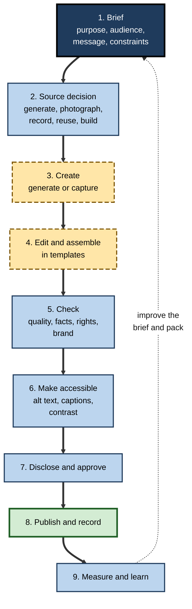
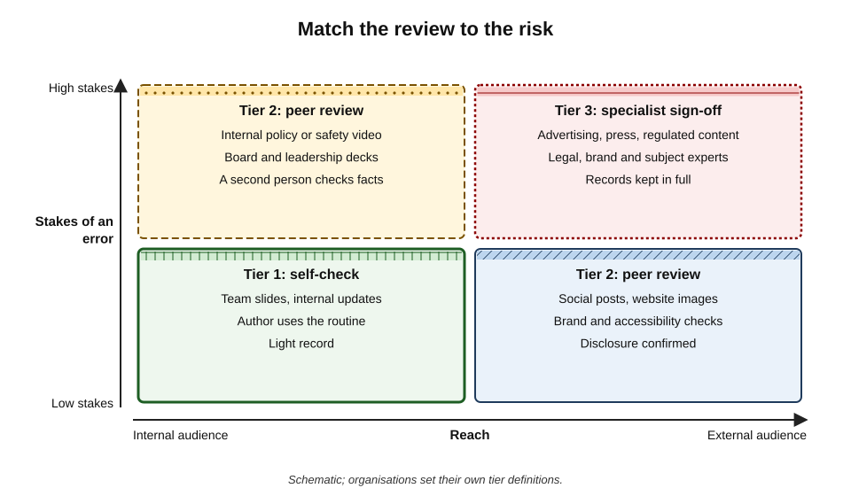
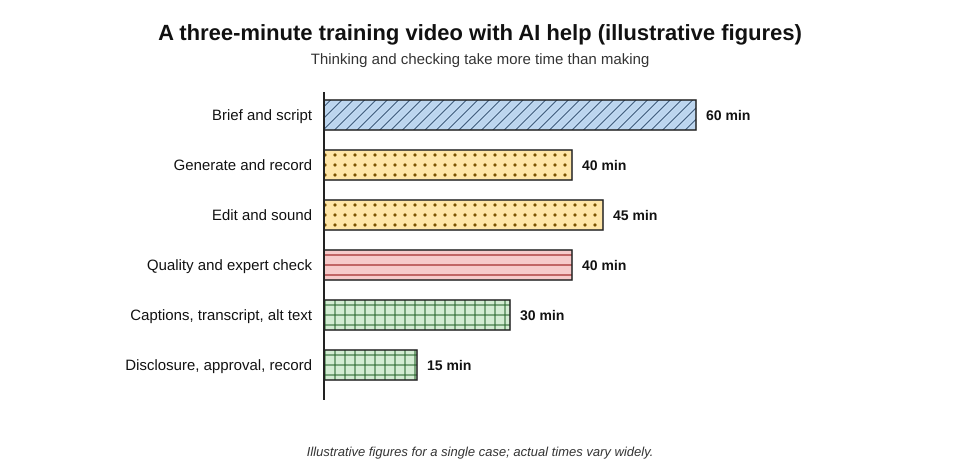
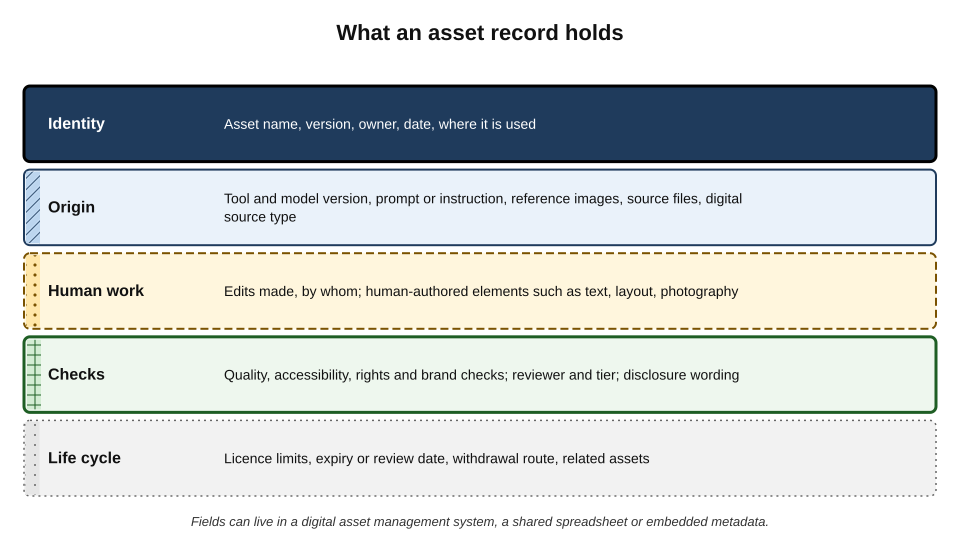
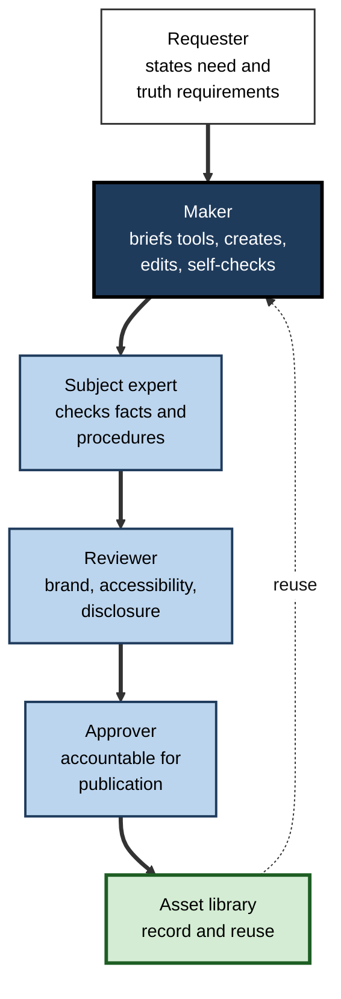
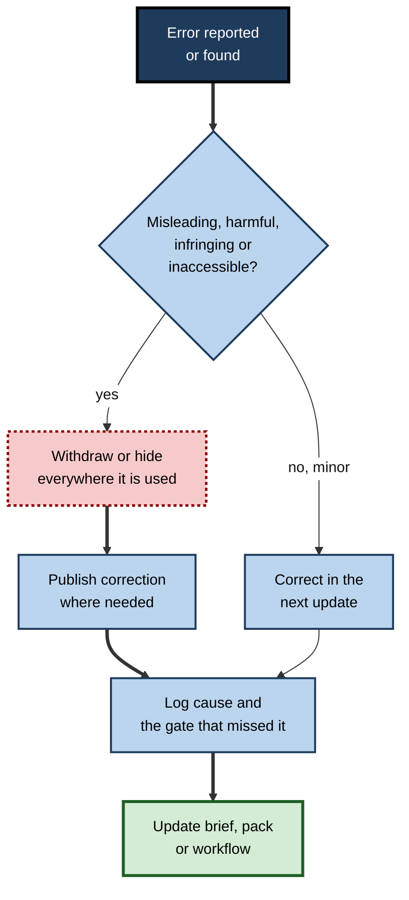

# I.12. Practical media workflows

Two communications officers get the same job: a short video, a social post and a slide for tomorrow's all-staff meeting. The first opens a generator and starts producing. The second writes a ten-minute brief, decides what to generate and what to photograph, and blocks out time to check.

The first is "finished" sooner — then spends the morning fixing a mispronounced name, an inaccessible post and an invented figure. The second finishes once. The difference is not skill with tools. It is a **workflow**.

> **Definition — Workflow:** a defined sequence of steps, decisions, roles and checks by which a piece of work moves from request to completion.

> **Definition — Media workflow (AI-assisted):** a repeatable process for producing images, slides, audio or video in which AI tools are used at chosen steps, with human decisions and checks placed where they matter.

**Why it matters**

- **AI changes where effort goes, not whether effort is needed.** Making becomes cheap; deciding and checking remain expensive.
- **Ad hoc use is unreliable.** The same person produces excellent work one day and an embarrassing error the next, depending on whether they happened to check.
- **Workflows scale judgement.** A good workflow lets a team apply the same standards to ten assets or ten thousand.
- **Workflows make responsibility visible** — who decided, who checked, who approved.

---

## The Shape of a Media Workflow

### A universal pipeline

**Figure 1.** A universal pipeline for AI-assisted media.

1. **Brief** — purpose, audience, message, format, deadline, constraints.
2. **Source decision** — for each element: generate, photograph, record, reuse an approved asset, or build from data.
3. **Create** — generate or capture.
4. **Edit and assemble** — in templates and editing tools.
5. **Check** — quality, facts, rights, brand.
6. **Make accessible** — alt text, captions, transcripts, contrast, reading order.
7. **Disclose and approve** — labels and sign-off at the right tier.
8. **Publish and record** — asset record kept with the published item.
9. **Measure and learn** — did it work; what went wrong; update templates and briefs.

> **Mnemonic — "Better Sources Create Excellent, Checked, Accessible, Disclosed, Published, Measured media":** Brief, Source, Create, Edit, Check, Accessible, Disclose, Publish, Measure.

> **Key point:** AI tools live mainly in steps 3 and 4. The steps that determine whether an asset is **right** — brief, source decision, checks, accessibility, disclosure — are human.

### The brief

A brief is the cheapest quality control there is. Ten minutes at the start prevents hours of rework.

- **Purpose** — inform, persuade, train, record, celebrate.
- **Audience** — who, how many, internal or external, what they already know, accessibility needs.
- **Message** — the one thing the audience should take away.
- **Format and channel** — slide, poster, social post, video length, aspect ratio, platform.
- **Constraints** — brand, legal, confidentiality, deadline, budget.
- **Truth requirements** — what must be real (people, products, data, places) and what may be illustrative.
- **Success measure** — how anyone will know it worked.

> **Watch out:** "make something nice for the newsletter" is not a brief. Without a stated message and truth requirements, the generator fills the gaps with defaults — typical, generic and sometimes false.

### The source decision

| Element | Generate | Photograph or record | Reuse approved asset | Build from data |
|---|---|---|---|---|
| Concept illustration | Yes | Possible | If available | — |
| Real people, places, products | No | Yes | Yes | — |
| Charts and figures | No | — | Template charts | Yes |
| Logos and brand marks | No | — | Yes | — |
| Background textures and scenes | Yes | Possible | Yes | — |
| Narration | Synthetic voice possible | Human voice preferred for leaders and sensitive topics | Stock voice | — |
| Procedures and equipment | No | Yes | If accurate | Diagrams from specifications |

- **Rule** — decide the source **element by element**, not for the whole asset at once. Most good assets are hybrids.

---

## Where AI Helps and Where It Hurts

**Study card — Dell'Acqua and colleagues (2023), the "jagged technological frontier"**

- **Design:** a field experiment with 758 consultants at Boston Consulting Group, run with researchers from Harvard Business School and other universities. Consultants performed realistic tasks with or without access to GPT-4.
- **Findings:**
  - for tasks **inside** the AI's capability frontier (creative product ideas, writing, analysis of a kind the model handled well), consultants with AI completed about **12% more tasks**, about **25% faster**, with work rated **over 40% higher** in quality;
  - for a task deliberately designed to lie **outside** the frontier (requiring careful integration of subtle evidence), consultants with AI were about **19 percentage points less likely** to reach the correct answer than those without;
  - successful users worked in two styles: dividing tasks between themselves and the AI ("centaurs"), or interleaving closely with it ("cyborgs").
- **Limits:** text-based consulting tasks with one model generation; media tasks were not tested directly.
- **Conclusion:** AI's capability is **jagged** — excellent on some tasks, harmful on apparently similar ones — so workflows must deliberately decide **which steps** AI performs.

> **Definition — Jagged frontier:** the uneven boundary between tasks an AI system performs well and tasks it performs poorly, which often does not match human intuitions about difficulty.

- **Media translation of the finding:**
  - **inside the frontier** — mood imagery, layout variations, rough cuts, transcripts, noise cleanup, first-draft alt text, outline alternatives;
  - **outside the frontier** — accurate technical depiction, data charts, exact text in images, judgement about what an audience needs, deciding what is true.

---

## Proportionate Review

**Figure 2.** Match the review to the risk.

- **Tier 1 — self-check** — internal, low-stakes assets: team slides, internal updates.
  - The author runs the standard checking routine.
- **Tier 2 — peer review** — external low-stakes (social posts, web images) or internal high-stakes (policy or safety videos, leadership decks).
  - A second person checks facts, brand, accessibility and disclosure.
- **Tier 3 — specialist sign-off** — external high-stakes: advertising, press materials, regulated content, anything about real people or events.
  - Legal, brand and subject experts sign off; full records kept.

> **Remember:** **review effort follows risk, not volume.** A hundred internal slides can share one self-check routine; one public advert needs three sets of expert eyes.

### Defining "done"

- **A definition of done** lists what must be true before an asset is published:
  - brief met (message, audience, format);
  - facts, numbers and names verified;
  - quality inspection passed;
  - rights cleared;
  - brand applied from templates;
  - accessibility complete (alt text, captions, contrast);
  - disclosure placed as policy requires;
  - approval at the right tier;
  - asset record saved.
- **Why it helps** — it prevents the "looks finished" trap, where polish is mistaken for completion.

**Study card — Haynes and colleagues (2009), the surgical safety checklist**

- **Design:** a World Health Organization study introduced a 19-item surgical safety checklist in eight hospitals in eight countries, ranging from high- to low-income settings, comparing outcomes for several thousand patients before and after.
- **Findings:** the rate of death after surgery fell from about 1.5% to 0.8%, and major complications from about 11% to 7%.
- **Explanation:** the checklist made routine checks explicit and created moments where team members confirmed critical facts aloud, catching errors that experienced professionals would otherwise skip under pressure.
- **Caveats:** a before-and-after design cannot fully separate the checklist's effect from other changes; later studies in some settings found smaller effects where checklists were imposed without real engagement.
- **Relevance:** media errors are far less grave, but the mechanism transfers — **explicit gates catch the errors that experts skip when busy**, provided people actually use them rather than ticking them off.

> **Watch out:** a definition of done only works if each item is genuinely checked. Teams that tick every box by habit gain the paperwork without the protection.

---

## Common Workflows

### A social post with an image

1. **Brief** — message, platform, audience, truth requirements.
2. **Source** — generated illustration or real photograph.
3. **Create** — generate a few options from the brand style block.
4. **Assemble** — place in the social template; add text as real text in the post and, if needed, on-image in the template.
5. **Check** — inspect at full size and at phone size; read every word.
6. **Accessibility** — alt text; key message also in the post text; captions if video.
7. **Disclose** — per policy.
8. **Approve** — tier 2; publish; save record.

### A leadership deck

1. **Brief** — decision sought, audience, message.
2. **Storyline** — ghost deck of action titles.
3. **Source** — data from the source table; real photographs where people and places appear; generated imagery only for concepts.
4. **Draft** — AI drafts slide bodies within the template.
5. **Check** — every number traced; charts rebuilt from data; hidden content cleaned.
6. **Accessibility** — titles, reading order, alt text, contrast.
7. **Rehearse and approve** — tier 2.

### A training video

1. **Brief** — learning objective, audience, length, accessibility needs.
2. **Script** — written and checked by the subject expert; visuals described in the narration.
3. **Source** — real screen recordings and photographs for procedures; generated scenes only for context; human or synthetic narration (with consent if cloned).
4. **Edit** — text-based rough cut; light sound processing; loudness to target.
5. **Check** — expert review of every procedure shown; meaning check of every cut.
6. **Accessibility** — corrected captions, transcript, no flashing.
7. **Disclose** — synthetic voice or presenter noted.
8. **Approve** — tier 2 or 3 for safety content; publish; record.

### A podcast episode

1. **Brief** — topic, guests, consent to recording and editing.
2. **Record** — good microphones, separate tracks.
3. **Edit** — transcript-based edit; moderate filler removal; voice isolation if needed.
4. **Check** — every cut heard; guest approval of sensitive edits.
5. **Accessibility** — transcript with speaker labels.
6. **Publish** — show notes checked against audio; loudness to platform target; record kept.

| Workflow | AI steps | Human gates | Most common failure |
|---|---|---|---|
| Social post | Image generation; caption drafts; alt-text draft | Brief, inspection, alt text, approval | Text in image; generic image; missing alt text |
| Leadership deck | Slide drafting; layouts; notes | Storyline, number checks, rehearsal | Invented or inconsistent figures |
| Training video | Rough cut; sound; captions; scene generation | Script, expert review, caption correction | Inaccurate procedure shown |
| Podcast | Transcription; editing; show notes | Cut review, guest approval, notes check | Clips or notes that misrepresent speakers |

---

## Worked Example (illustrative): A Three-Minute Training Video

**Situation:** an HR team must produce a three-minute video explaining a new holiday-booking process to 2,000 staff, within one working day.

**Figure 3.** Where the time goes in an AI-assisted training video.

| Stage | What happened | Time |
|---|---|---|
| Brief and script | Objective: "Staff can book holiday in the new system unaided." Script drafted with AI, rewritten and checked by the system owner; every screen action described in words | 60 min |
| Generate and record | Real screen recordings of the booking steps; two generated scene-setting shots; synthetic narration from the script | 40 min |
| Edit and sound | Text-based assembly; loudness normalised; on-screen highlights added | 45 min |
| Quality and expert check | System owner watched it: one step shown in the wrong order — re-recorded; narrator mispronounced the system's name — fixed with phonetic spelling | 40 min |
| Captions, transcript, alt text | Automatic captions corrected (system name, two dates); transcript published; thumbnail alt text | 30 min |
| Disclosure, approval, record | "Narrated with a synthetic voice; steps recorded in the live system." Approved by HR lead; asset record saved | 15 min |

*Illustrative figures.*

- **Total** — about 3 hours 50 minutes.
- **Where the effort went** — about a quarter on brief and script, about a third on checking, accessibility and approval combined; making the media itself took well under half.
- **Errors caught** — a wrong-order step and a mispronounced name, both of which would have confused staff.

> **Watch out:** the instinct under time pressure is to cut the check. In this example the check found the only error that would have made the video **wrong** rather than merely imperfect.

---

## Asset Management

### The asset record

**Figure 4.** What an asset record holds.

- **Identity** — name, version, owner, date, where used.
- **Origin** — tool and model version, prompt, references, source files.
- **Human work** — edits and human-authored elements.
- **Checks** — quality, accessibility, rights, brand; reviewer; disclosure wording.
- **Life cycle** — licence limits, review or expiry date, withdrawal route.

### Metadata standards

- **Embedded metadata** — image and video files can carry descriptive fields (creator, credit, copyright notice, description).
- **Digital source type** — the IPTC photo-metadata standard, widely used by news and stock agencies, includes a field describing how an image was made, with values distinguishing media created entirely by a trained AI model from composites that include AI-generated elements.
- **Content Credentials** — signed provenance records that tools can attach on export.
- **Digital asset management (DAM) systems** — searchable libraries holding assets with their metadata, rights and usage history.

> **Definition — Digital asset management (DAM):** a system for storing, organising, searching and governing an organisation's media files together with their metadata, rights information and approvals.

### Reuse before regeneration

- **Search the library first** — an approved image reused is cheaper, safer and more consistent than a new one generated.
- **Retire assets deliberately** — remove outdated images (old branding, departed staff, superseded products) so they are not reused.
- **Track usage** — knowing where an asset appears makes withdrawal possible when a problem is found.

> **In practice:** teams that record prompts and approvals alongside generated assets find that answering a complaint, a rights query or a regulator's question takes minutes rather than days.

---

## Roles and Responsibilities

**Figure 5.** Roles in an AI-assisted media workflow.

- **Requester** — states the need, the message and what must be real.
- **Maker** — writes the tool briefs, creates and edits, runs the self-check.
- **Subject expert** — checks facts, procedures and technical depictions.
- **Reviewer** — checks brand, accessibility and disclosure.
- **Approver** — accountable for publication; signs off at the right tier.
- **Small teams** — one person may hold several roles, but **maker and approver should differ** for anything external or high-stakes.

> **Definition — RACI:** a way of assigning roles for each task — Responsible (does the work), Accountable (signs off), Consulted (gives input), Informed (kept up to date).

---

## Improving the Workflow

### Measure

- **Output measures** — reach, engagement, completion rates for video, comprehension checks for training.
- **Process measures** — time per stage, rework rates, errors found at each gate, errors found **after** publication.
- **Quality log** — every published error recorded with its cause and the gate that missed it.

### Learn

- **Update the brief template** when errors trace back to unclear briefs.
- **Update the brand-in-AI pack** when style drift recurs.
- **Move steps** — if a tool repeatedly fails at a step, take that step back to human production.
- **Share** — short internal notes on what worked spread good practice faster than formal training.

> **Formula — Escaped-error rate:** errors found after publication ÷ total errors found. If reviewers catch 18 errors and 2 are found by the audience after publication, the escaped-error rate is 2 ÷ 20 = **10%**. A rising rate signals that checks are being squeezed.

### Case study (illustrative): a council communications team builds a workflow

- **Situation:** a city council's six-person communications team adopted AI tools for images, video and social media and doubled its output in three months.
- **Problem:** complaints rose — an inaccessible infographic, a generated image of a "new park" that did not resemble the real plans, and a video whose captions misnamed a councillor.
- **Diagnosis:**
  - no briefs; requests arrived as one-line emails;
  - no source decision — generation was the default for every image;
  - one person made and published most items;
  - no records.
- **Actions:**
  1. **one-page brief** required for every request, including "what must be real";
  2. **source rule** — real places, people and plans photographed or taken from official drawings; generation for concepts only;
  3. **tiers** — public consultation and planning material at tier 3 with planning officers as subject experts;
  4. **definition of done** pinned in the team's channel;
  5. **asset records** in a shared library with prompts and approvals;
  6. **monthly review** of the quality log.
- **Result:** output stayed above its earlier level; complaints fell below their pre-AI level; the escaped-error rate fell over two quarters.
- **Lesson:** the gains from AI media tools are kept only when a workflow puts **decisions and checks** where the tools cannot.

---

## The Professional's Personal Workflow

- **Keep a brief template** — a few lines answered before opening any tool.
- **Keep a checking routine** — the same order every time.
- **Keep prompt and style notes** — what worked, for which tool and version.
- **Time-box generation** — a few well-briefed attempts, then change method if results are poor.
- **Protect checking time** — schedule it, especially under deadline pressure.
- **Keep records** — even a simple folder with prompt, source and approval notes.
- **Review monthly** — which uses saved time; which created rework.

> **Key point:** professional mastery of AI media tools looks less like clever prompting and more like **reliable process** — knowing when to generate, when not to, and how to know the result is right.

---

## Workflows Under Pressure

### The fast lane

Urgent requests — a crisis statement, a same-day announcement, breaking news — tempt teams to skip the workflow entirely. A defined **fast lane** keeps the essential gates while dropping the rest.

- **Keep:**
  - a one-line brief with the message and what must be real;
  - a factual check of every name, number and claim;
  - one independent reviewer;
  - captions or alt text in their simplest correct form;
  - a record, completed afterwards if necessary.
- **Drop or defer:**
  - design exploration and multiple options;
  - generated imagery (use approved assets or plain text);
  - extended versions and repurposing.
- **Avoid entirely in a crisis** — generated images of real events, synthetic voices of leaders, unreviewed automated captions on statements.

> **Watch out:** crises are when audiences scrutinise media most closely and when generated content is most likely to be read as deceptive. A plain, accurate, accessible message beats a polished one.

### Production at scale

- **Templates first** — when the same kind of asset is needed many times (event promotion, product tiles, regional versions), invest in a locked template and a style block, then generate only the variable elements.
- **Batch generation with sampling** — generate in batches, inspect every high-visibility item and a sample of the rest; increase sampling if faults appear.
- **Variable data** — names, prices, dates and places inserted from a data source into templates, never typed into generator prompts.
- **Localisation pipelines** — corrected source captions and scripts feed translation; fluent reviewers check each language version.

### When something goes wrong: withdrawal and correction

**Figure 6.** Responding to an error found in published media.

1. **Assess** — is the error misleading, harmful, infringing or inaccessible, or merely imperfect?
2. **Withdraw quickly** where serious — the asset record's usage list shows everywhere the asset appears.
3. **Correct openly** — a visible correction where people may have relied on the error.
4. **Log** — cause and the gate that missed it.
5. **Fix the system** — brief template, brand pack, review tier or source rule.

> **Remember:** **fix the asset, then fix the workflow.** An error corrected only in one file will recur in the next.

---

## Open Questions

- **How will workflows change as tools become agents?**
  - Tools that plan, generate, edit and publish across several steps could compress workflows further; where human gates belong in such pipelines is unsettled.
- **What is the right balance of speed and review?**
  - Evidence on how much checking prevents how many errors in media work is mostly anecdotal; organisations set tiers by judgement.
- **Will provenance metadata become routine?**
  - Standards exist, but many tools and platforms do not yet write or preserve them consistently.
- **Does AI-assisted production deskill teams?**
  - If making becomes automated, the craft knowledge that informs good checking may erode; the long-term effect on expertise is unknown.
- **How should small organisations manage this?**
  - Formal tiers and DAM systems suit large teams; lightweight equivalents for one- or two-person teams are still being worked out.

---

## Summary

- A **media workflow** sequences steps, decisions, roles and checks; AI belongs in **create** and **edit**, while **brief, source decision, checks, accessibility and disclosure** are human.
- The universal pipeline: **Brief → Source → Create → Edit → Check → Accessible → Disclose → Publish → Measure**.
- A good **brief** states purpose, audience, message, format, constraints, **truth requirements** and success measures.
- Make the **source decision element by element**: generate concepts; photograph real people, places and products; build charts from data; reuse approved assets.
- AI capability is a **jagged frontier** (Dell'Acqua and colleagues, 2023): large gains inside it, real harm outside it — so choose AI's steps deliberately.
- Use **proportionate review tiers** by reach and stakes, and a **definition of done** to avoid the "looks finished" trap.
- Standard workflows exist for **social posts, decks, training videos and podcasts**; checking and accessibility often take as long as making.
- Keep an **asset record** (identity, origin, human work, checks, life cycle); use metadata standards and a DAM; **reuse before regenerating**.
- Separate **maker and approver** for external or high-stakes work; measure the **escaped-error rate** and improve the workflow continuously.

---

## Self-Check

1. Define a media workflow and explain why AI changes where effort goes.
2. List the nine stages of the universal pipeline and say which are human.
3. What should a brief contain, and why are "truth requirements" essential?
4. Make the source decision for: a concept image for a blog; a photo of the new office; a sales chart; the company logo; a procedure in a safety video.
5. Summarise the "jagged frontier" study and translate its lesson to media work.
6. Assign review tiers to: an internal team slide; a public advert; a safety training video; an Instagram post.
7. What is a definition of done, and what problem does it solve?
8. Outline the workflow for a training video and identify its most important human gate.
9. In the illustrative training-video example, which check found the most important error, and why does that matter under time pressure?
10. What fields belong in an asset record, and why is the IPTC digital source type useful?
11. Why should maker and approver be different people for external work?
12. Calculate the escaped-error rate if reviewers find 27 errors and audiences find 3 more after publication.
13. A small team has doubled its output with AI and complaints are rising. Diagnose likely causes and propose a workflow.

### Answer Key

1. A repeatable sequence of steps, decisions, roles and checks for producing media with AI at chosen points. AI makes creation cheap, so the remaining effort — deciding what to make and checking it — becomes the larger share.
2. Brief, source decision, create, edit, check, make accessible, disclose and approve, publish and record, measure. Create and edit use AI most; brief, source, check, accessibility, disclosure, approval and learning are human-led.
3. Purpose, audience, message, format and channel, constraints, truth requirements, success measure. Truth requirements state what must be real, preventing generated substitutes for real people, products, places or data.
4. Concept image — generate. Office photo — photograph. Sales chart — build from data. Logo — reuse approved file. Safety procedure — record or photograph real, correct practice.
5. With GPT-4, consultants did tasks inside the frontier faster and better, but were less likely to be correct on a task outside it. In media, use AI for mood, layout, rough cuts and drafts; keep accurate depiction, data, exact text and judgement human.
6. Team slide — tier 1. Public advert — tier 3. Safety video — tier 2 or 3 (internal but high-stakes; specialist review). Instagram post — tier 2.
7. A list of conditions that must hold before publication; it prevents mistaking a polished asset for a complete, checked one.
8. Brief, script checked by expert, source real recordings for procedures, edit, expert review, captions and transcript, disclosure, approval, record. The expert review of procedures is the most important gate.
9. The expert check found a step in the wrong order — the only error that made the video wrong. Under time pressure checks are cut first, yet they catch the errors that matter.
10. Identity, origin (tool, prompt, references), human work, checks and disclosure, life cycle. The digital source type records in standard metadata whether media was AI-generated or a composite, so others can recognise it.
11. Independent review catches errors the maker cannot see in their own work and separates accountability from production.
12. 3 ÷ (27 + 3) = 3 ÷ 30 = 10%.
13. Likely: no briefs, generation by default, no tiers, maker publishing alone, no records, checking squeezed. Propose: one-page briefs with truth requirements, source rules, tiers with subject experts, definition of done, separate approver, asset records and a quality log reviewed monthly.

---

## Glossary

| Term | Meaning |
|---|---|
| Asset record | Information kept with a published asset: identity, origin, human work, checks and life cycle. |
| Brief | A short statement of purpose, audience, message, format, constraints and truth requirements. |
| Definition of done | Conditions that must all hold before an asset is published. |
| Digital asset management (DAM) | A system for storing and governing media with metadata, rights and approvals. |
| Digital source type | A standard metadata field describing how an image or media item was made. |
| Escaped-error rate | Errors found after publication as a share of all errors found. |
| Jagged frontier | The uneven boundary between tasks AI does well and tasks it does badly. |
| Media workflow | A repeatable process for producing media with chosen AI steps and human checks. |
| RACI | Responsible, Accountable, Consulted, Informed — a role-assignment method. |
| Review tier | A level of review matched to an asset's reach and stakes. |
| Source decision | Choosing, element by element, whether to generate, capture, reuse or build. |
| Truth requirements | The parts of an asset that must depict real people, things, places or data. |
| Workflow | A defined sequence of steps, decisions, roles and checks. |
