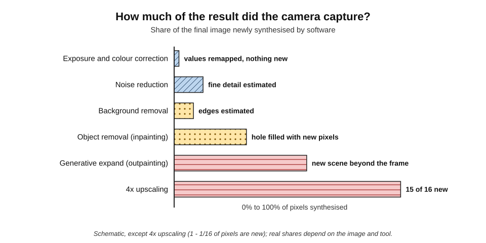
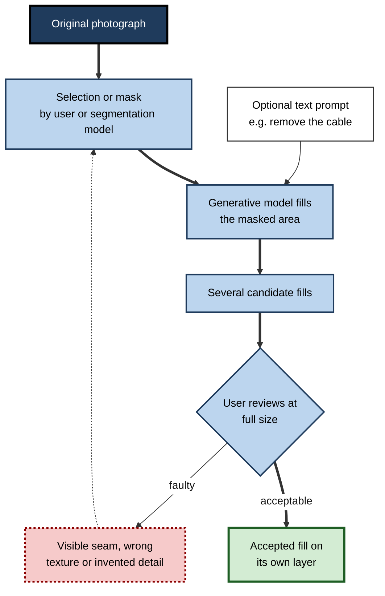
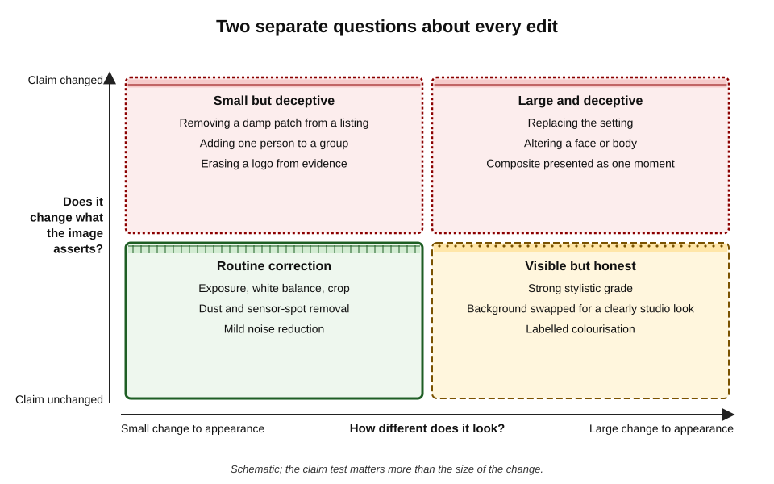
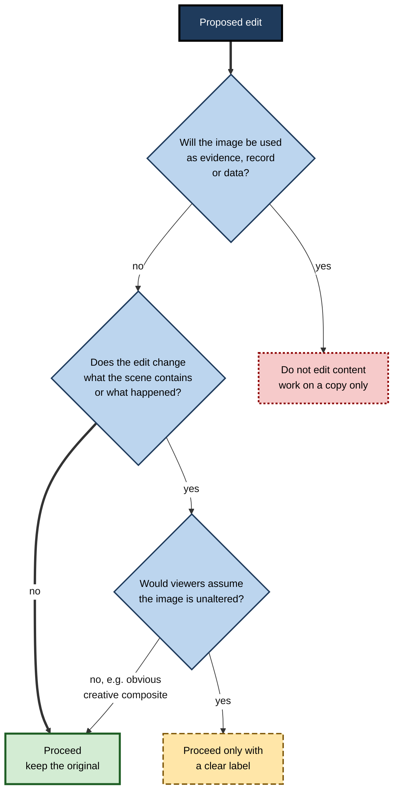
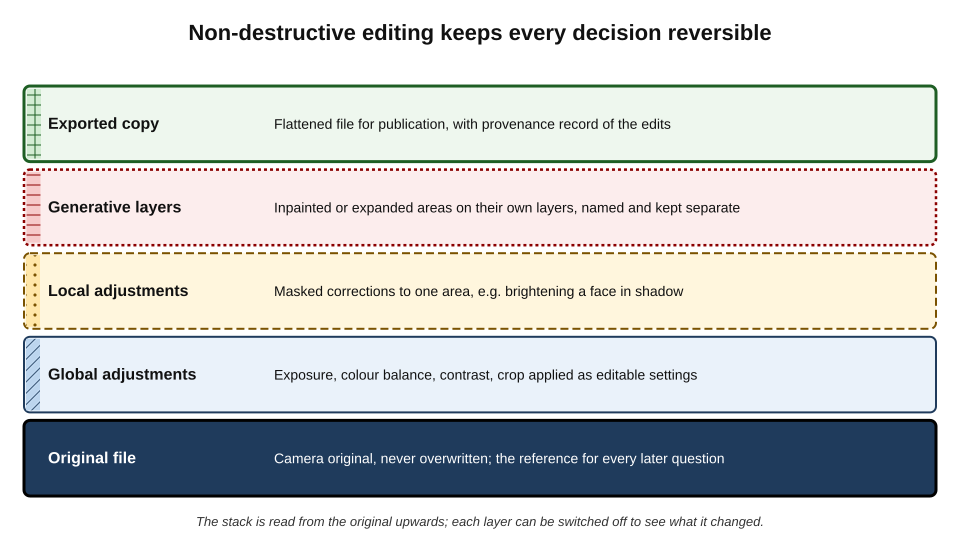
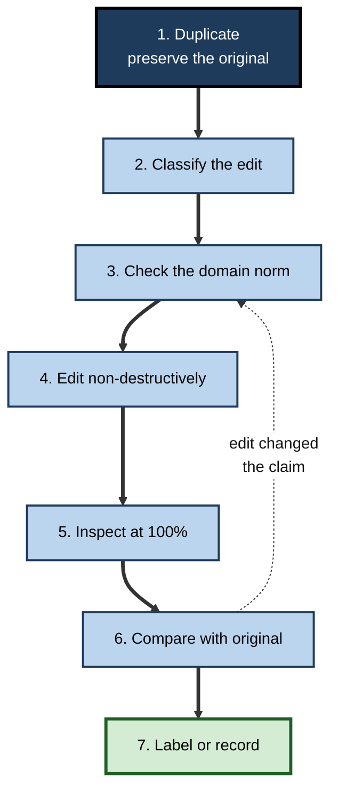

# I.2. Editing and enhancing images

An estate agent brightens a gloomy kitchen photograph — routine. The same tool, with one more click, removes a crack in the ceiling — misrepresentation. A third click enlarges a blurry security still until a face appears — and the face is partly invented. All three edits take seconds, use the same software and look equally convincing. What separates them is not the technology but what the edit does to the **truth of the image**.

> **Definition — AI image editing:** changing an existing image with tools that use machine-learning models — to correct, restore, recompose or alter its content — as distinct from generating an image from nothing.

> **Definition — Enhancement:** an edit intended to make an image clearer, cleaner or more attractive without changing what it shows.

**Why it matters**

- **Most workplace images are edited, not generated.** Product shots, staff photographs, event pictures, scanned documents, screenshots and archive images all pass through editing tools.
- **AI has blurred the line between correcting and inventing.** "Enhance" buttons can add detail that was never captured.
- **Edited photographs keep the authority of photographs.** Viewers still assume a camera recorded what they see.
- **The rules differ sharply by context.** An edit that is normal in fashion advertising may be misconduct in science, fraud in an insurance claim or contempt in court.

---

## What AI Editing Can Do

Edits fall into five families, ordered roughly by how much they change what the image says.

### Corrective edits

- **Exposure, contrast and white balance** — automatic "one-click" fixes that analyse the scene.
- **Noise reduction** — learned denoisers remove grain from low-light photos.
- **Sharpening and deblurring** — models estimate what an unblurred image would look like.
- **Lens and perspective correction** — straightening verticals, removing distortion.

### Restorative edits

- **Scratch, stain and dust removal** from scanned prints.
- **Face restoration** — reconstructing faces in damaged or low-resolution photographs.
- **Colourisation** — adding plausible colour to monochrome images.

> **Watch out:** colourisation and face restoration produce what is **plausible**, not what was there. The colour of a 1940s dress or the shape of a great-grandmother's eyes in a restored photograph is the model's guess.

### Compositional edits

- **Cropping and reframing** — including automatic subject-aware crops for different formats.
- **Background removal** — separating subject from background in one click.
- **Generative expand (outpainting)** — extending the canvas to change the aspect ratio.
- **Sky and background replacement.**

### Content-altering edits

- **Object removal** — erasing people, signs, cables or blemishes and filling the gap.
- **Generative fill** — adding objects or regions described in words.
- **Face and body retouching** — smoothing skin, reshaping features, changing expressions.
- **Composite "best moment" tools** — combining faces from several shots so everyone is smiling.
- **Relighting** — changing the apparent direction and colour of light.

### Synthetic resolution

- **Upscaling (super-resolution)** — enlarging an image by predicting the missing detail.
- **Frame and detail "enhancement"** in phones and video tools.

> **Definition — Super-resolution:** producing a higher-resolution image from a lower-resolution one; learned super-resolution **predicts** plausible detail rather than recovering detail that was captured.

| Family | Typical tools | What changes | Implicit claim at risk? |
|---|---|---|---|
| Corrective | Auto-exposure, denoise, sharpen | Rendering of captured information | Rarely |
| Restorative | Scratch removal, colourisation, face restoration | Damaged or missing information is estimated | Sometimes — colour and faces are guesses |
| Compositional | Crop, background removal, expand | What is included in the frame | Sometimes — context can be removed or invented |
| Content-altering | Object removal, generative fill, retouching, face compositing | What the scene contains | Often |
| Synthetic resolution | Upscaling, "enhance" | Fine detail, text, faces | Often — invisible to the viewer |

---

## How the Tools Work

### From interpolation to prediction

- **Classical interpolation** (bilinear, bicubic) — new pixels are weighted averages of neighbours.
  - Enlargements look soft, but nothing is invented beyond smooth blending.
- **Learned super-resolution** — a model trained on pairs of low- and high-resolution images learns what fine detail *usually* accompanies a blurry pattern.
  - A landmark was **SRGAN** (Christian Ledig and colleagues, 2017), which used an adversarial network to produce sharp, photo-like textures rather than blur.
  - Diffusion-based upscalers now produce still more convincing detail.
- **The trade-off** — the sharper and more "photographic" the result, the more of it is prediction.

> **Formula — Share of new pixels after upscaling:** enlarging by a factor *k* in each direction multiplies the pixel count by *k*², so the share of pixels not present in the original is 1 − 1/*k*². For 4× upscaling: 1 − 1/16 = **15/16 ≈ 94%** of the final pixels are synthesised.

**Figure 1.** How much of the final image the camera actually captured, for common edits.

### Segmentation and inpainting

- **Segmentation** — models identify which pixels belong to a person, object, sky or background.
  - Meta's Segment Anything model (2023) made one-click selection of almost any object widely available.
- **Inpainting** — a generative model fills a masked region so that it blends with its surroundings.
- **Generative fill** — inpainting guided by a text prompt.

**Figure 2.** How a generative-fill edit is produced.

### Computational photography: editing before the photograph exists

- **Modern phones edit every picture** before the user sees it.
  - Several frames are merged for dynamic range and low light;
  - faces are detected and exposed separately;
  - skin is smoothed, skies saturated and detail sharpened by learned models.
- **Consequences:**
  - there is often **no unedited original**, only the phone's interpretation;
  - "straight out of camera" no longer means "unprocessed".
- **Positive uses** — manufacturers have worked to render darker skin tones accurately, an area where earlier camera tuning performed poorly.

**Study card — The phone that "photographed" the moon (2023)**

- **Design:** an online experimenter downloaded a high-resolution moon image, shrank and blurred it until craters vanished, displayed it on a monitor in a dark room and photographed the screen with a flagship phone's zoom.
- **Result:** the phone's photograph showed **crisp crater detail** that was not present in the blurred source.
- **Explanation:** the manufacturer stated that its scene optimisation recognises the moon and applies a learned detail-enhancement model.
- **Conclusion:** the "photograph" contained detail **supplied by a model trained on other moon images** — a vivid illustration that enhancement can mean importing information from elsewhere.

**Study card — PULSE and the upsampled face (2020)**

- **Design:** researchers at Duke University presented PULSE, a method that searches a face-generating model for a high-resolution face which, when shrunk, matches a given low-resolution input.
- **What happened:** users fed it a pixelated photograph of Barack Obama; the output was a high-resolution face of a **white man**. Other tests showed similar shifts for non-white faces.
- **Explanation:** the generator's training data and the method's search favoured the faces it had seen most; many different faces are consistent with the same few pixels.
- **Conclusion:** upscaling a face does not reveal *the* face; it produces *a* face consistent with the pixels, shaped by the model's biases. The authors themselves stressed that the method was not for identifying people.

> **Key point:** enhancement can only redistribute or **predict** information; it cannot recover what the sensor never recorded. When the prediction concerns a face, a number plate or a word, the result can look like evidence while being invention.

---

## Editing That Keeps an Image Honest

### Two questions for every edit

**Figure 3.** Two separate questions about every edit.

- **How much does it change appearance?**
- **Does it change what the image asserts happened?**
- These are **independent**:
  - a dramatic colour grade changes appearance a lot and the claim not at all;
  - removing one small damp patch changes appearance slightly and the claim decisively.

> **Remember:** improve the **presentation** freely; change the **content** only where the context allows it — and say so when viewers would assume otherwise.

### Norms by domain

| Domain | Generally acceptable | Generally prohibited | Basis |
|---|---|---|---|
| News and documentary | Exposure, colour, crop that does not mislead, dust removal | Adding, removing or moving content; composites; generative fill | Codes of major news agencies and photojournalism associations |
| Science and medicine | Adjustments applied equally to the whole image and to controls | Selective enhancement, removing bands or cells, splicing without marking | Journal image-integrity guidelines |
| Legal and evidence | Copies made for display, with the original preserved | Any change to content; unvalidated enhancement | Rules of evidence; chain of custody |
| Property and product listings | Brightness, straightening, removing temporary clutter | Hiding defects; adding features; altering size or colour of goods | Consumer-protection and advertising rules |
| Advertising and fashion | Styling, retouching within limits | Misleading the effect of a product; some body alterations without labels | Advertising codes; labelling laws in some countries |
| Internal and creative work | Almost anything, if not later used as a record | Reuse as evidence or documentation | Organisational policy |

- **Science** — in 2004 Mike Rossner and Kenneth Yamada, editors at the *Journal of Cell Biology*, set out rules now widely copied: adjustments must apply to the whole image, must not obscure or eliminate information, and must be disclosed. Journals screen submitted images for manipulation.
- **Advertising** — in 2021 the UK's Advertising Standards Authority ruled that social-media filters must not be used in ads for beauty products where they exaggerate the product's effect.
- **Labelling laws** — France has required commercial photographs whose models' bodies were digitally altered to carry a "retouched photograph" label since 2017; Norway extended a similar requirement to paid social-media posts from 2022.

> **Watch out:** "everybody retouches" is true in fashion and false in science, journalism and evidence. The norms are **domain-specific**, and a professional is expected to know those of their field.

**Figure 4.** Deciding whether an edit is acceptable.

---

## Case Study: The Princess of Wales's Mother's Day Photograph

- **Situation:** on 10 March 2024, Kensington Palace released a family photograph of Catherine, Princess of Wales, with her children — the first official image of her since abdominal surgery, amid intense public speculation about her health.
- **What happened:**
  1. major picture agencies, including the Associated Press, Reuters and AFP, distributed the image;
  2. within hours they issued **"kill notices"** withdrawing it, saying it appeared to have been manipulated;
  3. observers pointed to inconsistencies — a misaligned sleeve, irregular edges, details that did not line up.
- **Response:** the next day the Princess apologised, saying that, like many amateur photographers, she occasionally experimented with editing.
- **Analysis:**
  - the edits appear to have been ordinary compositing and retouching, not generative AI;
  - but the image was **documentary** — released to show the public that she was well — so any undisclosed alteration damaged its evidential value;
  - agencies' codes forbid distributing manipulated news images, regardless of who supplied them;
  - the episode intensified rumours rather than calming them.
- **Lesson:** the more an image is relied on **as proof**, the more any undisclosed edit costs — and in an age of AI editing, audiences and agencies now look for manipulation by default.

---

## Where Enhancement Goes Wrong

### Common faults

- **Over-smoothing** — skin, fabric and foliage become plastic; texture that conveys age or material vanishes.
- **Halos and seams** — bright outlines around cut-out subjects; repeated textures in filled areas.
- **Hallucinated detail** — upscalers invent text, numbers, patterns and facial features.
  - *e.g.* a number plate upscaled from a few pixels can show confident but wrong characters.
- **Identity drift** — face restoration subtly changes a person into someone slightly different.
- **Beautification by default** — phone and video-call tools slim faces, enlarge eyes or lighten skin unless turned off.
- **Lost context** — background removal or tight cropping strips information that changed the meaning (who else was present, what sign was visible).

### Enhancement and the courts

- **Interpolation questioned** — in a high-profile US criminal trial in 2021, the defence objected to prosecutors zooming into video on a tablet, arguing that the device's processing might add information; the judge required the prosecution to show the zoom did not alter the footage.
- **AI enhancement excluded** — in 2024 a Washington State trial court refused to admit smartphone video that had been "enhanced" with AI software, finding that the method's effect on what the video showed had not been established as reliable.
- **Principle:** courts treat enhancement as a **process that must be explained and validated**, not as a neutral sharpening of truth.

> **Watch out:** television's "zoom and enhance" is fiction. When an enhanced image reveals a face, a word or a number that the original did not clearly show, treat the revealed detail as a **hypothesis**, never as a finding.

### Bias in enhancement

- **Skin tone** — auto-exposure and colour models tuned mainly on lighter skin have historically rendered darker skin poorly; some manufacturers now train and test specifically on diverse skin tones.
- **Face models** — restoration and upscaling pull faces towards the most common features in their training data, as the PULSE episode showed.
- **Beauty norms** — default retouching encodes particular ideals of youth, slimness and skin colour.

---

## Restoration and Archives

Restoring old images is one of the most valued everyday uses of AI editing — and one of the easiest places to rewrite history without noticing.

- **Valuable uses:**
  - repairing torn, stained or faded family and organisational photographs;
  - making archive images legible for exhibitions and anniversaries;
  - preparing scans for print and display.
- **Risks:**
  - **colourisation** presents guessed colours as historical fact;
  - **face restoration** changes the faces of real, often deceased, people;
  - **upscaling** adds detail to documents, signage and insignia that may be wrong.
- **Good practice:**
  1. **Preserve the master scan** at full resolution, untouched.
  2. **Restore on copies**, keeping each stage.
  3. **Label** restored and colourised versions as such, with the method.
  4. **Consult** archivists, families or communities when the images concern them.

> **Example (illustrative):** a university marks its centenary with colourised photographs of its first students. A caption reads "Colourised using AI; colours are approximate". A descendant later supplies a hand-tinted original showing the academic gowns were a different colour — the caption has already protected the exhibition's credibility.

---

## Worked Example (illustrative): Product Photographs for an Online Shop

**Situation:** a small homeware company photographs forty products against a kitchen backdrop and wants consistent listing images.

| Proposed edit | Acceptable? | Reason |
|---|---|---|
| Correct white balance so the whites are white | Yes | Improves faithful colour |
| Remove a crumb and a fingerprint | Yes | Temporary, not part of the product |
| Replace backgrounds with plain white | Yes | Common listing convention; viewers do not assume the white void is real |
| Remove a visible scratch on a display sample | Only if sold items are unscratched | It must not hide defects buyers will receive |
| Intensify the glaze colour to look "richer" | No | Misrepresents the goods; likely returns and complaints |
| Generatively add steam and food to the bowls | Yes, as lifestyle images, if the product is unchanged | Styling, not a claim about the product itself |
| Upscale a low-resolution image of the label to make text legible | No | Upscaled text may be invented; reshoot instead |

1. **Classify each edit** by the two questions — appearance and claim.
2. **Check the domain norm** — consumer law expects listings to show goods as supplied.
3. **Apply edits non-destructively** so any can be reversed if a complaint arises.
4. **Batch-apply corrections** across the set for consistency.

- **Conclusion:** most edits were routine; two were refused because they would have changed what customers were promised.

> **Watch out:** the most dangerous edits are the **small, invisible** ones — a removed blemish on the actual product, a slightly richer colour — because no viewer can detect them and every buyer relies on them.

---

## Professional Editing Practice

### Non-destructive editing

> **Definition — Non-destructive editing:** editing that keeps the original file unchanged and records every adjustment as a separate, reversible layer or setting.

**Figure 5.** Non-destructive editing keeps every decision reversible.

- **Keep the original** — never overwrite the camera file or master scan.
- **Use adjustment layers and masks** rather than painting over pixels.
- **Put generative changes on their own named layers** so they can be identified and removed.
- **Export a flattened copy** for publication; keep the layered working file.

### Records and provenance

- **Edit log** — for any image used externally or as a record: what was changed, why, by whom, with which tool.
- **Content Credentials** — some editors can attach a signed record of edits to exported files, letting later viewers see that generative tools were used.
- **Retention** — keep originals as long as the edited image is in use, plus any period required for legal or regulatory reasons.

### Consent and people

- **Retouching people** — colleagues photographed for a website should know how their image will be edited; heavy retouching of real staff can be both misleading and hurtful.
- **Removing people** — erasing someone from a team photograph (a departed colleague, an ex-partner) changes the record and can be read as a statement.
- **Expression changes and face compositing** — combining faces from different moments produces a moment that never happened; acceptable in a family snapshot, not in a news or evidential image.

### The editing routine

1. **Duplicate** — work on a copy; preserve the original.
2. **Classify** — corrective, restorative, compositional, content-altering or synthetic resolution.
3. **Check the norm** for the domain and the intended use.
4. **Edit non-destructively**, generative changes on separate layers.
5. **Inspect at 100%** — seams, halos, invented text, altered faces.
6. **Compare with the original** side by side.
7. **Label or record** as the context requires.

**Figure 6.** The editing routine.

> **Mnemonic — "DC CEICL" ("Don't Change Content Except In Clear Labels"):** Duplicate, Classify, Check, Edit, Inspect, Compare, Label.

### Case study (illustrative): a facilities team's inspection photographs

- **Situation:** facilities staff at a logistics firm photographed warehouse racking for quarterly safety inspections using phones with automatic AI enhancement.
- **Problem:** after a racking collapse, investigators found that the inspection images had been "auto-enhanced" and some had been cleaned up by a staff member to remove "distracting" debris — including debris that indicated earlier impact damage.
- **Diagnosis:**
  - inspection photographs were treated as illustrations rather than **records**;
  - phone settings applied beautification and noise reduction that softened fine cracks;
  - no originals were retained.
- **Actions:**
  1. inspection photos taken with enhancement disabled where the device allows, in the camera's most faithful mode;
  2. originals uploaded automatically to a records system with timestamps;
  3. a written rule that inspection images are **never edited**; annotated copies are made separately;
  4. training on the difference between records and presentation images.
- **Result:** the next audit found complete, unedited inspection records; insurers accepted the revised process.
- **Lesson:** for records, the most professional edit is **no edit** — and the camera's own automatic enhancements must be understood and controlled.

---

## Files, Formats and Quality

AI edits are only as good as the files they work on. A few technical facts decide whether an edit improves an image or quietly degrades it.

### Raw, compressed and generational loss

- **Raw files** — the sensor data from a camera, before the camera's own processing.
  - Hold far more tonal and colour information; exposure and white balance can be corrected with little loss.
- **JPEG and similar compressed formats** — processed and compressed images that discard information the eye is less likely to miss.
  - Each re-save after editing can discard more ("generational loss"), producing blockiness and banding.
- **Lossless formats** (PNG, TIFF) — preserve every pixel; larger files.
- **Practical rule** — edit from the highest-quality original available; export to compressed formats once, at the end.

> **Definition — Generational loss:** the cumulative degradation of a file each time it is decoded, edited and re-compressed in a lossy format.

### Colour spaces and screens

- **Colour space** — the range of colours a file can represent and how its numbers map to real colours.
  - **sRGB** is the standard for the web and most screens; wider spaces (such as Adobe RGB or Display P3) hold more saturated colours.
- **Mismatches** — an image edited in a wide colour space and published without conversion can look dull or oddly saturated.
- **Uncalibrated screens** — a laptop screen may be too blue or too bright; colour-critical work (product colours, brand colours) needs a calibrated display or a reference print.

> **Watch out:** AI "auto-colour" makes images look pleasing on the editor's screen, not necessarily accurate. For products sold online, check colours against the physical item under neutral light.

### Resolution and output size

- **Match resolution to use** — a slide or web image rarely needs more than a few thousand pixels across; large-format print needs far more.
- **Upscale only when necessary** — and never for detail that will be relied on (text, faces, numbers).
- **Downscaling** is safe; detail is averaged, not invented.

| Intended output | Typical pixel width | Format | AI enhancement worth using |
|---|---|---|---|
| Slide or document | 1,500–2,500 | PNG or high-quality JPEG | Exposure, colour, background removal |
| Website hero image | 2,000–3,000 | Web-optimised JPEG or WebP | Noise reduction, careful sharpening |
| Social post | 1,080–1,440 | JPEG | Auto-reframe, colour |
| Large print or poster | 6,000+ | TIFF | Restoration, cautious upscaling of textures only |
| Record or evidence | Original | Original format | None on the record copy |

*Typical values; platforms and printers publish their own specifications.*

### Editing at scale

- **Batch editing** — the same correction applied to hundreds of images (product catalogues, event galleries, staff portraits).
  - AI makes it possible to apply *content* edits in batches too — removing backgrounds or blemishes from every image at once.
- **Quality assurance** — batch edits fail unevenly: one image in fifty may lose a product edge, invent a texture or mangle a face.
  - Sample-check a proportion of every batch at full size, and every image that will be used prominently.
- **Consistency** — a saved preset or "look" applied across a set keeps colour and tone uniform.

> **In practice:** e-commerce teams commonly combine automated background removal with a human check of every image's **edges** — hair, transparent packaging, fine jewellery and fabric fringes are where segmentation most often fails.

---

## Open Questions

- **Can "unedited" still be defined?**
  - With phones processing every frame, the distinction between capture and editing is dissolving; standards bodies and courts are still working out what counts as an original.
- **Will provenance records survive real-world sharing?**
  - Signed edit histories are valuable, but most platforms strip metadata and adoption across editing tools is uneven.
- **How should enhanced images be validated for evidence?**
  - Forensic standards for AI enhancement are immature; courts have reached different conclusions about admissibility.
- **Where should labelling of retouched bodies and faces stop?**
  - Some countries require labels for altered bodies in advertising; whether such rules should extend to AI filters in everyday social media is debated.
- **Can bias in enhancement be measured and removed?**
  - Progress on skin-tone rendering is real, but there is no agreed benchmark for fairness in restoration and upscaling.

---

## Summary

- **AI image editing** changes existing images; **enhancement** aims to improve clarity without changing what is shown — but AI tools increasingly **predict** rather than recover detail.
- Five families of edit: **corrective, restorative, compositional, content-altering, synthetic resolution** — roughly in order of how much they risk the image's claim.
- Learned super-resolution invents detail: **4× upscaling synthesises about 94% of the final pixels** (1 − 1/k²). The PULSE episode and the moon-photo test show that enhanced faces and details are predictions shaped by training data.
- Phones apply **computational photography** to every image; "unprocessed" originals are increasingly rare.
- Ask two separate questions: how much does the edit change **appearance**, and does it change the **claim**? Small edits can be the most deceptive.
- Norms differ by **domain**: news, science and evidence forbid content changes; listings must show goods as supplied; advertising codes and some labelling laws restrict retouching.
- The **Princess of Wales photograph** (2024) shows how undisclosed edits to a documentary image destroy its value as proof.
- Treat details revealed by enhancement as **hypotheses**; courts require enhancement to be explained and validated.
- Restoration and colourisation are valuable but must be **labelled** and done on copies.
- Professional practice: **non-destructive editing**, generative changes on separate layers, edit logs and provenance, consent for people, and the routine Duplicate–Classify–Check–Edit–Inspect–Compare–Label.

---

## Self-Check

1. Distinguish AI image editing from image generation, and enhancement from content alteration.
2. Name the five families of AI edit with an example of each.
3. Explain why learned super-resolution differs in kind from bicubic interpolation.
4. Calculate the share of synthesised pixels after 2× and after 8× upscaling.
5. What did the PULSE episode reveal about upscaling faces?
6. Why is "straight out of camera" no longer the same as "unprocessed"?
7. Explain the two questions for every edit, and give an example where they give different answers.
8. Compare editing norms in news photography and in scientific publishing.
9. What happened with the Princess of Wales's photograph in March 2024, and what does it teach about documentary images?
10. A colleague upscales a blurry screenshot to read a figure in a competitor's chart. What would you advise?
11. Describe a non-destructive editing workflow and explain why it matters if a complaint arises.
12. A charity wants to colourise and restore founding-era photographs for its fiftieth anniversary. Set out good practice.
13. Why are inspection and insurance photographs a special case, and what controls would you put in place?

### Answer Key

1. Editing changes an existing image; generation creates one from a prompt. Enhancement aims to make an image clearer or more attractive without changing what it shows; content alteration changes what the scene contains or what it implies happened.
2. Corrective — auto-exposure. Restorative — scratch removal or colourisation. Compositional — background removal or generative expand. Content-altering — object removal or face compositing. Synthetic resolution — 4× upscaling.
3. Bicubic interpolation blends neighbouring pixels, so enlargements are soft but add nothing beyond averaging. Learned super-resolution predicts plausible fine detail from patterns in training data, producing sharp results whose detail may never have existed.
4. 2×: 1 − 1/4 = 75%. 8×: 1 − 1/64 ≈ 98.4%.
5. Many faces fit the same few pixels; the method produced a face shaped by its training data, turning a pixelated image of Barack Obama into a white man. Upscaled faces are not identifications and can carry bias.
6. Phones merge frames, adjust faces and skies, smooth skin and sharpen detail automatically before the image is saved, so even the "original" is a processed interpretation.
7. How much does it change appearance; does it change what the image claims. A heavy colour grade changes appearance greatly but not the claim; removing a small crack from a property photo barely changes appearance but changes the claim decisively.
8. News: only exposure, colour, non-misleading crops and dust removal; no adding, removing or moving content. Science: adjustments must apply to the whole image and controls, nothing obscured or eliminated, and adjustments disclosed. Both protect the image's function as a record.
9. A family photograph released to reassure the public was withdrawn by major agencies through kill notices for apparent manipulation; the Princess apologised for editing. A documentary image relied on as proof loses its value with any undisclosed edit, AI or not.
10. Do not rely on it: upscaled text and numbers can be invented. Seek the original source or a higher-resolution copy; if none exists, report the figure as unreadable.
11. Keep the original untouched; use adjustment layers and masks; put generative changes on separate named layers; export a flattened copy and keep the working file with an edit log. If challenged, every change can be shown, explained and reversed.
12. Preserve master scans; restore on copies keeping each stage; label colourised and restored versions with the method and note that colours are approximate; consult archivists and families; avoid upscaling text or insignia without checking sources.
13. They are records relied on by investigators, insurers and courts, so any alteration — including automatic phone enhancement — can conceal facts. Controls: enhancement disabled where possible; automatic upload of timestamped originals; a rule of no editing; annotated copies made separately; staff training.

---

## Glossary

| Term | Meaning |
|---|---|
| Colourisation | Adding plausible colour to a monochrome image; the colours are estimates. |
| Computational photography | In-camera processing that merges frames and applies learned adjustments before the image is saved. |
| Content Credentials | A standard for attaching a signed record of an image's origin and edits to the file. |
| Edit log | A record of what was changed in an image, why, by whom and with which tool. |
| Enhancement | An edit intended to improve clarity or appearance without changing what an image shows. |
| Generative expand (outpainting) | Extending an image beyond its borders with generated content. |
| Generative fill | Filling a selected area with content generated from a text prompt. |
| Inpainting | Regenerating a masked region so that it blends with the rest of the image. |
| Interpolation | Calculating new pixel values from neighbouring pixels when resizing. |
| Kill notice | A picture agency's instruction to clients to stop using an image it has distributed. |
| Non-destructive editing | Editing that preserves the original and records changes as reversible layers or settings. |
| Segmentation | Identifying which pixels belong to which object or region. |
| Super-resolution | Producing a higher-resolution image from a lower-resolution one; learned methods predict detail. |
