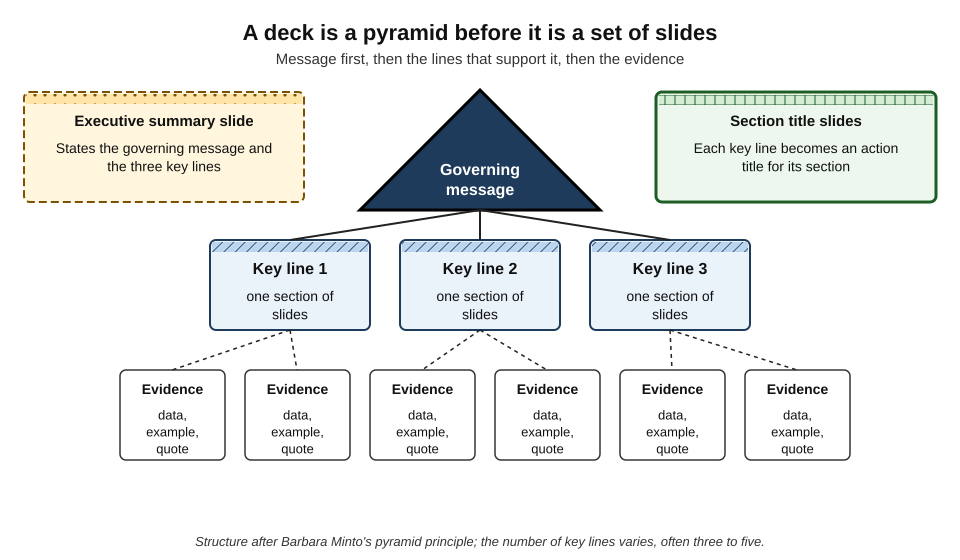
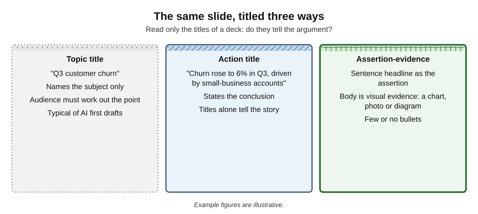
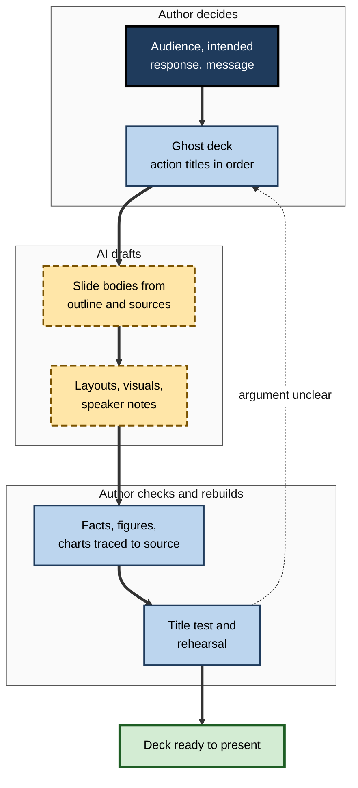
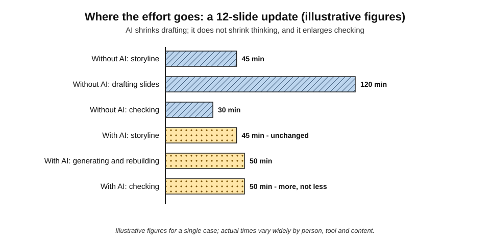
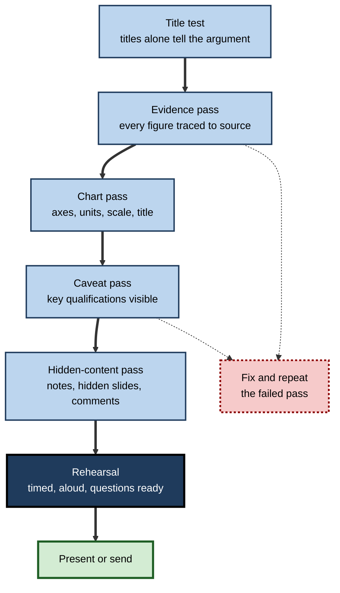

# I.3. Building slide decks with AI

A project manager types "create a 12-slide deck on our Q3 results from this report" and, a minute later, has twelve tidy slides with headings, bullets, icons and a chart. It looks finished. Then a director asks, "So what are you recommending?" — and nothing in the deck answers. The tool produced **slides**; it did not produce a **presentation**. The difference between the two is the whole craft of building decks with AI.

> **Definition — Slide deck:** a sequence of slides used to present an argument or information, either spoken to an audience or read on its own.

> **Definition — AI deck generation:** using an AI tool to draft some or all of a deck — outline, slide text, layout, images, charts or speaker notes — from a prompt, a document or data.

**Why it matters**

- **Decks are the working currency of many organisations** — for decisions, updates, pitches, training and reporting.
- **AI removes the slowest part** — turning notes into formatted slides — and so tempts people to skip the most valuable part: deciding what the deck must say.
- **A polished deck lends unearned authority.** Clean layout and confident headings make weak or wrong content look credible.
- **Errors scale.** A deck is copied, forwarded and reused long after the meeting; one invented figure travels with it.

---

## What a Deck Is For

### Two kinds of deck

- **Presentation deck** — supports a speaker.
  - Few words, strong visuals; the speaker supplies explanation.
  - Fails if read alone.
- **Reading deck** (sometimes called a "document deck" or "slideument") — read without a presenter.
  - Fuller sentences; each slide must stand on its own.
  - Common in consulting, banking and internal reporting.
- **The mistake** — building one and using it as the other. AI tools default to a middle ground: too wordy to present, too thin to read.

> **Key point:** before generating anything, decide **which kind of deck** this is. The instruction changes everything: number of words per slide, role of speaker notes and level of evidence.

### Three questions a deck must answer

1. **Who is the audience,** and what do they already know?
2. **What should they think, feel or do** afterwards?
3. **What is the one message** that, if remembered alone, would be enough?

> **Mnemonic — "AIM":** **A**udience, **I**ntended response, **M**essage — settled before the first slide.

---

## Storyline Before Slides

### The pyramid principle

- **Barbara Minto**, a consultant at McKinsey from the 1960s, set out a method later published as *The Pyramid Principle*:
  - start with the **governing message** — the answer;
  - support it with a small number of **key lines** — reasons, findings or recommendations;
  - support each key line with **evidence**.
- **Ordering rules:**
  - ideas at any level summarise the ideas grouped beneath them;
  - ideas in a group are of the same kind (all reasons, all steps);
  - groups are logically ordered (by time, structure or importance).
- **Applied to decks:** the governing message becomes the executive summary; each key line becomes a section; evidence becomes the slides within it.

**Figure 1.** A deck is a pyramid before it is a set of slides.

> **Definition — Governing message:** the single main point of a communication, from which all supporting points follow.

> **Definition — Ghost deck:** a skeleton deck of slide titles (and sketched contents) written before any analysis or formatting, used to agree the storyline.

### Action titles

- **Topic titles** name the subject: "Q3 customer churn".
- **Action titles** state the conclusion: "Churn rose to 6% in Q3, driven by small-business accounts".
- **The title test:** reading only the titles, in order, should tell the whole argument.
- **AI first drafts** usually produce topic titles, because the source document and prompt rarely state conclusions explicitly.

**Figure 2.** The same slide, titled three ways.

### Assertion–evidence slides

- **Michael Alley** and colleagues in engineering education proposed the **assertion–evidence** structure:
  - a sentence headline making an assertion;
  - visual evidence — a chart, photograph, diagram — supporting it;
  - little or no bulleted text.

**Study card — Garner and Alley (2013), slide design and comprehension**

- **Design:** students watched presentations on technical topics delivered with either conventional topic-title-and-bullet slides or assertion–evidence slides, then were tested on understanding.
- **Results:** those who saw assertion–evidence slides showed **better comprehension** and fewer misconceptions.
- **Limits:** studies were mostly in engineering and science education, with student audiences; effects in business settings are less tested.
- **Conclusion:** stating the point in the headline and showing evidence rather than listing text helps audiences grasp the argument.

> **Remember:** **message in the title, evidence in the body, explanation in the voice** (or, for reading decks, in a short text box).

---

## How AI Tools Build Decks

### The main routes

- **Prompt to deck** — "a 10-slide introduction to our new expenses policy".
  - Fast, generic; the model fills gaps with plausible content.
- **Document to deck** — a report, proposal or meeting notes converted into slides.
  - Better grounded, but the tool decides what is important and often flattens the argument into a summary.
- **Outline to deck** — the user supplies the storyline (titles and key points); the tool drafts slides and layouts.
  - The most reliable route for serious work.
- **Slide-level assistance** — rewrite this slide, summarise into three points, suggest a visual, draft speaker notes, translate.
- **Data to chart** — create a chart from a table or spreadsheet.

| Route | Speed | Grounding in real content | Control over argument | Best use |
|---|---|---|---|---|
| Prompt to deck | Fastest | Low — content may be invented | Low | Brainstorming structure; generic training openers |
| Document to deck | Fast | Medium — bound to the source, but selection is the tool's | Low to medium | First draft of a summary deck from a single report |
| Outline to deck | Moderate | High — user supplies the points | High | Decision, client and board decks |
| Slide-level assistance | Fast per slide | High, if the user supplies content | High | Polishing and tightening |
| Data to chart | Fast | High, if data are correct and complete | Medium | Standard charts from clean tables |

> **Watch out:** prompt-to-deck output often contains **plausible invented specifics** — statistics, market sizes, quotations, case examples — presented in the same confident format as real ones. Every number and name in a generated deck must be traced to a source before use.

### What the tool does well and badly

- **Does well:**
  - converting dense text into structured slides;
  - generating several alternative outlines quickly;
  - consistent formatting and layout from a template;
  - speaker-note drafts from slide content;
  - summarising, shortening and rephrasing;
  - translating a deck while keeping layout.
- **Does badly:**
  - choosing the **governing message** — it summarises rather than concludes;
  - judging what matters to a **specific audience**;
  - keeping numbers consistent across slides;
  - building charts that fairly represent data without instruction;
  - knowing what is **confidential** or politically sensitive;
  - matching a real organisation's terminology and context.

---

## The Outline-First Method

The dependable professional method uses AI for the parts it is good at and keeps the thinking with the author.

**Figure 3.** The outline-first method for building a deck with AI.

1. **Settle AIM** — audience, intended response, message — in writing, in two or three sentences.
2. **Ask AI for alternative storylines** (optional) — "propose three ways to structure an argument that X, for an audience of Y". Choose or combine.
3. **Write the ghost deck** — one action title per slide, in order. Apply the title test.
4. **Attach sources** — the report, data tables, approved figures — so the tool drafts from real material.
5. **Generate slide bodies** — slide by slide or section by section, instructing the deck type (presenting or reading) and word limits.
6. **Rebuild** — replace generic phrases with specific ones; cut what does not serve the title.
7. **Verify every fact, number and chart** against its source.
8. **Draft speaker notes**, then rewrite them in the presenter's own words.
9. **Rehearse** — aloud, timed; adjust slides that cannot be explained in under a minute.

### Prompts that work

- **Specify the deck type and limits** — "presentation deck for a 20-minute talk; no more than 25 words per slide; visuals preferred".
- **Supply the storyline** — "use exactly these titles, in this order".
- **Bind to sources** — "use only figures in the attached report; mark any slide where the report lacks the data with [DATA NEEDED]".
- **Ask for placeholders, not inventions** — "where an example is needed, insert [EXAMPLE] rather than inventing one".
- **Ask for critique** — "act as a sceptical finance director; list the five questions this deck does not answer".

> **In practice:** the most valuable AI prompt in deck-building is often not "make slides" but **"what is missing from this argument?"** — using the model as a critical reviewer of a storyline the author owns.

---

## Content, Charts and Evidence

### Bullets and the cognitive style of slides

- **Edward Tufte** argued in *The Cognitive Style of PowerPoint* (2003) that slide software encourages fragmented bullet hierarchies, low information density and a "sales pitch" style that can obscure reasoning.
- **Counter-view:** many presentation researchers argue the problem lies in how slides are used, not in the software itself; well-designed slides support understanding.
- **AI makes bullet-fragmentation easier** — dense text is summarised into short bullets that lose the causal links ("because", "unless", "therefore").

> **Watch out:** when AI condenses a paragraph into bullets, check that **qualifications and causal connections** survive. "Sales rose; prices fell" and "sales rose because prices fell" are different claims.

### Seductive details

**Study card — research on "seductive details"**

- **Origin:** Ruth Garner and colleagues (1989) found that interesting but irrelevant additions to a text reduced readers' recall of its main ideas.
- **Later work:** meta-analyses of many studies (including Günter Daniel Rey, 2012) found that such additions — anecdotes, decorative pictures, irrelevant images — tend to **harm** learning, with effects varying across studies.
- **Explanation:** they draw attention and working memory away from the central content, and may prompt the audience to organise the material around the wrong theme.
- **Relevance:** AI tools add stock-style images, icons and decorative visuals to almost every slide by default.

> **Key point:** an image earns its place only if it **carries part of the message**. Decorative AI imagery that merely "fills" a slide is not neutral; it can reduce what the audience remembers.

### Charts from data

- **Let the data, not the model, define the chart** — supply the actual table; never accept a chart "drawn" by an image generator.
- **Check the encoding:**
  - axes start at zero for bar charts;
  - consistent scales across comparable charts;
  - units and time periods labelled;
  - no 3-D effects distorting size.
- **Check the arithmetic** — totals, percentages and growth rates the tool calculated.
- **State the conclusion in the title** — and make sure the chart actually supports it.

### Worked example (illustrative): turning a report into a board deck

**Situation:** a 30-page operations review must become a 10-slide board deck asking for approval of a warehouse automation investment.

| Step | AI-only draft | Outline-first result |
|---|---|---|
| Governing message | None — "Operations Review Q3" | "Approve £2.4m automation to cut fulfilment cost per order by 18% within two years" |
| Titles | "Overview", "Key metrics", "Challenges", "Next steps" | Ten action titles forming the argument: problem, options, recommendation, risks, decision |
| Numbers | Three figures absent from the report (a market growth rate and two competitor statistics) | Only report figures, each with a source footnote |
| Charts | Generic bar chart of "efficiency" with no units | Cost per order by quarter, axis from zero, units labelled |
| Images | Stock robots and handshakes on six slides | One photograph of the real warehouse bottleneck |
| Ask | Implied | Explicit decision slide with options and recommendation |

*Illustrative figures.*

1. **AIM written** — board; approve investment; one-sentence message.
2. **Ghost deck** of ten action titles drafted and tested with a colleague.
3. **AI drafts** slide bodies from the attached report, told to use only its figures.
4. **Three invented statistics** found in an earlier AI draft were removed.
5. **Charts rebuilt** from the report's data tables.
6. **Speaker notes** drafted by AI, then rewritten by the presenter.

- **Conclusion:** generation saved roughly two hours of formatting; the storyline and checks took the same time as before — and were the parts the board judged.

**Figure 4.** Where the effort goes in a twelve-slide update, with and without AI.

> **Watch out:** "the AI did the deck" is a dangerous sentence in a review meeting. The presenter is answerable for every slide, including the ones they did not write.

---

## Case Study: The Columbia Shuttle Briefing Slides

- **Situation:** in January 2003, during the flight of the space shuttle *Columbia*, engineers assessed whether a piece of foam that struck the left wing at launch might have caused serious damage.
- **The briefing:** engineering analysis was presented to NASA managers in slide briefings. One slide, later widely discussed, carried a reassuring title about test data indicating "conservatism" for tile penetration.
- **The buried point:** lower in the bullet hierarchy, in small type, the slide noted that the debris was far larger than anything in the test data — meaning the reassuring models were being applied well outside the conditions they had been validated for.
- **Outcome:** *Columbia* broke up on re-entry on 1 February 2003, killing all seven crew. The cause was a breach in the wing's thermal protection from the foam strike.
- **Investigation:** the Columbia Accident Investigation Board criticised NASA's reliance on slide briefings in place of technical papers, citing the way critical qualifications were lost in bullet hierarchies. Edward Tufte's analysis of the same slide became a classic study in presentation failure.
- **Lessons for AI-built decks:**
  1. **Titles carry belief** — a reassuring headline frames everything beneath it.
  2. **Qualifications sink** — the decisive caveat was in the lowest bullet, in the smallest type.
  3. **Format can replace reasoning** — bullets fragment an argument whose force lies in its connections.
  4. AI summarisation **amplifies all three** unless the author deliberately protects caveats and states the real conclusion.
- **Lesson:** for consequential technical decisions, a deck should **accompany** a written analysis, not replace it — and the most important caveat belongs in the title, not the fourth-level bullet.

> **In practice:** some organisations require a written narrative for major decisions. Amazon is the best-known example: in 2004 its senior leadership replaced slide presentations in key meetings with narrative memos read at the start of the meeting.

---

## Speaker Notes, Rehearsal and Delivery

- **Speaker notes drafted by AI** are a starting point:
  - they tend to restate the slide rather than add to it;
  - they rarely sound like the presenter;
  - they may introduce claims not on the slide or in the sources.
- **Better use:**
  - ask for **likely audience questions** and draft answers;
  - ask for **transitions** between sections;
  - ask for a **one-minute summary** of the whole deck.
- **Rehearsal remains human work** — timing, emphasis and the ability to answer "why?" without looking at notes.

> **Remember:** a deck is ready when its presenter can **explain every slide without it** — not when every slide looks finished.

---

## Confidentiality, Reuse and Versions

- **Source documents uploaded to a deck tool** may leave the organisation's control if the tool is not approved; use the approved enterprise tool for anything confidential. (Data-handling rules are a subject in their own right; the deck-specific point is that whole reports are often uploaded casually "just to make slides".)
- **Reuse** — decks are frequently copied into new decks; AI makes merging easy but carries old figures, client names and outdated claims along.
- **Versions** — keep the outline, sources and final deck together; record which slides were AI-drafted for complex or high-stakes decks.
- **Hidden content** — speaker notes, hidden slides and comments travel with the file; AI-generated notes may contain material never meant for the audience.

> **Watch out:** before sending a deck externally, check **speaker notes, hidden slides, comments and alt text** — AI drafts placed there are easy to forget and visible to anyone who opens the file.

**Figure 5.** The final review sequence before a deck is presented or sent.

> **Mnemonic — "TECH-R":** **T**itles, **E**vidence, **C**harts, **H**idden content, **R**ehearsal (with caveats checked inside Evidence).

---

## Decks in Organisations

### Case study (illustrative): a consultancy's AI deck policy

- **Situation:** a consultancy adopted an AI deck tool across its analysts.
- **Problem:** within months, partners noticed decks that looked polished but argued nothing; two client decks contained market statistics no one could source.
- **Diagnosis:**
  - analysts were using prompt-to-deck and document-to-deck routes for client work;
  - the time saved on formatting was not reinvested in storyline or verification;
  - reviews focused on appearance.
- **Actions:**
  1. **ghost decks required** for client work, reviewed by a manager before any slides were generated;
  2. **source-bound prompting** — tools instructed to use only attached material and to mark gaps;
  3. **evidence footnotes** for every number on a client slide;
  4. **review checklist** for managers covering titles, evidence, charts and hidden content;
  5. prompt-to-deck reserved for internal brainstorming.
- **Result:** fewer, shorter decks; no further unsourced figures in client work over the following year; analysts reported spending more time on the argument and less on alignment of boxes.
- **Lesson:** AI deck tools pay off when organisations **move the saved time** into thinking and checking rather than producing more slides.

### Skills that matter more, not less

- **Structured thinking** — finding the governing message.
- **Audience judgement** — what this group needs, fears and will ask.
- **Data literacy** — recognising a misleading chart or an implausible number.
- **Editing** — cutting generic AI phrasing ("leveraging synergies to drive value").
- **Delivery** — explaining, persuading and answering questions live.

---

## Decks for Different Purposes

The same tool serves very different kinds of deck. The structure, density and checking each needs differ.

| Deck type | Governing message | Typical length | Most useful AI help | Main risk |
|---|---|---|---|---|
| Decision deck | A recommendation and the decision sought | 5–15 slides | Critique of the argument; anticipating objections | Summary instead of recommendation |
| Status update | Where things stand and what needs attention | 3–8 slides | Drafting from tracker data and notes | Burying the one red item among greens |
| Sales or pitch deck | Why this client should choose this offer | 10–20 slides | Tailoring a master deck to a client's sector | Generic claims; invented client facts |
| Training deck | What learners will be able to do | Varies | Examples, practice questions, speaker notes | Text-heavy slides; inaccurate content |
| Board or investor deck | Performance, risks and decisions | 10–25 slides plus appendix | Consistency checks across figures | Numbers that disagree between slides |
| Conference talk | One idea the audience will remember | 15–40 short slides | Visual ideas; rehearsal questions | Decorative imagery; reading from slides |

### Tailoring and reuse

- **Master decks** — many organisations keep a master pitch or capability deck; AI can tailor it to a client's sector, size or language.
- **Tailoring risks:**
  - client names left over from a previous version;
  - sector "facts" generated rather than researched;
  - case examples presented as relevant when they are not.
- **Good practice** — tailor from a **brief** listing the client's actual situation and the approved case studies; search the finished file for other clients' names before sending.

> **Watch out:** one of the most common and damaging deck errors is **another client's name** surviving in a reused deck — in a title, a chart label, speaker notes or a file property. AI tailoring does not reliably remove it.

### Localising decks

- **Translation** — AI can translate slide text while keeping layout, but text expansion (many languages run longer than English) can overflow placeholders.
- **Conventions** — number formats, dates, currencies and units must change with the language.
- **Examples and images** — culturally specific examples, gestures and symbols may need replacing, not just translating.
- **Review** — a fluent colleague checks any deck going to an external audience in another language.

### Choosing charts

- **Comparison across categories** — bar chart, sorted.
- **Change over time** — line chart (or columns for few periods).
- **Part of a whole** — stacked bar, or a simple table; avoid charts with many slices.
- **Relationship between two measures** — scatter plot.
- **Exact values matter** — a table.
- **AI suggestions** often choose a chart by data shape, not by message; the author chooses by the **point the title makes**.

> **Remember:** **the title states the point; the chart proves it.** If the chart does not make the title obviously true, change the chart or the title.

### Working with numbers across a deck

- **Single source** — keep the figures in one table or spreadsheet and link or paste from it, so every slide uses the same numbers.
- **Consistency check** — ask the tool to list every number in the deck with its slide, then compare against the source.
- **Rounding** — round consistently; totals should add up after rounding, or say why not.
- **Dates and periods** — label every figure's period ("Q3 2026", "year to date").

---

## Open Questions

- **Will AI change the form of the deck itself?**
  - Interactive, conversational "decks" that answer questions may replace static slides for some uses; whether they help or fragment decisions is unknown.
- **Does AI-generated structure homogenise thinking?**
  - If many people accept similar default storylines, organisations may lose the distinctive arguments that come from wrestling with material.
- **How much does slide design actually affect decisions?**
  - Evidence on comprehension exists mainly from education; rigorous studies of business decision quality are scarce.
- **Can tools reliably bind generation to sources?**
  - Source-grounded generation reduces but does not eliminate invented details; verification standards for decks are informal.

---

## Summary

- A **deck** presents an argument; AI tools readily produce **slides** but not the argument itself.
- Decide the **deck type** — presentation or reading — and settle **AIM**: audience, intended response, message.
- Build the **storyline first** using the **pyramid principle**: governing message, key lines, evidence. Write a **ghost deck** of **action titles** and apply the title test.
- **Assertion–evidence** slides (headline assertion plus visual evidence) improved comprehension in engineering-education studies.
- AI routes — prompt, document, outline, slide-level, data-to-chart — differ in grounding and control; **outline-first** is the dependable route for important decks.
- Generated decks contain **plausible invented specifics**; trace every number, name and quote to a source.
- Protect **qualifications and causal links** when condensing to bullets; avoid **seductive details** — decorative images that reduce recall.
- Build charts from **real data**; check axes, units and arithmetic.
- The **Columbia** briefing shows how titles, bullet hierarchies and buried caveats can mislead; serious decisions need written analysis alongside slides.
- Review with **TECH-R**: Titles, Evidence, Charts, Hidden content, Rehearsal.
- Organisations gain when saved formatting time is **reinvested in thinking and checking**.

---

## Self-Check

1. Distinguish a presentation deck from a reading deck and explain why AI tools often produce something between the two.
2. What are the three AIM questions, and why should they be answered before generating anything?
3. Explain the pyramid principle and how it maps onto a deck.
4. Rewrite the topic title "Staff turnover" as an action title using illustrative figures.
5. What is an assertion–evidence slide, and what did Garner and Alley find?
6. Compare prompt-to-deck and outline-to-deck routes for a client recommendation.
7. Why are "plausible invented specifics" the most dangerous feature of generated decks?
8. What are seductive details, and what is their relevance to AI-generated slides?
9. List four checks for a chart created by an AI tool.
10. Summarise the Columbia slide case and three lessons for AI-assisted decks.
11. What should be checked in a deck file before it is sent externally, beyond the visible slides?
12. A colleague's AI-generated deck looks excellent but has no recommendation. Coach them through fixing it in under an hour.
13. Propose a short organisational rule set for AI deck tools in client work.

### Answer Key

1. A presentation deck supports a speaker with few words and strong visuals; a reading deck must stand alone with fuller text. AI tools, lacking the instruction, default to medium-density bullets — too wordy to present, too thin to read.
2. Who is the audience; what should they think, feel or do; what is the one message. They determine content, density, evidence and order; without them the tool optimises for generic coverage.
3. Start with the governing message, support it with a few key lines of the same kind in logical order, and support each with evidence. The message becomes the executive summary, key lines become section titles and evidence becomes the slides beneath.
4. E.g. "Staff turnover fell from 22% to 15% after flexible-working changes, but remains highest in customer service" (illustrative figures).
5. A slide with a sentence headline stating an assertion and a visual body of evidence, with minimal bullets. Students taught with such slides showed better comprehension and fewer misconceptions than with topic-and-bullet slides, mainly in engineering-education settings.
6. Prompt-to-deck is fast but ungrounded and lets the tool choose the argument — unsuitable for a recommendation. Outline-to-deck lets the author fix the storyline and sources while AI drafts bodies and layout — suitable.
7. They look exactly like real facts, appear in authoritative formatting, are hard to spot without checking sources, and travel with the deck when it is reused.
8. Interesting but irrelevant additions that reduce recall of main content. AI tools add decorative images and icons by default; unless an image carries part of the message, it may harm understanding.
9. Built from the actual data table; bar axes start at zero; units and periods labelled; consistent scales; arithmetic checked; title states a conclusion the chart supports; no distorting 3-D.
10. Engineers' slides on the foam strike had a reassuring title while the critical caveat — debris far outside test conditions — sat in a low bullet in small type; the investigation criticised reliance on slides over technical papers. Lessons: titles frame belief; caveats sink in hierarchies; bullets fragment reasoning — and AI summarisation can amplify all three.
11. Speaker notes, hidden slides, comments, alt text, embedded data in charts, file metadata and any AI-drafted text placed outside the visible slides.
12. Write AIM in three sentences; draft a ghost deck of action titles leading to an explicit recommendation; map existing slides to titles and cut those that do not fit; add a decision slide with options; verify numbers; rehearse the title sequence aloud.
13. Ghost deck reviewed before generation; approved tools only; source-bound prompts with gaps marked; footnoted sources for every number; prompt-to-deck limited to internal brainstorming; manager review of titles, evidence, charts and hidden content; presenter accountable for all content.

---

## Glossary

| Term | Meaning |
|---|---|
| Action title | A slide title stating the slide's conclusion as a sentence. |
| AI deck generation | Using AI to draft outline, text, layout, visuals or notes for a deck. |
| Assertion–evidence slide | A slide with a sentence headline assertion supported by visual evidence. |
| Executive summary | A slide or section stating the governing message and key lines up front. |
| Ghost deck | A skeleton of slide titles written before content and formatting. |
| Governing message | The single main point from which a communication's supporting points follow. |
| Key line | A main supporting point directly beneath the governing message. |
| Presentation deck | A deck designed to support a live speaker. |
| Pyramid principle | Barbara Minto's method of structuring communication from conclusion down to evidence. |
| Reading deck | A deck designed to be read without a presenter. |
| Seductive details | Interesting but irrelevant additions that reduce recall of the main content. |
| Speaker notes | Text attached to slides for the presenter, not normally shown to the audience. |
| Title test | Checking that a deck's titles alone, read in order, tell the argument. |
| Topic title | A slide title naming only the subject. |
