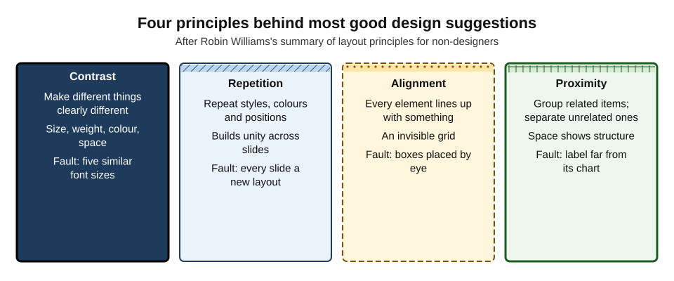
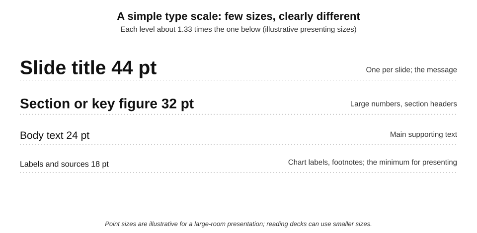
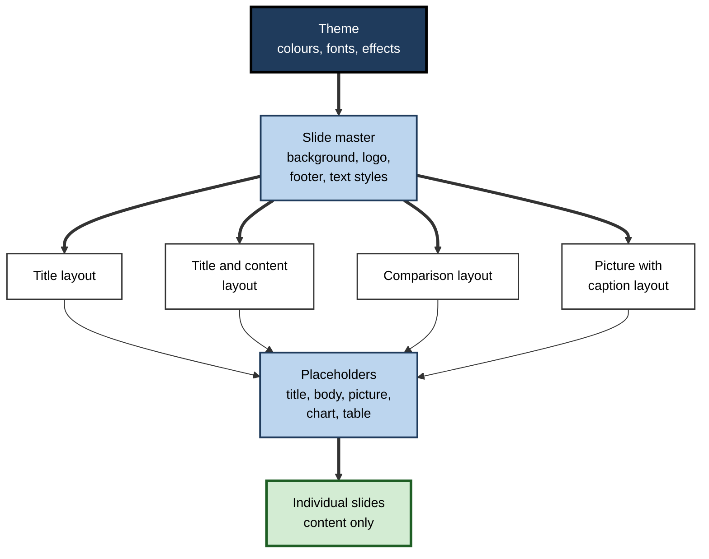
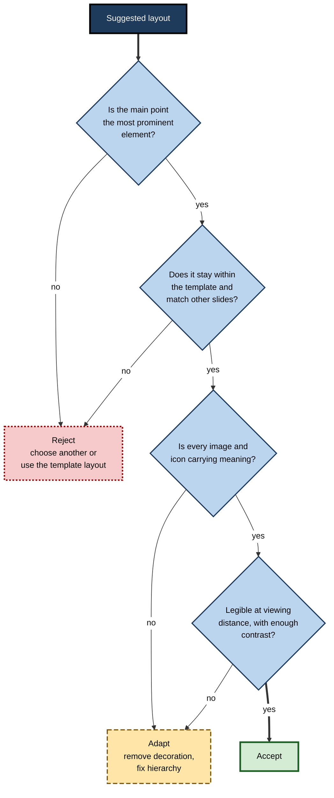
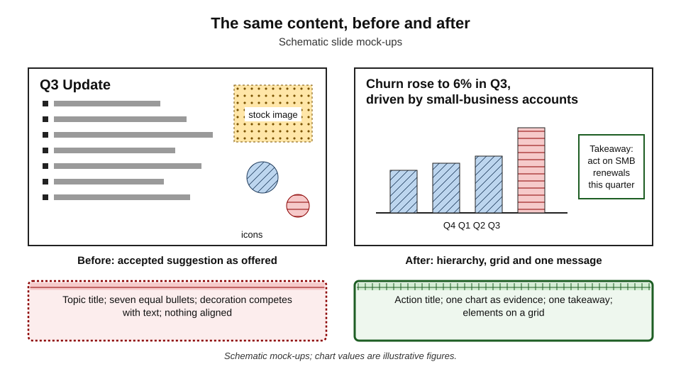
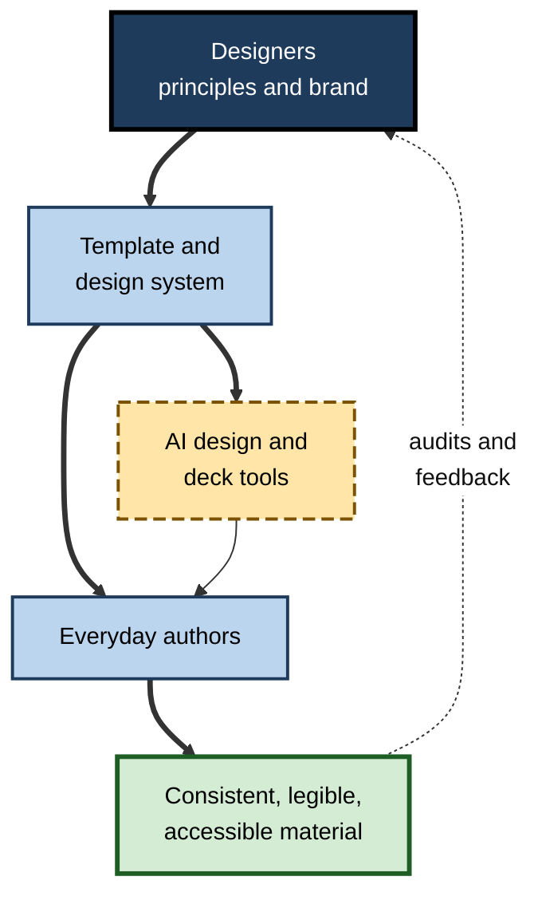

# I.4. Design suggestions and templates

An analyst pastes a chart and four bullet points onto a blank slide. A side panel instantly offers six layouts: chart left, text right; chart full-bleed with a caption; bullets turned into icons; a photograph behind everything. All six look more professional than the original. Only two of them make the point clearer. Knowing which two — and why — is the skill that design suggestions cannot supply on their own.

> **Definition — Design suggestion:** an automatically generated proposal for the visual arrangement of content — layout, typography, colour, imagery or icons — offered by a presentation, document or design tool.

> **Definition — Template:** a reusable file that defines the structure and appearance of new documents or decks — layouts, fonts, colours, placeholders and standard elements — so that content can be added without redesigning each time.

**Why it matters**

- **Most professionals are not trained designers**, yet they produce visual material daily. Suggestions and templates put design knowledge into the tool.
- **First impressions are visual and fast.** Audiences judge credibility partly on appearance before reading a word.
- **AI suggestions optimise for "looking designed"**, which is not the same as communicating clearly.
- **Templates are infrastructure.** A well-built template makes every later deck — and every AI tool that uses it — better; a broken one spreads problems at scale.

---

## How Design Assistance Works

### From fixed templates to generated layouts

- **Fixed templates** — pre-designed files with a small set of layouts; the user chooses.
- **Rule-based suggestions** — the tool analyses the content type (a photo, a list, a chart, a date sequence) and matches it to layouts designed by humans.
  - Microsoft introduced its PowerPoint "Designer" feature in 2015, offering layout options when a picture or certain content was added.
- **Learned suggestions** — models trained on large collections of designs rank or generate layouts, colour palettes and image crops.
- **Generative design** — whole slides, posters or social graphics generated from a prompt, including images, colours and fonts.
- **Brand-aware generation** — the tool is given brand assets (logo, colours, fonts, templates) and constrains its output to them.

> **Key point:** whatever the mechanism, a design suggestion is a **guess about intent**. The tool sees the content's *type*; only the author knows its *purpose*.

### What the tool can and cannot see

| | The tool can detect | The tool cannot know |
|---|---|---|
| Content | Text length, lists, numbers, dates, images, charts | Which item is the main point |
| Audience | Nothing directly, unless told | Room size, viewing distance, expertise, culture |
| Context | Neighbouring slides, if it reads the whole deck | What came before in the meeting; what the speaker will say |
| Brand | Assets supplied to it | Unwritten conventions, sensitivities, house taste |
| Accessibility | Some checks (contrast, missing alt text) | Whether the reading order makes sense to a screen-reader user |

---

## The Principles Behind Good Suggestions

Good suggestions apply a small set of well-established design principles. Judging them requires knowing those principles.

### Contrast, repetition, alignment, proximity

- **Robin Williams**, in *The Non-Designer's Design Book* (first published 1994), summarised layout for non-designers in four principles:
  - **Contrast** — if two things are different, make them **very** different (size, weight, colour, space).
  - **Repetition** — repeat visual elements (fonts, colours, positions) to create unity.
  - **Alignment** — nothing placed arbitrarily; every element visually connected to another.
  - **Proximity** — group related items; separate unrelated ones.

**Figure 1.** Four principles behind most good design suggestions.

> **Mnemonic — "CRAP":** Contrast, Repetition, Alignment, Proximity — Williams's own, deliberately memorable acronym.

### Gestalt grouping

- **Gestalt psychology** (Max Wertheimer and colleagues, 1920s) described how people perceive groups and wholes:
  - **proximity** — near things are seen as related;
  - **similarity** — things that look alike are seen as belonging together;
  - **continuity** — the eye follows lines and curves;
  - **closure** — the mind completes incomplete shapes;
  - **figure–ground** — one element is seen as the object, the rest as background.
- **Design implication:** layout itself communicates structure; a misplaced label or a stray colour tells the audience something false about what belongs together.

### Visual hierarchy

> **Definition — Visual hierarchy:** the arrangement of elements so that their visual prominence matches their importance, guiding the eye from the most to the least important.

- **Tools of hierarchy:** size, weight, colour, position (top-left in left-to-right reading cultures), white space, isolation.
- **One focal point per slide** — if everything is emphasised, nothing is.
- **Hierarchy test:** squint at the slide (or view it as a small thumbnail). What is seen first should be what matters most.

### Typography

- **Few typefaces** — usually one or two families (one for headings, one for body), as the template defines.
- **Few sizes, clearly different** — a **type scale** where each level is noticeably larger than the next.
- **Legibility at distance** — presentation text far larger than document text; reading decks can use smaller sizes.
- **Line length and spacing** — short lines, generous spacing; avoid full justification on slides.

**Figure 2.** A simple type scale for presentation slides.

> **Formula — Modular type scale:** each size = base size × ratio^level. With a 24 pt base and a ratio of 1.33: 24 → 32 → 43 pt for successively higher levels, and 24 ÷ 1.33 ≈ 18 pt for the level below.

> **Example:** at the 2012 announcement of the discovery of the Higgs boson at CERN, one presenter's slides were set in Comic Sans. The physics was a historic achievement; online commentary nonetheless fixed on the typeface. Typography changes how content is received, even when it changes nothing about the content.

### Colour

- **Palette from the template** — theme colours defined once, used everywhere.
- **Colour with a job** — highlight the one series or item that matters; mute the rest.
- **Sufficient contrast** between text and background (a requirement of accessibility standards as well as good design).
- **Meaning not carried by colour alone** — labels, patterns and position as well.
- **Rule of thumb, not law:** designers often cite a "60–30–10" split (dominant, secondary, accent colours) as a starting point for balance.

### White space

- **White (negative) space** is not wasted space; it separates, groups and gives emphasis.
- **AI suggestions often fill space** — adding icons, shapes or background images to "complete" a slide.

> **Watch out:** a full slide is not a finished slide. Many generated layouts add decorative elements because empty space looks unfinished to the model's training data; for the audience, the space is often what makes the content readable.

---

## Why Appearance Changes Judgement

**Study card — Kurosu and Kashimura (1995), the aesthetic–usability effect**

- **Design:** researchers at Hitachi showed participants 26 variations of a cash-machine interface layout and asked them to rate both how beautiful and how easy to use each appeared — before using any of them.
- **Findings:** ratings of **apparent usability correlated strongly with ratings of beauty**, more strongly than with the layouts' functional features.
- **Replication:** Noam Tractinsky (1997) found a similar, even stronger, relationship in Israel, suggesting the effect was not limited to one culture.
- **Conclusion:** people **assume attractive designs work better**.

**Study card — Lindgaard and colleagues (2006), first impressions in 50 milliseconds**

- **Design:** participants rated the visual appeal of web pages shown for only 50 milliseconds, and again with longer exposure.
- **Findings:** judgements after 50 ms were **highly consistent** with judgements after longer viewing.
- **Conclusion:** visual appeal is assessed almost instantly and tends to persist — a "halo" that colours later evaluation.

> **Key point:** these effects are why AI design polish is double-edged. It makes good content more persuasive — and weak or wrong content more persuasive too.

> **Watch out:** the aesthetic–usability effect describes **perception**, not performance. Attractive designs are judged easier, which can lead users to forgive real problems; the effect is not evidence that attractive designs *are* more usable.

---

## Templates: The Hidden Infrastructure

### Anatomy of a template

- **Theme** — the colour palette, font pair and effects.
- **Slide master** — the parent layout that sets backgrounds, logos, footers and default text styles for every slide.
- **Layouts** — child designs for common slide types: title, section header, title and content, two content, comparison, picture with caption, blank.
- **Placeholders** — defined boxes within layouts for titles, text, pictures, charts and tables.
- **Standard elements** — approved icons, chart styles, table styles, source-line formats.

**Figure 3.** The layers of a presentation template.

> **Definition — Slide master:** the top-level slide in a template that controls the default appearance of every layout and slide beneath it.

> **Definition — Placeholder:** a predefined container in a layout for a specific kind of content, such as a title or picture, which carries the template's formatting and structural meaning.

### Why placeholders matter more with AI

- **Structure for machines** — AI deck tools, outline views, screen readers and export to other formats rely on placeholders to know which text is the title and which is the body.
- **Formatting stays consistent** — content in a placeholder inherits the template's style; content in free text boxes does not.
- **Reading order** — placeholders give a predictable order for assistive technology; manually drawn boxes are read in the order they were created.
- **Easy redesign** — a deck built on placeholders can be moved to a new template in one step.

> **In practice:** a deck built from text boxes drawn by hand looks fine on screen but is invisible as structure: AI tools cannot find its titles, accessibility checkers flag it, and every slide must be fixed by hand when the brand changes.

### Template quality

| | Weak template | Strong template |
|---|---|---|
| Layouts | One or two; users improvise the rest | A layout for each common slide type, named clearly |
| Placeholders | Missing or decorative | Every layout uses real title and content placeholders |
| Theme | Colours applied manually to shapes | Theme colours and fonts defined once |
| Charts and tables | Default styles | Styles matching the brand, with source-line format |
| Accessibility | Low-contrast colour pairs; text in images | Contrast-checked palette; real text; logical order |
| Guidance | None | A few example slides showing correct use |
| Works with AI tools | Tool ignores it or breaks it | Tool can generate directly into its layouts |

---

## Judging a Suggestion

### Accept, adapt or reject

**Figure 4.** Deciding what to do with a design suggestion.

### Common faults in suggested designs

- **Decoration over meaning** — icons for every bullet, stock photographs behind text, gradients and shapes that carry nothing.
- **Inconsistency across slides** — accepting a different suggestion on each slide produces a deck that looks like a collage.
- **Template drift** — suggested colours, fonts or layouts outside the organisation's template.
- **Lost hierarchy** — titles shrunk to fit, bullets converted into equal-sized "cards" with no focal point.
- **Image problems** — crops through faces or across the subject; text over busy areas; images that imply something unintended.
- **Data distortion** — charts restyled with 3-D effects, truncated axes or decorative colours.
- **Shrink-to-fit text** — automatic resizing lets too much text stay on a slide rather than forcing an edit.

> **Remember:** **one deck, one look.** Choose layouts from the template for consistency; use suggestions to explore, then standardise.

### Worked example (illustrative): repairing a suggested slide

**Situation:** a design suggestion turned a churn update into a slide with a topic title, seven equal bullets, a stock photograph and decorative icons.

**Figure 5.** The same content before and after applying layout principles.

1. **Contrast** — the title becomes a sentence stating the point, at the template's title size; supporting text is smaller and lighter.
2. **Repetition** — the chart uses the template's chart style and highlight colour, as on other slides.
3. **Alignment** — chart and takeaway box sit on the template grid, left edges aligned with the title.
4. **Proximity** — the takeaway box is placed next to the bar it explains; the source line sits directly under the chart.
5. **Subtraction** — the stock photograph and icons are removed; five of the seven bullets move to speaker notes.

| | Suggested design | Repaired design |
|---|---|---|
| Focal point | None — photograph competes with text | The highlighted Q3 bar |
| Words on slide | About 70 | About 20 |
| Elements | 11 | 4 |
| Within template | Fonts and colours changed | Template styles throughout |
| Time to understand (squint test) | Unclear | Point seen first |

*Illustrative figures.*

- **Conclusion:** the repaired slide uses fewer elements and the template's own styles; its appearance is plainer and its message is clearer.

> **Watch out:** the repaired slide may look "less designed" in a side-by-side comparison. That is the aesthetic–usability effect at work; judge by what the audience will understand, not by which version looks richer.

---

## Templates and AI Tools Together

### Generating into a template

- **Supply the template** — most AI deck tools can generate into an organisation's template if it is provided or set as default; without it they invent a style.
- **Name layouts clearly** — "Title and chart", "Two-column comparison" — so the tool and people can choose correctly.
- **Include example slides** — a few well-made slides teach tools and colleagues how layouts are meant to be used.
- **Lock what must not change** — logos, footers and legal text on the master, not on individual slides.

### Design systems

> **Definition — Design system:** a documented set of reusable components, styles and rules — colours, typography, spacing, icons, layouts — with guidance on their use, shared across an organisation's products and materials.

- **From template to system** — larger organisations connect slide templates, document templates, social graphics and web components under one set of rules.
- **Tokens** — named values (such as "primary colour" or "heading size") that tools and templates reference, so that one change propagates everywhere.
- **Brand kits in design tools** — logos, palettes, fonts and templates loaded once and offered to every user and every AI feature.

### Case study (illustrative): a professional-services firm rebuilds its template

- **Situation:** a firm's template had three layouts and no real placeholders; staff improvised slides, and AI deck tools ignored the template and produced off-brand decks.
- **Problems found in an audit of 200 client decks:**
  - most slides used manually drawn text boxes;
  - a wide variety of font sizes and many off-palette colours appeared;
  - accessibility checks failed on nearly every deck (missing titles, low-contrast pairs);
  - AI-generated decks needed hours of manual reformatting.
- **Actions:**
  1. **new master** with fourteen named layouts covering title, agenda, section, statement, chart, comparison, timeline, table, quote, team and closing slides;
  2. **real placeholders** in every layout, in a logical reading order;
  3. **theme colours** tested for contrast; chart and table styles defined;
  4. **example deck** showing each layout well used;
  5. template set as the **default for the AI deck tool**, so generation landed in the correct layouts;
  6. a thirty-minute training session on choosing layouts rather than drawing boxes.
- **Result:** AI-drafted decks needed far less reformatting; accessibility failures fell sharply; partners reported decks "looking like one firm".
- **Side effects:** some staff felt constrained; a request route was created for new layouts.
- **Lesson:** templates are the place where design expertise is stored once and reused everywhere — including by AI tools.

**Figure 6.** How design knowledge flows from a template into everyday work.

---

## Design Judgement as a Professional Skill

- **Know the principles** — contrast, repetition, alignment, proximity, hierarchy — well enough to name what is wrong with a suggestion.
- **Prefer the template** to novelty; exploration is for drafts.
- **Subtract** — the most common improvement to a suggested design is removing something.
- **Check at real size and distance** — a laptop screen is not a conference hall.
- **Look at the deck as a whole** — slide sorter or thumbnail view reveals inconsistency instantly.
- **Respect designers** — templates and brand systems are expert work; ask before overriding them.

> **In practice:** experienced presenters often design a deck in **slide-sorter view**, checking rhythm and consistency across all slides before polishing any single one — the reverse of how suggestion panels encourage people to work.

---

## Grids, Formats and Screens

### Layout grids

> **Definition — Grid:** an invisible framework of columns, rows, margins and gutters on which elements are aligned, giving a layout order and consistency.

- **Column grids** — slides and pages divided into (often) 12 columns, allowing halves, thirds and quarters.
- **Margins** — consistent space at the edges; logos and footers sit within them.
- **Gutters** — gaps between columns that keep elements from touching.
- **Baseline rhythm** — consistent vertical spacing between lines and blocks.
- **Why it matters for AI** — suggested layouts that ignore the template's grid produce slight misalignments that, across a deck, look careless; good templates encode the grid in their placeholders.

### Aspect ratios and safe areas

- **16:9** — the default for modern screens and video calls.
- **4:3** — older projectors and some tablets; content designed for 16:9 is letter-boxed.
- **Square (1:1) and vertical (4:5, 9:16)** — social media and phone-first formats.
- **Safe areas** — regions where content will not be cut off or covered by interface elements (video-call participant strips, social-app buttons, captions).

> **Watch out:** generated slide designs often place important text near the bottom edge — exactly where video-call toolbars, captions and participant thumbnails appear when a deck is shared online. Keep key content within the central safe area.

### Designing for how the deck will be seen

| Viewing situation | What changes | Design response |
|---|---|---|
| Large room, projector | Distance; washed-out colours | Larger type; strong contrast; fewer elements |
| Video call, shared screen | Small window; compression; overlays | Larger type than for a room; avoid fine lines and thin fonts; keep bottom clear |
| Read on a laptop | Close viewing; reader controls pace | Smaller type acceptable; fuller sentences; clear structure |
| Read on a phone | Very small screen | Single message per slide; large text; avoid dense tables |
| Printed handout | No animation; ink | No reliance on builds; check legibility on paper |

### Imagery and icons

- **Photographs** — one strong, relevant image beats several small ones; crop with intent (eyes on the upper third line, subject facing into the slide).
- **Rule of thirds** — placing points of interest along lines dividing the frame into thirds; many design tools' auto-crops use it.
- **Icons** — a single consistent set (same line weight, style and size); mixed icon styles are one of the commonest marks of assembled-from-suggestions decks.
- **Illustrations** — one style per deck; generated illustrations should follow a defined style.
- **Charts** — template chart styles first; decoration removed; highlight colour used for the point.

> **In practice:** many design teams give templates a small **approved icon set** and a few **image-crop rules**. These two additions remove much of the visual noise that suggestion tools introduce.

### Animation and transitions

- **Purposeful builds** — revealing points one at a time can pace an argument; overused, it slows everything.
- **Transitions** — subtle or none; elaborate transitions distract and can trouble people sensitive to motion.
- **AI suggestions** sometimes add animation by default; switch off what does not serve the message.

### Typography details that suggestions miss

- **Widows and orphans** — a single word stranded on the last line of a title; rewrite or rebreak.
- **All capitals** — harder to read in long runs; reserve for short labels.
- **Line spacing** — too tight in many generated text boxes; about 1.2 times the font size is a common starting point for body text.
- **Alignment** — left-aligned text is easiest to read; centred text works for short titles only.

---

## Choosing Where Design Help Comes From

| | Built-in suggestions in office software | Standalone AI deck or page tools | Design platforms with brand kits |
|---|---|---|---|
| Typical strength | Works inside the organisation's own template and files | Fast, polished whole-deck generation | Rich templates, imagery and social formats |
| Template fidelity | High, if the template is well built | Often low — own styles unless configured | High, if the brand kit is set up |
| Output format | Native, editable slides and documents | Sometimes web-first; export may lose structure | Varied; export may flatten text into images |
| Accessibility of output | Good, if placeholders are used | Variable; check reading order and titles | Variable; check text is real text |
| Best use | Everyday decks and documents | Drafts, internal pitches, exploration | Marketing, social and event graphics |

- **Export matters** — a design that looks perfect in one tool can lose fonts, alignment or editable text when exported; test the round trip before adopting a tool.
- **Lock-in** — designs created in a proprietary format may be hard to move later; keep masters in formats the organisation controls.
- **Approval** — use only tools approved for the content's confidentiality; whole decks uploaded for "redesign" leave the organisation's systems.

> **Watch out:** some design tools export slides or posters as **flattened images** to preserve appearance. The result looks identical but contains no real text — it cannot be searched, edited, translated or read by a screen reader.

---

## Open Questions

- **Will AI design converge on a single look?**
  - Models trained on similar design collections may push organisations towards a homogeneous "AI aesthetic"; distinctiveness may become harder and more valuable.
- **Can tools learn purpose, not just content type?**
  - Suggestions improve when told the message and audience, but reliably inferring the main point remains difficult.
- **How far do design effects on credibility matter in practice?**
  - Laboratory evidence on aesthetics and judgement is strong; evidence on business decisions made from decks is thin.
- **Who owns design decisions as tools become more capable?**
  - The balance between central design teams, templates and individual authors using generative tools is being renegotiated in many organisations.

---

## Summary

- A **design suggestion** guesses at intent from content type; a **template** stores design decisions for reuse.
- Assistance has moved from **fixed templates** to **rule-based**, **learned** and **generative** suggestions, increasingly constrained by **brand kits**.
- Judge suggestions with **CRAP** (contrast, repetition, alignment, proximity), **Gestalt** grouping, **visual hierarchy**, a simple **type scale**, purposeful **colour** and generous **white space**.
- The **aesthetic–usability effect** (Kurosu and Kashimura, 1995) and **50-millisecond first impressions** (Lindgaard and colleagues, 2006) show that appearance shapes judgement — making polish double-edged.
- Templates consist of **theme, slide master, layouts and placeholders**; placeholders give structure that AI tools, screen readers and redesigns rely on.
- Accept, adapt or reject suggestions by testing **focal point, template consistency, meaningful imagery and legibility**.
- Common faults: decoration, inconsistency, template drift, lost hierarchy, image crops, distorted charts, shrink-to-fit text.
- **Subtraction** is the most common repair; **one deck, one look**.
- Supplying a strong template to AI tools, or a **design system** with tokens and brand kits, stores expertise once and spreads it everywhere.

---

## Self-Check

1. Distinguish a design suggestion from a template.
2. Describe four generations of design assistance, from fixed templates to brand-aware generation.
3. What can a design tool detect about content, and what can it not know?
4. Explain each of Williams's four principles with a slide example.
5. Name four Gestalt principles and explain why they make layout a form of communication.
6. Calculate a three-level type scale from an 18 pt base with a ratio of 1.25.
7. What did Kurosu and Kashimura find, and why is the finding double-edged for AI-polished decks?
8. Describe the parts of a template and the role of placeholders.
9. Why do placeholders matter more when AI tools are used?
10. List five common faults in suggested designs.
11. Walk through repairing a cluttered suggested slide using the four principles plus subtraction.
12. A team's AI-generated decks ignore the brand and need heavy reformatting. Diagnose likely causes and propose fixes.
13. Why might a plainer slide be judged worse in a side-by-side comparison despite communicating better?

### Answer Key

1. A design suggestion is an automatic proposal for arranging specific content; a template is a reusable file defining layouts, styles and placeholders for all new content.
2. Fixed templates chosen by users; rule-based suggestions matching content types to human-designed layouts; learned suggestions ranking or generating layouts from design data; generative and brand-aware design creating whole slides within supplied brand assets.
3. It detects text length, lists, numbers, dates, images and charts, and assets it is given. It cannot know the main point, the audience, the room, what the speaker will say or unwritten brand conventions.
4. Contrast — title much larger and bolder than body. Repetition — same chart style and highlight colour on every chart. Alignment — chart, text and title on a shared left edge. Proximity — label beside the bar it explains, source directly under the chart.
5. Proximity, similarity, continuity, closure (also figure–ground). Viewers perceive grouping and structure from layout, so placement and styling assert relationships whether intended or not.
6. 18 → 22.5 → about 28 pt (18 × 1.25 = 22.5; 22.5 × 1.25 ≈ 28).
7. Interfaces rated more beautiful were also rated easier to use, before use. Polish makes good content more persuasive but also makes weak or wrong content more credible.
8. Theme (colours, fonts), slide master (backgrounds, logos, default styles), layouts (slide types) and placeholders (containers for titles, text, pictures, charts) that carry formatting and structural meaning.
9. AI tools, screen readers, outline views and template changes rely on placeholders to identify titles and body content and to apply consistent formatting; hand-drawn boxes are invisible as structure.
10. Decorative icons and images; inconsistency across slides; off-template fonts and colours; lost hierarchy; poor image crops; distorted charts; shrink-to-fit text.
11. Make the title state the point and dominate (contrast); apply template chart style (repetition); place elements on the grid (alignment); put takeaway beside its evidence (proximity); remove decoration and move extra bullets to notes (subtraction).
12. Causes: no template supplied to the tool; template lacks layouts and placeholders; theme colours not defined; staff drawing boxes. Fixes: build a template with named layouts and placeholders, define theme and chart styles, set it as the tool's default, provide an example deck and brief training.
13. The aesthetic–usability and first-impression effects make richer-looking designs feel more competent at a glance; comprehension, not visual richness, should be the test.

---

## Glossary

| Term | Meaning |
|---|---|
| Aesthetic–usability effect | The tendency to judge attractive designs as easier to use. |
| Brand kit | A set of logos, colours, fonts and templates loaded into a design tool. |
| CRAP | Contrast, repetition, alignment, proximity — four layout principles. |
| Design suggestion | An automatically generated proposal for arranging content visually. |
| Design system | A documented set of reusable components, styles and rules shared across an organisation. |
| Design token | A named value, such as a colour or size, referenced by templates and tools. |
| Gestalt principles | Rules describing how people perceive grouping and wholes. |
| Layout | A predefined arrangement of placeholders for a type of slide. |
| Placeholder | A container in a layout for a specific kind of content, carrying formatting and structure. |
| Slide master | The top-level slide controlling the default appearance of all layouts. |
| Template | A reusable file defining the structure and appearance of new documents or decks. |
| Theme | The colours, fonts and effects defined for a template. |
| Type scale | A set of text sizes related by a constant ratio. |
| Visual hierarchy | Arrangement making visual prominence match importance. |
| White space | Empty space used to separate, group and emphasise. |
