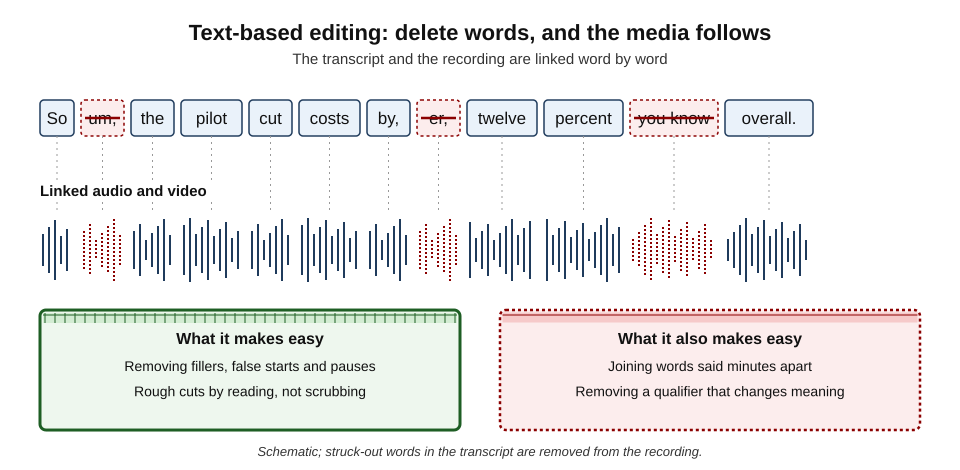
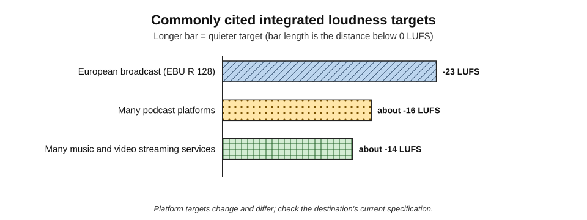
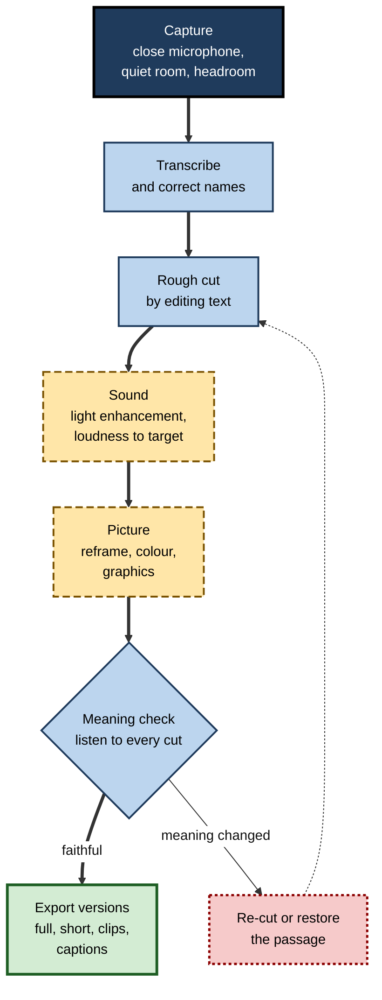
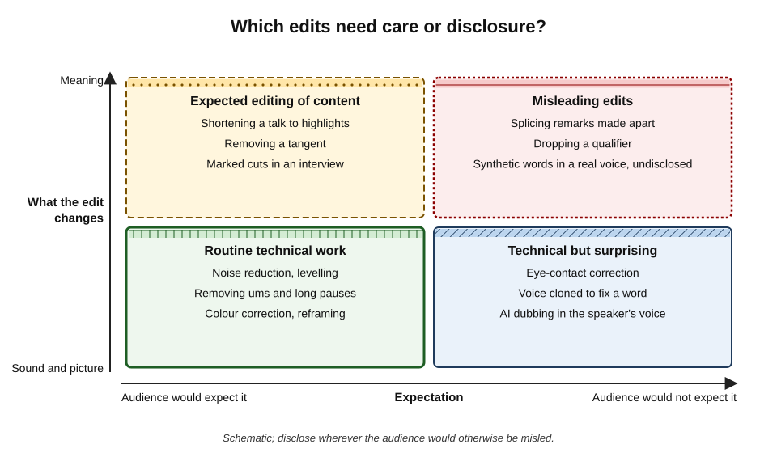
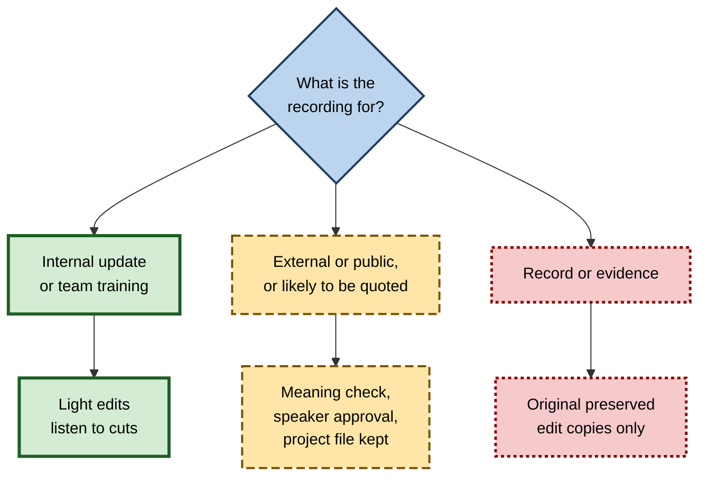

# I.5. Audio and video editing help

A training manager records a 40-minute talk in an echoing room, full of "ums", a ringing phone and a long silence while a slide fails to load. Once, a clean ten-minute version meant hiring an editor. Now an AI tool removes the echo, deletes the fillers when she strikes them out of a transcript, suggests chapter points and reframes the speaker for a phone screen — in an afternoon. The same tool would let her delete a single "not" from a sentence just as easily.

> **Definition — AI-assisted audio and video editing:** the use of machine-learning tools to clean, cut, structure, enhance, translate or alter recorded sound and moving images.

> **Definition — Post-production:** all the work done on recorded media after capture — editing, sound, graphics, colour, captions and export.

**Why it matters**

- **Audio and video have become everyday workplace formats** — recorded briefings, training, webinars, podcasts, product demos, social clips, customer support videos.
- **AI has collapsed the skill barrier.** Tasks that needed specialist software and training are now one-click features in common tools.
- **Quality affects credibility.** Poor sound makes speakers seem less competent and their message less trustworthy.
- **Editing power is also manipulation power.** Cutting, splicing and synthetic correction can change what a person appears to have said.

---

## What AI Can Do to a Recording

### Sound

- **Speech enhancement and voice isolation** — separate speech from background noise, music, echo and hum.
- **Noise reduction** — remove steady noise such as air-conditioning and computer fans.
- **De-reverberation** — reduce the echo of a hard-walled room.
- **Levelling and loudness normalisation** — balance quiet and loud speakers; hit a target overall loudness.
- **Filler and silence removal** — detect "um", "er", false starts and long pauses.
- **Music and effects separation** — split a mixed track into voice, music and effects ("stem separation").
- **Synthetic voice correction** — regenerate a mispronounced word in the speaker's voice from a typed correction (requires a voice model).

### Picture

- **Scene and shot detection** — find cuts and changes of camera automatically.
- **Auto-reframing** — track the subject and crop landscape footage to vertical or square formats.
- **Background removal and replacement** — without a green screen.
- **Colour matching and correction** — make shots from different cameras look consistent.
- **Stabilisation and upscaling** — steady shaky footage; enlarge low-resolution clips (with the same invented-detail risks as still images).
- **Eye-contact correction** — redirect a speaker's gaze towards the camera when they are reading.
- **Generative insert shots ("B-roll")** — create or extend short clips to cover cuts or illustrate points.

### Structure and language

- **Transcription** — the basis for most modern editing workflows.
- **Chapters and highlights** — suggest section breaks, titles and the "best" short clips.
- **Summaries and descriptions** — draft episode notes, video descriptions and social posts.
- **Translation and dubbing** — translate speech and resynthesise it, sometimes in a cloned version of the speaker's voice, with lip movements adjusted.

> **Definition — Voice isolation:** separating a speaking voice from all other sound in a recording using a model trained to recognise speech.

> **Definition — AI dubbing:** replacing the original speech in a video with translated speech generated by AI, often imitating the original voice and adjusting lip movement.

| Task | Before AI tools | With AI tools | Main risk |
|---|---|---|---|
| Removing background noise | Specialist plug-ins, skilled tuning | One-click enhancement | Over-processing: robotic or "underwater" voice |
| Rough cut of an interview | Scrubbing through the timeline | Editing the transcript | Splices that change meaning |
| Vertical clips for social media | Manual keyframed cropping | Auto-reframe | Subject or key information cropped out |
| Fixing a misspoken word | Re-record or leave it | Synthetic correction in the speaker's voice | Undisclosed words the speaker never said |
| Multilingual versions | Subtitles or human dubbing | AI dubbing with voice cloning | Mistranslation; consent; uncanny lip-sync |

---

## Why Sound Matters So Much

**Study card — Newman and Schwarz (2018), "Good sound, good research"**

- **Design:** participants heard recordings of scientists presenting their research at conferences and on a radio programme; the content was identical, but audio quality was either good or slightly degraded (tinny, with some echo).
- **Results:** with poorer audio, listeners rated the **research as less important**, the **researcher as less competent** and the talk as less interesting.
- **Explanation:** processing fluency — when something is harder to perceive, people misattribute the difficulty to the content or the speaker.
- **Conclusion:** audio quality is not cosmetic; it changes how **credible** a message seems.

> **Key point:** for most workplace recordings, **sound matters more than picture**. Audiences tolerate an imperfect image far more readily than unclear speech.

### Capture still beats correction

- **Microphone distance** — a microphone close to the mouth captures far more voice relative to room noise than a laptop microphone across a desk.
- **Room** — soft furnishings reduce echo; corners and glass increase it.
- **Levels** — record with headroom; clipped (distorted) peaks cannot be fully repaired.
- **Separate tracks** — recording each speaker separately makes levelling and cleaning much easier.

> **Watch out:** "the AI will fix it" leads to over-processed sound. Aggressive enhancement can produce metallic, warbling or lisping artefacts, and can remove quiet words along with the noise. Light processing of a good recording almost always sounds better than heavy processing of a poor one.

---

## Text-Based Editing

### How it works

- **The recording is transcribed** with word-level timings.
- **The transcript becomes the editing interface** — deleting a word, sentence or paragraph removes the matching audio and video.
- **Rearranging text** rearranges the media.
- **Fillers and pauses** can be detected and removed in bulk.

**Figure 1.** Text-based editing: deleting words in the transcript removes them from the recording.

> **Definition — Text-based editing:** editing audio or video by editing an automatically generated, time-aligned transcript, so that changes to the text are applied to the media.

### Strengths

- **Speed** — a rough cut of an hour-long interview in minutes.
- **Accessibility of the craft** — people who think in words can edit without learning a timeline.
- **Searchability** — find every mention of a topic instantly.

### Weaknesses

- **Transcript errors become edit errors** — a misrecognised word can cause the wrong section to be cut.
- **Audio seams** — cuts that look clean in text can sound abrupt: breaths cut in half, changes in room tone, jumps in pitch.
- **Picture jumps** — removing words from a single-camera recording causes visible "jump cuts".
- **Meaning is easy to change** — removing "not", "only", "unless" or a whole qualifying clause takes one keystroke.

> **Remember:** **listen to every cut.** A text edit is finished only when it has been heard and seen in context.

### Filler removal: how much is too much?

- **Moderate removal** — long hesitations, repeated false starts and distracting fillers — improves clarity.
- **Total removal** — every "um", breath and pause — can make speech sound breathless, rushed and unnatural.
- **Fillers sometimes carry meaning** — a hesitation before an answer to a difficult question is information; removing it from an interview or testimony changes the record.

---

## Sound to a Standard: Loudness

### Why loudness standards exist

- **Listeners hate adjusting volume** between programmes, adverts and clips.
- **Broadcasters and platforms normalise** content to a target loudness; content mixed too loud is turned down, and its peaks may be squashed.
- **Integrated loudness** is measured in **LUFS** (loudness units relative to full scale), which approximates perceived loudness over a whole programme.

> **Definition — LUFS:** loudness units relative to full scale — a measure of perceived loudness used in broadcast and streaming standards; values are negative, and a higher (less negative) number is louder.

**Figure 2.** Commonly cited integrated loudness targets.

- **Broadcast** — the European Broadcasting Union's recommendation R 128 (2010) sets −23 LUFS for television and radio programmes.
- **Podcasts** — many platforms and producers work to around −16 LUFS for stereo spoken word.
- **Streaming services** — many normalise playback to around −14 LUFS.
- **True peak** — a ceiling (commonly −1 dBTP) prevents distortion after compression into streaming formats.

> **Formula — Loudness correction:** gain needed = target loudness − measured loudness. A podcast measured at −20 LUFS with a −16 LUFS target needs 4 dB of gain: −16 − (−20) = **+4 dB** (followed by a true-peak limiter so peaks stay below the ceiling).

> **In practice:** AI "auto-level" and "studio sound" features often apply normalisation automatically. Check the export settings against the destination's specification, especially for broadcast, where non-compliant files may be rejected.

---

## Editing Video for Attention

**Study card — Guo, Kim and Rubin (2014), video length and engagement**

- **Design:** analysis of about 6.9 million video-watching sessions on the edX online-course platform, comparing production styles with how long viewers kept watching and whether they attempted follow-up problems.
- **Findings:**
  - **shorter videos held attention better**; median engagement time topped out at around six minutes regardless of video length;
  - videos interspersing a speaking face with slides were more engaging than slides alone;
  - informal, personal settings engaged more than expensive studio productions.
- **Limits:** observational data from online courses; engagement is not the same as learning.
- **Conclusion:** for informational video, **short segments** and a visible, natural speaker matter more than polish.

### What AI structuring offers

- **Chapters** — suggested titles and timestamps allow viewers to jump to what they need.
- **Highlights and clips** — AI ranks "moments" by emphasis, laughter, keywords or visual change.
- **Multiple formats** — one recording becomes a full version, a short summary and vertical social clips.

> **Watch out:** "highlight" algorithms favour **energy over substance** — emphatic moments, laughter, strong statements. A clip chosen this way may be the least representative part of a careful talk, and quoted out of context it may misrepresent the speaker.

**Figure 3.** A post-production workflow using AI assistance.

---

## Synthetic Voice and Picture

### Voice cloning in editing

- **Typed corrections** — some tools can regenerate a misspoken word or sentence in the speaker's voice.
- **Narration from text** — a cloned voice reads updated script lines without re-recording.
- **Dubbing** — translated speech in the speaker's own voice.
- **Requirements for responsible use:**
  1. **written consent** from the speaker covering cloning, the uses, duration and withdrawal;
  2. **access control** over the voice model, which could be misused for fraud;
  3. **review** by the speaker of anything said in their synthetic voice;
  4. **disclosure** to audiences where they would assume the speaker said the words.

> **Watch out:** a voice model is a security asset. In the wrong hands it can be used to impersonate a senior person on the phone. Treat it with the same care as a signature.

### Altering appearance

- **Eye-contact correction** — makes a speaker reading a script appear to look at the viewer.
  - Many audiences accept it for training videos; some find it unsettling when they learn of it.
- **Background replacement and blur** — routine for calls and recordings.
- **Beautification filters** — smoothing skin and reshaping faces, often on by default in video apps.
- **Avatars and face replacement** — synthetic presenters or a person's face animated from a photograph.

### Technical versus content edits

**Figure 4.** Which audio and video edits need care or disclosure.

- **Routine technical work** — noise reduction, levelling, moderate filler removal, colour correction.
- **Expected content editing** — shortening, removing tangents, highlights — acceptable if the result fairly represents the whole.
- **Technical but surprising** — eye-contact correction, voice-cloned fixes, dubbing in the speaker's voice — usually acceptable with consent and, often, disclosure.
- **Misleading edits** — splicing remarks made apart, dropping qualifiers, undisclosed synthetic words — unacceptable.

---

## Case Study: The Panorama Edit

- **Situation:** in October 2024, a week before the US presidential election, the BBC's *Panorama* programme broadcast a documentary, *Trump: A Second Chance?*, which included excerpts of Donald Trump's speech of 6 January 2021, given before the attack on the US Capitol.
- **The edit:** the programme joined passages from different parts of the speech into what appeared to be a continuous statement.
  - It placed his remark about walking down to the Capitol next to his later words "fight like hell", which had been spoken considerably later.
  - It omitted a passage in which he told supporters to make their voices heard "peacefully and patriotically".
- **Discovery:** the edit was criticised in an internal memo by a former adviser to the BBC's editorial standards committee, which was reported by the press in November 2025.
- **Result:**
  - on 9 November 2025, the BBC's Director-General, Tim Davie, and the chief executive of BBC News, Deborah Turness, resigned;
  - the BBC's chair apologised for an "error of judgement" in the editing;
  - the episode drew legal threats and intense political criticism.
- **Analysis:**
  1. The edit was made with **conventional tools**, not AI — splicing has always been possible.
  2. The fault was **joining remarks made apart without signalling the join**, which created an impression the full speech did not support.
  3. The damage fell on the institution's **trust**, far beyond the programme.
- **Relevance to AI editing:** text-based editing makes exactly this kind of splice a matter of selecting and deleting words. The faster and easier the edit, the more important the meaning check.
- **Lesson:** an edit is judged by whether the **result fairly represents what was said**. Joins between remarks made at different times must be visible or signposted — and qualifications that change meaning must stay.

> **Remember:** when quoting recorded speech, **never join without showing the join**. Use a visual transition, a cutaway with narration, or an on-screen note that remarks have been combined.

---

## Worked Example (illustrative): From Webinar to Learning Assets

**Situation:** a 60-minute recorded webinar on a new expenses process must become a full-length archive version, a 6-minute summary video and three 45-second clips for the intranet.

| Output | AI assistance used | Human decisions | Checks |
|---|---|---|---|
| Archive version (55 min) | Voice isolation, loudness to −16 LUFS, filler trimming, chapters | Which tangents to remove; chapter titles | Every cut heard; nothing substantive removed |
| Summary (6 min) | Transcript-based selection of key segments | Choice of segments to represent the whole | Script of the summary read by the presenter for accuracy |
| Clips (3 × 45 s) | Highlight suggestions; auto-reframe to vertical | Rejected two "energetic" highlights that misrepresented policy | Each clip makes sense out of context; captions burned in |
| Captions | Automatic transcript | Names and policy terms corrected | Read-through against audio |

*Illustrative figures.*

1. **Capture review** — the presenter's microphone was good; one questioner was faint and was boosted.
2. **Rough cut** — 5 minutes of technical difficulty and off-topic discussion removed by editing the transcript.
3. **Sound** — light voice isolation; loudness normalised; true peak limited.
4. **Structure** — AI suggested eleven chapters; merged to seven with clearer titles.
5. **Clips** — the AI's top highlight was a joke about "creative expense claims"; it was rejected as likely to be misunderstood out of context.
6. **Meaning check** — the presenter watched the summary and clips and approved them.

- **Conclusion:** AI saved most of the mechanical time; the decisions that protected accuracy — which highlights to reject, which passages to keep — were human.

> **Watch out:** a summary video edited from a speaker's words becomes, in effect, a new statement attributed to them. **The speaker should approve it** before publication.

---

## Professional Practice

### Records and originals

- **Keep the original recording** unaltered.
- **Keep the project file** and an edit decision list for anything that might be quoted, challenged or used as a record.
- **Label versions** — "edited for length", "summary", "clip from ...".

> **Definition — Edit decision list (EDL):** a record of every cut and source time used in an edited programme, allowing the edit to be reconstructed and checked.

### Consent and people

- **Recording consent** — people recorded should know how the recording will be edited and published.
- **Voice and likeness** — explicit consent for cloning, dubbing, avatars or appearance changes.
- **Contributors' words** — interviewees should not be edited into saying something they did not mean; many organisations offer contributors a chance to review sensitive edits.

### Proportion

- **Internal recordings** — lighter editing, faster turnaround.
- **External, public or quoted material** — full meaning check, approvals and records.
- **Recordings as evidence or records** (meetings of regulated bodies, disciplinary hearings, legal depositions) — edit copies only; preserve unedited originals.

**Figure 5.** How much editing care different recordings need.

### Case study (illustrative): an internal podcast that went external

- **Situation:** a company's internal leadership podcast was edited quickly with AI tools: aggressive filler removal, auto-generated show notes and AI-selected social clips.
- **Problem:** when the communications team began publishing episodes externally, a clip of a director appeared to dismiss a regulator's concerns. In the full episode, she had been describing a view she then rejected.
- **Diagnosis:**
  - highlight selection favoured a strong statement without its context;
  - the editor did not listen to the surrounding minute;
  - the director was not asked to approve external clips;
  - show notes drafted by AI repeated the misleading framing.
- **Actions:**
  1. clip removed and a correction posted;
  2. **speaker approval** introduced for all external clips and summaries;
  3. a rule that every clip must make sense **with the 30 seconds before and after it** in mind;
  4. filler removal reduced to long hesitations only, after listeners said the speech sounded "breathless";
  5. AI show notes checked against the audio before publication.
- **Result:** no further complaints; production time rose modestly.
- **Lesson:** moving content from an internal to an external audience **raises the standard of editing**, even when the recording is the same.

---

## Formats, Export and Delivery

### Aspect ratios and platforms

| Destination | Typical aspect ratio | Typical length | Notes |
|---|---|---|---|
| Intranet or website video | 16:9 | Minutes | Closed captions supported on most players |
| Video-call recording | 16:9 | Varies | Speaker strips and shared screens; reframing rarely helps |
| Vertical social video | 9:16 | Under a minute | Most watched muted; open captions common |
| Square social video | 1:1 | Under two minutes | Text kept away from edges |
| Podcast | Audio only | 15–60 minutes | Loudness target; transcript |

*Typical values; each platform publishes its own current specification.*

- **Auto-reframe** works well when one person speaks to camera; it struggles with two-person interviews, slides with small text and wide shots of rooms.
- **Re-composing** — for important clips, reframing by hand or re-shooting in the target format gives better results than automatic cropping.

### Codecs, bit rates and quality

- **Codec** — the method used to compress video or audio (*e.g.* H.264 for video, AAC for audio, widely supported).
- **Bit rate** — how much data per second; too low produces blockiness and smeared detail, especially in dark or fast-moving scenes.
- **Re-encoding** — every export and upload re-compresses; editing from an already-compressed download degrades quality further.
- **Masters** — keep a high-quality master export from which all versions are made.

> **Definition — Codec:** software or hardware that compresses and decompresses audio or video for storage and transmission.

### Music and sound in edited media

- **Licensed libraries** — stock music must be licensed for the intended use (internal, online, broadcast, paid advertising often differ).
- **Generated music** — terms vary by service; some restrict commercial use on cheaper plans, and rights in purely generated music may be weak.
- **Platform rights-detection** — video platforms automatically detect copyrighted music; an unlicensed track can block or demonetise a video.
- **Sound effects** — as with music, check the licence.

### AI dubbing in practice

1. **Start from a corrected transcript** of the source language.
2. **Translate** with terminology fixed (product names, job titles, legal terms).
3. **Adapt for timing** — translated speech often runs longer; condense where needed.
4. **Synthesise** — stock voice, or cloned voice only with consent.
5. **Review by a fluent speaker**, watching the video: meaning, pronunciation, tone, lip-sync.
6. **Disclose** synthetic dubbing where viewers would assume they are hearing the speaker.

> **Watch out:** lip-sync adjustment alters the speaker's mouth movements — a change to their **appearance**. Speakers should know and agree, and the result should be checked for uncanny distortion before release.

### Accessibility in edited media

- **Captions** from the final cut, corrected.
- **Transcripts** for audio-only versions.
- **Audio description** where important information is only visual (for example, a chart on screen that the speaker does not describe).
- **No flashing** effects; modest motion graphics.
- **Speech clarity first** — music beds kept well below speech.

---

## Open Questions

- **Will synthetic correction become normal?**
  - If fixing words in a speaker's cloned voice becomes routine, audiences may stop assuming recorded speech is spoken — with consequences for trust and evidence.
- **How should edited speech be signposted?**
  - Broadcast conventions for showing joins exist, but social clips and AI-generated summaries rarely follow them; no common standard has emerged.
- **Can provenance standards work for audio and video?**
  - Signed edit histories are technically possible, but recordings are re-encoded, clipped and re-uploaded constantly.
- **Do AI-cleaned recordings change how people speak?**
  - If fillers and hesitation are always removed, listeners' expectations of natural speech may shift — an effect that has not been studied.
- **What do audiences accept?**
  - Evidence on audience attitudes to eye-contact correction, dubbing and avatars is early and varies by culture and context.

---

## Summary

- **AI-assisted editing** cleans, cuts, structures, enhances, translates and alters recordings; it has made post-production an everyday skill.
- **Sound matters most**: poor audio lowers perceived credibility (Newman and Schwarz, 2018). **Capture well**; light processing of good audio beats heavy processing of bad audio.
- **Text-based editing** turns a transcript into the editing interface — fast, but transcript errors, audio seams, jump cuts and meaning changes follow easily. **Listen to every cut.**
- Moderate **filler removal** helps; total removal sounds unnatural and can alter a record.
- **Loudness** standards: EBU R 128 at −23 LUFS for broadcast; around −16 LUFS for podcasts and −14 LUFS on many streaming services; correction = target − measured.
- Short, natural, well-chaptered video holds attention (Guo and colleagues, 2014); AI **highlights** favour energy over substance.
- **Voice cloning and appearance tools** require consent, access control, speaker review and disclosure.
- Classify edits as **technical or content**, **expected or surprising**; misleading edits splice, drop qualifiers or insert undisclosed words.
- The **Panorama** case (resignations, November 2025) shows the cost of an unsignposted splice; AI makes such splices easier.
- Professional practice: keep **originals and project files**, obtain consent and approvals, and scale care with the recording's purpose and audience.

---

## Self-Check

1. Define post-production and list four things AI tools can do in each of sound, picture and structure.
2. What did Newman and Schwarz find about audio quality, and what mechanism explains it?
3. Why does capture quality still matter when AI enhancement is available?
4. Explain text-based editing and three of its weaknesses.
5. When does removing fillers change the record rather than improve clarity?
6. What is LUFS? Calculate the gain needed to bring a −19 LUFS file to a −16 LUFS target.
7. Summarise Guo, Kim and Rubin's findings and their limits.
8. Why should AI-selected highlights be checked, and what test applies to each clip?
9. What conditions should apply before using a cloned voice to correct a recording?
10. Classify these edits: noise reduction; joining two sentences said ten minutes apart; eye-contact correction; cutting a tangent from a training video.
11. Summarise the Panorama case and its lesson for AI-assisted editing.
12. A manager asks you to produce a two-minute summary video of the chief executive's town-hall speech for external release by tomorrow. Plan the edit and approvals.
13. What records should be kept for an edited recording that might be quoted or challenged?

### Answer Key

1. All work on recorded media after capture. Sound: voice isolation, noise reduction, de-reverberation, loudness normalisation, filler removal. Picture: scene detection, auto-reframe, background replacement, colour matching, eye-contact correction. Structure: transcription, chapters, highlights, summaries, translation and dubbing.
2. Identical talks with slightly degraded audio led listeners to rate the research as less important and the researcher as less competent. Processing fluency: difficulty perceiving is misattributed to the content and speaker.
3. Clipped peaks and heavily buried speech cannot be fully recovered; aggressive enhancement adds artefacts and can remove quiet words. Good capture needs only light processing.
4. Editing the media by editing a time-aligned transcript. Weaknesses: transcript errors cause wrong cuts; cuts can sound abrupt; jump cuts in single-camera video; meaning can be changed with one deletion.
5. When hesitations or pauses carry meaning — in interviews, testimony or difficult answers — or when the recording is a record of what was said.
6. Loudness units relative to full scale, a perceptual loudness measure. Gain = −16 − (−19) = +3 dB, then limit true peaks.
7. In 6.9 million edX sessions, engagement topped out around six minutes; face-plus-slides and informal settings engaged more than slides alone or studio polish. Observational, from online courses; engagement is not learning.
8. They favour emphatic or humorous moments that may misrepresent the whole. Each clip should make sense — and fairly represent the speaker — with the surrounding context in mind.
9. Written consent covering use, duration and withdrawal; secure access to the voice model; review by the speaker; disclosure where audiences would assume the speaker said the words.
10. Noise reduction — routine technical. Joining sentences said apart — misleading unless the join is shown. Eye-contact correction — technical but surprising; acceptable with consent and often disclosure. Cutting a tangent — expected content editing.
11. A documentary joined passages of a speech spoken far apart and omitted a qualifying passage, creating a misleading impression; the Director-General and head of news resigned in November 2025. AI text editing makes such splices trivial, so meaning checks and signposted joins are essential.
12. Keep the original; transcribe and correct names; choose segments that fairly represent the whole, keeping qualifiers; signpost joins with transitions or on-screen text; light sound processing to the platform's loudness; captions checked; label as an edited summary; obtain the chief executive's (or their office's) approval and communications sign-off; keep the project file.
13. The unaltered original; the project file or edit decision list; version labels; consent and approval records; notes of any synthetic or appearance edits.

---

## Glossary

| Term | Meaning |
|---|---|
| AI dubbing | Replacing speech with AI-generated translated speech, often in an imitation of the original voice. |
| Auto-reframe | Automatic cropping of video to a new aspect ratio while tracking the subject. |
| De-reverberation | Reducing room echo in a recording. |
| Edit decision list (EDL) | A record of every cut and source time in an edited programme. |
| Eye-contact correction | Processing that redirects a speaker's apparent gaze towards the camera. |
| Integrated loudness | Average perceived loudness over a whole programme. |
| Jump cut | A visible jump in picture where part of a continuous shot has been removed. |
| LUFS | Loudness units relative to full scale; the unit of standardised loudness. |
| Post-production | Work on recorded media after capture. |
| Stem separation | Splitting a mixed recording into voice, music and effects tracks. |
| Text-based editing | Editing media by editing a time-aligned transcript. |
| True peak | The maximum signal level after conversion, used to prevent distortion. |
| Voice isolation | Separating a voice from all other sound using a trained model. |
