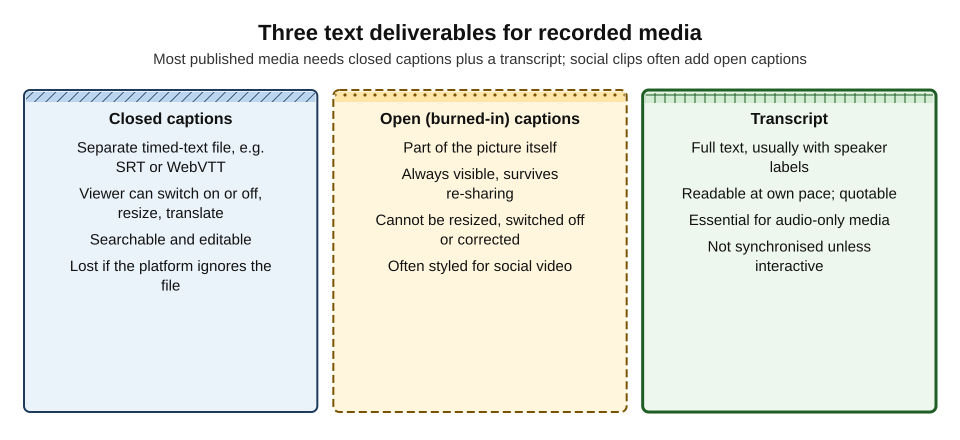
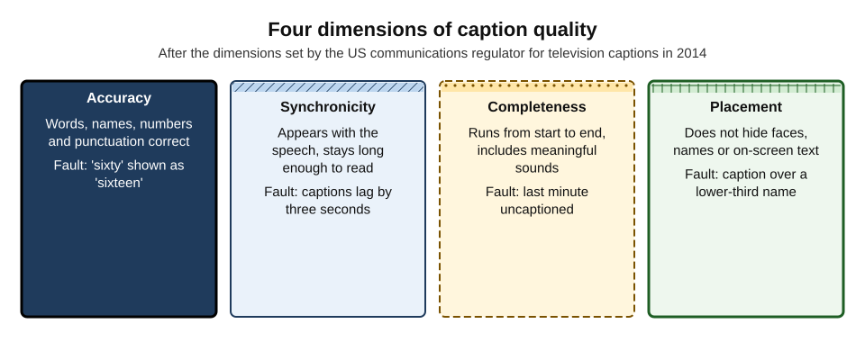
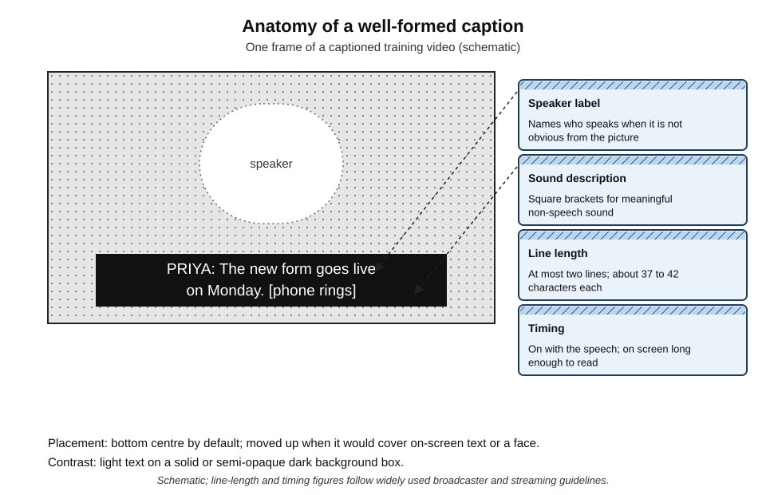
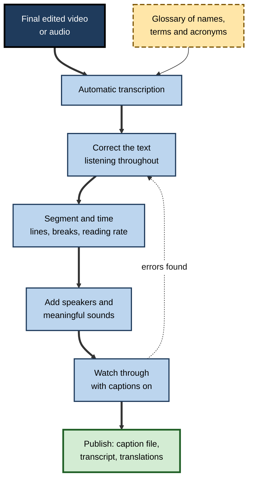
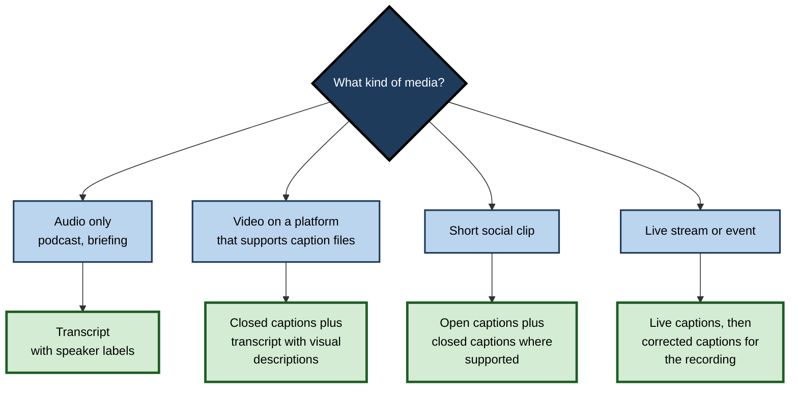

# I.6. Captions and transcripts

A company publishes a product video with automatic captions. The chief executive says, "We've cut emissions by sixty per cent"; the captions say "sixteen". A deaf customer reads the lower number; a journalist quotes the higher one from the audio; both are now in circulation. Automatic captioning made the video accessible in seconds — and a single unchecked word made it inaccurate for exactly the people who depend on the text.

> **Definition — Captions:** timed text that presents the speech and meaningful non-speech sound of audio or video, synchronised with the media, for people who cannot hear it or prefer to read it.

> **Definition — Transcript:** a complete written version of the speech (and, where relevant, other sounds and visual information) in a recording, not necessarily synchronised with it.

**Why it matters**

- **Access is a right, not a courtesy.** Deaf and hard-of-hearing people need captions to use video at all; accessibility law and standards in many jurisdictions require them for published media.
- **Most viewers benefit.** People watch with the sound off on phones and in open-plan offices, follow speakers with unfamiliar accents, or read in a second language.
- **Text makes media findable and reusable.** Transcripts can be searched, quoted, translated and summarised.
- **AI has made captioning nearly free** — and has made unchecked, inaccurate captions the new default.

---

## Captions, Subtitles and Transcripts

### Terms that are often confused

- **Captions** — speech plus meaningful sounds, in the same language as the audio, for people who cannot hear.
  - In British usage, broadcasters often call these **subtitles** as well.
- **Subtitles** (translation sense) — speech translated into another language, for people who can hear but do not understand the language.
- **SDH — subtitles for the deaf and hard of hearing** — subtitles that also include speaker identification and sound information.
- **Closed captions** — a separate track the viewer can switch on or off.
- **Open (burned-in) captions** — text rendered into the picture itself, always visible.
- **Transcript** — the full text, read separately from the media.
- **Interactive transcript** — a transcript synchronised with playback, highlighting the current words and allowing navigation by clicking text.

> **Definition — Subtitles for the deaf and hard of hearing (SDH):** subtitles that include not only dialogue but speaker identification, sound effects and music descriptions.

> **Definition — Audio description:** narration that describes important visual information for people who are blind or have low vision — a separate access service from captions.

**Figure 1.** Three text deliverables for recorded media.



| | Closed captions | Open captions | Transcript |
|---|---|---|---|
| Viewer control | On/off, size, colour, language | None | Read at own pace |
| Survives re-sharing | Only if the platform carries the file | Yes — part of the picture | As a separate document |
| Correctable after publishing | Yes, by replacing the file | Only by re-exporting the video | Yes |
| Searchable by machines | Yes | Not directly | Yes |
| Best for | Published video on capable platforms | Short social clips; platforms that ignore caption files | Audio-only media; reference; deafblind users with braille displays |

### Verbatim and clean transcripts

- **Full verbatim** — every word, filler, false start and repetition.
  - Used for legal, research and evidential purposes.
- **Clean verbatim** — fillers and false starts removed, meaning untouched.
  - Used for most published transcripts and captions.
- **Edited transcript** — tightened for reading, with light grammatical correction.
  - Used for articles and published interviews; should be labelled as edited.

> **Watch out:** "clean" must never mean "corrected for content". Removing "um" is cleaning; removing "probably" changes what was said.

---

## How Automatic Captioning Works

- **Speech recognition** produces words with timings.
  - The same technology powers meeting transcription; its accuracy limits — accents, jargon, crosstalk, poor audio, occasional invented phrases — apply equally to published media.
- **Segmentation** splits the word stream into caption units ("cues") of one or two lines.
- **Timing** assigns each cue an in-time and out-time.
- **Formatting** adds punctuation, capitalisation, line breaks and, in better tools, speaker labels and sound tags.
- **Translation** (optional) produces subtitle tracks in other languages from the corrected source captions.

> **Key point:** recognition is only the first of four steps. Many poor automatic captions are poor not because of wrong words but because of **bad segmentation and timing** — lines broken mid-phrase, cues flashing past too fast or lagging behind speech.

### Timed-text formats

- **SRT (SubRip)** — simple numbered cues with start and end times; widely supported.
- **WebVTT** — the web standard for HTML video; supports positioning and styling.
- **TTML and its broadcast profiles** — XML-based formats used by broadcasters and streaming services.
- **Platform-native formats** — some video platforms convert uploads into their own internal format.

```text
12
00:01:14,200 --> 00:01:17,900
PRIYA: The new form goes live
on Monday. [phone rings]
```

- **Anatomy of a cue:** a number; start and end times; one or two lines of text.

---

## What Makes Captions Good

### The four dimensions of quality

**Figure 2.** Four dimensions of caption quality.



- **Accuracy** — words, spelling, punctuation, names, numbers, grammar.
- **Synchronicity** — captions appear with the speech and remain long enough to read.
- **Completeness** — from beginning to end of the programme, including meaningful sounds.
- **Placement** — captions do not obscure faces, names, graphics or other important visual information.
- **Origin:** in 2014 the US Federal Communications Commission adopted caption quality standards for television built on these four dimensions; they serve well for any published media.

> **Mnemonic — "ASCP" ("Always Show Clear Pictures"):** Accuracy, Synchronicity, Completeness, Placement.

### Reading speed and line length

- **Line length** — most guidelines allow at most **two lines**, of about **37 to 42 characters** each, depending on the broadcaster or service.
- **Reading speed** — guidelines commonly set a maximum rate:
  - British broadcast guidance has long used roughly **160 to 180 words per minute** for adult programmes;
  - some streaming specifications express it as about **17 characters per second for children's** and **20 for adult** English content.
- **Duration** — a cue should normally stay on screen for at least about one second and rarely more than about seven.
- **Line breaks** — at natural linguistic boundaries: after punctuation, before conjunctions and prepositions; never splitting an article from its noun or a name across lines.

> **Formula — Caption reading rate:** characters per second = characters in the cue (including spaces) ÷ display time in seconds. A 62-character cue shown for 2.5 seconds runs at 62 ÷ 2.5 = **24.8 cps** — too fast for a 20 cps limit. Either extend the display to at least 3.1 seconds (62 ÷ 20) or shorten the text.

**Figure 3.** Anatomy of a well-formed caption.



### Speaker identification and sound

- **Speaker labels** — when the speaker is off-screen, not obvious, or changes rapidly: "PRIYA:", or a dash for a change of speaker within a cue.
- **Sound descriptions** — in square brackets, only when they matter: [phone rings], [laughter], [door slams], [upbeat music].
- **Tone and manner** — where it changes meaning: [sarcastic], [whispering].
- **Music** — identify mood or title; lyrics captioned when they matter to the content.
- **Silence** — "[no audio]" can be useful when a viewer might otherwise think captions have failed.

> **Watch out:** automatic tools rarely add meaningful sound descriptions. A captioned video in which a fire alarm sounds, a speaker is interrupted by laughter or a crucial clip plays silently in the captions is **incomplete** — and the omission is invisible to anyone who can hear.

### Accuracy that matters

- **Weighted errors** — a misspelled filler matters far less than a wrong number, a negation dropped or a name mangled.
- **High-risk items:** numbers, dates, money, percentages; names of people, products and places; negatives ("can"/"can't"); technical terms; acronyms.

**Study card — the NER model of caption accuracy (Romero-Fresco and Martínez, 2015)**

- **Problem:** simple word error rates treat every error equally and ignore errors introduced by editing or paraphrase.
- **Model:** accuracy = (N − E − R) ÷ N × 100, where N is the number of words, E "edition" errors (from editing or paraphrasing) and R "recognition" errors.
  - Each error is weighted by its effect on meaning: **minor** (0.25), **standard** (0.5) or **serious** (1 — a misleading but plausible statement).
- **Threshold:** 98% is commonly treated as the minimum acceptable accuracy.
- **Use:** the UK regulator Ofcom used the model to assess live subtitling quality on British television in the mid-2010s; it has since been applied in several countries.
- **Conclusion:** caption quality is about **meaning conveyed**, not just words matched.

> **Formula — NER accuracy:** with N = 500 words, E = 2 (one minor, one standard → 0.25 + 0.5 = 0.75) and R = 4 (two minor, one standard, one serious → 0.5 + 0.5 + 1 = 2.0): (500 − 0.75 − 2.0) ÷ 500 × 100 = **99.45%** — above 98%, but the single serious error still needs correcting before publication.

---

## The Captioning Workflow

**Figure 4.** Producing accurate captions and a transcript with AI assistance.



1. **Caption the final cut** — captions made before editing must be redone after every change.
2. **Prepare a glossary** — names, product terms, acronyms; many tools accept custom vocabulary.
3. **Transcribe automatically.**
4. **Correct the text while listening** — reading alone misses errors that "look" right.
5. **Segment and time** — check line breaks and reading rates; most caption editors flag cues that exceed limits.
6. **Add speaker labels and sound descriptions.**
7. **Watch the whole video with captions on**, as a viewer would.
8. **Publish** the caption file, a transcript and any translations; set captions as available (or default on, where appropriate).

> **In practice:** correction time depends heavily on audio quality and vocabulary. Clear, single-speaker recordings may need only a few minutes of correction per minute of video; noisy, technical or multi-speaker material can take far longer. Budget for it rather than assuming automatic captions are finished.

### Worked example (illustrative): correcting an automatic caption file

**Situation:** a two-minute product explainer has automatic captions. The checker compares them with the audio.

| Automatic cue | Problem | Corrected cue |
|---|---|---|
| "our new flow manager cuts setup time by sixteen percent" | Product name wrong ("Flowmanager"); number wrong (sixty); one long line | "Our new FlowManager cuts setup time / by 60 per cent." |
| "you can't export reports" | Negation wrong — speaker said "can" | "You can export reports" |
| "integrates with sales force and zero" | Product names misrecognised | "It integrates with Salesforce and Xero." |
| (nothing) | Doorbell sound used as a joke in the video | "[doorbell rings]" |
| "so the next thing that we're going to look at is how you set up" (1.4 s) | Reading rate about 46 cps | Split into two cues, or condensed to "Next: setting up." |

*Illustrative figures.*

1. **Glossary added** for future videos: FlowManager, Salesforce, Xero.
2. **Numbers and negatives** checked first — the highest-risk errors.
3. **Long cues split** at natural boundaries; reading rate brought under 20 cps.
4. **Sound description** added where the sound carried meaning.

- **Conclusion:** five corrections changed meaning — two of them reversed it. None would have been found by reading the captions without listening.

> **Watch out:** captions are quoted. A wrong number or negation in captions may be repeated by journalists, customers and colleagues who never heard the audio.

---

## Translation and Multilingual Media

- **Translate from corrected source captions** — never from uncorrected automatic text, which compounds errors.
- **Expansion** — many languages need more characters than English for the same meaning; translated subtitles may need condensing to stay within reading limits.
- **Timing** — translated cues usually keep the source timing; some languages require re-segmentation.
- **Terminology** — product names, legal terms and job titles should follow the organisation's approved translations.
- **Right-to-left and complex scripts** — check that the player renders them correctly.
- **Review** by a fluent speaker for anything external, legal or safety-related.

> **Example (illustrative):** a German subtitle of a 2-second English cue — "Click save before you exit" — comes out at nearly twice the characters. The reviewer condenses it to the German equivalent of "Save before exiting", keeping the meaning and the reading rate.

---

## Transcripts as Products

### Uses

- **Audio-only media** — podcasts and audio briefings need a transcript to be accessible to deaf people at all.
- **Deafblind users** — read transcripts on braille displays; captions alone may not reach them.
- **Reference and quotation** — journalists, researchers and colleagues quote from text.
- **Search and discovery** — transcripts make media findable inside and outside the organisation.
- **Repurposing** — articles, summaries, social posts and training notes drafted from transcripts.

### Good practice

- **Speaker labels** with names or roles.
- **Paragraphs** at changes of topic, with timestamps at intervals for navigation.
- **Descriptions of essential visual content** in video transcripts — "[Slide shows a chart: sales by region]" — so that the transcript serves people who can neither see nor hear the video.
- **Label the type** — verbatim, clean or edited.
- **Publish alongside the media**, clearly linked to it on the same page.

> **Remember:** a transcript of a **video** should include what is **shown** as well as what is said, where the visual content matters.

---

## Law and Standards

- **Web Content Accessibility Guidelines (WCAG)**, published by the World Wide Web Consortium, are the reference standard behind most accessibility laws:
  - **captions for prerecorded audio in synchronised media** — Level A, the most basic level;
  - **captions for live audio** — Level AA;
  - **an alternative (such as a transcript) for prerecorded audio-only content** — Level A;
  - **audio description** for prerecorded video — required at Level AA.
- **Where the standards bite** — public-sector bodies in the UK and EU must meet WCAG-based requirements for websites and apps; the European Accessibility Act extends obligations to many private-sector products and services from June 2025; in the United States, disability-rights law has been applied to online video, and broadcast captioning is regulated.
- **Broadcast regulation** — regulators such as Ofcom in the UK set subtitling targets and quality guidance for television.

### Case study: the lawsuits against Harvard and MIT

- **Situation:** Harvard University and the Massachusetts Institute of Technology published large amounts of free online video — lectures, courses, podcasts and events.
- **Complaint:** in 2015 the National Association of the Deaf and four deaf and hard-of-hearing individuals sued both universities, arguing that much of the content was **uncaptioned or inaccurately captioned** — including automatic captions that were often unintelligible — and therefore inaccessible under US disability-rights law.
- **Defence and course of the cases:** the universities argued, among other things, that the law did not require captioning of all freely published content; courts allowed the core claims to proceed.
- **Settlements:** Harvard settled in 2019 and MIT in 2020, agreeing to caption new and much existing online content to quality standards, to provide captions on request within set times, and to require high-quality captions rather than unedited automatic ones.
- **Lessons:**
  1. publishing video publicly creates an **accessibility obligation**, even when the content is free;
  2. **automatic captions alone were not treated as adequate**;
  3. backlogs of uncaptioned media are a liability that grows quietly.

> **Key point:** "captions available" is not the test. The test is whether the captions are **accurate, synchronised, complete and well placed** enough for someone who cannot hear to receive the same content.

---

## Choosing What to Produce

**Figure 5.** Choosing caption and transcript deliverables by type of media.



- **Audio only** — transcript.
- **Video on a capable platform** — closed captions and a transcript.
- **Short social clips** — open captions (because many platforms autoplay muted and some ignore caption files), plus closed captions where supported.
- **Live** — live captions during the event; corrected captions for the recording afterwards.

> **Watch out:** stylised social captions — one word at a time, bouncing, colour-changing — can be hard to read for people with dyslexia, low vision or cognitive impairments. Keep animated styles modest and the text large and steady.

---

## Captioning in Organisations

### Case study (illustrative): a training library's caption backlog

- **Situation:** a retailer's learning team held 400 training videos, most with automatic captions only.
- **Problem:** a deaf employee raised a grievance after failing a compliance assessment; the relevant safety video's captions rendered a key instruction ("do **not** lift above shoulder height") without the "not".
- **Diagnosis:**
  - no one owned caption quality;
  - automatic captions were assumed adequate;
  - videos had been re-edited after captioning, so many captions were out of sync.
- **Actions:**
  1. **triage** — safety, compliance and onboarding videos corrected first; low-use videos scheduled or retired;
  2. **standard** — the four quality dimensions and reading-rate limits written into the video brief;
  3. **workflow** — captions produced from the final cut only, with a glossary and a full watch-through;
  4. **ownership** — each video's owner responsible for its captions, with a central check for high-risk content;
  5. **feedback route** — a simple way for viewers to report caption errors.
- **Result:** the high-risk backlog was cleared within three months; the grievance was resolved; new videos were published with corrected captions from the start.
- **Lesson:** captions are part of the **content**, with the same owner and the same standard of accuracy as the speech itself.

### Professional habits

- **Caption from the final edit**, and re-check after any change.
- **Check numbers, names and negatives first.**
- **Listen while correcting.**
- **Respect reading rates** — condense rather than flash text past.
- **Add meaningful sounds and speaker labels.**
- **Publish transcripts** with essential visual descriptions.
- **Invite and act on corrections** from viewers.

---

## Caption Style Decisions

Beyond accuracy and timing, a caption file embodies dozens of small editorial choices. Consistent choices, written down as a house style, make captions easier to read and faster to correct.

### Verbatim or edited captions

- **Verbatim captions** — every word, at the cost of high reading rates for fast speakers.
- **Edited captions** — lightly condensed to stay within reading limits, keeping meaning, tone and key words.
- **Who prefers which** — many deaf viewers prefer verbatim captions, seeing condensation as censorship of what hearing viewers receive; readers with slower reading speeds may prefer edited captions.
- **Common compromise** — verbatim where reading rates allow; condense only when a cue would exceed the limit, never changing meaning.

> **Watch out:** condensing is an editorial act. Removing hedges ("I think", "probably") or softening a speaker's words changes what deaf viewers receive compared with hearing viewers.

### House-style choices

- **Numbers** — words or digits (a common rule: one to nine in words, 10 and above in digits; always digits for money, percentages and times).
- **Profanity** — caption what is said; do not censor unless the audio is also censored.
- **Non-English speech** — translate and label "[in Hindi]" or caption the original if most viewers understand it.
- **Dialect and accent** — do not spell out accents phonetically; caption standard spellings.
- **Off-screen speakers** — label, and consider italics where the style supports it.
- **Song lyrics** — caption when meaningful; mark clearly as sung.
- **Inaudible passages** — "[inaudible]" rather than a guess.

| Choice | Option A | Option B | Common professional practice |
|---|---|---|---|
| Fillers | Keep all | Remove all | Remove unless they carry meaning |
| Numbers | Always digits | Words for small numbers | Words one to nine; digits otherwise and for money and data |
| Speaker change | Name every time | Dash for change of speaker | Name when unclear; dash within a cue |
| Unknown words | Best guess | "[inaudible]" | "[inaudible]" — never invent |
| Case | All capitals | Sentence case | Sentence case (more readable) |

### Platforms and files in practice

- **Upload the caption file**, not only the platform's automatic captions; most platforms let the owner replace or edit automatic tracks.
- **Check after upload** — some platforms re-time or re-segment captions; watch a sample.
- **Embedding** — when a video is embedded elsewhere, closed captions travel only if the player supports them.
- **Burning in** — export open captions from the corrected file, never from uncorrected automatic text; keep the clean (caption-free) master too.
- **Versioning** — name caption files with language and version (*e.g.* "induction-v3-en.vtt") and update them whenever the video changes.

### Live captions in brief

- **Live events and streams** use real-time recognition or human captioners (stenographers or respeakers); accuracy and delay are worse than for prerecorded captions.
- **After the event**, the recording should receive corrected captions before it is published as on-demand video.
- **For high-stakes events** — town halls, public meetings, launches — human captioners or human-corrected live captions remain the standard of care.

---

## Open Questions

- **When will automatic captions be good enough without correction?**
  - Accuracy has improved dramatically, but errors still cluster in names, numbers and specialist terms — exactly the words that matter most.
- **How should AI-generated captions be disclosed?**
  - Viewers may trust captions more than they should; whether unedited automatic captions should be labelled as such is debated.
- **Can quality be measured at scale?**
  - Meaning-weighted models such as NER need trained human assessors; automated quality estimation is improving but unproven for compliance purposes.
- **How should creative styling be balanced with readability?**
  - Animated social captions engage many viewers but may exclude others; evidence on their effects is limited.
- **Will AI audio description close the gap?**
  - Automatically generated descriptions of visual content are emerging, but their accuracy and judgement about what matters remain uncertain.

---

## Summary

- **Captions** present speech and meaningful sound in sync with media; **transcripts** are full text versions; **subtitles** may translate; **SDH** adds speakers and sounds.
- **Closed** captions can be controlled and corrected; **open** captions survive re-sharing; transcripts serve audio-only media, deafblind users, search and quotation.
- Automatic captioning involves **recognition, segmentation, timing and formatting**; poor segmentation and timing are as harmful as wrong words.
- Quality has four dimensions: **accuracy, synchronicity, completeness, placement** (US regulator, 2014).
- Keep to **two lines of about 37–42 characters**, sensible **reading rates** (cps = characters ÷ seconds) and natural line breaks.
- Weight errors by meaning: the **NER model** (98% threshold) counts serious errors more heavily; numbers, names and negatives are highest risk.
- Workflow: final cut → glossary → automatic transcription → **correct while listening** → segment and time → speakers and sounds → watch-through → publish.
- Translate from **corrected** captions; manage text expansion and terminology.
- **WCAG** requires captions for prerecorded video at Level A; laws in many jurisdictions build on it. The **Harvard and MIT** settlements showed that unedited automatic captions were not treated as adequate.
- Choose deliverables by media type; treat captions as **content** with an owner and a standard.

---

## Self-Check

1. Distinguish captions, subtitles, SDH and transcripts.
2. Compare closed captions, open captions and transcripts on control, survival when shared and correction.
3. What is the difference between full verbatim, clean verbatim and edited transcripts, and when is each appropriate?
4. Name the four steps of automatic captioning and explain why recognition accuracy alone does not guarantee good captions.
5. List and explain the four dimensions of caption quality.
6. A 55-character cue is displayed for 2 seconds. Calculate its reading rate and say how to fix it for a 20 cps limit.
7. Explain the NER model and why it weights errors.
8. Which words should be checked first in automatic captions, and why?
9. Describe the captioning workflow and explain why captions must be made from the final cut.
10. What should a video transcript contain beyond the spoken words?
11. What does WCAG require for prerecorded video and audio-only content?
12. Summarise the Harvard and MIT cases and their lessons.
13. Recommend caption and transcript deliverables for a podcast, a webinar recording and a 30-second social clip.
14. Your organisation has 300 videos with uncorrected automatic captions. Propose a plan.

### Answer Key

1. Captions: same-language speech and sounds for people who cannot hear. Subtitles: usually translated speech for people who can hear. SDH: subtitles with speaker and sound information. Transcripts: full text read separately from the media.
2. Closed: viewer-controlled, correctable by replacing the file, lost if a platform drops the file. Open: always visible and survive re-sharing, but cannot be resized, switched off or easily corrected. Transcripts: read at own pace, correctable, separate from playback.
3. Full verbatim keeps every filler and false start (legal, research, evidence); clean verbatim removes fillers but keeps meaning (most captions and published transcripts); edited transcripts are tightened for reading (articles) and should be labelled.
4. Recognition, segmentation, timing, formatting. Correct words can still be broken mid-phrase, shown too briefly, out of sync or without speakers and sounds.
5. Accuracy — correct words, names, numbers. Synchronicity — appears with speech, readable duration. Completeness — whole programme, meaningful sounds. Placement — not covering faces or on-screen text.
6. 55 ÷ 2 = 27.5 cps. Extend to at least 2.75 seconds (55 ÷ 20), or shorten the text, or split it into two cues.
7. Accuracy = (N − E − R) ÷ N × 100 with edition and recognition errors weighted minor, standard or serious by effect on meaning. Weighting reflects that a dropped negation misleads far more than a misspelled filler; 98% is a common threshold.
8. Numbers, dates, money, names, negatives, technical terms and acronyms — they are most often misrecognised and errors in them change meaning most.
9. Final cut, glossary, automatic transcription, correction while listening, segmentation and timing, speakers and sounds, watch-through, publication. Any later edit shifts timings and content, making earlier captions wrong.
10. Speaker labels, paragraphs and timestamps, meaningful sounds and descriptions of essential visual content such as slides and on-screen text, plus a label of its type.
11. Captions for prerecorded synchronised media at Level A; an alternative such as a transcript for prerecorded audio-only content at Level A; audio description for prerecorded video at Level AA (captions for live audio at Level AA).
12. Deaf plaintiffs and the National Association of the Deaf sued in 2015 over uncaptioned and poorly captioned free online content; settlements (2019, 2020) required quality captions for new and existing content. Free public video carries accessibility obligations; unedited automatic captions were not adequate; backlogs are liabilities.
13. Podcast: transcript with speaker labels. Webinar: corrected closed captions and a transcript including slide descriptions. Social clip: open captions plus closed captions where supported, in a readable style.
14. Triage by risk and use (safety, compliance, onboarding, public first); retire unused videos; correct to a written standard with glossary and watch-through; assign owners; build captioning into the production workflow; add a feedback route; track progress.

---

## Glossary

| Term | Meaning |
|---|---|
| Audio description | Narration describing important visual content for blind and low-vision people. |
| Captions | Timed, synchronised text of speech and meaningful sound. |
| Characters per second (cps) | Caption reading rate: characters divided by display time. |
| Clean verbatim | A transcript without fillers and false starts, meaning unchanged. |
| Closed captions | Captions in a separate track the viewer can switch on or off. |
| Cue | A single caption unit of one or two lines with start and end times. |
| Full verbatim | A transcript including every word, filler and false start. |
| Interactive transcript | A transcript synchronised with playback and usable for navigation. |
| NER model | A meaning-weighted measure of caption accuracy: (N − E − R) ÷ N × 100. |
| Open captions | Captions rendered permanently into the picture. |
| SDH | Subtitles for the deaf and hard of hearing, including speakers and sounds. |
| SRT | A simple, widely supported timed-text caption format. |
| Subtitles | Timed text, often translated, for viewers who can hear. |
| Transcript | A full written version of a recording's speech and relevant sounds. |
| WebVTT | The web standard timed-text format for HTML video. |
| WCAG | Web Content Accessibility Guidelines, the reference accessibility standard. |
