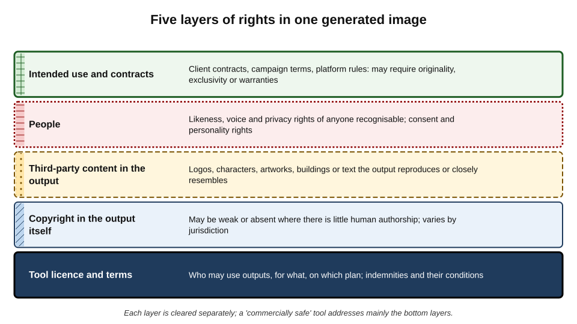
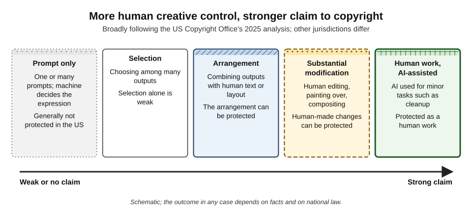
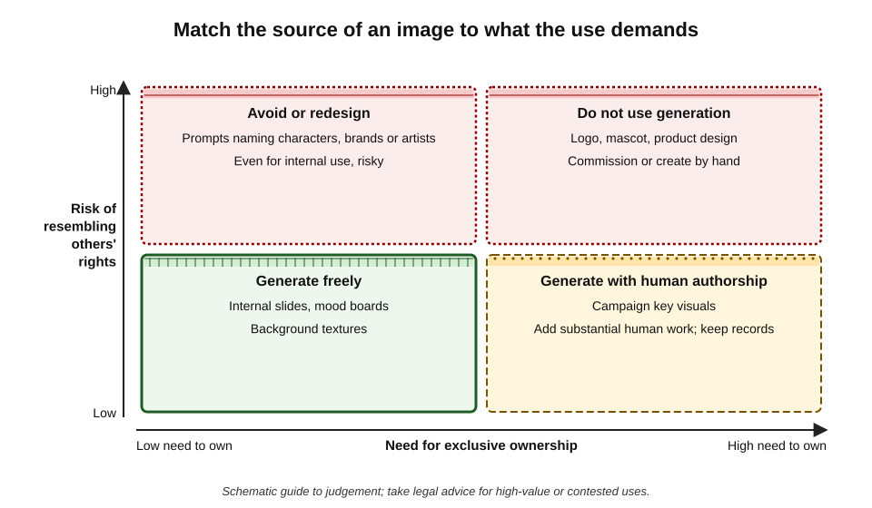
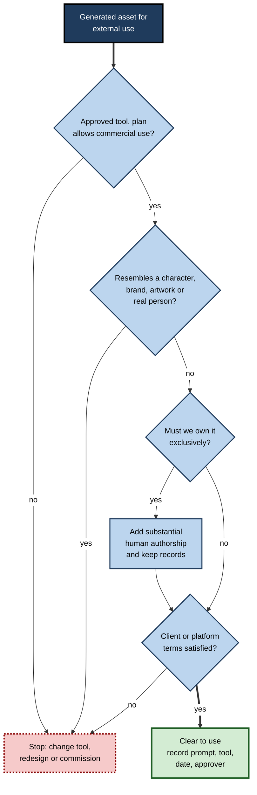
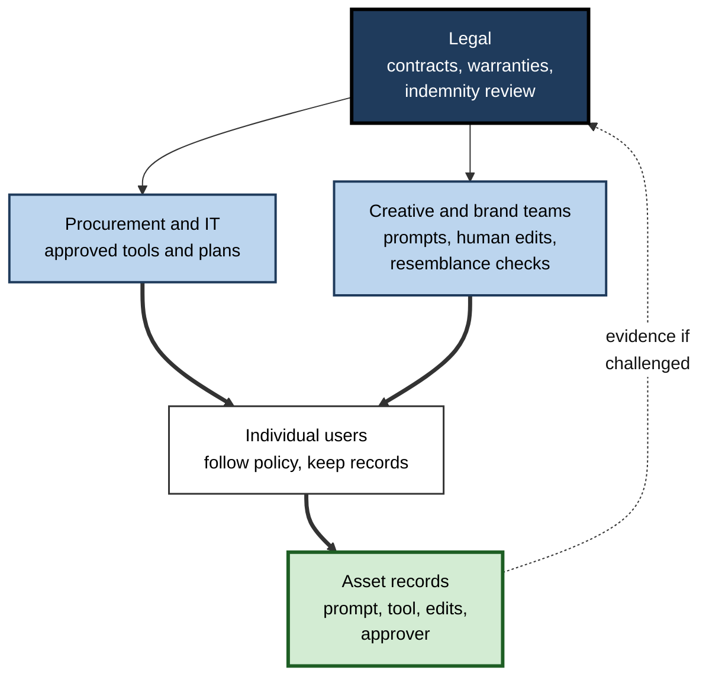

# I.7. Rights and licensing of generated media

A start-up generates a mascot for its new app — a friendly fox — and builds its whole brand around it. A year later a competitor launches with a nearly identical fox. The start-up's lawyer asks a simple question: "Who owns the fox?" The honest answer may be: possibly nobody. Then a stock-image company says the fox resembles one of its illustrations. Generated media sits inside a web of rights that neither the prompt nor the "Download" button reveals.

> **Definition — Rights in generated media:** the legal interests that can attach to an AI-generated or AI-assisted image, video, audio or text — copyright in the output, rights of others whose works, marks or likeness it uses, and the contractual terms of the tool and of the intended use.

> **Definition — Licence:** permission, usually in a contract or terms of service, to use material in specified ways, without transferring ownership.

**Why it matters**

- **Ownership is uncertain.** In many jurisdictions purely machine-generated material may not be protected by copyright at all.
- **Infringement risk is real.** Outputs can reproduce or closely resemble protected characters, logos, artworks and photographs.
- **Contracts assume rights.** Clients, publishers and platforms often require warranties that delivered material is original and owned.
- **The law is moving.** Courts and legislators on several continents are deciding cases and rules that will shape what is safe — and some decisions remain years away.

> **Watch out:** this is a field of active litigation and legislation. The decisions and guidance cited are those up to 2026, and positions are changing; matters of real value need advice from a lawyer in the relevant jurisdiction.

---

## The Building Blocks

### Copyright in brief

- **Copyright** protects original creative expression — images, text, music, film, software — not ideas, styles or facts.
- **It arises automatically** on creation in most countries; registration (where available) mainly helps enforcement.
- **It gives the owner exclusive rights** — to copy, distribute, adapt, perform and communicate the work — for a limited period.
- **Originality** is required: in the EU and UK, a work must be the "author's own intellectual creation"; in the United States, a modicum of creativity by a human author.

> **Definition — Copyright:** a legal right protecting original works of authorship, giving the owner control over copying and certain other uses for a limited time.

### Other rights that matter

- **Trade marks** — logos, names and distinctive signs used in trade; a generated image containing a brand's logo or distinctive packaging can infringe or mislead.
- **Personality, publicity and image rights** — control over commercial use of a person's name, likeness or voice; strong in some US states, recognised differently in Europe and Asia.
  - *e.g.* Tennessee's 2024 "ELVIS Act" specifically protects individuals' voices against unauthorised AI imitation.
- **Data protection** — a recognisable person's image is personal data under laws such as the GDPR.
- **Design rights** — the appearance of products.
- **Moral rights** — authors' rights to attribution and against derogatory treatment, strong in civil-law countries and in India.

### Three questions for any generated asset

1. **Can we use it?** — the tool's licence and terms.
2. **Do we own it?** — copyright in the output.
3. **Does it infringe anyone else?** — third-party copyright, marks, likeness and data.

> **Mnemonic — "USE, OWN, INFRINGE":** three separate questions, answered by three different sources: the contract, copyright law and other people's rights.

**Figure 1.** Five layers of rights in one generated image.

---

## Can We Use It? Tool Licences and Terms

### What terms of service typically say

- **Ownership of outputs** — most major providers state that, as between provider and user, the user owns outputs (to the extent any rights exist) or assign whatever rights the provider has.
- **Use restrictions** — prohibited content, prohibited uses (*e.g.* political campaigning, impersonation), and sometimes restrictions on commercial use for free tiers or for larger companies on lower-priced plans.
- **Inputs** — the user warrants they have the right to upload reference images, voice samples and documents.
- **Provider licence back** — some terms let the provider use prompts and outputs to improve services, or show outputs publicly (in some tools, generated images are visible to other users by default unless a private mode is purchased).
- **Liability** — usually excluded or capped, unless an indemnity applies.

> **Watch out:** "you own the output" in a provider's terms does not create copyright where the law gives none. It only means the **provider** will not claim it. A competitor who copies the output is not bound by those terms.

### Indemnities

- **What they are** — a promise by the provider to defend and compensate a customer sued for infringement arising from using the tool's outputs.
- **Examples** — from 2023, several large providers announced intellectual-property indemnities for business customers of their generative tools, including Microsoft, Google, Adobe, Shutterstock and OpenAI.
- **Typical conditions:**
  - available only on business or enterprise plans;
  - the customer must use the provider's safety filters and content guardrails;
  - no cover if the user **intentionally** sought infringing output (*e.g.* prompting for a named character) or modified the output into infringement;
  - no cover for trade-mark use the customer chooses, or for uploaded inputs.

| Feature | Consumer or free tier | Business or enterprise tier |
|---|---|---|
| Output ownership statement | Usually present | Usually present |
| Commercial use permitted | Sometimes restricted | Generally permitted |
| IP indemnity | Rare | Often offered, with conditions |
| Inputs used for training | Often, by default | Often excluded by contract |
| Privacy of generations | Sometimes public by default | Private |
| Audit and admin controls | None | Typically available |

> **In practice:** organisations choose approved tools partly on **contract terms**: commercial-use rights, indemnity scope and conditions, training-data assurances and confidentiality. The same model accessed through a consumer account and an enterprise contract can carry very different legal positions.

### "Commercially safe" models

- **Claim** — some providers train image models only on licensed stock, public-domain and openly licensed material, and market them as "commercially safe".
  - *e.g.* Adobe's Firefly models were announced in 2023 as trained on Adobe Stock content, openly licensed work and public-domain material.
- **What it addresses** — the risk that the **model** was built by infringing training data.
- **What it does not address** — outputs that resemble a trade mark, a character or a real person; ownership of the output; contributors' objections to how their stock images were used.

---

## Do We Own It? Copyright in AI Outputs

### The central principle: human authorship

**Figure 2.** More human creative control, stronger claim to copyright.

- **United States**
  - The Copyright Office's position, set out in registration guidance in 2023 and in a report on copyrightability in January 2025:
    - copyright requires **human authorship**;
    - **prompts alone** generally do not make the user the author of the output, because the system determines the expressive elements;
    - **human selection and arrangement** of AI material, and **human modifications** of it, can be protected;
    - works made with AI assistance (for example, AI used to clean up a human-made image) remain protectable.
  - *Thaler v. Perlmutter* — the courts upheld refusal to register an image listing an AI system as its sole author (appeals court, March 2025); the Supreme Court declined to hear the case in March 2026.
  - *Allen v. Perlmutter* — an artist's challenge to the refusal to register an award-winning Midjourney-based image, made with hundreds of prompt iterations and later editing, was still pending in 2026; it asks whether intensive prompting can amount to authorship.
- **United Kingdom**
  - The Copyright, Designs and Patents Act 1988 protects **"computer-generated works"** with no human author, naming as author the person who made the arrangements necessary for the work's creation, for 50 years.
  - How this applies to modern generative AI, and whether such works meet the originality test, is uncertain; the government consulted on reforms in 2024–25 and the position remained under review in 2026.
- **India**
  - The Copyright Act 1957 likewise names the person who causes a computer-generated work to be created as its author; the application to generative AI has not been settled by the courts.
- **European Union**
  - No specific provision; protection requires the **author's own intellectual creation**, which most commentators read as requiring human creative choices.
- **China**
  - In November 2023 the Beijing Internet Court recognised copyright in an image generated with Stable Diffusion, finding that the user's detailed prompts, parameter choices and selection reflected intellectual input — a more generous approach than the US Copyright Office's.

| Jurisdiction | Purely generated output | Human-modified or arranged output | Key sources |
|---|---|---|---|
| United States | Not protected | Human contributions protected | Copyright Office guidance and 2025 report; *Thaler* |
| United Kingdom | Possibly protected as computer-generated work; uncertain | Protected as human work where original | CDPA 1988 s. 9(3); consultation 2024–25 |
| India | Statute names a computer-generated work author; untested for generative AI | Protected as human work | Copyright Act 1957 |
| European Union | Probably not protected | Protected where human creative choices | Originality case law |
| China | Protected in at least one court decision where user input was substantial | Protected | Beijing Internet Court, 2023 |

> **Key point:** the safest assumption for international work is that **the purely generated part of an output may be free for anyone to copy**, while human contributions — selection, arrangement, editing, added text and design — can be owned.

### Case study: *Zarya of the Dawn*

- **Situation:** in 2022 the artist Kris Kashtanova registered copyright in *Zarya of the Dawn*, a short comic book with text written by the author and images generated with Midjourney.
- **What happened:** after learning that the images were AI-generated, the US Copyright Office reviewed the registration.
- **Decision (February 2023):**
  - the **text** written by the author was protected;
  - the **selection and arrangement** of text and images — the comic as a compilation — was protected;
  - the **individual Midjourney images** were not, because the author did not control their specific expressive content; prompting was compared to giving instructions to a commissioned artist;
  - minor human edits to some images were too slight to change the result.
- **Consequences:** the registration was narrowed rather than cancelled.
- **Lessons:**
  1. an AI-assisted work can be **partly protected** — the human layers;
  2. **disclose** AI material accurately when registering;
  3. to strengthen ownership, **add substantial human creative work** and keep evidence of it.

### Strengthening ownership in practice

- **Add human authorship** — redraw, paint over, composite, combine with original photography, add designed typography and layout.
- **Keep records** — prompts, iterations, sketches, layered working files, showing the human creative contribution.
- **Use generation for components**, not for assets that must be owned exclusively.
- **Never base a core brand asset** (logo, mascot, product design) on unmodified generated output.

---

## Does It Infringe? Others' Rights

### Infringement through outputs

- **Substantial similarity** — an output that reproduces a substantial part of a protected work can infringe, however it was made.
- **Characters and franchises** — prompts naming well-known characters often produce recognisable versions of them.
- **Memorisation** — models can occasionally reproduce training images closely, especially ones duplicated many times in training data (famous photographs, paintings, film stills, product shots).
- **Logos and watermarks** — distorted versions of stock-library watermarks and brand logos have appeared in outputs.
- **Style** — style itself is not protected by copyright in most systems, but imitating a living artist's distinctive style can raise passing-off, unfair-competition and reputational problems, and some providers block artist-name prompts.

> **Definition — Substantial similarity:** the test, in various forms across jurisdictions, of whether one work copies enough of the protected expression of another to infringe.

### Training-data litigation

- **The question** — whether training models on copyrighted works without permission infringes, or is permitted by exceptions such as fair use (US) or text-and-data-mining exceptions (EU, UK).
- **Selected cases:**
  - **Getty Images v. Stability AI** (High Court of England and Wales, November 2025) — Getty dropped its main training claim for lack of evidence that training happened in the UK; the court rejected the argument that the model itself was an infringing copy, finding trade-mark infringement only in limited respects concerning watermarks reproduced by older model versions.
  - **Disney and Universal v. Midjourney** (United States, filed June 2025; Warner Bros. Discovery joined later that year) — studios allege that the image service reproduces their characters; the case was in discovery in 2026.
  - **GEMA v. OpenAI** (Munich Regional Court, November 2025) — the court held that memorising song lyrics in a model and reproducing them in outputs infringed copyright; the judgment was not final and was expected to be appealed.
  - **Artists' class actions** against image-model developers in the United States were continuing.
  - **Music** — major record labels sued AI music generators in 2024; in late 2025 some labels reached settlements and licensing arrangements with those services.
- **EU framework** — the 2019 Copyright in the Digital Single Market Directive allows text and data mining for any purpose unless rights holders **opt out** in a machine-readable way; the AI Act requires providers of general-purpose models to have a copyright-compliance policy and publish a summary of training content.

> **Watch out:** outcomes differ by country and even by claim within a case. A model found lawful to train in one jurisdiction may still produce **infringing outputs**, and the user who publishes them bears that risk.

### People in the output

- **Likeness and voice** — generated depictions of real people for commercial use usually need consent; several jurisdictions are adding specific protections against AI imitation.
- **Lookalikes** — an image of "a woman who looks like [celebrity]" can engage publicity and passing-off rights even if no photo of her was used.
- **Employees and models** — standard photo releases often predate AI; using staff or model photographs as references for generation, or training a custom model on them, needs consent covering that use.

### Inputs: what goes into the tool

- **Reference images** — uploading a photographer's image to "make one like this" can itself be copying and can produce derivative outputs.
- **Client materials** — logos, product shots and documents uploaded for generation must be within the client's permission.
- **Fine-tuning and custom models** — training a model on a set of images (for brand consistency) requires rights in all of them.

---

## Clearing Rights for Real Uses

### Matching source to use

**Figure 3.** Match the source of an image to what the use demands.

- **Generate freely** — low ownership need, low resemblance risk: internal slides, mood boards, textures.
- **Generate with human authorship** — high ownership need, low risk: campaign visuals with substantial human design work and records.
- **Avoid or redesign** — high risk, even if ownership does not matter: anything prompted from characters, brands or named artists.
- **Do not use generation** — assets that must be owned and are central to identity: logos, mascots, product designs.

**Figure 4.** A rights-clearance route for a generated asset intended for external use.

### Worked example (illustrative): a campaign image for a client

**Situation:** an agency proposes a generated key visual — a stylised city at dawn — for a bank's savings campaign, to run for a year on posters and online.

| Question | Finding | Action |
|---|---|---|
| Tool and plan | Enterprise plan; commercial use and indemnity included if guardrails are on | Confirm guardrails were on; save account details |
| Prompts | "In the style of" a named living illustrator in an early draft | Draft discarded; new prompts without artist names |
| Resemblance | Reverse image search finds no close matches; a skyline landmark is recognisable | Landmark replaced with an invented skyline to avoid building-image restrictions |
| Ownership | Client contract warrants "original work, all rights assigned" | Designer repaints sky, adds original typography and layout; layered files kept |
| People | None depicted | — |
| Disclosure | Bank policy requires credit for AI-assisted imagery | "Image created with AI tools and edited by [agency]" in campaign records |

*Illustrative scenario.*

1. **The contract warranty** was the decisive constraint: the agency could not assign rights that might not exist.
2. **The remedy** was to make the final asset a **human work incorporating AI material**, and to renegotiate the warranty wording to describe the AI components.
3. **Records** of prompts, iterations and human edits were archived with the asset.

- **Conclusion:** the asset was used, but only after rights were cleared at every layer — tool, resemblance, ownership, contract and disclosure.

> **Watch out:** many standard creative contracts warrant that work is "original" and that "all rights are assigned". Delivering unmodified generated material under such terms can put the supplier **in breach**, regardless of whether anyone ever copies it.

---

## Licensing Generated Media Onward

- **Stock libraries** — policies differ: some refuse AI-generated submissions entirely; others accept them if labelled and if no real people or third-party marks appear.
- **Open licences** — Creative Commons licences presuppose copyright; applying one to a purely generated image may grant nothing, though it signals the creator's intention. A public-domain dedication (CC0) is a coherent choice for unprotected material.
- **Model licences** — some openly released models come with licences restricting harmful or certain commercial uses of the model and outputs; these bind the user contractually.
- **Client deliverables** — describe AI components in the contract and adjust warranties accordingly.

> **Remember:** **you cannot license what you do not own** — but you can promise not to object, describe what you deliver honestly and assign the human-authored parts.

---

## Organisational Practice

### Policy elements

- **Approved tools and plans**, chosen for commercial terms, indemnity and data handling.
- **Prohibited prompts** — named living artists, characters, brands, real people without consent.
- **Core assets rule** — logos, mascots, product designs not generated.
- **Records** — prompt, tool, plan, date, human edits and approver kept with every external asset.
- **Contract templates** updated to describe AI use and adjust warranties.
- **Escalation** — legal review for high-value, high-visibility or contested uses.

**Figure 5.** How rights responsibilities divide across an organisation.

### Case study (illustrative): the mascot that could not be protected

- **Situation:** a consumer app adopted a generated fox mascot, lightly edited, as the centre of its brand.
- **Problem:** a competitor launched a similar fox; separately, a stock illustrator alleged resemblance to her work.
- **Diagnosis:**
  - the mascot was essentially **unmodified generated output** — weak or no copyright in key jurisdictions;
  - no records showed human creative development;
  - no resemblance check had been done before launch;
  - the trade-mark application covered only the name, not the image.
- **Actions:**
  1. a designer created a **new, hand-developed mascot** based on the fox concept, with documented sketches and iterations;
  2. the new design was **registered as a trade mark** for the relevant goods and services;
  3. the illustrator's claim was settled by licence while the redesign rolled out;
  4. policy changed: no core brand asset to be generated.
- **Result:** the company owned a protectable, registrable mascot; rebranding cost several months of design work.
- **Lesson:** speed at the start produced uncertainty at the centre of the brand. **Core identity assets need human authorship and registration.**

---

## Rights by Media Type

The same three questions apply to every medium, but the typical risks differ.

### Generated voice and audio

- **Synthetic stock voices** — licensed under the tool's terms; check whether commercial, broadcast and advertising uses are covered.
- **Cloned voices** — need the speaker's written consent, covering scope, duration, territories and withdrawal; voice actors' unions and contracts increasingly set terms for AI replicas.
- **Sound-alike voices** — a voice designed to resemble a famous person can engage publicity rights and passing off even if no recording of that person was used.
- **Ownership** — purely synthetic narration may carry weak rights; the script, if human-written, is protected.

### Generated music

- **Service terms** — many music generators restrict commercial use on free plans; some assign outputs, others license them.
- **Resemblance** — outputs that reproduce recognisable melodies, lyrics or a famous artist's voice carry high risk.
- **Platform detection** — rights-detection systems on video platforms may flag generated music that resembles catalogue recordings.
- **Practical rule** — for advertising and broadcast, licensed library or commissioned music remains the safer choice.

### Generated video

- **Combined risks** — video combines images, people, music and voice, so every layer applies at once.
- **Stock footage in generated edits** — licences may forbid alteration or combination with AI-generated material.
- **Real locations and buildings** — some jurisdictions and owners restrict commercial use of images of particular buildings and landmarks.

### Slides, documents and templates

- **Templates** — commercial templates and fonts are licensed; check that the licence covers the use (and the number of users).
- **Fonts** — font licences may restrict embedding in files sent externally or use in logos.
- **Icons and illustrations** — icon libraries often require attribution or a paid licence for commercial use.
- **Client material** — logos and content supplied by clients are licensed for the project only.

| Media type | Typical ownership position | Highest-risk element | Usual safeguard |
|---|---|---|---|
| Generated image | Weak if unmodified | Resemblance to characters, brands, artworks | Human authorship; resemblance check |
| Synthetic voice | Script protected; voice licensed | Cloned or sound-alike voice | Written consent; licensed stock voices |
| Generated music | Weak; licence terms decide | Resemblance to existing songs | Licensed library for external use |
| Generated video | Mixed | Real people; combined third-party elements | Layer-by-layer clearance |
| AI-built slides | Text and arrangement protected if human | Licensed fonts, icons, templates | Check licences; approved assets |

---

## Open Questions

- **Will prompting ever count as authorship?**
  - The *Allen* case and similar claims test whether intensive, iterative prompting can meet the human-authorship requirement; jurisdictions may diverge.
- **Is training on copyrighted works lawful?**
  - Courts in the US, UK, Germany and elsewhere are reaching different conclusions on different facts; licensing markets are growing in parallel.
- **Should computer-generated works keep special protection?**
  - The UK and India's provisions predate generative AI; reform proposals range from abolition to new, shorter rights.
- **How will likeness and voice be protected?**
  - New laws targeting AI imitation of voices and faces are appearing; their scope, and their interaction with free expression, is unsettled.
- **Will indemnities hold?**
  - Provider indemnities have rarely been tested; their conditions and limits will become clearer only through claims.

---

## Summary

- Generated media carries **layered rights**: the tool's terms, copyright in the output, third-party content, people's likeness and the intended use's contracts.
- Ask three separate questions: **can we use it, do we own it, does it infringe?**
- **Tool terms** decide permitted use; "you own the output" does not create copyright. **Indemnities** exist on business plans, with conditions such as guardrails and no deliberate infringement.
- **Human authorship** is central: in the US, prompts alone are not enough; selection, arrangement and modification can be protected (*Zarya of the Dawn*, 2023; Copyright Office report, 2025; *Thaler*, cert denied 2026).
- The **UK** and **India** have computer-generated-work provisions of uncertain application; the **EU** requires human intellectual creation; a **Chinese** court protected an AI image in 2023.
- **Infringement** arises from outputs resembling characters, logos, artworks or real people; training-data cases (*Getty v. Stability*, *Disney v. Midjourney*, *GEMA v. OpenAI*) are being decided differently across jurisdictions.
- Match source to use: generate freely for internal low-risk uses; add **human authorship and records** for owned assets; **never generate core identity assets**.
- Adjust **contracts and warranties**; you cannot license what you do not own.

---

## Self-Check

1. Define copyright and name four other kinds of right that can attach to a generated image.
2. Explain the three questions "use, own, infringe" and the source that answers each.
3. Why does a provider's statement that the user owns outputs not settle ownership?
4. What do IP indemnities typically cover, and what conditions limit them?
5. Summarise the US Copyright Office's position on AI-generated material.
6. What did the *Zarya of the Dawn* decision protect and not protect?
7. Compare the US, UK, Indian, EU and Chinese approaches to purely generated outputs.
8. In what ways can a generated output infringe others' rights even if training was lawful?
9. What does a "commercially safe" model address, and what does it leave unaddressed?
10. Why is a standard "original work, all rights assigned" warranty a problem for generated deliverables, and how can it be handled?
11. Place these on the ownership–risk matrix and advise: an internal slide background; a company logo; a poster prompted "in the style of" a famous animation studio; a campaign visual heavily edited by a designer.
12. What records should accompany an external generated asset, and why?
13. A colleague wants to train a custom image model on the firm's past campaign photographs for brand consistency. What rights questions arise?

### Answer Key

1. A right protecting original works of authorship. Others: trade marks, personality/publicity rights, data-protection rights, design rights, moral rights.
2. Use — the tool's licence and terms; own — copyright law in the relevant jurisdiction; infringe — the rights of third parties (copyright, marks, likeness, data).
3. It is a contractual promise between provider and user; it cannot create copyright where the law gives none, and it does not bind third parties who copy the output.
4. Defence and compensation if the customer is sued for infringement from outputs. Conditions: business plans only, guardrails on, no deliberate infringing prompts or modifications, often no cover for inputs or chosen trade-mark use.
5. Copyright requires human authorship; prompts alone generally do not suffice; human selection, arrangement and modification, and human works made with AI assistance, can be protected.
6. Protected: the author's text and the selection and arrangement of text and images. Not protected: the individual Midjourney images, including those with minor edits.
7. US: not protected. UK: possibly protected as computer-generated work, uncertain. India: statute names a computer-generated work author, untested. EU: probably not protected without human creative choices. China: protected in at least one 2023 court decision where user input was substantial.
8. Substantial similarity to a protected work; reproducing characters or memorised images; logos or watermarks; real people's likeness or voice; derivative outputs from uploaded reference images.
9. It addresses the risk that training data were infringing. It does not address resemblance of outputs to marks, characters or people, ownership of the output, or contractual terms of use.
10. Purely generated material may have no copyright to assign and may not be "original" in the legal sense, so the supplier may breach the warranty. Handle by adding substantial human authorship, describing AI components in the contract and adjusting warranty wording.
11. Slide background — generate freely. Logo — do not generate; commission or design by hand and register. "In the style of" a studio poster — high resemblance risk; avoid or redesign. Edited campaign visual — acceptable with records of human work and cleared resemblance.
12. Prompt, tool, plan, date, iterations, human edits (layered files), resemblance checks and approver. They evidence human authorship, compliance with tool terms and indemnity conditions, and good faith if challenged.
13. Rights in every training photograph (photographers' copyright and licences, which may not cover AI training); consent of people pictured; client rights in past campaign materials; the tool's terms for custom models; ownership of the resulting outputs.

---

## Glossary

| Term | Meaning |
|---|---|
| Computer-generated work | In UK and Indian law, a work generated by computer with no human author, with authorship given to the person making the arrangements. |
| Copyright | A right protecting original works of authorship for a limited time. |
| Fair use | A US doctrine permitting some unlicensed uses of copyrighted works. |
| Human authorship | The requirement, in many systems, that a human make the creative choices in a work. |
| Indemnity | A promise to defend and compensate another party against specified claims. |
| Licence | Permission to use material in specified ways without transferring ownership. |
| Memorisation | A model's reproduction of specific training examples in its outputs. |
| Moral rights | Authors' rights to attribution and against derogatory treatment of their work. |
| Personality (publicity) rights | Control over commercial use of a person's name, likeness or voice. |
| Substantial similarity | The test of whether one work copies enough protected expression of another to infringe. |
| Text and data mining (TDM) | Automated analysis of works; permitted in the EU subject to rights holders' opt-out. |
| Trade mark | A protected sign, such as a logo or name, identifying the source of goods or services. |
| Warranty | A contractual promise that certain facts are true, such as originality of delivered work. |
