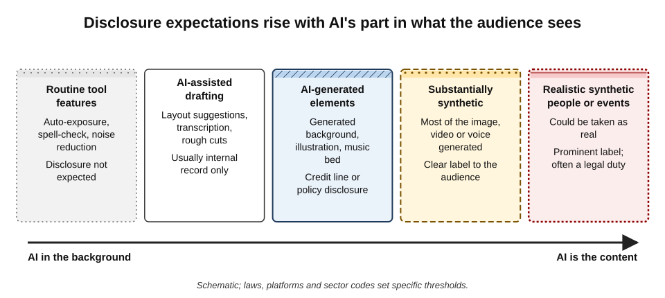
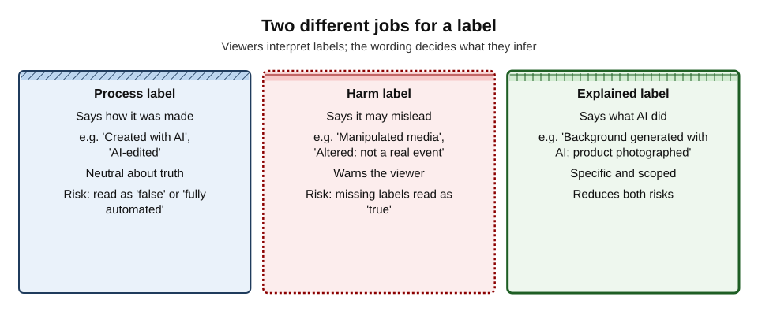
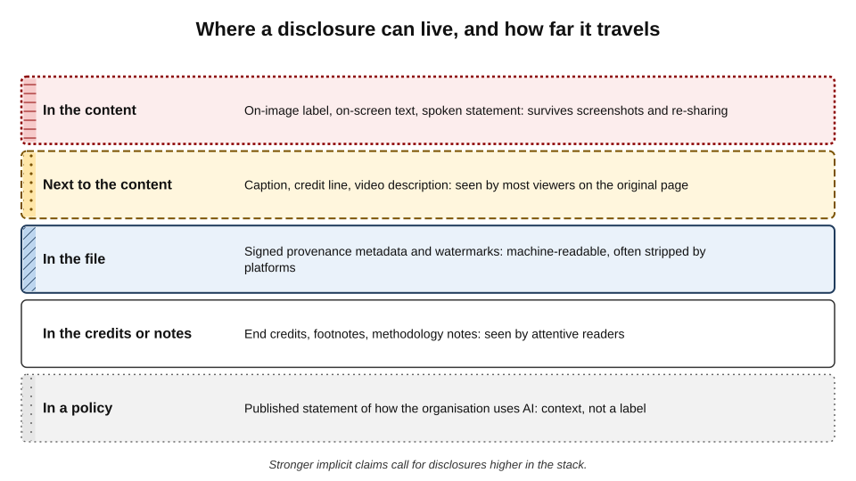
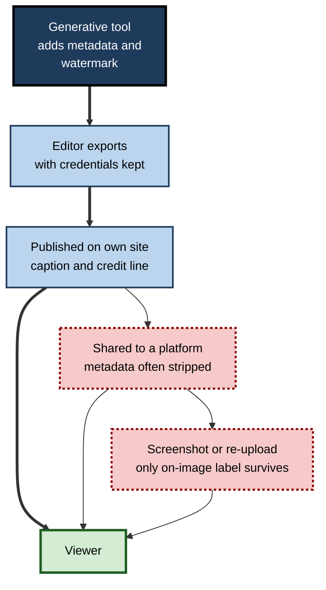
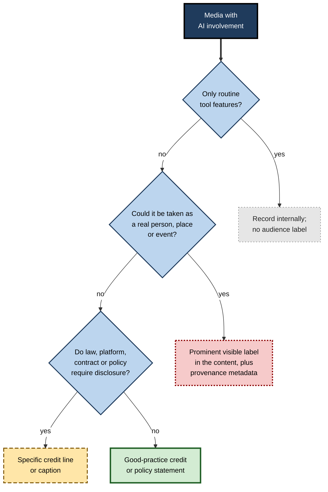

# I.8. Attribution and disclosure

In April 2023 a striking black-and-silver portrait of two women won a category at one of the world's best-known photography competitions. Its maker then declined the prize: the image had been generated with AI, and he had entered it to see whether the judges could tell. They could not. The episode raised the questions every professional now faces with media — who, or what, made this; who deserves credit; and what does the audience have a right to know?

> **Definition — Disclosure:** telling an audience, client or employer that AI was used to create or alter content, and in what way.

> **Definition — Attribution:** crediting the people, sources and tools that contributed to a piece of content, in the form required by licences, contracts, professional norms or courtesy.

**Why it matters**

- **Audiences make decisions based on what they believe media is** — a photograph of a real event, a real customer's testimonial, a real person's voice.
- **Law and platform rules increasingly require disclosure** of realistic synthetic content.
- **Trust is asymmetric.** Disclosing generously costs a little credibility; being caught concealing costs much more.
- **Credit is a matter of fairness and contract.** Photographers, designers, voice artists and licensors have rights to attribution; colleagues deserve recognition for human work alongside AI.
- **Badly worded labels mislead too** — making true content look false, or unlabelled content look certified.

---

## What Disclosure Is For

### Three purposes

- **Preventing deception** — the audience should not be led to believe something false about what the media shows.
  - *e.g.* a realistic synthetic image of a flood used in a news-style post.
- **Respecting the relationship** — clients, employers, editors and examiners have expectations about how work was produced.
  - *e.g.* a client who commissioned "original photography" receives generated images.
- **Supporting accountability** — records of AI involvement let organisations answer later questions about provenance, rights and errors.

> **Key point:** the core test is not "was AI used?" but **"would the audience, client or reader be misled — or feel misled — if they were not told?"**

### Degrees of AI involvement

**Figure 1.** Disclosure expectations rise with AI's part in what the audience sees.

- **Routine tool features** — auto-exposure, noise reduction, spell-checking, layout snapping.
  - Disclosure not expected; these are part of ordinary editing.
- **AI-assisted production** — transcription, rough cuts, layout suggestions, colour matching.
  - Normally recorded internally; disclosure to audiences seldom needed.
- **AI-generated elements** — a generated background, illustration, music bed or narration in an otherwise human work.
  - A credit line or policy-based disclosure is good practice; sometimes required.
- **Substantially synthetic content** — most of the image, video or voice generated.
  - Clear disclosure to the audience.
- **Realistic synthetic people, places or events** — content that could be taken as real.
  - Prominent disclosure; often a legal or platform obligation; sometimes inappropriate to publish at all.

> **Watch out:** the boundary between "editing" and "generation" has blurred. Removing a cable with generative fill and removing it with a clone tool produce the same result; disclosure should follow **what the edit changes**, not which button was pressed.

---

## Rules That Require Disclosure

### Law

- **European Union — AI Act, Article 50:**
  - **deployers** that publish image, audio or video **deepfakes** must disclose that the content is artificially generated or manipulated, with lighter requirements for evidently artistic, satirical or fictional works;
  - deployers publishing AI-generated **text** to inform the public on matters of public interest must disclose it, unless it has undergone human review and editorial responsibility;
  - **providers** of generative systems must mark outputs in a machine-readable way so that they can be detected as artificially generated;
  - the transparency obligations apply from **2 August 2026**, with a grace period to **2 December 2026** for the marking duty for systems already on the market before August 2026.
- **China** — rules on labelling AI-generated content in force from September 2025 require both visible labels and embedded (implicit) identifiers for certain synthetic content.
- **India** — in 2025 the government proposed amendments to its information-technology rules requiring prominent labelling of synthetically generated content on platforms.
- **Elections and advertising** — several jurisdictions require disclosure of AI-generated content in political advertising, and consumer-protection law in many places treats undisclosed synthetic testimonials and endorsements as misleading.

> **Definition — Deepfake (in the AI Act):** AI-generated or manipulated image, audio or video content that resembles existing persons, objects, places, entities or events and would falsely appear to a person to be authentic or truthful.

### Platforms

- **Video platforms** — from 2024, major platforms began requiring creators to declare realistic altered or synthetic content, adding a label to the video.
- **Social networks** — automatic labelling based on embedded provenance signals and creator self-disclosure.
  - In 2024 Meta initially labelled such content "Made with AI"; after photographers complained that lightly edited real photographs were being labelled, it changed the label to "AI info", with details available on request.
- **Stock libraries** — require AI-generated submissions to be labelled, or refuse them.

### Sector codes

- **Journalism** — major news organisations' guidance generally forbids presenting synthetic images as news photographs and requires labelling of any AI-generated illustration.
- **Academic publishing** — leading journals do not accept AI systems as authors, require disclosure of AI use in methods or acknowledgements, and several prohibit generated images in research papers except in narrowly defined cases.
- **Advertising** — codes apply the ordinary rule that ads must not mislead; AI-generated product demonstrations that exaggerate results breach that rule.
- **Competitions and awards** — many now state whether AI-generated entries are allowed and require declarations.

| Source of obligation | Who must disclose | Typical trigger | Typical form |
|---|---|---|---|
| Law (e.g. EU AI Act) | Providers and deployers | Realistic synthetic content; public-interest AI text | Machine-readable marking; visible disclosure |
| Platform rules | Creators and advertisers | Realistic altered or synthetic content | Self-declaration; platform label |
| Sector codes | Journalists, researchers, advertisers | Any synthetic depiction presented as real; AI in research | Captions, methods sections, credits |
| Contracts | Suppliers to clients | AI use in deliverables | Statement in proposal, delivery note or warranty |
| Organisational policy | Employees | As the policy defines | Credit lines, internal records |

---

## How Labels Work on People

Disclosure only helps if audiences interpret it correctly. Research shows they often do not.

**Study card — Altay and Gilardi (2024), labels and AI aversion**

- **Design:** two preregistered online experiments with about 5,000 participants in the United States and the United Kingdom rated news headlines that were true or false, written by humans or by AI, and labelled or unlabelled as AI-generated.
- **Findings:**
  - labelling a headline "AI-generated" **lowered its perceived accuracy and willingness to share it** — whether it was true or false, human- or AI-written;
  - participants did **not** equate "AI-generated" with "false";
  - the penalty arose because people assumed labelled content was **fully automated with no human oversight**;
  - the effect was about three times smaller than labelling a headline as false.
- **Conclusion:** labels carry implications beyond their literal meaning; explaining **what the AI did** may reduce unwarranted penalties.

**Study card — Pennycook and colleagues (2020), the implied truth effect**

- **Design:** experiments in which some false news headlines carried warnings that they had been disputed, while others did not.
- **Findings:** warnings reduced belief in the tagged headlines — but **increased** belief in false headlines that were left untagged.
- **Explanation:** viewers inferred that untagged items had been checked and found true.
- **Relevance:** if labelling of synthetic media is patchy, **unlabelled synthetic media may be trusted more**, not less.

> **Watch out:** a label regime is only as good as its coverage. Partial labelling can create a false sense that unlabelled content is authentic — and the absence of a label proves nothing about authenticity.

### Process labels and harm labels

**Figure 2.** Two different jobs for a label.

- **Process labels** — describe how content was made ("Created with AI", "AI-edited").
  - Neutral about truth, but often read as "fake" or "fully automated".
- **Harm labels** — warn that content may mislead ("Manipulated media", "Altered — not a real event").
  - Protect viewers but imply that unlabelled content is genuine.
- **Explained labels** — say specifically what AI did and what is real.
  - "Background generated with AI; product photographed in our studio."
  - Most informative, and least likely to trigger a blanket penalty.

> **In practice:** surveys of how people interpret label wording, including work by MIT researchers in 2023 across several countries, found that terms such as "AI-generated" were mostly understood as describing **process**, while terms such as "manipulated" or "deepfake" were understood as signalling **intent to mislead**. Choose the word for the job.

---

## Writing and Placing Disclosures

### Good disclosure wording

| Situation | Weak disclosure | Better disclosure |
|---|---|---|
| Generated illustration on a blog | (none) | "Illustration created with AI." |
| Product photo with generated background | "AI image" | "Product photographed; background generated with AI." |
| Training video with synthetic narrator | "Made with AI" | "Narration uses a synthetic voice. Script written and checked by the compliance team." |
| Realistic scenario image in a safety campaign | Small grey credit | Visible on-image label: "AI-generated scene. Not a real incident." |
| Translated video with cloned voice | (none) | "Translated with AI. The voice is a synthetic version of [name]'s, used with permission." |
| Report cover image | "Image: AI" | "Cover image generated with [tool] and edited by [designer]." |

*Illustrative examples.*

- **Be specific** — which part, what kind of AI involvement.
- **Say what is real** — the product, the data, the speaker's script.
- **Mention human responsibility** where it reassures accurately — "reviewed by", "written by".
- **Avoid euphemism** — "digitally enhanced" for a fully synthetic person misleads.

> **Remember:** **specific, scoped and visible** — say what AI did, say what is real, and put it where the audience will see it.

### Placement

**Figure 3.** Where a disclosure can live, and how far it travels.

- **In the content** — on-image text, on-screen titles, a spoken statement.
  - Survives screenshots and re-sharing; needed for realistic synthetic content.
- **Next to the content** — caption, credit line, video description.
  - Seen on the original page; lost when content is copied.
- **In the file** — provenance metadata and invisible watermarks.
  - Machine-readable; useful for platforms and verification; frequently stripped.
- **In credits or notes** — end credits, footnotes, acknowledgements.
- **In a published policy** — explains general practice; not a substitute for labels on realistic content.

> **Definition — Content Credentials:** signed provenance information attached to a media file under the C2PA standard, recording its origin and edits — including use of generative tools — so that later viewers and platforms can inspect it.

**Figure 4.** How a disclosure travels — or is lost — from creation to viewer.

> **Watch out:** relying on metadata alone is not disclosure to people. For realistic synthetic content, the **visible** label is the one that reaches viewers after the content has been shared.

---

## Attribution: Crediting People and Sources

### Human contributors

- **Photographers, illustrators, designers, editors, voice artists** — credit them as their contracts and norms require; AI use does not erase human authorship.
- **Mixed works** — "Photography: A. Patel. Background: generated with AI and retouched by L. Moreno."
- **Internal work** — record who reviewed and approved AI-generated material, so responsibility is visible.

### Licensed sources

- **Stock and agency images** — licence terms often specify credit format ("Photo: Name / Agency").
- **Creative Commons** — attribution licences require credit; a common formula is **TASL**: **T**itle, **A**uthor, **S**ource, **L**icence.
- **Reference images used in generation** — if a licensed image was uploaded as a reference, check whether its licence allows that use and whether credit is due.

> **Mnemonic — "TASL":** Title, Author, Source, Licence — the four elements of a Creative Commons credit.

### Crediting the tool

- **Practice varies** — some organisations name the tool ("Created with [tool]"); others say only "AI-generated".
- **Naming the tool helps** when provenance matters or when the tool's terms require it.
- **The tool is not an author** — credit lines should not imply that an AI system is a creator with authorial responsibility; journals and copyright offices reject that framing.

---

## Disclosure to Clients and Employers

- **Proposals** — state whether and how AI will be used in producing media.
- **Deliverables** — note AI-generated elements, especially where contracts require originality or exclusivity.
- **Employers** — follow policy on recording AI use in work products; a manager signing off a campaign needs to know which images are synthetic.
- **Examinations and assessments** — portfolio and coursework rules increasingly require declarations of AI use.

> **In practice:** a short **AI-use note** attached to a deliverable — what was generated, with what tool, what humans did, what was checked — answers most later questions in a few lines and protects both supplier and client.

---

## Case Study: The Prize-Winning Photograph That Was Not a Photograph

- **Situation:** in 2023 the German artist Boris Eldagsen entered *Pseudomnesia: The Electrician*, a vintage-style portrait of two women, in the creative category of the Sony World Photography Awards.
- **What happened:**
  1. the image was shortlisted and then announced as a category winner in April 2023;
  2. Eldagsen declined the award, revealing that the image had been generated with AI;
  3. he said he had entered to provoke debate about whether AI images belong in photography competitions.
- **Response:** the organisers said he had initially told them the work was a "co-creation" involving AI, and withdrew the image; Eldagsen disputed their account of the discussions.
- **Analysis:**
  - the competition's rules did not clearly address AI-generated entries;
  - expert judges could not distinguish the image from photography;
  - disclosure depended entirely on the entrant's choice.
- **Aftermath:** photography competitions widely revised their rules to define what counts as a photograph and to require declarations of AI use.
- **Lesson:** where the **category itself makes a claim** — "photograph", "documentary", "original" — disclosure rules must be explicit, because inspection alone cannot reveal AI involvement.

---

## Building a Disclosure Practice

**Figure 5.** Deciding whether and how to disclose AI involvement in media.

### Case study (illustrative): a housing association's disclosure policy

- **Situation:** a housing association began using generated images in tenant newsletters and on its website.
- **Problem:** tenants complained that a newsletter photograph of "our newly refurbished flats" looked nothing like their building. The image was generated; nothing said so.
- **Diagnosis:**
  - a generated image was placed in a **documentary** context — a report on real refurbishment;
  - there was no policy on labelling;
  - the communications officer assumed a stock-style image was acceptable "for illustration".
- **Actions:**
  1. apology and replacement with real photographs of the refurbished flats;
  2. **policy**: no generated images in reports about real places, people or work; generated illustrations allowed for general topics, with the caption "Illustration created with AI";
  3. **register** of generated images with prompt, date and approver;
  4. a **published statement** on the association's use of AI in communications.
- **Result:** complaints stopped; tenants' panel welcomed the statement; communications staff reported clearer decisions.
- **Lesson:** disclosure cannot rescue an image used in the **wrong context**. First decide whether generation is appropriate; then label clearly.

### Elements of a disclosure policy

- **Thresholds** — what counts as routine, assisted, generated and realistic synthetic.
- **Standard wording** — approved labels and credit formats for each case.
- **Placement rules** — visible labels for realistic synthetic content; captions for generated elements.
- **Provenance** — keep Content Credentials where tools support them; do not strip metadata without reason.
- **Records** — what was generated, by whom, with what tool, approved by whom.
- **Attribution** — credit formats for human contributors and licensed sources.
- **Review** — periodic updates as laws and platform rules change.

---

## Disclosure in Particular Settings

### Advertising and endorsements

- **Misleading-advertising rules apply whatever the method** — an AI-generated "before and after" or product demonstration that exaggerates results misleads, labelled or not.
- **Virtual influencers and synthetic spokespeople** — audiences should not be led to believe a synthetic presenter is a real customer or employee.
- **Endorsements** — consumer-protection regulators treat fake reviews and invented testimonials as unlawful; in 2024 the US Federal Trade Commission finalised a rule banning fake reviews and testimonials, including AI-generated ones.

### News, research and public information

- **Illustrations of real events** — if a generated illustration is used at all, it must be unmistakably labelled and visually distinct from photography.
- **Public bodies** — information campaigns depend on trust; many public-sector communicators avoid photoreal synthetic imagery entirely.
- **Research outputs** — methods sections should state where AI was used to create, edit or analyse images, audio or video.

### Internal communications

- **Synthetic leaders** — an avatar of the chief executive delivering a message should be disclosed; staff who later discover it may feel deceived, especially for sensitive news.
- **Training and onboarding** — synthetic presenters and voices are common; a brief note in the credits is usually enough.
- **Recognition and culture** — generated images of "the team" at events that did not happen undermine the authenticity internal communications rely on.

### Client work, tenders and assessments

- **Proposals** — state planned AI use and how outputs are reviewed.
- **Deliverables** — an AI-use note; adjust warranties where originality is promised.
- **Tenders** — some public procurement now asks bidders to declare AI use in bid materials and services.
- **Portfolios and qualifications** — creative and academic assessments increasingly require declarations; undeclared generated work can be treated as misconduct.

| Setting | Disclosure audience | Usual form | Consequence of non-disclosure |
|---|---|---|---|
| Advertising | Consumers, regulators | On-ad label; no fake testimonials | Regulatory action; reputational harm |
| News and public information | The public | Clear caption; distinct style | Loss of credibility; complaints |
| Internal communications | Employees | Credit or on-screen note | Loss of trust; morale |
| Client deliverables | Client | AI-use note; contract wording | Breach of contract; lost client |
| Assessments and awards | Examiners, judges | Declaration form | Disqualification; misconduct findings |

---

## Worked Example (illustrative): Disclosing AI in an Annual Report

**Situation:** a charity's annual report uses a generated cover illustration, two generated scene-setting images, real photographs of projects (some retouched), AI-assisted infographics built from real data and a narrated video summary with a synthetic voice.

| Element | AI involvement | Disclosure decision | Wording and placement |
|---|---|---|---|
| Cover illustration | Generated, then edited by designer | Credit line | Inside cover: "Cover illustration created with AI tools and edited by [designer]." |
| Scene-setting images | Generated, stylised | Caption | "Illustration created with AI." under each |
| Project photographs | Real; exposure corrected; one distracting sign removed | None for exposure; consider the removal | Sign removal reversed — the photo is documentary |
| Infographics | AI-assisted layout; data from accounts | None to readers; internal record | Source line: "Data: audited accounts 2025–26" |
| Video summary | Synthetic narrator; real footage | On-screen and description | Opening card: "Narrated by a synthetic voice. Script by the communications team." |
| Overall | Mixed | Policy statement | Back page: short statement on the charity's use of AI in communications |

*Illustrative scenario.*

1. **Classify each element** by degree of involvement.
2. **Check for documentary context** — project photographs are records of real work; content edits were reversed rather than disclosed.
3. **Write specific labels** that say what AI did and what is real.
4. **Place labels where they travel** — captions on images, an opening card on the video.
5. **Record internally** what tools were used, by whom, and who approved.

- **Conclusion:** disclosure took a few lines of text; the most important decision was not a label at all but **reversing an edit** in a documentary photograph.

> **Watch out:** a single generic line such as "Some images in this report may have been created with AI" is a weak disclosure. It leaves readers unable to tell which images are real — and so casts doubt on the genuine photographs too.

---

## Records Behind Disclosure

Visible labels are the public face of disclosure; records are what make it truthful and defensible.

- **What to record for each published asset:**
  - the tool and model version used;
  - the prompt or instruction, and any reference images;
  - the human edits made, and by whom;
  - the approver and the date;
  - the disclosure wording used and where it was placed.
- **Why records matter:**
  - **corrections** — if a label later proves wrong, the record shows what actually happened;
  - **complaints** — an organisation can answer "was this real?" quickly and precisely;
  - **regulation** — transparency duties are easier to evidence;
  - **rights** — records support claims of human authorship and compliance with tool terms.
- **Keep provenance metadata** — do not strip Content Credentials from exported files unless there is a privacy reason; they are a machine-readable form of the same record.

> **Remember:** **label for the audience, record for the organisation.** A disclosure without a record cannot be checked; a record without a disclosure helps no one who sees the content.

---

## Open Questions

- **Will labels help or hurt trust in the long run?**
  - Early studies show labels lower trust in labelled content regardless of truth; whether explained labels avoid this, and how labels shape trust over years, is unknown.
- **Can provenance survive the open internet?**
  - Signed credentials and watermarks are promising, but stripping, open models without marking, and uneven platform support limit them.
- **Where should the line between editing and generation be drawn?**
  - Platforms and regulators are still defining which edits trigger labels; photographers object to labels on lightly edited genuine work.
- **Will disclosure fatigue set in?**
  - If most content carries some AI label, audiences may ignore them all.
- **How should credit be shared between humans and tools?**
  - Norms for crediting AI involvement in creative work differ across industries and are still forming.

---

## Summary

- **Disclosure** tells audiences, clients and employers that and how AI was used; **attribution** credits people, sources and tools.
- The core test: **would someone be misled — or feel misled — if not told?** Disclosure expectations rise with AI's part in what the audience sees, from routine features to realistic synthetic content.
- **Law** (EU AI Act Article 50 from August 2026; Chinese labelling rules from 2025; proposals elsewhere), **platform rules**, **sector codes**, **contracts** and **policy** create obligations.
- Labels are interpreted, not just read: "AI-generated" labels **lower trust even in true content** because people assume full automation (Altay and Gilardi, 2024); partial labelling can make unlabelled content seem verified (**implied truth effect**).
- Distinguish **process**, **harm** and **explained** labels; prefer **specific, scoped, visible** wording that says what AI did and what is real.
- Place disclosures where they will **travel**: in the content for realistic synthetic media; captions and credits for generated elements; provenance metadata as a machine-readable supplement.
- Credit **human contributors** and **licensed sources** (TASL for Creative Commons); do not present tools as authors.
- The **Eldagsen** case shows that where a category makes a claim, explicit declaration rules are essential.
- Disclosure cannot rescue an image used in the **wrong context**.

---

## Self-Check

1. Define disclosure and attribution and explain how they differ.
2. State the core test for whether disclosure is needed.
3. Place on the involvement spectrum and say what disclosure is appropriate: noise reduction on a podcast; a generated background behind a real product photo; a synthetic "customer" in a video testimonial.
4. Summarise the disclosure duties in Article 50 of the EU AI Act and when they apply.
5. What did Altay and Gilardi find, and why?
6. Explain the implied truth effect and its relevance to labelling synthetic media.
7. Distinguish process, harm and explained labels with examples.
8. Rewrite the weak disclosure "Made with AI" for a training video whose script was written by staff and whose narrator is synthetic.
9. Why is metadata-based provenance not sufficient disclosure for realistic synthetic images?
10. What is TASL, and when is it needed?
11. Why should credit lines not present an AI tool as an author?
12. What lessons does the Eldagsen case hold for competitions and for organisations that use category claims such as "photograph"?
13. Draft the main elements of a disclosure policy for a marketing team.

### Answer Key

1. Disclosure tells people that and how AI was used; attribution credits contributors, sources and tools. Disclosure is about the audience's understanding; attribution is about recognition and licence compliance.
2. Would the audience, client or reader be misled — or feel misled — if they were not told?
3. Noise reduction — routine; no label. Generated background — AI-generated element; specific caption such as "product photographed; background generated with AI". Synthetic customer — realistic synthetic person in a testimonial; misleading and likely unlawful as a testimonial; do not use, or make clear it is a dramatisation with prominent labelling.
4. Deployers must disclose deepfakes (lighter for evident art and satire) and AI-generated public-interest text without human editorial responsibility; providers must mark outputs machine-readably. Applies from 2 August 2026, with a marking grace period to 2 December 2026 for systems already on the market.
5. Labelling headlines as AI-generated lowered perceived accuracy and sharing regardless of truth or true authorship, because people assumed full automation without human oversight; the effect was smaller than a "false" label.
6. Warning labels on some false items make untagged false items seem more accurate. If synthetic media is labelled patchily, unlabelled synthetic media may be trusted more.
7. Process: "Created with AI" — how it was made. Harm: "Manipulated media" — may mislead. Explained: "Background generated with AI; product photographed" — what AI did and what is real.
8. "The narration uses a synthetic voice. The script was written and checked by our learning team."
9. Platforms often strip metadata, screenshots discard it, and people do not read it. Only visible labels in the content reliably reach viewers after sharing.
10. Title, Author, Source, Licence — the elements of a Creative Commons attribution credit, needed when using CC-licensed material that requires attribution.
11. Authorship implies creative and legal responsibility; journals and copyright offices reject AI authorship; such credits obscure the human responsibility for the content.
12. Inspection cannot reliably reveal AI involvement; where a category claims "photograph" or "original", rules must define it and require declarations. Organisations using such claims need explicit policies.
13. Thresholds of involvement; standard wording; placement rules (visible labels for realistic synthetic content); provenance retention; records; attribution formats; prohibited contexts (documentary content); periodic review.

---

## Glossary

| Term | Meaning |
|---|---|
| AI-use note | A short statement attached to a deliverable describing what AI did and what humans did. |
| Attribution | Crediting people, sources and tools that contributed to content. |
| Content Credentials | Signed provenance information attached to media under the C2PA standard. |
| Credit line | A short text naming the creator, source or method of an image or media item. |
| Deepfake | Realistic synthetic or manipulated media that would falsely appear authentic. |
| Disclosure | Telling an audience, client or employer that and how AI was used. |
| Explained label | A label stating specifically what AI did and what is real. |
| Harm label | A label warning that content may be misleading or manipulated. |
| Implied truth effect | The tendency for unlabelled items to seem more credible when some items carry warnings. |
| Process label | A label describing how content was made, such as "Created with AI". |
| Provenance | Information about the origin and edit history of media. |
| TASL | Title, Author, Source, Licence — elements of a Creative Commons credit. |
| Watermark (invisible) | A machine-detectable signal embedded in generated media. |
