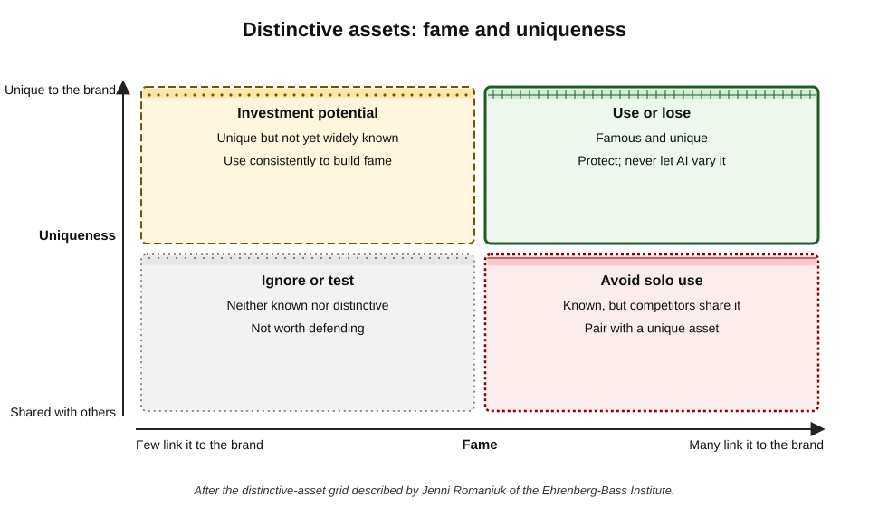
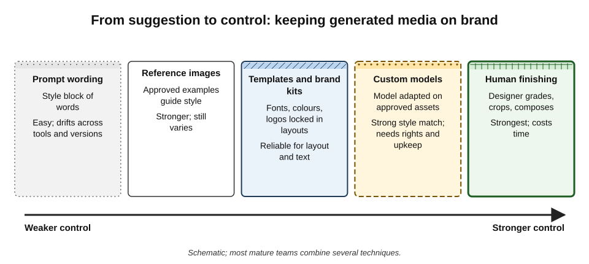
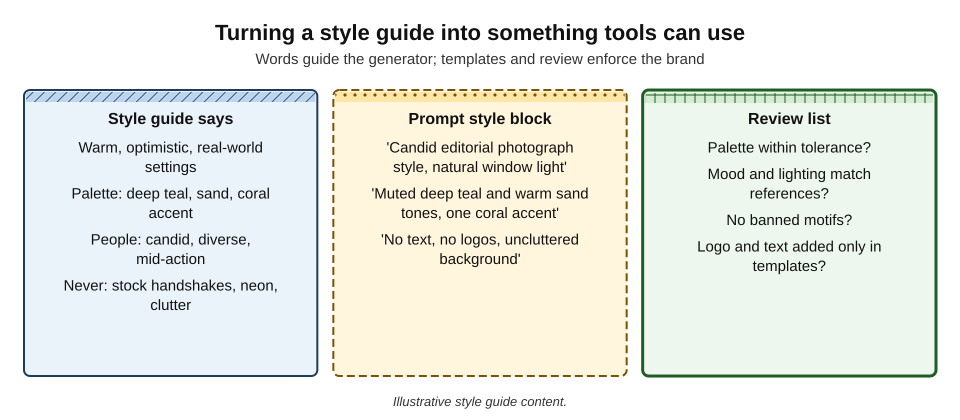
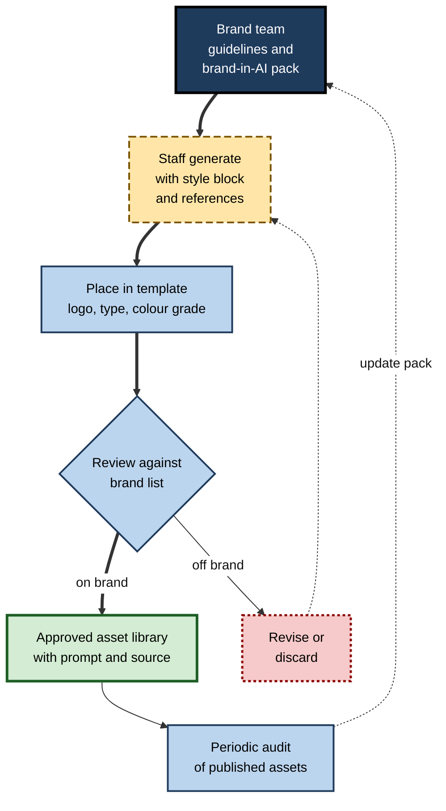
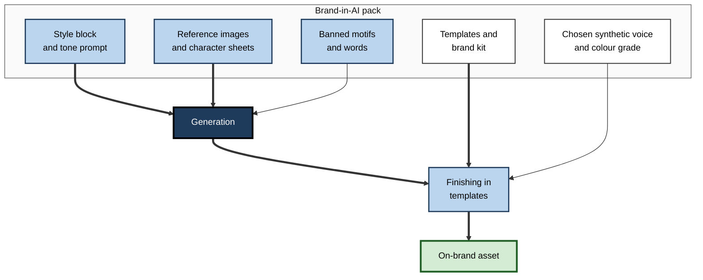

# I.9. Brand and style consistency

A regional bank's social team generates thirty images for a month of posts. Each one is attractive. Laid side by side, they look like the work of thirty different organisations: teal in one, purple in another; watercolour, then glossy 3-D, then photo-style; one with a distorted version of the logo baked in. No single image breaks the rules badly. Together they dissolve the brand — the very thing the posts were meant to build.

> **Definition — Brand:** the set of associations, memories and expectations that people hold about an organisation, product or person, built through every experience of it — including its visual and verbal identity.

> **Definition — Brand consistency:** presenting an organisation's identity — visual, verbal and sonic — in a recognisably coherent way across all materials, channels and over time.

**Why it matters**

- **Recognition depends on repetition.** People notice and remember brands through consistently repeated cues — colours, shapes, characters, sounds, phrases.
- **AI multiplies output.** A team can now produce ten times the assets, and ten times the inconsistency, in the same time.
- **Generators have their own style.** Without control, output drifts towards a generic "AI look" shared by everyone using the same tools.
- **Inconsistency signals carelessness.** Customers, investors and recruits read visual coherence as a sign of competence — and incoherence as its absence.

---

## What a Brand Identity Contains

### Visual identity

- **Logo and marks** — primary logo, variants, minimum sizes, clear space.
- **Colour palette** — primary, secondary and accent colours with exact values for print and screen.
- **Typography** — typefaces, weights, sizes and their roles.
- **Imagery style** — photography, illustration, iconography: subjects, lighting, composition, treatment.
- **Layout system** — grids, margins, recurring structures.
- **Distinctive assets** — characters, mascots, patterns, shapes, packaging forms.

### Verbal identity

- **Tone of voice** — the personality of the writing (*e.g.* warm, plain, confident, never jokey about money).
- **Vocabulary** — preferred and banned words, product names, capitalisation.
- **Messaging** — taglines, value propositions, recurring phrases.

### Sonic and motion identity

- **Sonic logos and music** — short signature sounds, approved music styles.
- **Voice** — the sound of narration: gender, accent, pace, energy.
- **Motion** — how logos and elements animate; transition styles.

> **Definition — Brand guidelines (style guide):** a document or system that specifies how an organisation's identity must be applied — rules, examples and prohibitions for logo, colour, type, imagery, voice and layout.

> **Key point:** most brand guidelines were written for human designers who can interpret intent. AI tools need those guidelines translated into **explicit instructions, references and constraints**.

---

## Why Consistency Builds Brands

### Distinctive brand assets

- **Researchers at the Ehrenberg-Bass Institute** for Marketing Science (University of South Australia) — notably Byron Sharp in *How Brands Grow* (2010) and Jenni Romaniuk in *Building Distinctive Brand Assets* (2018) — argued that brands grow largely by being easy to **notice** and **recall** in buying situations.
- **Distinctive brand assets** — non-name cues (colours, logos, characters, shapes, sounds) that trigger the brand in people's minds.
- **Two measures:**
  - **fame** — how many people link the asset to the brand;
  - **uniqueness** — how few link it to competitors.

**Figure 1.** Distinctive assets classified by fame and uniqueness.

**Study card — distinctive-asset measurement (Ehrenberg-Bass Institute)**

- **Method:** survey category buyers, show them an asset stripped of the brand name (*e.g.* a colour, shape or character), and ask which brand, if any, it brings to mind.
- **Findings across many categories:**
  - few assets are both widely known and unique;
  - assets become strong only through **long, consistent use**;
  - changing or varying an asset can erode years of built recognition.
- **Implication for AI:** every generated variation of a mascot, palette or pattern dilutes the very consistency that makes it distinctive.

> **Definition — Distinctive brand asset:** a sensory cue other than the brand name — colour, shape, logo, character, sound — that category buyers reliably link to one brand.

> **Watch out:** widely quoted figures claiming that consistent branding raises revenue by a fixed percentage come mainly from vendor surveys with weak methods. The research-based case for consistency rests on **memory and recognition**, not on a single revenue statistic.

### Consistency is not sameness

- **Fixed elements** — logo, core colours, typeface, mascots: kept constant.
- **Flexible elements** — subjects, layouts within the grid, campaign themes: allowed to vary within rules.
- **The skill** — knowing which elements carry recognition (protect them) and which carry freshness (vary them).

| | Fixed (protect) | Flexible (vary within rules) |
|---|---|---|
| Examples | Logo, primary colours, typeface, mascot, sonic logo | Photo subjects, campaign graphics, layouts, seasonal themes |
| Role | Recognition and memory | Relevance and freshness |
| AI's role | Never generate or alter; place from approved files | Generate within a defined style |
| Typical failure | Distorted logo inside a generated image | Variation so wide the style is unrecognisable |

---

## How AI Breaks Consistency

- **Style drift** — the same prompt produces different styles across sessions, tools and model versions.
- **Palette drift** — colours approximate the brand but wander; generators cannot match exact colour values from words.
- **The generic AI look** — glossy lighting, smooth skin, dramatic depth of field and saturated colour that many audiences now recognise as synthetic.
- **Character inconsistency** — a mascot or recurring person changes face, proportions or clothing between images.
- **Logo and text corruption** — logos and slogans rendered inside images come out distorted.
- **Tone drift** — AI-written captions and on-image text slide into generic marketing language.
- **Model updates** — a provider's new version changes the look of outputs from the same prompts overnight.

> **Remember:** **never let a generator draw the logo.** Place logos, wordmarks and exact text from approved files in a template or editing tool.

---

## Techniques for Control

**Figure 2.** From suggestion to control: keeping generated media on brand.

### Prompt style blocks

- **A reusable block of style instructions** appended to every prompt — medium, lighting, palette, mood, composition, exclusions.
- **Strengths** — easy to share; no special tools.
- **Limits** — words are interpreted differently by different models and versions; colours cannot be specified exactly.

**Figure 3.** Turning a style guide into something tools can use.

### Reference images

- **Style references** — approved images supplied to the generator to guide its style.
- **Subject or character references** — images of a mascot or product to keep its appearance stable.
- **Strengths** — much closer style matching than words alone.
- **Limits** — rights in reference images must be clear; outputs still vary.

### Seeds and settings

- **Seed** — a number that fixes the random starting point of generation; the same prompt, seed, model and settings usually reproduce a similar image.
- **Use** — making controlled variations of an approved image.
- **Limits** — results change when the model changes; seeds do not transfer between tools.

> **Definition — Seed:** the number that initialises the random noise from which a generative model starts; fixing it makes outputs more reproducible on the same model and settings.

### Templates and brand kits

- **Templates** hold logos, fonts, colours and layouts; generated imagery is placed into them.
- **Brand kits** in design tools load palettes, fonts and logos once; AI features draw on them.
- **Strengths** — exact colours, real fonts, correct logos.
- **Division of labour** — **the generator makes the picture; the template makes it on brand**.

### Custom models

- **Fine-tuning or adaptation** — training a model further on a set of approved brand images so it reproduces the style or a character.
  - A common lightweight method is **LoRA** (low-rank adaptation, described by Edward Hu and colleagues in 2021), which adds small trainable components to a large model.
- **Enterprise offerings** — several design-tool providers offer custom models trained on a customer's own assets.
- **Strengths** — strongest style and character consistency from generation alone.
- **Limits and duties:**
  - rights in every training image, and consent from people shown in them;
  - maintenance when brand guidelines or base models change;
  - access control — a model that produces the brand's style can be misused;
  - risk of over-fitting to a narrow set of images.

> **Definition — Fine-tuning:** further training of a pre-trained model on a smaller, specific dataset to adapt its outputs to a style, subject or task.

### Human finishing

- **Colour grading** — applying a consistent colour treatment (a saved "look") to all images.
- **Cropping and composition** to the brand's layout rules.
- **Retouching** of AI artefacts and generic gloss.
- **Final placement** in templates with approved type and logos.

| Technique | Control over style | Exact colours and logos | Effort | Main risk |
|---|---|---|---|---|
| Prompt style block | Low to medium | No | Low | Drift across tools and versions |
| Reference images | Medium | No | Low | Rights in references; variation |
| Seeds and settings | Medium, same model only | No | Low | Breaks when model updates |
| Templates and brand kits | High for layout and type | Yes | Medium (one-off) | Generated image itself may still be off-style |
| Custom model | High | Partly | High | Rights, upkeep, misuse |
| Human finishing | Highest | Yes | High per asset | Cost and time |

---

## Consistency Across Formats

- **Images** — style, palette, lighting, subjects.
- **Slides and documents** — templates, chart styles, icon sets.
- **Video** — colour grade, motion graphics, title styles, music.
- **Audio** — voice choice for narration, sonic logo, music beds.
  - A synthetic narrator voice chosen for training videos becomes, in effect, part of the brand; switching voices randomly undermines it.
- **Words on visuals** — tone of voice applies to captions, slide titles and social copy as much as to long documents.

> **In practice:** many brand teams now keep a **"brand-in-AI" pack**: the style block, approved reference images, banned motifs, templates, a chosen synthetic voice and a short tone-of-voice prompt — so that everyone, and every tool, starts from the same place.

---

## Worked Example (illustrative): Testing a Style Block

**Situation:** a bank's brand team wants staff to generate lifestyle images for social posts. It drafts a style block and tests it.

1. **Translate the guide** into a style block: "Candid editorial photograph style, natural window light, muted deep teal and warm sand tones with one coral accent, uncluttered real-world settings, people mid-action, no text, no logos."
2. **Generate a test set** — twenty images across five subjects (home, café, park, office, family kitchen) using two approved tools.
3. **Score each image** against a review list.
4. **Revise** the block and add three reference images; repeat.

| Measure | Block only, tool A | Block only, tool B | Block plus references, tool A |
|---|---|---|---|
| Palette judged on brand | 12 of 20 | 7 of 20 | 17 of 20 |
| Lighting and mood on brand | 14 of 20 | 10 of 20 | 18 of 20 |
| Banned motifs present | 3 | 5 | 1 |
| Text or logo artefacts | 4 | 6 | 0 (exclusion respected) |

*Illustrative figures.*

5. **Decision** — staff use tool A with the block and references; all images pass through a template that adds logo and text; a saved colour grade is applied before posting.

- **Conclusion:** words alone were not enough; references, templates and a final colour grade together achieved consistency.

> **Watch out:** a style block tested on one model version must be **re-tested** when the provider updates the model. Treat it like any other brand asset with a version number and an owner.

---

## Case Study: Coca-Cola's AI Holiday Advertisement

- **Situation:** in November 2024 Coca-Cola released a reworking of its long-running "Holidays Are Coming" Christmas campaign — first aired in 1995, featuring illuminated red trucks — produced largely with generative AI by several AI studios.
- **Brand logic:** the campaign relied on some of the company's most distinctive assets — the red trucks, the colour red, the festive imagery — and the AI version kept them prominent.
- **Reaction:**
  - many viewers and creative professionals criticised the advert as **"soulless"** and uncanny;
  - observers pointed to visual inconsistencies — for example, truck wheels that appeared to glide rather than turn — and to the smooth, synthetic look of people and objects;
  - animators and artists criticised the replacement of human creative work in a campaign whose message was human connection.
- **Defence:** the company presented the work as a combination of human creativity and new tools; a further AI-produced holiday advertisement followed in 2025 and drew similar mixed reactions.
- **Analysis:**
  1. **Asset consistency was achieved** — the trucks, the colour and the theme were all present.
  2. **Style consistency was not** — the AI look departed from the warmth and craft audiences associated with the campaign.
  3. **Brand meaning was at stake** — for a message about human warmth, the production method itself became part of the story.
- **Lesson:** consistency means more than reproducing assets. A brand's **style and values** — including how its work is made — are part of what audiences recognise.

---

## Governance

**Figure 4.** A governed workflow for on-brand generated media.

### Elements of brand governance for AI

- **Ownership** — the brand team owns the brand-in-AI pack, with versions and change notes.
- **Tiers of approval:**
  - low-risk internal assets — self-review against the list;
  - external social and web — peer or brand-champion review;
  - campaigns and flagship assets — brand team and, where needed, legal review.
- **Asset library** — approved generated images stored with prompts, references, tool and date, and reused rather than regenerated.
- **Audits** — periodic sampling of published material to catch drift.
- **Training** — short sessions on what is fixed, what is flexible and how to use the pack.

### Case study (illustrative): a charity's brand drift

- **Situation:** a national charity's regional offices began producing their own social graphics with AI design tools.
- **Problem:** within a year an audit found more than a dozen variants of the charity's mascot, off-palette colours on most posts, and a different illustration style in each region.
- **Diagnosis:**
  - brand guidelines existed only as a PDF for designers;
  - regional staff had no templates in the tools they used;
  - generated mascots were treated as acceptable "versions".
- **Actions:**
  1. **mascot fixed** — approved poses supplied as files; generation of the mascot prohibited;
  2. **brand kit** loaded into the design tool for all regional accounts, with locked templates;
  3. **style block and references** for illustration published;
  4. **brand champions** in each region trained to review posts;
  5. quarterly audit introduced.
- **Result:** the next audit found the mascot consistent and most posts within palette; regional staff said templates made production faster.
- **Lesson:** consistency at scale comes from **putting the brand inside the tools** people use, not from guidelines alone.

---

## Distinctiveness in an AI Era

- **Homogenisation risk** — if many organisations use similar models and similar prompts, their imagery converges; distinctiveness becomes rarer and more valuable.
- **Owned assets matter more** — characters, patterns, typefaces, photography of real people and places, and sonic identity that generic models cannot reproduce.
- **Human craft as a signal** — some brands deliberately emphasise human-made illustration and photography as part of their identity.
- **Custom models as moats** — models adapted on proprietary assets can produce a distinctive look — but only if the underlying assets are distinctive.

> **Key point:** AI makes the **average** look cheap to produce. Brands win attention by being **recognisably themselves** — which requires deliberate, consistent assets that no default prompt will generate.

---

## Recurring Characters, Voice and Markets

### Consistent characters and recurring people

- **The problem** — generators redraw a character from scratch each time; faces, proportions, colours and clothing change.
- **Character sheets** — approved reference images of a character from several angles, with written specifications (proportions, colours, clothing, expressions allowed).
- **Locked assets** — for mascots that are distinctive brand assets, use **approved artwork files** in set poses, and allow generation only for backgrounds and scenes around them.
- **Recurring human "personas"** — invented people who appear across campaigns raise the same consistency problem plus a disclosure question: audiences may come to believe they are real customers or staff.

> **Remember:** a character the brand depends on is a **file**, not a prompt. Generate the world around it; place the character from approved artwork.

### Tone of voice in words on visuals

- **Captions, slide titles, social copy and on-image text** carry tone as much as long documents do.
- **Tone prompts** — a short description of the voice with examples of on-brand and off-brand lines ("We say 'Your money, your way'; we never say 'Unlock financial synergies'").
- **Banned and preferred words** — a list the tool and reviewers apply.
- **Review** — AI copy drifts towards generic marketing phrasing ("elevate", "seamless", "unlock"); reviewers cut it.

### Consistency across markets and languages

- **Global fixed elements** — logo, core palette, typeface, mascot.
- **Local flexible elements** — people, settings, festivals, idioms.
- **Generation for localisation** — AI can adapt scenes to local settings quickly; brand teams must check cultural accuracy (dress, gestures, symbols, food) and avoid stereotypes.
- **Typography** — brand typefaces may not support every script; brand guidelines need approved fallbacks for languages such as Hindi, Arabic or Chinese.

### What goes in a brand-in-AI pack

**Figure 5.** Contents of a brand-in-AI pack and how they reach the finished asset.

- **Style block** — the reusable prompt text, with a version number.
- **Tone prompt** — voice description and examples.
- **Reference images and character sheets** — approved, with rights cleared.
- **Templates and brand kit** — logos, fonts, colours, layouts.
- **Banned motifs and words** — what never appears.
- **Synthetic voice and colour grade** — chosen once, used everywhere.
- **Owner and change log** — who maintains the pack, and what changed when.

---

## Measuring Consistency

What is not measured drifts. Brand teams increasingly combine human judgement with simple measurements.

### Colour tolerance

- **Exact values** — brand colours are specified as numbers (hex or RGB for screens; CMYK or spot colours for print).
- **Perceptual difference** — whether two colours *look* the same is measured in a perceptual colour space (CIELAB), where distance approximates visible difference.

> **Definition — Delta E (ΔE):** a measure of the perceived difference between two colours, calculated as a distance in the CIELAB colour space; around 1–2 is barely noticeable to most observers, while larger values become obvious.

> **Formula — Colour difference (CIE76):** ΔE = √(ΔL² + Δa² + Δb²). Brand teal L 45, a −30, b −10 against a generated image's dominant teal L 50, a −24, b −14: ΔE = √(25 + 36 + 16) = √77 ≈ **8.8** — clearly visible; the image needs a colour grade towards the brand value.

- **Practical tolerances** — many teams set a tolerance (for example, a few ΔE units for screen colours) for brand colours in finished assets; generated imagery's dominant tones are graded into range.
- **Tools** — design tools and simple scripts can extract a palette from an image and compare it with brand values.

### Style and content checks

- **Reference comparison** — reviewers compare each asset with approved references side by side, not from memory.
- **Banned-motif review** — scanning sets of images for prohibited elements (stock handshakes, neon, clutter, competitor colours).
- **Set review** — judging images in groups, as audiences will see them in a feed or a deck.
- **Automated similarity** — some teams use image-embedding tools to score how close new assets are to the approved style; such scores support, but do not replace, human review.

| Check | Human or automated | What it catches | What it misses |
|---|---|---|---|
| Palette extraction and ΔE | Automated | Off-brand dominant colours | Mood, lighting, subject matter |
| Side-by-side with references | Human | Style, lighting, composition drift | Small colour shifts |
| Banned-motif scan | Human, sometimes assisted | Prohibited elements | Subtle stereotypes |
| Set review | Human | Inconsistency across a campaign | Single-image technical faults |
| Style-similarity score | Automated | Large departures from the approved look | Whether the image suits its message |

### Brand safety of generated imagery

- **Accidental symbols** — generated backgrounds can contain shapes resembling political, religious or offensive symbols, or competitors' logos.
- **Unintended associations** — a generated scene may place the brand next to alcohol, gambling, weapons or other content the brand avoids.
- **Representation** — sets of images can show stereotyped patterns (who leads, who serves) that contradict the brand's values.
- **Check at full size and as a set** — many such problems are visible only on close inspection or across many images.

> **Key point:** consistency is not only visual sameness; it is **consistency with the brand's values** — what it shows, whom it shows and how.

---

## Open Questions

- **Does the "AI look" harm brands?**
  - Audience reactions suggest some penalty for obviously synthetic imagery, but systematic evidence on brand outcomes is limited and attitudes are shifting.
- **Will custom models become standard brand assets?**
  - Their cost is falling, but rights, maintenance and security questions are not settled.
- **How should consistency be measured?**
  - Distinctive-asset surveys measure memory; automated tools can measure palette and style adherence; linking the two to business outcomes is difficult.
- **What happens to brand voice when AI writes most copy?**
  - Tone-of-voice prompts help, but convergence on generic phrasing is a widely reported concern without strong evidence yet.
- **Who should control the brand in AI tools?**
  - The balance between central brand teams and empowered local creators is being renegotiated as tools spread.

---

## Summary

- A **brand** is a set of associations built through consistent experience; **brand consistency** presents visual, verbal and sonic identity coherently across materials and time.
- Identity includes **logo, colour, type, imagery style, layout, distinctive assets, tone of voice, sound and motion**; guidelines written for humans must be translated for AI tools.
- Ehrenberg-Bass research holds that brands grow by being easy to **notice and recall**; **distinctive brand assets** gain strength through long, consistent use and are judged by **fame and uniqueness**.
- Distinguish **fixed elements** (protect) from **flexible elements** (vary within rules).
- AI breaks consistency through **style and palette drift, a generic AI look, character inconsistency, logo corruption, tone drift and model updates**.
- Control techniques, from weak to strong: **prompt style blocks, reference images, seeds, templates and brand kits, custom models, human finishing** — combine them. **Never let a generator draw the logo.**
- Test style blocks on a sample, version them and re-test after model updates.
- The **Coca-Cola** 2024 advert shows that reproducing assets is not enough; style and values are part of consistency.
- Govern with a **brand-in-AI pack**, tiered approval, an asset library and audits; put the brand **inside the tools**.

---

## Self-Check

1. Define brand and brand consistency.
2. List the main elements of visual, verbal and sonic identity.
3. What are distinctive brand assets, and how are they measured?
4. Place in the fame–uniqueness grid and advise: a mascot known to most customers and to no competitor; a shade of blue used by every bank.
5. Distinguish fixed from flexible brand elements and give AI's role for each.
6. Name five ways AI generation breaks brand consistency.
7. Compare prompt style blocks, reference images and custom models as control techniques.
8. Why should logos and exact text not be generated inside images?
9. What is a seed, and why is it a limited tool for consistency?
10. Interpret the illustrative style-block test: what made the biggest difference, and what else was needed?
11. What does the Coca-Cola case teach beyond asset consistency?
12. Design a governance model for a company whose regional teams generate their own social graphics.
13. Why might AI make distinctiveness more valuable, and how can a brand respond?

### Answer Key

1. Brand: the associations, memories and expectations people hold about an organisation, built through experience. Brand consistency: presenting its identity coherently across materials, channels and time.
2. Visual: logo, palette, typography, imagery style, layout, distinctive assets. Verbal: tone of voice, vocabulary, messaging. Sonic and motion: sonic logo, music, narration voice, animation style.
3. Non-name sensory cues linked to one brand. Measured by showing buyers the unbranded cue and asking which brand it brings to mind: fame (share linking it to the brand) and uniqueness (few linking it to competitors).
4. Mascot — "use or lose": protect and keep consistent. Bank blue — "avoid solo use": shared with competitors; pair with a unique asset.
5. Fixed (logo, core colours, typeface, mascot) carry recognition: AI must not generate or alter them — place from approved files. Flexible (subjects, campaign graphics, layouts) carry freshness: AI may generate them within a defined style.
6. Style drift, palette drift, generic AI look, character inconsistency, logo and text corruption, tone drift, model updates.
7. Style blocks: easy, weak control, drift. Reference images: stronger style match, need rights, still vary. Custom models: strongest style and character match, require rights in training data, maintenance and access control.
8. Generators distort logos and text, cannot match exact brand values and may create trade-mark and accuracy problems; placing approved files in templates guarantees correctness.
9. The number initialising generation noise; it helps reproduce variations on the same model and settings, but breaks when models update and does not transfer between tools.
10. Adding reference images improved palette and mood adherence most; templates for logo and text and a final colour grade were still needed.
11. Reproducing distinctive assets does not guarantee consistency with a brand's style and values; an AI look and the production method itself can conflict with what the brand stands for.
12. Brand-in-AI pack owned centrally; brand kit and locked templates in regional tools; fixed assets supplied as files, not generated; tiered approval with regional brand champions; shared asset library; periodic audits feeding updates.
13. Similar models and prompts produce converging imagery, so distinctive looks become rare. Respond by investing in owned assets (characters, typefaces, photography, sound), consistent use, possibly custom models on distinctive material, and emphasising human craft where it fits the brand.

---

## Glossary

| Term | Meaning |
|---|---|
| Brand | The associations and expectations people hold about an organisation or product. |
| Brand consistency | Coherent presentation of identity across materials, channels and time. |
| Brand guidelines | Rules and examples specifying how an identity is applied. |
| Brand kit | Logos, palettes, fonts and templates loaded into a design tool. |
| Colour grade | A consistent colour treatment applied to images or video. |
| Distinctive brand asset | A non-name sensory cue reliably linked to one brand. |
| Fame (of an asset) | The share of category buyers who link an asset to the brand. |
| Fine-tuning | Further training of a model on specific data to adapt its outputs. |
| LoRA | Low-rank adaptation; a lightweight method for adapting large models. |
| Reference image | An approved image supplied to a generator to guide style or subject. |
| Seed | The number initialising a model's random noise, aiding reproducibility. |
| Style block | A reusable set of style instructions appended to prompts. |
| Tone of voice | The consistent personality of an organisation's writing. |
| Uniqueness (of an asset) | The degree to which an asset is not linked to competitors. |
