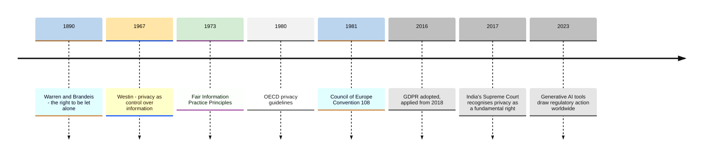
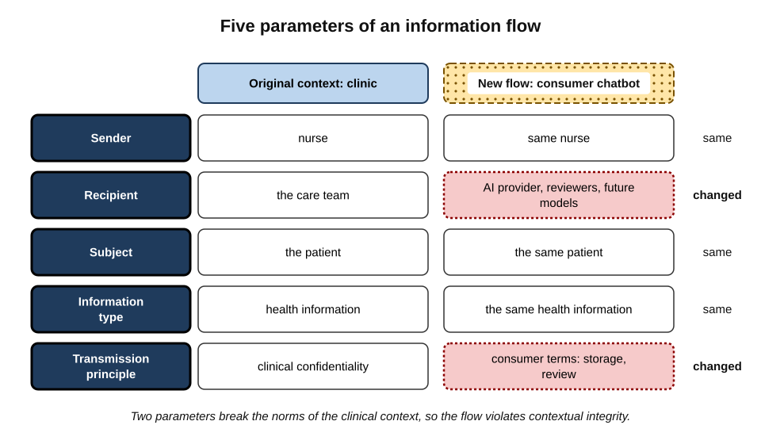
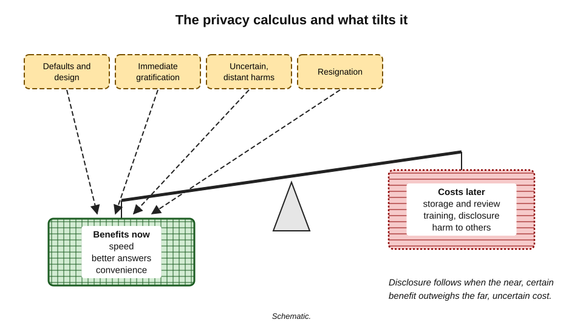
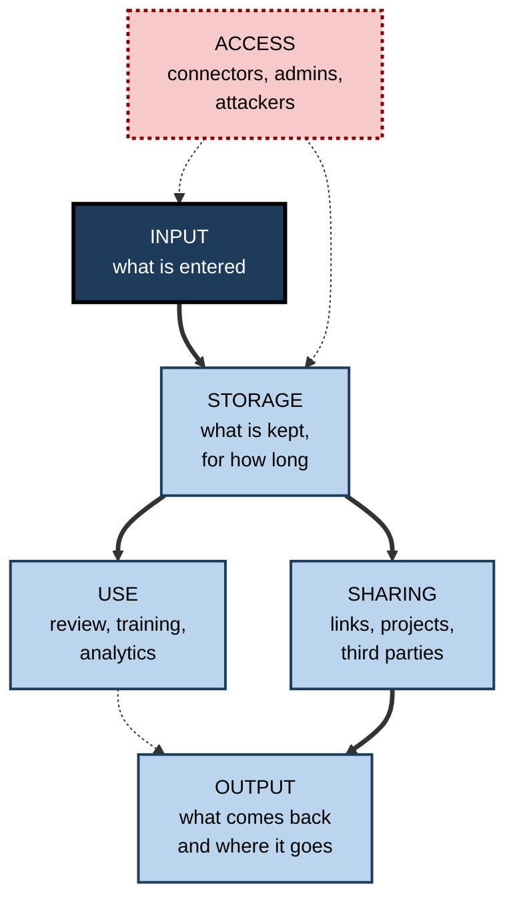
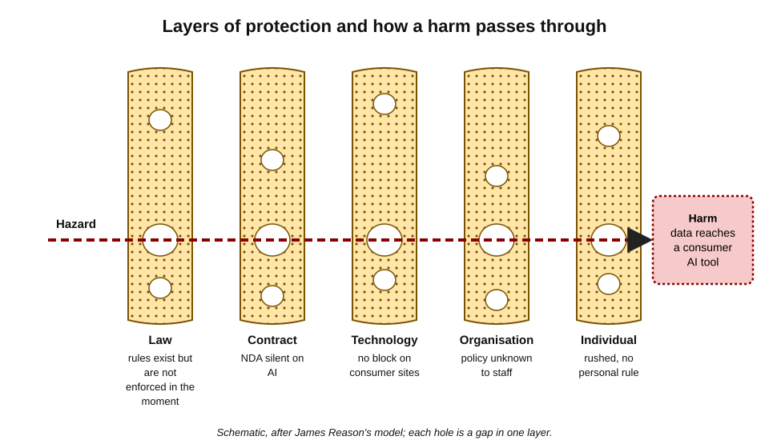
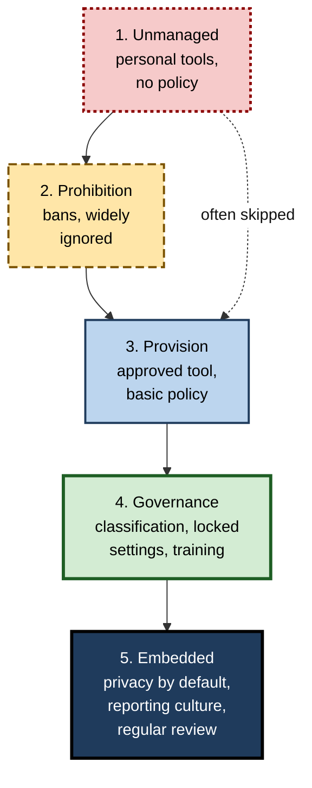

# J. Privacy & Confidentiality

A pharmacist asks an assistant to explain a drug interaction. An engineer asks it to find the bug in a module. A manager asks it to soften a difficult email. Each request takes seconds and feels like a private act of thinking aloud. Each also moves information — about patients, about a company's code, about a colleague — out of the setting in which it was entrusted and into a new one, run by another organisation, under rules the user has rarely read.

> **Definition — Privacy:** the appropriate flow of information about people, and the ability of individuals to influence how information about them is collected, used and shared.

> **Definition — Confidentiality:** the duty to keep information that has been entrusted, or that belongs to someone else, within the circle of people and purposes for which it was shared.

**Why it matters**

- **Every AI request is an information flow.** Text, files and voice leave one context and enter another; whether that is acceptable depends on the norms of the original context.
- **AI tools sit inside ordinary work.** Assistants are now built into email, documents, meetings, browsers and phones, so privacy decisions are made dozens of times a day, usually without noticing.
- **Professional trust depends on it.** Clients, patients, employers and colleagues share information on the understanding that it will be protected.
- **The law has caught up.** Data-protection regulators, courts and professional bodies have applied existing duties directly to AI use, and enforcement has begun.

---

## Privacy, Confidentiality and Security

The three ideas overlap but answer different questions.

| | Privacy | Confidentiality | Information stewardship | Responsibility for information held on behalf of others. |
| Information security |
|---|---|---|---|
| Central question | Is this flow of information about a person appropriate? | Is this information staying within the permitted circle? | Is information protected against unauthorised access, change and loss? |
| Protects | People | Relationships of trust and the owners of information | Information and systems |
| Main sources | Human-rights and data-protection law, social norms | Contract, employment, professional codes, equity, trade-secret law | Standards, technical controls, organisational procedures |
| Typical AI failure | A customer's complaint, with health details, pasted into a consumer chatbot | A client's strategy uploaded in breach of an NDA | A stolen session token gives an attacker a user's chat history |

- **Security is a precondition, not a substitute.** A perfectly secure provider can still use data in ways that breach privacy or confidentiality — training on it, sharing it, keeping it too long.
- **Privacy and confidentiality often apply together.** A client's employee list is both personal data and confidential information.

> **Key point:** the question for AI tools is rarely "is the provider secure?" alone. It is "**should this information go to this recipient, for this purpose, under these terms?**" — a question of privacy and confidentiality as much as security.

---

## Ideas That Shaped Privacy

### From the right to be let alone to data protection

- **1890 — "The Right to Privacy"**
  - The American lawyers **Samuel Warren and Louis Brandeis** argued in the *Harvard Law Review* that new technologies — instant photography and mass-circulation newspapers — threatened "the right to be let alone", and that the law should protect it.
- **1967 — Alan Westin, *Privacy and Freedom***
  - Defined privacy as the claim of individuals, groups or institutions to determine for themselves **when, how and to what extent** information about them is communicated to others.
  - Shifted attention from seclusion to **control over information**.
- **1973 — Fair Information Practice Principles**
  - A US government advisory committee report, *Records, Computers and the Rights of Citizens*, proposed principles for computerised record-keeping: no secret systems, a way for individuals to see and correct records, use only for stated purposes, and reliability and security.
- **1980 — OECD Guidelines**
  - Eight principles for the protection of privacy and transborder flows of personal data — collection limitation, data quality, purpose specification, use limitation, security safeguards, openness, individual participation and accountability — which still underlie most data-protection laws.
- **1981 — Council of Europe Convention 108** — the first binding international treaty on data protection.
- **1995 and 2016 — European data-protection law** — the Data Protection Directive, replaced by the **General Data Protection Regulation (GDPR)**, adopted in 2016 and applied from May 2018.
- **2017 — India** — in *Justice K. S. Puttaswamy v. Union of India*, a nine-judge bench of the Supreme Court held that privacy is a fundamental right under the Constitution; the **Digital Personal Data Protection Act** followed in 2023.

**Figure 1.** Milestones in the development of privacy and data-protection ideas.

> **Key point:** the recurring trigger for new privacy thinking has been **new technology** — the camera, the database, the internet, and now generative AI. Each time, the principles have been restated rather than replaced.

### Confidentiality's older roots

- **Medicine** — the Hippocratic tradition of keeping secret what a physician learns in treating a patient.
- **Law** — legal professional privilege, protecting communications between client and lawyer.
- **Commerce** — banking secrecy, trade secrets and the equitable action for breach of confidence.
- **Employment** — the duty of fidelity owed by employees to employers.

---

## Privacy as Contextual Integrity

The most useful modern framework for thinking about AI and privacy comes from the philosopher **Helen Nissenbaum**.

> **Definition — Contextual integrity:** the theory that privacy is preserved when information flows in ways that match the norms of the context in which it was shared, and violated when flows break those norms.

**Study card — Helen Nissenbaum, "Privacy as Contextual Integrity" (2004) and *Privacy in Context* (2010)**

- **Problem addressed:** the old split between "public" and "private" information could not explain why some uses of public information feel like violations, or why some sharing of private information feels perfectly appropriate.
- **Core claim:** every social context — healthcare, employment, friendship, commerce — has **norms** about how information should flow.
- **Five parameters of a flow:**
  - **sender** — who passes the information on;
  - **recipient** — who receives it;
  - **subject** — whom the information is about;
  - **information type** — what kind of information it is;
  - **transmission principle** — the condition under which it flows, such as confidentiality, consent, legal requirement or sale.
- **Test:** a flow is appropriate when all five parameters fit the norms of the original context; change any one — especially recipient or transmission principle — and the flow may become a violation.
- **Influence:** widely adopted in privacy research, design and policy as a way of reasoning about new technologies.

**Figure 2.** The five parameters of an information flow, applied to pasting a patient's details into an AI tool.

### Applying it to AI tools

- **A new recipient** — an AI provider, and possibly its sub-processors, reviewers and future models.
- **A new transmission principle** — consumer terms permitting storage, review and sometimes training, in place of the clinical, contractual or employment confidentiality under which the information was shared.
- **The same subject** — who did not take part in the decision.
- **The same information type** — often sensitive.
- **Conclusion** — the flow is acceptable only if the original context's norms allow it: an approved clinical tool under a confidentiality contract may fit; a consumer chatbot almost never does.

> **In practice:** contextual integrity explains why "it's only a summary" or "the provider is secure" do not settle the question. What matters is whether the **new flow** honours the **old norms** — and the person whose information it is would usually recognise the difference at once.

---

## Why AI Tools Change the Picture

AI assistants do not create new kinds of privacy duty, but they change the conditions under which old duties apply.

### Seven shifts

1. **A recipient in every task**
   - Writing, analysis and search once happened in tools that kept data local or within the organisation; an AI assistant adds an outside processor to tasks that never had one.
2. **Conversational disclosure**
   - The chat format invites context, background and candour — exactly where personal and confidential details live.
3. **Persistence**
   - Histories, memories, files and logs keep what was typed, sometimes for years; a single prompt quickly becomes several copies with different lifespans, and "delete" usually starts a process rather than ending one.
4. **Secondary use**
   - Content may be reviewed by people or used to improve future models; whether it is depends on defaults most users never change.
5. **Aggregation and inference**
   - Conversations accumulate into profiles; models infer health, beliefs or intentions from patterns of questions.
6. **Outputs as data**
   - Summaries, drafts and analyses carry the confidentiality of their inputs — and models can generate false statements about real people.
7. **Agency**
   - Assistants connected to mail, files and the web act on the user's behalf, reading and sending information without a visible "paste" moment.

**Study card — disclosure to a "computer" (Lucas and colleagues, 2014)**

- **Design:** participants at the University of Southern California were interviewed about personal and health topics by an on-screen virtual human. Some were told it was fully automated; others that it was operated by a person behind the scenes.
- **Results:** participants who believed they were talking to a computer reported **less fear of self-disclosure**, managed their impressions less, and were rated as **disclosing more** sensitive information.
- **Conclusion:** people may share more with systems they perceive as machines, partly because they feel less judged.
- **Relevance:** the same tendency may lead users to tell AI assistants things they would not tell a colleague — while the conversation is in fact stored and potentially readable by people.
- **Caveat:** the study used a research interview system, not a commercial chatbot; its effects on everyday workplace AI use are plausible but not directly tested.

> **Watch out:** the feeling of talking privately to a machine is the reverse of the reality. Behind most assistants stands a service that stores conversations, staff who may review them, and legal processes that can compel their disclosure.

---

## The Privacy Paradox and Its Explanations

> **Definition — Privacy paradox:** the observation that people often express strong concern about privacy yet behave in ways that disclose personal information readily.

### Explanations

- **Privacy calculus**
  - People weigh expected benefits — convenience, speed, better answers — against expected costs; disclosure follows when benefits seem larger.
- **Bounded rationality**
  - The economist **Alessandro Acquisti** and colleagues have argued that privacy decisions are distorted by incomplete information, immediate gratification and the difficulty of estimating distant, uncertain harms.
- **Defaults and design**
  - Pre-set options and interface design steer behaviour regardless of stated preferences.
- **Resignation**
  - Some researchers describe "digital resignation": people disclose not because they do not care but because they feel they cannot meaningfully control what happens.
- **Measurement artefact**
  - Stated concern is measured in general terms; behaviour is specific and contextual, so the two may not truly conflict.

**Figure 3.** The privacy calculus, and the pressures that tilt it towards disclosure.

> **Watch out:** the privacy paradox is **contested**. Reviews of the research find mixed evidence — some studies show attitudes predicting behaviour reasonably well when both are measured specifically. What is consistently supported is that **immediate convenience and design** exert strong pressure on disclosure decisions.

> **Key point:** because individual choices are bent by convenience, defaults and uncertainty, durable protection comes from **pre-set rules, safe defaults and contracts**, not from expecting each user to calculate risk afresh every time.

---

## A Map of the Risks

The risks of AI use for privacy and confidentiality fall into six families, following the life of information through a tool.

**Figure 4.** Six families of privacy and confidentiality risk in AI tool use.

| Risk family | Typical failure | Main protections |
|---|---|---|
| Input | Personal, client or regulated data entered into the wrong tool | Minimisation, approved tools, personal rules |
| Storage | Conversations kept for years; held under court order | Retention settings, temporary chats, contracts |
| Use | Content reviewed by staff or used for training | Business terms, training settings, avoiding feedback on sensitive chats |
| Sharing | Public links indexed; projects with stale members | Narrow audiences, link revocation, workspace governance |
| Output | Summaries with secrets sent onwards; false facts about people | Treating outputs as confidential; verification |
| Access | Over-broad connectors; compromised accounts; prompt injection | Permission hygiene, account security, reporting odd behaviour |

- **Input** is where most everyday harm begins: the commonest failures are personal details pasted for context and client documents uploaded to the wrong account.
- **Account type** cuts across all six families — the same model offered under consumer and business terms can differ in nearly every protection — so choosing the account is often the single most consequential decision.

> **Mnemonic — "I Store, Use, Share, Output, Access" (ISUSOA):** the life of information through an AI tool, and the six places it can go wrong.

---

## Layers of Protection

### The layered-defence model

> **Definition — Defence in depth:** protecting something valuable with several independent layers, so that the failure of one is caught by another.

- **The Swiss cheese model** — the psychologist **James Reason** described organisational accidents as occurring when holes in several layers of defence momentarily line up, letting a hazard pass through every layer.
- **Applied to AI privacy**, the layers are:
  - **law and regulation** — rights, duties, enforcement;
  - **contracts** — business terms, data-processing agreements, NDAs;
  - **technology** — enterprise controls, data-loss prevention, encryption, private deployments;
  - **organisation** — policies, approved tools, training, incident procedures, culture;
  - **the individual** — knowledge, settings, habits and a personal rule.

**Figure 5.** Layers of protection for information entering AI tools, and how a harm passes when gaps line up.

> **Key point:** no single layer is enough. The individual layer is the last — and, for consumer tools used outside the organisation's control, often the only — one in place.

### Privacy by design

> **Definition — Privacy by design:** building privacy into systems and practices from the start, rather than adding it afterwards.

- **Origins** — developed in the 1990s by **Ann Cavoukian**, then Information and Privacy Commissioner of Ontario, as seven foundational principles, including proactive rather than reactive measures, privacy as the default setting, and full functionality without false trade-offs.
- **In law** — the GDPR (Article 25) requires **data protection by design and by default**: appropriate technical and organisational measures, and defaults that process only the personal data necessary for each purpose.
- **For AI tools** — privacy by default means training off, short retention, memory off, sharing limited, and connectors scoped narrowly unless a user deliberately chooses otherwise.

### Privacy-enhancing technologies

| Technology | What it does | Example of use | Limitation |
|---|---|---|---|
| On-device processing | Runs models on the user's device so data need not leave it | Phone and laptop assistants for simple tasks | Smaller models; device security matters |
| Confidential computing | Processes data in hardware-protected enclaves | Cloud AI services offering protected processing | Depends on hardware and verification |
| Differential privacy | Adds calibrated noise so outputs reveal little about any individual | Usage statistics; the 2020 US Census | Reduces accuracy; hard to apply to free text |
| Federated learning | Trains models across devices without collecting raw data centrally | Keyboard prediction on phones | Updates can still leak information |
| Synthetic data | Generates artificial records with realistic structure | Testing prompts and pipelines | May reproduce real records if poorly made |
| Redaction and pseudonymisation tools | Remove or mask identifiers before data leaves | Gateways that strip names from prompts | Miss context and quasi-identifiers |

> **Definition — Differential privacy:** a mathematical standard, introduced by Cynthia Dwork and colleagues in 2006, under which the result of an analysis changes very little whether or not any one individual's data is included.

---

## Regulation of AI and Privacy

### Applying existing law

- **Data-protection law applies in full** to personal data in prompts, files and outputs: lawful basis, purpose limitation, minimisation, accuracy, retention, security, rights.
- **Regulators have acted** — Italy's data-protection authority temporarily restricted ChatGPT in 2023 and later fined its provider; several authorities have blocked or investigated AI apps; others have issued guidance on staff use of chatbots.
- **European guidance** — the European Data Protection Board's 2024 opinion on AI models addressed legitimate interests, anonymity of models and the consequences of unlawful training.
- **Professional regulators** — law societies, bar associations, medical and accounting bodies have applied confidentiality duties to generative AI.
- **Courts** — have ordered providers to preserve conversations and have ruled on whether AI-generated material is privileged.

### AI-specific law

- **EU Artificial Intelligence Act (2024)** — risk-based regulation of AI systems, with duties for high-risk uses and transparency obligations, applied in phases.
- **China** — interim measures for generative AI services (2023) include requirements on training data and personal information.
- **United States** — no federal AI privacy statute; state privacy laws, sector rules and the Federal Trade Commission's powers against unfair and deceptive practices apply.
- **India** — the DPDP Act applies to digital personal data in AI tools; sector regulators add expectations.

> **Watch out:** AI law is changing quickly, and timetables for some obligations have been the subject of proposed amendments. Principles are stable; specific deadlines and thresholds should be checked against current law when a decision depends on them.

---

## Ethics: Holding Information for Others

Law sets the minimum. The ethical core of privacy and confidentiality at work is that most of the information a professional handles is **held on behalf of someone else**.

### Stewardship

> **Definition — Information stewardship:** responsibility for information one holds but does not own, exercised in the interests of the people it concerns and the parties who entrusted it.

- **The subject is absent** — the patient, customer, candidate or colleague described in a prompt is not present when the decision to paste is made, and usually never learns of it.
- **The benefit is the user's; the risk is the subject's** — the professional saves minutes; the person described bears any harm from exposure, error or inference.
- **Asymmetry of power** — employers over employees, firms over customers, institutions over service users; the weaker party is least able to object or seek redress.
- **Dignity** — some information, such as health, family difficulty or grief, deserves protection not only because harm might follow but because exposing it diminishes the person.

### Ethical tests beyond legality

- **The absent-subject test** — would the person described consider this use respectful if they could see it?
- **The entrusting-party test** — would the client or employer who shared this recognise the use as within the trust they gave?
- **The reversal test** — would I accept this use of my own information, in my own most sensitive circumstances?
- **The public-account test** — could this use be explained plainly to a regulator, a court or a journalist?

> **Key point:** legal permission and ethical appropriateness usually coincide, but not always. An enterprise contract may make a use lawful while the absent-subject test still counsels restraint — for example, asking an assistant to "read between the lines" of a struggling employee's messages.

### Trust as a professional asset

- **Trust is built slowly and lost quickly** — clients judge a professional's discretion by the worst incident they hear of, not by the average.
- **Discretion is visible** — the professional who removes names before using a tool, explains the safeguards to a client and reports their own mistakes is seen to be trustworthy.
- **Collective reputation** — one practitioner's careless disclosure affects how clients view the whole firm and, sometimes, the whole profession.

---

## Organisational Practice

### What well-governed organisations do

- **Provide approved tools** that are as convenient as consumer alternatives, under business contracts.
- **Classify information** and map each class to permitted tools.
- **Assess risk** — data protection impact assessments for AI uses involving personal or sensitive data.
- **Lock key settings** — training, retention, memory, sharing, connectors.
- **Train by role and example** — showing staff how to rewrite real prompts, not only what is forbidden.
- **Monitor proportionately** — data-loss prevention and usage logs, explained honestly to staff.
- **Respond well** — an AI section in incident procedures, and a just culture that encourages prompt reporting.
- **Review terms** — someone accountable for provider changes.

### Stages of maturity

**Figure 6.** Stages through which organisations' handling of AI privacy commonly develops.

- **Unmanaged** — staff use whatever they like; nobody knows what data has gone where.
- **Prohibition** — bans issued after an incident or warning; use continues out of sight.
- **Provision** — an approved tool arrives; much shadow use moves onto it.
- **Governance** — classification, settings, training and monitoring make the approved route reliable.
- **Embedded** — privacy is the default, mistakes are reported quickly, and practice is reviewed as tools change.

> **In practice:** organisations that moved directly from unmanaged use to provision of a good approved tool generally saw shadow use fall faster than those that passed through a long period of prohibition.

---

## Professional Mastery

### What experts do differently

- **Think in flows, not files** — asking who will receive information, under what norms, rather than whether a document is "sensitive".
- **Separate the model from the service** — worrying less about the model "learning" and more about storage, review, sharing and disclosure.
- **Read terms for verbs** — distinguishing "do not" from "may".
- **Default to minimum necessary** — removing the person and keeping the problem.
- **Make decisions repeatable** — a personal rule, a register, a review rhythm.
- **Report early** — treating their own mistakes as information, not as embarrassment.
- **Teach others** — sharing rules and rewritten prompts with colleagues.

### Worked example (illustrative): five requests through the lens of contextual integrity

| Request | Original context and norms | New flow | Appropriate? |
|---|---|---|---|
| Summarise a published industry report | Public; no restriction | Any tool | Yes |
| Rewrite a team's internal process note | Internal; staff only | Enterprise assistant under business terms | Yes |
| Draft a reply to a customer complaint, pasting name and medical details | Customer service; confidential, purpose-limited | Consumer chatbot | No — new recipient and weaker transmission principle |
| Analyse a client's sales data under an NDA permitting "service providers bound by confidentiality" | Client engagement; contractual confidence | Enterprise assistant whose contract binds confidentiality | Likely yes, after confirming with the engagement lead |
| Ask what an assistant "knows" about a job candidate | Recruitment; fairness and accuracy duties | Model generating claims about a named person | No — inaccurate personal data, outside recruitment norms |

*Illustrative scenarios.*

- **Conclusion:** the same tool can be appropriate or inappropriate depending on the **norms of the source context** and the **terms of the new flow**. Asking only "is the tool safe?" misses the question.

### Case study (illustrative): a consultancy rebuilds its approach

- **Situation:** a 400-person consultancy had banned public AI tools after a client complained about a junior analyst's use of a chatbot. Surveys showed that most staff continued to use personal accounts for drafting and research.
- **Diagnosis:**
  - the ban had driven use out of sight, not stopped it;
  - staff could not distinguish safe from unsafe uses;
  - no approved tool existed;
  - client contracts were silent on AI.
- **Actions:**
  1. procured an enterprise assistant with training excluded, regional processing and 30-day retention;
  2. created three information classes with permitted tools for each;
  3. added an AI clause to engagement letters describing tools and safeguards;
  4. trained staff using their own anonymised prompts, rewritten together;
  5. asked each consultant to adopt a one-sentence personal rule and a quarterly self-audit;
  6. introduced a just-culture commitment and a one-form reporting route.
- **Result (first year):** most staff moved to the approved tool; reported near misses rose, then fell; two clients asked to adopt the firm's AI clause for their other suppliers.
- **Side effects:** some partners felt slowed by the classification step; it was simplified to a two-question test.
- **Lesson:** protection came from **layers working together** — contract, technology, organisation and individual — not from any single control.

---

## Open Questions

- **Can contextual integrity be built into AI systems?**
  - Researchers are exploring assistants that recognise the norms of the context they are working in and refuse or adapt inappropriate flows; reliable implementations do not yet exist.
- **Will AI conversations receive legal protection?**
  - Some have proposed a form of privilege for conversations with AI about health, law or personal matters; courts have so far declined to extend existing privileges to consumer tools.
- **How should agents be governed?**
  - When assistants act autonomously across systems, the moment of human decision that most privacy protections rely on disappears.
- **Can trained models respect deletion and correction?**
  - Rights to erasure and rectification were designed for databases; applying them to model weights remains unsolved.
- **Is individual choice still meaningful?**
  - With defaults dominant and terms changing often, the balance between individual responsibility and structural protection — defaults, contracts, regulation — is debated.
- **Will privacy-enhancing technologies close the gap?**
  - On-device and confidential processing are advancing; whether they can match cloud capability at acceptable cost will shape the next decade.

---

## Summary

- **Privacy** concerns the appropriate flow of information about people; **confidentiality** keeps entrusted information within its permitted circle; **security** protects information and systems. AI decisions involve all three.
- Privacy thinking has repeatedly been renewed by technology: **Warren and Brandeis (1890)**, **Westin (1967)**, the **Fair Information Practice Principles (1973)**, the **OECD Guidelines (1980)**, **Convention 108**, the **GDPR**, India's **Puttaswamy** judgment and **DPDP Act**.
- **Contextual integrity** (Nissenbaum) judges a flow by five parameters — sender, recipient, subject, information type, transmission principle — against the norms of its context; AI tools introduce a **new recipient** and often a **weaker transmission principle**.
- AI tools shift conditions through **a recipient in every task, conversational disclosure, persistence, secondary use, aggregation and inference, outputs as data and agency**; people may disclose more to systems perceived as machines.
- The **privacy paradox** is contested; convenience, defaults, bounded rationality and resignation push towards disclosure, so protection should rest on **rules, defaults and contracts**.
- Risks fall into six families — **input, storage, use, sharing, output, access** — with account type cutting across all.
- Protection is **layered**: law, contract, technology, organisation and the individual (the **Swiss cheese model**); **privacy by design** and **privacy-enhancing technologies** strengthen the layers.
- Existing **data-protection law** applies in full to AI use; **AI-specific law** adds risk-based duties; enforcement and court rulings have begun.
- Ethically, professionals are **stewards** of information about absent subjects; tests of the absent subject, the entrusting party, reversal and public account go beyond legality.
- Organisations progress from **unmanaged** through **prohibition, provision and governance** to **embedded** practice.

---

## Self-Check

1. Distinguish privacy, confidentiality and information security, with an AI example of each failing.
2. What did Warren and Brandeis argue in 1890, and what prompted them?
3. How did Westin's definition change the idea of privacy?
4. Name the eight OECD privacy principles.
5. Explain contextual integrity and its five parameters.
6. Apply contextual integrity to an HR officer pasting an employee's grievance into a consumer chatbot.
7. List the seven shifts that AI tools bring to privacy and confidentiality.
8. Summarise the Lucas and colleagues study of disclosure to virtual humans, with its caveat.
9. What is the privacy paradox, and why is it contested?
10. Name the six families of risk and a protection for each.
11. Explain the Swiss cheese model and apply it to an AI data leak.
12. What does GDPR Article 25 require, and what would "privacy by default" mean for an AI assistant?
13. Compare two privacy-enhancing technologies, giving a strength and limitation of each.
14. Describe the five stages of organisational maturity and why prohibition rarely works on its own.
15. A colleague argues that because the AI provider is "very secure", any work data can be used with it. Evaluate the argument using contextual integrity and the layered view of protection.
16. Describe four ethical tests that go beyond legal permission, and give a case where a lawful use might still fail one.

### Answer Key

1. Privacy: whether a flow of information about a person is appropriate — e.g. a customer's health details pasted into a chatbot. Confidentiality: whether entrusted information stays within its circle — e.g. a client strategy uploaded in breach of an NDA. Security: protection against unauthorised access — e.g. a stolen session token exposing chat history.
2. That the law should protect "the right to be let alone"; prompted by instant photography and intrusive mass-circulation newspapers.
3. It defined privacy as control over when, how and to what extent information about oneself is communicated — shifting from seclusion to control over information flows.
4. Collection limitation, data quality, purpose specification, use limitation, security safeguards, openness, individual participation, accountability.
5. Privacy is preserved when information flows match the norms of their context. Parameters: sender, recipient, subject, information type, transmission principle.
6. Sender: HR officer; recipient: changes from HR to an outside provider; subject: the employee; type: sensitive employment and possibly health information; transmission principle: changes from employment confidentiality to consumer terms. Two parameters break the norms, so the flow violates contextual integrity.
7. A recipient in every task; conversational disclosure; persistence; secondary use; aggregation and inference; outputs as data; agency.
8. Participants told that a virtual interviewer was automated felt less fear of disclosure and disclosed more than those told it was human-operated. Caveat: a research system, not a commercial chatbot; workplace effects are untested.
9. People express concern but disclose readily. Contested because evidence is mixed; specific measures of attitude often do predict behaviour, and apparent conflict may reflect how concern is measured.
10. Input — minimisation and approved tools; storage — retention settings and contracts; use — business terms and training settings; sharing — narrow audiences and link revocation; output — treating outputs as confidential and verifying; access — permission hygiene and account security.
11. Harm occurs when holes in several defensive layers align. E.g. law prohibits the disclosure, but the contract is silent, no technical block exists, the policy is unknown and the individual is rushed — the data reaches a consumer tool.
12. Appropriate measures to implement data-protection principles, and defaults that process only necessary personal data. For an assistant: training off, short retention, memory off, sharing limited, connectors scoped narrowly unless deliberately changed.
13. E.g. on-device processing keeps data on the device (strength) but uses smaller models (limitation); differential privacy limits what outputs reveal about individuals (strength) but reduces accuracy and suits statistics more than free text (limitation).
14. Unmanaged; prohibition; provision; governance; embedded. Prohibition alone pushes use out of sight because staff still need the capability and have no approved route.
15. Security is necessary but not sufficient. Even a secure provider may store, review or train on data and can be compelled to disclose it; the question is whether the new flow honours the norms of the original context — contracts, professional duties, data-protection principles — and whether the account's terms permit the use. Some work data may be appropriate under business terms; client, personal and regulated data may not be, whatever the security.
16. Absent-subject (would the person described find it respectful?), entrusting-party (would the client or employer see it as within their trust?), reversal (would I accept it for my own information?), public-account (could it be explained to a regulator or journalist?). A lawful enterprise-tool analysis of an employee's private messages to infer their state of mind could fail the absent-subject and reversal tests.

---

## Glossary

| Term | Meaning |
|---|---|
| Confidentiality | The duty to keep entrusted information within its permitted circle. |
| Contextual integrity | The theory that privacy depends on information flows matching contextual norms. |
| Defence in depth | Protection through several independent layers. |
| Differential privacy | A mathematical standard limiting what an analysis reveals about any individual. |
| Digital resignation | Disclosure driven by a sense that control is impossible. |
| Fair Information Practice Principles | Principles for fair handling of personal records, proposed in 1973. |
| Federated learning | Training models across devices without collecting raw data centrally. |
| Information stewardship | Responsibility for information held on behalf of others. |
| Information security | Protection of information and systems against unauthorised access, change and loss. |
| OECD Guidelines | The 1980 international principles for privacy and data flows. |
| Privacy | The appropriate flow of information about people and their influence over it. |
| Privacy by design | Building privacy into systems and practices from the start. |
| Privacy calculus | Weighing expected benefits of disclosure against expected costs. |
| Privacy-enhancing technology | A technique that reduces privacy risk while allowing data to be used. |
| Privacy paradox | The apparent gap between stated privacy concern and disclosing behaviour. |
| Swiss cheese model | A model of accidents as aligned gaps in successive layers of defence. |
| Transmission principle | The condition under which information flows, such as confidentiality or consent. |
