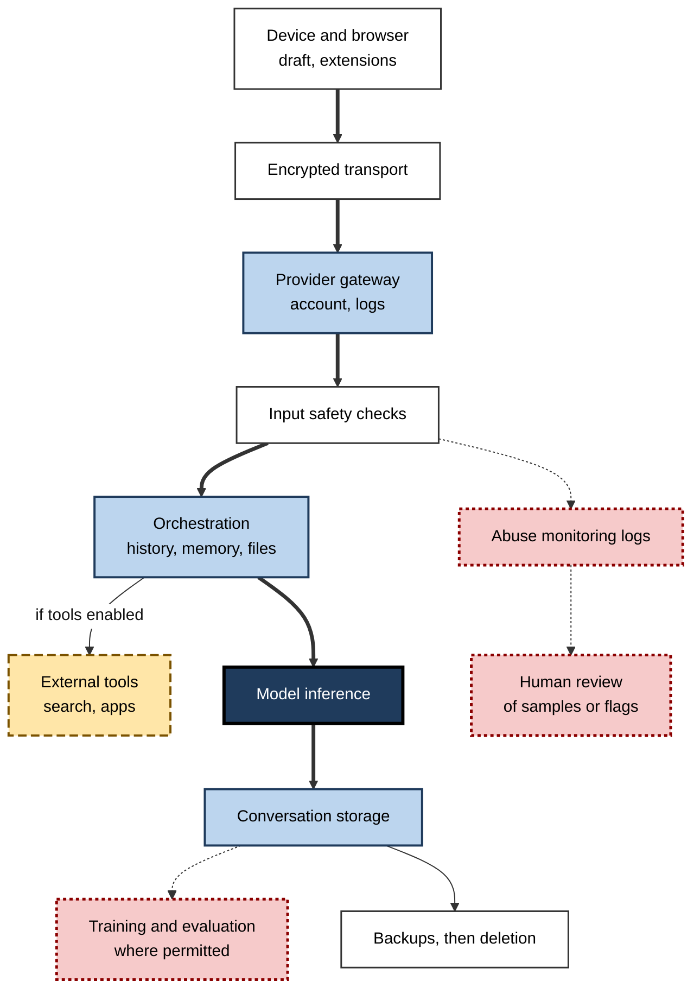
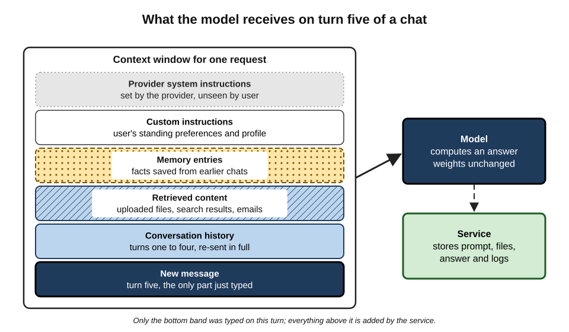
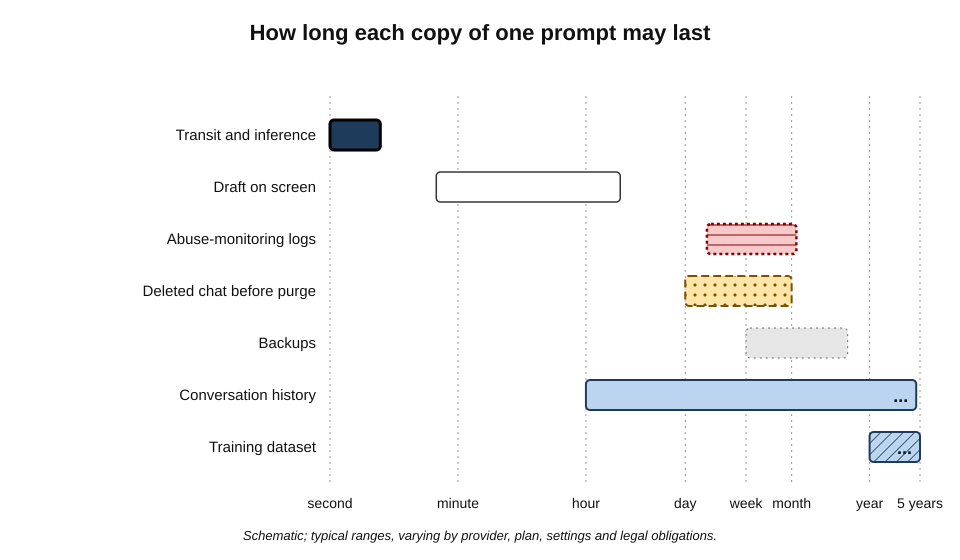
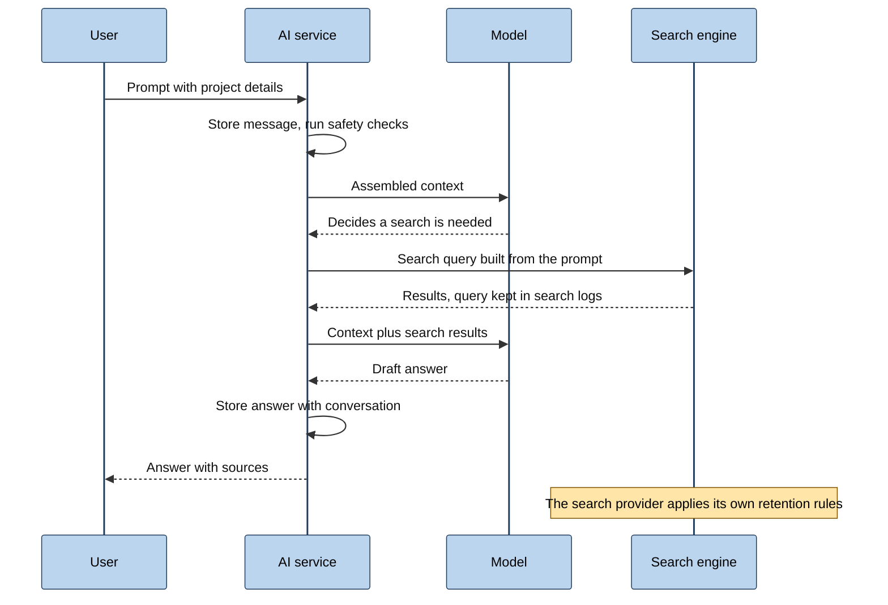
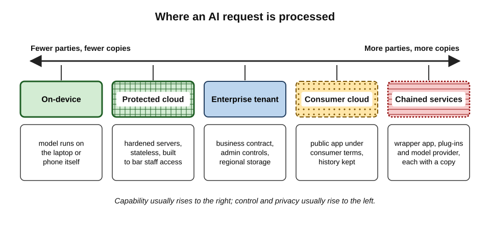
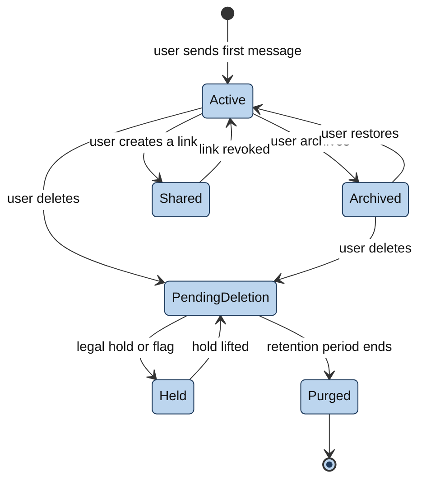

# J.1. What happens to what you type

A project manager pastes a paragraph from a client proposal into an AI assistant and asks for a shorter version. The answer arrives in two seconds, in a window that looks like a private notepad. In those two seconds the paragraph has crossed the internet, been decrypted on a provider's servers, screened, processed and written into a database and logs. Some copies vanish within seconds; others may outlive the project.

> **Definition — Input data (prompt data):** everything a person submits to an AI tool — typed text, pasted passages, attached files, images, audio, instructions and feedback — together with the metadata the service records about each submission.

**Why the path matters**

- **Every privacy decision depends on it.** Whether a passage may be pasted depends on who will hold a copy, for how long and for what purpose.
- **The interface hides it.** A chat window gives no visual sign of the servers, logs, reviewers and third parties behind it.
- **The path changes with features.** Memory, web search, file upload, connectors and agents each add new places where data travels.
- **Most mistakes come from a wrong mental model.** People who picture the assistant as a closed box, or as a mind that "learns" every sentence instantly, make predictable errors in both directions.

---

## What Counts as "What You Type"

The word *prompt* suggests a single line of text. In practice an AI service receives, and may store, a much larger bundle.

### The input envelope

- **The visible prompt** — the words typed or pasted into the box.
- **Attachments** — documents, spreadsheets, slides, screenshots, photographs, code files.
  - Files are often **extracted into text** and may be stored separately from the conversation.
- **Voice and images** — spoken requests, camera input, screen captures.
  - Audio may be transcribed, and the recording itself may be kept for a period.
- **Conversation history** — earlier turns of the same chat.
  - Sent back to the model with **every** new message.
- **Standing instructions** — "custom instructions", profile details, preferred style.
- **Memory** — facts the tool has saved about the user from earlier chats.
- **Retrieved content** — emails, files or web pages that a connector or search feature pulls in on the user's behalf.
- **Feedback** — thumbs up or down, written comments, choices between two answers.
  - Feedback commonly sends the **whole conversation** for review, not only the rating.
- **Outputs** — the model's answers are stored alongside the inputs and can contain the same sensitive details.

> **Definition — Metadata:** data about a submission rather than its content — account identifier, time, IP address, approximate location, device and browser, language, feature used, length and error codes.

> **Key point:** the unit of privacy is not the sentence typed but the **whole envelope** — prompt, files, history, memory, retrieved content, feedback, outputs and metadata.

### Metadata alone reveals a great deal

- **Timing** shows working patterns — late-night use, activity during a particular meeting.
- **Volume and topic classifiers** show what someone works on.
  - Providers commonly run automatic classifiers that tag conversations by topic for safety and product analysis.
- **Account links** tie activity to a named person, an employer domain and a payment card.

> **Example (illustrative):** a solicitor never types a client's name, but asks twenty questions about the insolvency of a small engineering firm in one town on the day before a court filing. The content is anonymised; the pattern is not.

---

## The Journey of a Prompt

The route from keyboard to answer passes through a series of distinct stages. Each stage is a place where a copy can exist and a control can apply.

### Stage by stage

1. **The device**
   - The text exists in the browser or app, sometimes saved as a draft.
   - **Browser extensions** with permission to "read and change data on all websites" can read it too.
   - Some operating systems and keyboards offer their own AI features that see the text before the chat service does.
2. **Transport**
   - The request travels over the internet encrypted with **TLS** (the same protection used by online banking).
   - TLS stops eavesdroppers on the network; it does **not** stop the provider reading the content once it arrives.
3. **The front door**
   - The provider's gateway authenticates the account, applies rate limits and routes the request.
   - Operational logs record that a request happened, and sometimes parts of it.
4. **Input safety checks**
   - Automated classifiers screen for abuse, illegal content or attempts to subvert the system.
   - Flagged material may be held longer and may be routed to human reviewers.
5. **Orchestration**
   - The service assembles the full context: system instructions, memory, history, files, retrieved documents.
   - If **tools** are enabled, it may send queries to a web search engine, run code in a sandbox, or call an external application.
6. **Inference**
   - The model runs on specialised hardware (usually graphics processors in a data centre), often operated by a cloud company acting as a **sub-processor**.
   - The text is held in working memory only for the seconds the computation takes.
7. **Output checks**
   - The answer may be screened before it is shown.
8. **Storage**
   - The conversation is written to a database so it appears in the history sidebar.
   - Files may sit in separate storage with their own retention rules.
9. **Secondary uses**
   - **Abuse monitoring** — logs kept for a period to detect misuse.
   - **Human review** — a sample or flagged items read by staff or contractors.
   - **Analytics** — aggregated statistics about usage.
   - **Training and evaluation** — where permitted, conversations may be selected for building future models.
10. **Backups and deletion**
    - Databases are backed up; deletion from the live system is followed by deletion from backups on a later cycle.

**Figure 1.** The path of a prompt from the keyboard to storage, and the secondary uses that may follow.

> **Remember:** **D-T-G-S-O-M-S** — Device, Transport, Gateway, Safety, Orchestration, Model, Storage. Each letter is a place a copy can live.

---

## The Model and the Service

The single most useful distinction is between the **model** — the trained mathematical system that produces text — and the **service** wrapped around it.

> **Definition — Model weights:** the billions of numerical parameters, fixed during training, that determine how a model turns input into output.

> **Definition — Inference:** running an already-trained model on new input to produce an answer. Inference does not change the weights.

### Why the model does not "remember" a chat

- **Models are stateless between requests.**
  - The weights are the same before and after a conversation.
  - The appearance of memory within a chat comes from the service **re-sending the whole conversation** with each new message.
- **The context window is the model's entire view.**
  - Anything outside it — earlier chats, other users' chats — is invisible to the model unless the service inserts it.
- **Learning happens only through later training.**
  - If a provider uses conversations for training, the effect appears in a **future model version**, weeks or months later, mixed with vast amounts of other data.

> **Definition — Context window:** the maximum amount of text (measured in tokens) a model can take into account in a single request, including instructions, history, files and the new prompt.

> **Definition — Token:** a chunk of text, often part of a word, that a model reads and writes; in English one token averages roughly three-quarters of a word.

**Figure 2.** What the model actually receives on each turn: the assembled context, not just the latest message.

### Model versus service compared

| | The model | The service around it |
|---|---|---|
| What it is | Fixed numerical weights | Apps, servers, databases, logs, staff, policies |
| Keeps your conversation? | No — holds it only during computation | Yes — history, files, logs, backups |
| Changes when you chat? | No | Yes — new records, new memory entries |
| Where privacy risk lies | Mainly through later **training** on user data and **memorisation** of that data | Storage, access, sharing, retention, breaches, legal demands |
| Who controls it | Provider's research teams | Provider's product, security and legal teams; customer administrators on business plans |

> **Watch out:** two opposite myths. "The AI instantly learns everything I type and might tell the next user" overstates the model's role — inference does not alter weights. "Nothing is kept because the AI has no memory" understates the service's role — the conversation is stored, logged and possibly reviewed. Both are wrong for the same reason: they confuse the model with the service.

> **Key point:** the realistic privacy questions are almost all **service questions** — who stores the conversation, who can read it, how long it is kept and whether it may later be selected for training.

### When the line blurs

- **Memory features** deliberately carry facts across chats.
  - The model is unchanged, but the service now inserts saved facts into future contexts.
- **Personalisation** may use past conversations to shape answers.
- **Training on user data** closes the loop over months: today's conversation may become part of a later model's training material, from which fragments can occasionally be reproduced.
  - Large models are known to **memorise** some rare, repeated strings from their training data; the risk is greatest for text that appears many times or is highly distinctive.

---

## Copies and How Long They Last

A single prompt can exist in many copies at once, each with its own lifespan.

- **On screen and in drafts** — until the window is closed or the draft cleared.
- **In transit** — milliseconds, encrypted.
- **In working memory during inference** — seconds.
- **In conversation history** — until the user deletes it, or indefinitely on many consumer plans.
- **After deletion** — commonly purged from live systems within a stated period (30 days is a frequent figure), unless a legal obligation intervenes.
- **In abuse-monitoring logs** — commonly days to weeks; longer if content is flagged.
- **In human-review sets** — for as long as the review and any resulting dataset require.
- **In training datasets** — potentially years, and the effect on a trained model cannot simply be deleted.
- **In backups** — until the backup cycle overwrites them.
- **With third parties** — search engines, connected apps and plug-ins keep data under **their own** rules.

**Figure 3.** Typical lifespans of the different copies of one prompt.

> **Watch out:** "deleted" in a sidebar normally means **scheduled for deletion**. Removal from logs, review sets and backups follows its own timetable, and a court order or regulatory duty can suspend deletion entirely.

---

## Who Can See It

### The people and systems with potential access

- **The user** — and anyone else with access to the unlocked device or the account.
- **The organisation's administrators** — on business plans, administrators can often export conversations for compliance, investigations or legal holds.
- **Provider staff** — normally under strict, logged access controls, for purposes such as abuse investigation, support requests and legal compliance.
- **Contracted reviewers** — some providers use external contractors to label or rate conversations.
- **Sub-processors** — cloud hosting, content-delivery and support companies that process data on the provider's behalf.
- **Third parties reached by tools** — a web search sends a query to a search engine; an external "action" or plug-in receives whatever the assistant passes it.
- **Public authorities** — through warrants, court orders and disclosure in litigation.
- **Other users** — only through bugs or misconfiguration, but it has happened.
- **Attackers** — through account takeover, stolen session tokens, malicious extensions or breaches.

> **Definition — Sub-processor:** an organisation engaged by a service provider to process data on the provider's behalf, such as the cloud company whose data centres run the model.

### Access compared

| Party | When access typically arises | Main safeguard |
|---|---|---|
| Organisation's administrators | Compliance export, investigation, legal hold | Internal policy, audit logs, data-protection law |
| Provider staff | Abuse investigation, support ticket, legal demand | Role-based access, logging, contractual limits |
| Contracted reviewers | Quality rating, labelling for training | Contracts, de-identification, opt-outs |
| Search engines and connected apps | Each time a tool is called | Their own privacy terms; disabling tools |
| Courts and authorities | Litigation, criminal investigation | Legal process; data minimisation beforehand |
| Other users and attackers | Bugs, breaches, stolen sessions | Provider security; account security; not storing what is not needed |

> **In practice:** experienced professionals treat any prompt sent to a cloud AI service as a **document handed to a third party** — one that may be stored, read by authorised people, disclosed under legal process, or exposed in a breach. The question becomes whether that third party, under those terms, is an acceptable home for the content.

---

## Features That Change the Path

Each feature added to a basic chat changes where data goes. The same question can have very different privacy consequences depending on which buttons are switched on.

### What each feature adds

- **File upload**
  - Files are parsed, stored and sometimes indexed for search within the conversation or a project.
  - Hidden content travels too: comments, tracked changes, hidden sheets, image metadata.
- **Web search and browsing**
  - The assistant writes search queries — sometimes containing details from the prompt — and sends them to a search provider.
- **Connectors** (email, calendar, drive, chat)
  - The assistant reads the user's own content and pulls it into the context.
  - Data from other people — senders, colleagues, clients — enters the conversation.
- **Code execution**
  - Files and data are copied into a temporary sandbox to run analysis.
- **Voice mode**
  - Audio is transcribed; recordings may be stored with the conversation.
- **Memory**
  - Facts are extracted and kept in a separate profile store that outlives individual chats.
- **Agents and computer use**
  - The tool takes screenshots, reads pages and fills forms — capturing whatever is on screen, including other windows and notifications.
- **Browser sidebars and assistants built into operating systems**
  - May read the page or document currently open, not only what is typed.
- **Third-party apps built on a model**
  - The app maker receives the data first, then passes it to the model provider: **two** sets of terms apply.

| Feature | Extra data that travels | Extra party that may receive it |
|---|---|---|
| File upload | Full file, hidden layers, metadata | File storage and indexing services |
| Web search | Search queries derived from the prompt | Search engine |
| Connectors | Emails, files, messages of other people | Source system and its logs |
| Memory | Extracted personal facts | Long-lived profile store |
| Agents / computer use | Screenshots, page contents, form inputs | Websites visited; screenshot storage |
| Third-party wrapper app | Everything, before the model sees it | App developer and its sub-processors |

> **Watch out:** a request that says "find the latest news about our acquisition of Northfield Ltd" may cause the assistant to send the words "acquisition of Northfield" to a public search engine. A confidential project name can leak through the **query**, not only through the conversation.

**Figure 4.** A request that uses web search: the data passes to a second organisation.

### Where processing happens

Processing location sits on a spectrum, from entirely on the user's own device to a chain of external services.

- **On-device models** — small models running on a laptop or phone; the text need not leave the device.
- **Protected cloud processing** — designs where the provider's servers process data in hardened environments intended to prevent even the provider's staff from accessing it.
  - Apple announced its **Private Cloud Compute** design in June 2024 on this principle, with requests processed statelessly and server software published for independent inspection.
- **Enterprise tenant** — a business deployment, with contractual limits, administrator control and regional storage options.
- **Consumer cloud service** — the standard public app under consumer terms.
- **Chained services** — a third-party app, plus plug-ins, plus a model provider, each holding a copy.

**Figure 5.** Where processing happens, from the user's own device to chains of external services.

> **Key point:** moving right along the spectrum adds **parties** and **copies**. Moving left reduces them, usually at some cost in model capability.

---

## Encryption and Its Limits

Encryption protects data from people who should not see it, but an AI provider must see the plain text in order to compute an answer.

> **Definition — Encryption in transit:** scrambling data while it travels across a network, so that interceptors cannot read it.

> **Definition — Encryption at rest:** scrambling stored data on disks and in databases, so that stolen storage media cannot be read without the keys.

> **Definition — End-to-end encryption:** encryption in which only the communicating users hold the keys, so that the service in the middle cannot read the content.

- **Standard AI chat is not end-to-end encrypted.**
  - The model cannot compute on text it cannot read; the provider's systems decrypt the prompt to process it.
- **Encryption at rest protects against stolen disks**, not against authorised staff or legal demands.
- **Customer-managed keys** on some enterprise plans let the customer revoke the provider's ability to decrypt stored data.
- **Confidential computing** uses hardware-protected enclaves so that data being processed is shielded even from the server's operator.
  - It is increasingly offered for AI workloads, but its guarantees depend on the hardware, the attestation process and correct implementation.

> **Watch out:** "your data is encrypted" in marketing copy usually means encrypted **in transit and at rest**. It does not mean the provider cannot read it.

---

## The Life of a Conversation

A conversation passes through recognisable states, each with different visibility and retention.

**Figure 6.** The states a stored conversation can pass through.

- **Active** — visible in history, available as context for further turns.
- **Archived** — hidden from the sidebar but fully stored.
- **Shared** — reachable by anyone with the link, and potentially copied by them.
- **Pending deletion** — invisible to the user but still held for the stated period.
- **Held** — kept beyond normal deletion because of a flag, investigation or legal obligation.
- **Purged** — removed from live systems; backups follow on their own cycle.

> **Remember:** archiving is not deleting; deleting is not purging; purging live data is not purging backups.

---

## Worked Example (illustrative): Tracing One Request

**Situation:** an analyst at a mid-sized retailer uploads a spreadsheet of regional sales, with a hidden tab of store managers' names and bonus figures, to a consumer AI assistant. The assistant has memory and web search switched on. The prompt reads: "Summarise the trends and compare our northern region with published figures for our competitor."

1. **Device** — the spreadsheet, including the hidden tab, is uploaded in full.
2. **Storage of the file** — the service stores the file and extracts its text, including the hidden tab.
3. **Safety checks** — the content passes; nothing is flagged.
4. **Orchestration** — the service adds the analyst's saved memory ("works in retail finance at a company in Leeds").
5. **Web search** — the assistant sends a query naming the competitor and the region to a search engine.
6. **Inference** — the model reads the whole context, including managers' names and bonuses.
7. **Output** — the summary mentions "strong performance under J. Patel in the Harrogate store", reproducing a name from the hidden tab.
8. **Storage of the conversation** — prompt, file reference and answer are written to history.
9. **Memory update** — the service saves a new fact: "analyses regional sales and bonus data".
10. **Secondary use** — under the consumer plan's default settings, the conversation is eligible for use in improving models.

| Copy | Where it lives | Contains personal data? |
|---|---|---|
| Uploaded file | Provider file storage | Yes — names and bonuses |
| Conversation | History database | Yes — a name in the output |
| Search query | Search engine logs | No personal data, but reveals the competitive interest |
| Memory entry | Profile store | Yes — about the analyst |
| Training-eligible record | Provider datasets | Yes, unless excluded |

*Illustrative figures and names.*

- **Conclusion:** one request produced **at least five copies in three organisations**, including personal data about employees who never used the tool. The analyst intended to share sales trends; the tool received pay data.
- **Better route:** remove the hidden tab, aggregate by region, use an approved business account with training excluded, and switch off memory and web search for the task.

> **Watch out:** the most common error is to judge a request by the **typed prompt** alone. The file, the hidden content, the memory and the tools enabled matter as much as the words.

---

## Case Study: The ChatGPT History Bug of March 2023

- **Situation:** on 20 March 2023 OpenAI took ChatGPT offline after users reported seeing other people's conversation titles in their history sidebars.
- **Problem:** a bug in an open-source library used to cache data (the Redis client library for Python) caused some requests to return data belonging to other users.
- **What was exposed:**
  - **titles** of other users' conversations — and, OpenAI said, possibly the first message of a new conversation in some cases;
  - for about **1.2% of ChatGPT Plus subscribers** active during a roughly nine-hour window, payment-related details could have been visible to another user: name, email address, billing address, card type, the last four digits of the card number and its expiry date.
  - Full card numbers were not exposed.
- **Actions:**
  1. the service was taken offline and the bug patched;
  2. OpenAI reported the fix to the library's maintainers;
  3. affected users were notified and a public account of the incident was published;
  4. additional checks were added to the caching layer.
- **Result:** the incident became an early reference point for regulators; Italy's data-protection authority cited it among its concerns when it temporarily restricted ChatGPT later that month.
- **Lesson:**
  - the risk to a conversation is set by the **service**, not the model — a caching bug, not any model behaviour, exposed the data;
  - conversation **titles** are generated from content and can reveal as much as the content;
  - anything stored can, in principle, be exposed; content that is never stored cannot be.

---

## Professional Mastery

### Thinking in data flows

- **Draw the flow before using a new tool for sensitive work.** For each feature: what leaves the device, which organisations receive it, how long each keeps it, and who can read it.
- **Separate content classes.** The same tool may be acceptable for public information, doubtful for internal material and unacceptable for client secrets.
- **Treat outputs as data.** A summary of a confidential document is itself confidential.
- **Assume persistence.** Plan as if the conversation will exist for longer than the user expects.

### Questions a professional asks of any AI service

- **Storage** — is the conversation stored, and can storage be switched off?
- **Retention** — how long are deleted items kept, and what overrides deletion?
- **Access** — which staff, contractors and sub-processors can read content, and when?
- **Use** — may content be used for training, evaluation or product analytics?
- **Tools** — which features send data to third parties?
- **Location** — in which countries is data stored and processed?
- **Account** — is this a personal account, a business account, or a third-party wrapper?

> **Mnemonic — "SRAUTLA" read as "Sir, a utla":** Storage, Retention, Access, Use, Tools, Location, Account.

### How organisations map AI data flows

- **Records of processing** — data-protection law in many jurisdictions requires organisations to document what personal data they process, why, where it goes and how long it is kept; AI tools must appear in these records.
- **Data protection impact assessments** — required in the European Union and the United Kingdom for processing likely to result in high risk; a data-flow diagram is their backbone.
- **Architecture choices** — routing requests through an enterprise gateway that strips identifiers, logs usage and blocks unapproved destinations.
- **Zero-retention arrangements** — some providers offer business customers terms under which prompts and outputs are not stored beyond the time needed to process them, subject to eligibility and to abuse-monitoring exceptions.

> **In practice:** security teams increasingly maintain a short "data-flow card" for each approved AI tool — a one-page record of storage, retention, training, sub-processors, regions and tools — so that employees can answer the basic questions without reading the full terms.

### Failure modes

- **The closed-box illusion** — assuming nothing leaves the screen.
- **The single-copy illusion** — deleting the chat and assuming every copy is gone.
- **The prompt-only illusion** — checking the typed words but not the files, memory or tools.
- **The model-only illusion** — worrying about the model learning secrets while ignoring storage, review and breach.
- **The wrapper blind spot** — using a third-party app without realising two companies hold the data.

---

## Open Questions

- **Can strong privacy guarantees be given for cloud AI at scale?**
  - Confidential computing and stateless designs are promising, but independent verification of what servers actually do remains difficult.
- **How much do trained models retain about individual conversations?**
  - Memorisation is measurable for repeated or distinctive text; the risk for a single ordinary conversation used once in training is believed to be low but is hard to quantify.
- **Should conversations with AI tools receive special legal protection?**
  - Some technology leaders have argued for confidentiality similar to that between doctor and patient; at present such protection does not exist in most legal systems.
- **Will agents make data flows unknowable to users?**
  - When an assistant chooses its own tools and websites, the user may not know in advance which organisations will receive data.
- **How should memory be governed?**
  - Saved profiles are useful but create a long-lived store of inferred personal facts whose accuracy and use are hard for users to check.

---

## Summary

- **Input data** is the whole envelope: prompt, files, voice, images, history, standing instructions, memory, retrieved content, feedback, outputs and **metadata**.
- A prompt passes through **device, transport, gateway, safety checks, orchestration, inference and storage**, then may enter **abuse logs, human review, training** and **backups**.
- The **model** is stateless: inference does not change its weights. The **service** stores, logs and may review conversations. Most privacy risk lies in the service; training is the slow route by which content can reach a model.
- One prompt creates **many copies** with different lifespans; "deleted" usually means scheduled for deletion, and legal holds can suspend it.
- Potential readers include administrators, provider staff, contractors, sub-processors, third parties reached by tools, authorities, and — through bugs or breaches — other users and attackers.
- **Features change the path**: file upload, web search, connectors, memory, code execution, agents and third-party wrappers each add data and parties.
- Standard AI chat is encrypted **in transit and at rest**, not **end to end**; the provider must read the text to process it.
- The **March 2023** ChatGPT bug showed that a service-layer fault can expose stored conversation titles and payment details.
- Professionals **map data flows**, treat prompts as documents handed to a third party, treat outputs as data, and choose features and accounts to match the sensitivity of the content.

---

## Self-Check

1. List six components of the "input envelope" beyond the typed prompt.
2. Why does an AI model appear to remember earlier messages in the same chat if it is stateless?
3. Distinguish the model from the service, and say where most privacy risk lies.
4. Name the stages a prompt passes through between the keyboard and the conversation database.
5. Why can a web-search feature leak confidential information even if the conversation itself is never exposed?
6. Explain the difference between encryption in transit, encryption at rest and end-to-end encryption, and why standard AI chat is not end-to-end encrypted.
7. What is the difference between archiving, deleting and purging a conversation?
8. What does metadata reveal even when content is anonymised? Give an example.
9. Describe what was exposed in the March 2023 ChatGPT incident and the lesson for users.
10. Why does using a third-party app built on a well-known model change the privacy picture?
11. A colleague says, "It's fine to paste the board minutes — the AI doesn't learn from individual chats." Evaluate the claim.
12. An analyst uploads a workbook with a hidden tab of salaries to an assistant with memory and web search on. Identify the copies created and propose a safer route.

### Answer Key

1. Attachments, voice or images, conversation history, standing instructions, memory, retrieved content from connectors or search, feedback, outputs and metadata (any six).
2. The service re-sends the whole conversation, plus instructions and memory, with each new request; the model processes the assembled context afresh each time.
3. The model is a fixed set of weights that produces text; the service is the apps, databases, logs, staff and policies around it. Most privacy risk lies in the service — storage, access, retention, review, sharing and breaches — with training on user data being the slower route by which content can affect a model.
4. Device, transport, gateway, input safety checks, orchestration (including any tools), inference, output checks and storage; then possible abuse logging, human review, training, backups and deletion.
5. The assistant may build a search query from the prompt and send it to a search engine, which keeps its own logs; a confidential project or client name can travel in the query.
6. In transit: protects data while it crosses the network. At rest: protects stored data against stolen media. End to end: only the users hold the keys, so the service cannot read content. AI chat cannot be end-to-end encrypted in the ordinary sense because the provider's systems must read the text to compute an answer.
7. Archiving hides a conversation but keeps it fully; deleting removes it from view and schedules removal; purging removes it from live systems at the end of the retention period, with backups following later.
8. Timing, frequency, topic and account links can reveal what a person works on, when and for whom — for example, many questions about one small firm's insolvency the day before a filing.
9. A caching-library bug let some users see other users' conversation titles, and for about 1.2% of Plus subscribers active in a nine-hour window, partial payment details. Lesson: stored data can be exposed by service faults unrelated to the model; titles derived from content are themselves sensitive.
10. The app developer receives the data first and passes it to the model provider, so two organisations, two sets of terms, two sets of retention and access rules apply.
11. The claim is half right: inference does not change the model's weights. But the minutes would be stored, logged, possibly reviewed and, on some plans, eligible for training; they could be disclosed in litigation or exposed in a breach. Whether pasting is acceptable depends on the account, its terms and the confidentiality of the minutes — not on whether the model "learns".
12. Copies: uploaded file including the hidden tab; extracted text; conversation history; output containing names; search query at a search engine; memory entry; possibly a training-eligible record. Safer: delete the hidden tab, aggregate, use an approved business account, disable memory and web search for the task.

---

## Glossary

| Term | Meaning |
|---|---|
| Abuse monitoring | Retention and automated or human checking of conversations to detect misuse of a service. |
| Confidential computing | Processing data inside hardware-protected enclaves shielded from the server's operator. |
| Connector | A feature that lets an AI tool read content from another system such as email or file storage. |
| Context window | The maximum amount of text a model can consider in one request. |
| Customer-managed keys | Encryption keys controlled by the customer, allowing it to revoke the provider's ability to decrypt stored data. |
| Encryption at rest | Protection of stored data against reading without keys. |
| Encryption in transit | Protection of data while it travels across a network. |
| End-to-end encryption | Encryption where only the communicating users hold the keys. |
| Inference | Running a trained model on new input; does not change the model. |
| Input data | Everything submitted to an AI tool, with associated metadata. |
| Memorisation | A model's ability to reproduce specific strings from its training data. |
| Memory feature | A service feature that saves facts about the user for use in later chats. |
| Metadata | Data about a submission, such as time, account, device and location. |
| Model weights | The fixed numerical parameters that define a trained model. |
| Orchestration | The service's assembly of instructions, history, memory, files and tool results into the context sent to the model. |
| Purging | Removal of data from live systems at the end of a retention period. |
| Stateless | Holding no information between requests. |
| Sub-processor | An organisation that processes data on a service provider's behalf. |
| TLS | Transport Layer Security, the standard protocol for encrypting web traffic. |
| Token | A chunk of text, often part of a word, processed by a model. |
| Zero data retention | A business arrangement under which prompts and outputs are not stored beyond processing, subject to exceptions. |
