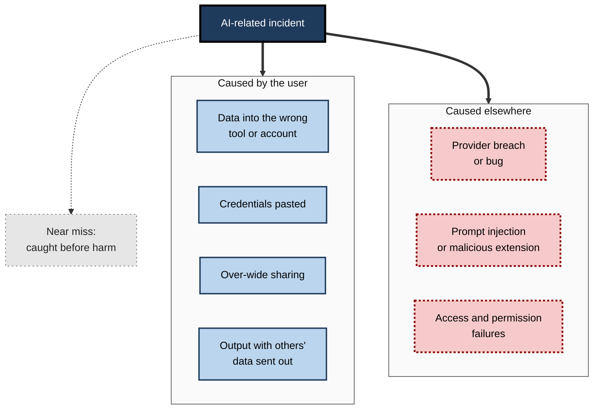
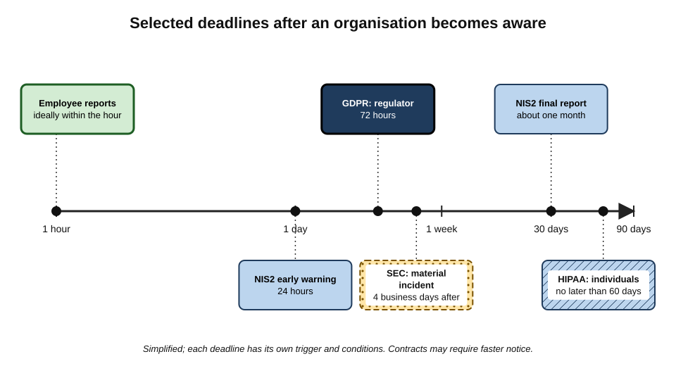
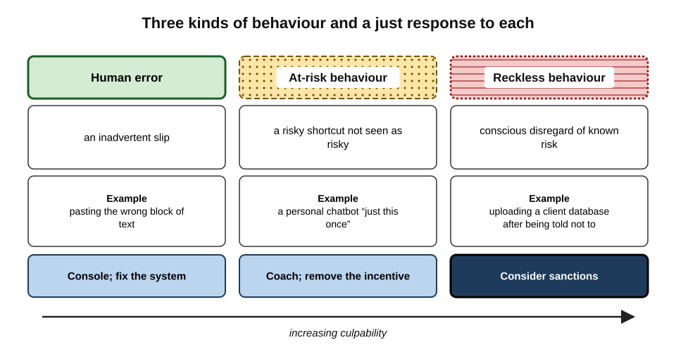
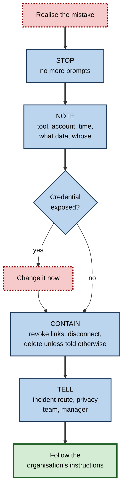
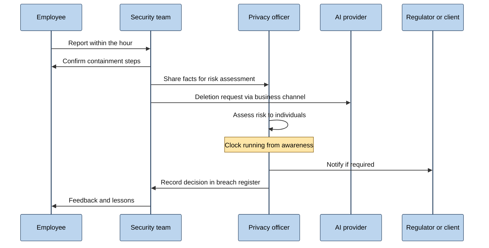
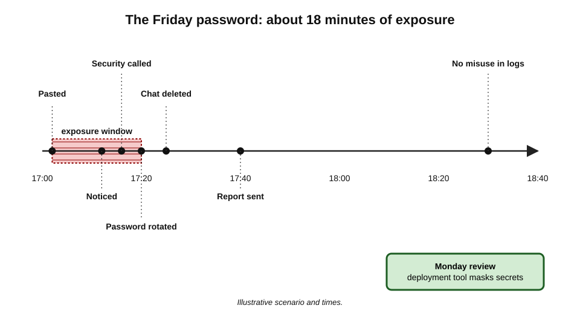

# J.10. Incidents and how to report them

At five o'clock on a Friday a developer, stuck on a failing deployment, pastes a block of configuration into a public chatbot and asks what is wrong. The answer is helpful. Ten minutes later he notices that the block included the production database password. He can delete the chat, change nothing and hope — or he can tell someone. What happens to the company over the next week depends almost entirely on which he chooses in the next ten minutes.

> **Definition — Security incident:** an event that actually or potentially compromises the confidentiality, integrity or availability of information or systems.

> **Definition — Personal data breach:** under the GDPR (Article 4(12)), a breach of security leading to the accidental or unlawful destruction, loss, alteration, unauthorised disclosure of, or access to, personal data.

**Why it matters**

- **Legal clocks start early.** Many notification duties run from the moment the organisation becomes aware — and the organisation becomes aware when an employee tells it.
- **Containment is time-sensitive.** A password can be changed, a link revoked or a connector disconnected in minutes; every hour of delay widens the window for harm.
- **Silence converts mistakes into cover-ups.** An honest error reported promptly is usually manageable; the same error discovered later looks like concealment.
- **Organisations learn only from what is reported.** Patterns of near misses reveal where tools, training or policies need to change.

---

## What Counts as an AI-Related Incident

### Kinds of incident

- **Disclosure by the user**
  - Confidential, personal or regulated data entered into an unapproved tool or the wrong account.
  - A conversation shared with too wide an audience.
- **Credential exposure**
  - Passwords, API keys, tokens or connection strings pasted into prompts, files or shared projects.
- **Output incidents**
  - An AI-drafted message containing someone else's personal data sent externally.
  - AI-generated false statements about a real person circulated as fact.
- **Tool and provider incidents**
  - A provider's breach, bug or misconfiguration exposing stored conversations.
- **Attack-driven incidents**
  - Malicious content — in an email, document or web page — instructing an assistant to retrieve and send out data (**prompt injection**).
  - Malicious browser extensions or apps harvesting AI conversations.
- **Access incidents**
  - An assistant connected to company systems surfacing documents to people who should not see them.
  - Former staff or guests retaining access to shared AI spaces.

> **Definition — Near miss:** an event that could have caused harm but did not — for example, confidential data typed into a public tool but not submitted. Near misses are worth reporting because they reveal the same weaknesses as incidents.

**Figure 1.** The main kinds of AI-related privacy and confidentiality incident.

### Incident types compared

| Type | Example | First action | Usually reportable internally? |
|---|---|---|---|
| Data into the wrong tool | Client contract pasted into a personal chatbot | Record details, then delete the chat and files | Yes |
| Credential exposure | Database password in a prompt | Change the credential immediately | Yes, urgently |
| Over-wide sharing | Link set to "anyone" in a public channel | Revoke the link | Yes |
| Output with others' data | Summary sent to a supplier included a customer's address | Ask the recipient to delete; record | Yes |
| Provider breach | Provider announces exposure of chat histories | Check notifications; change passwords; list what was stored | Yes |
| Prompt injection | Assistant followed hidden instructions in an email | Disconnect the assistant's access | Yes, urgently |
| Near miss | Pasted but not sent | None needed | Yes, as a near miss |

> **Key point:** when unsure whether something "counts", report it. Deciding whether an event is a reportable breach is the organisation's job, not the individual's.

---

## The Clocks That Start Running

Notification laws give organisations short windows. Those windows usually start when the organisation becomes **aware** — which, for most AI incidents, means when the employee reports it.

### Main duties

- **GDPR and UK GDPR**
  - **Controllers** must notify the supervisory authority **within 72 hours** of becoming aware of a personal data breach, unless it is unlikely to result in a risk to people's rights and freedoms (Article 33).
  - **Affected individuals** must be told **without undue delay** if the breach is likely to result in a **high risk** to them (Article 34).
  - **Processors** must notify the controller without undue delay.
  - **All breaches** — reported or not — must be **documented** by the controller (Article 33(5)).
- **EU NIS2 Directive** — essential and important entities must give an **early warning within 24 hours** of becoming aware of a significant incident, a fuller notification within 72 hours and a final report within a month.
- **United States**
  - **HIPAA** — covered entities must notify affected individuals without unreasonable delay and **no later than 60 days** after discovering a breach of unsecured health information; large breaches must also be reported to the federal health department and the media.
  - **Listed companies** — since 2023, rules of the Securities and Exchange Commission require disclosure of material cybersecurity incidents within **four business days** of determining materiality.
  - **State laws** — every US state has a breach-notification law, with varying triggers and deadlines.
- **India** — the Digital Personal Data Protection Act 2023 requires data fiduciaries to notify the Data Protection Board and each affected person of a personal data breach, in the form and manner set by its rules.
- **Contracts** — NDAs, data-processing agreements and client terms often require notice of any unauthorised disclosure within a fixed period, sometimes 24 or 48 hours.

**Figure 2.** Selected notification deadlines, measured from the moment an organisation becomes aware.

> **Definition — Awareness (for breach notification):** the point at which an organisation has a reasonable degree of certainty that a security incident has occurred that has led to personal data being compromised. An employee's knowledge is generally treated as the organisation's knowledge once reported through proper channels — and regulators expect organisations to have channels that make prompt reporting possible.

> **Watch out:** "it was only one prompt" does not stop the clock. The legal test is the **risk to the people whose data was involved**, which depends on what the data was, how sensitive it is, and where it went — not on how small the action felt.

---

## Why People Do Not Report

### Common reasons

- **Fear of blame** — expecting punishment for an honest mistake.
- **Embarrassment** — not wanting to look careless.
- **Uncertainty** — not knowing whether the event "counts".
- **False comfort** — believing that deleting the chat undid the disclosure.
- **Not knowing how** — no obvious channel, or a channel that seems reserved for serious events.
- **Normalisation** — "everyone pastes things into chatbots".

### Just culture

> **Definition — Just culture:** an organisational approach that treats honest errors as opportunities to learn and improve systems, while still holding people accountable for reckless or deliberate wrongdoing.

- **Origins** — developed in aviation and healthcare safety; the psychologist **James Reason**, in his 1997 book on managing the risks of accidents in organisations, argued that safety depends on an **informed culture**, which in turn depends on a **reporting culture**, which requires a **just culture**.
- **Three kinds of behaviour** — a widely used framework distinguishes:
  - **human error** — an inadvertent slip, such as pasting the wrong block of text; the response is to support the person and fix the system;
  - **at-risk behaviour** — a choice whose risk was not recognised or seemed justified, such as using a personal chatbot "just this once"; the response is coaching and removing the incentives for the shortcut;
  - **reckless behaviour** — conscious disregard of a substantial, known risk; the response may be disciplinary.

**Figure 3.** Three kinds of behaviour behind incidents, and the response a just culture gives to each.

**Study card — the Aviation Safety Reporting System (United States, since 1976)**

- **What it is:** a confidential system, run by NASA for the Federal Aviation Administration, through which pilots, controllers and other aviation staff report incidents and near misses.
- **Design features:**
  - reports are **confidential** and de-identified before analysis;
  - reporting can give **limited protection** from certain penalties for inadvertent violations;
  - the system is run by an organisation **independent** of the enforcement body.
- **Results:** the system has received well over a million reports and issues safety alerts based on recurring patterns; it is widely credited with contributing to aviation's safety culture.
- **Lesson for AI incidents:** people report more when reporting is **safe, simple and visibly useful** — and organisations learn most from the near misses that would otherwise never be known.

> **In practice:** organisations that want early reports of AI mistakes say so explicitly in their AI policy — for example, that honest mistakes reported promptly will not lead to disciplinary action — and then visibly keep that promise.

---

## The First Hour

### What to do

1. **Stop** — do not continue the conversation or try to "fix it" with more prompts.
2. **Note the facts** — before deleting anything, write down:
   - the tool, the account and whether it was personal or work;
   - the date and time;
   - what was entered — in general terms, not by copying it again;
   - whose data it was and roughly how much;
   - the relevant settings, such as training and history;
   - whether anything was shared, sent or downloaded.
3. **Contain** — reduce ongoing exposure:
   - **change any exposed credential at once** — passwords, keys and tokens should be treated as compromised the moment they leave the approved environment;
   - revoke share links; disconnect connectors or extensions involved;
   - delete the conversation, files and any memory created, unless told to preserve them.
4. **Tell** — report through the organisation's channel: the security or IT incident route, the data-protection officer or privacy team, and the line manager.
5. **Follow instructions** — the organisation may ask for an export before deletion, a deletion request to the provider, or a statement of events.

> **Mnemonic — "STOP, NOTE, CONTAIN, TELL":** the four moves of the first hour.

**Figure 4.** The first hour after realising an AI-related mistake.

### What not to do

- **Do not hide it** — quiet deletion without a report removes the organisation's chance to meet its duties.
- **Do not paste the data again** — for example into another tool to "check what was exposed".
- **Do not contact the client or the people affected on your own** — notification decisions belong to the organisation, which must assess risk and coordinate the message.
- **Do not approach the provider privately** unless the organisation asks — business channels and contracts may give better routes.
- **Do not speculate in group chats** — describe facts only to those handling the incident.

> **Watch out:** "record first, then delete" applies to **details of the event**, not to the data itself. Writing "pasted a contract summary naming the client and the price" is a useful record; copying the contract into an email to the security team creates another exposure.

---

## Making a Good Report

### What a report should contain

| Field | Example (illustrative) |
|---|---|
| Reporter and contact | Developer, platform team, mobile number |
| When it happened and when it was noticed | 17:02 pasted; 17:12 noticed |
| Tool and account | Public chatbot, personal free account |
| Settings at the time | Training on; history on; memory on |
| What was entered | Deployment configuration including production database password |
| Whose data, and how much | Company credentials; no personal data directly, but the database holds customer records |
| Shared or sent further? | No |
| Actions already taken | Password changed 17:20; chat deleted 17:25 |
| Anything uncertain | Whether training had already captured the conversation |

- **Facts, not judgements** — "I pasted", not "I may have accidentally slightly…".
- **Speed over polish** — a short report now is better than a perfect one tomorrow; details can follow.
- **Uncertainties stated** — saying what is not known helps the assessment.

> **Remember:** a good report answers **what, whose, where, when, what since** — and is sent within the hour.

---

## What the Organisation Does Next

### The response process

1. **Triage** — confirm facts, classify the incident and assign a handler.
2. **Containment** — make sure credentials are changed, links revoked, access removed; ask enterprise providers for deletion through business channels where available.
3. **Risk assessment** — judge the likelihood and severity of harm to individuals and to the organisation, considering:
   - the type and sensitivity of data;
   - the number of people affected;
   - the recipient — an enterprise processor under contract, a consumer service, a public website;
   - whether the data could be used for harm, such as fraud or discrimination;
   - mitigations already in place.
4. **Notification decisions** — regulator, affected individuals, clients under contract, insurers, and, for listed companies, markets.
5. **Recording** — entry in the breach register, including incidents judged not reportable and the reasoning.
6. **Learning** — a review of why it happened and what will change: tools, settings, training, policy.

**Figure 5.** How an AI-related incident report travels through an organisation.

### How regulators judge AI incidents

- **The recipient matters** — data sent to a processor under contract is a lower risk than data in a consumer service that may train on it.
- **Sensitivity matters** — health, financial, children's and special category data raise the risk.
- **Mitigation matters** — prompt deletion, credential changes and provider confirmation reduce it.
- **Patterns matter** — repeated incidents suggest inadequate controls; the Dutch regulator's 2024 warning and the Victorian regulator's 2024 child-protection investigation both turned on organisations lacking effective controls, not only on one employee's act.

> **Key point:** the employee's prompt report is what allows the organisation to show **effective controls** — that it detected, contained and assessed the incident quickly. A late discovery shows the opposite.

---

## When There Is No Security Team

Small organisations, freelancers and sole practitioners have the same duties with fewer people to share them.

- **Freelancers handling client data**
  - Usually act as the client's **processor** or under a confidentiality agreement.
  - A processor must tell the controller **without undue delay**; the client then decides on regulator and individual notification.
  - Many contracts require notice within a fixed number of hours.
- **Small organisations acting as controllers**
  - Someone must be named to receive reports, even if it is the owner.
  - The organisation itself must assess risk, decide whether to notify the regulator within 72 hours where the GDPR applies, and keep a breach record.
  - Regulators' websites typically offer self-assessment tools and helplines for small organisations deciding whether a breach is reportable.
- **Professionals with regulatory duties**
  - Solicitors, accountants, doctors and financial advisers may have duties to report to their professional regulator as well.
- **Practical preparation**
  - a one-page incident plan: who to call, which provider contacts to use, which clients require notice and how fast;
  - a template report with the fields listed above;
  - a list of credentials to rotate quickly.

> **Example (illustrative):** a freelance bookkeeper realises she uploaded a client's payroll file to a personal AI account. Her contract requires notice "within 24 hours of becoming aware of any unauthorised disclosure". She notes the facts, deletes the file and conversation, switches off training, and emails the client's finance director within two hours with a factual account. The client, as controller, records the incident and decides, after assessing the risk, whether notification to the regulator is needed.

## Reporting Strange Assistant Behaviour

Not every incident begins with a user's mistake. Assistants connected to email, files and the web can be manipulated by content they read.

- **Signs worth reporting**
  - an assistant summarising an email includes instructions or links the email did not seem to contain;
  - an assistant tries to open unfamiliar websites, send messages or fetch files that were not requested;
  - answers contain fragments of documents the user did not provide;
  - a connected agent takes actions nobody asked for.
- **What to do**
  - stop using the assistant on that content;
  - do not click links it produced;
  - note the item that triggered the behaviour — the email, document or page — without forwarding it widely;
  - report it to the security team as a possible **prompt injection**.

> **Key point:** security teams can only defend against injection attacks they hear about. A user's report of "the assistant did something odd" is often the first sign.

---

## Incidents That Start With the Provider

When an AI provider announces a breach or bug, the user's role changes from cause to affected party.

- **Read the notice carefully** — what was exposed, for which accounts, in what period.
- **Change passwords** and review sign-in sessions for the affected account.
- **List what was stored** — conversations, files, memories — during the affected period.
- **Report internally** if work data was in the account; the organisation may have its own duties as controller.
- **Watch for follow-on attacks** — phishing messages that use details from the breach to appear genuine.

### Case Study: The Microsoft AI Research Data Exposure (2023)

- **Situation:** a Microsoft AI research team published open-source training data and models on a public code-hosting site, with a link for others to download files from the company's cloud storage.
- **The flaw:** the link used a **shared access signature (SAS) token** configured far too broadly — it granted access to an entire storage account, not just the intended files, with permissions that allowed not only reading but also overwriting and deleting.
- **Discovery:** in June 2023 researchers at the cloud-security company Wiz found that the token exposed about **38 terabytes** of additional internal data, including backups of two employees' workstations containing secrets, private keys, passwords and more than 30,000 internal messages.
- **Response:**
  1. Wiz reported the issue to Microsoft under coordinated disclosure;
  2. Microsoft revoked the token within about two days;
  3. it investigated, stated that no customer data had been exposed and no other internal services had been put at risk, and published an account of the incident in September 2023;
  4. it extended its scanning to detect over-permissive tokens in public repositories.
- **Lessons:**
  - AI work — sharing datasets, models and notebooks — creates new routes for exposure, often through **credentials and links** rather than prompts;
  - quick **reporting and revocation** limited the damage;
  - publishing a clear account afterwards supported trust;
  - the root cause was a **configuration** that nobody had reviewed for its full scope.

---

## Worked Example (illustrative): The Friday Password

**Situation:** the developer from the opening has pasted a configuration block containing the production database password into a public chatbot with training and history on.

**Timeline**

| Time | Action |
|---|---|
| 17:02 | Configuration pasted into the chatbot |
| 17:12 | Developer notices the password |
| 17:14 | Writes a note: tool, account, time, what was pasted, settings |
| 17:16 | Calls the on-call security engineer, as the incident procedure directs for credentials |
| 17:20 | Database password rotated; applications updated |
| 17:25 | Chat deleted; training switched off |
| 17:40 | Written report submitted |
| 18:30 | Security confirms no unusual database access in the logs since 17:02 |
| Monday | Review: the deployment tool printed secrets in plain text; it is changed to mask them; an approved coding assistant is made available |

*Illustrative scenario and times.*

**Figure 6.** The Friday password incident, from mistake to review.

**Risk assessment (organisation)**

| Factor | Assessment |
|---|---|
| Data type | A credential, not personal data in itself, but it protected customer records |
| Exposure window | About 18 minutes before rotation |
| Evidence of misuse | None in access logs |
| Recipient | Consumer service; possibility of retention and review |
| Personal data breach? | No customer data accessed; recorded as a security incident, not notified to the regulator |

- **Conclusion:** the incident was closed as contained, with a system improvement. Had the developer stayed silent, the password would have remained valid indefinitely in a third-party system — and any later misuse would have become a reportable breach of customer data.

> **Watch out:** changing the password was more important than deleting the chat. Deletion addresses one copy; rotation makes **every** copy worthless.

---

## Professional Mastery

### Individuals

- **Know the channel before you need it** — save the incident contact in the phone.
- **Report near misses** — they are cheap lessons.
- **Rotate first** when credentials are involved.
- **Describe, do not duplicate** — record what was exposed without copying it again.
- **Keep calm and factual** — incidents are handled best by people who give clear information quickly.

### Organisations

- **An AI section in the incident procedure** — covering prompts, uploads, shared links, connectors, agents and provider breaches.
- **A simple reporting route** — one form or one number; no need to decide in advance whether it "counts".
- **Explicit just-culture commitment** — in writing, and kept.
- **Provider escalation paths** — contacts and contractual routes for deletion requests and incident information.
- **Rehearsal** — short tabletop exercises using realistic AI scenarios.
- **Metrics** — time from event to report, time to containment, number of near misses reported (a rising count can be a sign of healthier reporting).
- **Blameless reviews** — focusing on why the system allowed the error, a practice popularised by site-reliability engineering teams in large technology companies.

### Failure modes

- **The silent delete** — removing the evidence and telling no one.
- **The late report** — reporting days later, after notification windows have narrowed.
- **The duplicated exposure** — forwarding the sensitive data to colleagues while reporting it.
- **The blame spiral** — punishing honest reporters, so that the next incident is hidden.
- **The lesson not learned** — closing the incident without changing the tool, setting or process that caused it.

---

## Open Questions

- **When does entering data into a consumer AI tool become a notifiable breach?**
  - Regulators have treated it as a breach in principle; whether it must be notified depends on risk assessments that are still being calibrated case by case.
- **Can providers reliably confirm deletion of specific conversations?**
  - Deletion from live systems can be confirmed; certainty about logs, backups and training pipelines is harder.
- **How should agent-caused incidents be reported?**
  - When an agent acts on its own, assigning cause and awareness is less straightforward.
- **Will AI incident reporting become standardised?**
  - Public AI incident databases and regulatory proposals exist; a common reporting format for organisational AI privacy incidents does not yet.
- **How can just culture coexist with strict liability regimes?**
  - Some laws and contracts impose penalties regardless of intent, which can discourage reporting.

---

## Summary

- An **incident** compromises the confidentiality, integrity or availability of information; a **personal data breach** compromises personal data. **Near misses** are worth reporting too.
- AI incidents include **user disclosures, credential exposure, over-wide sharing, outputs with others' data, provider breaches, prompt injection and access failures**.
- Clocks start at **awareness**: GDPR **72 hours** to the regulator and prompt notice to high-risk individuals; NIS2 **24-hour** early warning; HIPAA **60 days**; SEC **four business days** after materiality; contracts often shorter. All breaches must be documented.
- People fail to report from **fear, embarrassment, uncertainty and false comfort**; a **just culture** — supporting honest error, coaching at-risk behaviour, sanctioning recklessness — makes reporting safe. Aviation's confidential **ASRS** shows the value.
- The first hour: **STOP, NOTE, CONTAIN, TELL**; **rotate credentials at once**; record facts, not copies of data.
- A good report gives **what, whose, where, when, what since**, quickly and factually.
- Organisations **triage, contain, assess risk, decide notifications, record and learn**; regulators look at recipient, sensitivity, mitigation and patterns.
- The **2023 Microsoft research data exposure** showed AI work creating exposure through over-broad links, limited by quick revocation and clear disclosure.

---

## Self-Check

1. Define a security incident, a personal data breach and a near miss.
2. List six kinds of AI-related incident.
3. What must a controller do under GDPR Articles 33 and 34, and what must it do with breaches it does not report?
4. Why does an employee's prompt report matter for notification deadlines?
5. Name four reasons people fail to report AI mistakes.
6. Explain just culture and its three kinds of behaviour.
7. What features of the Aviation Safety Reporting System encourage reporting?
8. Set out the four steps of the first hour and why credentials come first.
9. Why should the record of an incident describe the data rather than copy it?
10. What should a good incident report contain?
11. What factors do organisations and regulators weigh in assessing an AI incident?
12. Summarise the 2023 Microsoft research data exposure and its lessons.
13. A colleague tells you she pasted a client's customer list into a personal chatbot last week, deleted it, and does not want to "make a fuss". Advise her.

### Answer Key

1. Security incident: an event that actually or potentially compromises confidentiality, integrity or availability. Personal data breach: a security breach leading to accidental or unlawful destruction, loss, alteration, unauthorised disclosure of or access to personal data. Near miss: an event that could have caused harm but did not.
2. Data into the wrong tool or account; credential exposure; over-wide sharing; outputs containing others' data sent out; provider breaches or bugs; prompt injection or malicious extensions; access and permission failures.
3. Notify the supervisory authority within 72 hours of awareness unless the breach is unlikely to result in risk; notify individuals without undue delay if high risk; document every breach, including unreported ones, with the facts, effects and remedial action.
4. Deadlines run from organisational awareness; the organisation cannot meet them, or contain the incident, until the employee tells it.
5. Fear of blame; embarrassment; uncertainty whether it counts; false comfort that deletion fixed it; not knowing how; normalisation (any four).
6. An approach that learns from honest errors while holding people accountable for recklessness. Human error: support and fix the system. At-risk behaviour: coach and remove incentives for shortcuts. Reckless behaviour: possible discipline.
7. Confidentiality and de-identification; limited protection from certain penalties for inadvertent violations; independence from the enforcement body; visible use of reports in safety alerts.
8. Stop, note, contain, tell. Credentials are rotated first because a changed credential makes every copy worthless, whereas deletion addresses only one copy.
9. Copying the data into emails or reports creates new exposures; a description is enough for assessment.
10. Reporter and contact; when it happened and was noticed; tool and account; settings; what was entered; whose data and how much; whether shared further; actions taken; uncertainties.
11. Data type and sensitivity; number of people affected; recipient and its terms; potential for harm; mitigations; patterns indicating weak controls.
12. An over-permissive storage token in a public AI research repository exposed about 38 terabytes of internal data, including workstation backups with secrets and internal messages. Wiz reported it; Microsoft revoked the token within about two days, found no customer data exposed, and published an account. Lessons: AI work creates exposure through links and credentials; quick reporting and revocation limit damage; configurations need review for full scope.
13. Report it now through the organisation's incident route. A customer list is personal data, and entering it in an unapproved tool may be a personal data breach; deletion does not end the matter, and the organisation must assess risk and any notification duties — the clock has effectively been running. Give facts: tool, account, settings, date, what was entered, what was deleted. Reporting late is far better than not reporting.

---

## Glossary

| Term | Meaning |
|---|---|
| Awareness | The point at which an organisation is reasonably certain a breach has occurred. |
| Blameless review | A post-incident review focused on system causes rather than individual fault. |
| Breach register | A record of all personal data breaches, including those not notified. |
| Containment | Actions that stop or limit ongoing exposure. |
| Credential rotation | Replacing a password, key or token so that the old one no longer works. |
| Just culture | An approach that learns from honest error while holding recklessness to account. |
| Near miss | An event that could have caused harm but did not. |
| Notification | Formal notice of a breach to a regulator, individuals or contractual parties. |
| Personal data breach | A security breach compromising personal data. |
| Prompt injection | Hidden instructions in content that redirect an AI system's behaviour. |
| Reporting culture | An environment in which people readily report errors and near misses. |
| Security incident | An event compromising the confidentiality, integrity or availability of information. |
| Shared access signature | A token granting time-limited access to cloud storage resources. |
| Triage | Initial sorting of an incident by type and urgency. |
