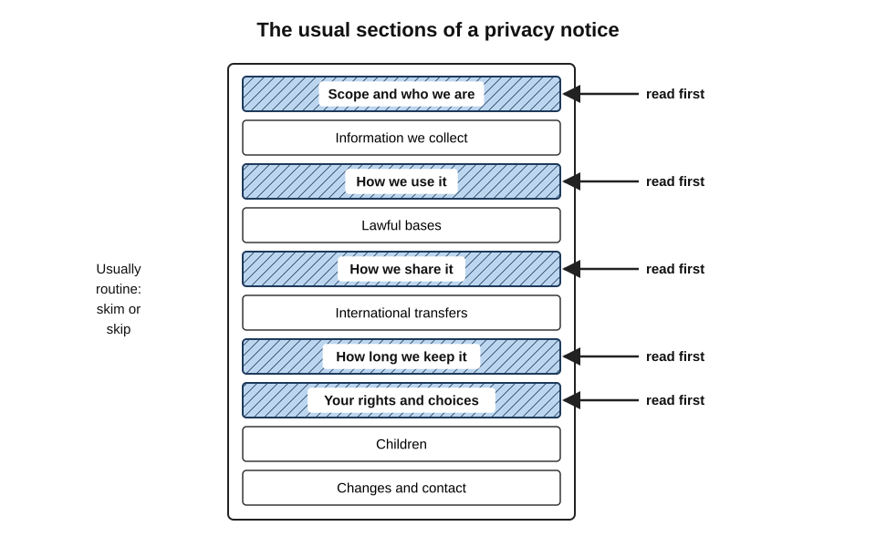
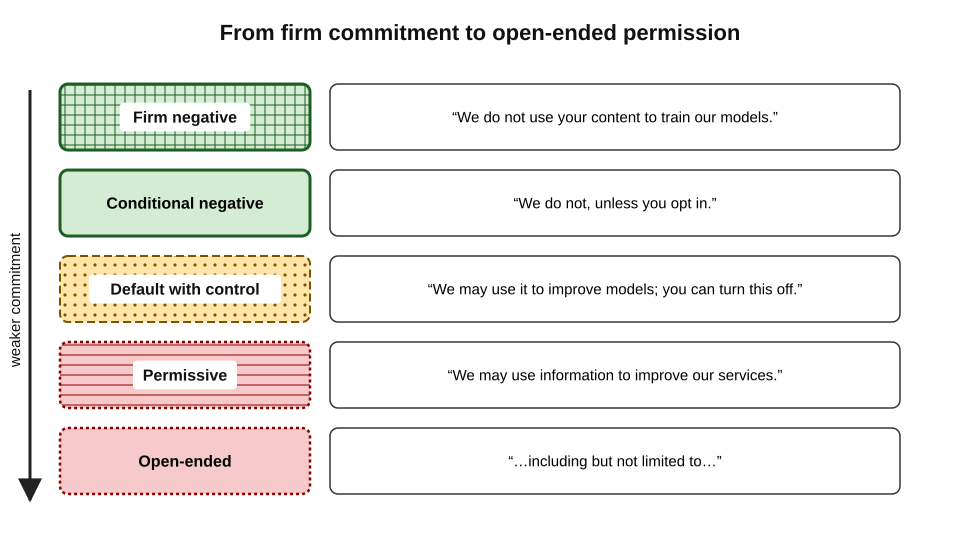
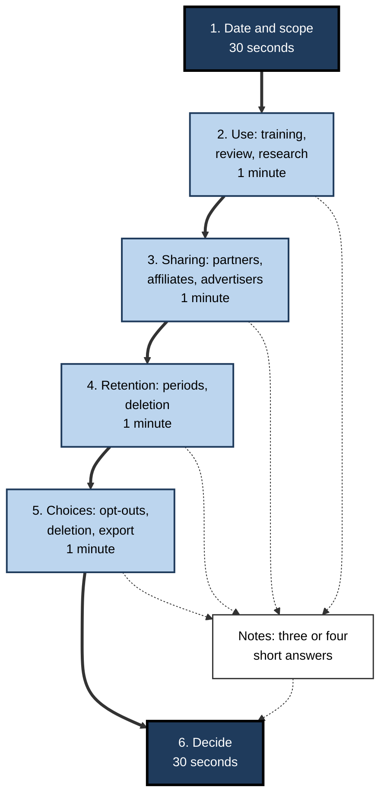
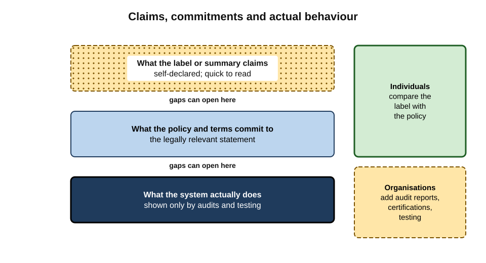
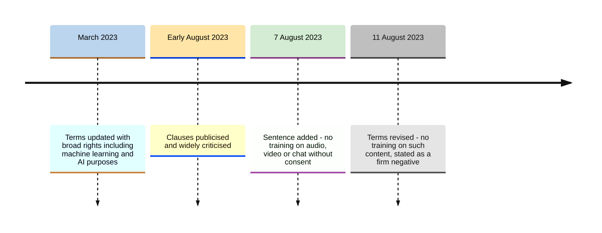
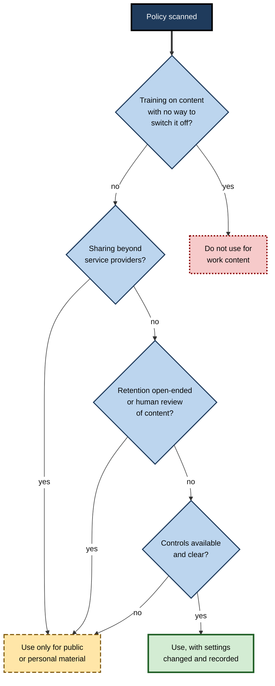

# J.11. Reading a privacy policy quickly

A team leader is about to connect a new AI note-taking app to her calendar. The privacy policy runs to eleven thousand words. She has five minutes before the meeting starts. Reading it all is impossible; skipping it entirely means accepting whatever it says about her colleagues' voices and her clients' discussions. There is a middle way: knowing where the decisive sentences live and how to recognise them.

> **Definition — Privacy policy (privacy notice):** a public statement by an organisation describing what personal data it collects, why, how it uses and shares it, how long it keeps it, and what rights and choices people have.

**Why it matters**

- **The policy is the main written evidence** of what a service does with data — the document a court, regulator or client will look at.
- **Most of its length is routine.** The decisive information usually sits in a handful of sections and phrases.
- **A quick, structured read beats no read.** Five focused minutes answer most of the questions that matter for everyday decisions.
- **Language signals commitment.** Knowing the difference between "we do not" and "we may" is the core reading skill.

---

## Why Policies Are Hard to Read

### Length and difficulty

- **Length** — policies of major online services commonly run to several thousand words; reading every policy a person agrees to would take far longer than anyone spends.
  - A widely cited 2008 estimate by researchers at Carnegie Mellon University put the time an average American would need to read the policies of the sites they visited in a year at around **200 hours**.
- **Difficulty** — analyses of policies repeatedly find reading levels well above the average adult's, with long sentences, legal terms and nested exceptions.
- **Vagueness** — policies are written to cover many products, future changes and legal uncertainty, which encourages broad, hedged wording.

### Measuring readability

> **Definition — Readability score:** a formula estimating how hard a text is to read from features such as sentence length and word length.

> **Formula — Flesch Reading Ease:** 206.835 − 1.015 × (words ÷ sentences) − 84.6 × (syllables ÷ words). Higher scores are easier; scores below about 30 are generally regarded as very difficult, at the level of academic or legal text. Example: a passage averaging 32 words per sentence and 1.7 syllables per word scores 206.835 − 32.48 − 143.82 ≈ **30.5**.

- **Use and limits** — readability formulas are crude: they ignore meaning, structure and vocabulary familiarity. But a very low score is a reliable warning that ordinary users will not understand the text.

> **Key point:** the difficulty is structural, not personal. Reading policies quickly is a skill of **navigation and recognition**, not of reading faster.

---

## The Anatomy of a Privacy Notice

Data-protection law gives most policies a predictable structure. Under the GDPR (Articles 13 and 14), a notice must tell people, among other things:

- **who** the controller is and how to contact it, including any data-protection officer;
- **what** categories of data are processed, and from where if not collected directly;
- **why** — the purposes and the lawful basis for each;
- **who receives it** — recipients or categories of recipients;
- **where** — any transfers outside the jurisdiction and the safeguards used;
- **how long** — the retention period, or the criteria used to set it;
- **what rights** people have — access, rectification, erasure, restriction, objection, portability, withdrawal of consent, complaint to a regulator;
- **whether automated decision-making** with significant effects takes place.

**Figure 1.** The usual sections of a privacy notice, with the ones that decide most AI questions marked.

### The sections that matter most for AI tools

- **"How we use your information"** — look for training, model improvement, research, safety review and personalisation.
- **"How we share your information"** — look for affiliates, service providers, model providers, advertisers, "partners".
- **"How long we keep it"** — look for days, criteria, deletion after account closure, legal holds.
- **"Your choices" or "Your rights"** — look for opt-outs, deletion, export, memory and history controls.
- **Scope paragraph** — usually at the top: which products and which customers the policy covers.

> **Watch out:** many providers publish **separate** policies or terms for business and consumer services. The consumer privacy policy may not apply to an enterprise account at all, and vice versa. Always check the scope paragraph first.

### Reading the rights section for action

- **Find the route, not just the right** — a list of rights is standard; the useful part is **how** to use them: a settings page, a web form, an email address, an in-app request.
- **Note any conditions** — identity checks, response times (the GDPR allows one month, extendable in some cases), and rights limited to particular regions.
- **Check for a privacy contact** — a named data-protection officer or privacy team is a sign that requests will reach someone accountable.
- **Look for the regulator** — the policy should name the authority to which complaints can be made.

> **Example (illustrative):** a policy states: "To object to our use of your data for model training, use the form at Settings › Privacy › Model improvement. Requests take effect within 30 days and apply to future data only." In one sentence the reader learns the route, the delay and the limit.

### Layered notices

> **Definition — Layered notice:** a privacy notice presented in levels — a short summary first, with links to fuller detail — so that key points can be grasped quickly.

- **Strength** — the first layer, if honest, gives the essential answers in a minute.
- **Weakness** — summaries can omit uncomfortable details that appear only in the full text.
- **Practice** — read the summary, then check the full text on the three or four points that matter for the decision.

---

## The Language of Commitment

The most valuable skill in reading a policy is recognising how strongly each statement binds the organisation.

### A ladder of commitment

- **Firm negative** — "We do not use your content to train our models." A clear commitment.
- **Conditional negative** — "We do not use your content to train our models unless you opt in." Clear, with a stated exception.
- **Default with control** — "We may use your content to improve our models. You can turn this off in Settings." Use is the default.
- **Permissive** — "We may use information to develop and improve our services." Allows almost anything described as improvement.
- **Open-ended** — "…including but not limited to…", "…such as…", "…and for other legitimate business purposes." Examples given, limits not.

**Figure 2.** Phrases arranged from firm commitment to open-ended permission.

### Signal phrases

| Phrase | What it usually allows | What to look for next |
|---|---|---|
| "may" | The activity, without commitment that it happens | Any control or opt-out nearby |
| "such as" / "including but not limited to" | Activities beyond the examples listed | Whether any limit is stated |
| "improve our services" | Analytics, research and often model training | A specific statement about training |
| "affiliates" | Sharing within the corporate group | How large the group is |
| "service providers" / "partners" | Sharing with other companies | Whether they may use data for their own purposes |
| "aggregated" / "de-identified" | Use or sharing of data said not to identify people | Whether re-identification is prohibited |
| "as long as necessary" | Retention without a fixed period | Criteria or examples of periods |
| "from time to time" | Changes at the provider's discretion | How users are notified of changes |
| "sell" / "share" | Under California law, "sell" and "share" (for cross-context advertising) have defined legal meanings | Opt-out links such as "Do not sell or share" |

> **Remember:** **"do not" binds; "may" permits; "such as" opens; "necessary" postpones.**

> **Watch out:** "we do not sell your data" can be literally true while data is still **shared** with partners, used for advertising within the company's own services, or licensed under another name. Read what the policy **does** allow, not only what it denies.

---

## The Five-Minute Scan

A structured scan answers the core questions for an AI tool in about five minutes.

### Steps

1. **Check the date and scope** (30 seconds)
   - When was the policy last updated? Which products and which kinds of account does it cover?
2. **Jump to the use section** (1 minute)
   - Search for "train", "model", "improve", "research", "review".
   - Note whether training is excluded, optional or default.
3. **Jump to the sharing section** (1 minute)
   - Search for "share", "third part", "partner", "affiliate", "advertis".
   - Note who receives content and for what purposes.
4. **Jump to the retention section** (1 minute)
   - Search for "retain", "delete", "days", "as long as".
   - Note periods for conversations, files and logs.
5. **Jump to choices** (1 minute)
   - Search for "opt out", "settings", "delete", "export", "memory".
   - Note what can be switched off and how.
6. **Decide** (30 seconds)
   - Use as is; use with settings changed; use only for public or personal material; or do not use.

> **Mnemonic — "D-U-S-R-C-D", read as "Do Users Share, Retain, Choose? Decide":** Date and scope, Use, Sharing, Retention, Choices, Decide.

**Figure 3.** The five-minute scan of a privacy policy.

### Search techniques

- **Use word stems** — "train" finds training and trained; "third part" finds third party and third parties; "advertis" finds advertising and advertisers.
- **Search for numbers** — "days", "months", "years" usually land in retention sections.
- **Search for the product name** — policies covering many products may treat the AI feature in its own paragraph.
- **Search for "human"** — reveals whether people may read content.
- **Search for "children"** — reveals age limits, which matter for education and family use.

> **In practice:** experienced reviewers keep a short list of search terms and a three-line note format — "Training: off by default for business; Retention: 30 days after deletion; Sharing: service providers only" — so that each policy produces a comparable summary.

---

## Labels, Summaries and What Lies Behind Them

### Privacy labels

- **App store labels** — since December 2020 Apple's App Store has required developers to declare their data practices in "privacy nutrition labels"; Google Play introduced a comparable **Data safety** section in 2022.
- **Benefit** — a standard format that can be read in seconds.
- **Limitation** — labels are **self-declared**.
  - Independent reviews have found many discrepancies between labels and policies or app behaviour; a 2023 review by the Mozilla Foundation of popular apps' Data safety labels reported misleading or inconsistent declarations in a large majority of the apps examined.

> **Watch out:** a label is a summary written by the company being summarised. Where the decision matters, check the label against the policy itself.

### Three layers of truth

- **What the label or summary claims.**
- **What the policy and terms commit to** — the legally relevant statement.
- **What the system actually does** — which only audits, investigations and technical testing can confirm.

**Figure 4.** Claims, commitments and actual behaviour: three layers that can diverge.

- **Individuals** can check the first against the second.
- **Organisations** add evidence for the third: audit reports, certifications, contractual audit rights and security testing.

---

## Reading Changes

Policies change, and AI has been one of the main drivers of change since 2023.

- **Find the date** — "Last updated" usually sits at the top or bottom.
- **Look for a summary of changes** — many providers publish one with each update.
- **Compare versions** — text-comparison tools show exactly which sentences changed; the change is often a few words in one section.
- **Read pop-ups announcing changes** — they often contain a new choice, sometimes with a default already set.
- **Watch for new sections** — "AI features", "generative AI", "model training" sections added to existing policies signal new uses.

### Case Study: Zoom's Terms of Service (August 2023)

- **Situation:** in March 2023 Zoom updated its terms of service. Sections dealing with "service generated data" and customer content granted Zoom broad rights, including for purposes described as machine learning and artificial intelligence.
- **Discovery (early August 2023):** a technology blog drew attention to the clauses, and the story spread rapidly; users and commentators read them as permitting Zoom to train AI models on customers' meetings.
- **First response (7 August 2023):** Zoom published an explanation and added a sentence stating that it would not use audio, video or chat customer content to train its AI models **without consent**.
- **Criticism continued:** commentators pointed out that "consent" could be given by a meeting host or account administrator on behalf of participants, and that the broader licence remained.
- **Second response (11 August 2023):** Zoom revised the terms again to state that it does **not** use customers' audio, video, chat, screen-sharing, attachments or other communications-like content to train its own or third-party AI models.
- **Lessons:**
  - the decisive language was a few lines in a long document, changed months before anyone noticed;
  - the first fix replaced "may" with "not without consent", which still left room; the second gave a **firm negative**;
  - who gives consent matters as much as whether consent is required;
  - public scrutiny changed the terms within days — evidence that policies are negotiable in practice when users read them.

**Figure 5.** How the wording of Zoom's terms changed in August 2023.

> **Watch out:** a similar controversy affected Adobe in June 2024, when a pop-up asking users to accept updated terms about accessing content "through automated and manual methods" was widely read as permitting AI training; Adobe clarified that it did not train its generative models on customers' content and revised the wording. Licence clauses that allow a provider to **host, process and moderate** content are normal; the question is always whether the purposes are limited.

---

## Two Policies for One Tool

Many AI tools are built by one company on another company's model.

- **The app's own policy** — what the app developer collects and does.
- **The model provider's terms** — what happens to data the app sends on.
- **Reading strategy:**
  1. read the app's policy for "AI", "model", "third part", "provider";
  2. identify which model provider is used, if stated;
  3. check whether the app sends data under business terms that exclude training;
  4. note that retention may differ at each company.

> **Example (illustrative):** a meeting-notes app's policy says: "We use third-party AI providers to generate summaries. These providers are contractually prohibited from using your data to train their models. We retain transcripts for 12 months." The scan yields three facts in under a minute: data goes to another company; that company may not train on it; the app itself keeps transcripts for a year.

---

## Worked Example (illustrative): Scanning an AI Note-Taker's Policy

**Situation:** the team leader from the opening has five minutes. Her searches produce these sentences.

| Search | Sentence found | Reading |
|---|---|---|
| "updated" | "Last updated: 2 June. This Policy applies to all users of our apps and website." | Recent; one policy for all accounts — no separate business terms |
| "train" | "We may use recordings, transcripts and summaries to train and improve our models and those of our partners." | Training on content by default, including partners' models |
| "opt out" | "Users on paid plans may opt out of model training by contacting support." | Opt-out only on paid plans, by email |
| "share" | "We may share information with partners for analytics, product development and marketing." | Broad sharing, including marketing |
| "retain" | "We retain content for as long as necessary to provide the services and for our legitimate business purposes." | No fixed period |
| "human" | "Authorised personnel may review recordings to improve quality." | People may listen to meetings |

*Illustrative policy text.*

**Decision**

1. **Training** — default on, extending to partners' models: unacceptable for client meetings.
2. **Sharing** — includes marketing purposes: unacceptable for colleagues' and clients' data.
3. **Retention** — open-ended: unacceptable.
4. **Human review** — people may listen: unacceptable for confidential discussions.
5. **Verdict** — do not connect the app; use the organisation's approved meeting tool instead.

- **Conclusion:** five minutes and six searches were enough for a confident "no". Most quick scans end in "yes, with settings changed" or "only for non-sensitive use"; this one did not.

---

## What a Good Policy Looks Like

Recognising a well-written policy speeds reading: good policies answer the key questions directly, so a scan finishes sooner and with more confidence.

| Feature | Good policy | Poor policy |
|---|---|---|
| Scope | Names the products and account types covered | "Our services" without distinction |
| Training | A dedicated statement with a firm position and controls | Buried in "improve our services" |
| Retention | Periods for each kind of data, with what triggers deletion | "As long as necessary" |
| Recipients | Named categories, with a published sub-processor list | "Trusted partners" |
| Human review | States when people may read content and why | Silent |
| Changes | Dated versions, a change summary, advance notice | "We may update this policy from time to time" |
| Language | Short sentences, defined terms, examples | Long sentences, undefined terms, nested exceptions |

- **Specificity is a signal of confidence.** A provider that states "deleted conversations are removed from our systems within 30 days" has committed itself to something testable.
- **Vagueness is not always bad faith** — it can reflect legal caution or many products — but it shifts risk to the user.

### Policies covering many products

- **Unified policies** — large companies often publish one privacy policy for dozens of products, with product-specific notices or "supplemental terms" for AI features.
- **Reading strategy** — search the main policy for the AI product's name; look for links to supplements labelled "AI", "generative AI" or with the product's name; read the supplement first, since it usually overrides the general text for that product.
- **Business addenda** — enterprise services often point to a data-processing agreement that replaces much of the consumer policy for business customers.

---

## Using AI to Read Policies

AI assistants can summarise a long policy in seconds. Used carefully, they speed up the scan; used carelessly, they replace one unread document with an unverified summary.

### A careful method

1. **Ask for quotations, not summaries** — "Quote the exact sentences about training, retention, sharing and human review."
2. **Verify each quotation** — search the policy for a few words of each quote to confirm it exists and is not cut short.
3. **Ask about omissions** — "Is there any sentence that limits or adds exceptions to these?"
4. **Check the scope yourself** — confirm the policy covers the account type in question.
5. **Make the decision yourself** — the assistant gathers; the professional judges.

> **Watch out:** a model asked "is this policy safe?" may give reassuring generalities, miss a decisive clause or misstate a period. Treat an AI summary of a policy like any other AI output: **useful, but to be checked against the source**.

> **Example (illustrative):** asked to summarise a policy, an assistant reports "data is deleted after 30 days". Checking the quoted sentence shows the full text: "data is deleted after 30 days, except where retained for safety, legal or business purposes". The exception was the important part.

---

## Deciding After Reading

**Figure 6.** Turning what a policy says into a decision about use.

> **Key point:** for work use, the policy is only the first filter. Even a good policy does not replace the employer's approval process or the client's contract; it tells the reader whether the tool is **worth** putting through them.

---

## Professional Mastery

### Habits of quick, accurate readers

- **Scope first** — never read a consumer policy to answer a business question.
- **Read the verbs** — do not, will not, may, can, might.
- **Distrust examples** — "such as" lists are illustrations, not boundaries.
- **Chase the vague** — "as long as necessary" and "partners" demand a follow-up search.
- **Write three lines** — training, sharing, retention — every time.
- **Date the note** — policies change; a dated note shows what applied when.
- **Escalate when it matters** — for sensitive or regulated data, a quick read leads to a proper review, not to a decision.

### Common errors

- **Reading the summary only** — missing exceptions in the full text.
- **Reading the wrong policy** — consumer instead of business, or the model provider instead of the app.
- **Taking "we do not sell" as "we do not share".**
- **Ignoring the pop-up** — accepting new terms without seeing the new default.
- **Treating labels as audits.**

> **In practice:** procurement and privacy teams often share their three-line summaries of approved tools internally, so that individual employees need not repeat the scan for common services.

---

## Open Questions

- **Can AI help read privacy policies reliably?**
  - Models can summarise policies quickly, but summaries can omit or soften key clauses; an AI summary of a policy is itself a claim to be checked against the text.
- **Will standard formats replace free-text policies?**
  - Labels and standard notices help, but their self-declared nature and the complexity of AI processing limit them.
- **Do privacy policies inform anyone?**
  - Research suggests very few users read them; their main audiences may be regulators, journalists and expert reviewers who act on behalf of users.
- **How should policies describe AI uses?**
  - Regulators increasingly expect specific statements about training and automated decisions, but standard wording has not emerged.
- **Who consents for whom?**
  - When an administrator or meeting host accepts terms on behalf of others, the people whose data is processed may never see the policy at all.

---

## Summary

- A **privacy policy** describes what data a service collects, why, with whom it shares it, how long it keeps it and what choices people have; it is the main written evidence of practice.
- Policies are long, difficult and hedged; **readability formulas** such as **Flesch Reading Ease** show why; the skill needed is **navigation and recognition**.
- GDPR notices follow a predictable **anatomy**: who, what, why, recipients, transfers, retention, rights, automated decisions. For AI tools the decisive sections are **use, sharing, retention, choices** and the **scope** paragraph.
- The **language of commitment** runs from firm negative ("we do not") through conditional and default-with-control to permissive ("may") and open-ended ("such as", "including but not limited to").
- The **five-minute scan**: **date and scope, use, sharing, retention, choices, decide** — with stem searches and a three-line note.
- **Privacy labels** are self-declared and often inconsistent; distinguish **claims, commitments and actual behaviour**.
- **Changes** matter: check dates, summaries and pop-ups. **Zoom's 2023 terms** moved from broad rights to "not without consent" to a firm negative within days of scrutiny.
- Wrapper apps involve **two policies**; read both.
- For work use, the policy is the **first filter**, not a substitute for approval and contracts.

---

## Self-Check

1. What must a GDPR privacy notice tell people? Name six items.
2. Which sections of a policy decide most questions about AI tools?
3. Why is the scope paragraph the first thing to check?
4. Calculate the Flesch Reading Ease for a passage with 25 words per sentence and 1.6 syllables per word, and interpret the result.
5. Arrange these from strongest to weakest commitment: "may", "do not", "do not unless you opt in", "such as".
6. What does "including but not limited to" do to a list of purposes?
7. Describe the steps and timings of the five-minute scan.
8. Why are search stems such as "third part" and "advertis" useful?
9. What are privacy labels, and what are their limits?
10. Distinguish claims, commitments and actual behaviour.
11. Summarise the Zoom terms episode of 2023 and its lessons for reading policies.
12. Why does a wrapper app require reading two documents?
13. A policy says: "We may use your content, such as prompts and files, to improve our services, including model development, and may share it with trusted partners." Interpret it and decide whether the tool suits client work.

### Answer Key

1. Controller identity and contact; data-protection officer; categories of data; purposes and lawful bases; recipients; international transfers and safeguards; retention periods or criteria; rights; right to complain; automated decision-making (any six).
2. How data is used (training, review, research), how it is shared, how long it is kept, what choices users have, and the scope paragraph.
3. It shows which products and account types the policy covers; reading the wrong policy — consumer instead of business — produces wrong answers.
4. 206.835 − 1.015 × 25 − 84.6 × 1.6 = 206.835 − 25.375 − 135.36 ≈ 46.1 — difficult, roughly the level of a serious newspaper or college text, though easier than typical legal prose.
5. "do not" → "do not unless you opt in" → "may" → "such as" (open-ended).
6. Turns the list into examples; the organisation reserves other unlisted purposes.
7. Date and scope (30 seconds); use (1 minute); sharing (1 minute); retention (1 minute); choices (1 minute); decide (30 seconds).
8. They catch all variants — party/parties, advertising/advertisers — in one search.
9. Standardised, self-declared summaries of data practices in app stores. They are quick to read but may be inaccurate or inconsistent with policies and behaviour, as independent reviews have found.
10. Claims are what labels and summaries say; commitments are what policies and terms legally state; actual behaviour is what systems do, verifiable only through audits and testing.
11. Terms updated in March 2023 granted broad rights including AI purposes; after publicity in August, Zoom first added "not without consent", then on 11 August stated it does not train on customers' communications content. Lessons: decisive wording is short and buried; "without consent" may leave room; who consents matters; scrutiny can change terms.
12. The app developer and the model provider each handle the data under their own terms; training, retention and sharing may differ at each.
13. "May" — training is permitted, not excluded; "such as" — other content may be included; "including model development" — training is explicit; "trusted partners" — sharing with unnamed companies. Unless a business account with a firm exclusion applies, it is unsuitable for client work.

---

## Glossary

| Term | Meaning |
|---|---|
| Firm negative | A policy statement that an activity does not happen, such as "we do not train on your content". |
| Flesch Reading Ease | A readability formula based on sentence length and syllables per word. |
| Layered notice | A privacy notice with a short summary linking to fuller detail. |
| Licence clause | Terms granting a provider rights to use customer content for stated purposes. |
| Privacy label | A standardised, self-declared summary of an app's data practices. |
| Privacy policy | A public statement of how an organisation handles personal data. |
| Readability score | A formula estimating how hard a text is to read. |
| Scope paragraph | The part of a policy stating which products and users it covers. |
| Signal phrase | Wording that indicates the strength or breadth of a commitment, such as "may" or "such as". |
| Stem search | Searching for the root of a word to find all its forms. |
