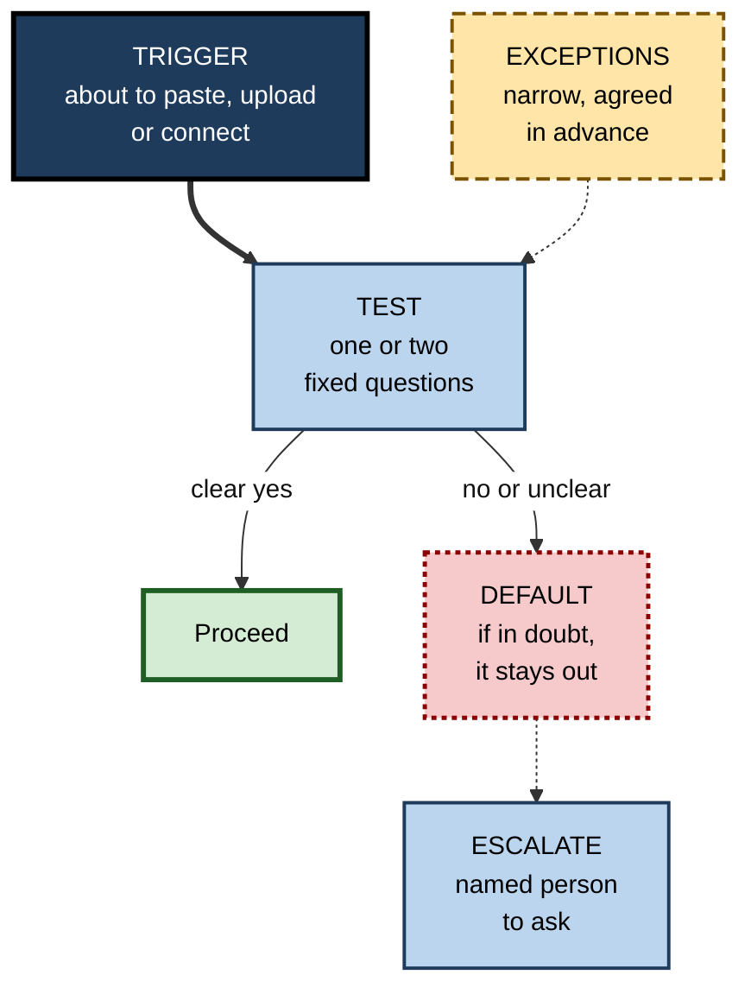
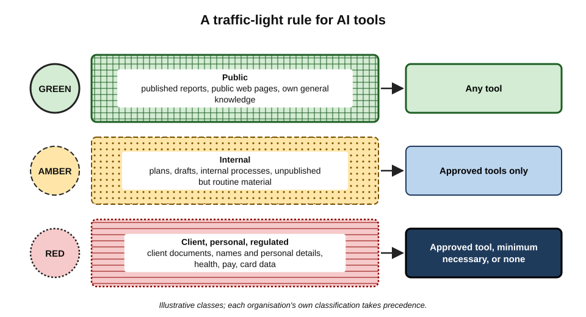
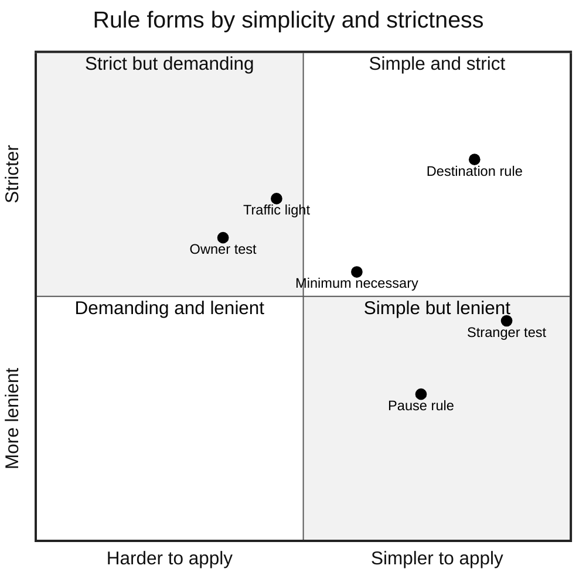
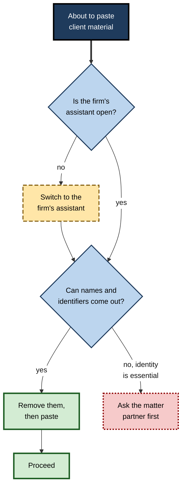
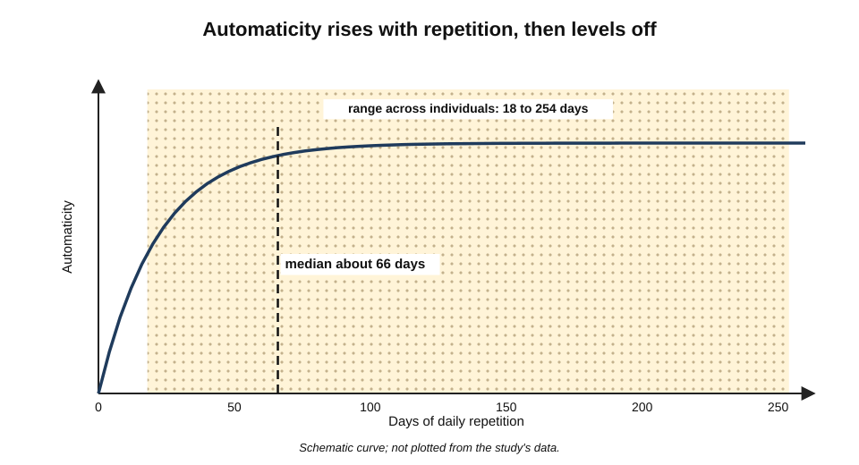
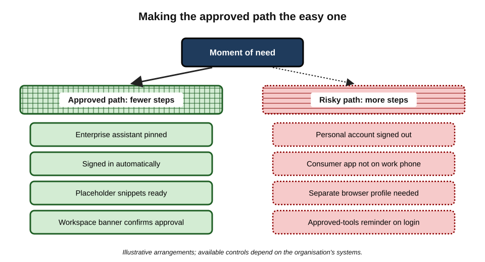

# J.12. A personal confidentiality rule

A senior solicitor is asked how she decides, dozens of times a day, what may go into an AI tool. She does not consult the firm's twenty-page policy each time. She says: "Client material goes into the firm's assistant or nowhere, and I take the names out first." One sentence, decided in advance, applied in a second. The policy tells her what is allowed; the rule makes sure she actually does it when she is tired, rushed or distracted.

> **Definition — Personal confidentiality rule:** a short decision rule, chosen in advance and committed to memory, that a person applies at the moment of entering, uploading or connecting information to an AI tool.

**Why it matters**

- **Decisions happen at speed.** The moment of risk — pasting, uploading, clicking "connect" — takes seconds, often under pressure.
- **Policies are long; moments are short.** Few people can apply a full policy in the moment; most can apply one well-chosen rule.
- **Rules beat good intentions.** Research on goal pursuit shows that plans specifying *when* and *how* to act close much of the gap between intending and doing.
- **A rule is portable.** It applies to tools that did not exist when the policy was written.

---

## Why a Rule Rather Than Judgement Alone

### Fast and slow decisions

- **Two modes of thinking** — psychologists distinguish fast, automatic, intuitive processing from slow, effortful, deliberate reasoning; the distinction was popularised by Daniel Kahneman in *Thinking, Fast and Slow* (2011).
- **The paste moment is fast-mode territory** — routine, repeated, rewarded by an immediate answer.
- **A rule recruits the slow mode briefly** — a single question that interrupts the automatic action.

> **Watch out:** "dual-process" accounts are a useful description rather than a precise map of the brain, and some findings popularised alongside them have not replicated well. The practical point stands independently: routine actions under time pressure are poorly governed by complex deliberation.

### Simple rules can outperform complex ones

> **Definition — Heuristic:** a simple rule of thumb that produces good-enough decisions quickly with limited information.

- **Fast-and-frugal heuristics** — the research programme led by Gerd Gigerenzer has argued that, in uncertain environments, simple rules that use little information can match or beat complex analysis, partly because they are robust to noise and easy to apply consistently.
- **Application** — a confidentiality decision rarely needs every fact; one or two well-chosen questions capture most of the risk.

### Lessons from checklists in high-risk work

**Study card — the WHO Surgical Safety Checklist (Haynes and colleagues, 2009)**

- **Design:** eight hospitals in eight countries, ranging from high- to low-income settings, introduced a nineteen-item checklist used at three moments in surgery: before anaesthesia, before incision and before the patient leaves the theatre.
- **Results:** comparing nearly 4,000 patients before with nearly 4,000 after introduction:
  - the death rate fell from about **1.5%** to **0.8%**;
  - inpatient complications fell from about **11%** to **7%**.
- **Conclusion:** short, fixed checks at defined **moments of risk** reduced errors by experienced professionals.
- **Caveats:** the study was a before-and-after comparison, not a randomised trial; later studies in some settings found smaller effects, and benefits depended heavily on how seriously teams adopted the checks.
- **Relevance:** the lesson is not "use long lists" but **anchor a brief check to the exact moment of risk**.

> **Key point:** a personal confidentiality rule works like a pre-incision pause: brief, fixed, attached to a specific moment, and used even by experts — especially by experts, whose fluency makes automatic action most likely.

---

## The Anatomy of a Good Rule

### Five parts

1. **Trigger** — the moment the rule applies: "whenever I am about to paste, upload or connect anything to an AI tool".
2. **Test** — one or two questions: "Is this tool approved for this kind of information? Can I remove the people and keep the problem?"
3. **Default action** — what happens if the answer is unclear: "If in doubt, it stays out."
4. **Exceptions** — the narrow, pre-agreed cases where the default does not apply: "Public information may go into any tool."
5. **Escalation** — who to ask when the rule does not settle it: "Ask the engagement lead or the privacy team."

**Figure 1.** The five parts of a personal confidentiality rule.

> **Mnemonic — "TTDEE", read as "Tidy":** Trigger, Test, Default, Exceptions, Escalation.

### Properties of rules that work

- **Short** — one or two sentences; anything longer will not be recalled at the moment.
- **Concrete** — names tools and kinds of information, not abstractions.
- **Conservative by default** — the cost of a wrong "no" is usually a few minutes; the cost of a wrong "yes" can be a breach.
- **Aligned** — consistent with the employer's policy, client contracts and professional rules; stricter is fine, looser is not.
- **Role-specific** — a nurse's rule differs from a developer's.
- **Reviewable** — revisited when jobs, tools or obligations change.

---

## Kinds of Rule

### Six common forms

- **Destination rule** — "Work information goes only into the approved enterprise tool."
  - Simple and strong; depends on an approved tool existing.
- **Traffic-light rule** — content sorted into classes, each with permitted destinations.
  - "Green — public: any tool. Amber — internal: approved tools. Red — client, personal or regulated: approved tool, minimum necessary, or none."
- **Stranger test** — "Would I be comfortable if a stranger read this?"
  - Fast and intuitive; may be too strict for routine internal work, or too loose for people who are comfortable with oversharing.
- **Owner test** — "Would the owner of this information agree to it going here?"
  - Captures confidentiality well; requires knowing who the owner is.
- **Minimum-necessary rule** — "Remove the people and keep the problem."
  - Reduces exposure in every tool; does not decide which tool.
- **Pause rule** — "Never paste when rushed: if I am hurrying, I wait thirty seconds and ask the test question."
  - Targets the moments when errors happen.

**Figure 2.** A traffic-light rule: classes of information and where each may go.

### Rule forms compared

| Rule form | Strength | Weakness | Best for |
|---|---|---|---|
| Destination | Clear; easy to follow | Silent on what to include | Organisations with a good approved tool |
| Traffic light | Fits content to tool | Requires classifying under pressure | Mixed work with varied sensitivity |
| Stranger test | Very fast; intuitive | Calibration varies between people | Quick personal checks |
| Owner test | Tracks confidentiality duties | Owner may be unclear | Client and third-party material |
| Minimum necessary | Reduces harm everywhere | Does not choose the tool | Combined with any other rule |
| Pause | Targets error-prone moments | Easy to skip under real pressure | People who often work against deadlines |

> **In practice:** many professionals combine **two** forms — a destination or traffic-light rule to choose the tool, and the minimum-necessary rule to decide what goes in. Three or more forms tend to collapse back into "it depends", which offers no help in the moment.

**Figure 3.** Rule forms placed by how simple they are to apply and how strictly they protect information.

*Positions are judgements for illustration, not measurements.*

---

## Writing Your Own Rule

### Steps

1. **List the obligations** that bind you — employer policy, client contracts, professional code, regulated data you handle.
2. **List your common AI tasks** — drafting, summarising, analysing, coding, translating.
3. **Find your riskiest moment** — the task where sensitive information and time pressure meet most often.
4. **Choose one or two rule forms** that fit that moment.
5. **Write the rule in one or two sentences**, naming real tools and kinds of information.
6. **Add an if–then plan** for the riskiest moment.
7. **Test it against scenarios** from your own work.
8. **Set a review date** — and review when jobs, clients or tools change.

### Implementation intentions

> **Definition — Implementation intention:** a plan in the form "If situation X arises, then I will do Y", which links a specific cue to a specific action.

**Study card — implementation intentions (Peter Gollwitzer, 1999; meta-analysis by Gollwitzer and Sheeran, 2006)**

- **Idea:** goal intentions ("I intend to protect client data") often fail at the moment of action; adding "if–then" plans makes the cue trigger the action automatically.
- **Evidence:** a meta-analysis of 94 independent studies found that forming implementation intentions improved goal attainment with an average effect of about **d = 0.65**, a medium-to-large effect.
- **Mechanisms:** the situation becomes highly accessible in memory, and the response is triggered with little deliberation.
- **Caveats:** effects vary widely across studies and goals; later work suggests publication bias may inflate the average somewhat, and plans work best when the person is genuinely committed to the goal.

> **Example — if–then plans for confidentiality:**
> - "If I am about to paste a client email into an AI tool, then I first check that the enterprise workspace is open and delete names and signatures."
> - "If a new app asks to connect to my email or calendar, then I close the dialog and check the approved tools list first."
> - "If I am rushing to meet a deadline and reach for my phone's chatbot, then I stop and use the work assistant instead."

**Figure 4.** One personal rule turned into a decision path for the riskiest moment.

### Illustrative rules by role

- **Solicitor** — "Client material goes into the firm's assistant or nowhere, names out first; privileged advice never leaves the matter workspace."
- **HR adviser** — "Cases go in as roles and situations, never names or diagnoses; anything about health, discipline or pay stays in the HR system."
- **Software engineer** — "No secrets, ever: keys and passwords are replaced with placeholders before any prompt; company code only in the approved coding assistant."
- **Management consultant** — "Client documents only in the enterprise workspace and only if the engagement permits; otherwise work from public sources."
- **Teacher** — "No pupil's name, grade or circumstances in any AI tool; I describe the learning problem, not the child."
- **Clinician** — "No patient-identifiable information outside the approved clinical tool; questions to general assistants are about conditions, never about patients."

*Illustrative rules.*

> **Watch out:** a rule borrowed from someone else's role may not match one's own obligations. A consultant's rule may be too loose for a clinician; a clinician's may be needlessly strict for a marketer working with public material.

---

## Companion Rules for Particular Moments

The main rule governs what goes in. A few short companion rules cover the other moments where confidentiality is commonly lost. Each is a single sentence attached to its own trigger.

- **Uploading files** — "Before uploading, I open the file and check hidden tabs, comments and tracked changes."
  - Files carry more than their visible text.
- **Connecting apps** — "I connect nothing new to my email, calendar or drive without checking the approved list."
  - Connections grant ongoing access, not a single use.
- **Sharing results** — "I share outputs as documents to named people, never as public links."
  - Links outlive their purpose.
- **Voice and images** — "I describe in words rather than photograph a screen, whiteboard or document."
  - Images capture bystanders and metadata.
- **Credentials** — "Secrets are replaced with placeholders before any prompt, every time."
  - A pasted key is compromised the moment it leaves the approved environment.
- **Personal matters** — "Nothing personal in the work account; nothing from work in the personal account."
  - Each account is governed by different people and terms.
- **Mistakes** — "If I get it wrong, I report it within the hour."
  - The value of a rule includes what happens when it fails.

> **Remember:** **one main rule for what goes in; one-line companions for files, connections, sharing, images, secrets, accounts and mistakes.**

> **Watch out:** companion rules are useful only if each stays attached to its own trigger. Merging them into one long rule recreates the policy-length problem the rule was meant to solve.

### A personal rule card

Some professionals keep their rule and companions on a small card or in a note pinned to the top of the approved tool's prompt library, for example:

- **Main rule:** client and internal material only in the enterprise assistant; names and identifiers out first; if a contract restricts it, ask.
- **Files:** check hidden content before upload.
- **Connections:** nothing new without the approved list.
- **Sharing:** documents to named people, never public links.
- **Secrets:** placeholders, always.
- **Mistakes:** report within the hour.

*Illustrative card.*

---

## Making the Rule Stick

### Habits take time

**Study card — Lally and colleagues (2010), how habits form**

- **Design:** 96 volunteers at University College London chose a new eating, drinking or exercise behaviour to perform daily in the same context, and reported each day how automatic it felt.
- **Results:**
  - automaticity rose quickly at first, then levelled off — a curve, not a straight line;
  - the **median** time to reach about 95% of each person's plateau was **66 days**, with a range from **18 to 254 days**;
  - missing a single day did not materially harm habit formation.
- **Conclusion:** habits form through repetition in a stable context, over weeks to months, with wide individual differences.
- **Relevance:** a confidentiality rule needs consistent practice for some weeks before it becomes automatic; an occasional lapse is not a reason to abandon it.

**Figure 5.** Automaticity of a new habit rising with repetition, levelling off over weeks to months.

### Design the environment, not just the intention

- **Make the right path easy**
  - bookmark the approved tool at the top of the browser;
  - pin it on the phone's home screen;
  - keep a placeholder text snippet ("[CLIENT]", "[NAME]") ready to paste.
- **Make the wrong path harder**
  - sign out of personal AI accounts on work devices;
  - remove consumer AI apps from the work profile of the phone;
  - use separate browser profiles for work and personal life.
- **Add a cue at the moment**
  - a workspace banner or name that shows "Enterprise — approved for client work";
  - a short reminder in the prompt library's template.

**Figure 6.** Making the approved path the easy one and the risky path the harder one.

> **Key point:** willpower is unreliable under deadline pressure; **friction** is not. A rule supported by an environment in which the right action is also the easiest action is followed far more consistently.

### When the rule meets pressure

- **Deadlines** — the commonest reason for breaking a rule; the pause rule exists for this moment.
- **Requests from seniors** — "just put it into ChatGPT" from a manager does not override client contracts; a short explanation usually settles it.
- **Client pressure** — clients who want speed rarely want their data in consumer tools; asking them is quicker than guessing.
- **Missing tools** — if the approved tool cannot do the task, the answer is to ask for one, not to use an unapproved route.

---

## Worked Example (illustrative): Testing a Draft Rule

**Situation:** a marketing manager drafts this rule: *"Anything that isn't public goes only into our enterprise assistant, and I strip out people's names first."* She tests it against eight situations from her month.

| Situation | Rule's answer | Right answer? | Change needed |
|---|---|---|---|
| Rewriting a published press release | Any tool | Yes | — |
| Summarising an internal strategy deck | Enterprise assistant | Yes | — |
| Drafting a reply to a customer complaint with name and address | Enterprise, names stripped | Yes | — |
| Analysing a customer survey export with emails | Enterprise, names stripped | Partly — emails and free text also identify | Add "and other identifiers" |
| Brainstorming slogans for an unannounced product | Enterprise assistant | Yes | — |
| Uploading an agency's draft contract under NDA | Enterprise assistant | Unclear — NDA may restrict | Add "unless a contract says otherwise — then ask" |
| Connecting a new AI scheduling app to her calendar | Not covered | No — connections need checking | Add "and I connect nothing new without checking the approved list" |
| Using an image tool for a public campaign concept | Any tool | Yes | — |

*Illustrative scenario.*

**Revised rule:** *"Anything that isn't public goes only into our enterprise assistant, with names and other identifiers stripped; if a contract restricts it, I ask first; and I connect nothing new without checking the approved list."*

- **Conclusion:** testing exposed two gaps — **contracts** and **connections** — that the first draft missed. The revised rule is still short enough to remember.

> **Watch out:** every additional clause makes a rule harder to recall. When a rule passes three clauses, consider whether one clause can absorb another or whether the rarest case can be left to escalation.

---

## Case Study (illustrative): A Team Adopts a Shared Rule

- **Situation:** a twelve-person finance team at a manufacturing company had an AI policy but kept making small mistakes: supplier invoices pasted into personal chatbots, payroll questions asked with employee names, a share link left open.
- **Diagnosis:** everyone had read the policy; nobody could apply its fourteen sections at the moment of pasting.
- **Actions:**
  1. the team wrote a shared rule in a workshop: *"Finance data goes only into the company assistant; no names, no account numbers, no payroll — ever; if unsure, ask Priya."*;
  2. each member wrote one personal if–then plan for their riskiest task;
  3. IT pinned the company assistant in every browser and removed consumer AI apps from work phones;
  4. the team reviewed near misses for ten minutes at its monthly meeting.
- **Result (after six months):** reported near misses rose at first — people were noticing more — then fell; no incident reached the privacy team in the second quarter.
- **Side effect:** two colleagues found the "no names" clause slowed some tasks; the team agreed a narrow exception for supplier company names, which are not personal data.
- **Lesson:** a shared rule, backed by environment changes and a regular review, did what a long policy alone had not.

*Illustrative scenario.*

---

## From Rule to Judgement

A rule is a floor, not a ceiling. Mastery means knowing when the rule's answer is not the whole answer.

- **Rules handle the routine** — the many quick decisions where speed and consistency matter most.
- **Judgement handles the novel** — new tools, new kinds of data, ambiguous ownership, agentic features that act on their own.
- **The signal to switch** — when the rule gives an answer that feels wrong, or no answer at all, the right move is to **slow down and escalate**, not to improvise.
- **Rules evolve** — mature practitioners update their rule after each near miss, new obligation or new tool.
- **Rules are taught** — senior professionals share their rule with juniors; a rule spoken aloud in a team becomes a norm.

> **In practice:** experienced professionals often describe their rule less as a restriction than as a relief — it removes hundreds of small decisions from the day and leaves attention for the cases that genuinely need thought.

### Failure modes

- **Too vague** — "be careful with sensitive data" gives no guidance at the moment.
- **Too strict** — a rule that forbids everything is quietly abandoned.
- **Too long** — five clauses cannot be recalled under pressure.
- **Out of date** — written for last year's tools or last job's obligations.
- **Ritual without thought** — saying the rule without asking its question.
- **Private only** — a rule never shared cannot support colleagues or show good practice to clients.

---

## Open Questions

- **Do personal rules reduce incidents measurably?**
  - Evidence from checklists and implementation intentions is encouraging, but studies specific to AI confidentiality behaviour are scarce.
- **How should rules adapt to agents?**
  - When an assistant acts without a "paste" moment — reading inboxes, browsing, filing — the trigger for the rule becomes less obvious.
- **Can tools enforce personal rules?**
  - Browser and device controls can block unapproved destinations and detect identifiers, but over-reliance may erode the judgement rules are meant to build.
- **What is the right balance between personal and organisational rules?**
  - Organisations set the limits; individuals make them usable. How much freedom individuals should have to write stricter or narrower rules is a matter of culture.
- **How quickly do rules become automatic in real work?**
  - Habit research suggests weeks to months, with wide variation; workplace studies of AI-related habits are only beginning.

---

## Summary

- A **personal confidentiality rule** is a short decision rule, set in advance and memorised, applied at the moment of pasting, uploading or connecting.
- Rules work because the risky moment is **fast**; simple **heuristics** can match complex analysis; brief checks at **defined moments of risk** — as in the **WHO Surgical Safety Checklist** study — reduce errors even among experts.
- A good rule has five parts — **Trigger, Test, Default, Exceptions, Escalation** ("Tidy") — and is **short, concrete, conservative, aligned, role-specific and reviewable**.
- Common forms: **destination, traffic light, stranger test, owner test, minimum necessary, pause**; most people combine **two**.
- Write the rule from **obligations, common tasks and the riskiest moment**; add **if–then implementation intentions** (meta-analytic effect around d = 0.65, with caveats); test it against real scenarios.
- Habits form over **weeks to months** (median **66 days** in Lally and colleagues' study); support them with **environment design** — make the approved path easy and the risky path harder.
- Rules face **deadlines, seniors, clients and missing tools**; the answer is to pause and escalate.
- A rule is a **floor**; judgement handles the novel, and rules should evolve and be shared.

---

## Self-Check

1. Define a personal confidentiality rule and explain why it differs from a policy.
2. Why is the moment of pasting or uploading poorly suited to complex deliberation?
3. Summarise the WHO Surgical Safety Checklist study, its caveats, and its lesson for confidentiality.
4. Name and explain the five parts of a good rule.
5. List six properties of rules that work.
6. Compare the destination rule and the stranger test.
7. Why do most professionals combine two rule forms rather than one or several?
8. What is an implementation intention? Write one for a risky moment in your own work.
9. What did Lally and colleagues find about habit formation, and what does it imply for a new rule?
10. Give three ways to make the approved path easier and three to make the risky path harder.
11. A manager tells you to "just put the client file into ChatGPT, we're late". How does your rule guide the response?
12. Test this rule against two situations and improve it: "Never put anything confidential into AI."

### Answer Key

1. A short rule, set in advance and memorised, applied at the moment of entering information into an AI tool. A policy sets out what is allowed in detail; a rule is the brief, usable form that ensures the policy is applied under time pressure.
2. It is fast, routine and immediately rewarded, so it runs on automatic processing; complex deliberation is unlikely to be engaged reliably in a few seconds.
3. In eight hospitals, a nineteen-item checklist at three moments of surgery was followed by deaths falling from about 1.5% to 0.8% and complications from about 11% to 7%. Caveats: before-and-after design; smaller effects elsewhere; dependent on adoption. Lesson: brief, fixed checks at the moment of risk reduce errors by experts.
4. Trigger — the moment the rule applies; Test — one or two questions; Default — the action when unclear ("if in doubt, it stays out"); Exceptions — narrow pre-agreed cases; Escalation — whom to ask.
5. Short; concrete; conservative by default; aligned with obligations; role-specific; reviewable.
6. The destination rule names the permitted tool — clear and strong, but silent on content. The stranger test asks whether a stranger could read it — fast and intuitive, but calibrated differently by different people and not tied to specific obligations.
7. One form usually leaves a gap — choosing the tool or deciding the content — while three or more collapse into "it depends" and cannot be applied in seconds.
8. A plan of the form "If X, then I will Y" linking a cue to an action — for example: "If I am about to upload a client spreadsheet, then I first delete hidden tabs and identifiers and open the enterprise workspace."
9. Automaticity rose then levelled off; median time to near-plateau was 66 days (range 18–254); single misses did not matter much. A new rule needs weeks of consistent practice, and a lapse is not failure.
10. Easier: bookmark or pin the approved tool; keep placeholder snippets; display a workspace banner. Harder: sign out of personal accounts on work devices; remove consumer apps from work profiles; separate browser profiles.
11. Apply the rule: client material goes only into the approved tool (or nowhere if the contract forbids). Pause, explain briefly that the client contract and policy require the approved route, and use it — or escalate if it cannot do the task. Deadline pressure is the trigger for the pause rule, not a reason to break the main rule.
12. "Confidential" is undefined, so routine internal work becomes uncertain; and the rule forbids approved enterprise use that the policy allows, so it will be abandoned. Improved: "Public material: any tool. Internal or client material: only the enterprise assistant, with names and identifiers removed; if a contract restricts it, I ask first."

---

## Glossary

| Term | Meaning |
|---|---|
| Automaticity | The degree to which a behaviour happens without deliberate thought. |
| Default action | What a rule prescribes when the answer to its test is unclear. |
| Destination rule | A rule that specifies which tools may receive which information. |
| Environment design | Arranging tools and settings so that the desired action is the easiest one. |
| Escalation | Referring a decision to a named person when a rule does not settle it. |
| Friction | Effort or steps that make an action harder to take. |
| Heuristic | A simple rule of thumb for quick decisions. |
| Implementation intention | An "if–then" plan linking a situation to an action. |
| Minimum-necessary rule | A rule to include only the information a task requires. |
| Owner test | Asking whether the owner of information would agree to its use. |
| Pause rule | A rule to stop briefly before acting when rushed. |
| Personal confidentiality rule | A short, pre-set decision rule applied when entering information into AI tools. |
| Stranger test | Asking whether one would be comfortable if a stranger read the information. |
| Traffic-light rule | A rule sorting information into classes with permitted destinations. |
| Trigger | The moment or cue at which a rule applies. |
