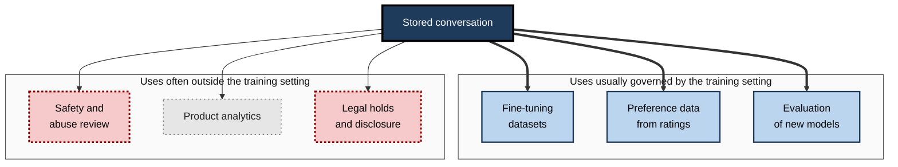
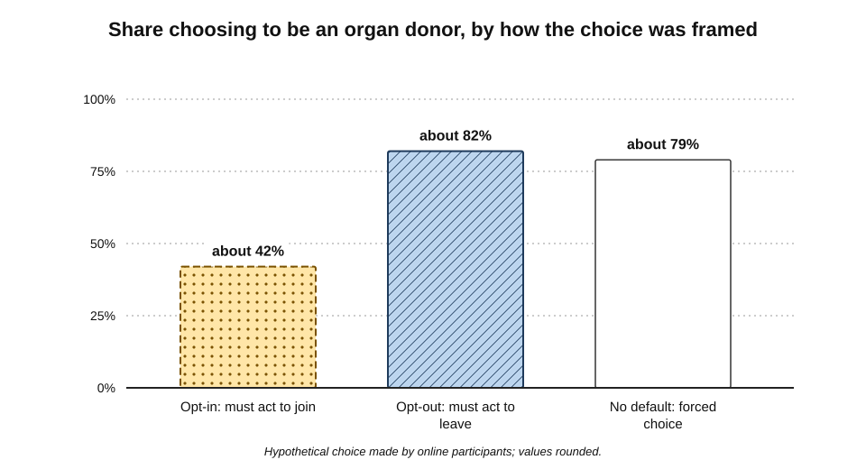
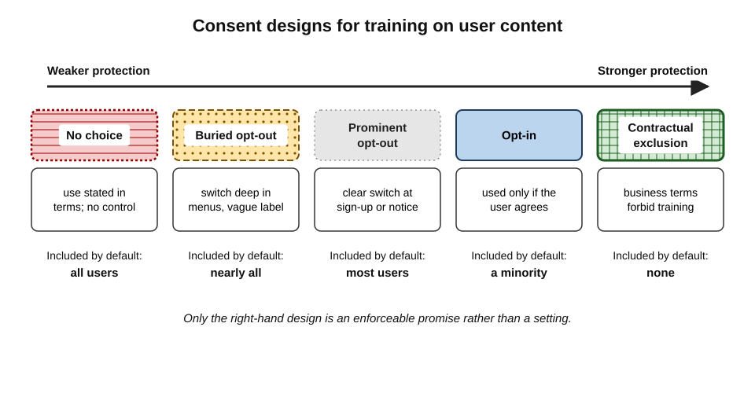
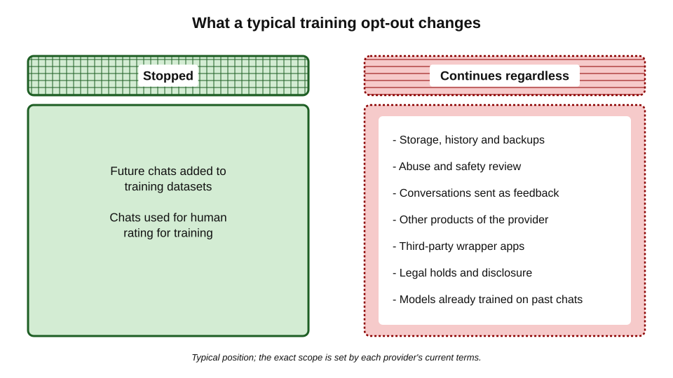
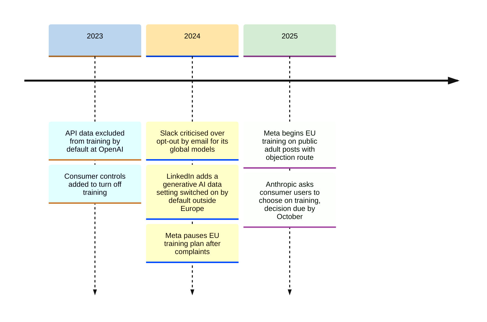
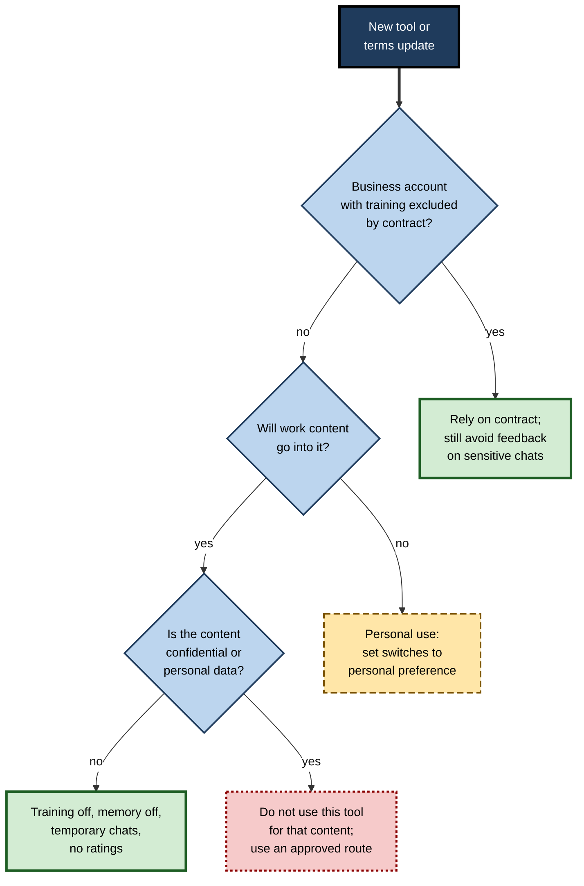

# J.2. Training opt-outs and settings

In the late summer of 2025 millions of people opening a popular AI assistant met a pop-up about updated terms. A large button accepted them; a smaller switch decided whether their future chats could be used to train new models. Many clicked the button without looking at the switch. One small control, set once in a few seconds, decided where years of their conversations might go.

> **Definition — Training on user data:** the use of people's prompts, files, outputs or feedback as material for building or improving AI models, including fine-tuning, reinforcement from human ratings and evaluation.

**Why it matters**

- **Content used for training leaves the user's control.** Once incorporated into a trained model, it cannot be withdrawn simply by deleting a chat.
- **The default decides for most people.** Few users ever open the settings page, so whoever chooses the default chooses for the majority.
- **Settings change.** Providers revise terms, rename switches and add new features with their own controls.
- **A setting is not a safeguard for secrets.** Even a correctly set opt-out leaves other uses — storage, safety review, legal disclosure — untouched.

---

## What "Training" Covers

Privacy terms often say content may be used to "improve our services". That phrase covers several distinct activities.

### Kinds of use

- **Pre-training**
  - Learning general language patterns from enormous text collections, mostly drawn from the public web, licensed sources and books.
  - User conversations are a small, specialised addition, if used at all.
- **Fine-tuning**
  - Further training on curated examples to make a model better at particular tasks or behaviours.
  - Real conversations are valuable here because they show what users actually ask.
- **Reinforcement from human feedback**
  - People rate or rank model answers; the model is adjusted towards preferred answers.
  - User thumbs-up and thumbs-down ratings can feed this process.
- **Evaluation**
  - Using samples of real conversations to test whether a new model is better or worse.
- **Safety systems**
  - Training classifiers that detect abuse, self-harm risk or attempts to break rules.
- **Product analytics**
  - Measuring which features are used, how long answers are, where users give up.

> **Definition — Fine-tuning:** additional training of an already-trained model on a smaller, targeted dataset to adapt its behaviour.

> **Definition — Reinforcement learning from human feedback (RLHF):** a training method in which human preferences between model outputs are used to steer a model towards answers people judge better.

**Figure 1.** The different uses to which a stored conversation can be put.

> **Key point:** a training opt-out normally governs the uses in the left-hand group. The uses in the right-hand group usually continue whatever the switch says.

### Why providers want conversation data

- **Realistic distribution** — real questions differ from the tidy examples researchers write.
- **Failure discovery** — conversations reveal where models are wrong, unhelpful or unsafe.
- **Feedback at scale** — millions of ratings are cheap preference data.
- **Competitive pressure** — providers with more usage data can, in principle, improve faster.

> **Watch out:** the value of user data to model quality is debated. Some researchers argue that curated and synthetic data now matter more than raw chat logs; providers' own statements vary. What is certain is that providers have repeatedly sought permission to use such data, which suggests they find it valuable.

---

## Defaults and the Architecture of Choice

### The power of the default

> **Definition — Default effect:** the tendency of people to stay with whatever option is pre-selected, even when changing it is easy.

**Study card — Johnson and Goldstein (2003), "Do defaults save lives?"**

- **Question:** why do neighbouring European countries with similar cultures have very different rates of consent to organ donation?
- **Comparison:** countries where people had to **opt in** to donation against countries where they were donors unless they **opted out**.
  - Opt-in countries had low effective consent rates; opt-out countries had rates close to universal.
- **Online experiment:** participants made a hypothetical donation choice under three framings.
  - Opt-in framing — about **42%** chose to be donors.
  - Opt-out framing — about **82%** remained donors.
  - No default (forced choice) — about **79%** chose to be donors.
- **Conclusion:** the default, not the underlying preference, largely determined the outcome.
- **Mechanisms proposed:** effort of changing, the default read as an implicit recommendation, and loss aversion relative to the status quo.

**Figure 2.** How the default framing changed the share of people choosing the same option.

> **Key point:** when a training switch is set to "on" by default, most users will be included — not because they chose it, but because they did not act.

### Consent models compared

| | Opt-in | Opt-out | No choice | Contractual exclusion |
|---|---|---|---|---|
| Default | Not used for training | Used unless user acts | Used, no control offered | Not used, fixed by contract |
| Typical setting | Some privacy-focused tools; some regulated contexts | Many consumer AI plans | Some free tools and apps | Business, enterprise and API plans |
| Share of users included | Usually small | Usually large | All | None |
| Strength for confidential work | Strong if verified | Weak — depends on each user acting | None | Strongest — enforceable promise |

### Deceptive design

> **Definition — Deceptive design pattern (dark pattern):** an interface design that steers users towards choices they would not otherwise make, often against their interests.

- **Common forms in privacy settings:**
  - **Asymmetric buttons** — a bright "Accept" and a faint or hidden alternative.
  - **Pre-ticked boxes** — the privacy-reducing option already selected.
  - **Buried controls** — the switch several menus deep, or only in a web version.
  - **Confusing labels** — "Improve the model for everyone" rather than "Use my chats for training".
  - **Linked loss** — turning off training also turns off chat history or other useful features.
  - **Repeated nagging** — asking again until the user agrees.
- **Regulators' position:**
  - The European Data Protection Board has issued guidelines on deceptive design patterns in social-media interfaces, treating several of these forms as incompatible with fair processing.
  - The United States Federal Trade Commission warned in February 2024 that quietly changing terms of service to allow AI training on previously collected data could be unfair or deceptive.

> **Example:** when ChatGPT introduced a control over training in April 2023, it was tied to chat history: users who refused training also lost their conversation list. The two controls were later separated, after criticism that the linkage penalised privacy.

**Figure 3.** Consent designs arranged from weakest to strongest protection for the user.

---

## The Settings Landscape

The names differ between tools and change with versions, but the same families of control recur.

### Families of control

- **Training switch**
  - Typical labels: "Improve the model for everyone", "Help improve", "Model training", "Use my data".
  - Controls whether future conversations may be selected for training.
- **Temporary or incognito chat**
  - A conversation that does not appear in history, is not used for training and is deleted after a short period.
  - Usually still retained briefly for abuse monitoring.
- **Chat history**
  - Whether conversations are saved for the user to return to.
- **Memory and personalisation**
  - Whether the tool saves facts about the user and uses past chats to shape answers.
- **Feedback**
  - Ratings and comments; submitting feedback commonly makes the **whole conversation** eligible for review and training, regardless of the general switch.
- **Connected apps and data sources**
  - Whether content pulled from email, drives or other services may be used beyond the immediate answer.
- **Voice and video**
  - Whether recordings may be kept and used to improve speech models.
- **Export and deletion**
  - Downloading a copy of stored data; deleting individual chats or the whole account.

> **Watch out:** the feedback button is the most common route by which a user who has opted out of training sends a conversation for training anyway. A thumbs-down on an answer about a client contract may send the contract text for human review.

### Special cases that need their own decision

- **Voice recordings**
  - Audio carries more than words: accent, emotion, background voices, sometimes the identity of other people in the room.
  - Some providers keep recordings for longer, or under a separate switch, to improve speech recognition.
- **Images and screenshots**
  - Photographs and screen captures may include faces, documents on a desk, location metadata and other people's messages.
- **Code**
  - Coding assistants may collect code snippets, file paths and repository names as "telemetry" under a setting distinct from the chat assistant's.
  - Code often contains embedded secrets — keys, passwords, internal addresses.
- **Content from connected services**
  - Emails and documents read through a connector belong mostly to **other people**; providers commonly state that connected content is not used for training, but the statement must be checked for each connector.
- **Shared and public conversations**
  - A conversation made public through a share link or community feed may fall outside the private-conversation rules altogether.

> **Key point:** the training switch in the main settings page is often only **one** of several. Each modality and each surface — voice, images, coding tools, connectors, browser extensions — may carry its own setting or its own default.

### Plans and their usual positions

| Plan type | Usual training position | Who controls it | Main residual uses |
|---|---|---|---|
| Free consumer | Often opt-out; sometimes no choice | Individual user | Safety review, analytics, legal disclosure |
| Paid individual | Often opt-out, same as free | Individual user | As above |
| Team or business | Excluded by default under business terms | Organisation's administrator and contract | Safety monitoring, admin access |
| Enterprise | Excluded by contract | Contract and administrator | Configurable retention, compliance export |
| Developer API | Excluded by default at major providers | Contract | Short abuse-monitoring retention |

- **Example of a dated change:** OpenAI stated that from 1 March 2023 data submitted through its developer API would not be used for training unless the customer opted in. Similar positions became standard for business and API access across major providers.

> **Remember:** **consumer** plan → check the switch; **business** plan → check the contract; **API** → check the data-use and retention terms.

---

## What an Opt-Out Does and Does Not Do

An opt-out is narrower than many users assume.

### What it normally does

- **Excludes future conversations** from datasets used to train or fine-tune models.
- **Often excludes** them from human rating programmes run for training purposes.

### What it normally does not do

- **It is not retroactive.**
  - Conversations already used in a trained model remain part of that model's training history; deleting them later does not "untrain" the model.
- **It does not stop storage.**
  - History, files and logs are kept under the normal retention rules.
- **It does not stop safety review.**
  - Content flagged for abuse may still be read by staff.
- **It may not cover feedback.**
  - A rated conversation may be used even with the switch off.
- **It may not cover other products.**
  - The same provider's browser extension, mobile keyboard or voice assistant may have separate settings.
- **It does not bind third parties.**
  - A wrapper app built on the model has its own terms for what it keeps.
- **It may not survive change.**
  - A new account, a new device, a merged product or revised terms can reset or redefine the setting.

**Figure 4.** What a typical training opt-out stops, and what continues regardless.

> **Key point:** an opt-out reduces **one** route by which content travels — into future models. It is a sensible default for anyone, but it is not a reason to place confidential material in a consumer tool.

---

## The Legal Background

### Europe and the United Kingdom

- **Lawful basis.** The General Data Protection Regulation (GDPR) requires every use of personal data to rest on a lawful basis.
  - **Consent** — must be freely given, specific, informed and unambiguous; a pre-ticked box is not consent.
  - **Legitimate interests** — the basis most providers rely on for training; it requires a balancing test between the provider's interest and the individual's rights.
- **The right to object** (GDPR Article 21) — where processing rests on legitimate interests, individuals may object, and the organisation must stop unless it shows compelling grounds.
  - Training opt-outs and objection forms are, in part, how providers give effect to this right.
- **Regulatory guidance.** In December 2024 the European Data Protection Board adopted an opinion on personal data in AI models, setting out how the legitimate-interests test should be applied to model development and stating that unlawful processing at the training stage can affect the lawfulness of a model's later use.

> **Definition — Legitimate interests:** a lawful basis for processing personal data where the organisation's interest is genuine, the processing is necessary for it, and the individual's rights do not override it.

**Study card — Meta and European user content (2024–2025)**

- **Situation:** in 2024 Meta announced it would train its AI models on public posts by adults in the European Union and the United Kingdom, relying on legitimate interests with an objection form.
- **Events:**
  - after complaints by the privacy group noyb and engagement by the Irish Data Protection Commission, Meta paused the plan in June 2024;
  - in 2025 it announced it would proceed from late May 2025, after notifying users and offering an objection route;
  - a German consumer organisation's request for an injunction was refused by a regional appeal court shortly before the start date.
- **Significance:** the episode showed the European model in action — training permitted on legitimate interests, but only with notice and an effective right to object.
- **Lesson for users:** objection windows can be short and announced by notification or email; the choice must be made **before** training begins to be fully effective.

### Elsewhere

- **United States** — no general federal privacy law; protection comes from sector laws, state laws and the Federal Trade Commission's power over unfair and deceptive practices.
  - Several state privacy laws give rights to opt out of particular uses of personal data, such as sale and targeted advertising.
- **India** — the Digital Personal Data Protection Act 2023 makes consent the main basis for processing, with notice requirements and a right to withdraw consent.
- **Everywhere** — contract terms for business accounts usually go further than law requires, excluding training altogether.

---

## A Timeline of Notable Changes

Provider positions have moved repeatedly; dated events show the pattern.

**Figure 5.** Selected changes in how AI and software providers handled training on user content, 2023–2025.

- **Slack (May 2024)** — users discovered that Slack's privacy principles allowed customer data to be used for some global machine-learning models (such as channel and emoji suggestions) unless a workspace owner opted out by email. Slack clarified that its generative AI product did not train on customer data.
- **LinkedIn (September 2024)** — a new setting allowing member data to be used to train generative AI models appeared switched on by default for many members; it was not applied to members in the European Economic Area, Switzerland or the United Kingdom.
- **Anthropic (August–October 2025)** — consumer users were asked to choose whether chats could be used for training; the case study below examines it.

> **Watch out:** these events describe positions at particular dates. Settings and terms continue to change; any statement about a specific provider's current default must be checked against its current settings.

---

## Managing Settings in Practice

### A method for any tool

1. **Find every switch.** Open the settings on each surface — web, desktop, phone — and look under privacy, data controls and personalisation.
2. **Read the label literally.** Translate "improve the model for everyone" into "use my conversations for training".
3. **Set the training switch deliberately.** Off is the sensible default for work use; on is a choice, not an accident.
4. **Decide on history and memory separately.** History aids work; memory builds a profile — weigh each.
5. **Note the feedback rule.** Avoid rating answers in conversations that contain anything sensitive.
6. **Use temporary chats** for one-off questions that need no history.
7. **Record the date and state.** A note such as "training off, memory off, 12 March" makes later checks quick.
8. **Recheck after every terms notice.** Changes often arrive as a pop-up with a new or reset switch.

> **Mnemonic — "FIND-RT":** Find every switch, Interpret the label, Note the feedback rule, Decide history and memory, Record the state, Track changes.

**Figure 6.** Deciding which settings to use for a given tool and kind of work.

### Worked example (illustrative): a freelance consultant's three tools

**Situation:** a freelance management consultant uses a general assistant on a paid individual plan, a writing assistant built into a document editor, and a free transcription app.

| Tool | Default found | Action taken | Residual concern |
|---|---|---|---|
| General assistant, individual plan | Training on; memory on | Training off; memory off; temporary chats for client questions | Still stored 30 days after deletion; safety review possible |
| Editor's built-in writing assistant | Covered by the editor's business terms; no training | None needed; confirmed in the editor's data-use page | Admin of the shared client folder can see AI history |
| Free transcription app | No training switch; terms allow use of recordings to improve services | Stopped using it for client calls | Earlier recordings already uploaded |

*Illustrative scenario.*

- **Steps followed:**
  1. listed every tool that touched client work;
  2. checked each tool's settings on web and phone;
  3. discovered that the transcription app offered **no choice**;
  4. deleted past recordings and asked the provider to erase the account;
  5. replaced the app with a tool covered by business terms.
- **Conclusion:** the most important finding was not a switch set wrongly but a tool with **no switch at all**.

> **Watch out:** deleting old recordings does not remove any effect they have already had on a trained model; it only stops further use.

---

## Case Study: Anthropic's 2025 Consumer Terms Change

- **Situation:** until 2025 Anthropic said it did not train its models on consumer users' chats unless they explicitly submitted them, for example through feedback.
- **Change announced (late August 2025):**
  - users of the consumer Free, Pro and Max plans were asked to choose whether their chats and coding sessions could be used to train future models;
  - for users who allowed training, the retention period for new or resumed conversations was extended to **five years**;
  - users who declined kept the existing **30-day** retention for deleted conversations;
  - existing users had until **8 October 2025** to make a choice in order to continue using the service.
- **Scope:** business, education, government and API use — including access through third-party cloud platforms — were excluded from the change.
- **Design criticism:**
  - commentators noted that the training switch in the pop-up was set to allow training, beside a prominent accept button;
  - the choice could be changed later in settings, but would apply only to future data.
- **Significance:**
  - showed the industry moving towards **opt-out** for consumer plans, with the training choice linked to retention length;
  - illustrated the gap between consumer and business terms at the same provider.
- **Lesson:**
  - a provider's privacy position is a **dated fact**, not a permanent property;
  - pop-ups announcing new terms deserve the same attention as signing a contract;
  - professionals should not rely on a consumer plan's current default for work content.

---

## Professional Mastery

### For individuals

- **Separate personal and work accounts.** Different defaults and obligations apply; mixing them confuses both.
- **Treat every terms pop-up as a decision point.** Read what changes, especially defaults and retention.
- **Assume the most permissive interpretation** of vague wording such as "may be used to improve our services".
- **Avoid the feedback button** in sensitive conversations.
- **Keep a short record** of settings chosen and when.

### For organisations

- **Contract rather than toggle.** Rely on business terms that exclude training, not on each employee's setting.
- **Lock settings centrally.** Business plans let administrators fix training, memory and sharing settings for all users.
- **Block personal accounts for work** where approved alternatives exist, by network controls or browser management.
- **Brief staff on residual uses.** Training exclusion does not mean no storage, no review or no disclosure.
- **Watch provider notices.** Assign someone to review terms changes for approved tools.

> **In practice:** mature organisations write the training position into the **data-processing agreement** with the provider, so that a change to consumer defaults has no effect on business data.

### Common errors

- **Equating opt-out with privacy** — forgetting storage, review and legal disclosure.
- **Checking one surface only** — the phone app or browser extension may have separate controls.
- **Rating sensitive answers** — sending the conversation for review.
- **Ignoring tools with no switch** — the absence of a control is the strongest warning sign.
- **Assuming settings persist** — new terms can introduce new switches defaulted to "on".

---

## Open Questions

- **Can a model be made to "forget" specific training data?**
  - Research on **machine unlearning** is active, but reliably removing the influence of particular data from a large trained model, and proving it, remains unsolved.
- **Is opt-out a meaningful choice when defaults are so powerful?**
  - The default effect suggests most users will never act; whether opt-out satisfies the spirit of data-protection law for training is contested.
- **How valuable is user data compared with synthetic data?**
  - If synthetic data comes to dominate, provider incentives — and default settings — may change.
- **Should training permission be tied to other benefits?**
  - Linking training to longer retention, better features or lower prices raises questions about whether the choice is free.
- **Who decides for shared content?**
  - A conversation may contain other people's information; the user who flips the switch is not the only person affected.

---

## Summary

- **Training on user data** covers fine-tuning, preference learning from ratings, evaluation and safety-system development; "improve our services" can mean any of these.
- **Defaults dominate**: Johnson and Goldstein's organ-donation research showed outcomes follow the pre-set option; a training switch set to "on" includes most users.
- Consent designs range from **no choice** through **buried and prominent opt-outs** to **opt-in** and **contractual exclusion**; only the last is a firm guarantee.
- **Deceptive design** — asymmetric buttons, buried switches, euphemistic labels, linked loss — steers users; European and US regulators have warned against it.
- Settings families: **training switch, temporary chat, history, memory, feedback, connected apps, voice, export and deletion**. Feedback often sends a conversation for training even when the switch is off.
- An opt-out is **not retroactive**, does not stop **storage, safety review or legal disclosure**, may not cover **feedback or other products**, and can be **reset by terms changes**.
- Under the GDPR, training usually relies on **legitimate interests** with a **right to object**; Meta's 2024–2025 EU training plan illustrated notice and objection in practice.
- Positions change: OpenAI's 2023 API exclusion, Slack and LinkedIn in 2024, and **Anthropic's 2025 consumer change** to opt-out with five-year retention for those who allow training.
- Professionals **set switches deliberately, avoid rating sensitive chats, record settings, recheck after notices** — and organisations rely on **contracts and locked settings**, not individual toggles.

---

## Self-Check

1. Distinguish fine-tuning, reinforcement from human feedback and evaluation as uses of conversation data.
2. Summarise the Johnson and Goldstein findings and explain their relevance to AI training settings.
3. Compare opt-in, opt-out, no choice and contractual exclusion as protections for confidential work.
4. Name four deceptive design patterns found in privacy settings.
5. Why can the feedback button undermine a training opt-out?
6. List five things a training opt-out normally does not do.
7. What is the legitimate-interests basis, and how does the right to object relate to training opt-outs?
8. What happened in the Meta EU training episode of 2024–2025, and what does it teach users?
9. Describe the main features of Anthropic's 2025 consumer terms change.
10. Why is the absence of any training control a stronger warning sign than a control set to "on"?
11. A colleague says, "I turned training off, so I can paste client files into my personal account." Evaluate the claim.
12. As a team leader, what would you put in place so that training settings do not depend on each employee remembering to change them?

### Answer Key

1. Fine-tuning trains a model further on curated examples; reinforcement from human feedback uses human preferences between outputs to steer the model; evaluation uses conversations to test whether new models perform better, without necessarily training on them.
2. Opt-out countries had far higher consent to organ donation than opt-in countries, and in an online experiment about 82% stayed donors under opt-out against about 42% who joined under opt-in. Outcomes follow defaults, so a training switch set to "on" will include most users regardless of their real preferences.
3. Opt-in protects by default but depends on the setting being honoured; opt-out depends on every user acting and so includes most; no choice gives no protection; contractual exclusion is an enforceable promise and the strongest protection.
4. Any four of: asymmetric buttons, pre-ticked boxes, buried controls, euphemistic labels, linked loss of features, repeated nagging.
5. Submitting a rating or comment often makes the entire conversation eligible for review and training, regardless of the general switch.
6. Any five of: undo past training; stop storage; stop safety review; cover feedback; cover other products of the same provider; bind third-party wrapper apps; survive new accounts or terms changes.
7. Legitimate interests allows processing where the organisation's genuine interest is necessary and not overridden by the individual's rights. Where it applies, individuals may object; opt-outs and objection forms are ways of honouring that right.
8. Meta announced EU training on public adult posts, paused after complaints and regulator engagement in 2024, then proceeded from late May 2025 with notice and an objection route; an injunction request failed. Users must act within objection windows, before training begins.
9. Consumer Free, Pro and Max users had to choose whether chats could be used for training; those allowing it had five-year retention for new or resumed chats, others kept 30 days; the decision was due by 8 October 2025; business, education, government and API use were excluded.
10. A switch can be turned off; no switch means the user cannot prevent the use at all, so the only protection is not to use the tool for that content.
11. Wrong. The opt-out stops future training only; the files are still stored, possibly reviewed, subject to legal disclosure and to breach. A personal account may also breach client contracts and employer policy. Client files belong in an approved business route, if anywhere.
12. A business plan whose contract excludes training; centrally locked settings for training, memory and sharing; network or browser controls that steer work to the approved tool; a short briefing on residual uses; and a named person who reviews provider terms changes.

---

## Glossary

| Term | Meaning |
|---|---|
| Contractual exclusion | A binding agreement that customer data will not be used for training. |
| Data-processing agreement | A contract setting out how a provider processes personal data on a customer's behalf. |
| Deceptive design pattern | An interface design that steers users towards choices against their interests. |
| Default effect | The tendency to stay with a pre-selected option. |
| Evaluation | Testing a model's performance, often on samples of real conversations. |
| Feedback | Ratings or comments on answers; often sends the conversation for review. |
| Fine-tuning | Further training of a model on a targeted dataset. |
| Legitimate interests | A lawful basis for processing where the organisation's interest is not overridden by individual rights. |
| Machine unlearning | Research on removing the influence of specific data from a trained model. |
| Opt-in | A design where a use happens only if the user actively agrees. |
| Opt-out | A design where a use happens unless the user actively refuses. |
| Pre-training | Initial training of a model on very large text collections. |
| Reinforcement learning from human feedback | Training that steers a model using human preferences between outputs. |
| Right to object | A data-protection right to object to processing based on legitimate interests. |
| Temporary chat | A conversation not saved to history or used for training, deleted after a short period. |
| Training on user data | Using prompts, files, outputs or feedback to build or improve models. |
