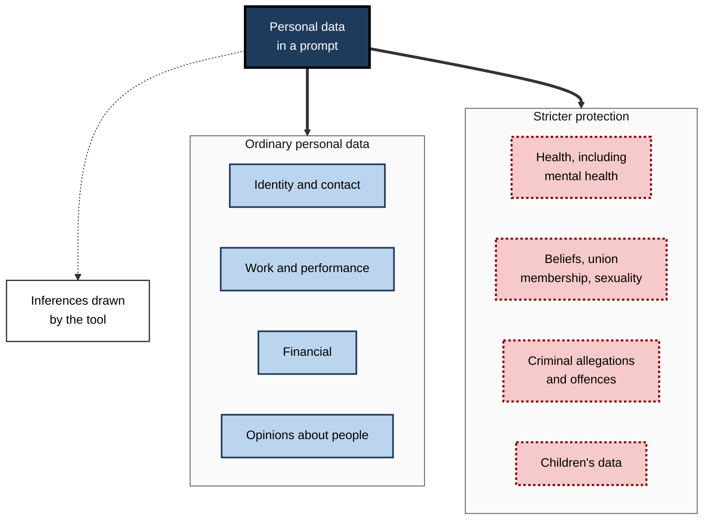
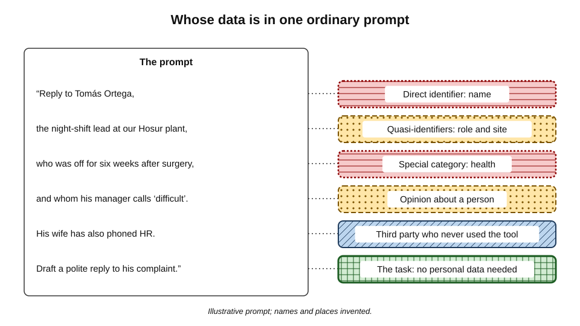
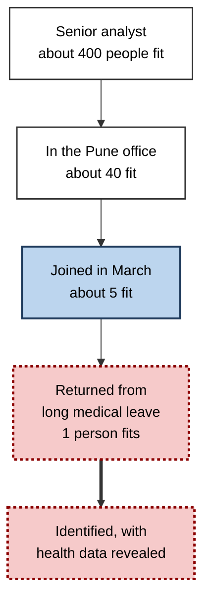
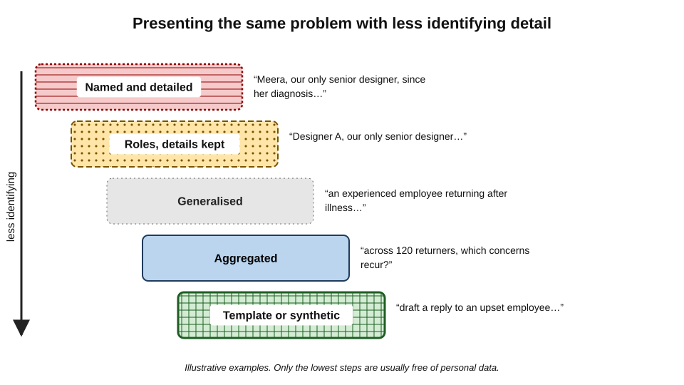
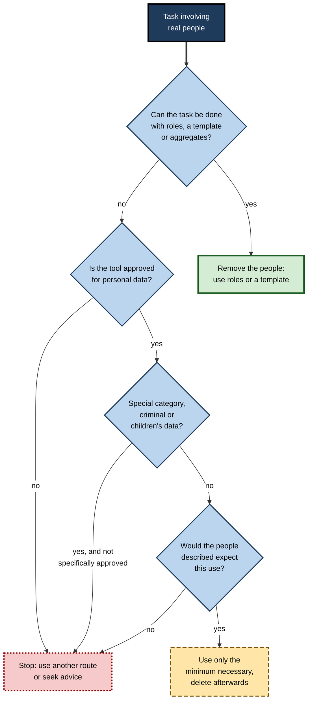
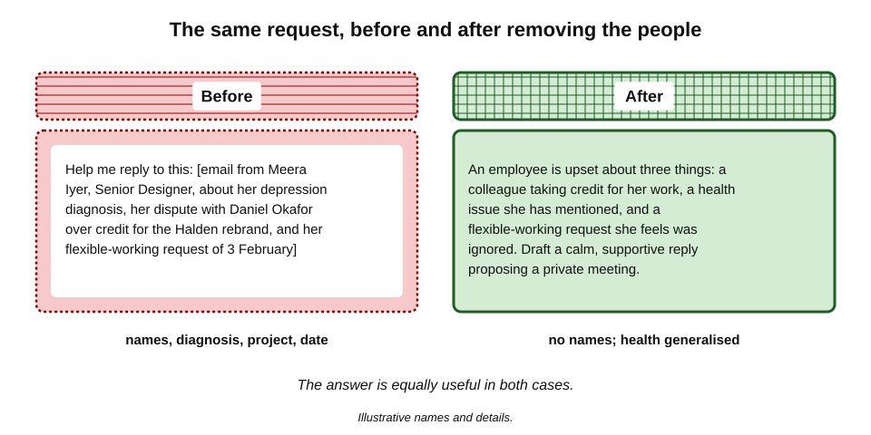

# J.3. Personal data in prompts

A team leader receives an angry email from a member of staff, pastes it into an AI assistant and asks for help writing a calm reply. The email names the employee, mentions a recent diagnosis of depression, describes a dispute with a colleague and refers to a pending flexible-working request. The team leader wanted help with tone. The tool received health data, an employment dispute and the names of two people who were never asked.

> **Definition — Personal data:** any information relating to an identified or identifiable living person — someone who can be singled out directly, or indirectly by combining the information with other details.

**Why it matters**

- **Most work involves people.** Emails, case notes, performance reviews, customer complaints, CVs and meeting notes are full of personal data.
- **The typist is rarely the person described.** Those whose data is pasted have usually not been asked and cannot object.
- **The law follows the data, not the tool.** Data-protection duties apply to personal data in a prompt exactly as they apply to personal data in a spreadsheet or an email.
- **Small details identify.** A job title, a town and a date can single out one person as surely as a name.

---

## What Counts as Personal Data

### Identified and identifiable

- **Identified** — the person is named or otherwise directly picked out.
  - *e.g.* "Priya Raman, account manager".
- **Identifiable** — the person can be singled out by combining details, even without a name.
  - *e.g.* "the only woman on the night shift at our Nagpur depot".
- **Not personal data** — information that cannot reasonably be linked to any individual.
  - *e.g.* "average handling time across all 400 call-centre staff fell by 8%".

> **Definition — Direct identifier:** a detail that identifies a person on its own, such as a name, email address, phone number, employee number or national identity number.

> **Definition — Quasi-identifier (indirect identifier):** a detail that does not identify on its own but can do so in combination with others, such as job title, postcode, age, date of an event or a rare characteristic.

### Kinds of personal data

- **Contact and identity data** — names, addresses, emails, phone numbers, identity numbers.
- **Work data** — roles, performance ratings, salaries, disciplinary records, absence.
- **Financial data** — account numbers, income, debts, transactions.
- **Online identifiers** — IP addresses, device identifiers, account handles, cookie identifiers.
- **Opinions and judgements** — "she is unreliable", "he handled the client badly". Opinions about a person are personal data about that person.
- **Images and voice** — photographs, video, voice recordings, where a person can be recognised.
- **Inferred data** — conclusions drawn about someone, such as likely health conditions, political leanings or flight risk.

### Special categories

> **Definition — Special category data:** personal data that data-protection law treats as particularly sensitive and protects more strictly. Under the GDPR (Article 9) it covers racial or ethnic origin, political opinions, religious or philosophical beliefs, trade-union membership, genetic data, biometric data used for identification, health data, and data about a person's sex life or sexual orientation.

- **Criminal offence data** — allegations, convictions and offences — is protected separately (GDPR Article 10) with similar strictness.
- **Children's data** — not a special category as such, but treated with extra care in most legal systems.
- **Other jurisdictions:**
  - India's Digital Personal Data Protection Act 2023 applies one standard to all digital personal data, without separate special categories, but adds duties for children's data.
  - Several US state laws define "sensitive personal information", including precise location, health data and government identifiers.

**Figure 1.** The main kinds of personal data likely to appear in workplace prompts.

### Kinds compared

| Kind | Example in a prompt | Why it matters |
|---|---|---|
| Direct identifier | "Reply to Tomás Ortega's complaint" | Identifies on its own; easy to remove |
| Quasi-identifier | "our only Portuguese-speaking engineer in Leeds" | Identifies in combination; often overlooked |
| Special category | "since her cancer diagnosis she has missed deadlines" | Strict legal conditions; serious harm if exposed |
| Opinion | "he is lazy and disruptive" | Personal data about the subject; may be unfair or inaccurate |
| Inferred | Tool concludes "possible burnout" | New personal data created by the tool |

> **Key point:** removing names is necessary but rarely sufficient. **Quasi-identifiers** and **special category details** carry most of the residual risk.

---

## Whose Data Is in a Prompt

**Figure 2.** One ordinary prompt, annotated by the personal data it contains.

### The people behind a prompt

- **The user** — their own account details, writing style, questions, worries.
- **Colleagues** — named in emails, meeting notes, feedback and complaints.
- **Customers and clients** — in support tickets, contracts, invoices, case files.
- **Patients, pupils, service users** — in clinical, educational and social-care records.
- **Candidates** — CVs and interview notes.
- **Third parties in documents** — people mentioned in passing: a family member, a witness, a supplier contact.
- **Public figures** — still have data-protection rights over their personal data.

> **Definition — Data subject:** the living individual whom personal data is about.

> **Key point:** the person typing can decide about **their own** data. They cannot give consent on behalf of the colleagues, customers or patients whose details they paste.

---

## Why Prompts Are a Distinctive Risk

### Free text gathers detail

- **Prompts are written for context.** Users add background to get better answers — and background is where personal details live.
- **Pasted material is unfiltered.** An email thread brings signatures, phone numbers, forwarded messages and quoted replies.
- **Files carry more than intended.** A spreadsheet can include hidden tabs; a document can include comments and tracked changes.
- **Conversations accumulate.** A long chat may assemble, turn by turn, a detailed profile no single message contained.

### Context identifies

> **Definition — Mosaic effect:** the identification of a person, or the revelation of sensitive information, by combining several pieces of information that are individually harmless.

- **Small populations** — a team of six, a village, a rare job title.
- **Rare events** — "the employee who was hospitalised after the warehouse fire".
- **Combination with outside knowledge** — anyone who knows the organisation can decode a "pseudonymised" story.
- **Combination by the tool** — an assistant with web search may connect details to public information.

**Figure 3.** How individually harmless details combine to identify one person.

*Illustrative figures.*

### The tool can create personal data

- **Inferences** — asked to "assess this employee's attitude", a model produces a judgement that becomes new personal data about the person.
- **Errors** — models can state false facts about real people with confidence.
  - Inaccurate personal data engages the **accuracy principle** of data-protection law.

**Study card — complaints about false information on real people (2024–2025)**

- **April 2024:** the privacy organisation noyb filed a complaint with the Austrian data-protection authority on behalf of a public figure whose date of birth ChatGPT repeatedly gave incorrectly, arguing that the provider could neither correct nor explain the error.
- **March 2025:** noyb filed a complaint in Norway on behalf of a man about whom ChatGPT had generated a fabricated story that he had murdered his children, mixed with true details such as his home town and the number and gender of his children.
- **Significance:** both complaints frame model outputs about individuals as **processing of personal data** subject to the accuracy principle and the right to rectification.
- **Status:** the complaints raised questions that regulators had not finally resolved at the time of writing.

> **Watch out:** asking an AI tool "what do you know about [a named person]?" is not a harmless search. The answer may mix true and invented details, and acting on it — in hiring, lending or investigation — can cause real harm and breach the accuracy duty.

---

## The Law as It Applies to a Prompt

### Who is responsible

- **Controller** — the organisation that decides why and how personal data is processed; at work, usually the **employer**.
- **Processor** — an organisation that processes data on the controller's instructions; an AI provider under a business contract usually acts as processor.
- **The employee** — acts on the employer's behalf, and must follow its rules.
- **Unapproved tool** — if an employee pastes personal data into a tool the employer has no contract with, the provider is not acting as the employer's processor; the Dutch data-protection authority has treated this as a likely **personal data breach**.
- **Purely personal use** — data-protection law generally does not apply to individuals acting for purely personal or household purposes, such as planning a family holiday; it applies fully once the activity is work.

> **Definition — Controller:** the person or organisation that determines the purposes and means of processing personal data.

> **Definition — Processor:** a person or organisation that processes personal data on behalf of a controller.

### The principles applied to a prompt

| Principle | What it asks | What it means for a prompt |
|---|---|---|
| Lawfulness, fairness, transparency | A lawful basis, and processing people would reasonably expect | Would the people described expect their details to go to this tool? |
| Purpose limitation | Use only for specified, compatible purposes | Data collected for payroll should not be pasted to profile an employee's attitude |
| Data minimisation | Only what is adequate, relevant and necessary | Include only the details the task needs |
| Accuracy | Keep data accurate; correct errors | Check AI statements about people before relying on them |
| Storage limitation | Keep no longer than necessary | Delete chats containing personal data when the task ends |
| Security | Appropriate technical and organisational protection | Use approved accounts with suitable terms |
| Accountability | Be able to show compliance | Know and record which tools process personal data |

> **Mnemonic — "LP-MASSA":** Lawfulness, Purpose, Minimisation, Accuracy, Storage, Security, Accountability.

---

## Reducing Personal Data in Prompts

Most tasks need far less personal data than users instinctively include. The art is to keep the **problem** while removing the **person**.

### Techniques

- **Remove** — delete details the task does not need.
  - Signatures, phone numbers, addresses, forwarded headers.
- **Replace with roles** — "the employee", "Manager A", "Customer 3".
  - Keep a separate key, outside the tool, if the answer must be mapped back.
- **Generalise** — "a large city" instead of "Nagpur"; "in the spring" instead of "on 14 March"; "a health condition" instead of the diagnosis.
- **Aggregate** — ask about patterns across many people rather than about one.
- **Describe the structure** — share column names and a few invented rows instead of the real dataset.
- **Ask for a template** — "write a reply to an employee who feels their flexible-working request was ignored" needs no real email at all.
- **Use synthetic examples** — realistic but invented cases to test a prompt before any real data is used.

> **Definition — Pseudonymisation:** replacing identifying details with codes or placeholders, with the means of re-identification kept separately. Pseudonymised data is **still personal data** in law.

> **Definition — Anonymisation:** processing data so that no one can be identified by any means reasonably likely to be used. Truly anonymised data is no longer personal data — but the bar is high.

**Figure 4.** Ways of presenting the same problem, from most to least identifying.

### Techniques compared

| Technique | Before | After | Still personal data? |
|---|---|---|---|
| Remove | "Call Ana on 07700 900123" | "Call the customer" | Possibly, if context identifies |
| Replace with role | "Ravi in payroll made the error" | "A payroll officer made the error" | Possibly, in a small team |
| Generalise | "diagnosed with bipolar disorder in June" | "returning after a period of illness" | Less sensitive; may still identify |
| Aggregate | "Why did Sam leave?" | "What reasons do exit surveys give across 120 leavers?" | Usually not |
| Template | Paste real complaint | "Draft a reply to a complaint about a late refund" | No |

*Illustrative names and details.*

> **Watch out:** replacing names with "Person A" while keeping the job title, location, dates and a rare medical condition is **pseudonymisation at best** — and in a small organisation it may not hide the person at all.

---

## Your Own Personal Data

People increasingly use AI tools for personal matters — health worries, money problems, relationship difficulties, legal disputes, emotional support.

- **No professional confidentiality.** A conversation with an AI tool is not protected like a conversation with a doctor, lawyer or therapist.
  - In July 2025 OpenAI's chief executive, Sam Altman, said publicly that ChatGPT conversations did not have the legal confidentiality of conversations with a therapist or lawyer, and could be produced in litigation.
- **Memory builds a profile.** Saved facts — "has diabetes", "is going through a divorce" — persist across chats.
- **Sensitive inferences.** Patterns of questions can reveal health, sexuality, finances or political views even when never stated.
- **Work and personal mix.** Using a work account for personal matters places that data under the employer's administration and retention; using a personal account for work places work data under consumer terms.

> **In practice:** many professionals keep a simple separation — personal matters in a personal account with memory and training switched off, work matters only in the employer's approved tool, and nothing deeply private in either unless they would accept it being read by a stranger.

---

## Images, Voice and Documents

- **Photographs** — faces of colleagues in the background, documents on a desk, screens, badges.
- **Image metadata** — many phone photographs carry **GPS coordinates**, date, time and device model in their EXIF data.
- **Screenshots** — of chats, inboxes or systems capture names, messages and notifications that were not the point of the question.
- **Voice** — recordings capture other voices in the room and reveal accent, mood and health.
- **Scanned documents** — identity cards, prescriptions, payslips, signatures.

> **Example (illustrative):** an engineer photographs a faulty machine on the shop floor and asks an assistant to identify the part. The image also shows a whiteboard listing the night-shift rota with staff names and a note about one worker's injury.

> **Remember:** before uploading an image, **crop**, **blur** and **strip metadata** — or describe the problem in words instead.

---

## Deciding Whether Personal Data Belongs in a Prompt

**Figure 5.** Questions to settle before including personal data in a prompt.

> **Key point:** the first question is the most powerful. In most everyday tasks — drafting, rewording, structuring, explaining — the real person can be removed without loss.

---

## Worked Example (illustrative): Rewriting a Grievance Prompt

**Situation:** the team leader from the opening wants help replying to the employee's email.

**Original prompt (do not use):**

> "Help me reply to this. [pasted email from Meera Iyer, Senior Designer, describing her depression diagnosis, her dispute with colleague Daniel Okafor over credit for the Halden rebrand, and her flexible-working request of 3 February]."

**Step-by-step rewrite**

1. **Ask what the task needs** — tone, structure and the right commitments; not names, diagnosis or project.
2. **Remove direct identifiers** — names, job title, project name, dates.
3. **Generalise the sensitive detail** — "has told me she is dealing with a health issue" rather than the diagnosis.
4. **Describe, do not paste** — summarise the three concerns in neutral words.
5. **Ask for a structure, then personalise outside the tool** — the team leader adds names and specifics in the email client.

**Rewritten prompt:**

> "An employee has written to me upset. Three concerns: (1) she feels a colleague took credit for her work on a recent project; (2) she has mentioned a health issue affecting her; (3) she feels a flexible-working request has been ignored. Draft a calm, supportive reply that acknowledges each point, avoids promising outcomes I cannot guarantee, proposes a private meeting this week, and mentions support available through occupational health."

**Figure 6.** The same request before and after removing the people from it.

| | Original | Rewritten |
|---|---|---|
| Direct identifiers | Two names, job title, project | None |
| Special category data | Named diagnosis | "a health issue" |
| Usefulness of the answer | High | High — the reply structure is the same |
| Residual risk | High | Low, though context still matters in a tiny team |

*Illustrative names and details.*

- **Conclusion:** the rewritten prompt gives an equally good draft and contains no one's identity or diagnosis.

> **Watch out:** the health issue is mentioned only so the reply can acknowledge it. Even in generalised form, a tool should not be asked to speculate about the condition, its effect on performance or its "likely" course.

---

## Case Study: A Child Protection Report Drafted With ChatGPT (Victoria, 2024)

- **Situation:** a child protection worker in the Department of Families, Fairness and Housing in Victoria, Australia, used ChatGPT while drafting a **Protection Application Report** — a report to the Children's Court that informs decisions about whether a child needs protection.
- **What was entered:** a significant amount of personal and sensitive information, including names and details of risk assessments about a young child whose parents had been charged in connection with sexual offences.
- **What went wrong:**
  - the text produced contained **inaccurate personal information** and, in places, **downplayed the risks** to the child;
  - the report's language did not match the standard terminology of Victorian child protection practice, which helped reveal the tool's use.
- **Investigation:** the Office of the Victorian Information Commissioner (OVIC) investigated and reported in September 2024.
  - It found that the department had **failed to take reasonable steps** to ensure the accuracy of personal information and to protect it from **unauthorised disclosure**.
  - It found indications that the same worker may have used the tool in many other child protection cases over the previous year.
  - Existing controls — guidance and training — were judged insufficient for the risks in a child protection setting.
- **Actions required:** OVIC issued a compliance notice requiring the department, among other steps, to **block** child protection staff from using ChatGPT and similar generative AI tools.
- **Lesson:**
  - personal data in prompts creates **two** harms at once: **disclosure** to an outside provider and **inaccuracy** in what comes back;
  - guidance alone did not prevent use; the regulator required **technical controls**;
  - the higher the stakes for the person described, the less room there is for unapproved tools.

---

## The Rights of the People in Your Prompts

- **Right to be informed** — organisations must tell people how their data is used, including significant AI processing.
- **Right of access** — a person can ask for a copy of their personal data; AI chat logs held by the organisation may fall within scope.
- **Right to rectification** — inaccurate data, including AI-generated statements, must be corrected.
- **Right to erasure** — in some circumstances, deletion can be demanded.
- **Right to object** — to processing based on legitimate interests.
- **Rights about automated decisions** — under the GDPR (Article 22), people have rights where decisions with legal or similarly significant effects are made solely by automated means.

> **In practice:** when an employee or customer makes a subject access request, organisations increasingly have to search AI-tool histories as well as email and files. Prompts that mention people by name become **records that must be found and disclosed**.

---

## Professional Mastery

### Habits of expert practitioners

- **Strip by default.** Remove names and identifiers before thinking about whether they are needed.
- **Watch the quasi-identifiers.** Job titles, small teams, dates and rare details.
- **Never paste whole threads.** Summarise the relevant point in neutral words.
- **Separate the key.** If placeholders are used, keep the mapping outside the tool.
- **Be wary of opinions.** Judgements about people are personal data and may be unfair; do not ask a tool to assess character.
- **Check outputs about people.** Treat any AI statement about a real individual as unverified.
- **Delete when done.** Remove conversations containing personal data at the end of the task.

### Failure modes

- **Name-only redaction** — names removed, identity obvious from context.
- **Consent confusion** — believing the typist's consent covers everyone mentioned.
- **"It's only internal"** — staff data is personal data; employees have full rights over it.
- **Profiling by stealth** — asking a tool to "read between the lines" of an employee's messages.
- **Screenshot spill** — images carrying names, messages and metadata beyond the question.

### For organisations

- **Approved routes** for tasks that genuinely need personal data, under processor contracts.
- **Data loss prevention** tools that detect identity numbers, health terms or customer records in prompts.
- **Impact assessments** for AI uses involving special category data or vulnerable people.
- **Clear examples** in guidance showing how to rewrite common prompts without personal data.

---

## Open Questions

- **Can model outputs about people be corrected?**
  - If a model repeatedly generates a false fact about someone, it is unclear whether filtering outputs is enough to satisfy a right to rectification.
- **When is pseudonymised data in a prompt "personal" to the provider?**
  - European courts have considered whether data is personal for a recipient who lacks the key; the answer depends on the means reasonably available, and its application to AI providers is still being worked out.
- **Should AI conversations about one's own health or finances receive legal protection?**
  - Calls for an "AI privilege" have grown, but no general protection exists.
- **How should memory features handle third parties?**
  - A saved fact such as "my manager is going through a divorce" is personal data about someone who never used the tool.
- **Will automatic redaction become reliable?**
  - Tools that detect and mask identifiers before prompts leave the device are improving, but quasi-identifiers and context remain hard to catch.

---

## Summary

- **Personal data** is any information about an identified or identifiable living person; **quasi-identifiers** identify in combination; **opinions** and **inferences** about people count.
- **Special category data** — health, ethnicity, beliefs, union membership, genetics, biometrics, sexuality — and **criminal offence data** carry stricter rules; children's data needs extra care.
- Prompts gather personal data because users add context, paste whole threads and upload files; the **mosaic effect** identifies people from harmless details.
- The tool can **create** personal data through inferences and **errors**; noyb's 2024 and 2025 complaints framed false outputs as breaches of the accuracy principle.
- At work the employer is usually the **controller**; pasting personal data into an unapproved tool can amount to a **personal data breach**.
- The principles — **lawfulness, purpose limitation, minimisation, accuracy, storage limitation, security, accountability** — apply to prompts.
- Reduce data by **removing, replacing with roles, generalising, aggregating, describing structure, asking for templates** and using **synthetic examples**; pseudonymised data remains personal data.
- Personal use carries its own risks: **no professional confidentiality**, memory profiles, sensitive inferences.
- Images, voice and scans carry **faces, metadata and bystanders**.
- The **Victorian child protection case (2024)** showed disclosure and inaccuracy together, and led to a regulator-ordered **block** on generative AI tools for that workforce.

---

## Self-Check

1. Define personal data, and distinguish identified from identifiable.
2. What is a quasi-identifier? Give three workplace examples.
3. List the GDPR special categories of personal data.
4. Why can the person typing a prompt not consent on behalf of others mentioned in it?
5. Explain the mosaic effect with an example.
6. How can an AI tool create new personal data? Refer to the noyb complaints.
7. Who is the controller when an employee uses an AI tool at work, and why does an unapproved tool raise the risk of a breach?
8. Apply data minimisation and purpose limitation to a prompt asking an assistant to assess an employee's commitment from their emails.
9. Distinguish pseudonymisation from anonymisation and explain why the difference matters.
10. Name five techniques for removing people from a prompt while keeping the problem.
11. What did OVIC find in the Victorian child protection case, and what did it require?
12. A sales manager uploads a photograph of a whiteboard to ask for help with a pipeline chart. What personal data risks might the image carry?
13. Rewrite this prompt to remove personal data: "Write a warning letter to Kofi Mensah, warehouse supervisor at our Leicester site, about his three late arrivals in May, which he says are due to his wife's chemotherapy appointments."

### Answer Key

1. Information relating to a living person who is identified or identifiable. Identified: directly named or picked out. Identifiable: can be singled out by combining the information with other details.
2. A detail that identifies in combination: job title, office location, start date, age, rare skill, team name, date of an event (any three).
3. Racial or ethnic origin; political opinions; religious or philosophical beliefs; trade-union membership; genetic data; biometric data for identification; health data; sex life or sexual orientation. Criminal offence data is protected separately.
4. Consent must come from the data subject; the typist controls only their own data. Others' data can be processed only on a lawful basis held by the controller, usually the employer.
5. Harmless details combine to single out one person — for example a senior analyst, in a particular office, who joined in March and returned from medical leave.
6. By drawing inferences (judgements about a person) and by generating errors. noyb argued that a wrong date of birth and a fabricated murder story were inaccurate personal data that the provider was obliged to correct.
7. Usually the employer. An unapproved provider has no processor contract with the employer, so disclosing personal data to it can be an unauthorised disclosure — a personal data breach.
8. Emails were exchanged for work communication, not for assessing commitment (purpose limitation); pasting a whole mailbox exceeds what any legitimate task needs (minimisation). The request should be refused or replaced by a proper performance process.
9. Pseudonymisation replaces identifiers but keeps a key, so the data remains personal data. Anonymisation makes identification not reasonably possible, so the data is no longer personal data. Treating pseudonymised data as anonymous leads to under-protection.
10. Remove, replace with roles, generalise, aggregate, describe structure, ask for a template, use synthetic examples (any five).
11. The department failed to take reasonable steps to ensure accuracy and to protect personal information from unauthorised disclosure; the output contained inaccurate information that downplayed risks. OVIC required, among other things, that the department block child protection staff from using ChatGPT and similar tools.
12. Names of colleagues and clients on the board, deal values linked to people, faces in the room, other notes on the board, and location and time metadata in the image file.
13. For example: "Draft a firm but fair warning letter to a supervisor about three late arrivals last month. The employee has said the lateness relates to a family member's medical appointments. The letter should record the issue, invite a meeting to discuss support such as adjusted hours, and explain next steps if lateness continues." Names, site, dates and the diagnosis are added, if at all, outside the tool.

---

## Glossary

| Term | Meaning |
|---|---|
| Aggregation | Combining data about many people into totals or averages. |
| Anonymisation | Processing data so that no one can reasonably be identified; anonymous data is not personal data. |
| Controller | The organisation that decides why and how personal data is processed. |
| Criminal offence data | Data about allegations, offences and convictions, protected separately under the GDPR. |
| Data minimisation | Using only the personal data adequate, relevant and necessary for the purpose. |
| Data subject | The living individual whom personal data is about. |
| Direct identifier | A detail that identifies a person on its own. |
| EXIF data | Metadata stored in image files, which can include location, time and device. |
| Inferred data | Conclusions drawn about a person, which are themselves personal data. |
| Mosaic effect | Identification by combining individually harmless details. |
| Personal data | Information relating to an identified or identifiable living person. |
| Personal data breach | A security incident leading to accidental or unlawful loss, alteration or disclosure of personal data. |
| Processor | An organisation that processes personal data on a controller's behalf. |
| Pseudonymisation | Replacing identifiers with codes while keeping a separate key; the data remains personal data. |
| Purpose limitation | Using personal data only for specified and compatible purposes. |
| Quasi-identifier | A detail that identifies in combination with others. |
| Special category data | Personal data given stricter protection, such as health, ethnicity and beliefs. |
| Subject access request | A request by an individual for a copy of their personal data. |
| Synthetic data | Artificially generated data that resembles real data without describing real people. |
