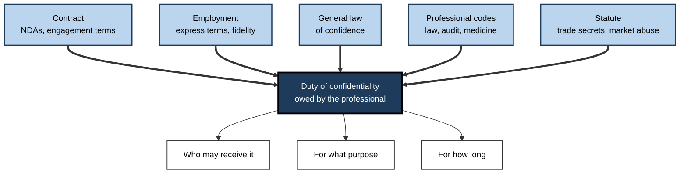
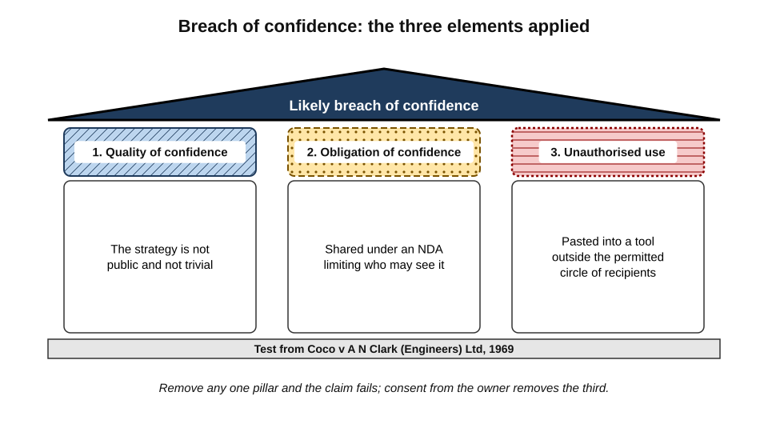
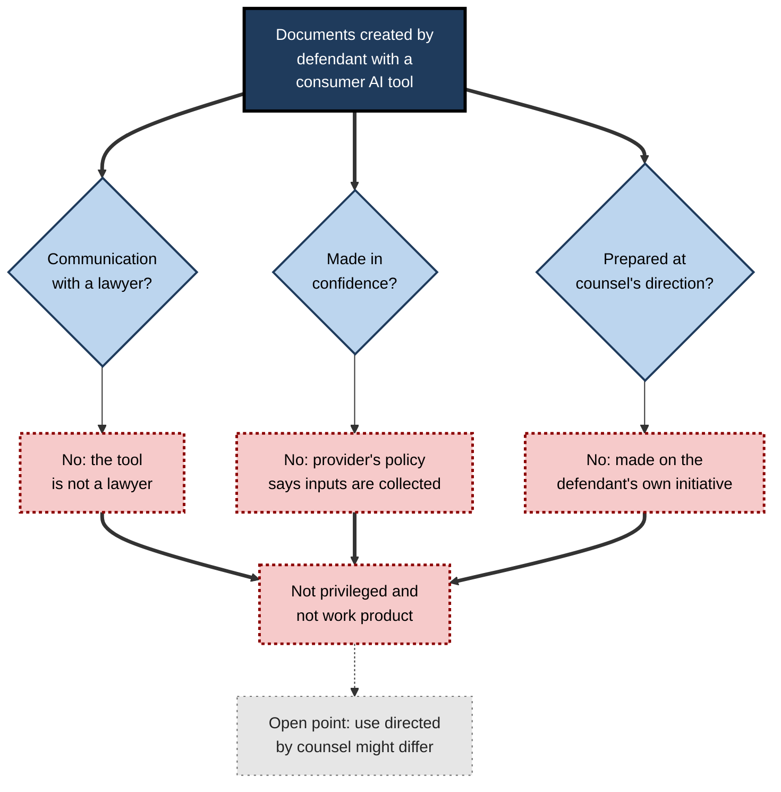
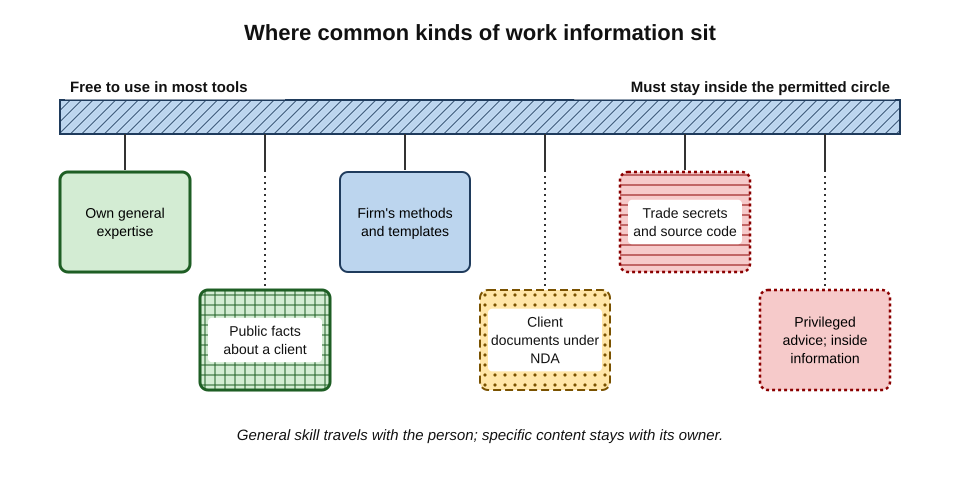
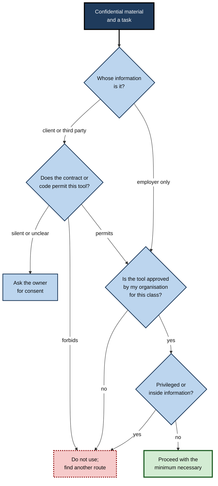
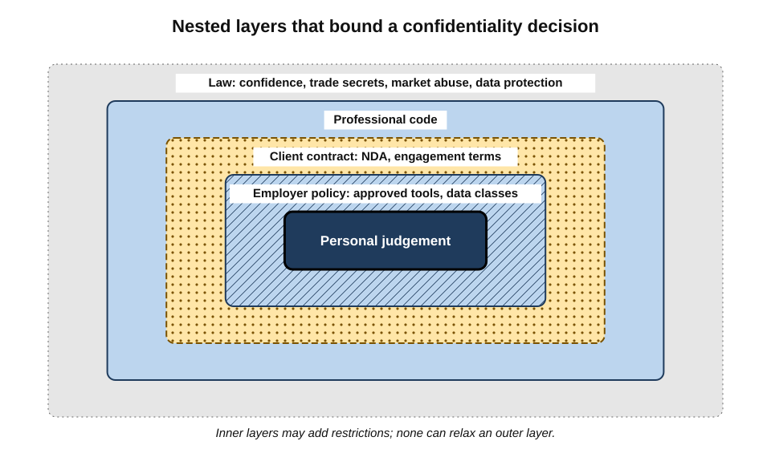

# J.4. Client and employer confidentiality

A junior consultant has an evening to turn a client's draft five-year strategy into slides. She pastes the strategy into a free chatbot on her phone and asks for a ten-slide outline. The outline is excellent. The strategy, however, was shared under a non-disclosure agreement that limits disclosure to the consulting firm's staff and its approved systems — and the chatbot's provider is neither.

> **Definition — Confidential information:** information that is not publicly available and that was shared, created or obtained in circumstances that place an obligation on the recipient to keep it secret and to use it only for permitted purposes.

**Why it matters**

- **Confidentiality is owed, not chosen.** The duty arises from contracts, employment, professional rules and the law; the individual cannot waive it on the owner's behalf.
- **Most confidential information is not personal data.** Prices, plans, code, designs and negotiating positions are protected by confidentiality law, not privacy law.
- **AI tools are third parties.** Unless covered by an approved arrangement, sending information to a provider is a disclosure.
- **The consequences are concrete.** Lost clients, damages, lost trade-secret protection, lost legal privilege, professional discipline and dismissal.

---

## Confidentiality and Privacy

The two are often run together but protect different things for different reasons.

| | Privacy and data protection | Confidentiality |
|---|---|---|
| Protects | People — information about identifiable individuals | Information — of any kind, because of how it was shared |
| Arises from | Statute and human-rights law | Contract, employment, equity, professional rules, trade-secret law |
| Owner of the interest | The data subject | The person or organisation that entrusted the information |
| Typical examples | Health records, CVs, customer lists with names | Strategy papers, prices, source code, deal terms, formulas |
| Can the owner permit disclosure? | Partly — consent is one lawful basis among several | Yes — the owner can release or license the information |

> **Key point:** a document can be **both** personal data and confidential — a client's employee list, for example — and then both sets of rules apply at once.

---

## Where the Duty Comes From

### Five sources

- **Contract**
  - **Non-disclosure agreements (NDAs)** define confidential information, permitted recipients, permitted purposes and how long the duty lasts.
  - **Client engagement terms** and **master services agreements** often contain confidentiality clauses — and increasingly, clauses on AI use.
- **Employment**
  - Employment contracts usually contain express confidentiality terms.
  - In common-law systems an **implied duty of fidelity** binds employees not to misuse the employer's confidential information during employment.
  - After employment ends, protection continues for **trade secrets** and highly confidential information, though not for an employee's general skill and knowledge.
- **The general law of confidence**
  - Courts protect confidential information even without a contract, where it was shared in confidence.
- **Professional rules**
  - Lawyers, accountants, doctors, auditors and many others are bound by codes that make confidentiality a core professional duty.
- **Statute**
  - **Trade-secret laws** — the EU Trade Secrets Directive (2016), implemented in the UK by the Trade Secrets (Enforcement, etc.) Regulations 2018; the US Defend Trade Secrets Act (2016).
  - **Market-abuse and insider-trading laws** — restrict disclosure of inside information about listed companies.
  - **Official secrets and public-sector duties** — for government information.

**Figure 1.** The overlapping sources of a professional's duty of confidentiality.

### The classic legal test

**Study card — Coco v A N Clark (Engineers) Ltd (1969)**

- **Court:** the High Court of England and Wales; judgment by Megarry J.
- **Facts:** a designer of a moped engine claimed that a manufacturer had used design information disclosed during abandoned negotiations.
- **The three elements of breach of confidence:**
  1. the information must have the **necessary quality of confidence** — it is not public or trivial;
  2. it must have been imparted in **circumstances importing an obligation of confidence**;
  3. there must be **unauthorised use** of the information, to the detriment of the party who communicated it.
- **Significance:** the test remains the starting point for breach of confidence in England and many Commonwealth jurisdictions, including India.

**Figure 2.** The three elements of breach of confidence, applied to pasting client material into an AI tool.

> **Watch out:** "the AI provider will never read it" is not a defence to the third element. Unauthorised **disclosure** to a recipient outside the permitted circle can itself be the breach, whatever the recipient does next.

---

## Trade Secrets

> **Definition — Trade secret:** information that is secret, has commercial value because it is secret, and has been subject to reasonable steps by its holder to keep it secret.

- **Examples** — formulas, source code, algorithms, customer-pricing models, manufacturing methods, unreleased product plans.
- **The "reasonable steps" requirement matters for AI use.**
  - Trade-secret protection depends on the holder acting to keep the information secret.
  - Allowing employees to paste secrets into consumer tools without restriction could be argued to show a **lack of reasonable steps**.
  - Clear policies, approved tools, training and technical controls are evidence of reasonable steps.
- **Loss of secrecy is often irreversible.** Once information becomes public, trade-secret protection is lost for everyone.

> **Watch out:** whether a single disclosure to an AI provider under consumer terms destroys trade-secret status has not been settled by courts in most jurisdictions. Arguments run both ways — the provider is bound by its own security and terms, but may store, review and in some plans train on the content. Organisations should not wait for a test case; they should behave as if the risk is real.

---

## Professional Codes and AI

Several professions have applied their confidentiality rules directly to generative AI.

**Study card — American Bar Association Formal Opinion 512 (July 2024)**

- **Subject:** lawyers' ethical duties when using generative AI tools.
- **On confidentiality:**
  - lawyers must make **reasonable efforts** to prevent unauthorised disclosure of information relating to a client's representation;
  - before entering such information into a generative AI tool that may disclose it or use it to train, a lawyer must evaluate the risk and, where it is significant, obtain the client's **informed consent**;
  - consent buried in boilerplate engagement terms is **not** sufficient.
- **Also covered:** competence (understanding the tool's capabilities and limits), communication with clients, supervision of staff, and fees.
- **Significance:** set an expectation that professionals understand **how a tool handles data** before using it with client information.

- **Other professions apply the same logic:**
  - accountants and auditors — international ethics codes treat confidentiality as a fundamental principle, binding on information obtained through professional relationships;
  - doctors — duties of confidentiality to patients apply to any system into which patient information is entered;
  - financial advisers and bankers — duties of client confidentiality, often reinforced by banking secrecy law.

> **In practice:** many law firms and banks now write AI terms into their **outside-counsel guidelines** and supplier contracts — for example, requiring advance consent before client data is used with generative AI, restricting use to named tools, and requiring disclosure of AI-assisted work.

---

## Legal Privilege

> **Definition — Legal professional privilege (attorney–client privilege):** the protection that prevents confidential communications between a client and lawyer for the purpose of legal advice, and certain material prepared for litigation, from being disclosed to opponents or courts.

- **Privilege depends on confidentiality.** Sharing privileged material with a third party outside the protected relationship can **waive** privilege.
- **Work product** (in the United States) or **litigation privilege** (in the UK) protects material prepared for litigation, usually at a lawyer's direction.

### Case Study: United States v. Heppner (2026)

- **Situation:** a defendant facing criminal charges in the Southern District of New York used the consumer version of an AI assistant, Claude, to prepare documents analysing his legal position, which he later shared with his lawyers.
- **Question:** were the AI-generated documents protected by attorney–client privilege or the work-product doctrine?
- **Ruling (10 February 2026, Judge Jed Rakoff):** neither protection applied, for three main reasons.
  1. **The AI tool is not a lawyer** — privilege protects communications with counsel, not with software.
  2. **The communications were not confidential** — the defendant had communicated with a third-party platform whose privacy policy stated that it collected users' inputs and outputs.
  3. **The purpose was not to obtain legal advice from a lawyer** — the documents were not created at counsel's direction.
- **Work product:** rejected because the material had not been prepared by or at the direction of counsel.
- **Caveat noted by the court:** the result might differ if a lawyer **directed** the client to use an AI tool as the lawyer's agent, with a proper expectation of confidentiality — by analogy with doctrines that extend privilege to experts engaged by counsel.
- **Lesson:**
  - using a consumer AI tool to think through a legal problem can create **discoverable documents** that an opponent may obtain;
  - the provider's **privacy policy** was evidence against confidentiality;
  - privileged material — legal advice received, drafts for counsel — should not be pasted into tools outside the legal relationship.

**Figure 3.** The court's reasoning on privilege for the AI-generated documents.

> **Watch out:** the ruling is a first-instance decision in one US court and turned on its facts, including the consumer plan and its privacy policy. Other courts and jurisdictions may reason differently, and business plans with stronger confidentiality terms were not before the court. The practical warning, however, is widely accepted.

---

## What Counts as the Client's or Employer's Information

### Grey zones

- **General skill and knowledge versus confidential information**
  - A professional may use the general expertise built over a career — how to structure a business case, how to review a lease.
  - They may not use the specific confidential content — this client's margins, that employer's pricing model.
- **"Anonymised" client material**
  - Removing a client's name rarely removes confidentiality; industry, size, location and figures often identify the client, and the duty attaches to the information, not the name.
- **Public facts with confidential analysis**
  - A client's published accounts are public; the firm's analysis of them for that client may be confidential work product.
- **Work product**
  - Documents created in the course of employment usually belong to the employer and are confidential to it.
- **Former employers' information**
  - Templates, client lists or models taken from a previous job remain confidential to the previous employer; pasting them into an AI tool to adapt them compounds the misuse.
- **Information received from third parties**
  - A supplier's quote or a partner's roadmap may be shared under its own NDA, which may be stricter than the client's.

**Figure 4.** From general know-how to protected secrets: where common kinds of work information sit.

### Kinds of information compared

| Kind of information | Usually confidential? | Typical AI handling |
|---|---|---|
| Own general expertise, written from scratch | No | Any reasonable tool |
| Published facts about a client | No, but the purpose may be | Any tool, without linking to confidential plans |
| Client documents shared under an NDA | Yes | Only tools the NDA and the firm permit |
| Firm's internal methods and templates | Usually | Approved business tools |
| Unannounced deals and results | Yes — and may be inside information | Usually no AI tool, or only specifically approved ones |
| Privileged legal advice | Yes — and privilege can be lost | Only within the legal relationship's approved systems |
| A former employer's materials | Yes, to that employer | Should not be used at all |

---

## Inside Information

> **Definition — Inside information:** precise information, not generally available, about a listed company or its securities that would be likely to have a significant effect on the price if made public.

- **Rules** — in the EU and UK the Market Abuse Regulation prohibits unlawful disclosure of inside information; in India the SEBI Prohibition of Insider Trading Regulations 2015 restrict communication of unpublished price-sensitive information; US securities law prohibits trading on and tipping material non-public information.
- **AI relevance**
  - Pasting a draft results announcement, an acquisition target or a profit warning into a tool outside the insider list is a disclosure outside the controlled circle.
  - Code names do not neutralise the risk if the surrounding details identify the deal.
- **Controls** — **insider lists**, information barriers, deal-room systems, and restrictions on which tools may be used for deal work.

> **Example (illustrative):** an analyst asks an assistant to "tidy up the press release announcing Project Kestrel — the acquisition of Brightwater Foods for £410m". The code name protected nothing; the prompt contains the target, the price and the fact of the deal.

---

## Deciding Whether Client or Employer Material May Be Used

**Figure 5.** Questions that decide whether confidential material may go into a particular AI tool.

> **Remember:** **owner, contract, approval, special status** — four questions, in that order. If any answer is no or unclear, stop.

### Reading an NDA for AI use

- **Definition of confidential information** — broad definitions ("all information disclosed, in any form") are the norm.
- **Permitted recipients** — often "employees, officers and professional advisers who need to know"; an AI provider is rarely listed.
- **Permitted purpose** — "solely for the purpose of evaluating the proposed transaction" may exclude use for unrelated tasks.
- **Security standard** — "at least the same degree of care as for its own confidential information, and no less than reasonable care".
- **Sub-contractors and processors** — some NDAs allow disclosure to service providers bound by equivalent terms; whether an AI provider under business terms qualifies is a question for the contract owner or legal team.
- **Return and destruction** — duties to return or destroy information at the end; information held in an AI tool's history must be included.
- **Explicit AI clauses** — increasingly common: "Recipient shall not input Confidential Information into any generative artificial intelligence tool without Discloser's prior written consent."

---

## Worked Example (illustrative): The Consultant's Evening

**Situation:** the consultant from the opening must produce slides from the client's strategy. Her firm has an enterprise AI assistant approved for client work; the NDA permits disclosure "to the Recipient's personnel and service providers bound by written confidentiality obligations no less protective than this Agreement".

| Option | Owner's permission | Firm approval | Verdict |
|---|---|---|---|
| Free chatbot on personal phone | Provider is not a bound service provider | Not approved | Not permitted |
| Firm's enterprise assistant | Likely within "service providers bound by written obligations" — confirm with engagement lead | Approved for client confidential data | Permitted, with confirmation |
| Outline from the public annual report only, in any tool | Public information | Not needed | Permitted, but weaker result |
| Ask the engagement lead to seek client consent | Explicit | — | Permitted once consent given |

*Illustrative scenario and contract wording.*

**Steps**

1. **Stop** before pasting into the free tool.
2. **Check the NDA** for recipients, purpose and any AI clause.
3. **Check the firm's tool list** for an approved route for client confidential data.
4. **Confirm** with the engagement lead that the client has not imposed stricter AI terms.
5. **Use the enterprise assistant**, sharing only the sections needed for the outline.
6. **Delete** the conversation when the slides are final, in line with the engagement's retention rules.

- **Conclusion:** the approved enterprise tool produces the same outline without a breach. The free tool would have saved two minutes and risked the client relationship.

> **Watch out:** the free chatbot would have been a breach **even if the outline had never been used**. The disclosure itself is the problem.

---

## Outputs, Derived Material and Memory

Confidentiality does not stop at what is pasted in. What comes out, and what a tool retains, can carry the same obligation.

- **Outputs inherit confidentiality.**
  - A summary, outline, translation or analysis of a confidential document is itself confidential — often more useful to a competitor than the original, because it is shorter.
- **Derived models and prompts.**
  - A custom assistant configured with a client's documents, or a saved prompt containing a client's figures, is confidential material that must be controlled and eventually destroyed.
- **Memory across clients.**
  - A tool that remembers "works on the Halcyon merger" may surface that fact in a chat for a different client, or in a screen share.
- **Cross-contamination.**
  - Using one client's material as an example when working for another — "make it like the one we did for the bank" — breaches the first client's confidence even if the second never sees the original.
- **Version histories and shared folders.**
  - AI-generated drafts saved to shared spaces may be visible to colleagues outside the engagement team.

> **Remember:** **in, out, kept** — confidential going in, confidential coming out, confidential while kept.

### Case study (illustrative): the pricing model that changed jobs

- **Situation:** a pricing analyst moved from one logistics company to a competitor.
- **What happened:**
  1. on her last day she emailed herself the former employer's tender-pricing workbook, "for reference";
  2. in her new role she uploaded it to an AI assistant and asked it to "rebuild this for our cost base";
  3. the new employer's tender, built on the adapted model, won a contract against the former employer.
- **Discovery:** the former employer's monitoring flagged the forwarded email; its lawyers wrote to the new employer.
- **Consequences:**
  - the new employer suspended the analyst and commissioned a forensic review, which found the AI conversation;
  - the conversation history showed the upload and the instruction to adapt — clear evidence of use;
  - the dispute settled with undertakings, destruction of all derived material and a payment.
- **Lesson:**
  - general pricing skill travelled lawfully; the **workbook** did not;
  - the AI tool did not create the breach but **documented and extended** it;
  - receiving organisations must make clear to new joiners that former employers' materials are not welcome.

*Illustrative scenario; organisations and events invented.*

---

## When Things Go Wrong

- **Reported warnings** — in early 2023 press reports described a lawyer at a large technology company warning employees not to share confidential information with ChatGPT after responses appeared that closely resembled internal company material.
- **Consequences for individuals**
  - disciplinary action up to dismissal for gross breach of confidence;
  - professional discipline for regulated professionals;
  - personal liability under some NDAs.
- **Consequences for organisations**
  - breach of contract claims and indemnities;
  - loss of trade-secret protection;
  - loss of privilege in litigation;
  - client loss and reputational damage;
  - regulatory investigation where inside information or regulated data is involved.
- **Response** — report promptly so that the organisation can assess duties to inform the client, request deletion from the provider and limit harm.

> **Key point:** the person who discovers a mistaken disclosure and reports it quickly is in a far better position — legally and professionally — than one whose disclosure is discovered later.

---

## Professional Mastery

### The layered view of obligation

A professional's confidentiality decision sits inside nested layers, each of which can only add restrictions, never remove those of a wider layer.

**Figure 6.** Nested layers of obligation that bound what a professional may do with confidential material.

- **Law** — breach of confidence, trade secrets, market abuse, data protection.
- **Professional code** — for regulated professions.
- **Client contract** — NDAs, engagement terms, outside-counsel guidelines.
- **Employer policy** — approved tools, data classes, procedures.
- **Personal judgement** — the professional's own standard, which may be stricter still.

### Habits of trusted professionals

- **Know the contract.** Read the confidentiality and AI clauses of every major engagement.
- **Default to the approved route.** Use consumer tools only for public information or one's own non-confidential work.
- **Ask early.** Raise AI use at the start of an engagement, when consent is easy to obtain.
- **Disclose AI use honestly** where the client expects to know.
- **Minimise even in approved tools.** Share sections, not whole data rooms.
- **Clean up.** Include AI histories in end-of-engagement return and destruction.
- **Separate jobs.** Never carry a former employer's or former client's material into new work.

### Talking to clients about AI

- **Raise it at the start.** An engagement letter or kick-off meeting is the natural place to explain which AI tools will be used and how data is protected.
- **Be specific.** "We use an enterprise assistant under a contract that excludes training, keeps data in the EU and deletes conversations after 30 days" builds more trust than "we use AI responsibly".
- **Offer choices.** Some clients will accept AI for drafting but not for analysing their data; others will forbid it altogether.
- **Record the answer.** A short note of the client's position protects both sides when staff change.
- **Revisit it.** New tools and features — connectors, agents, meeting assistants — may fall outside what was agreed.

> **Key point:** clients rarely object to AI use they were told about in advance. They object strongly to AI use they discover afterwards.

### Organisational practice

- **Map contracts to tools** — maintain a register of client restrictions on AI use.
- **Approved tools with contractual confidentiality** — business terms with no training, defined retention and sub-processor controls.
- **Training with real clause examples** — staff learn faster from their own NDAs than from general rules.
- **Technical controls** — blocking consumer AI sites on managed devices, data-loss prevention for client code names and document markings.

---

## Open Questions

- **Is an enterprise AI provider a permitted recipient under a typical NDA?**
  - Many NDAs predate generative AI; whether "service providers" or "processors" include AI vendors is often untested.
- **Does consumer AI use destroy trade-secret status?**
  - No leading court decision has settled the point in most jurisdictions.
- **Can AI use ever attract privilege?**
  - The Heppner court left open whether use directed by counsel, under confidential business terms, might be protected.
- **Should clients be told whenever AI is used on their work?**
  - Professional bodies differ on when disclosure is required.
- **How should confidentiality survive in agentic tools?**
  - Agents that browse, call other services and share across tools make the permitted circle harder to define and enforce.

---

## Summary

- **Confidentiality** protects information because of how it was shared; **privacy** protects people. Many documents attract both.
- The duty comes from **contract, employment, the general law of confidence, professional codes and statute**.
- **Coco v A N Clark (1969)**: quality of confidence, an obligation of confidence, and unauthorised use — disclosure to an unapproved AI tool can satisfy the third element.
- **Trade secrets** require reasonable steps to keep secret; uncontrolled AI use may undermine that claim.
- **ABA Formal Opinion 512 (2024)** requires lawyers to evaluate AI tools' confidentiality risks and obtain informed consent where needed.
- **Legal privilege** can be lost by sharing outside the relationship; **United States v. Heppner (2026)** held that documents a defendant created with a consumer AI tool were neither privileged nor work product.
- Grey zones: **general know-how versus specific secrets**, "anonymised" client material, work product and **former employers' materials**.
- **Inside information** must not leave the insider circle; code names do not neutralise detailed prompts.
- Decide by **owner, contract, approval, special status**; read NDAs for recipients, purpose, sub-contractors and AI clauses.
- Trusted professionals **know the contract, use approved routes, ask early, disclose honestly, minimise and clean up**.

---

## Self-Check

1. Distinguish confidentiality from privacy and give an example of information protected by each.
2. Name five sources of a professional's duty of confidentiality.
3. State the three elements of breach of confidence from Coco v A N Clark.
4. Why might uncontrolled AI use weaken a trade-secret claim?
5. What does ABA Formal Opinion 512 require before a lawyer enters client information into a generative AI tool?
6. Summarise the reasoning in United States v. Heppner and the open point the court left.
7. Distinguish general skill and knowledge from an employer's confidential information.
8. Why does removing a client's name rarely remove confidentiality?
9. What is inside information, and why can code names fail to protect it?
10. List five clauses to look for when reading an NDA for AI use.
11. A new hire wants to paste her previous employer's pricing template into an assistant to adapt it. Advise her.
12. An NDA is silent on AI. Your firm has an approved enterprise assistant. What should you do before using it with the client's documents?

### Answer Key

1. Confidentiality protects information because of the circumstances of sharing — for example a client's unreleased product plan. Privacy protects information about identifiable people — for example a patient's medical record.
2. Contract (NDAs, engagement terms), employment (express terms and fidelity), the general law of confidence, professional codes, and statute (trade secrets, market abuse, official secrets).
3. Information with the necessary quality of confidence; imparted in circumstances importing an obligation of confidence; unauthorised use to the detriment of the discloser.
4. Trade-secret protection requires reasonable steps to keep the information secret; allowing secrets into consumer tools without restriction could be cited as a failure to take such steps.
5. Evaluate the risk of disclosure or training; where significant, obtain the client's informed consent — not boilerplate consent in engagement terms — and understand the tool's handling of data.
6. Not privileged: the tool is not a lawyer, the communications were not confidential given the provider's policy of collecting inputs and outputs, and they were not made to obtain advice from counsel. Not work product: not prepared at counsel's direction. Open point: use directed by counsel under proper confidentiality might be treated differently.
7. General skill and knowledge is the expertise a person carries from job to job; confidential information is specific content belonging to the employer, such as its prices or client lists, which may not be used outside permitted purposes.
8. Confidentiality attaches to the information itself, and context — industry, size, figures, location — often identifies the client anyway.
9. Precise, non-public, price-sensitive information about a listed company. A code name hides nothing if the prompt also includes the target, price or other identifying details.
10. Definition of confidential information; permitted recipients; permitted purpose; security standard; sub-contractor or processor provisions; return and destruction; explicit AI clauses (any five).
11. The template is the previous employer's confidential information; using it at all — let alone pasting it into a third-party tool — risks breach of confidence and possibly trade-secret misuse. She should build a new template from her general knowledge.
12. Check whether the NDA's permitted recipients include service providers bound by equivalent confidentiality, confirm with the engagement lead or legal team, check whether the client has separate AI terms, and if unclear obtain the client's consent; then use only the necessary parts and delete at the end.

---

## Glossary

| Term | Meaning |
|---|---|
| Breach of confidence | Unauthorised use or disclosure of information imparted in confidence. |
| Confidential information | Non-public information subject to an obligation to keep it secret. |
| Duty of fidelity | An employee's implied duty to act in good faith towards the employer, including protecting its confidential information. |
| Informed consent | Agreement given with an understanding of the risks and alternatives. |
| Inside information | Precise, non-public, price-sensitive information about a listed company. |
| Insider list | A record of people with access to inside information. |
| Legal professional privilege | Protection of confidential lawyer–client communications from disclosure. |
| Non-disclosure agreement | A contract restricting disclosure and use of confidential information. |
| Outside-counsel guidelines | A client's rules for the law firms it instructs, often including AI terms. |
| Trade secret | Secret information with commercial value, protected by reasonable steps. |
| Waiver of privilege | Loss of privilege, for example by sharing with a third party. |
| Work product | In US law, material prepared in anticipation of litigation, protected from disclosure. |
