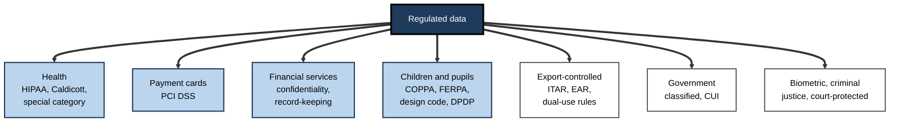
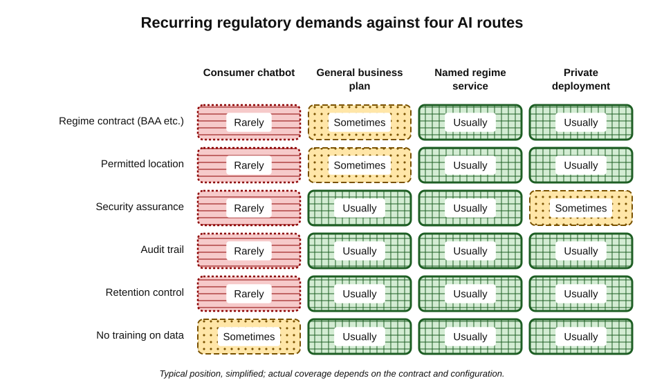
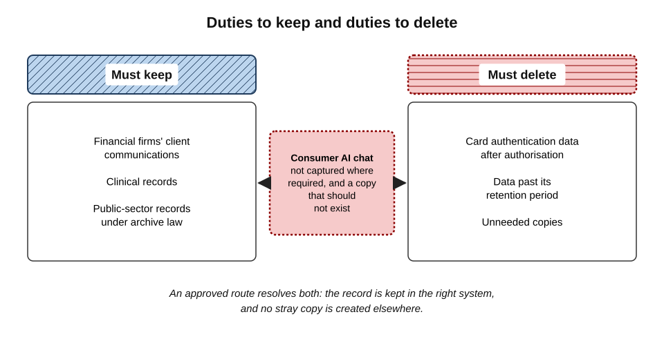
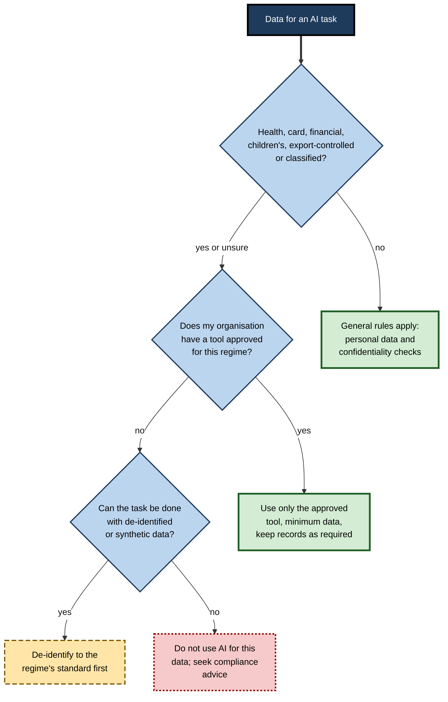
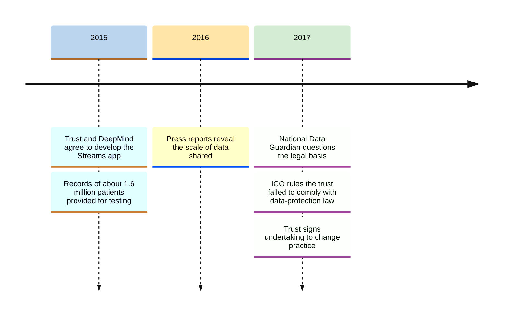
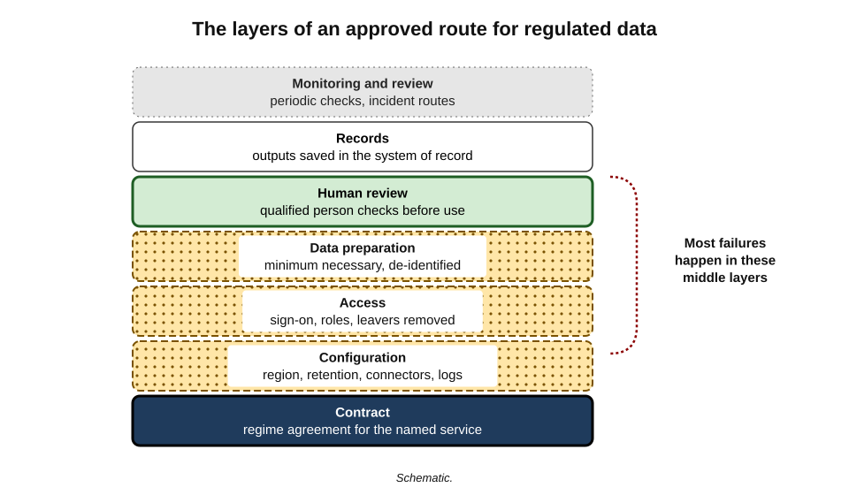

# J.5. Regulated data and AI tools

A physiotherapist dictates treatment notes into a free transcription app. A payments clerk pastes a customer's card number into a chatbot to work out why a refund failed. An engineer at an aerospace supplier uploads a technical drawing to ask about tolerances. Each is trying to save a few minutes. Each has moved data that specific laws say may be handled only in particular ways, by particular parties, in particular places.

> **Definition — Regulated data:** information whose collection, use, storage, transfer or disclosure is governed by specific laws or binding industry standards, beyond the general rules that apply to all personal or confidential information.

**Why it matters**

- **The rules are specific and strict.** General good sense is not enough; regimes set exact requirements for contracts, locations, security and records.
- **Penalties are severe.** Regulated sectors face fines, licence conditions, criminal liability and loss of the right to operate.
- **AI tools often fall outside the approved perimeter.** A consumer chatbot has no contract with the regulated organisation and no certification for the data.
- **Several regimes can apply at once.** One support ticket can contain health data, card data and a child's details.

---

## The Main Families of Regulated Data

### Health information

- **United States — HIPAA**
  - The Health Insurance Portability and Accountability Act protects **protected health information (PHI)** held by **covered entities** (health plans, most healthcare providers, clearing houses) and their **business associates**.
  - A vendor that creates, receives, stores or transmits PHI on a covered entity's behalf is a business associate and must sign a **business associate agreement (BAA)**.
  - Entering PHI into an AI tool without a BAA in place is, in general, an impermissible disclosure.
- **United Kingdom — health and care**
  - Health data is special category data under the UK GDPR.
  - The common-law duty of confidentiality applies to patient information.
  - The **Caldicott Principles** — eight principles for handling patient-identifiable information, the eighth added in 2020 — guide NHS and social-care organisations, starting with "justify the purpose" and "use the minimum necessary".
- **European Union** — health data is special category data; the European Health Data Space Regulation adds rules for secondary use.
- **India** — health data falls under the Digital Personal Data Protection Act 2023, alongside sector guidance.

> **Definition — Protected health information (PHI):** under HIPAA, individually identifiable health information held or transmitted by a covered entity or business associate, in any form.

> **Definition — Business associate agreement (BAA):** a contract required by HIPAA in which a vendor handling PHI agrees to safeguard it and to use it only as permitted.

### Payment card data

- **PCI DSS** — the Payment Card Industry Data Security Standard, set by the major card brands and enforced through contracts with banks and payment processors.
  - The current major version, 4.0, was published in 2022.
- **Key rules relevant to AI tools:**
  - the **primary account number (PAN)** must be protected wherever it is stored, processed or transmitted;
  - **sensitive authentication data** — the full magnetic-stripe data, the card verification code and PINs — must not be stored after authorisation;
  - any system that touches card data is **in scope** for the standard's controls.
- **Consequence:** pasting a card number into an AI tool brings that tool into PCI scope — and a consumer chatbot cannot meet the standard's requirements on the merchant's behalf.

### Financial services

- **Customer confidentiality** — banking secrecy and duties of confidence to customers.
- **Record-keeping** — regulators require firms to keep business communications.
  - US securities regulators have fined many firms heavily since 2021 for staff conducting business over unapproved messaging apps ("off-channel communications").
  - The same logic can apply to AI tools used for client-related work: the conversation may be a **business record** that must be captured and kept.
- **Model risk and fair treatment** — rules on automated credit decisions, explainability and consumer outcomes.
- **US** — the Gramm–Leach–Bliley Act protects customers' non-public personal financial information.

### Children's and education data

- **United States** — COPPA governs online collection of personal information from children under 13; FERPA protects student education records.
- **United Kingdom** — the **Age Appropriate Design Code** (in force from 2021) sets standards for online services likely to be accessed by children.
- **India** — the DPDP Act 2023 requires **verifiable parental consent** to process the personal data of anyone under 18.

### Export-controlled technical data

- **Rules** — US International Traffic in Arms Regulations (ITAR) and Export Administration Regulations (EAR); the UK Export Control Order 2008; the EU dual-use regulation.
- **Why AI matters** — sending controlled technical data to a cloud service whose servers or staff are in another country can amount to an **export**.
  - Since 2016 the EAR has recognised that sending data secured with **end-to-end encryption** to cloud storage abroad is not, by itself, an export.
  - AI processing cannot rely on that carve-out in the ordinary way, because the provider must **decrypt** the data to work on it.

### Government and public-sector information

- **Classification schemes** — the UK Government Security Classifications (OFFICIAL, SECRET, TOP SECRET); US classified information and **controlled unclassified information (CUI)**.
- **Rule of thumb** — public bodies publish AI guidance specifying which classification levels may be used with which tools; above the permitted level, no external tool may be used.

### Other regimes

- **Biometric data** — Illinois' Biometric Information Privacy Act (2008) requires written consent before collecting biometric identifiers such as face geometry or voiceprints, and allows individuals to sue.
- **Criminal justice information** — US law-enforcement data is governed by the FBI's CJIS Security Policy.
- **Court-protected material** — sealed records and documents under protective orders.
- **Legal-aid, social-care and immigration records** — often subject to statutory confidentiality.

**Figure 1.** The main families of regulated data a professional may meet.

### Regimes compared

| Regime | Data covered | What an AI tool would need | Usual verdict for a consumer tool |
|---|---|---|---|
| HIPAA | Protected health information | Business associate agreement; safeguards | Not permitted |
| PCI DSS | Card numbers, authentication data | Inclusion in the compliant environment | Not permitted |
| Financial record-keeping | Business communications | Capture and retention of conversations | Usually not permitted |
| COPPA / children's codes | Children's personal data | Parental consent, child-appropriate design | Not permitted for children's data |
| ITAR / EAR | Controlled technical data | Authorisation; location and staff nationality controls | Not permitted |
| Government classification | Classified or controlled information | Accreditation at the right level | Not permitted above the lowest tiers |

---

## Why AI Tools Strain Regulatory Requirements

Regulated regimes share a small number of recurring demands. AI tools can fail each of them.

### Recurring demands

- **A contract with the right terms** — BAA, data-processing agreement, PCI responsibility matrix, outsourcing agreement.
- **Location** — data stored and processed only in permitted countries; staff access only from permitted locations.
- **Security assurance** — certifications and audits for the specific service used.
- **Access control and audit trails** — who saw what, and when.
- **Retention rules** — sometimes **must keep** (financial records), sometimes **must delete** (card authentication data), sometimes both for different parts.
- **Accuracy and safety** — especially for clinical, credit and legal decisions.
- **Transparency to the people concerned** — patients, customers, pupils.

**Figure 2.** How the recurring demands of regulated regimes compare across common kinds of AI route.

### Location and transfer

> **Definition — Data residency:** a requirement that data be stored, and sometimes processed, within a particular country or region.

> **Definition — International transfer:** moving personal data to, or making it accessible from, a country outside the jurisdiction whose law protects it.

- **Europe** — the GDPR restricts transfers outside the European Economic Area unless the destination is deemed adequate or appropriate safeguards are in place.
  - In July 2020 the Court of Justice of the European Union invalidated the EU–US Privacy Shield in the *Schrems II* judgment; a replacement, the **EU–US Data Privacy Framework**, received an adequacy decision in July 2023.
- **India** — the Reserve Bank of India's 2018 direction requires payment-system data to be stored only in India; the DPDP Act permits transfers except to countries the government restricts.
- **Elsewhere** — China, Russia and others impose localisation rules for certain data.
- **AI relevance** — a request may be processed in a data centre in another region, with abuse-monitoring staff in a third; business plans increasingly offer **regional processing** to address this.

### Records that must be kept and data that must be deleted

- **Must keep** — financial firms' client communications; clinical records; public-sector records subject to archive law.
- **Must delete** — card authentication data after authorisation; data beyond its retention period.
- **The AI conflict** — a consumer chat may be both a record that should have been captured (but was not) and a copy of sensitive data that should not exist (but does).

**Figure 3.** The tension between duties to keep records and duties to delete regulated data.

> **Key point:** for regulated data, a conversation in an unapproved AI tool is often wrong **twice** — a copy in the wrong place, and a record outside the system that should hold it.

### AI-specific regulation

- **EU Artificial Intelligence Act (2024)** — classifies certain uses as **high-risk** — including AI used in employment decisions, creditworthiness assessment, access to education and essential public services — and imposes duties on providers and deployers, such as risk management, data governance, human oversight and logging.
  - Obligations apply in phases from 2025; the timetable for some high-risk obligations has been the subject of proposed amendments.
- **Sector regulators** — health, financial and data-protection regulators have issued guidance applying existing rules to AI.

> **Watch out:** the AI Act regulates **systems and uses**, not data categories. A general chatbot used once to draft an email is not a high-risk system; the same model built into a tool that ranks job applicants may be.

---

## Deciding Whether Data Is Regulated

**Figure 4.** Questions that identify regulated data before it reaches an AI tool.

> **Remember:** "unsure" counts as "yes". Regulated status is decided by the **data**, not by how routine the task feels.

---

## Safer Patterns for Regulated Work

### Approved and specialised routes

- **Services with the right contract** — several major cloud and AI providers offer specific services covered by BAAs, or certified for particular government security levels; coverage applies only to the named services and configurations.
- **Private deployment** — models run inside the organisation's own cloud tenancy or data centre, with no data leaving its control.
- **Sector-specific tools** — clinical documentation assistants, compliance-recorded financial assistants, built and contracted for the regime.

### De-identification to a recognised standard

- **HIPAA Safe Harbor** — removal of eighteen specified identifiers (names, small geographic units, dates other than year, contact numbers, record numbers and others) with no actual knowledge that the rest could identify the person.
- **HIPAA Expert Determination** — a qualified expert certifies that the risk of re-identification is very small.
- **UK and EU** — anonymisation must make identification not reasonably likely; pseudonymised data remains personal data.

> **Definition — De-identification:** removing or transforming identifiers so that data no longer identifies individuals, to the standard set by the applicable regime.

### Tokenisation and masking

- **Tokenisation** — replacing card numbers or account numbers with tokens that are useless outside the payment system.
- **Masking** — showing only the last four digits, as receipts do.
- **Synthetic data** — invented records with realistic structure for developing and testing prompts.

| Approach | Strength | Limitation |
|---|---|---|
| Approved tool under the regime's contract | Data can be used as needed | Limited to named services; requires configuration |
| Private deployment | Full control of data | Cost, expertise, sometimes weaker models |
| De-identification to standard | Data leaves the regime | Hard to do well on free text; residual risk |
| Tokenisation and masking | Removes the most sensitive fields | Context may still be regulated |
| Synthetic data | No real people involved | Answers about real cases still need real data |

---

## Study Card — Dutch Data Protection Authority Warning (August 2024)

- **Source:** the Autoriteit Persoonsgegevens (AP), the Dutch data-protection regulator.
- **What it reported:** it had received **notifications of personal data breaches** caused by employees entering personal data of patients or customers into AI chatbots.
  - In one, an employee of a **general practice** had entered patients' medical data into a chatbot, contrary to agreements with the employer.
  - In another, an employee of a telecommunications company had entered a file including customers' addresses.
- **Its reasoning:**
  - employees often used chatbots on their own initiative, against workplace agreements;
  - most chatbot companies store the data entered, so it ends up on their servers, often without the employee realising, and without knowing what the company will do with it;
  - entering personal data in that way is, in principle, a **data breach** that may need to be reported.
- **Advice to organisations:** agree clearly with staff whether and how AI chatbots may be used, and make arrangements with providers where use is allowed.
- **Significance:** a regulator treating unapproved chatbot use with medical data as a **breach**, not a policy lapse.

---

## Case Study: The Royal Free and DeepMind (2015–2017)

- **Situation:** in 2015 the Royal Free London NHS Foundation Trust agreed with Google's AI company DeepMind to develop and test **Streams**, an app to alert clinicians to signs of acute kidney injury.
- **Data shared:** identifiable records of about **1.6 million patients**, covering several years and many patients with no kidney condition, were provided for the testing phase.
- **Concerns raised:**
  - patients were not told their records were being used in this way;
  - the volume of data appeared disproportionate to testing a kidney alert;
  - the arrangement relied on "direct care" as its basis, though the app was not yet in clinical use.
- **Regulatory findings:**
  - the National Data Guardian advised that direct care was an inappropriate basis for the testing phase;
  - in **July 2017** the Information Commissioner's Office ruled that the trust had **failed to comply with data-protection law**, finding shortcomings in transparency, proportionality and the legal basis;
  - the trust signed an undertaking to change its practices, including carrying out a privacy impact assessment and commissioning an audit.
- **Result:** Streams went on to be used clinically, but the episode became a landmark in debates on health data and AI.
- **Lesson:**
  - good clinical intentions do not supply a legal basis;
  - "testing" an AI tool with real regulated data is processing, with all its duties;
  - **proportionality** — using far more data than the purpose requires — is itself a failing;
  - patients' **reasonable expectations** matter as much as the technical legality.

**Figure 5.** Key events in the Royal Free and DeepMind case.

---

## Worked Example (illustrative): Mapping a Support Export

**Situation:** a customer-service lead at a telehealth company operating in the UK and the US wants to upload last month's support tickets to an AI assistant to find the commonest complaints. The company has an enterprise assistant approved for "internal and confidential" data, but not for health or card data.

**Step 1 — sample the export and list what it contains**

| Field or content found | Regime engaged | Can it be removed without losing the analysis? |
|---|---|---|
| Patient names, emails, phone numbers | Data protection; HIPAA for US patients | Yes |
| Free-text mentions of symptoms and medication | Health data; HIPAA PHI | Partly — needed only as broad categories |
| Card numbers typed by customers into tickets | PCI DSS | Yes — must not be there at all |
| Messages from parents about children's appointments | Children's data rules | Yes |
| Complaint category, date, resolution time | None once de-identified | Keep |

*Illustrative scenario.*

**Step 2 — decide**

1. **The raw export is regulated** — health data, card data and children's data — so the approved tool cannot take it as it stands.
2. **The analysis needs only categories**, not identities or clinical detail.
3. **Prepare a de-identified extract** in the company's controlled environment: remove identifiers, replace free text with category codes, delete card numbers, drop children's tickets or reduce them to categories.
4. **Report the card numbers** found in tickets to the payments compliance team: their presence is itself a PCI issue.
5. **Use the approved assistant** on the de-identified extract.

- **Conclusion:** the AI task is legitimate; the **raw data** was not suitable. The preparation also uncovered a separate compliance problem.

> **Watch out:** de-identifying free text is far harder than deleting columns. Symptoms, dates and places in a sentence can identify a patient; automated tools miss some. Where free text matters, regulated organisations use approved tools rather than relying on redaction alone.

---

## What an Approved Route Is Made Of

An "approved" AI tool for regulated data is not a single decision but a stack of safeguards, each of which must hold.

**Figure 6.** The layers that together make an AI route acceptable for regulated data.

- **Contract** — the regime's required agreement (BAA, data-processing agreement, outsourcing terms) for the specific service, with no training on customer data and defined retention.
- **Configuration** — regional processing switched on, retention set, connectors and sharing restricted, logging enabled.
  - A contract can cover a service that is then configured unsafely; both layers are needed.
- **Access** — single sign-on, role-based permissions, and removal of access when people leave or change role.
- **Data preparation** — rules on what may enter the tool: minimum necessary, de-identification where possible, no card authentication data ever.
- **Human review** — a qualified person checks outputs before they enter a clinical record, a credit decision, a regulatory filing or a client communication.
- **Records** — outputs that are business or clinical records are saved in the system of record; logs are kept for audit.
- **Monitoring and review** — periodic checks that the configuration, contract and use still match; incident routes defined.

> **Key point:** most failures in approved routes happen in the **middle** layers — a correct contract, but memory left on, a connector to an unrestricted drive, or outputs pasted into the record without review.

### Everyday roles that meet regulated data

- **Human resources** — occupational-health notes, disability adjustments, criminal-record checks.
- **Customer service** — card numbers typed into chats, medical details in insurance claims.
- **Sales and marketing** — children's data in consumer promotions; biometric data in some apps.
- **Engineering** — export-controlled drawings and source code in defence and aerospace supply chains.
- **Education** — pupil records, special educational needs, safeguarding notes.
- **Public services** — benefit claims, immigration files, classified or controlled material.

> **Example (illustrative):** an HR adviser asks a general assistant to "draft a reasonable-adjustments letter for an employee with multiple sclerosis who works in our Bristol warehouse". The diagnosis makes the prompt special category data; the location and role may identify the employee. A template request without the diagnosis — "an employee with a long-term health condition affecting mobility" — serves the same purpose.

---

## Professional Mastery

### Habits of practitioners in regulated sectors

- **Know the regimes that touch your work** — a nurse knows health rules; a payments analyst knows PCI; an engineer knows whether drawings are controlled.
- **Treat unsure as yes.**
- **Use only the named service.** A BAA or certification covers specific services and configurations, not everything a provider sells.
- **Keep the record where the regime requires.** If client communications must be captured, AI-assisted drafts belong in the captured system.
- **Never "just test" with real data.**
- **Report stray data.** Card numbers in tickets or patient names in a shared drive are problems in their own right.

### Organisational practice

- **Regime-to-tool mapping** — a register showing which AI tools are approved for which regulated data, with the contract that covers each.
- **Impact assessments** — data protection impact assessments for AI uses involving special category or regulated data; AI-specific impact assessments where required.
- **Vendor due diligence** — certifications, audit reports, sub-processor locations, staff access locations, incident terms.
- **Technical controls** — data-loss prevention tuned to card numbers, patient identifiers and export-control markings; blocking of unapproved AI services on managed devices.
- **Training by role** — short, specific examples for each regulated group.

> **In practice:** healthcare organisations that allow AI documentation tools typically insist on a contract covering the regime, processing in a permitted region, no training on patient data, configurable retention, audit logs, and a clinician's review of every generated note before it enters the record.

---

## Open Questions

- **Will regimes written before generative AI adapt clearly?**
  - Many rules assume identifiable systems and records; conversational tools that summarise, infer and act blur those categories.
- **Can AI outputs themselves be regulated data?**
  - A summary that infers a diagnosis from symptoms creates health data; how regimes treat inferred regulated data is still developing.
- **How should export controls apply to AI models trained on controlled data?**
  - Whether a model's weights can embody controlled technical data is debated.
- **Can private and confidential-computing deployments satisfy strict regimes at scale?**
  - Assurance frameworks for these architectures are still maturing.
- **Will the AI Act's high-risk regime and sector rules fit together?**
  - Overlaps with medical-device, financial and employment rules are being worked out.

---

## Summary

- **Regulated data** is governed by specific laws or standards beyond general data-protection and confidentiality rules.
- Main families: **health** (HIPAA, Caldicott, special category), **payment cards** (PCI DSS), **financial services** (confidentiality, record-keeping), **children and pupils** (COPPA, FERPA, the Age Appropriate Design Code, DPDP parental consent), **export-controlled** technical data (ITAR, EAR), **government** information, plus biometric, criminal-justice and court-protected material.
- Recurring demands: **the right contract, location, security assurance, access control, retention rules, accuracy and transparency**; unapproved AI tools fail most of them.
- **Residency and transfer** rules — Schrems II, the EU–US Data Privacy Framework, India's payment-data localisation — make processing location a compliance question.
- Regulated data in an unapproved tool is often wrong **twice**: a copy in the wrong place, and a record missing from the right one.
- The **EU AI Act** regulates high-risk **uses**, such as employment and credit decisions, alongside sector rules.
- Safer patterns: **approved services under the regime's contract, private deployment, de-identification to a recognised standard, tokenisation and masking, synthetic data**.
- The **Dutch regulator (2024)** treated GP-practice staff entering patient data into a chatbot as a data breach; the **Royal Free–DeepMind** case (ICO, 2017) showed that good intentions do not replace a lawful basis, transparency and proportionality.
- Practitioners **know their regimes, treat unsure as yes, use only named services, keep records properly, never test with real data, and report stray data**.

---

## Self-Check

1. Define regulated data and explain how it differs from ordinary personal data.
2. What is a business associate agreement, and why does it matter for AI tools in US healthcare?
3. Why does pasting a card number into an AI tool raise a PCI DSS problem?
4. How can financial record-keeping rules apply to AI conversations?
5. Why can uploading a controlled technical drawing to a cloud AI service be an export, even when encrypted cloud storage might not be?
6. What did Schrems II decide, and what replaced the invalidated framework?
7. Explain why regulated data in an unapproved AI tool is often "wrong twice".
8. Distinguish HIPAA Safe Harbor from Expert Determination.
9. What did the Dutch regulator report in August 2024, and how did it characterise the incidents?
10. Summarise the ICO's findings in the Royal Free–DeepMind case and its lessons for AI projects.
11. Why does the EU AI Act regulate uses rather than data categories? Give one high-risk example.
12. A clinic manager wants to upload a month of patient feedback forms, some mentioning diagnoses and some written by parents, to the clinic's general-purpose AI assistant. Advise them.

### Answer Key

1. Information governed by specific laws or binding standards on its handling — beyond general data-protection and confidentiality rules — such as health, card, financial, children's, export-controlled or classified data.
2. A HIPAA contract in which a vendor handling PHI for a covered entity agrees to safeguard and limit its use. Without one, sending PHI to an AI vendor is generally an impermissible disclosure.
3. Any system that stores, processes or transmits card data falls within the standard's scope and must meet its controls; a consumer AI tool cannot, and authentication data must never be stored after authorisation.
4. Regulators require firms to capture and keep business communications; an AI conversation used for client work may be such a record, and using an uncaptured tool can breach the rules, as in the off-channel messaging cases.
5. Export rules can treat making controlled data accessible abroad as an export. The EAR carve-out relies on end-to-end encryption, but AI processing requires the provider to decrypt the data.
6. In July 2020 the Court of Justice invalidated the EU–US Privacy Shield; the EU–US Data Privacy Framework received an adequacy decision in July 2023.
7. It creates a copy of regulated data in a place it should not be, and the interaction may also be a record that the regime required to be kept in an approved system.
8. Safe Harbor removes eighteen specified identifiers with no actual knowledge that remaining data identifies anyone; Expert Determination relies on a qualified expert certifying that re-identification risk is very small.
9. Notifications of data breaches caused by staff entering patient or customer data into AI chatbots, including a GP-practice employee entering medical data against workplace agreements; it treated such entry as, in principle, a personal data breach.
10. The trust failed to comply with data-protection law: patients were not adequately informed, the data shared for testing was disproportionate, and the legal basis was inappropriate. Lessons: testing is processing; intentions do not supply a legal basis; use only proportionate data; respect patients' expectations.
11. Because the same model can be harmless or harmful depending on what it is used for; risk lies in the decision. Example: AI used to screen job applicants or assess creditworthiness.
12. The forms contain health data and children's data, so the general assistant is not suitable unless specifically approved for them. Options: use a tool approved for patient data; or de-identify within the clinic's systems — remove names, convert diagnoses to broad categories, exclude or reduce children's forms — then analyse; check the clinic's governance first.

---

## Glossary

| Term | Meaning |
|---|---|
| Business associate | Under HIPAA, a vendor that handles PHI on a covered entity's behalf. |
| Business associate agreement | The HIPAA contract a business associate must sign. |
| Caldicott Principles | Eight UK principles for handling patient-identifiable information. |
| Controlled unclassified information | US government information requiring safeguarding though not classified. |
| Covered entity | Under HIPAA, a health plan, clearing house or provider subject to the rules. |
| Data residency | A requirement to store and process data in a particular place. |
| De-identification | Removing or transforming identifiers to a regime's standard. |
| Export-controlled data | Technical data whose transfer abroad requires authorisation. |
| High-risk AI system | Under the EU AI Act, an AI system used in specified sensitive areas, subject to strict duties. |
| International transfer | Moving personal data outside the protecting jurisdiction. |
| Off-channel communications | Business messages sent through unapproved, unrecorded channels. |
| PCI DSS | The card industry's data security standard. |
| Primary account number | The main number on a payment card. |
| Protected health information | Identifiable health information covered by HIPAA. |
| Regulated data | Data governed by specific laws or standards beyond general rules. |
| Safe Harbor (HIPAA) | De-identification by removing eighteen specified identifiers. |
| Sensitive authentication data | Card data such as verification codes and PINs that must not be stored after authorisation. |
| Tokenisation | Replacing sensitive values with substitutes useless outside the issuing system. |
