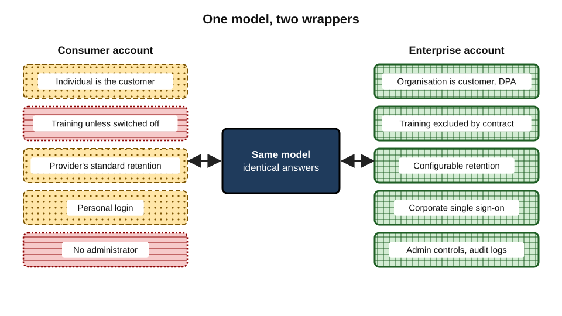
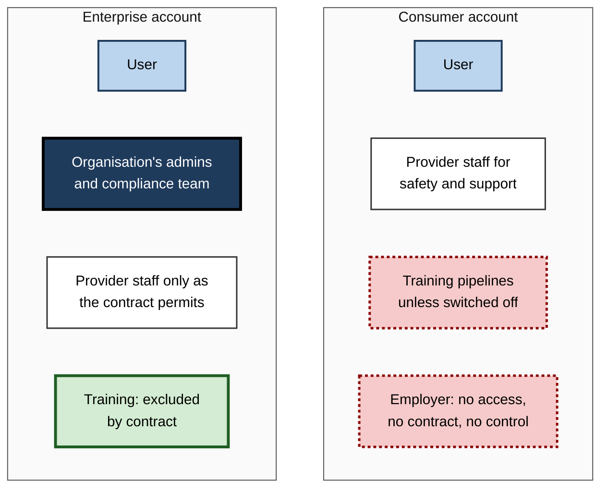
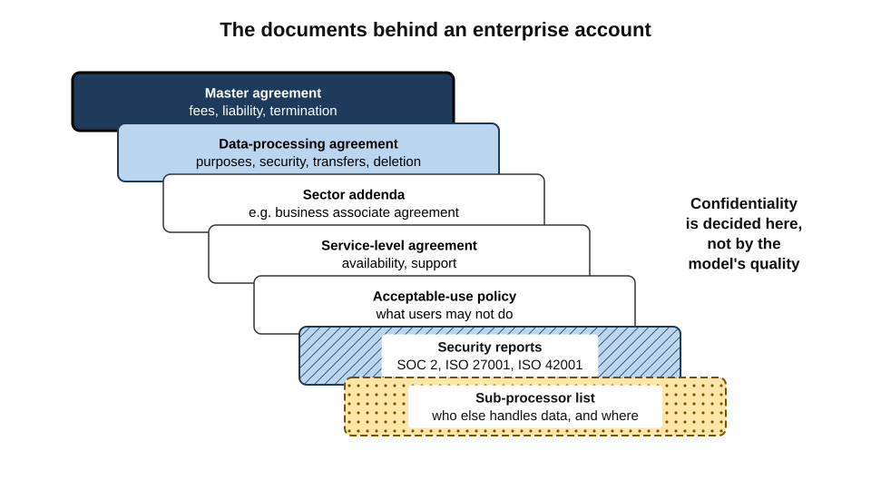
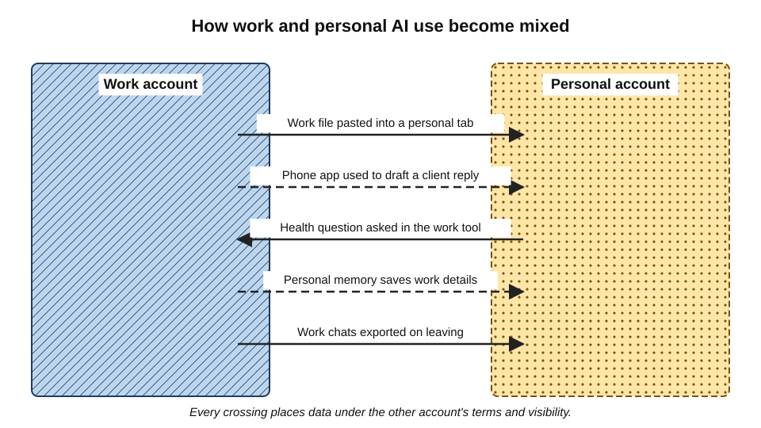
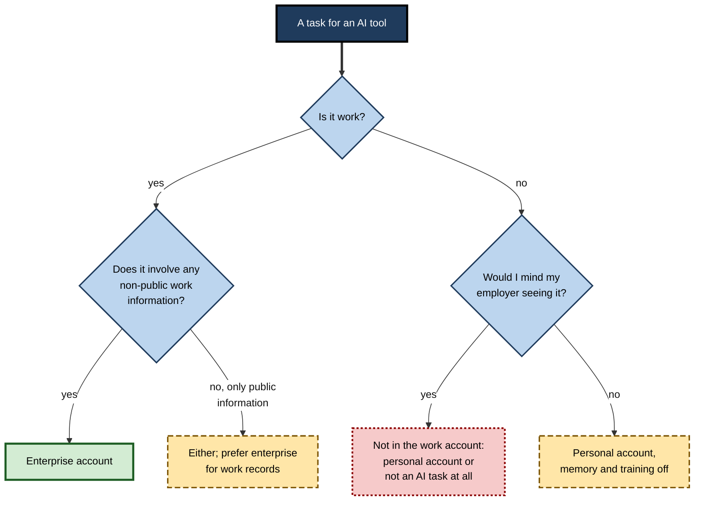
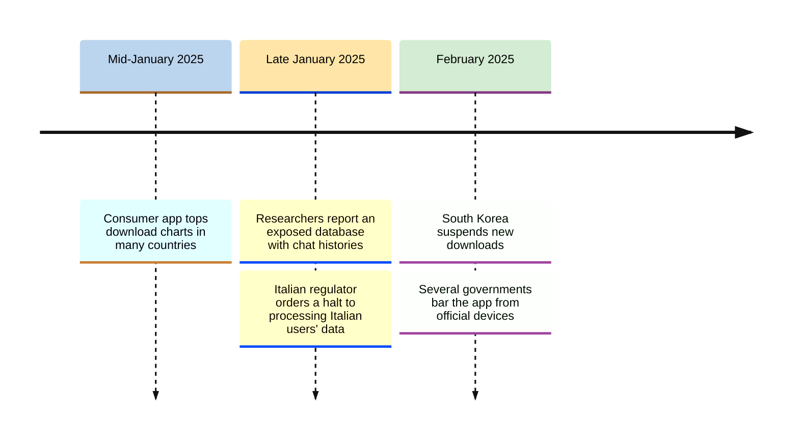

# J.6. Enterprise versus consumer accounts

Two analysts at the same bank ask the same AI model to summarise the same market report. One uses the bank's enterprise workspace, signed in through the corporate login. The other uses a personal account on her phone because it is quicker. The answers are word for word alike. The two conversations, however, live under different contracts, in different places, with different people able to read them — and only one of them is the bank's.

> **Definition — Consumer account:** an account an individual opens for themselves under the provider's standard terms, in which the individual is the customer and decides the settings.

> **Definition — Enterprise account:** an account provided by an organisation under a negotiated or business contract, in which the organisation is the customer, controls the settings and is responsible for the data.

**Why it matters**

- **The model is often identical; the protections are not.** Training, retention, access, location and legal responsibility differ by account type.
- **The account decides who is accountable.** In a consumer account the individual bears the risk; in an enterprise account the organisation does, under a contract designed for that purpose.
- **The account decides who can look.** Enterprise accounts protect the organisation's data from the provider — and give the organisation visibility of the employee's use.
- **Mixing accounts is the commonest everyday error.** Work content drifts into personal accounts, and personal life into work accounts.

---

## Same Model, Different Wrapper

The products that people call "the same AI" are usually one model wrapped in several commercial offerings.

### The usual tiers

- **Free consumer** — the public app, often with usage limits and the most permissive data terms.
- **Paid individual** — more capacity and features; data terms usually the same as free.
- **Team or business** — small-organisation plans with business terms and an administrator.
- **Enterprise** — large-organisation contracts with full administrative, security and compliance controls.
- **Developer access (API)** — the model accessed by software; business terms, used to build internal tools.
- **Third-party wrappers** — other companies' products built on the model, under their own terms.

**Figure 1.** One model, several wrappers: what changes between consumer and enterprise access.

> **Key point:** asking "is this AI tool safe?" without naming the **account type** is like asking whether a building is secure without saying whether the door is locked.

### What usually differs

| Feature | Consumer account | Enterprise account |
|---|---|---|
| Customer and contracting party | The individual | The organisation |
| Use of content for training | Often allowed unless switched off | Excluded by contract |
| Retention | Provider's standard policy | Configurable, sometimes zero |
| Data-processing agreement | None | Provided; provider acts as processor |
| Sign-in | Personal email or social login | Corporate single sign-on |
| Administrator controls | None | Settings locked centrally; features enabled or disabled |
| Audit logs and export | None for anyone but the user | Available to the organisation |
| Data residency options | Rare | Often available |
| Security certifications | General | Specific to the enterprise service, with audit reports |
| Breach notification | Public statements, regulator notices | Contractual notice to the customer |
| Legal protections | Standard consumer terms | Negotiated liability, sometimes indemnities |

### Internal tools built on developer access

- **What they are** — many organisations build their own chat interface, often branded with the company name, which sends requests to a model through developer access.
- **Strengths**
  - developer terms at major providers exclude training by default;
  - the organisation controls the interface, logging, retention and which data sources the tool can reach;
  - some providers offer **zero data retention** for eligible developer customers, keeping prompts only for the moment of processing.
- **Weaknesses**
  - the organisation becomes responsible for security the provider would otherwise handle — authentication, storage of conversation history, access control;
  - abuse-monitoring retention may still apply unless specifically waived;
  - home-built tools can lag behind the provider's own products in features, pushing staff back to consumer apps.
- **Variants** — models hosted by large cloud platforms inside the customer's cloud account, under the cloud platform's terms rather than the model developer's.

> **Example (illustrative):** a law firm deploys "Firm Assistant", an internal chat tool calling a frontier model through a cloud platform in its own region. Conversations are stored in the firm's document system under matter numbers; the model provider never stores them. The same model in the consumer app would have been governed by entirely different terms.

> **Watch out:** "paid" does not mean "business". Many individual paid plans carry exactly the same data terms as the free plan; the difference is capacity and features, not confidentiality.

---

## Who Is the Customer, and What Follows

### Roles in the two models

- **Consumer account**
  - The provider is generally the **controller** of the account data — it decides how conversations are used, within the law and its terms.
  - The individual accepts the provider's terms and chooses settings.
  - If the individual pastes an employer's data, the employer has **no contract** with the provider.
- **Enterprise account**
  - The organisation is the **controller**; the provider usually acts as **processor** for conversation content.
  - The provider may still be controller for limited purposes, such as billing and abuse prevention.
  - The employee is a **user**, bound by the employer's policies.

### Who can see what

**Figure 2.** Who may have access to a conversation under each account type.

- **The trade-off for the employee:** an enterprise account protects the **organisation's** data well, but the employee should expect that conversations can be retained, exported and reviewed by the employer for compliance, investigations and legal holds.
- **The trade-off for the organisation:** a consumer account used for work gives the organisation **no** visibility, no deletion control and no contractual protection.

> **In practice:** many organisations state plainly in their AI policy that enterprise conversations are business records that may be monitored, in the same way as work email. Employees who would not want a manager to read a question should not ask it in a work account.

---

## The Contract Behind an Enterprise Account

### The documents

- **Master or customer agreement** — the main commercial terms: service description, fees, liability, termination.
- **Data-processing agreement (DPA)** — how the provider processes personal data as processor: purposes, security, sub-processors, international transfers, assistance with data-subject requests, breach notification, deletion at the end of the contract.
- **Sector addenda** — for example a business associate agreement for US health data.
- **Service-level agreement** — availability and support commitments.
- **Acceptable-use policy** — what users may not do.
- **Security documentation** — certifications (such as SOC 2 reports and ISO/IEC 27001 certificates), penetration-test summaries, and, increasingly, AI management certification (ISO/IEC 42001, published in 2023).
- **Sub-processor list** — the companies the provider uses, with locations and a process for notifying changes.

**Figure 3.** The documents that together define an enterprise account's protections.

> **Definition — SOC 2 report:** an independent auditor's report on a service organisation's controls relating to security, availability, processing integrity, confidentiality and privacy.

> **Definition — Single sign-on (SSO):** signing in to many services through one organisational identity, so that access is controlled — and removed — centrally.

### Clauses that matter most for confidentiality

- **No training on customer content** — stated as a contractual commitment, not a setting.
- **Ownership** — the customer owns its inputs and outputs.
- **Retention** — default periods and the customer's ability to shorten them.
- **Human access** — when provider staff may access content, and with what approval and logging.
- **Location** — where data is stored and processed, and where support staff are.
- **Breach notice** — how quickly the customer is told of an incident affecting its data.
- **Deletion on exit** — what happens to data when the contract ends.

---

## Identity: the Hidden Half of Account Type

Account type is decided not only by the plan purchased but by **how people sign in**.

- **Corporate SSO** — the employee signs in with the organisation's identity; leaving the organisation removes access automatically.
- **Automated provisioning** — accounts are created and removed as people join and leave, often through a standard known as SCIM.
- **Personal email sign-up** — the account belongs to the individual, even if used for work.
- **Work email, personal plan** — a dangerous middle: an employee signs up for a consumer plan using a work email address. The account looks corporate but is legally personal.
  - Some providers offer **domain verification**, letting an organisation discover or take over accounts created with its email domain.
- **Shared logins** — one account used by several people; no individual accountability and no meaningful audit.

> **Watch out:** an employee who signs up to a consumer plan with a work email address may believe they are "using the company account". Unless the organisation has a business contract and the account sits within it, the conversations are under consumer terms.

---

## Mixing Accounts

### How work and personal accounts become entangled

- **One browser, two accounts** — a personal account left signed in on a work laptop; work material pasted into the wrong tab.
- **Phone apps** — the personal app is always to hand; the work tool needs a VPN or device enrolment.
- **Copy and paste across** — drafting in the enterprise tool, then "polishing" in a personal one.
- **Personal matters in work accounts** — health questions, job searches or family issues asked in the work tool, now visible to the employer's administrators and kept under its retention rules.
- **Memory carrying context** — a personal account with memory may store work details permanently.

**Figure 4.** Common paths by which work and personal AI use become mixed.

### Bringing one's own AI to work

> **Definition — Bring your own AI (BYOAI):** employees using AI tools they have chosen and often pay for themselves to do their work, outside the organisation's approved tools.

- **Scale:** a 2024 survey of knowledge workers across many countries, published by Microsoft and LinkedIn, reported that about three-quarters of those using generative AI at work were bringing their own tools rather than using ones provided by their employer.
- **Why it happens** — approved tools are missing, slower, less capable or unknown; personal tools are already familiar.
- **Why it matters** — every such use is, by definition, a consumer account processing work data.

> **Watch out:** survey figures on AI use at work vary widely with the sample, the wording and the year. The direction of the finding — widespread personal use of AI for work — is consistent across surveys; precise percentages are not.

### Keeping accounts apart

- **Separate browser profiles** — one for work (signed in to the enterprise tool only), one for personal use.
- **Managed work devices** — personal AI accounts not signed in on them at all.
- **Distinct appearance** — many tools allow a workspace name or colour; making the work account visibly different reduces wrong-tab errors.
- **No personal memory of work** — switch memory off in personal accounts, or keep them free of work topics entirely.
- **Clean departure** — on leaving a job, do not export work conversations to personal storage.

---

## Choosing Which Account to Use

**Figure 5.** Deciding which account a task belongs in.

> **Remember:** **work data → work account; personal life → personal account; nothing private in either that a stranger must never read.**

---

## The Account Lifecycle

Accounts are created, used, changed and closed; confidentiality can fail at each stage.

- **Joining**
  - The new employee receives an enterprise seat through provisioning, with settings already locked.
  - Without this, new joiners fill the gap with personal accounts in their first week.
- **Changing role**
  - Access to shared projects, custom assistants and connected sources should follow the new role; old access lingering is a common oversight.
- **Leaving**
  - The enterprise account is suspended; conversations remain the employer's records, subject to its retention schedule.
  - Personal accounts used for work during employment are invisible to this process — the reason they are so hard to clean up.
- **Contract end**
  - The DPA should require the provider to return or delete customer data within a stated period, and to certify deletion on request.
- **Mergers and divestments**
  - When a business unit is sold, its AI workspaces, histories and custom assistants must be separated like any other records.

> **Key point:** the most valuable feature of an enterprise account is often not a security control but **lifecycle control** — the ability to switch off a person's access, and keep their work records, on the day they leave.

---

## Evaluating an Enterprise Offer

Procurement and security teams examine an enterprise AI offer in more depth than any individual can. The questions they ask show what "enterprise grade" should mean.

### Questions to put to a provider

- **Training** — is customer content excluded from training and evaluation by contract, including feedback and connected data?
- **Retention** — what are the default periods for conversations, files and logs, and can the customer set zero or shorter periods?
- **Human access** — under what circumstances can provider staff see content, with what approval, and is it logged?
- **Location** — in which regions is data stored and processed, including for abuse monitoring and support?
- **Sub-processors** — who are they, where are they, and how is the customer notified of changes?
- **Security evidence** — which certifications and audit reports cover **this** service, and how recent are they?
- **Administration** — can training, memory, sharing, connectors and third-party apps be controlled centrally?
- **Audit** — can the customer export conversation logs and administrative events for investigations and legal holds?
- **Incidents** — how quickly will the customer be notified of a breach, and what information will be provided?
- **Exit** — how is data returned or deleted at the end of the contract?

> **Mnemonic — "TRH-LS-SAAIE":** Training, Retention, Human access, Location, Sub-processors, Security evidence, Administration, Audit, Incidents, Exit.

> **Watch out:** certification reports describe the scope audited. A provider's ISO 27001 certificate may cover its cloud platform but not a newly launched AI feature; the scope statement matters more than the logo.

### Small organisations and freelancers

- **Freelancers** often cannot buy enterprise contracts, but can:
  - choose a business or team tier where available, even for one person;
  - use API-based tools under developer terms, which usually exclude training;
  - keep client data out of consumer accounts and say so in their terms of engagement.
- **Small firms** can:
  - use a team plan for business terms and basic administration;
  - keep a simple register of which tool is used for which kind of data;
  - nominate one person to check terms changes twice a year.
- **Clients increasingly ask** suppliers which AI tools they use and under what terms; a clear answer is becoming a competitive advantage for small providers.

---

## Limits of Enterprise Protection

Enterprise accounts reduce the provider-side risks; they do not remove every risk.

- **Configuration** — an administrator can leave memory on, sharing open or retention unlimited.
- **Connectors and permissions** — an assistant connected to company files can surface documents a user had access to but never knew about.
- **Human error** — the wrong file uploaded, the wrong person given access to a shared project.
- **Provider incidents** — breaches and bugs can affect enterprise services too; the contract governs notification and liability, not prevention.
- **Legal process** — enterprise data can still be subject to court orders, though usually addressed to the customer.
- **Client restrictions** — some client contracts forbid AI use altogether, whatever the account.
- **Third-party wrappers** — an app built on an enterprise API is only as safe as the app vendor's own practices.

> **Key point:** an enterprise account answers "is the provider an acceptable home for this data?" It does not answer "should this data be used for this task at all?"

---

## Worked Example (illustrative): A Small Firm Chooses a Tier

**Situation:** a 25-person architecture practice uses AI for drafting proposals and summarising planning documents. Several staff use personal accounts. Client contracts require "reasonable security measures" and two clients forbid uploading their drawings to external services.

| Option | Annual cost | Training excluded? | Admin control | Fits client terms? |
|---|---|---|---|---|
| Staff keep personal accounts | 0 to the firm | Only if each person switches it off | None | No — no contract, no control |
| Firm buys individual paid plans | 25 × 240 = 6,000 | Same as personal | None | No |
| Team plan with business terms | 25 × 360 = 9,000 | Yes, by contract | Basic: invite, remove, settings | Yes for most clients |
| Enterprise contract | Negotiated; minimum seats above firm size | Yes | Full: SSO, logs, retention | Yes, but unaffordable |

*Illustrative figures in an unspecified currency.*

**Steps**

1. **List the data involved** — proposals (internal), planning documents (public), client drawings (confidential; two clients forbid external upload).
2. **Rule out options without a business contract** — personal and individual paid plans cannot meet the client security clause.
3. **Compare business tiers** — the team plan meets the core needs: no training, admin removal of leavers, business terms.
4. **Handle the two restrictive clients separately** — their drawings stay out of every AI tool.
5. **Close the old route** — ask staff to stop using personal accounts for work, delete work chats from them, and move to the team workspace.

- **Conclusion:** the decisive step is from **individual** to **business** terms; the step from team to enterprise adds controls the firm does not yet need.

> **Watch out:** buying individual paid plans for staff feels like "making it official" but changes nothing about data terms. The firm pays more and gets the same consumer contract.

---

## Case Study: DeepSeek's Consumer App (January–February 2025)

- **Situation:** in January 2025 the Chinese company DeepSeek released a free consumer chatbot app built on its R1 model; it quickly reached the top of app-store download charts in many countries.
- **Terms:** the app's privacy policy stated that user data, including prompts and uploaded files, was stored on servers in the People's Republic of China.
- **Security incident:** in late January 2025 the cloud-security firm Wiz reported finding a publicly accessible DeepSeek database that exposed more than a million lines of log data, including **chat histories**, secret keys and back-end details; the database was secured after DeepSeek was notified.
- **Regulatory responses:**
  - Italy's data-protection authority ordered DeepSeek to stop processing Italian users' data at the end of January 2025, after finding its answers on data handling insufficient;
  - South Korea's data-protection commission suspended new downloads of the app in February 2025 pending improvements;
  - several governments, including Australia's, barred the app from government devices.
- **Lesson:**
  - a consumer app's **terms** (where data is stored, under which law) and its **security practice** are separate risks, and both matter;
  - the model's quality said nothing about the account's protections;
  - organisations could not protect data their staff had already entered into a consumer app they had no contract with — they could only **block** it and ask staff to stop;
  - enterprise and API access to the same model through other hosting providers carried different terms — again, the wrapper mattered more than the model.

**Figure 6.** Key events in the DeepSeek consumer app episode, 2025.

---

## Professional Mastery

### For individuals

- **Know which account is open.** Check the workspace name before pasting anything.
- **Use the enterprise account for all work data**, even when a personal one is quicker.
- **Keep personal life out of work accounts**, and work out of personal accounts.
- **Never sign up for consumer plans with a work email** to "make it official".
- **Treat third-party apps as separate providers**, whatever model they use.
- **On leaving**, leave the work conversations with the employer.

### For organisations

- **Provide a good enough approved tool.** BYOAI flourishes where approved options are absent or poor.
- **Make the approved route the easiest** — single sign-on, on every device, with the features people need.
- **Discover shadow accounts** — domain verification, network monitoring and expense reviews reveal personal plans used for work.
- **Lock key settings** — training, memory, sharing, connectors, retention.
- **Explain monitoring honestly** — tell staff what administrators can see and why.
- **Review contracts, not marketing** — the DPA and security documents decide the protections.

> **In practice:** organisations that moved from banning AI to providing an enterprise tool commonly report that personal-account use for work fell sharply once the approved tool was as easy to reach as the consumer one. The decisive factors are availability and convenience, not policy wording.

### Common errors

- **"Paid means private"** — confusing capacity with contract.
- **"Same model, same safety"** — ignoring the wrapper.
- **"Work email means work account"** — ignoring how the account was created.
- **"Enterprise means anything goes"** — forgetting client restrictions, regulated data and configuration.
- **"Enterprise means my employer can't see"** — forgetting administrators and compliance exports.

---

## Open Questions

- **Will consumer and business terms converge?**
  - Some providers have tightened consumer terms; others have moved consumer plans towards training by default. The gap may widen or narrow.
- **How should employee privacy be protected inside enterprise AI?**
  - Monitoring of AI prompts can reveal health, personal and political concerns; the boundaries of acceptable workplace monitoring are being tested.
- **Can small organisations get enterprise-grade protection affordably?**
  - Team tiers help, but full controls often require minimum contract sizes.
- **Who is responsible for agent actions across accounts?**
  - Agents that act in both personal and work systems blur the line between account types.
- **Will regulators treat BYOAI as an organisational failure?**
  - Regulators have begun to treat unapproved chatbot use with personal data as a breach; expectations for preventing it are still forming.

---

## Summary

- A **consumer account** makes the individual the customer under standard terms; an **enterprise account** makes the organisation the customer under business terms, with the provider usually acting as **processor**.
- The **model** is often the same; the **wrapper** — training, retention, administration, audit, location, certification, liability — differs.
- **Paid individual plans** usually share the free plan's data terms; **team and enterprise** plans exclude training by contract.
- Enterprise accounts protect the organisation's data from the provider and give the organisation **visibility** of employees' use.
- The enterprise contract stack: **master agreement, DPA, sector addenda, SLA, acceptable use, security reports, sub-processor list**.
- **Identity** matters: SSO and provisioning tie accounts to the organisation; a consumer plan opened with a work email is still personal.
- **Mixing accounts** — shared browsers, phone apps, copy-paste, memory — is the commonest error; **BYOAI** is widespread.
- Enterprise protection has limits: **configuration, connectors, human error, provider incidents, legal process, client restrictions, wrappers**.
- The **DeepSeek** episode (2025) showed consumer terms and security failures as separate risks, and regulators responding with orders and bans.
- Professionals **check which account is open, keep work and personal apart, and judge the contract, not the model**; organisations **make the approved route easiest and lock key settings**.

---

## Self-Check

1. Define consumer and enterprise accounts and state who the customer is in each.
2. Name eight features that commonly differ between consumer and enterprise accounts.
3. Why does a paid individual plan usually not change the data terms?
4. Explain the controller and processor roles under each account type.
5. What can an organisation's administrators typically see in an enterprise account, and what follows for employees?
6. List the documents that make up an enterprise contract stack.
7. Why is a consumer plan opened with a work email address still a consumer account?
8. Describe four ways work and personal AI accounts become mixed, and four ways to keep them apart.
9. What is BYOAI, and why does it matter for confidentiality?
10. Name five risks that remain even with an enterprise account.
11. Summarise the DeepSeek episode of 2025 and its lessons.
12. A manager proposes buying everyone the individual paid plan "so it's official". Advise.

### Answer Key

1. Consumer: opened by an individual under standard terms; the individual is the customer. Enterprise: provided by an organisation under business terms; the organisation is the customer and controls settings.
2. Contracting party, training use, retention, DPA, sign-in method, admin controls, audit logs, data residency, certifications, breach notification, liability terms (any eight).
3. Individual paid plans buy capacity and features; the contract is still the consumer one, with the same training and retention terms.
4. Consumer: the provider is generally controller of account data; the employer has no role. Enterprise: the organisation is controller and the provider usually processor for content, with limited controller roles for billing and abuse prevention.
5. Conversations, usage logs and exports for compliance, investigations and legal holds. Employees should treat the account like work email and keep private matters out of it.
6. Master agreement, data-processing agreement, sector addenda such as a BAA, service-level agreement, acceptable-use policy, security reports and certifications, sub-processor list.
7. Account type depends on the contract under which the account sits, not on the email address; without a business agreement covering it, the account is under consumer terms.
8. Mixing: shared browser sessions, phone apps, copy-paste between tools, personal matters in work accounts, memory storing work details. Separation: separate browser profiles, no personal accounts on managed devices, visibly distinct workspaces, memory off in personal accounts, leaving work chats on departure.
9. Employees using their own AI tools for work. Every such use places work data in a consumer account without an organisational contract or control.
10. Misconfiguration, connector oversharing, human error, provider incidents, legal process, client restrictions, third-party wrappers (any five).
11. A popular free app stored data in China under its policy; researchers found an exposed database with chat histories and keys; Italy ordered a halt, South Korea suspended downloads, governments barred it from devices. Lessons: terms and security are separate risks; model quality says nothing about protections; organisations cannot protect data already entered in consumer apps.
12. Individual paid plans keep consumer terms, so nothing changes for confidentiality. Buy a team or enterprise plan with business terms that exclude training, provide admin control and a DPA, and move staff onto it.

---

## Glossary

| Term | Meaning |
|---|---|
| API access | Using a model through software interfaces under developer terms. |
| Bring your own AI | Employees using personally chosen AI tools for work. |
| Consumer account | An individual's account under the provider's standard terms. |
| Data-processing agreement | A contract setting out how a processor handles personal data for a controller. |
| Domain verification | A feature letting an organisation prove ownership of an email domain and manage accounts created with it. |
| Enterprise account | An organisation-provided account under business terms with central control. |
| ISO/IEC 27001 | An international standard for information security management systems. |
| ISO/IEC 42001 | An international standard for AI management systems, published in 2023. |
| Provisioning | Creating and removing user accounts automatically as people join and leave. |
| Single sign-on | Access to many services through one organisational identity. |
| SOC 2 report | An auditor's report on a service organisation's security and related controls. |
| Sub-processor list | The published list of companies a provider uses to process customer data. |
| Team plan | A small-organisation tier with business terms and basic administration. |
| Wrapper | A third-party product built on another company's model. |
