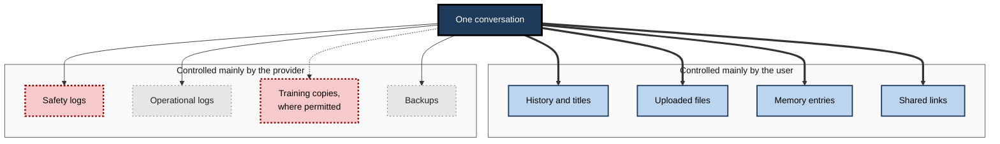
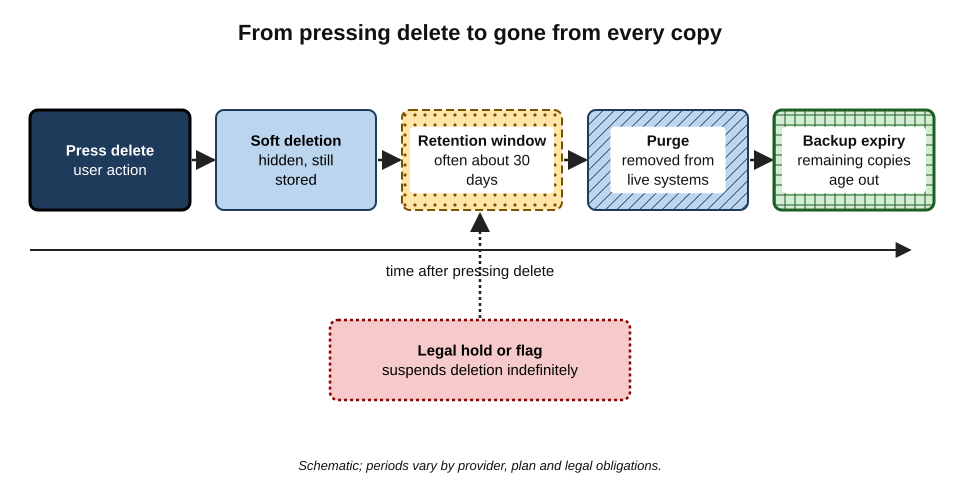
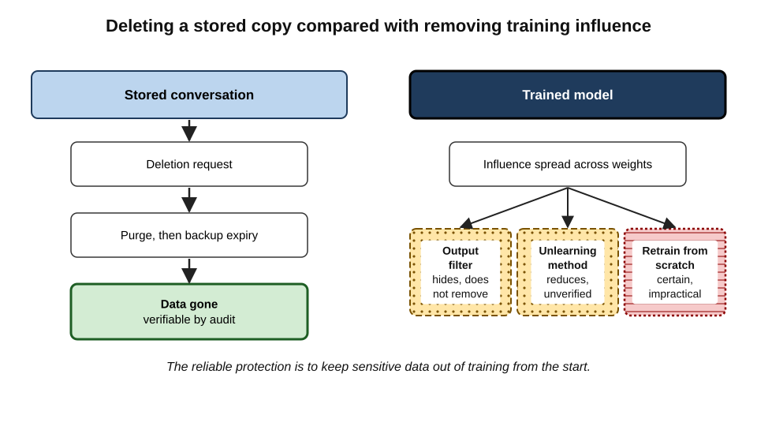
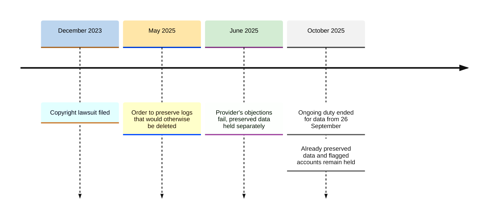
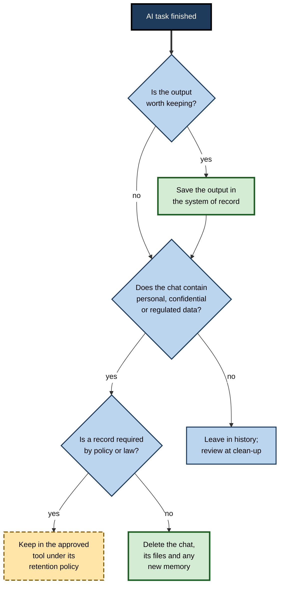
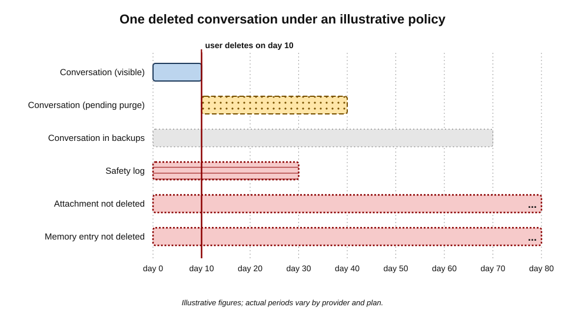

# J.7. Retention and deletion controls

A finance manager realises she has pasted next quarter's unpublished results into an AI chat. She clicks "delete", the conversation vanishes from the sidebar, and she relaxes. In the provider's systems the conversation has merely been marked for deletion. It will remain in a database for some weeks, in backups for longer, and — if a court has ordered the provider to preserve data — possibly for years.

> **Definition — Retention:** the keeping of data for a period of time, whether by design, by default or by legal obligation.

> **Definition — Deletion:** the removal of data so that it can no longer be retrieved in the ordinary course — a process that, in large systems, happens in stages rather than at the moment a button is pressed.

**Why it matters**

- **Data that is kept can be exposed.** Breaches, bugs, legal demands and insiders can only reach what still exists.
- **Users overestimate deletion.** The sidebar shows the user's view, not the provider's storage.
- **Retention is set by several actors at once.** The provider's policy, the user's settings, the employer's configuration and the courts all have a say.
- **The cheapest protection is not keeping things.** Data never stored, or deleted promptly, cannot leak.

---

## What an AI Tool Retains

A single conversation leaves several kinds of record, each with its own retention rule.

### The records

- **The conversation** — prompts and responses, as shown in history.
- **Titles and summaries** — automatically generated titles, previews and search indexes derived from content.
- **Uploaded files** — stored separately, sometimes with extracted text and search indexes.
- **Project knowledge** — documents attached to a project or custom assistant, often converted into **embeddings** for retrieval.
- **Memory** — facts extracted about the user, kept in a profile that outlives individual chats.
- **Custom instructions** — standing preferences and personal details.
- **Shared links** — public or semi-public copies of conversations.
- **Feedback** — rated conversations copied into review sets.
- **Safety logs** — records kept for abuse monitoring.
- **Operational logs** — technical records of requests, errors and performance.
- **Training datasets** — copies selected for model development, where permitted.
- **Backups** — periodic copies of databases for disaster recovery.

> **Definition — Embedding:** a numerical representation of a piece of text used to find related passages; embeddings derived from documents can sometimes be partly reversed to recover content and should be treated as sensitive.

**Figure 1.** The separate records a single conversation can create, each retained under its own rule.

> **Key point:** the user's delete button reaches the left-hand group directly. The right-hand group follows the provider's schedule — and training copies may never be fully reachable.

---

## How Deletion Actually Works

### Stages of deletion

1. **Soft deletion** — the item is flagged as deleted and hidden from the user; the data remains in the database.
   - Allows recovery from mistakes and gives time for processes that depend on the data to finish.
2. **Retention window** — the item is kept for a stated period after soft deletion; 30 days is a common figure for consumer AI services.
3. **Hard deletion (purge)** — the item is removed from the live database and indexes.
4. **Backup expiry** — copies in backups disappear only when those backups are overwritten or expire, often weeks to months later.
5. **Downstream copies** — logs, review sets and analytics stores follow their own schedules.

> **Definition — Soft deletion:** marking data as deleted without removing it, so that it is hidden but recoverable.

> **Definition — Hard deletion (purge):** removing data from live storage so that it cannot be recovered through normal means.

> **Definition — Crypto-shredding:** making data unreadable by destroying the encryption key that protects it, so that all copies — including backups — become useless at once.

**Figure 2.** The stages between pressing "delete" and the data being gone from every copy.

### Why deletion is slow in large systems

- **Distributed storage** — data is replicated across many servers and regions for reliability.
- **Backups exist to survive mistakes** — instantly deleting from backups would defeat their purpose.
- **Abuse investigations** — providers keep records for a period to detect and investigate misuse.
- **Legal duties** — tax, accounting, litigation and regulatory obligations require some records to be kept.

> **Watch out:** a provider that promises "immediate deletion" usually means **removal from view**. Purge from live systems and expiry from backups take longer. A precise policy states both.

---

## Controls Available to Users

### Everyday controls

- **Delete a conversation** — removes it from history and starts the deletion process.
- **Delete all conversations** — the same, in bulk.
- **Archive** — hides a conversation without deleting it; archiving gives **no** privacy benefit.
- **Temporary or incognito chat** — not saved to history, deleted after a short period, typically still kept briefly for safety review.
- **Auto-delete settings** — some tools let users set history to delete automatically after a chosen period.
- **Memory management** — view, edit and delete individual memories, or switch memory off.
- **File management** — delete uploaded files and project documents, which may not be deleted with the conversation.
- **Revoke shared links** — stops access through the link; copies others have made remain.
- **Account deletion** — deletes the account and its data, subject to retention exceptions.
- **Data export** — download a copy of what the provider holds, useful for seeing what exists before deleting.

| Control | What it removes from view | What may remain |
|---|---|---|
| Archive | The sidebar entry | Everything |
| Delete conversation | History and titles | Files, memory, logs, backups, training copies |
| Temporary chat | History from the start | Short-term safety logs |
| Delete memory | The saved fact | Conversations that mention it |
| Revoke link | Public access | Copies made by viewers; search-engine caches for a time |
| Delete account | The whole account | Records kept under legal duties; backups until expiry; training copies |

> **Remember:** **archive hides, delete schedules, purge removes, backups linger, training stays.**

### The legal right to erasure

> **Definition — Right to erasure (right to be forgotten):** the right under the GDPR (Article 17) to have personal data erased in specified circumstances, such as when it is no longer necessary or consent has been withdrawn.

- **Exceptions** — the right does not apply where processing is necessary for compliance with a legal obligation, for legal claims, or for freedom of expression, among other grounds.
- **Practical use** — an individual can ask a provider to erase their account data and confirm what has been deleted.
- **Limits for AI models** — erasing stored conversations is feasible; removing the influence of data from a trained model is not straightforward, and providers generally address it by filtering outputs rather than retraining.

---

### Seeing what is held

- **Data export** — most major AI services let users download their data: conversations, memory, settings, sometimes uploaded files.
  - Reading an export is the most reliable way to discover forgotten conversations, old projects and saved memories.
- **Subject access request** — under the GDPR and similar laws, an individual can ask a provider for a copy of the personal data it holds about them, including information on purposes, recipients and retention.
- **Before closing an account** — export first, check what exists, then delete; afterwards, request confirmation of deletion if the matter is sensitive.

> **Example (illustrative):** a researcher exports two years of assistant history before changing jobs and finds 1,400 conversations, 37 uploaded files and 112 saved memories — including the names of interview participants she had believed were only ever in her notebook. *Illustrative figures.*

---

## Copies the User Creates

Provider retention is only half the picture. Users routinely create copies of AI inputs and outputs outside the tool.

- **Pasted outputs** — answers copied into documents, emails, chat messages and tickets.
- **Downloads** — generated files, exported conversations and images saved to the device or cloud storage.
- **Screenshots** — taken to share an answer, often capturing the whole conversation and sidebar.
- **Clipboard history** — operating systems and clipboard managers can keep a list of recently copied items, sometimes synchronised across devices.
- **Browser storage** — cached pages and local storage on shared or unmanaged computers.
- **Device sync** — conversation apps on phone, tablet and laptop each holding a local copy.
- **Notifications** — previews of answers shown on lock screens and smartwatches.

> **Key point:** deleting a conversation from the provider does nothing to the **user's own copies**. A complete clean-up includes downloads, screenshots and pasted fragments.

---

## Why Shorter Retention Reduces Risk

The exposure created by stored data grows with both the **amount** kept and the **time** it is kept.

> **Formula — Exposure (stock of stored items):** average items held ≈ rate of creation × average time kept. Example: 10 sensitive conversations a week kept for 52 weeks means about **520** held at any time; kept for 4 weeks, about **40** — a thirteen-fold reduction. *Illustrative figures.*

- **Breach impact** — an attacker or bug can only expose what exists at the moment it strikes.
- **Disclosure burden** — every retained conversation may have to be searched in litigation or a subject access request.
- **Accuracy decay** — old conversations reflect old facts; keeping them invites reliance on outdated material.
- **Counterweight** — some records must be kept; short retention applies to the **workbench**, not to records that law or policy require.

### Typical retention by account type

| Account or mode | Typical history retention | Typical retention after deletion | Who sets it |
|---|---|---|---|
| Consumer, history on | Until the user deletes | Commonly about 30 days, then backups | Provider; user can delete |
| Consumer, temporary chat | Not saved to history | Short safety retention, commonly up to about 30 days | Provider |
| Team or enterprise | As configured by administrators | As set by contract and configuration | Organisation, within contract |
| Developer access, standard | Not stored as history | Short abuse-monitoring retention | Provider, under developer terms |
| Developer access, zero retention | Not stored | None beyond processing, with exceptions | Contract |

*Typical positions; each provider's current policy decides.*

---

## Controls Available to Organisations

- **Configurable retention** — business plans let administrators set how long conversations and files are kept, sometimes down to zero.
- **Zero data retention** — eligible developer customers can arrange for prompts and outputs not to be stored after processing, subject to exceptions.
- **Compliance export** — administrators can export conversations for audit, investigation and disclosure.
- **Legal hold** — the organisation can preserve particular users' data when litigation or investigation is anticipated, overriding normal deletion.
- **Integration with records management** — conversation data flows into the organisation's archiving and eDiscovery systems.
- **Deletion on contract exit** — the data-processing agreement sets how data is returned or deleted at the end.

> **Definition — Legal hold:** an instruction to preserve information relevant to actual or reasonably anticipated litigation or investigation, suspending normal deletion.

### The organisation's dilemma

- **Shorter retention** reduces breach exposure and disclosure burden.
- **Longer retention** preserves records needed for regulation, disputes and knowledge.
- **The resolution** — keep the **record** (a decision, a deliverable) in the system of record; let the **working conversation** expire quickly.

> **In practice:** many organisations set enterprise AI conversations to expire after a defined period — for example 30 or 90 days — and instruct staff to save anything of lasting value as a document in the proper repository. The AI tool is treated as a workbench, not an archive.

---

## Memory: Retention by Another Name

Memory features turn short-lived conversations into long-lived profiles. They deserve separate attention because they retain **conclusions about the user**, not just text.

- **How memory is created**
  - **Explicitly** — the user says "remember that I manage the Asia-Pacific team".
  - **Implicitly** — the tool decides on its own that a detail is worth saving.
  - **From history** — some tools draw on past conversations generally, not only on saved facts.
- **What it tends to hold** — role, employer, projects, family situation, health conditions, preferences, writing style, recurring worries.
- **Why it matters for retention**
  - a memory can outlive the conversation that created it by years;
  - deleting the conversation usually does **not** delete the memory;
  - memories are inferences, and may be wrong or out of date;
  - memories may surface unexpectedly — in a screen share, a demonstration or a conversation about something else.
- **Controls**
  - view and delete individual memories;
  - switch off memory entirely, or switch off use of chat history;
  - use temporary chats, which neither read nor write memory in most tools.

> **Watch out:** an assistant that "remembers" a client name or a colleague's illness has created a record about a third party, held under consumer terms, which the third party cannot see or correct.

## When Providers Change

- **Acquisitions** — a provider bought by another company may transfer data under the buyer's terms; privacy policies usually reserve this right.
- **Product closures** — when a tool shuts down, users are normally given a period to export before deletion; data held for legal reasons may persist.
- **Insolvency** — customer data can be treated as an asset in insolvency proceedings, subject to data-protection law.
- **Policy changes** — new terms can change retention periods for future data, as when a consumer plan linked longer retention to allowing training.

> **In practice:** for tools used heavily for work, experienced users export their data periodically and keep important outputs in their own repositories, so that a provider's change of ownership or policy does not leave them choosing between losing work and accepting new terms.

---

## Deletion Is Not Unlearning

> **Definition — Machine unlearning:** methods intended to remove the influence of specific training data from a trained model without retraining it from scratch.

- **Stored copies** can be deleted like any other data.
- **Model weights** trained on data are not a store of copies; the data's influence is spread across billions of parameters.
- **Retraining from scratch** without the data is the only certain removal — and is impractical for a single request.
- **Unlearning research** has produced methods that reduce a model's tendency to reproduce particular content, but verifying that influence has truly gone remains an open problem.
- **Output filters** are the usual practical response: the model is prevented from repeating specific information.

**Figure 3.** Deleting a stored conversation compared with removing its influence from a trained model.

> **Key point:** the only reliable way to keep data out of a model is to keep it out of **training** in the first place — by contract, by settings, or by not entering it.

---

## Case Study: The New York Times v. OpenAI Preservation Order (2025)

- **Background:** in December 2023 The New York Times sued OpenAI and Microsoft for copyright infringement, alleging that its articles had been used to train models and could be reproduced by ChatGPT.
- **The order (May 2025):** a US magistrate judge ordered OpenAI to **preserve and segregate output log data that would otherwise be deleted** — in effect, to stop deleting consumer ChatGPT and API conversations, including those users had deleted and temporary chats — so that they could be examined as potential evidence.
- **Scope:** the order covered consumer ChatGPT plans and standard API use; **enterprise and education** accounts and API customers with **zero data retention** arrangements were not covered.
- **Response:** OpenAI objected publicly, describing the order as conflicting with its privacy commitments; its challenges did not succeed at that stage, and it stored the preserved data separately under restricted access.
- **Ending the ongoing obligation (October 2025):** a further order ended OpenAI's duty to preserve new deleted conversations from **26 September 2025**, and the company returned to its standard practice of deleting such conversations within 30 days.
- **What remained:**
  - data already preserved under the order stayed held for the litigation;
  - OpenAI remained obliged to preserve data linked to particular accounts identified by the newspaper.
- **Lessons:**
  - a provider's retention policy describes **normal** practice, which a court can suspend without notice to users;
  - "deleted" and "temporary" conversations were preserved for months;
  - account type mattered: enterprise and zero-retention customers were outside the order;
  - for truly sensitive material, the safest retention is **none** — content that is never entered cannot be preserved.

**Figure 4.** Key dates in the preservation dispute.

> **Watch out:** litigation is continuing, and later rulings may change what happens to the preserved data. The lasting point is not the outcome of one case but the mechanism: **legal holds override deletion promises**.

---

## Designing a Personal Retention Practice

### Principles

- **Decide retention by content, not by habit.** Public and personal-preference chats can stay; anything sensitive should not.
- **Use temporary chats for sensitive one-offs** — nothing is added to history in the first place.
- **Save the result, delete the conversation.** Copy the useful output to the proper place, then delete.
- **Review memory** periodically and delete facts that should not persist.
- **Clean files and projects** — they often outlive the chats that used them.
- **Revoke old shared links.**
- **Schedule a clean-up** — monthly or quarterly, review and delete history.

**Figure 5.** Choosing what to keep and what to delete after an AI task.

> **Mnemonic — "SAVE then CLEAR":** Save the output where it belongs; then Clear the chat, files and memory.

---

## Worked Example (illustrative): When Is It Really Gone?

**Situation:** on day 0 a project lead pastes a confidential bid strategy into a consumer AI tool. On day 10 she realises and deletes the conversation. The provider's stated policy: deleted conversations purged from live systems within 30 days; backups retained for up to 30 further days; safety logs for 30 days from creation.

| Copy | Created | Removed from view | Removed from live systems | Removed from backups |
|---|---|---|---|---|
| Conversation | Day 0 | Day 10 | By day 40 | By day 70 |
| Uploaded attachment | Day 0 | Not deleted — still in the files list | Not until deleted separately | — |
| Safety log | Day 0 | Never visible | By day 30 | By day 60 |
| Memory entry "works on the Halden bid" | Day 0 | Visible until deleted | Not until deleted separately | — |
| Under a legal hold | Day 0 | Day 10 | Not until the hold ends | Not until the hold ends |

*Illustrative figures; actual periods vary by provider and plan.*

**Figure 6.** The timeline of one deleted conversation under an illustrative retention policy.

**Steps she should take**

1. **Delete the conversation** — done on day 10.
2. **Delete the attachment** from the files or project area.
3. **Delete the memory entry** created from the conversation.
4. **Check for shared links** and revoke any.
5. **Report the incident** under her employer's procedure, so that the organisation can assess whether to request deletion from the provider or notify the client.
6. **Record the timeline** — when the data was entered, when it was deleted, and what the policy says.

- **Conclusion:** even with prompt action, copies exist for about **ten weeks** under the illustrative policy — indefinitely under a hold — and two copies would have survived had she deleted only the chat.

> **Watch out:** if the account allowed training, the conversation may already have been selected for a dataset before day 10. Deletion afterwards does not reverse inclusion in a model already trained.

---

## Professional Mastery

### What experts ask about retention

- **For each record type** — conversation, files, memory, logs, backups, training copies — what is the period?
- **What starts the clock** — creation, last activity or deletion?
- **What overrides it** — legal holds, investigations, flagged content?
- **Who can shorten it** — the user, the administrator, neither?
- **How is deletion evidenced** — certificates, audit reports, contractual commitments?

### Failure modes

- **Archive confusion** — archiving instead of deleting.
- **Orphaned files** — deleting chats but not uploaded documents.
- **Persistent memory** — sensitive facts remembered after the chat that produced them is gone.
- **Workbench as archive** — keeping important work only in AI history, then losing it, or keeping sensitive work there indefinitely.
- **Unlimited enterprise retention** — business accounts left at "keep forever" because nobody chose a period.
- **Assuming deletion reverses training.**

### Organisational design

- **Set a default period** for enterprise conversations that matches the records policy.
- **Separate records from workspace** — integrate outputs with document management.
- **Plan for holds** — make sure legal holds can be applied to AI data, and lifted.
- **Test deletion** — confirm with the provider how deletion requests are fulfilled and evidenced.
- **Include AI data in data maps** and in responses to subject access and erasure requests.

---

## Open Questions

- **Can deletion from trained models ever be verified?**
  - Unlearning methods exist, but proving the absence of influence is unsolved.
- **How should courts balance preservation with user privacy?**
  - Preservation orders covering millions of users' private conversations raise questions that discovery rules were not designed for.
- **Should consumer AI services offer shorter default retention?**
  - Shorter defaults reduce risk but weaken abuse detection and user convenience.
- **Are embeddings and derived indexes personal data?**
  - Research shows some embeddings can be partly inverted; their legal status is not settled.
- **Will agents complicate retention further?**
  - Agents that act across email, files and websites leave traces in many systems, each with its own retention.

---

## Summary

- **Retention** is the keeping of data; **deletion** in large systems happens in stages — **soft deletion, retention window, purge, backup expiry** — with downstream copies on their own schedules.
- One conversation creates many records: **history, titles, files, project knowledge and embeddings, memory, custom instructions, shared links, feedback, safety and operational logs, training copies, backups**.
- User controls: **delete, delete all, temporary chat, auto-delete, memory management, file deletion, link revocation, account deletion, export**. **Archive is not delete.**
- The **right to erasure** applies to stored data, with exceptions for legal obligations and claims; it does not simply reverse model training.
- Organisations can **configure retention, use zero-retention arrangements, export for compliance and apply legal holds**; the best practice is to keep **records** in the system of record and let **working conversations** expire.
- **Deletion is not unlearning**: removing data's influence from a trained model is unsolved; keep sensitive data out of training from the start.
- The **NYT v. OpenAI preservation order (2025)** suspended deletion of consumer conversations for months; enterprise and zero-retention customers were excluded.
- A personal practice: **use temporary chats for sensitive one-offs; save the output, delete the conversation; clean files, memory and links; review regularly** — "SAVE then CLEAR".

---

## Self-Check

1. Distinguish soft deletion, hard deletion and backup expiry.
2. List eight kinds of record a single AI conversation can create.
3. Why is deletion slow in large distributed systems?
4. What does archiving a conversation achieve for privacy?
5. Name three things that may remain after deleting a conversation, and how to remove each.
6. What is crypto-shredding and why is it useful?
7. State the right to erasure and two exceptions to it.
8. Why is deleting stored data different from removing its influence on a trained model?
9. Describe the 2025 preservation order in the NYT v. OpenAI litigation and who was excluded from it.
10. What is a legal hold, and how does it interact with retention settings?
11. Explain the principle "keep the record, let the workbench expire".
12. A colleague deleted a chat containing a client's draft contract yesterday and says the matter is closed. What else should they check and do?

### Answer Key

1. Soft deletion hides data but keeps it; hard deletion removes it from live systems; backup expiry is when copies in backups are overwritten or expire, often weeks later.
2. Conversation; titles and summaries; uploaded files; project knowledge and embeddings; memory; custom instructions; shared links; feedback copies; safety logs; operational logs; training copies; backups (any eight).
3. Data is replicated across servers and regions, backups exist to survive mistakes, abuse investigations need records for a period, and legal duties require some data to be kept.
4. Nothing — archiving only hides it from the sidebar; all data remains.
5. Uploaded files (delete from the files or project area); memory entries (delete in memory settings); shared links (revoke). Also logs and backups, which expire on the provider's schedule.
6. Destroying the encryption key so that all encrypted copies, including backups, become unreadable at once.
7. The GDPR right to have personal data erased in specified circumstances, such as when no longer necessary or when consent is withdrawn. Exceptions include compliance with a legal obligation, establishment or defence of legal claims, and freedom of expression.
8. Stored data can be removed like any file; a model's weights encode data's influence across many parameters, and removing it reliably requires retraining or unverified unlearning methods.
9. In May 2025 a magistrate judge ordered OpenAI to preserve output logs that would otherwise be deleted, covering consumer ChatGPT and standard API use including deleted and temporary chats; enterprise, education and zero-retention API customers were excluded. The ongoing duty ended for data from 26 September 2025, but previously preserved data and flagged accounts remained held.
10. An instruction to preserve information relevant to litigation or investigation; it overrides normal retention and deletion until lifted.
11. Save anything of lasting value — decisions, deliverables — in the proper repository, and let AI conversations, which are working material, expire on a short schedule.
12. Delete uploaded files and any memory entries; revoke shared links; check whether training was enabled; report under the employer's incident procedure so the organisation can assess client notification and a deletion request; note that copies persist in logs and backups for weeks.

---

## Glossary

| Term | Meaning |
|---|---|
| Archive | Hide a conversation from view without deleting it. |
| Backup expiry | The point at which data disappears from backup copies. |
| Compliance export | An administrator's export of conversations for audit or disclosure. |
| Crypto-shredding | Destroying encryption keys so that all copies of data become unreadable. |
| Deletion | Removal of data so it can no longer be retrieved in the ordinary course. |
| eDiscovery | Identifying and producing electronic information for litigation. |
| Embedding | A numerical representation of text used for retrieval. |
| Hard deletion | Removing data from live storage. |
| Legal hold | A duty to preserve information relevant to litigation, overriding deletion. |
| Machine unlearning | Methods intended to remove specific data's influence from a trained model. |
| Preservation order | A court order requiring a party to keep specified data. |
| Retention | Keeping data for a period. |
| Retention window | The period data is kept after soft deletion before purge. |
| Right to erasure | The GDPR right to have personal data erased in specified circumstances. |
| Soft deletion | Marking data as deleted while keeping it recoverable. |
| System of record | The authoritative repository in which an organisation keeps a type of record. |
| Temporary chat | A conversation not saved to history and deleted after a short period. |
| Zero data retention | An arrangement under which prompts and outputs are not stored after processing. |
