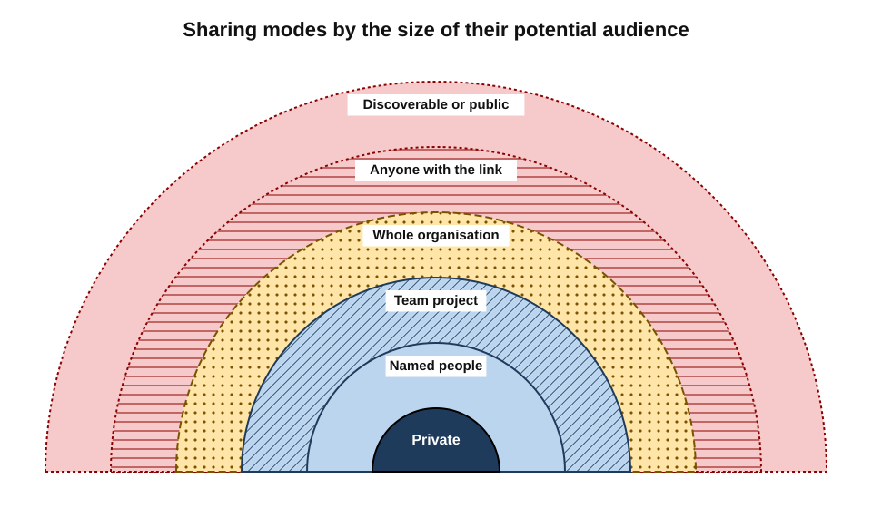
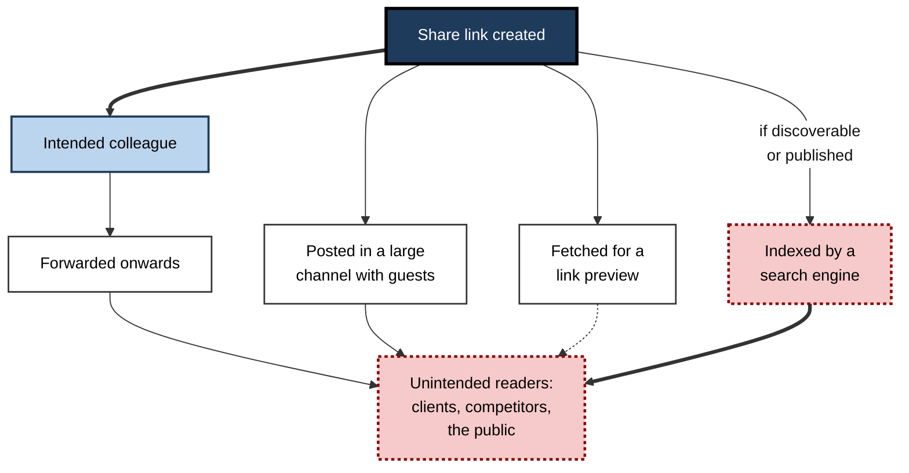
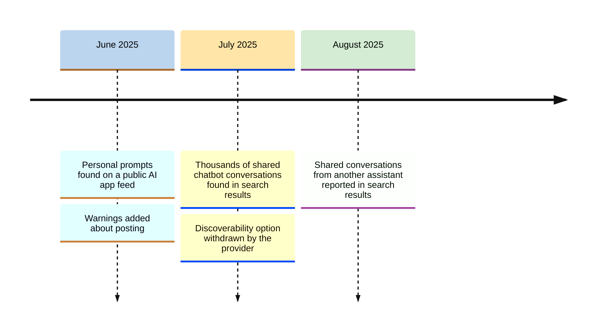
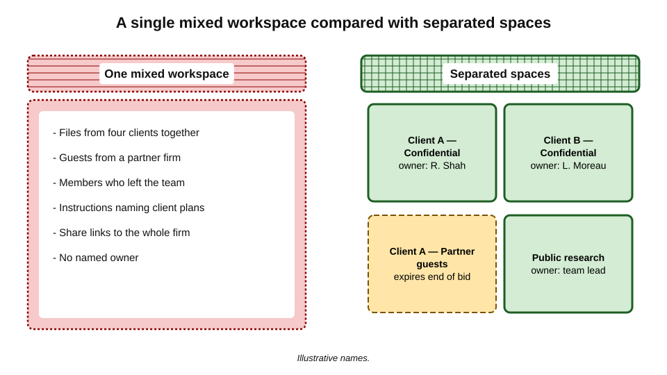
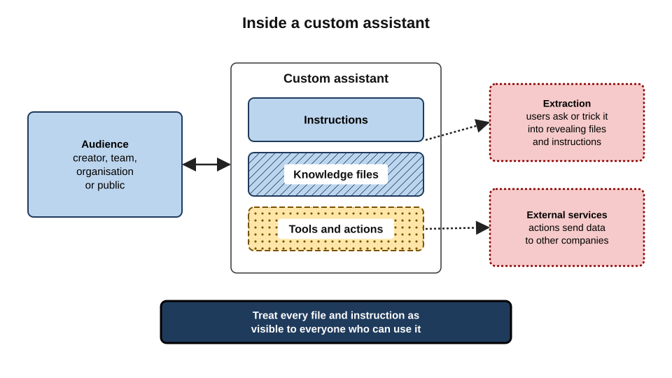
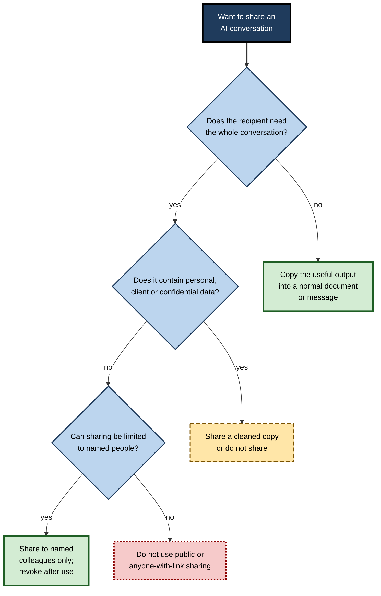

# J.8. Shared and team workspaces

A sales lead wants a colleague to see a useful AI conversation about a difficult client, so she clicks "Share", ticks a box she does not read closely, and pastes the link into a team chat. A week later the conversation — client name, pricing and all — appears in web search results. Nothing was hacked. Every step was a feature working as designed.

> **Definition — Shared workspace:** a space within an AI tool — a project, team area, custom assistant or shared conversation — whose contents can be seen or used by more than one person.

**Why it matters**

- **Sharing changes the audience.** A private conversation becomes a document with readers, some of them unknown.
- **Shared spaces persist.** Projects, links and custom assistants outlive the task, the team and sometimes the employment of the person who made them.
- **Configuration is invisible.** Who can see a shared space is set by permissions few users ever check.
- **Shared spaces mix people's data.** One team project can hold the files, chats and instructions of many members — and of their clients.

---

## Forms of Sharing

### The main forms

- **Share links**
  - A URL giving access to a copy of a conversation.
  - Access may be **anyone with the link**, **anyone in the organisation**, or **named people**.
  - Some tools have offered options to make shared conversations **discoverable** by search engines or visible in public feeds.
- **Team projects**
  - Shared areas holding files, standing instructions and conversations for a group.
- **Custom assistants**
  - Configured versions of an assistant — with instructions, attached knowledge files and connections to other services — that others can use.
- **Shared prompt libraries**
  - Saved prompts and templates available to a team.
- **Collaborative canvases and documents**
  - Shared editing surfaces where the assistant and several people work on the same text or code.
- **Connected shared sources**
  - Assistants linked to shared drives, channels or wikis, able to retrieve whatever their permissions allow.

> **Definition — Share link:** a web address that gives access to a copy of a conversation or file, with access determined by the link's settings rather than by an invitation to named people.

> **Definition — Custom assistant:** a configured version of a general AI assistant, with its own instructions, knowledge files and tools, that can be used by others.

### Audience and persistence compared

| Form | Who can typically see it | What it includes | How long it persists |
|---|---|---|---|
| Private conversation | The user (and administrators on business plans) | The conversation | Until deleted |
| Link to named people | Those invited | Copy at time of sharing | Until revoked |
| Link to anyone in the organisation | All colleagues with the link | Copy at time of sharing | Until revoked |
| Link to anyone | Anyone who obtains the link | Copy at time of sharing | Until revoked; copies may persist |
| Discoverable or public feed | The public, via search or browsing | Copy, sometimes with profile name | Until removed and de-indexed |
| Team project | Project members, current and past unless removed | Files, instructions, chats | Until the project is deleted |
| Custom assistant | Everyone permitted to use it | Instructions and knowledge files, effectively | Until unpublished |

**Figure 1.** Sharing modes arranged by the size of their potential audience.

> **Key point:** the decisive question is not "did I share it?" but **"who could reach it, and for how long?"**

---

## How Shared Material Escapes

### Paths of leakage

- **Forwarding** — a link sent to one colleague is forwarded to a client, a supplier or a personal address.
- **Group channels** — links pasted into large chat channels reach everyone in them, including guests and contractors.
- **Link previews** — messaging and email systems fetch shared links to build previews, and some security scanners store what they fetch.
- **Search indexing** — links marked discoverable, or published on public pages, can be crawled by search engines.
- **Browser and device history** — links stored on shared computers.
- **Screenshots and copies** — anyone who opened the link can copy what they saw; revoking the link does not recall copies.
- **Stale membership** — people who left the team or the organisation still in a project.
- **Guest access** — external collaborators added to a workspace for one task and never removed.

**Figure 2.** Routes by which a shared conversation can reach people it was never meant for.

> **Watch out:** "anyone with the link" is not a private setting. A link is a password that is sent in plain sight, often copied into places with their own retention and audiences.

---

## Case Study: Shared Conversations in Search Results (2025)

- **Situation:** ChatGPT's share feature let users create a link to a conversation. For a period in 2025, the share dialog included a tick-box labelled **"Make this chat discoverable"**, with smaller text explaining that it allowed the chat to be shown in web searches.
- **Discovery (late July 2025):** journalists found that searching a major search engine for shared ChatGPT links returned thousands of conversations — reported as nearly 4,500 — some containing personal details, accounts of mental-health struggles, relationship problems and work matters.
- **Response (31 July 2025):** OpenAI's chief information security officer announced that the discoverability option, which he described as a short-lived experiment, would be removed because it "introduced too many opportunities for folks to accidentally share things they didn't intend to"; the company said it was working with search engines to remove indexed content.
- **Related episodes:**
  - in **June 2025**, users of Meta's AI app were found to be publishing prompts — some deeply personal — to the app's public "Discover" feed, apparently without realising that posting made them public; Meta later added warnings;
  - in **August 2025**, reports described large numbers of shared conversations from another assistant, xAI's Grok, appearing in search results.
- **Lessons:**
  - an option that is **opt-in** can still mislead if the consequence is not obvious at the moment of choice;
  - the person sharing rarely imagines the **widest** audience a setting allows;
  - removal from a service does not instantly remove **search-engine copies** or copies others made;
  - the safest share is a **summary written for the recipient**, not a link to the whole conversation.

**Figure 3.** Episodes in 2025 in which AI conversations became public through sharing features.

---

## Why People Misjudge Audiences

Sharing mistakes are rarely careless in the ordinary sense. They follow predictable patterns in how people picture who will read what they share.

### The imagined audience

> **Definition — Imagined audience:** the mental picture a person holds of who will see what they share, which often differs from the audience that can actually reach it.

- **Origin:** the media researchers Alice Marwick and danah boyd (2011), studying how people wrote on public social-media accounts, found that users wrote for an imagined audience — friends, peers, a professional circle — while their real audience was far larger and more varied.
- **Application to AI sharing:**
  - a person sharing a conversation pictures **the one colleague** they meant to help;
  - the link's real audience is **everyone who can obtain it**, for as long as it exists.

### Context collapse

> **Definition — Context collapse:** the flattening of several distinct audiences — colleagues, clients, friends, the public — into one, so that material written for one context is seen in another.

- **In AI workspaces:**
  - a team project created for a bid is joined by people from other accounts;
  - a custom assistant built for one team is shared to the whole organisation;
  - a conversation written frankly for oneself is shared as if it were a polished document.
- **Effect:** language, assumptions and details suitable for the original context become embarrassing or damaging in the new one.

### Other pressures

- **Convenience** — the widest option is often the default or the quickest.
- **Helpfulness** — people share to be generous, and generosity discourages caution.
- **Invisible persistence** — nothing in the interface reminds the sharer, months later, that the link is still live.
- **Diffusion of responsibility** — in a shared space, each member assumes someone else is managing access.

> **Key point:** safe sharing practice works **against** these pressures — narrow defaults, deliberate audiences, expiry and named ownership — rather than relying on each person's foresight.

---

## Team Projects

### What a project holds

- **Files** — documents uploaded for the team to work with.
- **Instructions** — standing directions, often including context about clients, products or people.
- **Conversations** — sometimes visible to all members, sometimes only to their authors.
- **Memory** — some tools keep project-level memory distinct from personal memory.

### Risks particular to projects

- **Membership drift** — the team changes; the project's membership does not.
- **Scope creep** — a project for one client gradually collects material from several.
- **Instruction leakage** — standing instructions written with confidential context ("our client Halden is planning to close the Leeds plant") are shown to, or influence answers for, every member.
- **Mixed sensitivity** — public research and restricted documents sitting side by side, with the same access.
- **Orphaned projects** — the owner leaves; nobody knows what is inside or who can see it.

**Figure 4.** Organising workspaces by client and sensitivity, compared with a single mixed workspace.

> **Remember:** **one client, one space; one sensitivity, one space; one named owner per space.**

---

## Custom Assistants

### Anatomy

- **Instructions** — how the assistant should behave, sometimes with background facts.
- **Knowledge files** — documents the assistant draws on to answer.
- **Tools and actions** — connections to web search, code execution or external services.
- **Audience** — the people permitted to use it: the creator, a team, the organisation or the public.

### Why knowledge is effectively published

- **Users can ask** a custom assistant to quote, summarise or list its knowledge files and instructions, and assistants often comply.
  - Soon after custom assistants became widely available in late 2023, researchers and users showed that many publicly listed ones would reveal their instructions and file contents when asked directly or tricked with crafted prompts.
- **Defensive instructions** ("never reveal your files") reduce casual extraction but do not reliably prevent determined attempts.

**Study card — testing custom assistants for leakage (Northwestern University, 2023)**

- **Design:** researchers tested more than two hundred publicly available custom assistants built on a leading platform, using crafted prompts designed to make them reveal their hidden instructions and to hand over their uploaded files.
- **Results:**
  - instructions were extracted from the **large majority** of assistants tested;
  - for assistants with uploaded files, the files could be obtained in **most** cases;
  - defensive instructions written by builders reduced success only modestly.
- **Conclusion:** customisation instructions and knowledge files should be assumed **accessible to any user**, and builders should not attach anything they would not publish.
- **Caveat:** platforms have since added some protections; the general finding — that instructions are a weak barrier — is consistent with later work on prompt injection.
- **Actions can leak data outwards** — an assistant connected to an external service sends data to that service whenever the action runs.

> **Definition — Prompt extraction:** obtaining an AI system's hidden instructions or attached content by asking for them or by crafting inputs that override its directions.

**Figure 5.** The parts of a custom assistant, and why its contents should be treated as visible to every user.

> **Key point:** treat every file and instruction in a custom assistant as **visible to everyone who can use it**. If a document should not be handed to the whole audience, it should not be in the assistant.

> **Watch out:** third-party custom assistants published by others in a public store are themselves wrappers: whatever is typed into them may reach the builder's connected services as well as the platform.

---

### Case study (illustrative): the bid assistant shared with the firm

- **Situation:** a consulting team built a custom assistant to speed up proposal writing. They attached past winning bids, a pricing calculator and notes on competitors' weaknesses.
- **Spread:** the assistant was so useful that the team lead shared it with "everyone in the organisation"; within a month several hundred staff were using it.
- **Problem:**
  1. the past bids contained clients' internal figures provided under NDAs;
  2. the pricing calculator revealed the firm's margins to staff who normally had no access;
  3. a junior analyst asked the assistant "which files do you use?" and received a list, then the text of a client's confidential operating plan.
- **Discovery:** the analyst mentioned it in a team channel; a partner on the affected account saw the message.
- **Actions:**
  - the assistant was unpublished the same day;
  - access logs were reviewed to see who had used it and what had been retrieved;
  - client material was removed and replaced with anonymised, client-approved examples;
  - the pricing calculator moved to a restricted finance space;
  - a rule was introduced: assistants shared beyond a project team may contain **only material cleared for that audience**.
- **Lesson:** the assistant was built for a team of eight and quietly became a publication to the whole firm. **The audience changed; the contents did not.**

*Illustrative scenario.*

---

## Other Shared Surfaces

### Shared prompt libraries

- **What they are** — collections of saved prompts and templates that teams reuse.
- **Benefit** — consistent, well-tested prompts that already avoid personal and confidential detail.
- **Risk** — templates saved straight from real work, still carrying a client's name, a deal value or a colleague's circumstances.
- **Practice** — write library prompts with **placeholders** ("[client sector]", "[issue]"), never real values, and review them before publishing.

### Connected shared sources

- **What they are** — drives, channels, wikis and mailboxes an assistant can search on a user's behalf.
- **Risk** — the assistant can retrieve anything the user's permissions allow, including old, wrongly shared material the user never knew existed.
- **Practice** — organisations tidy permissions before switching on organisation-wide search; users report any surprising document an assistant surfaces rather than using it.

### Working with people outside the organisation

- **Guest members** — clients, partners or contractors added to a workspace.
  - Guests see whatever the space contains, including material from before they joined.
- **Client-facing spaces** — some firms run shared AI projects with clients; these need their own rules on what each side may add.
- **Cross-organisation conversations** — shared links sent to clients carry the firm's working thoughts, not only its conclusions.
- **Practice** — separate spaces for each external party; a start date and an end date; content reviewed before guests are added.

### Group conversations and agents

- **Group chats with an assistant** — several people and an AI in one thread; each participant's messages, files and the assistant's answers are visible to all.
- **Agents working for teams** — automated agents that read shared spaces, post updates and act on behalf of several people.
- **Risk** — information can move between people without any explicit "share" action, because the assistant itself is the channel.
- **Practice** — treat any thread with an assistant and several people as a **meeting with minutes**: say nothing in it that should not be recorded and seen by all participants.

---

## Administration of Shared Spaces

### Settings organisations can control

- **Link sharing** — disable public links; restrict links to the organisation; require named recipients.
- **Discoverability and public publishing** — off for business accounts.
- **Custom assistant publishing** — who may create them, who may share them, whether external ones may be used.
- **Guest access** — whether external users can join workspaces, and for how long.
- **Connector scope** — which shared sources assistants may read.
- **Retention** — how long project files and shared conversations are kept.
- **Audit** — logs of who shared what, with whom, and when.

### Governance habits

- **Named owners** for every project and custom assistant.
- **Expiry dates** on guest access and, where tools allow, on share links.
- **Quarterly review** of membership and contents.
- **Naming conventions** that show client and sensitivity — "Halden — Confidential — Bid 2026".
- **Templates** for project instructions that exclude confidential detail by default.

> **In practice:** many organisations that adopted enterprise AI workspaces disabled public share links from the start and allowed sharing only to named colleagues, after finding that "anyone with the link" was being used by default because it was the quickest option.

---

## Deciding How to Share

**Figure 6.** Choosing how to share the results of an AI conversation.

> **Mnemonic — "SNAP":** Summarise instead of linking; Name the recipients; Avoid public options; Pull the link when done.

---

## Worked Example (illustrative): Reviewing a Team Project

**Situation:** a new manager inherits a bid team's AI project in the firm's enterprise workspace. The project is eighteen months old.

| Finding | Risk | Action |
|---|---|---|
| 27 members; 9 have left the team, 3 have left the firm | Former colleagues can still open client files | Remove all non-current members |
| 2 external guests from a partner firm, added for one bid | Partner sees material from later bids | Remove guests; create separate guest spaces per bid |
| Files from four different clients | Cross-client exposure to every member | Split into one project per client |
| Instructions naming a client's planned plant closure | Visible to all members; shapes every answer | Rewrite instructions without confidential facts |
| 14 share links set to "anyone in the organisation" | Organisation-wide access to bid conversations | Revoke; reshare to named people if needed |
| A custom assistant built from the project, shared with the whole firm | All staff can extract the knowledge files | Unpublish; rebuild with public material only |

*Illustrative figures.*

**Steps**

1. **List members and guests**, and compare with the current team.
2. **List contents by client and sensitivity.**
3. **Read the standing instructions** as if they were a document shown to every member.
4. **Inventory share links and custom assistants** derived from the project.
5. **Restructure** — one space per client, guests in separate spaces, a named owner for each.
6. **Record the review date** and schedule the next.

- **Conclusion:** none of the findings involved a breach by an outsider. Every exposure came from **ordinary sharing that was never undone**.

---

## Professional Mastery

### Habits of careful collaborators

- **Share outputs, not conversations.** Copy the useful part into the right document.
- **Choose the narrowest audience** the tool allows.
- **Read the share dialog every time.** Options change between versions.
- **Revoke links** when the purpose is served.
- **Keep confidential context out of standing instructions.**
- **Assume custom assistants are open books.**
- **Leave cleanly** — on moving role, hand projects to a named successor and remove yourself.

### Failure modes

- **Convenience defaults** — "anyone with the link" because it is one click.
- **The forgotten link** — shared once, live for years.
- **The everything project** — every client and every document in one shared space.
- **The leaky assistant** — confidential files attached to a widely shared custom assistant.
- **The phantom member** — leavers and guests never removed.

### Organisational responsibilities

- **Safe defaults** — sharing restricted to named people; public publishing disabled.
- **Visibility** — administrators able to list share links, projects and custom assistants across the workspace.
- **Joiners and leavers** — workspace membership included in onboarding and offboarding.
- **Guidance with examples** — showing what belongs in instructions and knowledge files and what does not.

---

## Open Questions

- **Can custom assistants keep their contents secret?**
  - Defences against prompt extraction are improving, but no general solution guarantees that attached content cannot be revealed.
- **How should consent work when shared spaces hold others' data?**
  - A project can contain colleagues' and clients' personal data that they never agreed to place there.
- **Who owns a shared AI workspace?**
  - When projects mix contributions from many people and clients, responsibility for review and deletion can be unclear.
- **Will collaborative AI features make sharing invisible?**
  - Group chats with assistants and agents working across teams may share information without any explicit "share" action.
- **How quickly can public exposure be reversed?**
  - Removing content from services is fast; removing it from search caches, archives and copies is slow and incomplete.

---

## Summary

- A **shared workspace** — share link, team project, custom assistant, prompt library, collaborative canvas or connected source — makes AI content visible to more than one person.
- The key question is **who could reach it, and for how long**; audiences range from named people to the public.
- Shared material escapes through **forwarding, channels, link previews, search indexing, history, copies, stale membership and guests**.
- In **2025** shared chatbot conversations appeared in **search results** after a "discoverable" option, prompting its withdrawal; personal prompts also appeared on a **public app feed**.
- **Team projects** risk membership drift, scope creep, instruction leakage, mixed sensitivity and orphaning — **one client, one space; one sensitivity, one space; one named owner**.
- **Custom assistants** can be induced to reveal instructions and files; treat their contents as **visible to every user**.
- Organisations should **restrict link sharing, disable public publishing, control custom-assistant publishing and guests, audit sharing and review membership**.
- Share by **SNAP**: Summarise instead of linking; Name recipients; Avoid public options; Pull links when done.

---

## Self-Check

1. Define a shared workspace and list five forms of sharing in AI tools.
2. Why is "anyone with the link" not a private setting?
3. Name six ways a shared conversation can reach unintended readers.
4. What happened with shared chatbot conversations in search results in 2025, and what lessons follow?
5. What did the Meta AI app episode of June 2025 show about public feeds?
6. List five risks particular to team projects.
7. Why should the contents of a custom assistant be treated as visible to all its users?
8. What is prompt extraction?
9. Name five settings an organisation can use to control sharing.
10. Explain the rule "one client, one space; one sensitivity, one space; one named owner".
11. A colleague wants to share an AI conversation analysing a client's pricing with the whole department. Advise them using the SNAP mnemonic.
12. You inherit a project with former members, guests and files from several clients. Set out the steps of a review.

### Answer Key

1. A space whose contents more than one person can see or use. Forms: share links, discoverable or public feeds, team projects, custom assistants, shared prompt libraries, collaborative canvases, connected shared sources (any five).
2. The link itself grants access, and it travels in messages, channels and previews where others can see and forward it; anyone who obtains it can read the content.
3. Forwarding; large group channels; link previews; search indexing; browser or device history; screenshots and copies; stale membership; guest access (any six).
4. A "make this chat discoverable" option let shared ChatGPT conversations be indexed; journalists found thousands, some highly personal, and the option was withdrawn on 31 July 2025. Lessons: opt-in can still mislead; sharers underestimate audiences; de-indexing lags; share a summary instead of a link.
5. Users published personal prompts to a public feed, apparently unaware that posting made them public — showing that a sharing action whose consequence is not obvious at the moment of choice leads to unintended disclosure.
6. Membership drift; scope creep across clients; instruction leakage; mixed sensitivity; orphaned projects.
7. Users can ask or trick the assistant into revealing its instructions and knowledge files, and defensive instructions do not reliably prevent it.
8. Obtaining an AI system's hidden instructions or attached content by asking for them or by crafting inputs that override its directions.
9. Disable or restrict link sharing; disable discoverability and public publishing; control custom-assistant creation and sharing; limit guest access; restrict connector scope; set retention; audit sharing (any five).
10. Separating spaces by client prevents cross-client exposure; separating by sensitivity prevents restricted material sharing the access of routine material; a named owner ensures someone reviews membership and contents.
11. Summarise the relevant findings in a document rather than linking the conversation; Name only the recipients who need it; Avoid organisation-wide or public link options; Pull any link once used. Check first whether the pricing analysis may be shared with the whole department at all.
12. List members and guests against the current team; list contents by client and sensitivity; read instructions as a shared document; inventory share links and custom assistants; restructure into one space per client with guests separated and a named owner; remove leavers and guests; record the review and schedule the next.

---

## Glossary

| Term | Meaning |
|---|---|
| Context collapse | The merging of distinct audiences so that material meant for one is seen by others. |
| Custom assistant | A configured assistant with its own instructions, knowledge files and tools, usable by others. |
| Discoverable | Able to be found through web search or public browsing. |
| Guest access | Access to a workspace for people outside the organisation. |
| Imagined audience | The audience a sharer pictures, often narrower than the real one. |
| Knowledge file | A document attached to a custom assistant for it to draw on. |
| Link preview | A summary or image of a linked page fetched automatically by messaging or email systems. |
| Membership drift | A workspace's members diverging from the people who should have access. |
| Prompt extraction | Obtaining hidden instructions or attached content from an AI system. |
| Share link | A URL giving access to a copy of a conversation or file. |
| Shared workspace | A space in an AI tool whose contents several people can see or use. |
| Standing instructions | Directions applied to every conversation in a project or assistant. |
| Team project | A shared area holding files, instructions and conversations for a group. |
