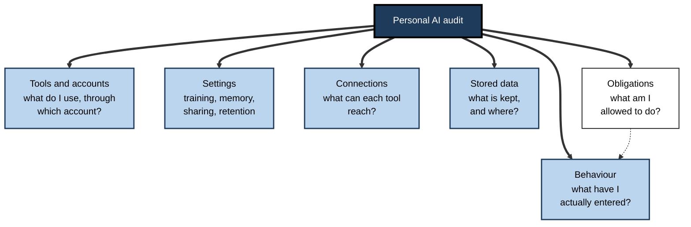
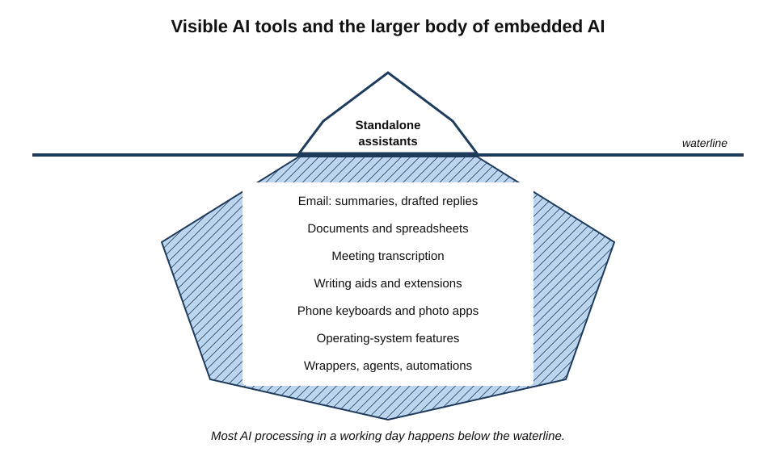
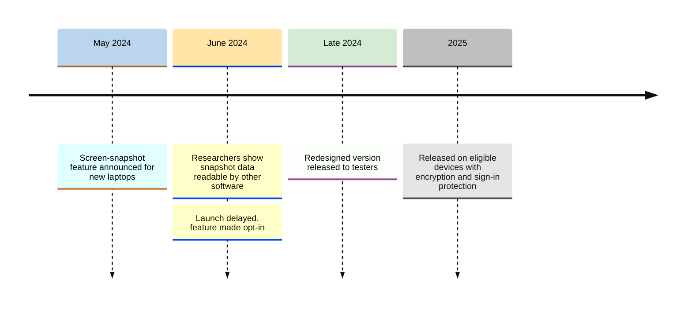
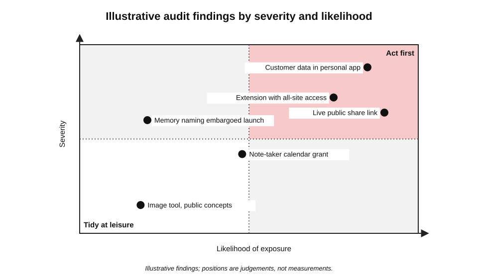
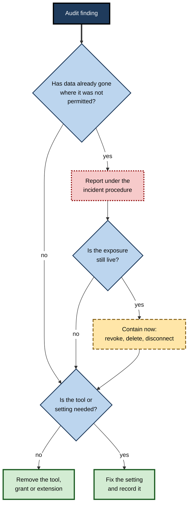
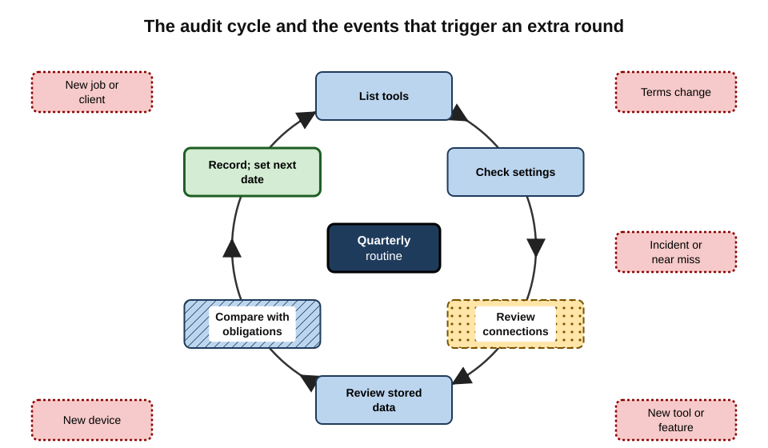

# J.9. Auditing your own tool use

A client's procurement team sends an independent consultant a short questionnaire: "Which AI tools have processed our information during the engagement, under what terms, and where is that information now?" She uses AI every day, but she cannot answer. She is not sure which of her apps have AI features switched on, which accounts she used, or what remains in their histories.

> **Definition — Personal AI audit:** a periodic, structured review by an individual of the AI tools, accounts, settings, connections and stored data they use, measured against the obligations that apply to their work.

**Why it matters**

- **Use drifts.** New tools, new features and new habits accumulate faster than anyone tracks them.
- **AI hides inside other software.** Email, documents, browsers, phones and meeting tools add AI features, often switched on by default.
- **Accountability requires evidence.** Clients, employers and regulators increasingly ask professionals to show — not just assert — how data was handled.
- **Problems found early are small.** A stale share link or a forgotten connector found in an audit is a tidy-up; found after an incident, it is a breach.

---

## What an Audit Covers

### Six areas

1. **Tools and accounts** — every AI tool and AI feature used, and which account each is used through.
2. **Settings** — training, history, memory, sharing, retention and personalisation for each.
3. **Connections** — connectors, sign-in grants, browser extensions, plug-ins, API keys and integrations that give AI tools access to other data.
4. **Stored data** — conversation history, uploaded files, projects, custom assistants, memories and shared links.
5. **Behaviour** — what kinds of data have actually been entered, compared with what is permitted.
6. **Obligations** — the employer's AI policy, client contracts, professional rules and regulated-data duties that apply.

> **Mnemonic — "TSC-SBO", read as "the six boxes":** Tools, Settings, Connections, Stored data, Behaviour, Obligations.

**Figure 1.** The six areas of a personal AI audit and the questions each answers.

> **Key point:** the audit is a comparison between **what is happening** (the first five areas) and **what is allowed** (the sixth). Without the obligations, it is only an inventory.

---

## Finding Every Tool

### Visible and hidden AI

- **Visible tools** — standalone assistants opened deliberately.
- **Embedded features** — AI inside software already in use:
  - email clients that summarise threads and draft replies;
  - word processors, spreadsheets and slide tools with built-in assistants;
  - meeting platforms with transcription and summaries;
  - writing aids and grammar checkers that send text for analysis;
  - note-taking and project-management apps with AI features;
  - design and photo tools with generative editing.
- **System-level features** — AI in the operating system, browser or phone keyboard that can read what is on screen or typed.
- **Third-party wrappers** — apps and browser extensions built on others' models.
- **Agents and automations** — scheduled or delegated tasks that run without the user watching.

**Figure 2.** Visible AI tools are only the tip; most AI processing in daily work happens in embedded and system-level features.

### Methods of discovery

- **Walk through a working day** — list every application used, then check each for AI features.
- **Check settings pages** — most software now has an "AI" or "Labs" section listing features and their state.
- **Review account security pages** — the "apps with access to your account" lists kept by major email and identity providers show third-party apps granted access.
- **Review browser extensions** — note any with AI functions and what permissions they hold.
- **Review subscriptions and expenses** — paid AI plans appear on card statements and expense claims.
- **Check phones** — keyboards, assistants, photo apps and voice recorders.
- **Ask colleagues** — tools adopted by a team often spread without anyone deciding.

> **Watch out:** a feature can be on without ever having been used. Some embedded assistants process content in the background — to suggest replies or summaries — whether or not the user clicks on them.

### Study card — Microsoft Recall (2024–2025)

- **What it was:** a Windows feature announced in May 2024 for a new class of AI-capable laptops. It would take snapshots of the screen every few seconds, analyse them with on-device AI and let users search everything they had seen.
- **Concerns:** security researchers showed that, in preview versions, the snapshot database was stored in a form other software on the machine could read; critics warned that it would capture passwords, private messages and confidential documents shown on screen, including other people's.
- **Changes made:**
  - the launch was delayed;
  - the feature was made **opt-in** rather than on by default;
  - access was tied to biometric sign-in and the data encrypted;
  - it reached testers in late 2024 and general availability on eligible devices in 2025.
- **Significance for auditing:** system-level AI can capture everything a person works on, from every application, in one place. An audit must include the operating system, not only the apps.
- **Lesson:** the strongest protections came from **design changes under scrutiny** — default off, encryption, authentication — not from users finding the feature themselves.

**Figure 3.** Key events in the Recall episode.

---

## Settings and Connections

### Settings to record for each tool

- **Account type** — personal, team or enterprise.
- **Training** — on or off.
- **History** — on, off or auto-deleting.
- **Memory** — on or off; number of saved memories.
- **Sharing** — any live links; default audience.
- **Connectors** — which data sources are connected.
- **Data location** — if selectable.

### Connections deserve the closest look

> **Definition — OAuth grant:** permission given, usually through a "Sign in with…" or "Connect your account" screen, allowing an application to access data in another service on the user's behalf.

- **Sign-in and connect grants**
  - "Allow this app to read, compose and send email" gives a third-party AI app the user's whole mailbox.
  - Grants persist until revoked, even if the app is no longer used.
- **Connectors inside AI tools**
  - Drives, calendars, chat systems and code repositories linked to an assistant.
- **Browser extensions**
  - Permissions such as "read and change all your data on all websites" allow an extension to see every page, including webmail, banking and internal systems.
- **API keys**
  - Keys stored in scripts, notebooks or automation tools give access to paid AI accounts and their logs; leaked keys can be abused by others.
- **Automations**
  - Workflows that send data from one service to an AI model and back, running on a schedule.

| Connection | What it can reach | Typical place to review | Common finding |
|---|---|---|---|
| OAuth grant to an AI app | Mailbox, files, calendar | Account security page of the email or identity provider | Apps tried once and never removed |
| Connector in an assistant | Linked drives, channels | Assistant's settings | Broad access to a whole shared drive |
| Browser extension | Every website visited | Browser extensions page | AI helpers with all-site permissions |
| API key | AI account usage and logs | Developer console, code repositories | Keys in shared notebooks |
| Automation | Whatever the workflow moves | Automation platform | Old flows still running |

> **Key point:** connections turn an AI tool from something that sees what it is **given** into something that sees what it can **reach**. They are the area where audits most often find serious exposure.

---

## Reviewing Stored Data and Behaviour

### Reviewing history efficiently

Reading every conversation is impractical. Targeted searches reveal most problems quickly.

| Search for | What it tends to find |
|---|---|
| Client and project names | Client confidential material |
| Colleagues' names | Personal data, HR matters |
| "confidential", "draft", "internal", "NDA" | Material marked or described as restricted |
| "salary", "diagnosis", "grievance", "visa" | Special category and sensitive personal data |
| "password", "key", "token" | Credentials pasted for troubleshooting |
| "@" and number patterns | Email addresses, phone and account numbers |
| File names and extensions | Uploaded spreadsheets and documents |

### Other stored data

- **Uploaded files** — the files list in each tool, separate from conversations.
- **Projects and custom assistants** — their files, instructions and membership.
- **Memories** — saved facts about the user and about others.
- **Shared links** — the list of live links, if the tool provides one.
- **Exports** — a full data export reveals what the tool's interface may not show.

### Comparing behaviour with obligations

- **For each finding, ask:** was this permitted, under the account and terms in use, by the employer's policy and the client's contract?
- **Patterns matter more than single items** — repeated use of a personal account for client work is a bigger finding than one mistaken paste.

---

### Using data exports

- **Why** — a full export shows what the provider holds, including items the interface hides or makes hard to browse: old archived chats, project files, memories, custom instructions.
- **How** — most services offer an export from their data or privacy settings; the file usually arrives by email or download within a day.
- **What to look for** — the date of the oldest conversation, the number of files, the list of memories, any conversation titles naming clients or people.
- **Legal route** — where an export is incomplete, a subject access request can ask the provider for all personal data held, the purposes, the recipients and the retention period.

> **Example (illustrative):** an export from a personal assistant account reveals 640 conversations going back three years, 58 uploaded files and 74 memories, nine of which name colleagues. *Illustrative figures.*

### Auditing outputs and where they went

- **Deliverables** — which client documents, reports or code contain AI-generated material, and does the client know?
- **Communications** — emails and messages drafted with AI, especially to regulators, courts or clients who expect personal authorship.
- **Published material** — articles, posts and marketing copy, where disclosure rules or platform policies may apply.
- **Copies** — downloads, screenshots and exported conversations stored on devices and drives.

> **Key point:** an audit of AI use is incomplete if it looks only at what went **in**. What came **out**, and where it was used, carries its own confidentiality, accuracy and disclosure duties.

### Auditing devices

- **Work laptop** — browser profiles, extensions, desktop AI apps, system features.
- **Personal phone** — AI apps, keyboards, assistants, photo tools, voice recorders; which are signed in to which accounts.
- **Home computer and tablets** — devices shared with family members, where work sessions may remain signed in.
- **Smart speakers and wearables** — voice assistants within earshot of calls about confidential matters.
- **Old devices** — phones and laptops being sold or recycled, still signed in to AI accounts.

---

## Choosing the Depth of an Audit

Not every audit needs to be exhaustive. Matching the depth to the occasion keeps the habit sustainable.

| | Light check | Standard audit | Deep audit |
|---|---|---|---|
| When | Monthly, or after adopting a tool | Quarterly | On changing jobs or clients, after an incident, or when a client asks |
| Time | About 15 minutes | About an hour | Several hours |
| Scope | Settings and live share links in main tools | All six areas for all known tools | All six areas, plus exports, devices and outputs |
| Output | Notes in the register | Updated register and actions | Register, actions, written summary, reports where needed |

*Illustrative timings.*

- **Light checks** catch drift: a setting reset by an update, a link left live.
- **Standard audits** maintain the register and remove unused tools and grants.
- **Deep audits** produce evidence that can be shown to an employer or client.

> **Remember:** **light monthly, standard quarterly, deep on change.**

### Questions to put to providers

- **What data do you hold about my account?** — answered by an export or subject access request.
- **Has my content been used for training?** — providers often cannot say for individual items, but can state what the settings allowed during each period.
- **How do I delete everything, and how will I know it is done?** — a precise answer distinguishes live systems from backups.
- **Which other companies receive my data?** — the sub-processor list.

---

## Rating and Acting on Findings

### Rating

- **Severity** — how serious would exposure be? Consider regulated data, client confidentiality, number of people affected.
- **Likelihood** — how likely is exposure? Consider public links, broad connectors, consumer terms, long retention.

**Figure 4.** Findings from an illustrative audit placed by severity and likelihood.

### Triage

**Figure 5.** Deciding what to do with each audit finding.

> **Remember:** **report, contain, remove, fix** — in that order. Tidying up a past disclosure without reporting it can look like concealment.

---

## Recording the Audit

### A one-page register

- **For each tool:** name; account type; purpose; data classes allowed; settings (training, history, memory, sharing); connections; retention; date checked; next check.
- **For the audit as a whole:** date; findings; actions taken; anything reported; anything still open.

| Tool | Account | Used for | Training | Memory | Connections | Checked |
|---|---|---|---|---|---|---|
| General assistant | Enterprise | Drafting, analysis | Excluded by contract | Off | Work drive (one folder) | 3 March |
| Meeting notes feature | Enterprise (built in) | Internal meetings only | Excluded | — | Calendar | 3 March |
| Writing aid extension | Personal | Removed | — | — | Had all-site access | 3 March |

*Illustrative entries.*

> **In practice:** a short register lets a professional answer a client's AI questionnaire in minutes, with dates, instead of reconstructing a year of use from memory.

### How often

- **Routine** — quarterly is a common rhythm; monthly for heavy users in sensitive roles.
- **Triggers** — run an extra audit when:
  - starting or ending a job or a major client engagement;
  - a provider announces new terms;
  - a new device is set up;
  - a significant new feature or tool is adopted;
  - an incident or near miss occurs.

**Figure 6.** The audit as a repeating cycle, with events that should trigger an extra round.

---

## Worked Example (illustrative): A Marketing Manager's First Audit

**Situation:** a marketing manager at a consumer-goods company, who uses AI daily, runs her first audit after her employer introduces an AI policy.

**Step 1 — inventory:** she lists nine AI tools or features, against the three she expected.

| Found | Account | Status against policy |
|---|---|---|
| Enterprise assistant | Enterprise | Approved |
| Assistant in the office suite | Enterprise | Approved |
| Personal chatbot app on phone | Personal | Not approved for work data |
| Image generator | Personal paid | Approved for public campaign concepts only |
| Grammar extension with AI rewriting | Personal | Not approved; all-site access |
| Social-media scheduler with AI captions | Team plan via agency | Not assessed |
| Survey tool's AI summary feature | Company account | Approved for anonymised data |
| Phone keyboard with AI suggestions | Personal | Not assessed |
| Free transcription app | Personal | Not approved |

*Illustrative figures.*

**Step 2 — searches of history** in the personal chatbot app reveal:

- 23 conversations naming the company's retail clients;
- 2 uploaded spreadsheets of customer survey responses with email addresses;
- a saved memory: "works on the Lumen launch, embargoed until 1 May".

**Step 3 — triage**

1. **Report** the spreadsheets — personal data of customers entered into an unapproved tool.
2. **Contain** — delete the spreadsheets, conversations and memory; switch off training and memory.
3. **Remove** — the grammar extension and the transcription app.
4. **Assess** — ask the IT team about the scheduler and the keyboard.
5. **Fix** — move all work use to the enterprise assistant.
6. **Record** — create the register and set a date three months ahead.

- **Conclusion:** most of what she found was harmless. One finding — customer data in a personal app — needed reporting; two tools with broad access were simply unnecessary.

> **Watch out:** the temptation on finding an old problem is to delete it quietly. Where personal or client data has gone somewhere it should not, the organisation may have duties to assess and notify; only it can decide.

---

## Case Study (illustrative): The Freelancer's Client Questionnaire

- **Situation:** the consultant from the opening must answer the client's procurement questionnaire within a week.
- **What she did:**
  1. listed her working week, application by application;
  2. found five AI features, including meeting summaries in her video-call software and an AI note-taker she had trialled once;
  3. discovered that the note-taker still held recordings of two client workshops and had an active grant to her calendar;
  4. checked her assistant's history and found the client's draft strategy pasted into a personal account early in the engagement;
  5. checked each provider's terms for training and retention.
- **Disclosure:** she told the client exactly what had happened, what she had deleted and when, and which tools she would use for the remainder of the engagement.
- **Changes:**
  - moved client work to a business plan with training excluded;
  - revoked the note-taker's calendar access and deleted its recordings;
  - added an AI clause to her standard terms describing her tools and safeguards;
  - began a quarterly audit with a one-page register.
- **Result:** the client continued the engagement and later cited her register as a model for other suppliers.
- **Lesson:** an honest audit, disclosed promptly, **strengthened** trust; the same facts discovered by the client would have ended it.

*Illustrative scenario.*

---

## Professional Mastery

### Habits of practitioners who audit well

- **Keep the register live** — update it when adopting or dropping a tool, not only at audit time.
- **Prefer fewer tools** — every tool is another set of settings, terms and stored data.
- **Revoke by default** — remove grants, extensions and connectors not used in the last quarter.
- **Search with a standard list** — the same keywords each time make audits fast and comparable.
- **Audit the phone** as carefully as the laptop.
- **Record decisions as well as findings** — "kept image generator for public concepts only" shows judgement, not just activity.
- **Disclose honestly** when the audit uncovers a past problem.

### Why recording works

**Study card — Harkin and colleagues (2016), monitoring and goal attainment**

- **Design:** a meta-analysis in *Psychological Bulletin* of 138 studies in which people were prompted to monitor their progress towards goals, compared with control conditions.
- **Results:**
  - prompting progress monitoring improved goal attainment, with an average effect around **d = 0.40**, a small-to-medium effect;
  - effects were larger when progress was **physically recorded** and when it was **reported** to others.
- **Relevance:** a written register and a dated audit are forms of recorded monitoring; telling a manager or client that audits happen adds the reporting element.
- **Caveat:** the studies concerned goals such as health behaviours and study, not data protection; the transfer to AI-use habits is plausible but not directly tested.

### How personal audits fit with organisational ones

- **Organisations audit centrally** — approved tools, configurations, logs and data-loss alerts.
- **Individuals see what central audits miss** — personal accounts, phones, extensions, trial tools.
- **Good organisations ask for both** — some run periodic self-attestation, asking staff to confirm they have reviewed their tools against policy.

### Failure modes

- **Inventory without obligations** — listing tools without checking them against rules.
- **Visible tools only** — missing embedded and system features.
- **Settings without connections** — checking toggles but not grants and extensions.
- **Quiet clean-up** — deleting evidence of a past disclosure instead of reporting it.
- **One-off audits** — a single tidy-up that drifts back within months.

---

## Open Questions

- **Can individuals realistically audit embedded AI?**
  - As AI becomes part of every application, the number of features to check may exceed what a person can track.
- **Should software be required to disclose AI processing clearly?**
  - Proposals for standard "AI labels" or settings dashboards are being discussed; no common standard exists.
- **How much self-audit should employers require?**
  - Self-attestation spreads responsibility but may encourage box-ticking.
- **Can audit tools help without becoming surveillance?**
  - Tools that scan histories for sensitive data could help individuals but could also be used to monitor them.
- **How should audits handle agents?**
  - Agents acting on a person's behalf leave traces in many systems that the person may not know to look for.

---

## Summary

- A **personal AI audit** reviews **tools, settings, connections, stored data and behaviour** against **obligations** — "the six boxes".
- Most AI in daily work is **embedded** in email, documents, meetings, browsers, keyboards and operating systems; discovery needs a walk through the day, settings pages, account security pages, extensions, subscriptions and phones.
- **Microsoft Recall (2024–2025)** showed system-level AI capturing everything on screen, and the value of opt-in, encryption and authentication.
- **Connections** — OAuth grants, connectors, extensions, API keys and automations — let tools reach data they were never given and are the commonest source of serious findings.
- Review history with **targeted searches** for clients, colleagues, sensitivity words, credentials and identifiers; check files, projects, memories and links; use **data exports**.
- Rate findings by **severity and likelihood**; act in the order **report, contain, remove, fix**.
- Keep a **one-page register**; audit **quarterly** and on **triggers** such as job changes, terms changes, new devices, new tools and incidents.
- Honest audits, disclosed promptly, build trust; quiet clean-ups of past disclosures do the opposite.

---

## Self-Check

1. Define a personal AI audit and name its six areas.
2. Why is an inventory without obligations not an audit?
3. List five places where embedded AI features are commonly found.
4. Describe five methods for discovering AI tools and features in one's own work.
5. What happened with Microsoft Recall, and what does it teach about audits?
6. What is an OAuth grant, and why do grants matter for AI privacy?
7. Why are connections often the most serious audit findings?
8. List six keywords or patterns useful for searching AI history, and what each finds.
9. Explain the order "report, contain, remove, fix".
10. What should a one-page AI register contain?
11. Name five events that should trigger an extra audit.
12. An audit reveals that last year you uploaded a client's customer list to a personal AI account. What do you do, and in what order?

### Answer Key

1. A periodic, structured review of one's AI tools, accounts, settings, connections and stored data against applicable obligations. Areas: tools and accounts, settings, connections, stored data, behaviour, obligations.
2. An audit compares what is happening with what is allowed; without the obligations, there is no standard against which to judge findings.
3. Email clients, word processors and spreadsheets, meeting platforms, writing aids, note-taking apps, design tools, browsers, phone keyboards, operating systems (any five).
4. Walking through a working day; checking AI sections in settings; reviewing account security pages for app grants; reviewing browser extensions; reviewing subscriptions and expenses; checking phones; asking colleagues (any five).
5. A Windows feature announced in 2024 to snapshot and analyse the screen continuously; researchers showed preview data was readable by other software; Microsoft delayed it, made it opt-in, and added encryption and biometric protection. Audits must include system-level features, and safe defaults matter.
6. Permission given through a "sign in with" or "connect" screen for an app to access another service's data. Grants can give AI apps whole mailboxes or drives and persist until revoked.
7. They let tools reach data beyond what the user deliberately gives them, often broadly and persistently, and they are easily forgotten.
8. Client and project names (confidential material); colleagues' names (personal data); "confidential", "NDA" (restricted material); "salary", "diagnosis" (special category data); "password", "key" (credentials); "@" and number patterns (contact and account details); file names (uploads).
9. Report first so the organisation can meet any duties; contain any live exposure; remove unneeded tools and grants; fix settings for tools that stay. Cleaning up before reporting can destroy evidence and look like concealment.
10. For each tool: name, account type, purpose, data classes allowed, settings, connections, retention, date checked and next check; for the audit: date, findings, actions, reports made and open items.
11. Starting or ending a job; starting or ending a major engagement; provider terms changes; new device; adopting a significant tool or feature; an incident or near miss.
12. Report under the employer's incident procedure, giving facts and dates; follow its instructions on containment — typically deleting the file and conversations and switching off training; check whether the provider's terms allowed training; record what was done; adjust practice so client data goes only into approved tools.

---

## Glossary

| Term | Meaning |
|---|---|
| API key | A secret credential giving software access to an AI service account. |
| Audit register | A short record of tools, settings, connections and checks. |
| Browser extension | An add-on that extends a browser and may have access to web pages visited. |
| Connector | A link letting an AI tool read data from another service. |
| Embedded AI feature | An AI capability built into software used for other purposes. |
| Likelihood | How probable it is that a weakness leads to exposure. |
| OAuth grant | Permission for an app to access another service's data on the user's behalf. |
| Personal AI audit | A periodic review of one's AI tools and data against obligations. |
| Self-attestation | A person's formal confirmation that they have reviewed their practice against policy. |
| Severity | How serious the consequences of exposure would be. |
| System-level AI | AI built into an operating system or device that can see across applications. |
| Trigger event | An event that should prompt an extra audit. |
