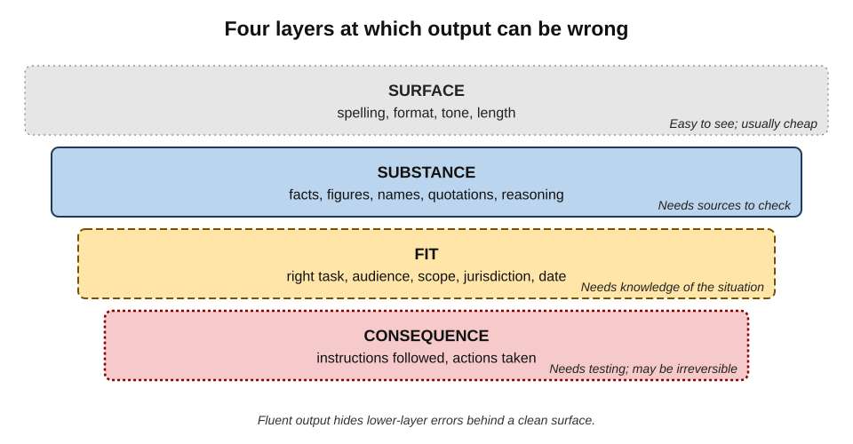
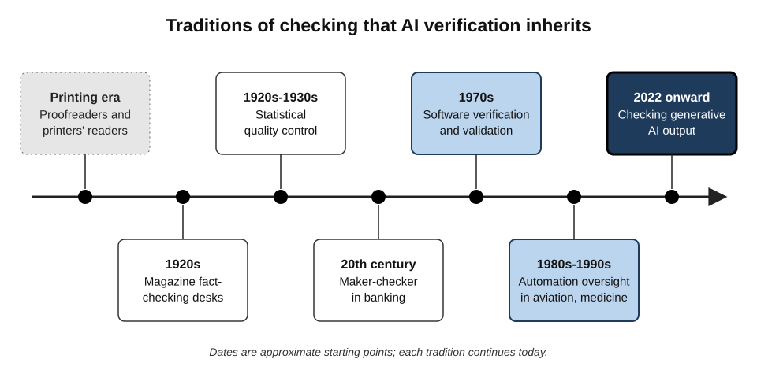
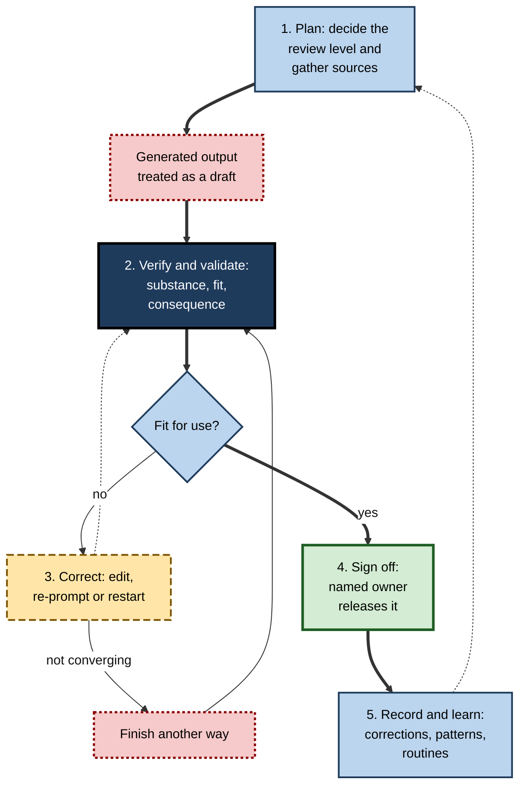
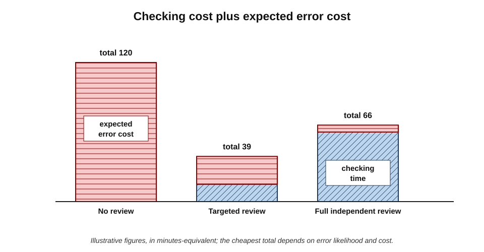
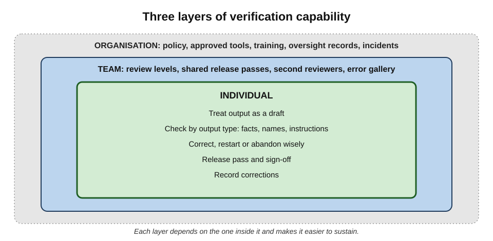
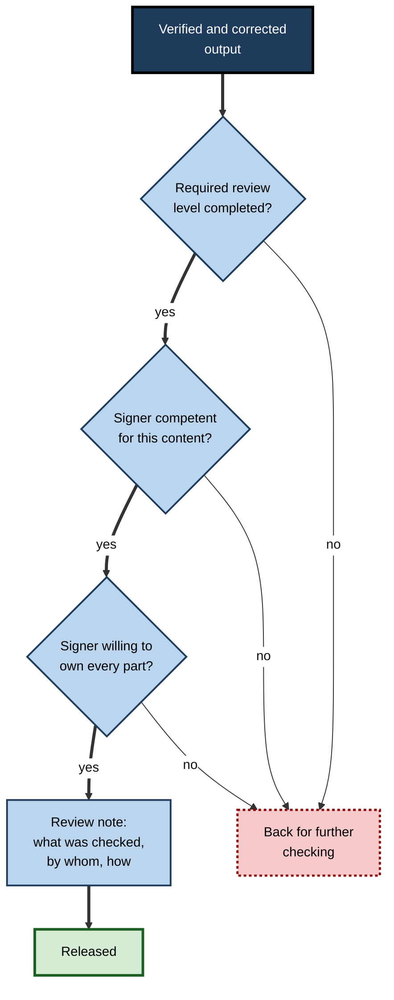

# K. Verifying & Correcting AI Output

Generative AI has made the first draft almost free. A report, a contract summary, a block of code or a client email can appear in seconds, fluent and well formatted. What it has not made free is **knowing whether the draft is right**. That work — checking, correcting and deciding to stand behind the result — has become one of the central skills of digital work, and the one that most separates professionals who gain from AI from those who are harmed by it.

> **Definition — Verifying and correcting AI output:** the set of practices by which a person or organisation establishes whether AI-generated output is accurate, complete, fit for its purpose and safe to act on; corrects what is wrong; and takes accountable ownership of what is finally used, sent or done.

**Why the subject matters**

- **Responsibility stays with people.** Courts, regulators, clients and employers hold the person or organisation that releases work accountable for it, however it was produced.
- **AI errors are distinctive.** They arrive fluent, confident and plausible, without the visible roughness that once signalled unfinished work.
- **Volume has exploded.** One person can now produce in a day what once took a week; the checking burden has grown in proportion.
- **The economics depend on it.** Time saved in drafting is real only if checking and correction cost less than the errors they prevent — and less than doing the work another way.
- **The skill is durable.** Tools change monthly; the disciplines of verification — provenance, independence, proportion, ownership — last a career.

---

## The Scope of the Subject

### What is verified

- **Surface** — spelling, format, tone, length.
- **Substance** — facts, figures, names, dates, quotations and reasoning.
- **Fit** — whether the output answers the actual question, for the right audience, scope, jurisdiction and moment.
- **Consequence** — instructions that will be followed and actions an agent will take.

**Figure 1.** Four layers at which AI output can be wrong.

> **Key point:** the lower the layer, the harder the error is to see and the more it costs when missed. Fluent generation perfects the surface, which is exactly what makes errors in the lower layers easy to overlook.

### Verification, validation, correction and sign-off

- **Verification** — checking that output is correct against sources and requirements: *is it right?*
- **Validation** — checking that output serves its real purpose: *is it the right thing?*
  - The distinction comes from software engineering, where Barry Boehm summarised it in 1979 as "Are we building the product right?" versus "Are we building the right product?"
- **Correction** — changing what is wrong, by editing, instructing the tool again, restarting or finishing the work another way.
- **Sign-off** — the accountable decision to release, with a person's name attached.

> **Definition — Validation:** confirming that an output meets its real purpose and the needs of its users, as distinct from verification, which confirms that it is correct against its specification or sources.

> **Definition — Sign-off:** the explicit, accountable decision by a named person that an output may be released or acted upon.

**How the four activities differ**

| | Verification | Validation | Correction | Sign-off |
|---|---|---|---|---|
| Question | Is it correct? | Is it the right output for the purpose? | What must change? | Will I stand behind it? |
| Compared against | Sources, records, tests | Purpose, audience, situation | The verified and validated standard | All of the above |
| Typical failure | Plausible error passes | Correct answer to the wrong question | Fix introduces new error | Nominal approval without review |
| Who | Author or reviewer | Author, often with the requester | Author | A named accountable person |

### Across every kind of output

- **Text** — emails, reports, summaries, translations.
- **Numbers** — calculations, tables, charts.
- **Code and formulas** — scripts, queries, spreadsheet logic.
- **Instructions and procedures** — steps people will follow.
- **Media** — images, slides, audio and video.
- **Actions** — what agents do in systems: sending, editing, deleting, paying.

---

## Where Verification Comes From

Checking other people's work is old; checking machine-generated work at scale is new. The present practice inherits from several traditions.

**Figure 2.** Traditions of checking that AI verification inherits.

### Printing and publishing

- **Proofreaders and printers' readers** checked typeset text against the author's copy from the early centuries of printing.
- **Magazine fact-checking** became a formal function in the United States from the 1920s, with dedicated staff verifying every name, date, figure and quotation before publication.
- **Corrections columns and readers' editors** later made correction public and systematic.

### Quality management

- **Statistical quality control**, developed by Walter Shewhart at Bell Telephone Laboratories in the 1920s and spread by W. Edwards Deming and others, replaced inspection of every item with **sampling and process control**.
- **The lesson for AI:** quality comes from a well-designed process, with checking targeted where it matters, not from heroic inspection at the end.

### Financial controls

- **Maker–checker** or **four-eyes** controls separate preparing a transaction from approving it.
- **Segregation of duties** ensures that no single person can both create and authorise a consequential action.

### Software engineering

- **Verification and validation**, **code review** and **testing** became disciplines from the 1970s.
- **Tests as executable checks** — software showed that some verification can be automated and repeated on every change.

### Automation in safety-critical work

- **Aviation and medicine** studied how people supervise automated systems from the 1980s onwards, and found **automation bias** — the tendency to accept automated suggestions and to look less hard for contradicting evidence — and **complacency** when systems are usually right.
- **Checklists and pause points** — such as the surgical safety checklist — showed that short, structured checks at fixed moments reduce harm.

> **Key point:** almost every practice for checking AI output has a precedent. What is new is the **combination** — fluent, high-volume, variable output arriving in every profession at once.

---

## Why AI Output Needs Its Own Discipline

### Characteristics of generated output

- **Fluency without commitment** — text is produced by predicting plausible continuations, not by asserting checked facts.
- **Uneven reliability** — the same tool may be excellent at one task and poor at a similar-looking one, and the boundary is not visible from the output.
- **Plausible errors** — when wrong, models tend to be wrong in the direction of what is typical or expected, so errors fit the reader's expectations.
- **Variability** — the same request can produce different answers; a correct answer today does not guarantee one tomorrow.
- **Missing provenance** — the author of a generated text usually cannot say where each claim came from.
- **Agreement with the user** — models tend to accept the premises and corrections users supply, even mistaken ones.

### Characteristics of the people checking it

- **Automation bias and complacency** — accepting output because it came from a system that is usually right.
- **The finish illusion** — mistaking polish for readiness.
- **Effort mismatch** — little effort went into producing the output, so little effort feels warranted in checking it.
- **Expertise gaps** — people use AI most in areas where they know least, which is where they are least able to check.

**Study card — Bansal and colleagues (2021), explanations and reliance**

- **Setting:** researchers at the University of Washington and Microsoft Research studied people making decisions with an AI assistant whose recommendations were sometimes wrong; presented at the CHI conference on human factors in computing.
- **Design:** participants saw the AI's recommendation with or without an explanation of its reasoning, across several tasks where human and AI accuracy were comparable.
- **Results:**
  - explanations **increased the chance that people accepted the AI's recommendation** — whether the recommendation was **right or wrong**;
  - explanations therefore did not reliably help people tell good recommendations from bad ones, and did not produce better joint performance than simpler displays of the AI's confidence.
- **Conclusion:** persuasive presentation can raise reliance without improving its quality.
- **Lesson:** fluent reasoning attached to generated output — "here is why this is correct" — is not a substitute for checking against an independent source.

> **Watch out:** a common belief is that explanations from an AI make its output safer to use because users can "see the reasoning". The evidence suggests explanations often **increase trust indiscriminately**; they help only when they make independent checking easier.

---

## The Verification and Correction Cycle

The practices of the subject can be organised as one cycle, applied to every consequential output.

**Figure 3.** The verification and correction cycle.

### 1. Plan

- **Decide how much review the output will need before seeing it**, from the consequence of an error, the likelihood of one, and who will rely on the output. Commitments, compliance, decisions about people, money, public statements, production systems and procedures usually justify full review; brainstorms and private notes do not.
- **Gather the sources** the output must match — the contract, the data, the policy, the transcript.

### 2. Verify and validate

- **Treat everything generated as a draft** — provisional, unowned and unverified until someone checks it.
- **Check substance by type:** figures need tracing to sources and recomputing; names, dates and quotations need checking against records rather than memory; instructions need testing before anyone follows them, in proportion to how hard their effects are to undo.
- **Read for plausible errors** — the typical answer applied to the wrong case, the outdated fact, the dropped caveat, the false premise accepted.
- **Use independent cross-checks** — a calculation, a database, the source document or a knowledgeable colleague — remembering that a second AI model often shares the first one's blind spots.

### 3. Correct

- **Small, precise fixes by hand; larger ones by targeted re-prompting** that locates the error, supplies the correct information and protects what should not change — then re-verify, because every regeneration is a new draft.
- **Restart with a consolidated brief** when corrections stop converging, and **finish the work another way** when checking would cost as much as doing it, or when the work must be the author's own.

### 4. Sign off

- **A named person decides to release**, having checked what the review level required.
- **The sign-off question:** "Would I be content to have written and checked every part of this myself?"

### 5. Record and learn

- **Keep a brief record of corrections** — what was wrong, what kind of error, how serious — so that patterns become visible and checks can be targeted.
- **Build checks into routine moments** — before prompting, after generation, before sending — so that they happen under pressure.
- **Teach others** through modelling, practice on realistic errors and feedback, so that verification becomes a shared skill rather than one careful person's habit.

> **Mnemonic — "PVCSR" ("Plan, Verify, Correct, Sign, Record"):** "Professionals Verify, Correct, Sign, Record."

---

## The Economics of Verification

Verification is worth doing when it costs less than the errors it prevents.

> **Formula — Expected cost of an output:** expected cost = checking cost + (probability an error survives × cost of that error). Example (illustrative figures): with no review, a 20% chance of an error costing 600 minutes-equivalent gives 0 + 0.2 × 600 = **120**; with a 15-minute targeted review that cuts the surviving-error chance to 4%, the cost is 15 + 0.04 × 600 = **39**.

**Figure 4.** Checking cost plus expected error cost for three ways of handling one output.

- **Too little checking** — cheap until an error escapes, then very expensive.
- **Too much checking** — every output fully and independently reviewed; safe but slow, and often decays into nominal approval.
- **Proportionate checking** — targeted at the claims and outputs where errors are likely and costly.

**Where the time saving of AI really comes from**

| Task | Drafting time saved | Verification cost | Net effect |
|---|---|---|---|
| Reformatting own content | High | Low (compare with original) | Large saving |
| Routine internal message | Moderate | Low | Saving |
| Summary of a long document | High | Moderate to high (must consult the source) | Saving only with efficient checks |
| Bespoke legal or technical analysis | Moderate | Very high (checking requires the research) | Little or none |
| Personal or relationship-critical message | Low to moderate | Low, but authenticity matters | Often better written personally |

> **Key point:** the most important number in AI productivity is often not drafting speed but **verification asymmetry** — how much cheaper it is to check an output than to produce it.

---

## Landmark Debates

### Will better models make verification unnecessary?

- **For:** error rates on many tasks have fallen with each generation of models; grounding in documents and tools for calculation reduce some error types.
- **Against:** rare, plausible errors remain; tasks shift towards harder ones as tools improve; and accountability does not change with accuracy.
- **Current position:** most professional bodies and regulators expect verification proportionate to risk, whatever the tool's typical accuracy.

### Can AI check AI?

- **For:** second models can surface doubts, inconsistent samples can flag guesses, and automated tests catch many code errors.
- **Against:** models share training data and errors, tend to approve fluent text, and lack access to the organisation's records.
- **Current position:** AI checks are useful **layers** — especially where they bring external feedback such as test results — but not substitutes for independent sources and accountable human judgement.

### Is human oversight meaningful?

- **The concern:** a person who approves hundreds of outputs an hour provides oversight in name only, and may become the "moral crumple zone" who absorbs blame for system failures.
- **The response:** oversight must be **designed** — proportionate review, time to review, tools that make checking cheap, and approval reserved for decisions that matter.

### Who is responsible?

- **The settled answer:** the person or organisation that releases or acts on the output.
- **The open question:** how responsibility is shared with tool providers and with organisations that deploy tools in ways that make careful checking impractical.

---

## Standards, Regulation and Professional Duty

- **The European Union's AI Act** (adopted 2024) requires that high-risk AI systems be designed for **effective human oversight**, and, since February 2025, that organisations deploying AI take measures to ensure **sufficient AI literacy** among staff who use it.
- **Courts** in several jurisdictions, including the United States and England and Wales, have sanctioned or publicly warned lawyers who submitted AI-generated material containing fictitious authorities, and have stated that the duty to check cannot be delegated to the tool.
- **Professional regulators** in law, accountancy, medicine and financial services have issued guidance that practitioners remain responsible for AI-assisted work and must supervise it competently.
- **Data-protection law** requires personal data to be accurate, which applies to generated content about identifiable people.

> **In practice:** organisations increasingly write AI use policies that specify **which outputs require which review**, **who may sign off**, and **how review is recorded** — turning the cycle into an auditable process.

---

## Verification Capability in Organisations

**Figure 5.** Three layers of verification capability.

### The individual layer

- The **draft stance**, checks by output type, judicious correction, a release pass before sending and a simple record of corrections.

### The team layer

- **Default review levels** for common tasks, **shared release passes**, **second reviewers** for high-stakes work, and an **error gallery** of anonymised real catches used for teaching.

### The organisational layer

- **Policy** on review and sign-off, **approved tools** for each kind of data, **training** in verification skill, **records** of oversight, and **incident handling** for errors that reach readers.

> **Key point:** each layer depends on the one inside it. Policy without individual habits produces paperwork; habits without team routines produce inconsistent assurance; both without organisational support collapse under time pressure.

**Figure 6.** Sign-off as the bridge between verification and release.

### The review note

- For high-stakes outputs, a short note states what was checked, against what, by whom: "Figures traced to the finance system; legal terms reviewed by the contracts team; narrative reviewed by the author."
- The note tells later readers **what assurance the document actually carries** — and makes sign-off a considered act rather than a click.

---

## Worked Example (illustrative): One Board Briefing Through the Cycle

A strategy manager uses an assistant to draft a two-page board briefing on entering a new market, from three analyst reports, the company's sales data and notes of an interview with a local partner.

| Stage | What happens | Finding |
|---|---|---|
| Plan | Board paper → full review with independent check of figures; sources gathered | Review level set before reading |
| Verify — figures | Number inventory: 14 figures traced | 2 wrong (one range collapsed, one percentage-point error); 1 unsupported benchmark |
| Verify — names, dates, quotes | Partner's name and title checked against correspondence; quotation against interview notes | Partner's title outdated; quotation paraphrased in quotation marks |
| Verify — plausible errors | Load-bearing claims tested: market size, regulation, competitor moves | Regulation described as "applies to all foreign entrants"; it applies above a revenue threshold |
| Validate | Does it answer the board's question (enter, delay or decline)? | It described the market but made no recommendation — added by the author |
| Correct | Figures and names by hand; regulation sentence re-prompted with the source clause; quotation converted to attributed paraphrase | Re-prompt introduced no new errors (document comparison) |
| Sign off | Finance colleague independently checks the figures; manager signs | Review note attached |
| Record | Six corrections logged with codes and severity | Two patterns noted: range collapse, scope of regulations |

*Illustrative figures.*

- **Time:** about 75 minutes of checking and correction, against an estimated six hours to draft from scratch.
- **Errors prevented:** at least four that a board member or the partner would have noticed.
- **Lesson:** the cycle preserved most of the time saving **and** produced a paper the manager could defend line by line.

---

## Case Study (illustrative): A Firm-Wide Verification Standard

- **Situation:** a professional-services firm of 2,000 staff rolled out an enterprise AI assistant. Within six months, quality reviews found AI-related errors in client deliverables: invented statistics, misattributed quotations, outdated regulations and one set of instructions to a client that would have deleted archived data.
- **Diagnosis:**
  1. guidance said "always check AI output" but did not say **what, how or how much**;
  2. staff checked surfaces — spelling, tone — more than substance;
  3. reviewers often assumed authors had checked facts, and authors assumed reviewers would;
  4. no one recorded corrections, so recurring weaknesses stayed invisible.
- **Actions:**
  1. **Review levels** were defined for common deliverable types, with full review and named sign-off for client-facing work.
  2. A **release pass** — names, numbers, dates, promises, recipients — was built into email and document templates.
  3. A **correction log** with ten error codes was introduced; practice leaders reviewed it monthly.
  4. **Training** replaced a lecture with short, spaced sessions using seeded-error exercises drawn from the log.
  5. **Review notes** became mandatory for regulatory and financial deliverables.
- **Result:** in the following year, client-reported AI-related errors fell substantially; the correction log showed more errors caught before release; staff surveys reported that the standard made AI use feel **safer**, and use increased.
- **Side effects:** some teams found the review notes burdensome; they were simplified to three lines.
- **Lesson:** verification becomes reliable when it is **specified, routinised, recorded and taught** — and a good standard tends to increase confident use rather than discourage it.

---

## What Distinguishes Expert Verifiers

- **They decide the level of review before reading**, so polish cannot lower their guard.
- **They check few things, carefully** — the load-bearing claims — rather than everything superficially.
- **They know where each kind of fact lives** — the system of record, the clause, the register — and go there directly.
- **They read for plausible errors**, asking "true here, now, for whom?" and "what would make this false?"
- **They prefer independent checks** — calculation, sources, people — over asking another model.
- **They correct surgically and re-verify**, and they restart or abandon without regret when corrections stop converging.
- **They own what they sign**, and can explain every part of it.
- **They learn systematically** from their own corrections and help others learn.

---

## Open Questions

- **How should verification scale with volume?**
  - As outputs multiply and agents act autonomously, line-by-line human review becomes impossible; the right mix of sampling, automated checks and human judgement is unsettled.
- **What residual error rate is acceptable?**
  - Professions have tolerances for human error; equivalent norms for AI-assisted work do not yet exist.
- **Can interfaces make checking cheap?**
  - Linking every claim to its source, highlighting unsupported statements and showing uncertainty could transform verification; their real-world effect on reliance is still being studied.
- **What happens to expertise?**
  - If people check more and create less, the expertise needed to check may erode; how to sustain it is an open question for education and professional development.
- **How should responsibility be shared?**
  - Between users, deploying organisations and tool providers, the allocation of responsibility for AI errors is still being worked out in law and professional regulation.

---

## Summary

- **Verifying and correcting AI output** establishes whether output is accurate, complete, fit for purpose and safe; corrects it; and ends in accountable **sign-off**.
- Output can be wrong at four layers — **surface, substance, fit, consequence** — and the lower layers are harder to see and costlier.
- **Verification** asks "is it right?", **validation** "is it the right thing?" (Boehm); **correction** changes it; **sign-off** owns it.
- The practice inherits from **proofreading and fact-checking, quality control, maker–checker controls, software verification** and **automation oversight**.
- Generated output is fluent, unevenly reliable, plausibly wrong, variable and without provenance; people checking it are prone to **automation bias, the finish illusion** and expertise gaps.
- Explanations attached to AI output can **raise reliance whether or not the output is right** (Bansal and colleagues, 2021).
- The **cycle**: plan the review, verify and validate, correct (or restart, or abandon), sign off, record and learn — "Professionals Verify, Correct, Sign, Record."
- Verification pays when its cost is less than the **expected cost of errors**; **verification asymmetry** decides where AI truly saves time.
- Regulation and professional duty increasingly require **effective human oversight** and **AI literacy**.
- Capability lives in three layers — **individual habits, team routines, organisational controls** — each depending on the one inside it.

---

## Self-Check

1. Define verifying and correcting AI output.
2. Describe the four layers at which output can be wrong and explain why the lower layers are more dangerous.
3. Distinguish verification, validation, correction and sign-off, with an example of each.
4. Name four traditions of checking that AI verification inherits and one lesson from each.
5. List five characteristics of generated output that make verification necessary.
6. Summarise the Bansal and colleagues (2021) study and its implication.
7. Describe the five stages of the verification and correction cycle.
8. Using the expected-cost formula, compare no review with a review costing 20 minutes that reduces the chance of a 500-minute error from 10% to 1%.
9. What is verification asymmetry, and why does it matter for productivity?
10. Summarise the arguments for and against using AI to check AI.
11. What do regulation and professional bodies currently require of people using AI output?
12. Describe the three layers of verification capability in an organisation.
13. What does a review note contain, and why is it useful?
14. A chief operating officer proposes that, because the firm's new assistant is "95% accurate", staff should spend no time checking routine outputs and only glance at client deliverables. Evaluate the proposal and propose an alternative.

### Answer Key

1. The practices by which a person or organisation establishes whether AI output is accurate, complete, fit for purpose and safe; corrects what is wrong; and takes accountable ownership of what is finally used, sent or done.
2. Surface (spelling, format, tone), substance (facts, figures, names, quotations, reasoning), fit (task, audience, scope, jurisdiction, date) and consequence (instructions and actions). Lower layers are harder to see — fluent text hides them — and errors there mislead, misfit or cause harm.
3. Verification: tracing a report's figures to the finance system. Validation: confirming the report answers the board's actual question. Correction: fixing a wrong figure by hand. Sign-off: a named manager approving release.
4. E.g. publishing fact-checking (check every name, date, figure and quotation); quality control (design the process and sample, rather than inspect everything at the end); maker–checker (separate preparation from approval); automation oversight (beware automation bias; use short checks at fixed moments).
5. Fluency without commitment; uneven reliability across tasks; plausible errors; variability between runs; missing provenance; tendency to agree with users.
6. Explanations increased people's acceptance of AI recommendations whether right or wrong, without improving joint accuracy. Persuasive reasoning raises reliance without improving discrimination; independent checking is still needed.
7. Plan (set review level, gather sources); verify and validate (treat as draft, check by type, read for plausible errors, cross-check independently); correct (edit, re-prompt, restart or finish another way); sign off (named owner releases); record and learn (log corrections, routines, teaching).
8. No review: 0 + 0.10 × 500 = 50. Review: 20 + 0.01 × 500 = 25. The review halves the expected cost.
9. How much cheaper it is to check an output than to produce it. Where checking is cheap, AI saves much time; where checking requires nearly all the work of production, AI saves little and adds risk.
10. For: second models surface doubts; sampling flags guesses; tests catch code errors. Against: shared training data and errors, approval of fluent text, no access to records. Conclusion: useful layers, not substitutes for independent sources and human judgement.
11. Effective human oversight of high-risk systems and sufficient AI literacy (EU AI Act); personal responsibility for AI-assisted work and competent supervision (courts and professional regulators); accuracy of personal data (data protection).
12. Individual: draft stance, checks by type, correction, release pass, records. Team: review levels, shared release passes, second reviewers, error gallery. Organisation: policy, approved tools, training, oversight records, incident handling.
13. What was checked, against which sources, by whom. It tells later readers what assurance the document carries and makes sign-off deliberate.
14. Weak. "95% accurate" is an average that hides task variation; 5% of many outputs is many errors; client deliverables carry high consequence; errors are plausible and hard to detect; accountability is unchanged. Alternative: proportionate review levels by task — sampling for routine outputs, targeted review of figures, names, dates and commitments for internal reports, full review with sign-off for client deliverables — supported by release passes, correction records to measure real error rates by task, and review notes.

---

## Glossary

| Term | Meaning |
|---|---|
| Automation bias | The tendency to accept automated suggestions and look less for contradicting evidence. |
| Consequence layer | Errors in instructions or actions that change the world when acted on. |
| Correction | Changing what is wrong in an output by editing, re-prompting, restarting or finishing another way. |
| Draft stance | Treating AI output as a proposal awaiting human judgement. |
| Expected cost | Checking cost plus the probability an error survives multiplied by its cost. |
| Fit | Whether output answers the right question for the right audience, scope and moment. |
| Maker–checker | A control separating preparation of work from its independent approval. |
| Review level | The depth of checking chosen for an output, from glance to full independent review. |
| Review note | A short record of what was checked, against what and by whom. |
| Sign-off | The accountable decision by a named person to release output. |
| Substance | The facts, figures, names, quotations and reasoning in an output. |
| Validation | Confirming that output meets its real purpose. |
| Verification | Confirming that output is correct against sources and requirements. |
| Verification asymmetry | The difference between the effort to check an output and to produce it. |
