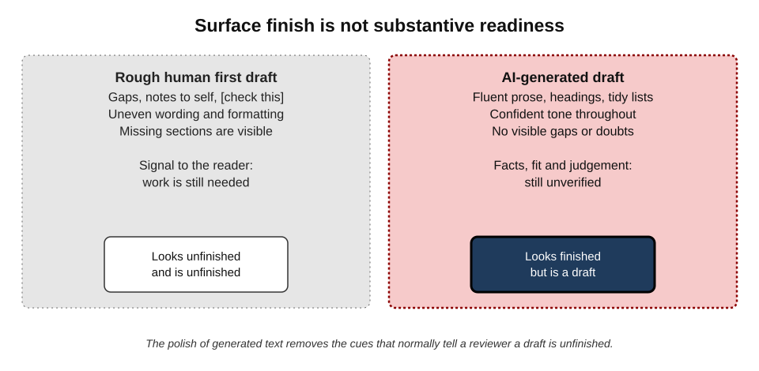
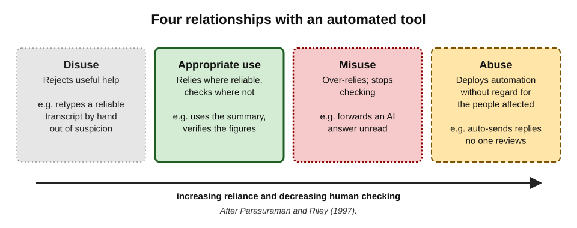
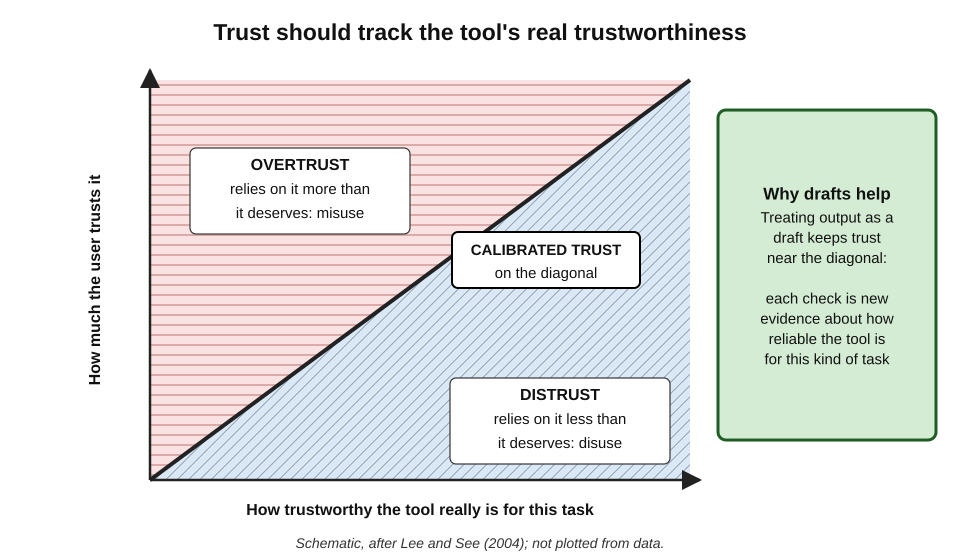
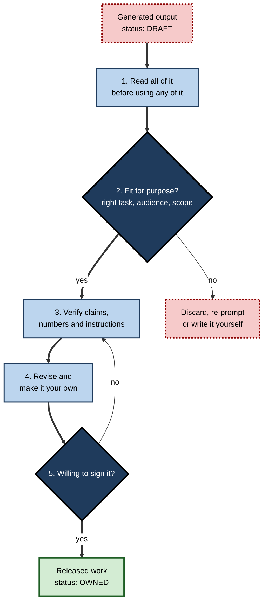

# K.1. Treating output as a draft

A project manager asks for a steering-committee update and receives four tidy paragraphs in seconds. A paralegal asks for a letter of claim and gets headings, defined terms and a confident close. A developer asks for a function and receives code that compiles. Each output **looks finished**; each is, in substance, a **first draft** that no one has yet checked, fitted to the situation or agreed to stand behind.

> **Definition — Draft stance:** the working habit of treating everything an AI tool produces as a proposal awaiting human judgement — material to be read, checked, changed and then adopted or rejected — rather than as a finished product.

**Why it matters**

- **Responsibility does not move to the tool.** The person who sends, signs, publishes or deploys the output answers for it.
- **AI output is unusually persuasive.** Fluent prose and clean formatting remove the visual cues that normally mark work as unfinished.
- **Errors are cheapest at the draft stage.** A wrong figure caught before sending costs a minute; caught by a client, it costs credibility.
- **The stance is the foundation of every later skill.** Fact-checking, testing, re-prompting and sign-off all assume that the output was never accepted as final in the first place.

---

## What a Draft Is

Drafting is far older than AI. Every profession that produces consequential documents has a settled idea of what a draft is and what must happen to it before it becomes final.

### Drafts in professional life

- **Law** — a junior drafts; a supervising solicitor or partner reviews, amends and signs.
  - The draft carries no authority until someone with authority adopts it.
- **Journalism** — a reporter files copy; editors and sub-editors challenge, cut and check before publication.
- **Engineering and software** — a change is proposed, reviewed by a second engineer and tested before it is merged.
- **Banking and finance** — the **maker–checker** principle: one person prepares a payment or entry, a different person approves it.
- **Medicine** — a trainee's prescription or report may require countersignature.
- **Management consulting** — slides pass through "ghost decks", team reviews and partner reviews before reaching the client.

> **Definition — Maker–checker (four-eyes) principle:** a control in which one person prepares a piece of work and a second, independent person checks and approves it before it takes effect.

> **Key point:** in every one of these settings, a draft is defined not by its appearance but by its **status** — it has not yet been accepted by someone accountable for it.

### Three properties of a draft

- **Provisional** — it may be changed in any part, or discarded entirely.
- **Unowned** — no one has yet put their name to it.
- **Unverified** — its claims, numbers and instructions have not been checked against reality.

A finished piece of work is the reverse: **settled, owned and verified**. Treating AI output as a draft means refusing to let it skip from the first state to the second without the work in between.

> **Remember:** a draft becomes final only when someone **checks it, changes what needs changing and takes ownership** of it.

---

## Why AI Output Is a Draft by Nature

AI output is not merely *often* a draft through carelessness; it is a draft because of how it is produced.

### How the text comes into being

- **Prediction, not assertion.** A language model produces text by repeatedly predicting a plausible continuation. It does not consult a store of verified facts and then report them.
- **No stake in the outcome.** The tool does not bear the consequences of a wrong figure, an offensive phrase or a broken instruction.
- **Partial context.** The tool knows only what was supplied in the prompt, retrieved documents and its training. It usually does not know the client's history, the office politics, the decision already taken last week or the unwritten house style.
- **Variability.** The same request can produce different outputs on different runs. An answer is one sample from many possible answers, not a considered position.
- **Fixed knowledge horizon.** Unless connected to live sources, a model's knowledge stops at a training cut-off and may be out of date.

> **Key point:** whatever a tool's accuracy on a given task, its output has not passed through anyone's **judgement about this situation**. That judgement is what turns text into work.

### The finish illusion

Human first drafts *look* like drafts: gaps, notes to self, uneven wording. Readers instinctively treat them as provisional. Generated text arrives with the polish of a final version.

**Figure 1.** Surface finish compared with substantive readiness.

- **Fluency** — grammatical, well-paced sentences.
- **Formatting** — headings, bullet points, bold terms, tables.
- **Tone** — consistent, confident, rarely hedged.
- **Completeness of form** — an introduction, a body and a conclusion, even when the substance is thin.

> **Definition — Finish illusion:** the tendency to judge a piece of work as ready because its surface is polished, when its substance has not been checked.

> **Watch out:** confident tone is a feature of the generation process, not evidence of accuracy. A model can state a wrong deadline in exactly the same voice as a correct one.

**What polish hides — rough human draft versus AI draft**

| | Rough human first draft | AI-generated draft |
|---|---|---|
| Visible gaps | Usually marked ("TBC", "[check]") | Usually filled with plausible content |
| Tone | Uneven, tentative where unsure | Uniform and confident |
| Formatting | Often incomplete | Often complete and professional |
| Errors | Tend to be visible slips | Tend to be smooth and plausible |
| Signal to a reviewer | "Work remains" | "This is done" |
| Real readiness | Unfinished | Also unfinished |

### Evidence that polish persuades

**Study card — Kabir and colleagues (2024), ChatGPT answers to programming questions**

- **Setting:** a team at Purdue University compared ChatGPT's answers with human answers to over 500 programming questions from the Stack Overflow question-and-answer site; presented at the CHI conference on human factors in computing.
- **Analysis of the answers:**
  - **52%** of the ChatGPT answers contained incorrect information;
  - **77%** were judged verbose.
- **User study:**
  - participants still **preferred** the ChatGPT answer **35%** of the time, citing comprehensiveness and well-articulated language;
  - they **overlooked** the misinformation in ChatGPT answers **39%** of the time.
- **Conclusion:** the qualities that make generated text pleasant to read — completeness, fluency, polite structure — also make its errors harder to notice.
- **Caveat:** the study used one model version on one kind of question; error rates for current tools differ, but the gap between perceived and actual quality is the lasting lesson.

> **Key point:** the danger is not only that output can be wrong, but that its errors are **wrapped in the signals people use to judge quality**.

---

## Trust, Reliance and Calibration

Treating output as a draft is not distrust. It is a way of making trust **match reality**.

### Use, misuse, disuse and abuse

Raja Parasuraman and Victor Riley (1997), writing on human use of automation in aviation and other complex systems, distinguished four relationships between people and automated tools.

- **Use** — relying on automation where it helps and is reliable.
- **Misuse** — over-reliance: failing to monitor, accepting outputs without checking.
- **Disuse** — under-reliance: rejecting or ignoring automation that would help, often after a bad experience.
- **Abuse** — designers or managers automating functions without regard for the consequences for the people who must work with them.

**Figure 2.** Four relationships with an automated tool.

> **Example:** a team that forwards meeting summaries unread is in **misuse**; a team that refuses to use summaries at all and retypes every note is in **disuse**; a manager who switches on automatic replies to customers with no reviewer has drifted into **abuse**.

### Calibrated trust

John Lee and Katrina See (2004), in an influential review of trust in automation, argued that the goal is not *more* or *less* trust but **appropriate reliance**.

- **Calibration** — how closely a person's trust matches the tool's actual capability.
- **Resolution** — how finely trust distinguishes situations where the tool is good from those where it is poor.
- **Specificity** — how far trust is tied to particular functions and conditions, rather than to the tool as a whole.

> **Definition — Calibrated trust:** trust in a tool that corresponds to how reliable it actually is for the task in hand.

**Figure 3.** Calibrated trust, overtrust and distrust.

- **Overtrust** → misuse: errors pass through unchecked.
- **Distrust** → disuse: useful help is wasted.
- **Calibration requires evidence.** Each time a draft is checked, the user learns something about where the tool is reliable — **the draft stance is how calibration is earned**.

> **Key point:** resolution and specificity matter most with AI. The same assistant may be excellent at reformatting a table and poor at stating a regulation's effective date; trust should differ between the two.

> **Watch out:** a long run of good outputs builds trust that may not transfer. A tool that summarised twenty internal memos accurately has shown nothing about its reliability on a legal contract or a spreadsheet of sales figures.

### Forces that push towards accepting output as final

- **Automation bias** — the tendency to favour suggestions from automated systems and to look less hard for contradicting evidence.
- **Time pressure** — the reason for using the tool was to save time; checking feels like giving the saving back.
- **Effort justification in reverse** — little effort went into the output, so little effort feels warranted in reviewing it.
- **Social proof** — colleagues appear to send AI drafts without much checking.
- **Ambiguous ownership** — when the output came from "the system", nobody feels it is quite theirs to check.
- **Fatigue and volume** — reviewing the fiftieth generated reply of the day with the same care as the first is hard.

> **Remember:** the draft stance has to be **designed in**, because every one of these forces works against it.

---

## Ownership and Accountability

Whatever produced the first version, the work belongs to the person or organisation that releases it.

### What ownership means in practice

- **Authorship of record** — the person whose name is on the email, report or code commit is answerable for its content.
- **Professional duty** — regulated professionals (solicitors, auditors, doctors, engineers) owe duties of competence and care that cannot be delegated to software.
  - Courts in several countries, including the United States and England and Wales, have sanctioned or publicly criticised lawyers who filed AI-generated authorities without checking them.
- **Organisational liability** — a business is generally responsible for what its systems tell customers, just as it is for what its staff say.
- **Regulatory expectation** — the European Union's AI Act (adopted 2024) requires that high-risk AI systems be designed so that people can oversee them effectively, and that deployers ensure staff have sufficient **AI literacy** for the systems they use.

> **Definition — Author of record:** the person who adopts a piece of work and is accountable for its content, regardless of who or what produced the first version.

> **Key point:** "the AI wrote it" explains how an error arose; it never excuses releasing it.

### The moral crumple zone

- **Idea (Madeleine Clare Elish, 2019):** in systems that mix automation and human operators, blame tends to land on the nearest human — the "crumple zone" — even when the system design made the error likely.
- **Implication for individuals:** the person who pressed "send" will be held responsible; the draft stance protects them.
- **Implication for organisations:** it is unfair, and ineffective, to deploy tools that make unchecked release easy and then blame staff for releasing unchecked output.

---

## The Draft Workflow

A disciplined path from generated text to released work.

**Figure 4.** The path from generated output to released work.

### 1. Read all of it before using any of it

- **Why:** problems often sit in the middle or at the end — a caveat dropped, a paragraph that contradicts the first, an invented next step.
- **How:** read at normal speed once for meaning, then again for anything that would be embarrassing if wrong.
- **Never** paste the first paragraph and discard the rest unread.

### 2. Judge fitness for purpose

- **Right task?** Did the tool answer the question actually asked, or a nearby easier one?
- **Right audience?** A summary for a board differs from one for a delivery team.
- **Right scope and jurisdiction?** Advice framed for one country, industry or product version may not fit another.
- **Right register?** Too formal, too casual, too long, too American, too salesy?

### 3. Verify what matters

- **Claims** — anything stated as fact about the world, the organisation or a person.
- **Numbers** — every figure, total, percentage and date.
- **Instructions** — any step someone will follow.
- **Attributions** — names, roles, quotations.
- **Effort** proportionate to consequence: an internal brainstorm needs less checking than a regulatory filing.

### 4. Revise and make it your own

- **Cut** what is generic, padded or untrue.
- **Add** what only the author knows: context, history, judgement, a recommendation.
- **Rewrite** in the author's own voice where the reader will expect it.

### 5. Ask the ownership question

- "Would I be content to have written every sentence of this myself?"
- "Could I explain and defend each claim if asked?"
- If not, it is still a draft.

> **Mnemonic — "RFVRO" ("Read First, Verify, Revise, Own"):** Read it all, judge Fitness, Verify, Revise, Own it.

> **In practice:** many professionals adopt a simple rule — **nothing generated leaves the author's hands in the form it arrived**. Even a perfect draft gets a final read and at least one deliberate decision to accept it.

---

## Drafts Across Kinds of Output

"Draft" means something slightly different for each kind of output, because finishing it requires different work.

**What "finishing" requires for different outputs**

| Output | Typical draft weakness | What finishing involves |
|---|---|---|
| Email or message | Wrong tone, generic warmth, invented commitments | Check every promise, date and name; adjust tone to the relationship |
| Summary of a document or meeting | Omissions, overstated certainty, misattribution | Compare against the source for key points, decisions and owners |
| Report or analysis | Unsupported claims, thin reasoning, generic recommendations | Verify facts and figures; test the logic; add the author's judgement |
| Code or formula | Works on the happy path only; outdated libraries; edge cases | Read it, run tests, check inputs at the boundaries |
| Translation | Literal phrasing, lost nuance, wrong terminology | Review by a fluent reader for key passages and terms |
| Instructions or procedure | Missing steps, wrong order, wrong product version | Test on a safe copy or walk through before relying on it |
| Image or slide | Plausible but wrong details, brand mismatch, rights issues | Check every label, chart value and visual claim |

> **Key point:** the draft stance is general, but the **finishing work is specific** to the output type. Knowing the characteristic weakness of each type tells the reviewer where to look first.

---

## Habits That Keep Output in Draft Status

The stance is easier to keep when the working environment reinforces it.

### Separating draft space from release space

- **Draft in one place, send from another.** Generate into a document or notes area; move text into the email or system of record only after review.
- **Avoid one-click release.** Where tools offer "insert and send" or "accept all", prefer "insert" and a separate send.
- **Delay before sending.** A short scheduled-send delay on important messages catches second thoughts.

### Marking draft status

- **Visible labels** — "DRAFT — AI-assisted — not yet checked" at the top of a working document.
- **Version names** — "v0.1-generated", "v0.2-reviewed", "v1.0-approved".
- **Inline flags** — bracketed markers such as [verify figure] left deliberately until checked.
- **Tracked changes** — inserting generated text as a suggestion rather than as accepted text, where the editor allows.

### Reading as an adversary

- **Assume something is wrong** and look for it, rather than reading to confirm that it is right.
- **Ask "what would the recipient challenge?"** — then check those points first.
- **Read the output aloud** or in a different view (print preview, larger font) to break the fluency that hides errors.

> **Watch out:** labelling is not checking. A "DRAFT" banner is useful only if someone later does the review it promises — and removes the banner when done.

### Worked example (illustrative): turning a generated client update into a sendable message

A consultant asks an assistant to "write a short update to the client on the data-migration project: on track, testing starts next week, one risk around data quality". The tool returns a 180-word email.

1. **Read it all.** The email is warm and well structured. The final paragraph says: "As agreed, we will provide a full data-quality report by Friday."
2. **Judge fitness.** The tone is slightly too effusive for this client, who prefers brevity. No report was ever agreed — the tool **invented a commitment** to make the message feel complete.
3. **Verify.** The email says testing starts "Monday 14th". The project plan shows testing starts on Tuesday, and the date in the email falls on a different weekday from the one stated.
4. **Revise.** Remove the invented report; correct the date; name the specific data-quality risk (duplicate customer records from the legacy system); shorten to four sentences.
5. **Own it.** The consultant re-reads the final version and is willing to defend every sentence. It is sent.

- **Time spent:** under five minutes — far less than writing from scratch.
- **Errors prevented:** one false commitment and one wrong date, either of which would have damaged trust.

> **Watch out:** invented commitments ("as agreed", "we will send", "I have attached") are among the most damaging draft errors in correspondence, because they create obligations or expose an untruth the moment the recipient acts on them.

---

## The Draft Stance in Organisations

Individual habits work best when the organisation's tools, policies and culture support them.

### Designing for review

- **Defaults that preserve review** — generated replies inserted as drafts, not sent; agent actions requiring approval before they take effect.
- **Review proportionate to consequence** — light review for internal notes, mandatory second review for client-facing, regulatory or financial outputs.
- **Clear ownership** — every AI-assisted output has a named human owner.
- **Disclosure norms** — agreed rules on when to tell recipients that AI assisted, so that the draft stance is visible to others too.

### Human in the loop, on the loop and out of the loop

- **Human in the loop** — a person must approve each output before it takes effect.
  - *e.g.* each generated customer reply is reviewed and sent by an agent.
- **Human on the loop** — outputs take effect automatically, but a person monitors and can intervene.
  - *e.g.* automatic ticket tagging, with a supervisor reviewing a sample each day.
- **Human out of the loop** — fully automatic, with no routine human review.
  - *e.g.* spam filtering.

> **Definition — Human in the loop:** a design in which a person must review and approve each output of an automated system before it takes effect.

**Figure 5.** Where the draft gate sits in three oversight designs.

```mermaid
%%{init: {'theme':'base','themeVariables':{'fontFamily':'Arial, Helvetica, sans-serif','fontSize':'15px','primaryColor':'#FFFFFF','primaryTextColor':'#111111','primaryBorderColor':'#222222','lineColor':'#333333','secondaryColor':'#F2F2F2','tertiaryColor':'#FFFFFF','clusterBkg':'#FAFAFA','clusterBorder':'#555555','edgeLabelBackground':'#FFFFFF','titleColor':'#111111'}}}%%
flowchart TD
    classDef key     fill:#BCD5EE,stroke:#1F3B5C,stroke-width:2px,color:#000000
    classDef good    fill:#D3ECD3,stroke:#1E5E24,stroke-width:3px,color:#000000
    classDef accent  fill:#FFE6A8,stroke:#7A5200,stroke-width:2px,stroke-dasharray:8 4,color:#000000
    classDef caution fill:#F6CACA,stroke:#8B0000,stroke-width:2.5px,stroke-dasharray:3 3,color:#000000

    subgraph IN["Human in the loop"]
        A1["AI output"] --> A2["Person reviews<br/>each item"] --> A3["Takes effect"]
    end
    subgraph ON["Human on the loop"]
        B1["AI output"] --> B2["Takes effect"]
        B2 -.-> B3["Person monitors<br/>samples and alerts"]
    end
    subgraph OUT["Human out of the loop"]
        C1["AI output"] --> C2["Takes effect<br/>no routine review"]
    end

    class A1,B1,C1 key
    class A2 good
    class B3 accent
    class A3,B2 key
    class C2 caution
```

> **Key point:** the higher the consequence of a single error and the harder it is to reverse, the closer the human should be to each output.

> **Watch out:** "in the loop" can become nominal. If a reviewer approves hundreds of items an hour, approval becomes a click, not a judgement — the loop exists on paper only.

### Case study: AI-written finance explainers at a technology news site (2022–2023)

- **Situation:** from November 2022, the technology publisher CNET quietly published dozens of personal-finance explainer articles produced with an internal AI tool, under a generic staff byline. The company said the articles were reviewed and edited by staff before publication.
- **Problem:** in January 2023 outside reporters identified factual errors, including a mistaken explanation of how compound interest accumulates.
- **Actions:**
  1. The publisher audited all **77** AI-assisted articles.
  2. It issued corrections on **41** of them.
  3. A small number needed substantial corrections; others had minor errors such as incomplete company names, transposed numbers or inaccurate wording; some passages were replaced because they were too close to existing text elsewhere.
  4. AI-assisted publishing was paused, and disclosure practices were changed.
- **Diagnosis:**
  - the output was treated as **nearly final**, with review functioning as a light polish rather than a substantive check;
  - the explainers' polished, authoritative style made errors easy to miss;
  - simple arithmetic and definitional claims — exactly the content readers rely on in finance articles — were not systematically verified.
- **Result:** reputational damage far larger than any time saved, and a public debate about AI in journalism.
- **Lesson:** a review step that assumes the draft is basically right is not a review. The draft stance means checking the substance — especially the claims readers will act on — not just the surface.

### Case study (illustrative): a sales team's proposal library

- **Situation:** a software company's sales team began generating first drafts of proposals from a library of past bids.
- **Problem:** within two months, two proposals promised features from a product tier the client had not bought, copied from old bids the tool had drawn on.
- **Diagnosis:**
  - representatives treated the generated proposal as "the proposal" and edited only the client's name and price;
  - the generated text looked exactly like an approved proposal, because it was assembled from approved proposals.
- **Actions:**
  1. Generated proposals now open with a "DRAFT — check scope, features and terms" banner that the template will not let the user delete until a reviewer field is completed.
  2. A short **scope check** against the client's order form became mandatory before sending.
  3. Pre-sales engineers review any proposal containing technical commitments.
- **Result:** drafting stayed fast; no further scope errors were found in the following quarter.
- **Lesson:** when output is assembled from finished work, it **inherits the look of finished work** — which makes the draft stance more, not less, necessary.

---

## The Draft Stance and Professional Judgement

### Drafts as thinking tools

- **Seeing an option makes judgement easier.** Many people find it easier to criticise a draft than to write from a blank page; a generated draft can surface structure, counter-arguments or phrasing the author had not considered.
- **But a draft frames the problem.** Once a version exists, reviewers tend to adjust it rather than ask whether a different approach would be better — an **anchoring** effect.
- **Remedy:** before reading a generated draft on an important matter, jot down the three points the author believes must be in it. Then check whether the draft contains them.

> **Definition — Anchoring:** the tendency for an initial suggestion to pull later judgements towards it, even when the suggestion is arbitrary or weak.

### Protecting the author's own capability

- **Skill erosion.** If every first draft comes from a tool, the author practises editing but not composing; for skills that matter, some drafting by hand keeps them sharp.
- **Understanding.** An author who cannot explain why a draft is right is not in a position to own it.
- **Voice and relationships.** Recipients who know the author can often tell when messages stop sounding like them.

> **In practice:** experienced professionals vary their use: they let the tool draft routine material and draft high-stakes or relationship-defining material themselves, using the tool to critique it afterwards.

### Agents and the disappearing draft

- **Agents act, not just write.** AI agents can send emails, update records, change files or execute code.
- **The draft stage can vanish.** When an agent acts directly, there is no draft to review — only consequences.
- **Restoring the draft stage:**
  - **approval steps** before irreversible actions;
  - **preview modes** that show what will change;
  - **sandboxes** where actions run on copies;
  - **logs** that make every action reviewable after the fact.

> **Key point:** for agents, "treat output as a draft" becomes "treat **proposed actions** as drafts" — nothing irreversible should happen without a human decision.

---

## Open Questions

- **How much review is enough as tools improve?**
  - If error rates on a task fall very low, line-by-line review may cost more than the errors it prevents; where the threshold lies, and how to know when it has been crossed, is unsettled.
- **Can review remain meaningful at high volume?**
  - Human attention degrades with repetition; research on vigilance suggests that people are poor at detecting rare errors in long streams of mostly correct items.
- **Who owns jointly produced work?**
  - Professional rules on authorship and responsibility were written for human drafters; how they apply to mixed human–AI work is still being worked out by regulators and professional bodies.
- **Will polished output always mislead?**
  - Interfaces could display uncertainty or highlight unverified claims; whether such cues restore appropriate caution without causing alarm fatigue is an open design question.
- **Does constant reviewing change how people think?**
  - Shifting from composing to evaluating may build some skills and erode others; the long-term effects on professional expertise are not yet known.

---

## Summary

- The **draft stance** treats every AI output as a proposal awaiting human judgement — provisional, unowned and unverified until someone checks, revises and adopts it.
- Professions have long separated **drafting from approval** (maker–checker, partner review, code review); AI output belongs on the drafting side.
- AI output is a draft **by nature**: it is predicted text, produced without a stake in the outcome, with partial context and variable results.
- The **finish illusion** — polish mistaken for readiness — is the main threat; studies show users preferring, and failing to spot errors in, fluent generated answers.
- The goal is **calibrated trust** (Lee and See): reliance that matches the tool's real reliability for each task, avoiding misuse and disuse (Parasuraman and Riley).
- **Ownership cannot be delegated**: the author of record answers for released work; regulation increasingly expects effective human oversight.
- A disciplined **draft workflow** — read all, judge fitness, verify, revise, own — turns generated text into work the author can defend.
- Each output type has a **characteristic weakness** that tells the reviewer where to look.
- **Habits and designs** — separate draft and release spaces, visible draft labels, approval gates for agents — keep output in draft status until it is checked.
- Review that only polishes the surface, as the CNET case showed, is not review.

---

## Self-Check

1. Define the draft stance and name the three properties that make a piece of work a draft.
2. Explain the maker–checker principle and why it is relevant to AI output.
3. Give three reasons, rooted in how language models produce text, why AI output is a draft by nature.
4. What is the finish illusion, and which features of generated text produce it?
5. Summarise the Kabir and colleagues (2024) study and its lesson for reviewers.
6. Distinguish use, misuse, disuse and abuse of automation, with an example of each.
7. What do calibration, resolution and specificity of trust mean? Why does resolution matter especially for AI tools?
8. List four forces that push people towards accepting AI output as final.
9. Describe the five steps of the draft workflow.
10. Why are invented commitments especially damaging in AI-drafted correspondence?
11. Distinguish human in, on and out of the loop, and explain when each is appropriate.
12. What went wrong in the CNET case, and what does it show about review?
13. How do AI agents change what "treating output as a draft" means?
14. A team leader proposes that, since the assistant has been accurate on internal summaries for three months, the team can now send its client-facing summaries without review. Evaluate the proposal.

### Answer Key

1. The draft stance treats AI output as a proposal awaiting human judgement, to be read, checked, changed and adopted or rejected. A draft is **provisional** (can change), **unowned** (no one has put their name to it) and **unverified** (claims not checked).
2. One person prepares work and an independent second person approves it before it takes effect. AI output plays the "maker" role; a human must act as the "checker" before anything is released.
3. Models predict plausible text rather than reporting verified facts; they have no stake in the consequences; they lack the situation's full context; outputs vary between runs; knowledge may be out of date.
4. Judging work as ready because its surface is polished. It arises from fluent sentences, complete formatting, uniformly confident tone and a complete structure even when substance is thin.
5. Over half of ChatGPT's answers to programming questions contained incorrect information, yet users preferred them about a third of the time and missed the misinformation 39% of the time, drawn by comprehensiveness and style. Reviewers must deliberately look past polish.
6. Use: relying where reliable (using a summary, checking its figures). Misuse: over-reliance (forwarding answers unread). Disuse: rejecting useful help (retyping a reliable transcript). Abuse: deploying automation without regard for people affected (auto-sending replies no one reviews).
7. Calibration: how well trust matches actual capability. Resolution: how finely trust distinguishes good from poor situations. Specificity: how far trust attaches to particular functions. AI tools are highly uneven across tasks, so trust that does not discriminate between tasks will be wrong in many of them.
8. Any four of: automation bias, time pressure, low effort invested making review feel unwarranted, social proof, ambiguous ownership, fatigue and volume.
9. Read all of it before using any; judge fitness for purpose (task, audience, scope, register); verify claims, numbers, instructions and attributions in proportion to consequence; revise and add the author's own knowledge and voice; ask whether one is willing to sign it.
10. They create obligations the sender never agreed to or reveal an untruth as soon as the recipient acts — for example expecting a report "as agreed" that was never agreed.
11. In: each output approved before taking effect — for high-consequence or irreversible outputs. On: outputs take effect automatically with monitoring — for moderate, reversible, high-volume outputs. Out: no routine review — only for low-consequence, well-proven tasks.
12. AI-written explainers were published after review that functioned as light editing; 41 of 77 needed corrections, including errors in basic financial explanations. Review that assumes the draft is right only polishes the surface; substance must be checked.
13. Agents act directly, so the draft stage can disappear. The stance must apply to proposed actions: approval before irreversible steps, previews, sandboxes and logs.
14. Weak. Trust built on internal summaries may not transfer to client-facing material (lack of specificity); consequences of client errors are higher; a run of successes does not establish a low error rate for rare but serious errors; ownership stays with the team. Better: keep review for client-facing summaries, perhaps lighter and focused on decisions, figures and names, and gather evidence on error types before reducing it.

---

## Glossary

| Term | Meaning |
|---|---|
| Abuse (of automation) | Automating functions without regard for the consequences for the people who work with the system. |
| Anchoring | The pull of an initial suggestion on later judgements. |
| Author of record | The person who adopts work and is accountable for it, whoever produced the first version. |
| Automation bias | Favouring suggestions from automated systems and looking less for contradicting evidence. |
| Calibrated trust | Trust that matches a tool's actual reliability for a task. |
| Disuse | Under-reliance: rejecting automation that would help. |
| Draft | Work that is provisional, unowned and unverified. |
| Draft stance | Treating AI output as a proposal awaiting human judgement. |
| Finish illusion | Judging work ready because its surface is polished. |
| Human in the loop | Design in which a person approves each output before it takes effect. |
| Human on the loop | Design in which outputs take effect automatically under human monitoring. |
| Human out of the loop | Fully automatic operation with no routine human review. |
| Maker–checker principle | Control in which one person prepares work and another independently approves it. |
| Misuse | Over-reliance: accepting automated output without adequate checking. |
| Moral crumple zone | The tendency for blame to fall on the nearest human operator in an automated system. |
| Resolution (of trust) | How finely trust distinguishes situations where a tool is good from those where it is poor. |
| Specificity (of trust) | How far trust is tied to particular functions and conditions. |
