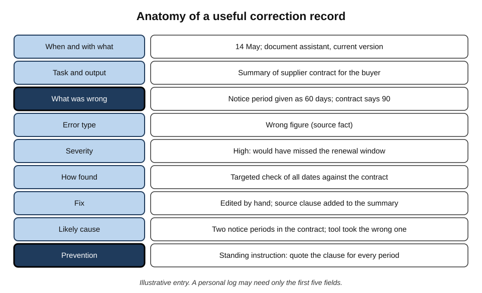
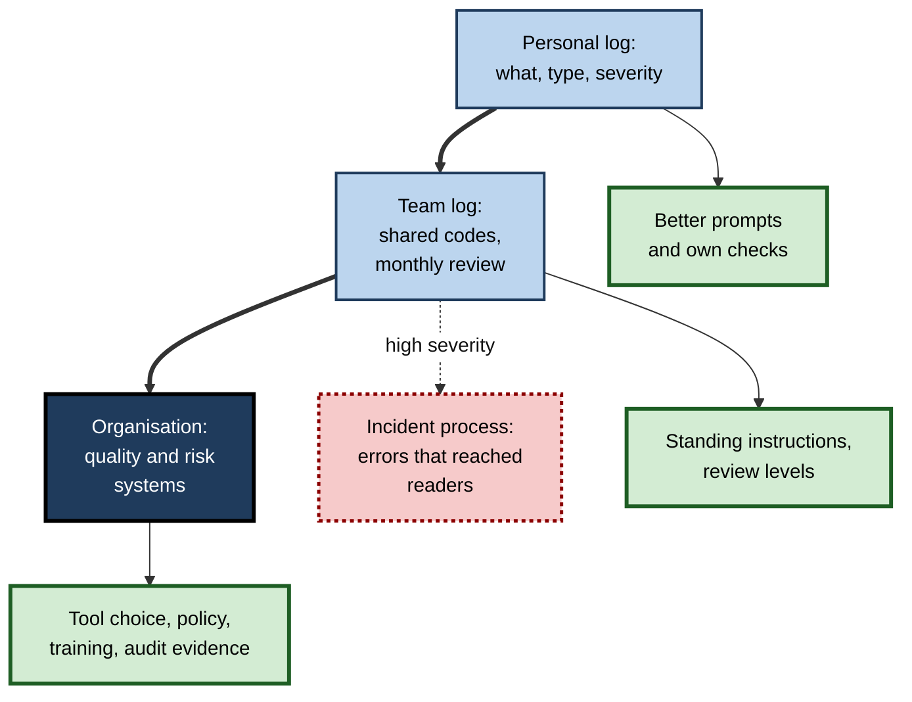
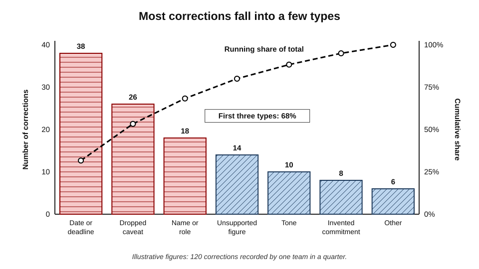
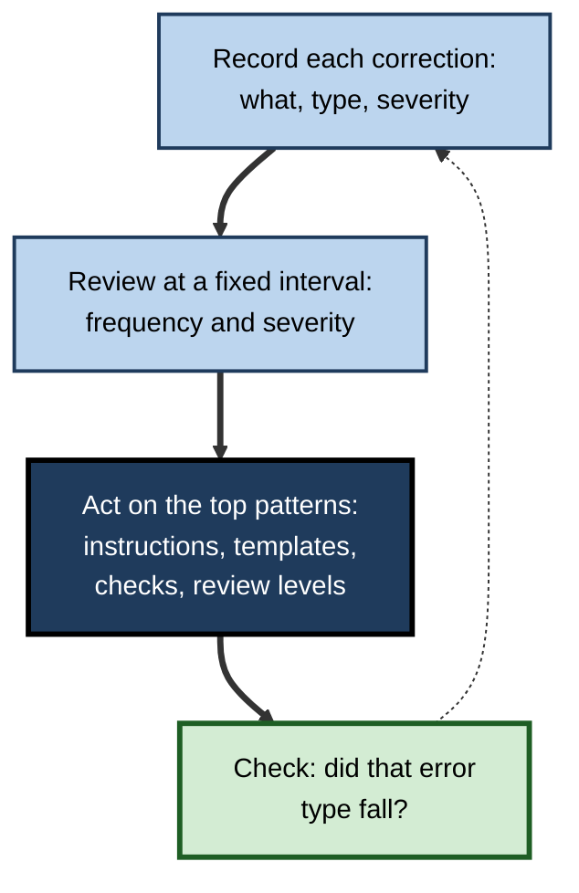
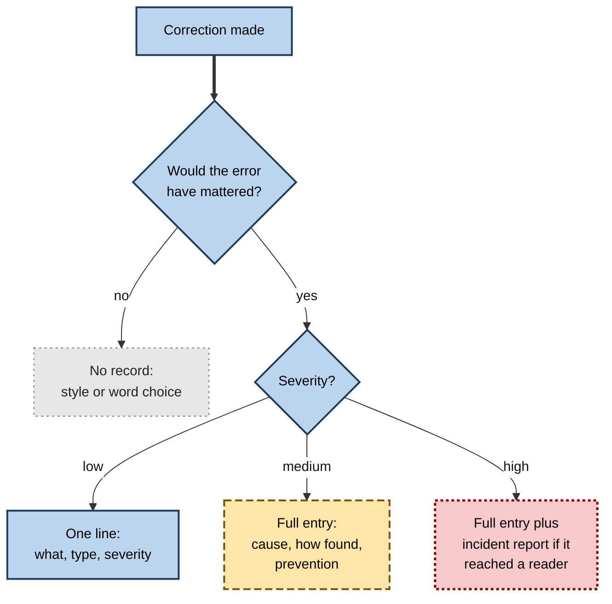

# K.10. Keeping a record of corrections

An analyst fixes a wrong date in an AI-generated meeting summary, then another the following week, then a third. Each fix takes a minute and is forgotten. Three months later a missed deadline traced to a summary costs the team a client's goodwill — and only then does anyone notice that dates in summaries have been wrong for months. Corrections that are **made but not recorded** solve today's problem and teach nothing about tomorrow's.

> **Definition — Correction record:** a brief, structured note of an error found in AI output — what was wrong, what kind of error it was, how serious it was, how it was found and how it was fixed — kept so that patterns can be seen and future errors prevented.

**Why it matters**

- **Patterns are invisible one error at a time.** Only a record shows that most corrections are of a few kinds.
- **Records calibrate trust.** They are the evidence for where a tool is reliable and where it is not.
- **Records guide review effort.** Tasks with frequent or severe corrections need closer review; tasks with clean records may need less.
- **Records protect people and organisations.** They show that output was checked and how, when questions are asked later.
- **Records turn individual learning into team learning.** One person's discovery becomes everyone's standing instruction.

---

## Learning from Errors: Lessons from Other Fields

The idea of recording errors in order to learn from them is long established in fields where mistakes are costly.

### Aviation: confidential incident reporting

**Study card — the Aviation Safety Reporting System (United States, 1976 onwards)**

- **Design:** a voluntary, confidential system, operated by NASA on behalf of the Federal Aviation Administration, through which pilots, controllers, engineers and cabin crew report incidents and **near misses** — events that could have caused harm but did not.
- **Key features:**
  - reports are **de-identified** after analysis;
  - it is run by an organisation **independent of the regulator** that enforces rules;
  - reporters gain limited protection from penalties for inadvertent violations they report;
  - analysts look for **recurring patterns** and issue alerts to the industry.
- **Results:** the system has received a very large number of reports over several decades and is widely credited with identifying hazards — confusing procedures, ambiguous charts, design weaknesses — before they caused accidents.
- **Conclusion:** people report errors when reporting is **safe, easy and visibly useful**; near misses are the richest source of learning because they are far more numerous than accidents.
- **Lesson for AI corrections:** every error caught before it reached a reader is a **near miss** worth recording.

> **Definition — Near miss:** an error or unsafe event that was caught or happened not to cause harm, but could have done so in other circumstances.

### Journalism: corrections in public

- **Published corrections** — many newspapers print corrections in a fixed place, acknowledging errors openly.
- **Readers' editors** — *The Guardian* appointed a readers' editor in 1997, an independent role with a regular corrections and clarifications column; other publications followed with similar roles.
- **What this shows:** systematic correction records support **accountability** and reveal recurring weaknesses — such as particular kinds of figures or names that are often wrong.

### Software: bug tracking

- **Every defect is logged** with steps to reproduce, severity, cause and fix.
- **Analysis of the log** guides testing, design and training.
- **Regression tests** are written for fixed bugs so that they cannot silently return.

### Healthcare: incident reporting and just culture

- Hospitals in many countries run **incident reporting systems** for medication errors, near misses and adverse events.
- The principle of a **just culture** — associated with the safety researcher James Reason and later with Sidney Dekker — distinguishes honest error (to be learned from) from reckless conduct (to be addressed), so that people report without fear.

> **Definition — Just culture:** an organisational approach in which people are not punished for honest errors they report, while reckless or deliberate misconduct is still addressed — so that errors are surfaced and learned from.

> **Key point:** across these fields, the same lesson recurs — **errors become useful only when they are recorded, collected and analysed**, and people record them only when doing so is safe and simple.

---

## What to Record

A correction record must be quick to make, or it will not be made. The essentials can be captured in under a minute.

**Figure 1.** The parts of a useful correction record.

### Essential fields

- **When and with what** — date, tool and, where known, version or setting.
- **Task and output** — what the tool was asked to do and what kind of output it produced.
- **What was wrong** — a short description, quoting the error where possible.
- **Error type** — from a short, agreed list of codes.
- **Severity** — what would have happened if it had not been caught.

### Useful additional fields

- **How it was found** — which check caught it, and by whom. This shows which checks are earning their keep.
- **Fix** — edited by hand, re-prompted, restarted or abandoned.
- **Likely cause** — missing source, ambiguous instruction, tool limit, bad input.
- **Prevention** — any standing instruction, template change or checking step adopted.
- **Time spent** — on finding and fixing.

> **Remember:** the minimum useful record is **what, type, severity** — the rest adds value but should never stop the essential note being made.

> **Watch out:** correction records can themselves contain confidential information. Record **the kind** of error and a minimal excerpt — "notice period 60 v 90 days" — not whole passages of client material.

### A shared vocabulary of error types

A short, stable list makes records comparable across people and over time.

**A practical taxonomy of AI output errors for correction records**

| Code | Error type | Example |
|---|---|---|
| FACT | Wrong fact (world, organisational or source) | Wrong policy scope |
| FIG | Wrong or unsupported figure | Growth rate miscalculated; invented benchmark |
| NAME | Wrong name, title or identity | Former job title; conflated people |
| DATE | Wrong date, time or deadline | Wrong weekday; wrong time zone |
| QUOTE | Altered, misattributed or invented quotation | Paraphrase in quotation marks |
| CAVEAT | Dropped condition or qualifier | "Up to" removed |
| SCOPE | Wrong jurisdiction, version or audience | Another country's rule |
| INSTR | Wrong or unsafe instruction | Non-existent menu option; destructive command |
| COMMIT | Invented commitment or claim of action | "As agreed, we will…" |
| TONE | Inappropriate tone or register | Overly casual reply to a complaint |
| OMIT | Important content omitted | Exceptions section missing |
| OTHER | Anything else | — |

> **In practice:** teams usually start with ten or twelve codes and resist adding more. A taxonomy too detailed to remember will be applied inconsistently.

### Rating severity

- **Low** — would have caused minor embarrassment or a small rework.
- **Medium** — would have caused confusion, delay or a correction to be issued.
- **High** — would have caused financial loss, a missed obligation, a breach, harm to a person or significant reputational damage.

---

## Personal, Team and Organisational Records

### A personal log

- **Form:** a simple note, document or spreadsheet with a line per correction.
- **Purpose:** to learn the tool's weak spots for one's own work and refine one's prompts and checks.
- **Effort:** seconds per entry; a few minutes a month to review.

### A team log

- **Form:** a shared spreadsheet, form or tracker with agreed fields and codes.
- **Purpose:** to find patterns across people and tasks, set review levels and share standing instructions.
- **Ownership:** a named person reviews it regularly and turns patterns into actions.

### Organisational records

- **Form:** integrated with existing quality, risk or incident systems.
- **Purpose:** to evidence oversight, identify systemic risks, inform tool selection and support audits and regulators.
- **Links:** high-severity corrections — those that reached customers or affected decisions — handled through the existing incident process.

**Figure 2.** How correction records flow from individuals to the organisation.

---

## Turning Records into Improvement

A record that is never read is clerical work. The value lies in **analysis and action**.

### Look for the vital few

- **Pareto principle** — in many quality problems, a small number of causes account for most occurrences. The idea was popularised in quality management by Joseph Juran, who named it after the economist Vilfredo Pareto.
- **Pareto chart** — error types sorted by frequency, with a cumulative line; it shows which few types to tackle first.

**Figure 3.** Corrections by type over one quarter.

> **Definition — Pareto chart:** a bar chart of categories sorted from most to least frequent, with a line showing the cumulative percentage, used to identify the few categories that account for most occurrences.

> **Watch out:** frequency is not the only measure. A rare error type with high severity — invented commitments to clients, unsafe instructions — may deserve attention before a frequent but trivial one. Sort by **frequency × severity** as well as by frequency.

### Actions that records support

- **Standing instructions** — "always quote the source clause for any period or deadline".
- **Templates** — fields for figures and dates filled from systems of record, not generated.
- **Targeted checks** — a dedicated date check for meeting summaries, if dates dominate the log.
- **Review levels** — raise review for task types with high-severity corrections; consider lowering it where records are consistently clean.
- **Tool choices** — move a task to a different tool, or stop using AI for it.
- **Training** — teach colleagues the error types that matter most in their work.

### Close the loop

1. **Record** each correction.
2. **Review** the log at a fixed interval — weekly for a new task, monthly once stable.
3. **Act** on the top patterns.
4. **Check** whether the action worked: did that error type fall in the next period?

> **Mnemonic — "RRAC" ("Record, Review, Act, Check"):** the loop that turns corrections into fewer errors — "Rarely Repeat A Correction."

**Figure 4.** The correction record improvement loop.

---

## Worked Example (illustrative): One Month of a Personal Log

A project manager keeps a one-line record of every correction to AI output for a month.

| Week | Corrections | Main types |
|---|---|---|
| 1 | 9 | DATE ×4 (meeting summaries), TONE ×2, CAVEAT ×2, FIG ×1 |
| 2 | 8 | DATE ×3, COMMIT ×2 (status emails), CAVEAT ×2, OTHER ×1 |
| 3 | 7 | DATE ×3, CAVEAT ×2, NAME ×1, TONE ×1 |
| 4 | 6 | DATE ×2, COMMIT ×1, CAVEAT ×2, FIG ×1 |

*Illustrative figures.*

**Analysis**

- **DATE** — 12 of 30 corrections, almost all in meeting summaries; mostly relative dates ("next Thursday") converted wrongly.
- **CAVEAT** — 8 of 30, mostly in summaries of policies and contracts.
- **COMMIT** — only 3, but all **high severity**: status emails promising deliverables that had not been agreed.

**Actions**

1. Meeting-summary prompt now says: "Write every date as day, date, month and year; do not convert relative dates — quote them as spoken, with the meeting date."
2. A dedicated date check is added for every shared summary.
3. Status-email prompt now says: "Do not state or imply any commitment, deadline or deliverable not listed in the notes."
4. Policy summaries are now checked specifically for qualifiers — "only", "unless", "up to", "subject to".

**Next month**

- DATE corrections fall from 12 to 3; COMMIT from 3 to 0; CAVEAT is unchanged — the next target.

- **Time cost of the log:** about ten minutes in the month, plus thirty minutes of analysis.

> **Key point:** without the log, the manager believed the main problem was tone, which was the most **noticeable** error. The record showed the main problems were dates (most frequent) and commitments (most severe).

---

## Recording What Was Checked, Not Only What Was Wrong

A record of corrections tells only half the story. To estimate how reliable a tool is, it is also necessary to know **how much was checked and found correct**.

> **Formula — Observed error rate:** errors found ÷ items checked. Example: 6 wrong dates found in 120 dates checked = 6 ÷ 120 = **5%**.

- **Without the denominator**, a falling number of corrections might mean fewer errors — or less checking.
- **Simple counts suffice** — "checked 40 dates this week; 2 wrong" is enough.
- **Check records support the assurance claim** — a note on a document that "all figures were checked against the finance system" is itself a record.

> **Watch out:** a log that shows few corrections can be **reassuring for the wrong reason**. If reviewers have stopped checking carefully, the log will look cleaner as error rates rise. Periodic **seeded-error tests** — inserting known errors to see whether reviewers catch them — test the checkers as well as the tool.

### The hidden part of the picture

- **Errors that reached readers** — usually discovered through complaints or rework; the most visible but fewest.
- **Errors caught by checks** — the near misses; most of what a correction log contains.
- **Errors never found** — by definition unrecorded; estimated only through audits and re-checks of samples.

> **Watch out:** a well-known industrial safety claim, attributed to H. W. Heinrich in 1931, held that for every serious injury there were 29 minor injuries and 300 no-injury accidents, in a fixed ratio. The fixed ratio and its supporting data have been heavily **criticised and are not reliable**. The broader point — that near misses far outnumber serious events and are a valuable source of learning — is widely accepted; the specific numbers are not.

---

## Using Records to Calibrate Trust and Review

Correction records are the most direct evidence of **where** a tool can be trusted. Read together with counts of what was checked, they let a person or team set review levels from experience rather than impression.

**How record patterns translate into decisions (illustrative thresholds)**

| Pattern in the record | Interpretation | Typical decision |
|---|---|---|
| Many checks, almost no corrections, none severe | Tool reliable for this task as currently used | Consider lighter review, keep sampling |
| Few corrections but one or more severe | Rare but serious failure mode | Keep or raise review; add a targeted check for that error type |
| Frequent corrections of one type | Systematic weakness | Standing instruction, template or method change; re-measure |
| Frequent corrections of many types | Poor fit between tool and task | Restrict use to parts of the task, or abandon |
| Corrections rising after a tool update | Change in tool behaviour | Re-test; revert settings or adjust instructions |
| Corrections falling while checks also fall | Possibly less checking, not fewer errors | Restore checking; run a seeded-error test |

> **Key point:** decisions to **reduce** review should rest on a record of many checks with few errors — never on the absence of complaints.

### Watching for change over time

- **Tools change** — model updates, new settings and new features alter behaviour, sometimes for the better and sometimes not.
- **Tasks change** — new document types, new clients, new regulations.
- **People change** — new staff use the tool differently and may check differently.
- A simple **monthly count** by error type makes such shifts visible within weeks rather than after an incident.

> **In practice:** when a tool is updated, teams that keep records often re-run a small set of **reference tasks** whose correct outputs are known, and compare the corrections needed before and after.

---

## Pitfalls in Keeping Records

### Logs that become bureaucracy

- **Too many fields** — people stop filling them in, or fill them in carelessly.
- **No visible use** — entries vanish into a spreadsheet nobody reads.
- **Remedy:** start with three fields; add others only when a review shows they are needed; report back on actions taken.

### Logs that become blame

- **Using the log to rate individuals** — people with many entries look careless when they are in fact the most careful checkers.
- **Remedy:** treat entries as evidence of good checking; analyse by **task and error type**, not by person.

### Logs that miss what matters

- **Recording the noticeable, not the important** — tone and style errors are easy to see and dominate logs, while dropped caveats and wrong scope pass unnoticed.
- **Remedy:** combine the log with **targeted checks** for high-severity error types, so that they are looked for rather than only stumbled upon.

### Logs that leak

- **Confidential content in entries** — copying client text into a shared log.
- **Remedy:** short excerpts, codes and references to the document's location instead of its content.

> **Watch out:** the two most common reasons correction logs fail are that **nobody reads them** and that **people fear being judged by them**. Both are problems of management, not of the log's design.

---

## Correction Records and Accountability

### Evidence of oversight

- **When something goes wrong**, a record shows that output was reviewed, what was checked and what was found.
- **For regulated work**, records of human review support compliance with requirements for human oversight of AI systems.
- **For clients**, a record can answer the question "how was this checked?"

### Disclosure and transparency

- Some organisations publish or share summaries of how AI outputs are reviewed and corrected — an extension of the journalistic corrections tradition.
- Within an organisation, knowing which parts of a document were AI-generated and which were corrected helps later reviewers focus their attention.

### Keeping records proportionate

- **Do not record every trivial edit** — word choice and style changes rarely need logging.
- **Do record anything** that would have mattered: facts, figures, names, dates, quotations, instructions, commitments, omissions.
- **Keep retention sensible** — correction logs are records like any other and should follow the organisation's retention and privacy rules.

---

## Case Study (illustrative): The Summaries That Moved Deadlines

- **Situation:** a property-management firm used an assistant to summarise weekly calls with contractors. Twelve staff used it; no one recorded corrections.
- **Problem:** after a contractor missed a safety inspection, an investigation found that the call summary had converted "the Friday after next" into the wrong date. Asking around, the investigator found that most staff had corrected similar date errors "now and then".
- **Diagnosis:**
  1. each person had treated their corrections as isolated slips;
  2. no one knew that the problem was common to all users of the tool;
  3. the risk was therefore never escalated, and no one changed the prompt or the check.
- **Actions:**
  - a shared correction form with ten error codes was introduced, taking under a minute per entry;
  - in the first month it recorded 46 corrections, 19 of them dates in call summaries;
  - the summary template was changed to require absolute dates confirmed with the contractor by email, and a date check was added for any safety-related action.
- **Result:** date corrections in call summaries fell sharply; no further missed inspections were linked to summaries in the following year.
- **Lesson:** twelve people each fixing the same error privately is an **organisational blind spot**. Shared records turn scattered corrections into a visible risk.

## Case Study (illustrative): A Log That Proved Its Worth

- **Situation:** an internal audit team asked a finance function how it controlled the accuracy of AI-assisted management commentary.
- **What the function could show:**
  - a log of corrections over six months, coded by type and severity;
  - counts of figures checked against the ledger each month;
  - three standing instructions adopted in response to patterns in the log;
  - evidence that the most frequent error type had fallen after the instructions were introduced.
- **Audit conclusion:** the control was designed and operating effectively; the function was asked to share its approach with other departments.
- **Lesson:** records are not just a learning tool — they are **evidence** that review happens and works.

---

## Making Recording a Habit

**Figure 5.** Recording effort rises with severity: most corrections need only a line.

- **Make it fast** — a form with drop-down codes; a keyboard shortcut to a log; a line in a running note.
- **Make it immediate** — record at the moment of correction, not at the end of the week.
- **Make it safe** — corrections are evidence of good checking, not of poor work; no one should be criticised for recording errors they caught.
- **Make it visibly useful** — share what the log has led to: "because of your entries, the summary template now fixes dates."

> **In practice:** the most effective prompt for continued recording is **feedback**. People keep logging when they see their entries change something.

---

## Open Questions

- **Will tools record corrections automatically?**
  - Editors and assistants could capture what users change in generated text; whether automatic capture would be accurate, privacy-respecting and useful is unresolved.
- **How should records be shared across organisations?**
  - Aviation pools near-miss reports across an industry; whether similar pooling of AI error patterns is feasible, given confidentiality, is open.
- **Can corrections improve tools directly?**
  - Some products use feedback to improve models; how individual corrections in professional settings should feed back, and with what safeguards, is debated.
- **What error rates should be reported?**
  - Organisations lack standard measures for AI output quality; agreed metrics would make records comparable.
- **How can unrecorded errors be estimated?**
  - Audit sampling and seeded-error tests help, but practice for AI outputs is immature.

---

## Summary

- A **correction record** notes what was wrong, its type, severity, how it was found and fixed, and how to prevent it.
- Fields that learn from error share a pattern: **record, collect, analyse**, with reporting made **safe, easy and visibly useful** — as in aviation's confidential near-miss reporting, journalism's corrections, software bug tracking and healthcare's **just culture**.
- Caught errors are **near misses** — the richest source of learning.
- Minimum record: **what, type, severity**; add how found, fix, cause and prevention when useful; avoid recording confidential detail.
- Use a **short shared taxonomy** of error types so records can be compared.
- Keep **personal, team and organisational** records, linked to existing quality and incident systems.
- Analyse with **Pareto charts**, weighting by **severity** as well as frequency.
- **Record, Review, Act, Check** — turn patterns into standing instructions, templates, targeted checks and review levels, then confirm the effect.
- Record **what was checked** as well as what was wrong, so that error rates can be estimated and falling counts are not mistaken for improvement.
- Records also provide **evidence of oversight** for audits, clients and regulators.

---

## Self-Check

1. Define a correction record and give four reasons for keeping one.
2. What are the key features of the Aviation Safety Reporting System, and what lesson does it offer?
3. What is a near miss, and why are near misses valuable?
4. What is a just culture, and why does it matter for recording errors?
5. List the essential fields of a correction record and three useful additional ones.
6. Why should correction records avoid recording whole passages of the original material?
7. Why is a short, shared taxonomy of error types important?
8. What is a Pareto chart, and why should severity also be considered?
9. Describe the Record–Review–Act–Check loop.
10. In the worked example, what did the log reveal that the manager had not realised?
11. Why must records include what was checked as well as what was wrong?
12. What is the status of Heinrich's accident ratio, and what part of the idea remains useful?
13. How do correction records support accountability?
14. Your team of eight uses an assistant for client meeting summaries, and corrections are made privately. Design a lightweight correction-record system and explain how it will be used.

### Answer Key

1. A brief, structured note of an error in AI output — what, type, severity, how found, how fixed. Reasons: reveal patterns; calibrate trust; guide review effort; evidence oversight; share learning.
2. Voluntary, confidential reporting of incidents and near misses; de-identification; operation by NASA, independent of the enforcing regulator; limited protection for reporters; pattern analysis and alerts. Lesson: people report when it is safe, easy and useful, and near misses are the best source of learning.
3. An error caught, or one that happened not to cause harm, that could have done so. They are far more numerous than harmful events and reveal the same weaknesses without the damage.
4. An approach that does not punish honest reported errors while still addressing recklessness. Without it, people hide errors and records stay empty.
5. Essential: when and with what tool; task and output; what was wrong; error type; severity. Additional: how found; fix; likely cause; prevention; time spent.
6. Records may contain confidential client or personal information; a minimal excerpt and the error type are enough.
7. It makes records comparable across people and time, so patterns can be counted; too many codes lead to inconsistent use.
8. A chart of categories sorted by frequency with a cumulative line, showing the vital few. Rare but severe errors may matter more than frequent trivial ones, so frequency × severity should be considered.
9. Record each correction; review the log at fixed intervals; act on the top patterns (instructions, templates, checks, review levels); check whether the action reduced that error type, then continue recording.
10. That dates (most frequent) and invented commitments (most severe) were the main problems, not tone, which was merely the most noticeable.
11. Without the number of items checked, error rates cannot be estimated; fewer recorded corrections might reflect less checking rather than fewer errors.
12. The fixed 1:29:300 ratio and its data have been heavily criticised and are unreliable. The general point — near misses far outnumber serious events and are valuable for learning — remains accepted.
13. They show that output was reviewed, what was checked and found, and what was done — evidence for audits, clients and regulators.
14. E.g. a shared form with fields for date, meeting, error code (from about ten codes), severity and a one-line description, plus a weekly count of summaries checked; entries made at the moment of correction; a named owner reviews the log every fortnight, produces a Pareto chart weighted by severity, and turns top patterns into prompt changes and targeted checks; results are shared with the team; high-severity errors that reached clients go through the incident process; no blame for recorded errors.

---

## Glossary

| Term | Meaning |
|---|---|
| Correction record | A structured note of an error in AI output and how it was handled. |
| Error taxonomy | An agreed list of error types used to code corrections. |
| Just culture | An approach that does not punish honest reported error while addressing recklessness. |
| Near miss | An error caught, or that caused no harm, but could have done. |
| Observed error rate | Errors found divided by items checked. |
| Pareto chart | Bar chart sorted by frequency with a cumulative line. |
| Pareto principle | The observation that a few causes often account for most occurrences. |
| Readers' editor | An independent newspaper role handling complaints and corrections. |
| Seeded-error test | Inserting known errors to measure whether reviewers catch them. |
| Severity | How serious the consequences of an error would have been. |
| Standing instruction | A saved instruction adopted to prevent a recurring error. |
