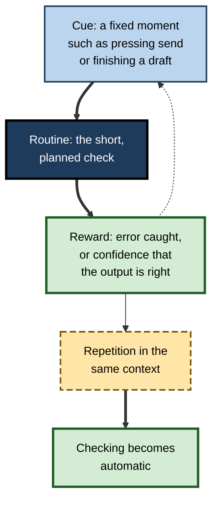
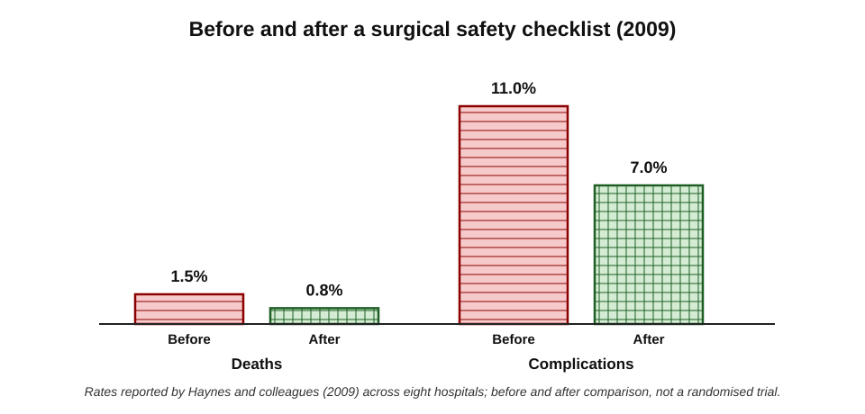
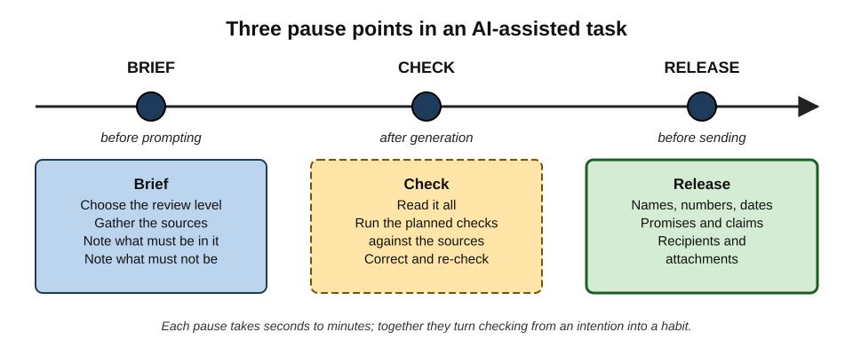
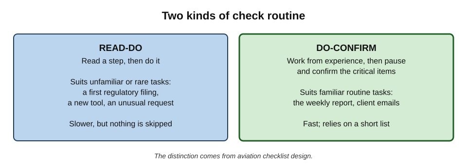
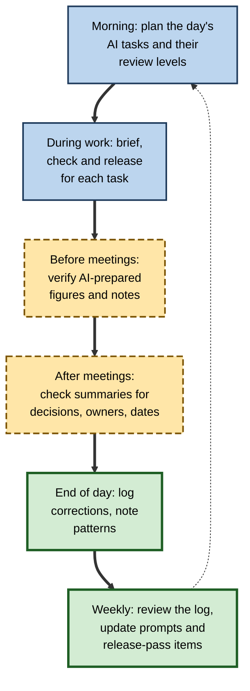

# K.11. Building verification into your routine

Most people who send an unchecked AI error did not decide to skip the check. They intended to verify, then a meeting started, a deadline loomed or the output simply looked fine. Good intentions are fragile under pressure; **routines are not**. Professionals who verify reliably do not rely on remembering to be careful — they have made checking part of the way the work is done.

> **Definition — Verification routine:** a planned, habitual set of checking steps attached to particular moments in recurring work — before prompting, after generation and before release — so that verification happens by default rather than by intention.

**Why it matters**

- **Intentions fail under load.** Time pressure, interruptions and fatigue are exactly the conditions in which checks are skipped.
- **Routines make checking cheap.** A familiar, short sequence takes less effort than deciding afresh each time what to check.
- **Routines protect against fluency.** A fixed check runs whether or not the output "looks right".
- **Routines can be shared.** A team routine spreads good practice and makes review predictable.

---

## Why Good Intentions Are Not Enough

### The intention–behaviour gap

- People routinely fail to act on intentions they sincerely hold — to exercise, save, or check their work. Psychologists call this the **intention–behaviour gap**.
- Research on **implementation intentions** — plans of the form "when situation X arises, I will do Y" — has found that specifying the **moment** of an action makes it substantially more likely to happen.
- For verification, the lesson is to tie each check to a **specific moment**: "When I paste generated text into an email, I check every name and date before pressing send."

> **Definition — Intention–behaviour gap:** the difference between what people intend to do and what they actually do.

### Conditions that erode checking

- **Time pressure** — checking is the step most easily cut.
- **Interruptions** — an interrupted check is often not resumed.
- **Volume** — the tenth similar output gets less attention than the first.
- **Success streaks** — a run of correct outputs lowers vigilance.
- **Fluency** — polished output does not trigger the instinct to check.

> **Key point:** a routine works because it **does not depend on noticing** that something might be wrong. It runs at the planned moment either way.

### Habit formation

- **Cue** — a consistent trigger (opening the send dialogue, finishing a draft).
- **Routine** — the behaviour (the check).
- **Reward** — a satisfying result (an error caught, confidence in the output).
- Repeated in the same context, the behaviour becomes increasingly automatic; research on everyday habits suggests this takes weeks to months, with wide variation between people and behaviours.

**Figure 1.** The habit loop applied to verification.

---

## Evidence That Routines Work

### Checklists in surgery

**Study card — Haynes and colleagues (2009), the WHO Surgical Safety Checklist**

- **Setting:** eight hospitals in eight cities in different parts of the world, including high- and lower-income countries; published in the *New England Journal of Medicine*.
- **Intervention:** a 19-item checklist, developed with the World Health Organization, used at three **pause points** in each operation:
  - **sign in** — before anaesthesia;
  - **time out** — before the incision;
  - **sign out** — before the patient leaves the operating room.
- **Results (before versus after):**
  - deaths fell from **1.5%** to **0.8%**;
  - inpatient complications fell from **11.0%** to **7.0%**.
- **Conclusion:** short, structured checks at fixed moments, carried out by the team, substantially reduced harm.
- **Caveats:**
  - a before-and-after comparison, not a randomised trial — other changes over the period may have contributed;
  - later studies found that results depend heavily on **how** checklists are implemented: imposed as paperwork, they have much smaller effects than when teams genuinely engage with them.

**Figure 2.** Results before and after the surgical safety checklist.

> **Key point:** the checklist did not teach surgeons anything new. It ensured that what they already knew to check **was checked every time**, at moments built into the work.

### Forcing functions for AI-assisted decisions

**Study card — Buçinca, Malaya and Gajos (2021), cognitive forcing functions**

- **Setting:** researchers at Harvard University studied people making decisions with AI suggestions that were sometimes wrong; published in the *Proceedings of the ACM on Human–Computer Interaction*.
- **Designs compared:**
  - AI suggestions with simple explanations;
  - **cognitive forcing** designs — asking people to make their own decision **before** seeing the AI's, imposing a short wait, or showing the AI suggestion only on request.
- **Results:**
  - the cognitive forcing designs **reduced over-reliance** on incorrect AI suggestions compared with simple explanations;
  - participants **liked** these designs less and found them more demanding;
  - benefits were larger for people who enjoy effortful thinking.
- **Conclusion:** interrupting the easy path of accepting a suggestion makes people think — at a cost in comfort.
- **Lesson for routines:** the most effective checks introduce a small, deliberate **friction** at the moment of acceptance.

> **Definition — Cognitive forcing function:** a design or routine that interrupts quick, intuitive acceptance and requires deliberate thought before a decision is made.

> **Watch out:** friction that people dislike tends to be removed or bypassed. Effective routines are **short** and their purpose is **understood**; otherwise they become rituals or are quietly dropped.

---

## The Three Pause Points

Borrowing the structure of the surgical checklist, an AI-assisted task has three natural pause points.

**Figure 3.** Three pause points in an AI-assisted task.

### 1. Brief — before prompting

- **Decide the review level** the output will need, before seeing it.
- **Gather the sources** the output must reflect: the contract, the data, the notes.
- **Write down what must be in it** — the three points that matter — and what must **not** be (no commitments, no figures not in the source).
- **Predict** what a correct answer will look like.

### 2. Check — after generation

- **Read it all.**
- **Run the planned checks** against the gathered sources: figures, names, dates, claims, instructions.
- **Compare with the prediction**: does it contain the points that matter?
- **Correct and re-check.**

### 3. Release — before sending, sharing or acting

- **A final short pass** on the items whose errors are most damaging:
  - names and titles;
  - numbers and dates;
  - promises and claims;
  - recipients and attachments.
- **Confirm ownership**: "Would I sign this?"

> **Mnemonic — "BCR" ("Brief, Check, Release"):** the three pause points — "Before Clicking, Reflect."

> **Mnemonic — "NNDPR" for the release pass:** **N**ames, **N**umbers, **D**ates, **P**romises, **R**ecipients — "No Nonsense Do People Read."

**What happens at each pause point**

| Pause point | Main question | Typical time | Errors it prevents |
|---|---|---|---|
| Brief | What will a correct output need, and how will it be checked? | 1–3 minutes | Missing sources, unrealistic review, unclear purpose |
| Check | Is this output true, complete and fit for purpose? | Depends on review level | Wrong facts, figures, instructions, omissions |
| Release | Is anything here that would embarrass or harm if wrong? | Under a minute | Wrong names, dates, promises, recipients |

*Times are indicative.*

---

## Designing a Personal Routine

### Two kinds of check routine

**Figure 4.** Two kinds of check routine.

- **Read-do** — read each step, then do it. For unfamiliar or rare tasks: the first time a tool is used for a regulatory filing; an unusual request.
- **Do-confirm** — work from experience, then pause and confirm that the critical items were done. For familiar routine tasks.
- The distinction comes from aviation, where checklists are designed differently for normal procedures and emergencies.

> **Key point:** most everyday verification suits **do-confirm**: a short list of critical items confirmed at the release point, not a long procedure read step by step.

### Principles for a routine that lasts

- **Short** — five to nine items at most for any one pause point; longer lists are skimmed.
- **Specific** — "check every date against the calendar invitation" rather than "check accuracy".
- **Critical items only** — the checks that catch the errors that matter most, based on one's own correction record.
- **Attached to a cue** — a moment that always occurs: pressing send, saving to a shared folder, committing code.
- **Supported by tools** — templates, bookmarks to systems of record, comparison features.
- **Reviewed periodically** — updated as tools, tasks and error patterns change.

### A personal verification kit

- **Saved prompts** that ask the tool for a list of every number with its source passage, or a list of every claim not supported by the attached documents.
- **Bookmarks** to the systems of record used most: contract repository, finance reports, staff directory, policy library.
- **A comparison feature** for checking rewrites against originals.
- **A calendar** for checking days and dates.
- **A short card** — physical or digital — with the release-pass items.
- **A correction log** — one line per correction.

> **In practice:** placing the release-pass card beside the screen, or as the first line of an email template, is a simple **environmental cue**. Environment design often works better than willpower.

---

## Routines by Role

The core structure is general; the critical items differ by role.

**Example release-pass items by role**

| Role | Critical items to confirm before release |
|---|---|
| Analyst | Every figure traced; totals reconcile; chart values match data; period and units stated |
| Manager | Names and roles; decisions and owners; commitments; tone for the relationship |
| Sales | Prices and discounts; product features in the customer's tier; contract terms; no invented promises |
| HR | Policy version and scope; legal requirements in the employee's jurisdiction; confidentiality; tone |
| Developer | Tests pass; diff reviewed; no secrets in code; dependencies verified as real |
| Communications | Quotations approved; facts traced; names and titles; claims about people and competitors |
| Legal | Citations checked; jurisdiction; defined terms consistent; dates and deadlines traced |

> **Example (illustrative):** a sales representative's release pass for any AI-drafted proposal is four questions: "Is every price from the current price list? Is every feature in the client's tier? Is every term from the approved template? Is there any promise I did not intend?"

---

## Building Verification into the Working Day

**Figure 5.** Verification moments across a working day.

### Time budgeting

- **Include verification time in estimates.** If a task is estimated with AI assistance, the estimate should include the checking, not just the drafting.
- **Protect verification time** for high-stakes outputs — schedule it, rather than squeezing it in before a deadline.
- **Batch similar checks** — verifying ten summaries in one sitting against the same sources is faster than ten separate checks.

> **Watch out:** when a manager plans work on the assumption that AI makes drafting "instant", the time for checking disappears from the plan — and checking is then the step that gets cut. Realistic estimates include verification explicitly.

### Routines for high-volume work

Some roles produce dozens of AI-assisted outputs a day — support replies, ticket summaries, data extractions. The three pause points still apply, but their form changes.

- **Brief once, for the batch** — sources, instructions and review level set for the whole run rather than item by item.
- **Check by rule and by sample** — automatic checks where possible (totals, required fields, forbidden phrases), plus a random sample read in full.
- **Release by exception** — items flagged by rules (money, complaints, vulnerable customers, unusual values) go to full human review; the rest are released after sampling.
- **Pace for attention** — short, focused review sessions with breaks, because detection of rare errors falls during long stretches of monotonous checking.

> **Example (illustrative):** a claims handler reviewing AI-drafted acknowledgement letters checks every letter flagged for a payment amount or a complaint, and reads one in ten of the rest in full, in two 25-minute sessions a day rather than continuously.

### Friction by design

- **Scheduled send** — a short delay on outgoing email gives a window to catch mistakes.
- **Draft folders** — generated text goes to drafts, never straight to send.
- **Approval steps** — agents and automations require confirmation before irreversible actions.
- **Template fields** — figures and dates pulled from systems of record, so they cannot be generated wrongly.

---

## Worked Example (illustrative): Designing a Routine for a Weekly Report

A programme manager produces a weekly status report for a steering group, drafted with an assistant from project notes, the risk register and the budget tracker. Her correction log over six weeks shows errors mainly in: budget figures (5), milestone dates (4), risk owners (3) and one invented commitment.

**Step 1 — Brief (two minutes)**

- Attach the latest notes, risk register and budget tracker export.
- Note the three messages that must be in the report this week.
- Prompt includes: "Use only figures from the attached tracker; quote each milestone date exactly as in the plan; do not state any commitment not in the notes."

**Step 2 — Check (ten minutes)**

- Ask the tool for a list of every figure and date with its source.
- Check every budget figure against the tracker (targeted review).
- Check every milestone date against the plan.
- Check every risk owner against the register.
- Confirm the three messages are present.

**Step 3 — Release (one minute, do-confirm)**

- Names and roles — correct?
- Numbers — all traced?
- Dates — all match the plan?
- Promises — any not agreed?
- Recipients — steering group list, no external addresses?

**Results over the next six weeks**

| Error type | Previous six weeks | Next six weeks |
|---|---|---|
| Budget figures | 5 | 1 (caught at Check) |
| Milestone dates | 4 | 0 |
| Risk owners | 3 | 1 (caught at Check) |
| Invented commitments | 1 | 0 |
| Errors reaching the steering group | 3 | 0 |

*Illustrative figures.*

- **Time cost:** about 13 minutes a week — against roughly 45 minutes saved in drafting.
- **What made it work:** the checks were chosen from her own correction record and attached to fixed moments.

---

## Case Study (illustrative): A Team's Release Pause

- **Situation:** an account-management team of twelve began drafting most client emails with an assistant. Within two months, three emails had gone to clients with wrong renewal dates or references to the wrong contract.
- **Initial response:** a reminder to "always check AI emails carefully". Errors continued.
- **Redesign:**
  1. **Scheduled send** of two minutes was enabled for all external email.
  2. A **four-item release pass** was agreed — client name, dates, figures, promises — and added as a hidden first line in the email template, deleted only after the pass.
  3. **Contract details** were inserted from the client record through a template field, not generated.
  4. The team reviewed corrections in a ten-minute slot at the monthly meeting.
- **Result:** no further client-facing date or contract errors in the following two quarters; staff reported that the pass took under a minute.
- **Side effects:** some staff found the template line irritating at first; adoption improved once the monthly review showed errors it had caught.
- **Lesson:** an exhortation to be careful changes little; a **cue, a short routine and visible results** change behaviour.

## Case Study (illustrative): When the Routine Became a Ritual

- **Situation:** a finance team introduced a 25-item checklist for AI-assisted management reports.
- **Problem:** after a few months, items were being ticked without being done; one report went out with a wrong margin figure despite a fully ticked checklist.
- **Diagnosis:** the list was too long, mixed trivial and critical items, and had become **paperwork** — evidence of compliance rather than a working tool.
- **Actions:** the list was cut to seven critical do-confirm items drawn from the correction log; a monthly spot audit re-checked one report in full.
- **Result:** errors fell, and reviewers reported the checks as useful rather than burdensome.
- **Lesson:** routines decay into **rituals** when they are long, generic or imposed. Keep them short, specific and grounded in real error patterns.

---

## Team Routines

Personal routines protect individual work; **team routines** make verification predictable across people, and let colleagues rely on one another's checks.

### What a team routine defines

- **Default review levels** for the team's common AI-assisted tasks.
- **Shared release-pass items** for each kind of output — client email, report, code change, social post.
- **Who checks what** — the author, a second reviewer, a specialist function.
- **Where evidence of checking is kept** — a review note, a field in the tracker, a comment on the document.
- **When the routine is reviewed** — for example, quarterly, using the team's correction log.

### Making team routines stick

- **Build them into shared tools** — templates, document workflows, ticket fields, pull-request templates in code repositories.
- **Agree them together** — routines designed by the people who use them are followed more faithfully than those imposed.
- **Induct newcomers** — new staff learn the routine as "how work is done here", not as optional advice.
- **Lead by example** — when senior people visibly run the release pass on their own messages, others follow.

> **Key point:** a shared routine allows a reader to **know what assurance a document carries** — "this went through the standard client-email pass" means something specific.

**Personal and team routines compared**

| | Personal routine | Team routine |
|---|---|---|
| Designed by | The individual | The team, with its lead |
| Based on | One's own correction record | The team's pooled record |
| Enforced by | Habit and self-discipline | Shared tools, norms and review |
| Main benefit | Fewer errors in one's own work | Consistent, visible assurance across the team |
| Main risk | Lapses under pressure | Becoming paperwork if not kept short and useful |

---

## Routines for Agents and Automations

When AI tools act on their own — sending scheduled messages, updating records, processing documents — the routine moves from the moment of release to the **design and monitoring** of the automation.

- **Before switching on:** test on sample inputs with known correct outputs; define what the automation may and may not do; set approval steps for irreversible actions.
- **Daily or weekly:** review a sample of actions and outputs; check exception queues and error alerts.
- **On change:** re-test when the tool, its instructions or its inputs change.
- **On incident:** pause the automation, investigate, and record the correction before resuming.

> **Watch out:** automations remove the natural pause points of manual work. Unless monitoring is scheduled as deliberately as the release pass, nobody may look at an automation's output until something goes visibly wrong.

> **In practice:** teams running AI automations often appoint an **owner** for each one — a named person responsible for its sample reviews and for pausing it when needed — so that monitoring has a home in someone's routine.

---

## Keeping Routines Alive

### Signs a routine is decaying

- Checks are completed noticeably faster than they could be done properly.
- Items are marked as done without evidence.
- Errors reach readers despite the routine.
- People describe the routine as "box-ticking".

### Renewing routines

- **Update from the correction log** — remove items that never catch anything; add items for new error patterns.
- **Rotate emphasis** — occasionally focus a team's attention on one error type.
- **Audit occasionally** — re-check a sample of released outputs fully, to see whether the routine is working.
- **Celebrate catches** — share examples of errors the routine prevented.

> **In practice:** a routine that is reviewed every quarter against the correction record stays useful; one that is never revisited usually becomes either obsolete or ceremonial within a year.

---

## Open Questions

- **How much friction is optimal?**
  - Forcing functions reduce over-reliance but are disliked; the right balance for everyday work tools is not established.
- **Can tools build verification in by design?**
  - Interfaces that show sources, highlight unsupported claims or require confirmation at release could make routines easier; their effect on real behaviour needs study.
- **How quickly do verification habits form and decay?**
  - Habit research gives general estimates; evidence specific to AI verification is very limited.
- **What makes checklists work in knowledge work?**
  - Surgical and aviation evidence is strong, but transfer to office work, with its variety of tasks, is less studied.
- **How should routines change as tools improve?**
  - Routines calibrated to today's error patterns may waste effort, or miss new errors, as tools change.

---

## Summary

- A **verification routine** attaches planned checks to fixed moments so that checking happens by default.
- **Intentions fail under pressure**; tying a check to a moment (implementation intentions) and repeating it in context (habit formation) make it reliable.
- The **WHO Surgical Safety Checklist** study showed large reductions in deaths and complications from short checks at fixed **pause points** — though implementation quality matters greatly.
- **Cognitive forcing functions** reduce over-reliance on AI by adding deliberate friction — at a cost in comfort.
- Three pause points: **Brief** (before prompting), **Check** (after generation), **Release** (before sending) — "Before Clicking, Reflect."
- The release pass covers **names, numbers, dates, promises and recipients**.
- Use **read-do** for unfamiliar tasks and **do-confirm** for familiar ones; keep routines **short, specific, critical and cued**.
- Support routines with a **personal verification kit**, **realistic time budgets** and **friction by design** (scheduled send, drafts, approvals, template fields).
- Routines decay into **rituals** when long, generic or imposed; renew them from the **correction record**.

---

## Self-Check

1. Define a verification routine and explain why routines beat intentions.
2. What is the intention–behaviour gap, and how do implementation intentions help close it?
3. List five conditions that erode checking.
4. Describe the cue–routine–reward loop applied to verification.
5. Summarise the Haynes and colleagues (2009) study, including its caveats.
6. What did Buçinca, Malaya and Gajos (2021) find about cognitive forcing functions?
7. Describe the three pause points and what happens at each.
8. What items belong in the release pass?
9. Distinguish read-do from do-confirm routines and give a use for each.
10. Give five principles for designing a routine that lasts.
11. What belongs in a personal verification kit?
12. Why should verification time be included in task estimates?
13. What are the signs that a routine has become a ritual, and how is it renewed?
14. Design a verification routine for a recruiter who uses an assistant to draft candidate shortlist summaries and outreach messages.

### Answer Key

1. A planned, habitual set of checks attached to particular moments in recurring work. Routines run at the planned moment regardless of time pressure or whether the output looks right; intentions depend on remembering and noticing.
2. The difference between intended and actual behaviour. Implementation intentions ("when X, I will Y") tie the action to a specific moment, making it more likely to occur.
3. Time pressure; interruptions; volume; success streaks; fluency of output.
4. A consistent cue (pressing send) triggers a routine (the check), which produces a reward (an error caught or confidence); repetition in the same context makes it automatic.
5. A 19-item checklist used at sign in, time out and sign out in eight hospitals reduced deaths from 1.5% to 0.8% and complications from 11.0% to 7.0%. Caveats: before-and-after design, not randomised; effects depend heavily on genuine implementation.
6. Designs that required people to decide before seeing AI advice, to wait, or to request advice reduced over-reliance on wrong suggestions compared with simple explanations, but were less liked; benefits were greater for people who enjoy effortful thinking.
7. Brief (before prompting): set review level, gather sources, note must-haves and must-nots, predict. Check (after generation): read all, run planned checks against sources, compare with prediction, correct. Release (before sending): final pass on critical items and ownership.
8. Names and titles; numbers; dates; promises and claims; recipients and attachments.
9. Read-do: read a step, then do it — for unfamiliar or rare tasks such as a first regulatory filing. Do-confirm: work from experience, then confirm critical items — for routine tasks such as a weekly report.
10. Short; specific; critical items only; attached to a cue; supported by tools; reviewed periodically.
11. Saved verification prompts; bookmarks to systems of record; a comparison feature; a calendar; a release-pass card; a correction log.
12. Otherwise plans assume instant drafting, leaving no time for checking, which is then the step cut under pressure.
13. Checks done implausibly fast; items marked without evidence; errors getting through; "box-ticking" talk. Renew by updating items from the correction log, auditing samples, rotating emphasis and sharing catches.
14. E.g. Brief: attach the CVs, job description and interview notes; set full review for shortlist summaries (decisions about people) and targeted review for outreach; instruct the tool to use only attached material and not to infer protected characteristics. Check: verify every claim about each candidate against the CV and notes; check names, current employers and titles; check that criteria applied match the job description; check for biased or speculative language. Release (do-confirm): candidate names and titles; role and salary details from the approved brief; no promises about outcomes; correct recipient; confidentiality of candidate information. Log corrections weekly and revise the routine monthly.

---

## Glossary

| Term | Meaning |
|---|---|
| Cognitive forcing function | A design that interrupts quick acceptance and requires deliberate thought. |
| Cue | A consistent trigger that prompts a habitual behaviour. |
| Do-confirm | A routine in which work is done from experience and critical items are then confirmed. |
| Friction by design | Deliberate small obstacles, such as send delays, that create a chance to check. |
| Habit loop | The cycle of cue, routine and reward that makes behaviour automatic. |
| Implementation intention | A plan linking a specific situation to a specific action. |
| Intention–behaviour gap | The difference between what people intend and what they do. |
| Pause point | A fixed moment in a task at which planned checks are carried out. |
| Read-do | A routine in which each step is read and then carried out. |
| Release pass | A short final check of critical items before output is sent or shared. |
| Ritual (of checking) | A check performed in form but not in substance. |
| Verification routine | A habitual set of checks attached to fixed moments in recurring work. |
