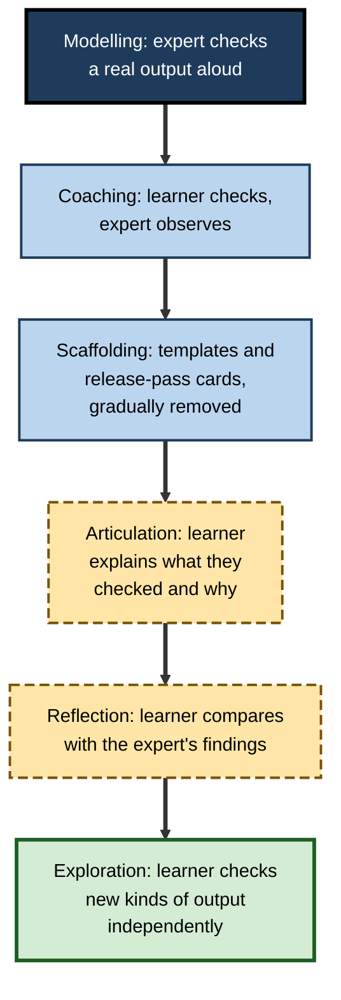
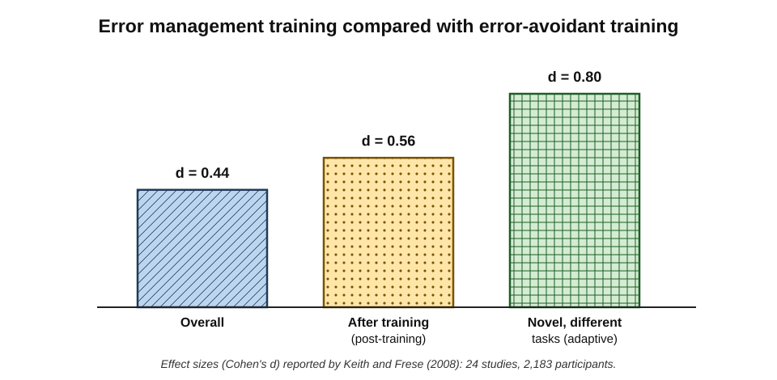
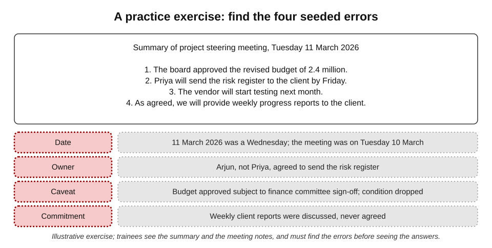
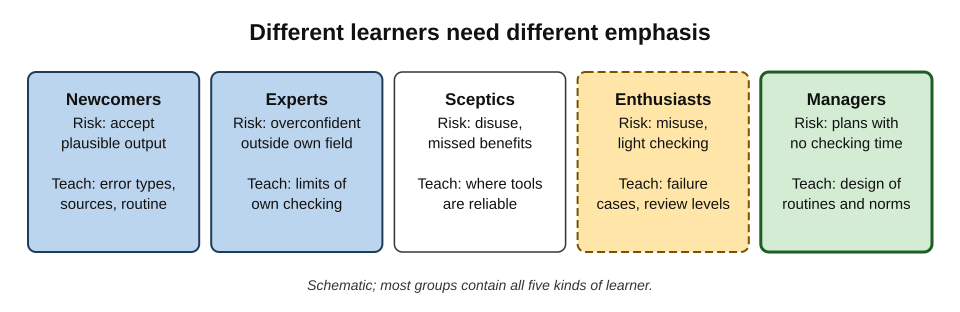
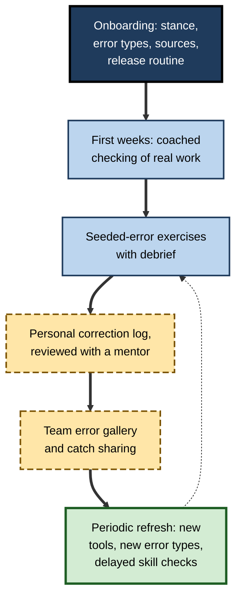

# K.12. Teaching others to verify

A team lead who checks every AI output meticulously discovers that her new graduate sends generated summaries to clients unread. She tells him to "always check", and he does — by reading each summary once and finding it fine. Telling someone to verify is easy; **teaching them how** is a different task. Verification is a skill made of knowledge, judgement and habit, and like any skill it is learned through modelling, practice and feedback, not instruction alone.

> **Definition — Teaching verification:** deliberately developing in others the knowledge, judgement and habits needed to check and correct AI output — what to look for, how to check it, how much checking a task needs and how to make checking routine.

**Why it matters**

- **The people most at risk are least equipped.** Newcomers and non-specialists accept plausible output most readily and are least able to see its errors.
- **Verification is largely tacit.** Experienced reviewers often cannot explain how they spot problems; their skill must be made visible to be passed on.
- **One careless user can expose a whole team.** An unchecked error sent to a client damages everyone's credibility.
- **Organisations are expected to build this capability.** The European Union's AI Act, for example, has required since February 2025 that organisations deploying AI systems take measures to ensure sufficient **AI literacy** among their staff.

---

## What There Is to Teach

Verification draws on several kinds of capability, each taught differently.

**Components of verification skill and how each is best taught**

| Component | Example | How it is best taught |
|---|---|---|
| Stance | Treating output as a draft; owning what is released | Modelling by respected colleagues; clear expectations |
| Knowledge of error types | Dropped caveats, wrong scope, invented commitments | Explanation with many real examples |
| Checking methods | Number inventory, quotation check, testing instructions | Worked examples, then guided practice |
| Calibration | Judging how much review a task needs | Practice with feedback on real tasks |
| Correction skill | Targeted re-prompts; knowing when to restart | Demonstration and coached practice |
| Habit | Release pass before every send | Routines, cues and reinforcement over weeks |
| Domain knowledge | Knowing the rules, figures and people of the field | The ordinary development of expertise |

> **Key point:** most verification failures are not caused by people not knowing they should check. They are caused by people not knowing **what to look for**, **how to check it quickly** or **when checking matters most** — and by habits that do not yet exist.

---

## How the Skill Is Learned

### Cognitive apprenticeship

- **Idea (Allan Collins, John Seely Brown and Susan Newman, 1989):** the methods of traditional craft apprenticeship can be applied to cognitive skills, provided the expert's thinking is made **visible**.
- **Six methods:**
  - **modelling** — the expert performs the task while explaining their thinking aloud;
  - **coaching** — the learner performs while the expert observes and gives feedback;
  - **scaffolding** — support (templates, checklists, prompts) that is gradually removed;
  - **articulation** — the learner explains their own reasoning;
  - **reflection** — the learner compares their performance with the expert's;
  - **exploration** — the learner tackles new problems independently.

> **Definition — Cognitive apprenticeship:** a model of teaching in which experts make their thinking visible through modelling, then support learners through coaching and scaffolding that is gradually withdrawn as competence grows.

**Figure 1.** Cognitive apprenticeship applied to teaching verification.

### Thinking aloud

- **Why it works:** it exposes the questions an expert asks silently — "Where did this figure come from? Is this still true? Who said this?"
- **How:** take a real AI output and check it in front of the learner, saying each question and showing each source consulted.
- **What learners notice:** experts check **few things, carefully** — the load-bearing claims — rather than reading everything with equal attention.

> **In practice:** a ten-minute think-aloud check of a real output, done by a respected senior colleague, often changes newcomers' behaviour more than an hour of slides.

### Worked examples, then fading

- **Worked-example effect** — research in cognitive load theory, associated with John Sweller and colleagues, has found that novices often learn problem-solving more efficiently by studying fully worked examples than by solving equivalent problems unaided.
- **Fading** — as competence grows, steps of the worked example are removed so that the learner completes more of the task.
- **Expertise reversal** — for learners who are already competent, worked examples become less useful than independent practice.

> **Definition — Worked-example effect:** the finding that novices often learn more efficiently from studying complete, step-by-step solutions than from solving equivalent problems unaided.

---

## Learning from Errors

The most distinctive feature of verification is that it is about **finding errors**. Research on training through errors is directly relevant.

**Study card — Keith and Frese (2008), error management training**

- **Design:** a meta-analysis of 24 studies with 2,183 participants comparing **error management training** — in which trainees are encouraged to make, explore and learn from errors during practice — with **error-avoidant** training that guides trainees to avoid mistakes.
- **Results:**
  - overall, error management training produced better outcomes (effect size **d = 0.44**);
  - the advantage was larger for performance **after** training (**d = 0.56**) than during it;
  - it was largest for **adaptive transfer** — tasks structurally different from those practised (**d = 0.80**).
- **Active ingredients:** active exploration, and explicit encouragement to treat errors as useful information.
- **Conclusion:** learning that includes encountering and working through errors transfers better to new situations than learning designed to prevent errors.
- **Lesson for teaching verification:** learners should **meet real errors** — find them, diagnose them, correct them — rather than only being told about error types.

**Figure 2.** Effects of error management training compared with error-avoidant training.

> **Definition — Error management training:** an approach in which trainees are encouraged to make and explore errors during practice and to treat them as a source of learning.

> **Watch out:** the evidence comes mainly from training in software use and similar tasks, not specifically from AI verification. The principle — that working through errors builds transferable skill — is well supported; the size of the effect for any particular programme is not guaranteed.

### Seeded-error exercises

The most direct way to let learners meet errors safely is to give them outputs with **known, deliberately inserted errors**.

**Figure 3.** A practice exercise with seeded errors.

- **Design principles:**
  - use **realistic** outputs from the learners' own work — summaries, emails, reports, code;
  - insert errors of the **types that matter** in that work — taken from the team's correction record;
  - provide the **sources** needed to check, so that learners practise checking rather than guessing;
  - include **plausible** errors, not just obvious ones;
  - include at least one output with **no** errors, so that learners do not assume every text is faulty.
- **Debrief:**
  - reveal the errors;
  - ask how each could have been found;
  - discuss which checks caught which errors, and which were missed.

> **Definition — Seeded-error exercise:** a practice task in which known errors are deliberately inserted into realistic material for learners to find.

> **Key point:** learners usually find the obvious errors and miss the plausible ones. The debrief — "why did nobody notice the dropped condition?" — is where most of the learning happens.

### An error gallery

- **What it is:** a shared collection of real, anonymised errors found in AI output in the team's own work, with how each was caught and what it would have cost.
- **Why it works:**
  - real examples are more memorable and credible than invented ones;
  - it shows the **specific** weak spots of the team's tools and tasks;
  - it normalises talking about errors.
- **How to build it:** from the correction record, with permission and anonymisation; add a few examples a month.

> **Watch out:** an error gallery must never become a gallery of **people's** mistakes. Examples should be anonymised and framed as catches — evidence that checking works — not as failures.

---

## Teaching Calibration

Knowing **how much** to check is harder to teach than knowing **how** to check.

### Calibration exercises

- **Predict, then check** — before verifying an output, the learner estimates how many errors it contains and how confident they are; then they check and compare.
- **Review-level sorting** — learners sort a set of realistic tasks into review levels, then discuss disagreements with an experienced reviewer.
- **Feedback over time** — learners keep a correction record and review it with a mentor after a few weeks.

> **In practice:** asking learners to state their confidence before checking quickly reveals the two common miscalibrations — **overconfidence** in fluent output and, in some learners, **blanket suspicion** that wastes time.

### Teaching the cost of checking

- **Time the checks** — learners discover how long proper checking takes, and where it is fast.
- **Compare with doing it by hand** — so that learners understand when a tool saves time and when it does not.

---

## Different Learners, Different Emphasis

**Figure 4.** Different learners need different emphasis.

### Newcomers

- **Risk:** accepting plausible output; not knowing the field's facts and sources.
- **Emphasis:** the draft stance; common error types; where the sources of truth are; a simple release routine.
- **Method:** worked examples, seeded exercises, close coaching.

### Experts

- **Risk:** confidence in their own field extending to areas where they are not expert; skipping checks on routine-looking output.
- **Emphasis:** limits of their own knowledge; error types they rarely meet; the value of independent review.
- **Method:** peer discussion, error gallery, examples from adjacent fields.

### Sceptics

- **Risk:** **disuse** — rejecting tools that would help, often after one bad experience.
- **Emphasis:** where tools are reliable and how checking makes them safe to use.
- **Method:** demonstrations of efficient checking; evidence from the team's own records.

### Enthusiasts

- **Risk:** **misuse** — heavy reliance with light checking.
- **Emphasis:** failure cases, review levels, the cost of errors that reach readers.
- **Method:** seeded exercises with plausible errors; case studies from their own field.

### Managers

- **Risk:** planning work as though AI drafting were instant, leaving no time for checking; expecting output without enabling review.
- **Emphasis:** designing routines, allocating review time, building a culture where catching errors is valued.
- **Method:** discussion of team-level design; correction-record data.

**Teaching approaches for different learners**

| Learner | Main risk | Most useful method |
|---|---|---|
| Newcomer | Accepts plausible output | Worked examples, seeded exercises, coaching |
| Expert | Overconfidence outside own field | Peer review, error gallery, adjacent-field cases |
| Sceptic | Disuse | Demonstrations of efficient, reliable use |
| Enthusiast | Misuse | Plausible-error exercises, failure cases |
| Manager | No time or structure for checking | Routine design, review-time planning, data |

---

## Culture: The Conditions for Learning

Teaching works only where people feel able to admit uncertainty, ask for checks and report errors.

### Psychological safety

- Research on teams, notably by Amy Edmondson, has found that teams in which members feel safe to speak up about mistakes **report and learn from** more errors — not because they make more, but because they hide fewer.
- **For verification:** people must feel able to say "I'm not sure this is right", to ask a colleague to check, and to record their own corrections without fear.

### Leaders as models

- **Senior people running checks visibly** — "let me check those figures before we send this" — teaches more than any policy.
- **Senior people admitting caught errors** — "the assistant got the date wrong; I caught it in the release pass" — normalises checking.
- **Senior people asking how something was checked**, routinely and without suspicion.

### Rewarding catches

- **Recognise people who find errors**, especially plausible ones.
- **Share catches** in team meetings as success stories.
- **Never punish honest reporting** of errors one made or caught.

> **Key point:** if catching an AI error is treated as a sign of careless prompting, people stop reporting catches — and soon stop looking.

---

## Designing a Teaching Programme

**Figure 5.** A teaching programme for verification over time.

### Principles

- **Short and spaced** — several brief sessions over weeks rather than one long course; skills built with spacing last longer.
- **Real material** — the learners' own kinds of output and sources.
- **Practice with feedback** — every session includes checking something and learning what was missed.
- **Routines, not just rules** — learners leave with a release pass and a review-level guide they actually use.
- **Measured** — skill is assessed, not assumed.

### Measuring whether teaching worked

- **Seeded-error detection rate** — the proportion of seeded errors learners find, before and after training.
- **Delayed assessment** — a seeded exercise weeks after the training, to test retention rather than short-term performance.
- **Real-work evidence** — correction records, errors reaching readers, quality audits.
- **Calibration** — whether learners' confidence predicts their accuracy.

> **Formula — Detection rate:** seeded errors found ÷ seeded errors inserted. Example: a learner finds 9 of 12 seeded errors → 9 ÷ 12 = **75%**.

> **Watch out:** a high score at the end of a training session shows **performance under easy conditions** — fresh, attentive, expecting errors. The real test is detection weeks later, in ordinary work, when errors are not expected.

---

## Worked Example (illustrative): A 60-Minute Session for a Client-Service Team

**Aim:** new client-service staff will check AI-drafted client emails reliably for the errors that matter most in their work.

| Minutes | Activity | Purpose |
|---|---|---|
| 0–10 | Senior colleague checks a real AI-drafted email aloud, showing sources | Modelling: make expert thinking visible |
| 10–15 | Short explanation of the five error types most common in the team's correction log | Knowledge, grounded in real data |
| 15–35 | Pairs check four AI-drafted emails with the client records; 11 seeded errors in total; one email has none | Practice with realistic, plausible errors |
| 35–45 | Debrief: which errors were found, which missed, how each could have been caught | Reflection: where the learning happens |
| 45–55 | Learners write their own five-item release pass and try it on a fifth email | Turning knowledge into a routine |
| 55–60 | Agree follow-up: personal correction logs, review with mentor in three weeks | Spacing and feedback |

**Results**

- **In the session:** pairs found on average 7 of 11 seeded errors; most missed a dropped condition in a refund policy and an invented commitment ("as discussed, we will waive the fee").
- **Three weeks later:** a new seeded exercise, done individually without warning, showed an average detection of 8 of 11, and every participant was using a release pass.

*Illustrative figures.*

> **Key point:** the missed errors in the session — a dropped condition and an invented commitment — are exactly the plausible errors that matter most. The debrief turned them into memorable examples.

---

## Case Study (illustrative): The Error Gallery at a Consulting Firm

- **Situation:** a consulting firm's practice of 80 consultants used AI tools heavily for research summaries, slides and client emails. A training module on "responsible AI use" had been completed by everyone, but errors kept reaching clients.
- **Diagnosis:**
  - the module explained principles but involved no practice;
  - examples were generic, not from the firm's own work;
  - consultants did not know which errors were common in **their** outputs.
- **Actions:**
  1. The practice built an **error gallery** from six months of anonymised corrections: 40 real examples, each with the source, how it was caught and what it would have cost.
  2. Every new joiner completed a **seeded-error exercise** using gallery-style material in their first week, with a debrief by a manager.
  3. Each team spent ten minutes a month discussing one new gallery entry.
  4. Partners began opening project reviews by asking, "What did the checks catch this week?"
- **Result:** client-reported errors in AI-assisted deliverables fell substantially over the following year; the correction log grew, showing more catches before release.
- **Side effects:** some consultants initially felt that discussing errors implied criticism; framing every entry as a **catch** helped.
- **Lesson:** real examples, practice and visible leadership interest teach verification far better than principles alone.

## Case Study (illustrative): The Training That Did Not Transfer

- **Situation:** a public-sector department ran a two-hour lecture on AI risks for 300 staff, ending with a multiple-choice quiz. Average quiz score: 92%.
- **Problem:** a later audit found that most staff could name hallucination as a risk but rarely checked figures or sources in their own AI-assisted briefings.
- **Diagnosis:**
  - the quiz measured **recognition** of facts about AI, immediately after the lecture, not the **skill** of checking real output weeks later;
  - no practice, no routine, no follow-up.
- **Actions:** the department replaced the lecture with short, spaced practice sessions using real briefing material, team release routines and a delayed seeded-error check.
- **Lesson:** knowing *about* verification is not the same as being able to *do* it. Teach and assess the **skill**, in realistic conditions, after a delay.

---

## Teaching Through Everyday Work

Formal sessions are only part of teaching. Much of it happens in ordinary work.

### Review conversations

- **Ask, don't just correct** — "How did you check this figure?" teaches more than silently fixing it.
- **Explain catches** — when correcting a colleague's AI-assisted draft, say what was wrong, how it was found and what check would have caught it.
- **Agree a next step** — "Next time, check dates against the calendar invitation before sending."

### Pairing

- **Pair a newcomer with an experienced checker** for the first few weeks of AI-assisted work.
- **Swap roles** — the newcomer checks the experienced colleague's output; experts benefit from fresh eyes too.

### Playbooks and shared prompts

- **A short team playbook** — review levels for common tasks, release-pass items, sources of truth.
- **Shared verification prompts** — "list every figure with its source passage" — so that newcomers start with good tools.

> **In practice:** the most effective teaching often takes under a minute: a senior colleague, seeing a generated email, asks "Where's this date from?" — and the question becomes a habit.

---

## Open Questions

- **How should AI literacy be assessed?**
  - Requirements to ensure staff AI literacy are spreading, but agreed ways of measuring practical verification skill are not yet established.
- **Does verification skill transfer across tools and tasks?**
  - Error management research suggests good transfer; whether skills learned on one kind of output carry over to very different ones needs more evidence.
- **Can AI tools teach verification?**
  - Tutoring systems could generate seeded exercises and feedback; whether they teach well, or encourage dependence, is open.
- **How should experts be taught?**
  - Expert overconfidence outside the home domain is well documented in general; effective ways of teaching experts to check AI output are little studied.
- **What should newcomers learn before using AI tools?**
  - If people need domain knowledge to verify, there may be tasks they should learn to do unaided first; where to draw that line is debated.

---

## Summary

- **Teaching verification** develops the stance, knowledge, methods, calibration, correction skill and habits needed to check AI output.
- Most failures come from not knowing **what to look for, how to check quickly or when it matters** — not from not knowing that checking is needed.
- **Cognitive apprenticeship** makes expert thinking visible: modelling, coaching, scaffolding, articulation, reflection, exploration; **thinking aloud** is especially powerful.
- **Worked examples** help novices; **fading** removes support as competence grows.
- **Error management training** outperforms error-avoidant training, especially for **transfer** to new tasks (Keith and Frese, 2008).
- **Seeded-error exercises** and an **error gallery** of real, anonymised catches let learners meet the errors that matter.
- **Calibration** — how much to check — is taught by prediction, sorting tasks and feedback over time.
- Tailor emphasis to **newcomers, experts, sceptics, enthusiasts and managers**.
- **Psychological safety, visible leadership and rewarded catches** are the conditions for learning.
- Programmes should be **short, spaced, practical and measured**, with **delayed** assessment of real skill.

---

## Self-Check

1. Define teaching verification and list its main components.
2. Why is "always check" an inadequate instruction?
3. Name the six methods of cognitive apprenticeship and give a verification example of one.
4. Why is thinking aloud effective for teaching verification?
5. What is the worked-example effect, and what is expertise reversal?
6. Summarise Keith and Frese (2008) and its implication for teaching verification.
7. Give five design principles for a seeded-error exercise.
8. What is an error gallery, and what must it avoid?
9. How can calibration be taught?
10. What are the main risks for newcomers, experts, sceptics, enthusiasts and managers?
11. Why does psychological safety matter for verification?
12. Why is a high quiz score at the end of a session weak evidence that training worked?
13. In the 60-minute session example, which errors were missed and why does that matter?
14. You are asked to improve AI verification in a 30-person finance team where a one-off e-learning module has had little effect. Design a three-month approach.

### Answer Key

1. Deliberately developing the knowledge, judgement and habits needed to check and correct AI output. Components: stance, knowledge of error types, checking methods, calibration, correction skill, habit, domain knowledge.
2. It does not teach what to look for, how to check quickly or when checking matters; learners may "check" by reading once and finding nothing.
3. Modelling, coaching, scaffolding, articulation, reflection, exploration. E.g. modelling: a senior colleague checks a real AI summary aloud, showing each source.
4. It exposes the silent questions experts ask and shows that they check a few load-bearing claims carefully rather than everything equally.
5. Novices learn more efficiently from complete solutions than from unaided problem-solving; for already-competent learners, worked examples lose value relative to independent practice.
6. A meta-analysis of 24 studies found error management training better overall (d = 0.44), more so after training (d = 0.56) and for adaptive transfer (d = 0.80). Learners should meet, diagnose and correct real errors.
7. Realistic material from learners' work; error types that matter, from the correction record; sources provided; plausible as well as obvious errors; at least one error-free output; a debrief.
8. A shared collection of real, anonymised errors with how they were caught and their potential cost. It must avoid becoming a record of individuals' mistakes; entries should be framed as catches.
9. Predict-then-check exercises; sorting tasks into review levels and discussing disagreements; reviewing personal correction records with a mentor; timing checks.
10. Newcomers: accepting plausible output. Experts: overconfidence outside their field. Sceptics: disuse. Enthusiasts: misuse and light checking. Managers: plans without checking time or structure.
11. Errors are reported and learned from only when people feel safe admitting uncertainty and catches; otherwise errors are hidden and checking declines.
12. It measures recognition under easy, immediate conditions; real skill is detection in ordinary work weeks later, when errors are not expected.
13. A dropped condition and an invented commitment — plausible errors that matter most and are hardest to see; the debrief made them memorable.
14. E.g. Month 1: build an error gallery from the team's corrections; senior think-aloud demonstrations; seeded-error baseline. Month 2: weekly 20-minute practice sessions with real management-report material and seeded errors; team release pass and review-level guide; pairing for new staff. Month 3: personal correction logs reviewed with mentors; managers ask "what did checks catch?" in reviews; delayed unannounced seeded-error assessment; compare detection rates and real error records with the baseline; refresh quarterly.

---

## Glossary

| Term | Meaning |
|---|---|
| AI literacy | The knowledge and skills needed to use AI systems appropriately, including understanding their limits. |
| Calibration | The match between a person's confidence and their actual accuracy. |
| Cognitive apprenticeship | Teaching that makes expert thinking visible and withdraws support as competence grows. |
| Detection rate | Seeded errors found divided by seeded errors inserted. |
| Error gallery | A shared collection of real, anonymised errors and how they were caught. |
| Error management training | Training that encourages making and learning from errors during practice. |
| Expertise reversal | The decline in usefulness of worked examples as learners become competent. |
| Fading | Gradual removal of steps from worked examples as learners progress. |
| Psychological safety | A shared belief that a team is safe for speaking up and admitting mistakes. |
| Scaffolding | Temporary support for a learner that is removed as competence grows. |
| Seeded-error exercise | Practice in which known errors are inserted into realistic material. |
| Thinking aloud | Performing a task while voicing one's reasoning. |
| Worked-example effect | Novices learning more efficiently from complete solutions than from unaided problem-solving. |
