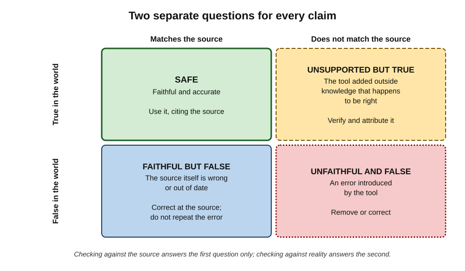
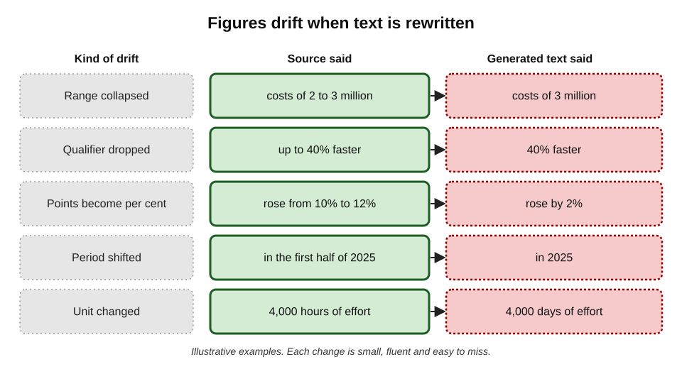
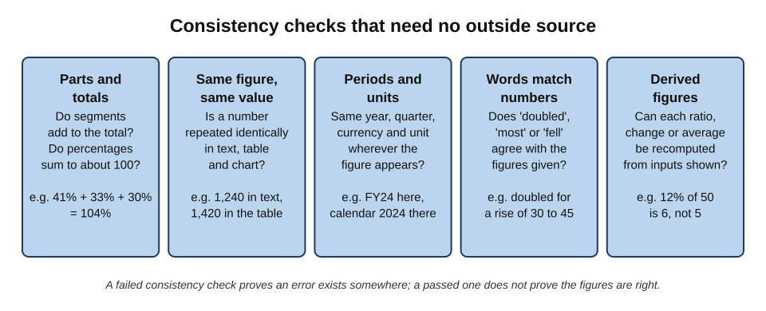
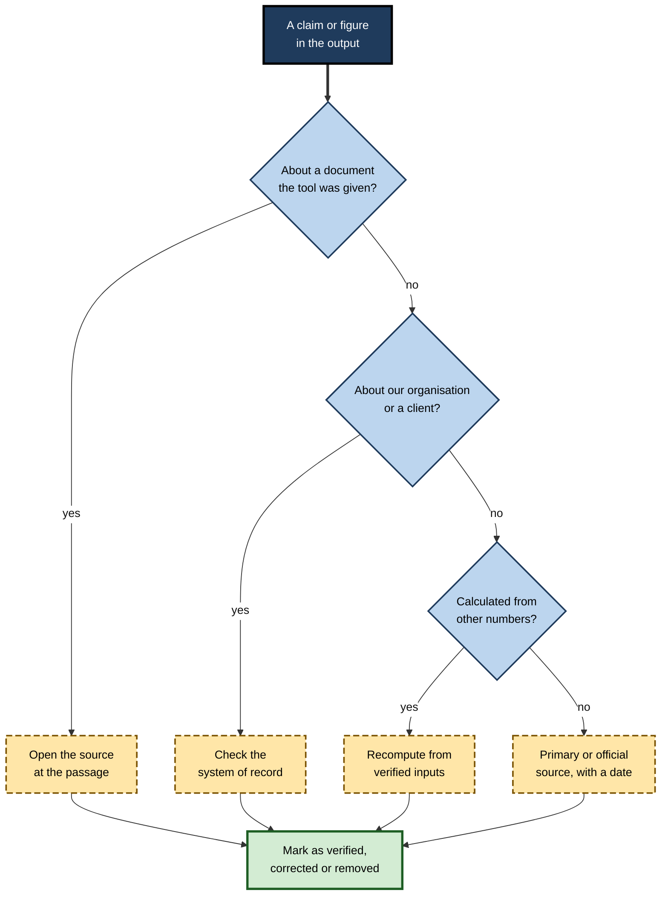
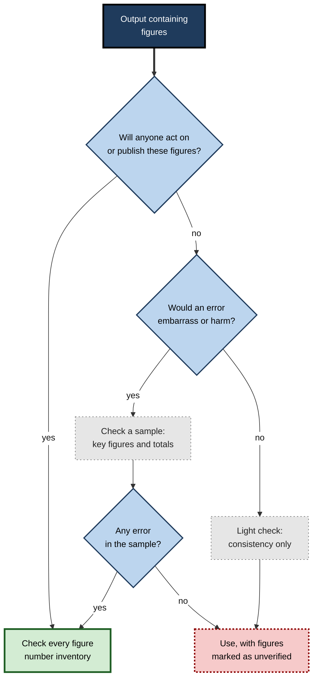

# K.2. Checking facts and figures

An assistant summarises a 30-page supplier contract and reports a "notice period of 60 days"; the contract says 90. Another rewrites a sales update and turns "revenue grew from 10% to 12% of the group total" into "revenue grew by 2%". A third drafts a briefing that names a regulation's effective date a year too early. None of these errors is dramatic. Each is fluent, specific and easy to believe — and each would mislead the person who relied on it.

> **Definition — Fact and figure checking:** the systematic confirmation that every factual statement and every number in a piece of output is supported by an appropriate source, is stated with the right meaning, units and scope, and is consistent with everything else in the output.

**Why it matters**

- **Facts and figures are what readers act on.** A reader may forgive clumsy phrasing; a wrong deadline or a misstated price causes real harm.
- **Numbers carry special authority.** Precise figures look researched, so they are questioned less.
- **AI errors cluster here.** Generated text reproduces the *form* of factual writing — dates, percentages, names of rules — more reliably than its *content*.
- **Errors propagate.** A wrong figure in a summary is copied into slides, emails and decisions long after the summary is forgotten.

---

## What Counts as a Fact or a Figure

Before anything can be checked, it has to be noticed. Generated text mixes checkable claims with opinion, framing and filler.

### Kinds of factual content

- **World facts** — claims about the external world.
  - *e.g.* "The regulation applies from 2 August 2026"; "Copper prices fell last quarter."
- **Organisational facts** — claims about the author's own organisation or its clients.
  - *e.g.* "Our standard payment terms are 30 days"; "The client has three data centres."
- **Source facts** — claims about what a particular document, dataset or conversation says.
  - *e.g.* "The contract allows termination on 90 days' notice"; "The survey found that most respondents…"
- **Figures** — numbers of every kind: counts, amounts, rates, percentages, dates, durations, rankings.
- **Derived figures** — numbers calculated from other numbers: totals, changes, averages, ratios, forecasts.

> **Key point:** organisational and source facts are often **more** dangerous than world facts, because no public source can contradict them — only the organisation's own records or the original document can.

### What is not a fact claim

- **Opinions and recommendations** — "the team should prioritise the migration".
  - Not checkable as true or false, but the facts they rest on are.
- **Framing** — "a significant challenge", "a strong quarter".
  - Check that the framing matches the numbers.
- **Hedged statements** — "may", "could", "in some cases".
  - Check that the hedge is justified and has not been dropped or added.

> **Watch out:** evaluative words smuggle in factual claims. "Revenue **surged**" implies a large increase; if revenue rose 1%, the word is false even though no number is stated.

---

## Two Questions for Every Claim

Much AI output is produced from material the user supplied — a document, a transcript, a spreadsheet, search results. Each claim then faces two distinct questions.

- **Is it faithful?** Does it accurately reflect what the source says?
- **Is it true?** Does it accurately reflect the world?

> **Definition — Faithfulness:** the degree to which generated output says only what its source material supports, without adding, omitting or distorting information.

**Figure 1.** Faithfulness and truth as two separate questions.

- **Faithful and true** — the ideal; use it.
- **Faithful but false** — the source itself is wrong or out of date; the tool has faithfully repeated an error.
- **Unfaithful but true** — the tool added outside knowledge that happens to be correct; it still needs checking and attribution, because the reader will assume it came from the source.
- **Unfaithful and false** — the tool has introduced an error.

> **Key point:** checking a summary against its source catches unfaithful errors only. If the source is out of date, a perfectly faithful summary is still wrong.

**Study card — summary hallucination benchmarks (2023 onwards)**

- **Design:** the AI company Vectara and, separately, academic groups evaluated many language models by giving them short documents to summarise, then measuring how often the summaries contained information the document did not support.
- **Results:**
  - even when instructed to use only the document, every model sometimes added unsupported content;
  - the best models did so in a small minority of summaries; others did so far more often;
  - rates differed widely between models and changed with each new model release.
- **Conclusion:** grounding output in a supplied document reduces, but does not eliminate, unfaithful content.
- **Caveat:** these benchmarks use short, clean documents; real workplace sources — long, messy, contradictory — are harder, and benchmark rates should not be taken as the rate a user will experience.

---

## How Figures Go Wrong

AI tools are not calculators. Language models handle numbers as text, so figures are vulnerable to errors that a spreadsheet would never make — and to subtler changes of meaning that are easy to miss.

### Transcription errors

- **Digits swapped or dropped** — 1,420 becomes 1,240; 15.6 becomes 1.56.
- **Wrong row or column** — a figure taken from the line above in a table.
- **Wrong entity** — a competitor's figure attributed to the client.
- **Wrong edition** — last year's figure from an older version of the document.

### Drift in meaning

Rewriting, shortening and summarising alter numbers' meaning even when the digits survive.

**Figure 2.** Typical ways figures drift when text is rewritten.

**Kinds of drift and what each does to the reader's understanding**

| Kind of drift | Source | Generated | Effect on reader |
|---|---|---|---|
| Range collapsed | "£2–3 million" | "£3 million" | False precision; worst or best case presented as certain |
| Qualifier dropped | "up to 40% faster" | "40% faster" | Maximum presented as typical |
| Points and per cent confused | "from 10% to 12%" | "up 2%" | Understates a 20% relative rise |
| Period shifted | "first half of 2025" | "2025" | Half-year figure read as annual |
| Scope widened | "UK customers" | "customers" | Local finding read as global |
| Unit changed | "hours" | "days" | Eightfold error, or worse |

*Illustrative figures.*

> **Definition — Percentage point:** the arithmetic difference between two percentages. A rise from 10% to 12% is **2 percentage points**, but a **20% relative** increase.

> **Formula — Relative change:** (new − old) ÷ old. From 10% to 12%: (12 − 10) ÷ 10 = 0.2 = **20%**.

### False precision

- **Invented decimals** — "37.4% of employees" when the source said "over a third".
- **Rounded inputs, precise outputs** — a total stated to the pound from estimates rounded to the nearest thousand.
- **Precise dates for vague events** — "launched on 14 March" when only the month is known.

**Study card — Janiszewski and Uy (2008), precise numbers and adjustment**

- **Design:** in a series of experiments, participants estimated prices (for example of a house) after seeing a suggested figure that was either a round number or a precise one of similar size (a figure ending in exact hundreds or units rather than whole thousands); published in *Psychological Science*.
- **Results:** estimates stayed **closer** to precise anchors than to round ones; participants adjusted less from precise numbers.
- **Interpretation:** a precise number suggests a finer scale of knowledge, so people treat it as more informative.
- **Lesson for checking:** precise figures in generated text attract **less** scrutiny than they deserve; precision should prompt the question "where did this exact number come from?"

> **Watch out:** precision is not evidence. A model can generate "37.4%" as easily as "about a third", and the precise version is the one readers are more likely to repeat.

### Calculation errors

- **Arithmetic in prose** — sums, differences and percentages computed by the model rather than by a calculation tool.
- **Wrong base** — a percentage computed on the wrong denominator.
- **Averages of averages** — combining group averages without weighting by group size.

Detailed methods for checking calculations — sense checks, recomputation, control totals — apply here too; the essential rule is that **any number the tool computed in prose should be recomputed** by a method that actually calculates.

---

## Checking Without a Source: Internal Consistency

Some errors can be found without consulting anything outside the output. If two parts of a document contradict each other, at least one is wrong.

**Figure 3.** Five consistency checks that need no outside source.

- **Parts and totals** — do the segments add to the stated total? Do the shares of a whole sum to roughly 100%?
- **Same figure, same value** — is a number repeated in the summary, body, table and chart identical each time?
- **Periods and units** — does each figure carry the same year, quarter, currency and unit wherever it appears?
- **Words and numbers** — do "doubled", "most", "fell sharply" and "a minority" agree with the figures they describe?
- **Derived figures** — can each ratio, change or average be recomputed from inputs shown in the output?

> **Remember:** a failed consistency check **proves** an error exists; a passed one proves only that the errors, if any, are consistent.

> **In practice:** consistency checks are the fastest first pass on a long generated report — five minutes of cross-checking often finds the error that sends the reviewer back to the source.

---

## Where to Check: Matching the Fact to Its Source

Each kind of fact has a natural authority. Checking against the wrong one wastes time or gives false comfort.

**Where to check each kind of fact**

| Kind of fact | Best authority | Weak substitutes |
|---|---|---|
| Source fact (what a document says) | The document itself, at the cited passage | The tool's restatement; memory of the document |
| Organisational fact | System of record: contract repository, finance system, HR system, policy library | Old slide decks; colleagues' recollection |
| Client fact | Client's own documents, signed agreements, confirmed correspondence | Notes from a sales call |
| World fact (stable) | Primary or official source: legislation, regulator, standards body, company filings | Secondary articles; encyclopaedias for important matters |
| World fact (volatile) | Live, dated official or market sources | Any figure without a date |
| Derived figure | Recalculation from verified inputs | The tool's statement that it "checked" |

> **Definition — System of record:** the authoritative data source for a given piece of information within an organisation, such as the finance ledger for revenue or the contract repository for agreed terms.

> **Watch out:** asking the same tool "are you sure?" is not checking. It may change a correct answer to please the user, or repeat an incorrect one more confidently.

**Figure 4.** Choosing where to check a claim.

- For world facts found by searching, the familiar techniques of tracing a claim to its origin and reading laterally about a source apply; the point here is to recognise **which kind of fact** is in hand, because organisational and source facts are never settled by a web search.

---

## The Number Inventory Method

The most reliable way to check figures in a long output is to **list them all first**, then check the list.

### Steps

1. **Extract.** Highlight or list every number, date, percentage and named quantity in the output — including numbers written as words ("a dozen", "a third", "doubled").
2. **Classify.** Mark each as source figure, organisational figure, world figure or derived figure.
3. **Locate.** For each, find the natural authority for its kind and record where it was found.
4. **Compare meaning, not just digits.** Check unit, period, scope, qualifier and base.
5. **Recompute** every derived figure from verified inputs.
6. **Cross-check** consistency across text, tables and charts.
7. **Mark the outcome:** verified, corrected, softened (e.g. to a range), or removed.

> **Mnemonic — "UPSQB":** for each figure, check **U**nit, **P**eriod, **S**cope, **Q**ualifier, **B**ase — "Up, Sir, Quick Bus."

> **In practice:** asking the tool itself to produce the inventory — "list every number in your answer with the sentence it appears in and the source passage it came from" — makes extraction fast. The checking against sources must still be done by the reviewer.

> **Watch out:** a tool's list of "source passages" can itself be wrong. Open the passages; do not trust the quoted extract.

### Worked example (illustrative): checking a generated board summary

A finance manager asks an assistant to summarise the quarterly management accounts (a 12-page document) into a half-page board note. The note contains seven figures.

| # | Figure in the note | Kind | Check | Outcome |
|---|---|---|---|---|
| 1 | Revenue £14.2m | Source | Accounts p. 2: £14.2m | Verified |
| 2 | "up 12% on last year" | Derived | (14.2 − 12.9) ÷ 12.9 = 10.1% | **Corrected** to 10% |
| 3 | Gross margin 41% | Source | Accounts p. 3: 41.3% | Verified (rounded) |
| 4 | "Headcount of 230" | Organisational | Accounts give 230 **budgeted**; HR system shows 214 actual | **Corrected**, scope clarified |
| 5 | Cash £3.1m | Source | Accounts p. 5: £3.1m at month end | Verified; date added |
| 6 | "Costs of £2–3m for the new system" | Source | Accounts p. 9: "estimated £2–3m" | Verified; "estimated" restored |
| 7 | "Industry average margin of 35%" | World | Not in the accounts; no source found | **Removed** |

*Illustrative figures.*

- **Result:** of seven figures, three were wrong or misleading and one was unsupported — in a note that read smoothly and confidently.
- **Time taken:** about fifteen minutes.

> **Watch out:** figure 7 is the classic **unfaithful but plausible** addition: a benchmark the tool supplied to make the note feel complete. Such figures often look like the most useful sentence in the document — which is exactly why they get repeated.

---

## Checking Facts in Different Kinds of Output

The principles are the same everywhere, but each kind of output has its own characteristic weak points.

**Characteristic fact and figure risks by output type**

| Output | Where facts and figures usually go wrong | First check |
|---|---|---|
| Summary of a document | Dropped qualifiers, merged figures, invented context | Key numbers and conditions against the source |
| Meeting notes | Misheard numbers, wrong owner, wrong deadline | Decisions, dates and owners against the recording or attendees |
| Email reply | Wrong dates, invented commitments, wrong prices | Every date and amount against the thread and records |
| Report or briefing | Unsupported statistics, outdated rules, false precision | Every statistic to a primary source |
| Slide or chart | Values transcribed wrongly, axes mislabelled | Chart values against the data table |
| Translation | Numbers and dates reformatted wrongly; decimal commas | Every number and date against the original |

> **Example:** in many European languages a comma marks decimals — "3,5 %" means three and a half per cent. A careless translation into English can turn "3,500" (three thousand five hundred, English) or "3,5" (three and a half, German) into the wrong value.

> **Example:** dates written as numbers are ambiguous: 04/05/2026 is 4 May in the United Kingdom and April 5 in the United States. A tool may silently switch conventions when rewriting.

---

## Case study: a promotional answer about a space telescope (2023)

- **Situation:** in February 2023 Google released a promotional demonstration of its new conversational assistant, Bard. One example answered the question of what new discoveries from the James Webb Space Telescope could be told to a nine-year-old.
- **Problem:** the answer stated that the telescope had taken the very first pictures of a planet outside the solar system. Astronomers quickly pointed out that the first direct image of an exoplanet had been taken years earlier, in 2004, by the European Southern Observatory's Very Large Telescope.
- **Result:**
  - the error was widely reported on the day of the product's launch event;
  - shares in Google's parent company, Alphabet, fell sharply the next day, wiping roughly $100 billion off its market value — a fall widely linked to the error and to concern about the launch generally.
- **Diagnosis:**
  - a single, specific, checkable world fact was stated confidently;
  - it was a **firsts** claim — "the first", "the only", "the largest" — the kind most often wrong and easiest to check;
  - no one checked it before it appeared in promotional material reviewed by many people.
- **Lesson:** superlatives and "firsts" deserve automatic checking. A two-minute search of an authoritative astronomy source would have caught the error.

> **Remember:** **firsts, onlys, mosts and records** are high-risk claims. Treat every superlative in generated text as unverified until traced.

---

## Case study (illustrative): the tender response that misquoted itself

- **Situation:** a facilities-management firm used an assistant to draft a 40-page tender response from its library of past bids and the client's requirements document.
- **Problem:** after submission, the client queried why the response promised "a two-hour emergency response" on page 6 and "a four-hour emergency response" on page 31.
- **Diagnosis:**
  1. the tool had drawn on two past bids with different service levels;
  2. the reviewers had checked the pricing tables against the finance system but had not checked consistency across the narrative;
  3. the firm's actual standard was four hours; the two-hour figure was from a premium contract.
- **Actions:**
  - the firm clarified in writing and was allowed to continue, at a cost to its credibility score;
  - its bid process now includes a **figure inventory** of every service level, price and date, checked against the current service catalogue, plus a consistency pass across the whole document.
- **Result:** the next three bids went out without figure queries.
- **Lesson:** when output is assembled from many past documents, **internal inconsistency** is the signature error — and only a deliberate cross-document check finds it.

---

## Figures in Generated Tables and Charts

Tables and charts give figures an extra layer of authority: a number in a grid or a bar looks measured. Generated tables and charts deserve the same inventory as prose, plus checks of their own.

### Tables

- **Row and column integrity** — does each value sit under the right heading and against the right item?
  - Tools that rebuild a table from a document can shift a column by one, so every value is real but attached to the wrong label.
- **Totals rows** — are they recomputed, or copied from the source even after rows were dropped?
- **Blank cells filled** — a gap in the source may be filled with a plausible estimate, with nothing to show it was invented.
- **Footnotes lost** — "excludes discontinued operations" or "restated" often disappears when a table is reformatted.

### Charts

- **Values** — does each bar, point or slice match the underlying data table?
- **Axes** — does the vertical axis start at zero where the comparison needs it? A truncated axis makes small differences look large.
- **Labels and legends** — are series labelled correctly, and in the right order?
- **Chart type** — does a line chart imply a continuous trend between points that were never measured?

> **Watch out:** when a tool generates a chart from a description rather than from data ("make a chart showing growth over five years"), the values may be **invented to fit the description**. Such a chart is an illustration, not evidence, and must not be presented as data.

> **In practice:** before using any generated chart externally, ask for — or build — the **data table behind it**, and check that table as carefully as any other set of figures.

---

## Facts, Figures and Professional Judgement

### Proportionate checking

- **Check everything that a reader will act on**: amounts, dates, deadlines, legal terms, names of obligations.
- **Check everything that would embarrass** if wrong: superlatives, comparisons with competitors, statistics about people.
- **Sample the rest** in low-stakes internal material, and widen the check if the sample finds errors.

**Figure 5.** Deciding how thoroughly to check the figures in an output.

> **Key point:** one error found in a sample is evidence about the **whole** output. If the first three figures checked include a wrong one, check them all.

### Removing, softening or attributing

When a claim cannot be verified, the options are:

- **Remove it** — the default for unsupported figures in external documents.
- **Soften it** — replace a precise figure with the range or qualitative statement that the evidence does support ("around a third").
- **Attribute it** — state where it comes from and its status ("the vendor estimates…").
- **Flag it** — in internal drafts, mark it clearly as unverified.

> **Watch out:** softening is not a way to keep an invented number. If no source supports even the softened claim, it goes.

### The reader's trust

- **One wrong figure taints the rest.** Readers who find one error reasonably doubt the others.
- **Corrections cost more after release.** A correction email reaches fewer people than the original, and the wrong number may already be in another document.
- **Experts check first what they know.** A reader who knows the true figure will judge the whole document by it.

> **In practice:** experienced editors and analysts adopt the rule "**no orphan numbers**": every figure in an external document can be traced, on request, to a named source and date.

### Facts that change

- **Volatile facts** — prices, rates, exchange rates, headcounts, regulatory status, product features, office holders.
- **Knowledge cut-offs** — a model without live retrieval may present an old figure as current.
- **Retrieved facts can be stale too** — an AI tool that searches may still land on an outdated page.

> **Remember:** a volatile figure without a **date** is not a fact; it is a guess about the present.

---

## Open Questions

- **Can tools reliably mark their own unsupported claims?**
  - Some products highlight sentences without a matching source passage; how accurate such highlighting is, and whether users rely on it too much, is not well established.
- **How faithful are summaries of long, messy documents?**
  - Benchmarks mostly use short, clean texts; evidence on faithfulness for long contracts, transcripts and reports is thinner.
- **Will calculation tools inside assistants remove arithmetic errors?**
  - Assistants that run code for calculations reduce arithmetic slips, but the choice of inputs, base and method can still be wrong.
- **What level of residual error is acceptable?**
  - Professions have norms for human error rates in audits and reviews; equivalent norms for AI-assisted documents do not yet exist.
- **How should organisations keep systems of record AI-readable?**
  - Many checking failures arise because the authoritative figure is hard to find; whether better data management or better tools will close the gap is open.

---

## Summary

- Fact and figure checking confirms that every claim and number is **supported, correctly stated and consistent**.
- Factual content includes **world, organisational, source and derived** facts; organisational and source facts can only be settled by the organisation's records or the original document.
- Every claim faces **two questions**: is it faithful to the source, and is it true? Faithful summaries of wrong sources are still wrong; correct additions not in the source still need attribution.
- Even grounded tools add **unsupported content** at measurable rates.
- Figures go wrong through **transcription**, **drift in meaning** (ranges, qualifiers, percentage points, periods, scope, units), **false precision** and **calculation**.
- Precise numbers attract **less scrutiny** than they deserve (Janiszewski and Uy).
- **Internal consistency checks** find many errors without any outside source.
- Each fact has a natural **authority**: the document, the system of record, a primary source, or recomputation.
- The **number inventory** — extract, classify, locate, compare meaning, recompute, cross-check, mark — is the most reliable method for long outputs.
- **Firsts and superlatives**, as the 2023 telescope example showed, are high-risk claims.
- When a claim cannot be verified: **remove, soften, attribute or flag** it.

---

## Self-Check

1. Define fact and figure checking and list four kinds of factual content.
2. Why are organisational facts often more dangerous than world facts?
3. Explain the difference between faithfulness and truth, with an example of a claim that is faithful but false.
4. A summary includes an industry benchmark not found in the source document. What category is it, and what should the reviewer do?
5. A rise from 25% to 30% is described as "up 5%". What is wrong, and what is the correct description?
6. List five kinds of drift in meaning that affect figures when text is rewritten.
7. Summarise the Janiszewski and Uy (2008) finding and its lesson for reviewing AI output.
8. Name the five internal consistency checks and explain what a passed check does and does not prove.
9. Where should each be checked: a contract's notice period; the firm's current headcount; a regulation's commencement date; a growth rate in the output?
10. Describe the steps of the number inventory method.
11. Why is asking the tool "are you sure?" not a check?
12. What made the 2023 telescope claim a high-risk kind of statement?
13. What are the four options when a claim cannot be verified, and when is softening inappropriate?
14. A generated market report quotes "a 37.4% adoption rate in 2024" with no source, and states elsewhere that "around a third" of firms have adopted. As reviewer, what do you conclude and do?

### Answer Key

1. The systematic confirmation that every factual statement and number is supported by an appropriate source, stated with the right meaning, units and scope, and consistent with the rest of the output. Kinds: world facts, organisational facts, source facts, figures, derived figures.
2. No public source can contradict them; only internal records can, so errors pass general-knowledge checks and readers assume the author knows their own organisation.
3. Faithfulness is whether output matches its source; truth is whether it matches the world. A faithful summary of last year's price list states prices that are no longer true.
4. Unfaithful (not in the source); possibly true or false. Find a primary source and attribute it, or remove it — in external documents removal is the default if no source is found.
5. 25% to 30% is a 5 **percentage-point** rise, which is a **20% relative** increase ((30 − 25) ÷ 25). "Up 5%" understates it.
6. Ranges collapsed to one value; qualifiers dropped; percentage points confused with per cent; periods shifted; scope widened; units changed.
7. People adjusted less from precise anchors than from round ones, treating precision as a sign of knowledge. Precise AI figures therefore draw less scrutiny and should prompt the question of their origin.
8. Parts and totals; same figure same value; periods and units; words match numbers; derived figures recomputable. A failed check proves an error; a passed check shows only that figures agree with each other, not that they are right.
9. Notice period: the contract itself. Headcount: the HR system of record. Commencement date: the legislation or regulator's official text. Growth rate: recompute from verified inputs.
10. Extract every number (including words like "doubled"); classify each; locate its authority; compare unit, period, scope, qualifier and base; recompute derived figures; cross-check consistency; mark each verified, corrected, softened or removed.
11. The tool has no independent access to truth; it may switch a correct answer to agree with the user or restate an error more confidently. Checking requires an independent authority.
12. It was a "first" — a superlative claim, specific and checkable, of a kind often wrong; it appeared in reviewed promotional material without being traced to an authoritative source.
13. Remove, soften, attribute, flag. Softening is inappropriate when no evidence supports even the softened claim, or when it is used to keep an invented figure in disguise.
14. The precise figure is unsourced and false precision is suspected; the two statements are roughly consistent but the precise one has no traceable origin. Search for a primary source; if none is found, remove the 37.4% figure, keep a sourced qualitative statement if one exists, and widen checking to all other figures in the report, since one unsupported figure suggests others.

---

## Glossary

| Term | Meaning |
|---|---|
| Consistency check | A comparison of parts of an output with each other to find contradictions. |
| Derived figure | A number calculated from other numbers. |
| Drift (of a figure) | A change in a figure's meaning during rewriting, even when digits survive. |
| Faithfulness | The degree to which output says only what its source supports. |
| False precision | Stating a figure more precisely than the evidence allows. |
| Number inventory | A list of every figure in an output, used to check each systematically. |
| Organisational fact | A claim about the author's own organisation or its clients. |
| Percentage point | The arithmetic difference between two percentages. |
| Relative change | (new − old) ÷ old. |
| Source fact | A claim about what a particular document or dataset says. |
| System of record | The authoritative data source for a piece of information in an organisation. |
| Truncated axis | A chart axis that does not start at zero, exaggerating differences. |
| Unsupported content | Information in generated output that the source material does not contain. |
| Volatile fact | A fact likely to change over time, such as a price or office holder. |
| World fact | A claim about the external world. |
