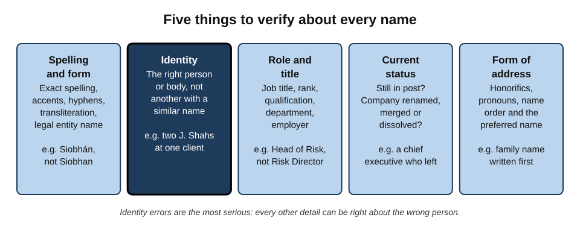
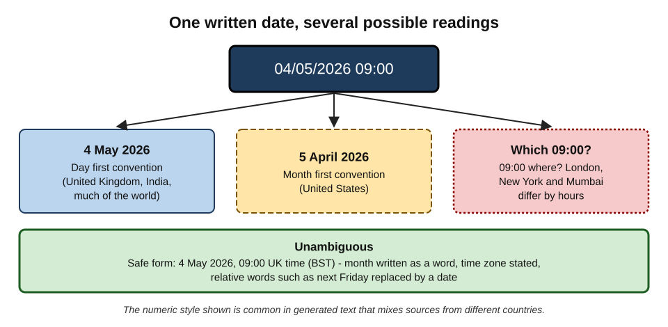
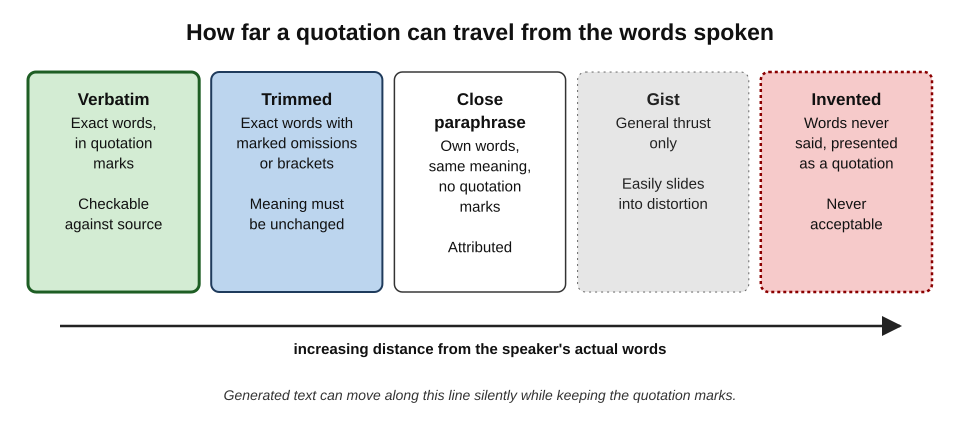
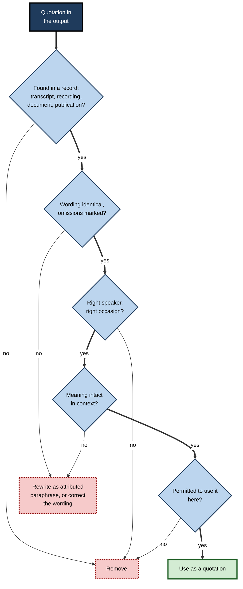
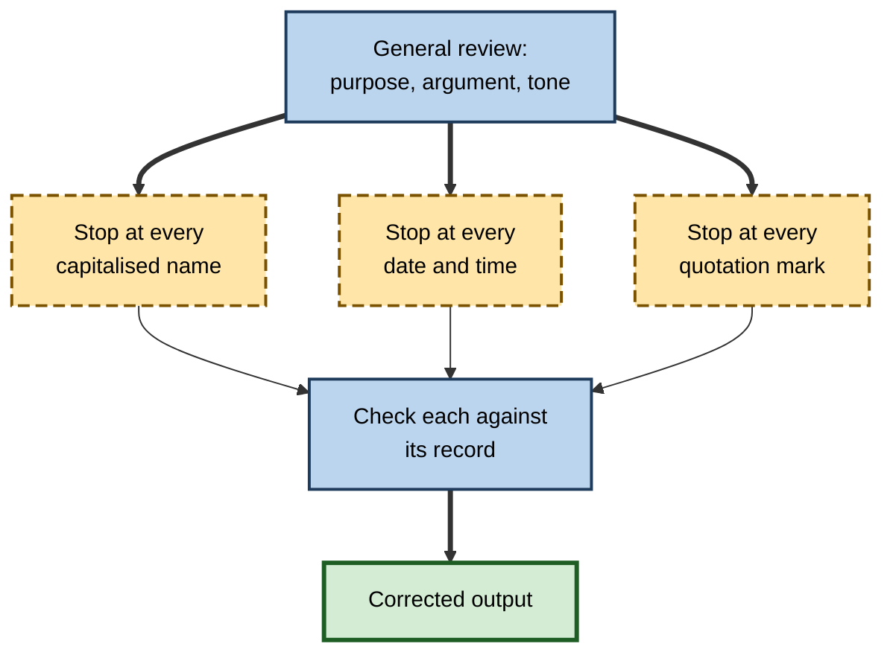

# K.3. Verifying names, dates and quotes

A thank-you email reaches a client's new finance director addressed to her predecessor. A project plan schedules a workshop for "Tuesday 12 March" in a year when 12 March is a Thursday. A press release quotes the chief executive saying something she never said, in words that sound exactly like her. Names, dates and quotations are the smallest units of factual writing — and the ones readers notice first when they are wrong.

> **Definition — Name, date and quote verification:** confirming that every person, organisation and place in an output is correctly identified and named; that every date and time is correct, unambiguous and consistent; and that every quotation reproduces the actual words of the person to whom it is attributed, in context.

**Why it matters**

- **Errors here are personal.** Misspelling someone's name or giving them the wrong title signals carelessness about *them*.
- **They are instantly visible.** The person named, or anyone who knows them, sees the mistake at once.
- **They can be legally serious.** A false quotation can misrepresent a person's views; a wrong date can miss a contractual or statutory deadline.
- **AI tools are prone to them.** Names, dates and quotations are high-specificity details, exactly where generated text substitutes the plausible for the true.

---

## Why These Details Fail

Names, dates and quotations share a property: there is one right answer, and many wrong answers that look almost identical to it.

### What makes them vulnerable in generated text

- **Pattern completion** — a model asked for a person's title produces a typical title for such a person, not necessarily theirs.
- **Blending** — information about two similar people, companies or events is merged into one.
- **Recency gaps** — job changes, mergers, renamings and rescheduled events after the model's training cut-off are invisible to it.
- **Format conversion** — rewriting a date or name from one format to another introduces errors (day–month order, transliteration).
- **Quotation as style** — models can produce text "in the voice of" a person; once quotation marks are added, style becomes a false record.

> **Key point:** for names, dates and quotes, **near enough is wrong**. "Siobhan" is not "Siobhán"; 4 May is not 5 April; a close paraphrase in quotation marks is a misquotation.

### Why readers miss them

**Study card — Jacqueline Sachs (1967), memory for wording and meaning**

- **Design:** participants listened to recorded passages. After a short delay, they heard a sentence that was either identical to one in the passage, changed in **wording** only (*e.g.* active to passive voice) or changed in **meaning**.
- **Results:**
  - changes in meaning were detected well even after a delay;
  - changes in wording that preserved meaning were detected well only immediately — within seconds of hearing the sentence, people largely lost the ability to tell them apart from the original.
- **Conclusion:** people remember the **gist** of language, not its exact form.
- **Lesson for checking:** a reviewer who "remembers what was said" in a meeting cannot reliably tell whether a quotation is verbatim. Exact wording must be checked against a **record**, not memory.

> **Watch out:** familiarity is not verification. A quotation that "sounds like" the speaker is exactly what a language model is good at producing.

---

## Verifying Names

### Five things to check about every name

**Figure 1.** Five things to verify about every named person or organisation.

- **Spelling and form**
  - Accents and diacritics (Zoë, Siobhán, Łukasz), hyphens, capitalisation (McDonald, van der Berg, DeVito).
  - **Transliteration** — names from non-Latin scripts have several spellings (Mohammed, Muhammad, Mohamed); use the one the person uses.
  - **Legal entity names** — "Acme Ltd" may differ from "Acme Holdings plc" in liability and contracts.
- **Identity**
  - Is this the right person or body, not another with a similar name?
  - **Conflation** — merging two people's careers, quotes or achievements into one profile — is a characteristic AI error.
- **Role and title**
  - Exact job title, rank, professional qualification and employer.
  - Titles are often "upgraded" or generalised in generated text (Head of Risk → Chief Risk Officer).
- **Current status**
  - People move jobs; companies are renamed, merged, acquired or dissolved; ministers change.
- **Form of address**
  - Courtesy titles (Dr, Professor, Dame), pronouns, the preferred form of the name, and **name order** (family name first in, for example, Chinese, Japanese, Korean and Hungarian convention).

> **Definition — Conflation:** the merging of two or more distinct people, organisations or events into a single description, combining true facts about each into a false whole.

> **Example (illustrative):** asked for a biography of a consultant named Priya Shah, an assistant combines the career of one Priya Shah (a management consultant in Leeds) with the publications of another (an academic in Toronto). Every individual fact is true of *someone*; the biography is false.

### Where to check names

| Kind of name | Best authority | Notes |
|---|---|---|
| Colleague | Staff directory, the person's own signature | Directories may lag behind role changes |
| Client contact | Their email signature, the contract, the client's own website | Ask if unsure; people prefer being asked to being misnamed |
| Company | Official company register, the company's own filings | Trading names and legal names differ |
| Public figure | Official biography on the organisation's site | Check the date; titles change |
| Product or system | Vendor documentation, internal system catalogue | Version numbers and editions matter |
| Place | Official gazetteer or postal authority | Local spellings and new names |

> **In practice:** many professionals copy names **from the person's own email signature** into outgoing messages, never retyping or accepting a generated version. It takes seconds and removes most spelling and title errors.

### Names in meeting and call outputs

- **Transcription** mishears unfamiliar names and substitutes common words or names.
- **Speaker labels** may attach the right words to the wrong person.
- **Summaries** may assign an action to whoever was mentioned nearest to it.

> **Watch out:** in meeting summaries, the most consequential name errors are **owners of actions**. "Ravi to send the revised forecast" assigned to the wrong Ravi — or to Ravi when Ruth agreed to do it — creates a dropped task that no one notices until the deadline.

---

## Verifying Dates and Times

### What can be wrong with a date

- **The date itself** — the wrong day, month or year.
- **Day-of-week mismatch** — "Tuesday 12 March" when 12 March falls on a different day.
  - A quick, powerful check: a mismatch proves that at least one of the two is wrong.
- **Format ambiguity** — 04/05/2026.
- **Time zone** — "09:00" for a meeting across London, New York and Mumbai.
- **Daylight-saving changes** — the gap between two cities changes on different dates in spring and autumn.
- **Relative dates** — "next Friday", "last quarter", "in two weeks", "recently" — meaningful only relative to when the text was written.
- **Financial and academic years** — "FY25" ends in March for many UK and Indian organisations, June for many Australian ones and December for many others.
- **Calendar conventions** — week numbering (ISO weeks begin on Monday), public holidays that differ by country and region.

**Figure 2.** One written date, several possible readings.

> **Remember:** write dates with the **month as a word**, the **year in full** and the **time zone** stated: "4 May 2026, 09:00 UK time".

### Relative dates and the knowledge horizon

- A model without access to the current date may calculate "next Monday" from the wrong starting point.
- A summary written today of an email from last month may convert "next week" into the wrong week.
- Generated text may describe events as "upcoming" that have already happened, or "recent" developments that are years old.

> **Definition — Knowledge cut-off:** the point in time after which a language model has no information from its training data.

> **Watch out:** "the latest version", "the current minister" and "this year" in generated text are claims about the present that the tool may not be able to know. Replace them with dated statements.

### Dates with consequences

**Which dates deserve the most careful checking**

| Kind of date | Example | Consequence if wrong |
|---|---|---|
| Statutory or regulatory deadline | Filing a return; responding to a data-subject request | Penalties, regulatory breach |
| Contractual date | Notice periods, renewal dates, delivery dates | Lost rights, automatic renewal, breach |
| Commencement or effective date | When a rule or policy starts to apply | Acting on rules not yet in force, or no longer in force |
| Event date and time | Meetings, launches, interviews | Missed meetings, wasted travel |
| Historical date | When something happened | Credibility; occasionally legal significance |

- **Deadline arithmetic** — "within 30 days" may mean calendar days or working days, inclusive or exclusive of the start date; the governing document decides, not the tool.

> **Example:** a 30-calendar-day deadline from a request received on 15 January ends on 13 February if the day of receipt counts as day 1, but on 14 February if counting starts the next day; some rules then move a deadline falling on a weekend or holiday to the next working day. The rule in the governing document, not intuition or the tool, decides.

### Techniques for checking dates

1. **Cross-check day and date** with a calendar for every date that pairs them.
2. **Convert every relative date** into an absolute one before relying on it.
3. **State and check time zones** for every event involving more than one location.
4. **Trace every deadline** to the clause, rule or message that sets it.
5. **Check the year** — generated text often carries forward last year's dates from templates and past documents.

> **Mnemonic — "DRAFT-Y":** **D**ay matches date, **R**elative made absolute, **A**mbiguous format removed, **F**ixed time zone, **T**raced to source, **Y**ear right.

---

## Verifying Quotations

### What a quotation promises

Quotation marks make a specific promise to the reader: **these are the words this person used**. Generated text can break that promise in several ways.

- **Fabricated** — words never said, presented as a quotation.
- **Misattributed** — real words, wrong speaker.
- **Paraphrased in quotation marks** — the gist of what was said, presented as exact words.
- **Trimmed misleadingly** — real words with parts removed so the meaning changes.
- **Decontextualised** — real words, but stripped of the question, irony or qualification that gave them their meaning.
- **Mistranslated** — a translation presented as the speaker's own words without noting it is a translation.

**Figure 3.** The distance between a quotation and the words actually spoken.

> **Definition — Verbatim quotation:** a reproduction of a person's exact words, with any omissions or insertions clearly marked by ellipses or square brackets.

> **Key point:** paraphrase is legitimate, but **not inside quotation marks**. The safest correction for a quotation that cannot be verified is to turn it into an attributed paraphrase that the evidence supports — or to remove it.

### The quotation check

**Figure 4.** Verifying a quotation before it is used.

1. **Find the record.** A transcript, recording, published article, document or the speaker's own written text. No record → no quotation.
2. **Compare wording exactly.** Word for word, including small words ("not", "only", "may").
3. **Confirm speaker and occasion.** The right person, at the event or in the document claimed.
4. **Check context.** Read what came before and after: was it a question, a joke, a hypothetical, a statement of someone else's view?
5. **Check permission.** Internal remarks, confidential meetings and private messages may not be quotable at all, however accurate.

> **Watch out:** a generated meeting summary that puts quotation marks around a participant's words is not a record of their words. Check the transcript or recording; even then, check that the transcript itself is accurate for the passage quoted.

### Quotations in workplace documents

- **Client testimonials** — must reproduce what the client actually said or approved; many organisations require written sign-off.
- **Quotes from executives in press releases and announcements** — conventionally drafted for the executive, but must be **approved by them** before release.
- **Quotes in reports and research** — must be traceable to an interview record or published source.
- **Quotes in internal minutes** — usually avoided; minutes record decisions and actions, not exact words, unless a precise statement matters.
- **Famous quotations in presentations** — notoriously often misattributed; many well-known lines credited to famous figures have no documented source.

> **In practice:** communications teams treat every drafted executive quotation as a **proposal to the executive**, not a statement by them, until the executive has read and approved it.

---

## Case study: fabricated quotations at a local newspaper (2024)

- **Situation:** in 2024 a reporter at a small newspaper in Wyoming, in the United States, filed stories that included quotations from public figures, among them the state's governor.
- **Problem:** a reporter at a rival local paper noticed that several quotations read oddly and that some of the people quoted said they had never spoken to the reporter. Questioned, the reporter acknowledged that he had used generative AI in writing the stories.
- **Actions:**
  1. The newspaper's editor investigated, published an apology and committed to reviewing the reporter's articles.
  2. Stories with fabricated quotations were corrected or retracted.
  3. The reporter resigned, and the paper introduced a policy on AI use.
- **Diagnosis:**
  - quotations were produced in a plausible "voice" for each speaker, with no record behind them;
  - editorial review checked the stories' readability and news value, not that each quotation had an interview record;
  - the fabricated quotes were mundane, which made them *harder* to spot — they sounded exactly like what such people say.
- **Lesson:** the test for a quotation is not "does it sound like them?" but "**where is the record?**" Plausibility is precisely what generated quotations are optimised for.

---

## Case study (illustrative): the conference programme

- **Situation:** an events team used an assistant to produce speaker biographies, session times and a printed programme for a two-day industry conference with speakers from five countries.
- **Problems found at final review:**
  1. One speaker's biography gave her previous employer and title — she had moved six months earlier.
  2. Two speakers with the same surname had their institutions swapped.
  3. A panellist from Japan had his given and family names reversed, and a courtesy title added that he did not use.
  4. A session listed as "Thursday 9 October" — the conference ran on Wednesday 8 and Thursday 9 October, but the source schedule had placed the session on Wednesday.
  5. The online session time was given as "15:00" without a time zone; the speaker was joining from Toronto.
  6. A "quote" from the keynote speaker in the welcome page had been generated from her book's blurb, not taken from anything she had said or written.
- **Actions:**
  - every biography was sent to the speaker for approval;
  - the schedule was regenerated from the master spreadsheet, not from the assistant's draft;
  - the keynote quotation was replaced by a short approved statement from the speaker.
- **Result:** no complaints from speakers; one speaker remarked that being asked to approve her biography was itself reassuring.
- **Lesson:** names, dates and quotes about people should be **confirmed with the people themselves** whenever that is practical.

---

## Building Habits That Catch These Errors

### Copy, do not retype or regenerate

- **Names** — copy from signatures, directories or registers.
- **Dates** — copy from the calendar invitation, contract or master schedule.
- **Quotations** — copy from the transcript or source document, then compare with the generated version.

### Instruct the tool to preserve, not produce

- "Use only names exactly as they appear in the attached list."
- "Do not include quotations unless they appear verbatim in the transcript; mark each with its timestamp."
- "Write all dates as day, month in words, year; state time zones."

> **Watch out:** instructions reduce such errors but do not eliminate them. A tool told to quote only verbatim may still lightly edit a quotation, and it will not reliably say that it has.

### Ask the person

- When the output names or quotes a person who will read it — a client, colleague or speaker — sending it to them for a quick check is often the fastest and most reliable verification, and it signals respect.

### Treat these details as a separate review pass

- A reviewer reading for argument and tone will skim over names and dates.
- A **dedicated pass** — reading only for names, dates, numbers and quotations — catches errors a general read misses.

> **In practice:** editors call this a **"proper nouns and numbers" pass**: one quick read in which the reviewer stops at every capitalised word, every digit and every quotation mark.

**Figure 5.** A dedicated detail pass, run after the general review.

---

## Names and Dates at Scale

AI tools are increasingly used to personalise many documents at once: renewal letters, event invitations, follow-up emails after a webinar, reminders before deadlines. Errors in such batches are multiplied, and each one reaches a different person.

### What changes when output is produced in bulk

- **Errors are systematic, not random.** A single wrong rule — reversed name order for one country, a wrong time zone for one region — affects every record of that kind.
- **Reading every item is impractical.** The reviewer must rely on **structured sampling** and data checks.
- **The source data matters more than the generation.** If the customer database holds an outdated name, a perfect generation step reproduces it faithfully.

### Checks for batches

- **Generate from fields, not free text.** Names, dates and amounts should be inserted from the database, with the tool writing only the surrounding prose.
- **Sample across categories.** Check items from every country, language, customer type and date range — not just the first ten.
- **Look for boundary cases.** Very long names, names with apostrophes or accents, missing fields, dates at month and year ends.
- **Test with a seeded record.** Include a test record with known, tricky values (an accented name, a 29 February date) and check how it comes out.

### Worked example (illustrative): checking 400 renewal reminders

An insurance broker uses an assistant to draft 400 personalised renewal reminders from its customer database. Each email includes the customer's name, policy type, renewal date and a short personalised sentence.

1. **Confirm the method.** Names, policy types and dates are inserted from database fields; the tool writes only the greeting and personalised sentence.
2. **Sample by category.** The reviewer selects 40 emails: ten each from personal, small-business and commercial customers, and ten whose names contain non-English characters.
3. **Check each sampled email** against its database record for name spelling, form of address, renewal date and day of the week.
4. **Findings:**
   - all inserted fields match the database;
   - in **three** of the ten emails to commercial customers, the personalised sentence names the customer's **parent company** rather than the policyholder — the tool has drawn on public knowledge about the firm;
   - in **two** emails, accented characters in names are displayed incorrectly because of an encoding setting.
5. **Diagnosis:** the errors are **systematic** — they will affect every commercial customer with a well-known parent and every accented name, not just the sampled ones.
6. **Corrections:** the personalised sentence is restricted to information in the database; the encoding setting is fixed; the full batch is regenerated and a fresh sample of 20 checked.
7. **Result:** the second sample is clean, and the batch is sent.

*Illustrative figures.*

> **Key point:** in a batch, **one error in a sample signals a rule**, not an accident. Diagnose the cause and fix it for the whole batch, rather than correcting the sampled items alone.

> **Watch out:** a sample drawn only from the top of a list reflects whatever order the list happens to be in — often alphabetical or by date — and can miss whole categories of error.

---

## Professional and Ethical Dimensions

### Respect and relationships

- **Names are identity.** Repeated misspelling or mispronunciation of names from minority or non-English backgrounds is experienced as exclusion, not as a small slip.
- **Titles signal status.** Omitting "Dr" for one person but using it for another, or upgrading a junior colleague's title, has social effects.

### Legal exposure

- **Defamation and misrepresentation** — attributing words or conduct to a real person that they did not say or do can be actionable, and AI generation is not a defence.
- **Data protection** — names are personal data; generated content about named individuals is subject to the same rules on accuracy and fairness as any other processing.
- **Contract** — a wrong date in a notice or a misnamed counterparty can make a notice invalid.

> **Key point:** in law, accuracy obligations attach to whoever publishes or sends the content, not to the tool that drafted it.

### Quotations and trust

- **Organisations** that publish fabricated or altered quotations lose the trust of the people quoted — who are often clients, partners or employees.
- **Journalistic, academic and legal standards** treat fabricated quotation as serious misconduct regardless of how it was produced.

---

## Open Questions

- **Can tools reliably keep quotations verbatim?**
  - Features that link each quotation to a timestamp or passage help, but how reliably tools preserve exact wording in long documents is not well measured.
- **How should names be handled across scripts and cultures?**
  - Transliteration, name order and courtesy titles vary widely; tools often default to one convention, and there is no agreed standard for multicultural workplaces.
- **Will tools always know the current date and status?**
  - Assistants connected to live data and calendars reduce relative-date and status errors, but stale information within retrieved sources remains.
- **What counts as a quotation in generated meeting outputs?**
  - Transcription-based summaries blur the line between verbatim record and paraphrase; norms for quoting from such outputs are still forming.
- **How much should people be asked to confirm?**
  - Asking people to approve how they are named and quoted is reliable but adds friction; where the balance lies varies by sector and relationship.

---

## Summary

- Names, dates and quotations have **one right answer** and many near-identical wrong ones; **near enough is wrong**.
- Generated text gets them wrong through **pattern completion, blending, recency gaps, format conversion and quotation as style**.
- People remember **gist, not wording** (Sachs, 1967) — so quotations must be checked against a record, never memory.
- For every name check **spelling and form, identity, role and title, current status and form of address**; beware **conflation** of similar people.
- Copy names from **authoritative sources**: signatures, directories, registers.
- Dates fail through **day-of-week mismatches, ambiguous formats, time zones, relative dates, financial years** and stale years; write dates unambiguously and trace deadlines to their source.
- Quotation marks promise **exact words**; generated text may fabricate, misattribute, paraphrase, trim or decontextualise.
- Verify a quotation by **record, wording, speaker, context and permission**; if it fails, paraphrase with attribution or remove it.
- The 2024 newspaper case showed that plausibility is **no test** of a quotation — only a record is.
- Run a dedicated **names, dates and quotes pass**, and where possible confirm details with the people themselves.

---

## Self-Check

1. Define name, date and quote verification.
2. Give four reasons why generated text gets names, dates and quotations wrong.
3. What did Sachs (1967) find, and why does it matter for checking quotations?
4. List the five things to verify about every name.
5. What is conflation? Give an example.
6. Why is a day-of-week mismatch such a useful check?
7. Rewrite "Meeting next Tuesday at 3" in an unambiguous form, explaining what information is needed.
8. Why is "FY25" potentially ambiguous?
9. List six ways a quotation in generated text can break the promise of quotation marks.
10. Describe the five steps of the quotation check.
11. Why is a quotation in a generated meeting summary not a record of what was said?
12. What lesson does the 2024 newspaper case teach about plausibility?
13. What are the legal risks of wrong names or quotations?
14. You are preparing a client case study, drafted by an assistant, that names the client's project lead, gives project dates and includes a quote from the client's director. Describe how you would verify each element.

### Answer Key

1. Confirming that people, organisations and places are correctly identified and named; that dates and times are correct, unambiguous and consistent; and that quotations reproduce the actual words of the attributed speaker, in context.
2. Pattern completion (typical rather than actual details); blending similar entities; recency gaps after the training cut-off; format conversion errors; producing text in a person's style that is then presented as a quotation.
3. People detected meaning changes but quickly lost the ability to detect wording changes; memory retains gist. Reviewers cannot tell from memory whether a quotation is verbatim, so a record is needed.
4. Spelling and form; identity; role and title; current status; form of address.
5. Merging distinct people, organisations or events into one description. E.g. a biography combining two people with the same name.
6. A day and date that do not match prove at least one is wrong, without needing any outside source beyond a calendar.
7. E.g. "Tuesday 14 October 2025, 15:00 UK time (BST)". It needs the absolute date (relative to when the message is read), the 24-hour or am/pm time, and the time zone; day and date must match.
8. Financial years end at different times in different organisations and countries (March, June, December), and "FY25" can refer to the year ending in 2025 or starting in 2025.
9. Fabricated; misattributed; paraphrased in quotation marks; misleadingly trimmed; decontextualised; mistranslated without notice.
10. Find the record; compare wording exactly; confirm speaker and occasion; check context; check permission to use it.
11. The summary is generated text that may paraphrase or alter wording, and the transcript it drew on may itself contain errors; only the recording or a verified transcript is a record.
12. Fabricated quotations sound exactly like what the speaker would say, because that is what models generate; the test is whether a record exists.
13. Defamation or misrepresentation from false attributions; data-protection breaches through inaccurate personal data; invalid notices or contractual errors from wrong names or dates.
14. Project lead's name and title: copy from the client's correspondence or contract and confirm with the client. Dates: trace to the project plan, contract or records; check day-of-week and year. Director's quote: confirm it exists in an interview record or written statement, compare wording, then send the final text to the director for written approval; if none exists, ask the director for an approved statement.

---

## Glossary

| Term | Meaning |
|---|---|
| Conflation | Merging distinct people, organisations or events into one false description. |
| Day-of-week mismatch | A date paired with the wrong weekday, proving an error. |
| Decontextualised quotation | Real words stripped of the context that gave them their meaning. |
| Financial year | An organisation's twelve-month accounting period, which may not match the calendar year. |
| Gist | The general meaning of language, as opposed to its exact wording. |
| Knowledge cut-off | The point after which a model has no information from its training data. |
| Legal entity name | The registered name of a company or organisation. |
| Misattribution | Assigning real words or acts to the wrong person. |
| Relative date | A date expressed relative to the time of writing, such as "next week". |
| Transliteration | Writing a name from one script in another, often with several possible spellings. |
| Verbatim quotation | A reproduction of exact words, with omissions and insertions marked. |
