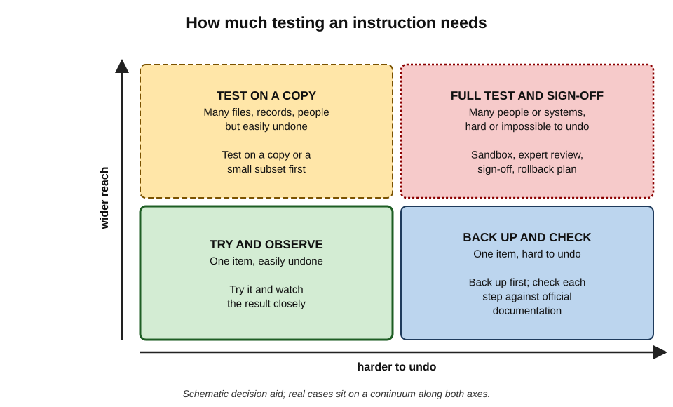
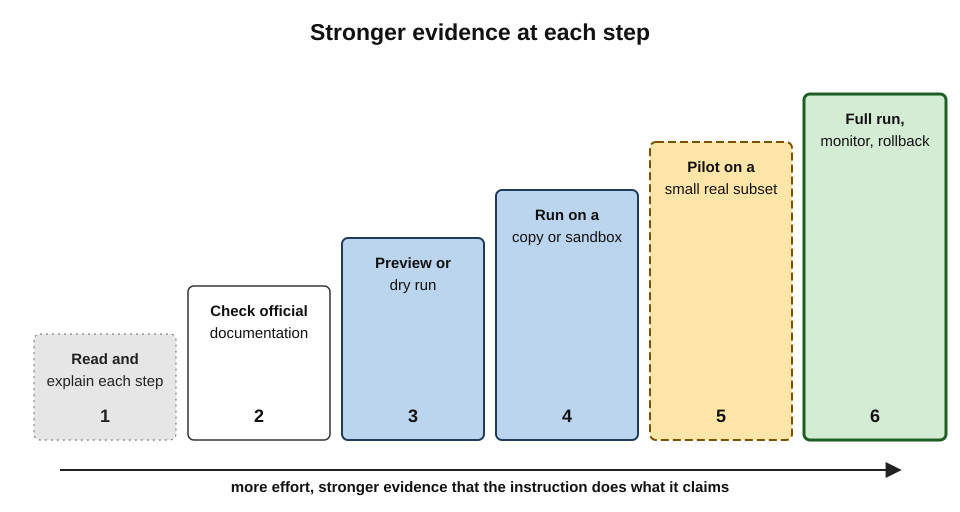
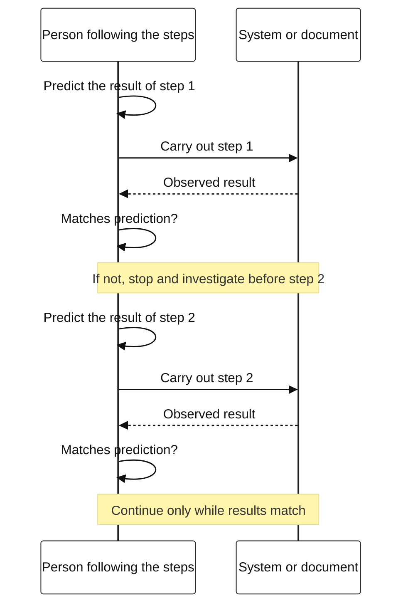
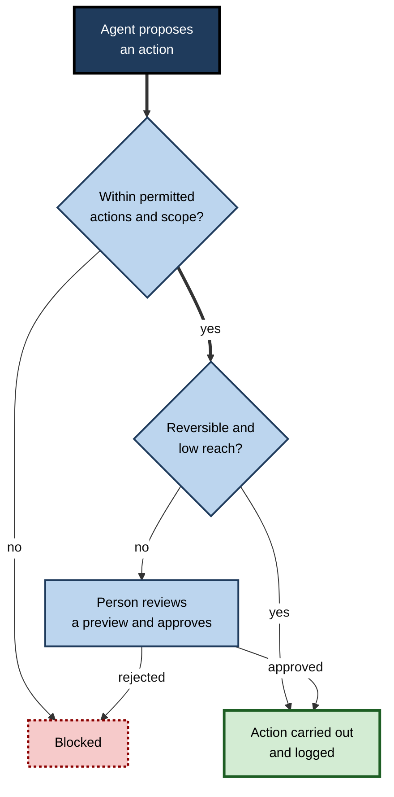
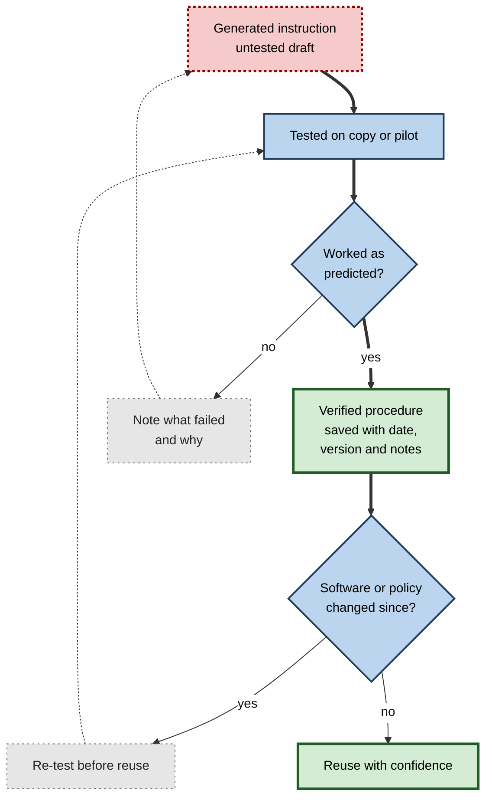

# K.4. Testing instructions before following

An office manager asks how to archive old files and is given a command that deletes them. An analyst follows six generated steps to set up a macro; step four names a menu her software does not have. A man asks a chatbot how to cut salt from his diet and ends up in hospital. Instructions are **acted on directly** — and the action happens before anyone discovers the instruction was wrong.

> **Definition — Testing an instruction:** establishing, before relying on it in earnest, that a generated step, procedure, command or piece of advice does what it claims, applies to the situation at hand, and fails safely if it is wrong.

**Why it matters**

- **Instructions turn text into consequences.** A wrong fact misleads; a wrong instruction changes files, money, systems or bodies.
- **Some consequences cannot be undone.** Deleted data, sent payments, published content and physical harm are often irreversible.
- **Generated instructions look authoritative.** Numbered steps, code blocks and precise menu paths read like official documentation.
- **The person following the steps is responsible for the result**, whoever wrote them.

---

## What Counts as an Instruction

Any output that tells someone **what to do** is an instruction, whatever its form.

### Kinds of instruction

- **Software commands and scripts** — command-line instructions, macros, database queries, automation scripts.
  - *e.g.* a command to rename 2,000 files; a query to delete old records.
- **Application steps** — "Go to File → Options → Advanced and tick…"
  - *e.g.* configuring a mail rule, a sharing setting or a dashboard.
- **Formulas and configuration** — spreadsheet formulas, system settings, rules in a workflow tool.
- **Business procedures** — how to process a refund, onboard a supplier, issue a contract variation, file a claim.
- **Administrative and legal steps** — how to register a company, respond to a tax notice, serve a notice.
- **Physical, health and safety advice** — cooking, cleaning, electrical, chemical, medical, fitness and dietary guidance.

> **Key point:** the test of whether output is an instruction is not its format but its **use**. A sentence in a summary ("the form must be submitted by the line manager") becomes an instruction the moment someone acts on it.

### How instructions differ from other output

| | Factual claims | Instructions |
|---|---|---|
| What the reader does | Believes, repeats, decides | Acts, often immediately |
| When errors show | When someone checks or relies on the claim | When the step is carried out |
| Typical harm | Misleading, embarrassing | Data loss, cost, breach, injury |
| Reversibility | Usually correctable | Sometimes impossible to undo |
| Best verification | Compare with an authority | Compare with an authority **and test safely** |

---

## How Generated Instructions Go Wrong

Generated instructions fail in characteristic ways. Knowing them tells the reader where to look.

### Failures of existence

- **Invented options, menus or settings** — a plausible menu path that the application does not have.
- **Invented functions, commands or flags** — a command-line option that looks standard but does not exist.
- **Invented software packages** — code that imports a library under a plausible name that no one has published.
  - Attackers have begun registering such names with malicious code, a practice known as **slopsquatting**.

> **Definition — Slopsquatting:** registering a software package under a name that AI tools tend to invent, so that anyone who installs the suggested package receives the attacker's code.

### Failures of fit

- **Wrong version** — steps correct for an older or newer release of the software.
- **Wrong platform** — Windows instructions given to a Mac user; a cloud product's steps for a different edition.
- **Wrong jurisdiction** — a legal or tax procedure from another country.
- **Wrong organisation** — a generic procedure that ignores the organisation's own approval rules.

### Failures of completeness and order

- **Missing prerequisites** — permissions, backups, installed components, approvals.
- **Missing steps** — the step that saves the change, or the one that notifies someone.
- **Wrong order** — a step that must come first placed later.
- **Silent assumptions** — "replace the path with yours" left implicit; a placeholder value treated as real.

### Failures of safety

- **Destructive defaults** — commands that overwrite or delete without confirmation.
- **Overbroad scope** — a step that affects every file, user or record when only some were intended.
- **Security weaknesses** — disabling protections "to make it work", hard-coding passwords, opening access widely.
- **Physical or health hazards** — unsafe combinations of chemicals, unsafe electrical work, harmful dietary or medication advice.

> **Remember:** generated instructions fail by **existence** (it is not real), **fit** (not for this situation), **completeness and order** (something is missing or misplaced) and **safety** (it does harm).

> **Mnemonic — "EFCS" ("Every Formula Can Sting"):** Existence, Fit, Completeness, Safety.

---

## Case study: replacing table salt on a chatbot's suggestion (2025)

- **Situation:** a case report published in 2025 in a clinical journal of the American College of Physicians described a 60-year-old man in the United States who had wanted to remove sodium chloride — table salt — from his diet.
- **What he did:** after consulting ChatGPT, he replaced table salt with **sodium bromide**, bought online, and used it for about three months.
- **Result:** he arrived at an emergency department believing a neighbour was poisoning him and developed paranoia and hallucinations. He was diagnosed with **bromism** — bromide toxicity, a condition once common when bromide salts were used as sedatives but now rare — and was treated in hospital for about three weeks.
- **Diagnosis:**
  - a question about *replacing* one substance with another, in a context the tool could not see (a person intending to eat it), produced information that was dangerous when **acted on**;
  - the physicians who wrote the report noted that they could not see the man's original conversation; when they asked a version of the chatbot a similar question, its reply mentioned bromide as a replacement for chloride without a specific health warning or a question about why the user wanted to know;
  - no step of testing or checking with a qualified person took place before months of ingestion.
- **Lesson:** for health, safety and physical-world actions, the only adequate "test" is **confirmation by a qualified professional or authoritative guidance** before acting. Advice that would be harmless as information can be harmful as an instruction.

> **Watch out:** sounding reasonable is not the same as being safe. Chemical, medical, electrical and structural advice should never be tested by trying it.

---

## Deciding How Much Testing an Instruction Needs

Not every instruction needs a sandbox. The effort should match two properties: how hard the effect is to undo, and how much it touches.

> **Definition — Reversibility:** how easily and completely the effects of an action can be undone.

> **Definition — Blast radius:** the extent of what an action can affect if it goes wrong — one file or a whole drive, one customer or every customer.

**Figure 1.** Matching testing effort to reversibility and reach.

- **Easy to undo, small reach** — try and observe.
  - *e.g.* changing a font setting; reformatting one table.
- **Easy to undo, wide reach** — test on a copy or a small subset first.
  - *e.g.* a formula copied down 10,000 rows; a bulk tag change in a mailing list.
- **Hard to undo, small reach** — back up first and check against official documentation.
  - *e.g.* changing a personal account's security settings; sending one formal notice.
- **Hard to undo, wide reach** — sandbox, expert review, sign-off and a rollback plan.
  - *e.g.* deleting records in a production database; changing permissions for all staff; sending a message to every customer.

> **Key point:** the question is not "how likely is this instruction to be wrong?" but "**what happens if it is?**" A probably-correct instruction with an irreversible, wide effect still needs testing.

**Examples of reversibility in everyday digital work**

| Action | Reversibility | Why |
|---|---|---|
| Editing a document with version history | High | Earlier versions can be restored |
| Changing a spreadsheet with no backup | Medium | Undo history is lost when the file closes |
| Bulk deleting emails | Medium to low | Deleted items may be purged automatically |
| Sending an email or message | Very low | Recipients already have it |
| Making a payment | Very low | Recovery depends on the recipient or bank |
| Running a destructive database command | Very low without backups | Data may be unrecoverable |
| Publishing on a public website | Low | Copies and screenshots persist |

---

## Methods for Testing Instructions

A ladder of methods, each giving stronger evidence than the one before.

**Figure 2.** A ladder of ways to test an instruction.

### 1. Read and explain each step

- **Read the whole procedure** before starting step one; problems often appear at the end ("this will remove all existing entries").
- **Explain each step in plain words.** If the reader cannot say what a step does, they are not ready to run it.
- **Ask the tool to explain** each line of a command or script — then check that the explanation matches the line.

> **Remember:** **never run what cannot be explained.** This rule alone prevents most serious errors with commands and scripts.

> **Watch out:** a tool's explanation of its own command can be wrong in the same way as the command. Explanation helps the reader understand; it does not prove correctness.

### 2. Check against official documentation

- **Vendor documentation** for software steps, menus, functions and options — for the exact product and version.
- **Official guidance** for legal, tax and regulatory procedures — the government department, regulator or court.
- **Internal policies and procedures** for organisational steps — the policy library or process owner.
- **Manufacturer instructions and safety data** for physical products and substances.

### 3. Preview or dry run

- Many tools can show what *would* happen without doing it.
  - **Command-line "what-if" or "dry-run" options** that list the files or records a command would change.
  - **Preview panes** for mail-merges, bulk edits and rule changes.
  - **Query first, change second** — for databases, run a selection with the same conditions before running an update or deletion, and check the count.

> **In practice:** experienced administrators run a destructive command first in a **listing form** — "show me what this would delete" — and compare the list with what they expected before running it for real.

### 4. Run on a copy or in a sandbox

- **Copy the file, folder or workbook** and run the instruction on the copy.
- **Use a test account or test environment** for system changes.
- **Use a sandbox** — an isolated environment in which mistakes cannot reach real data.

> **Definition — Sandbox:** an isolated environment in which software or instructions can be run without affecting real systems or data.

### 5. Pilot on a small real subset

- Apply the instruction to a **few real items** — ten records, one team, one region — and check the results before scaling up.
- Choose the subset to include **awkward cases**, not just easy ones.

### 6. Full run with monitoring and rollback

- **Back up first**, and confirm that the backup can actually be restored.
- **Know the rollback plan** — the steps to undo the change — before starting.
- **Watch the results** during and immediately after the run.

### Predict before running

A habit that strengthens every method: **state the expected result before each step**, then compare.

- "This should rename 340 files and leave the rest untouched."
- "After this setting, external users should no longer see the folder."
- A difference between prediction and result is an early warning — stop and investigate.

> **Mnemonic — "SAFER":** **S**ource-check against documentation, **A**sk what each step does, **F**irst on a copy, **E**xpect a result before running, **R**ollback ready.

**Comparing testing methods**

| Method | Effort | What it catches | What it misses |
|---|---|---|---|
| Read and explain | Low | Obvious errors, destructive steps, misunderstood intent | Subtle technical errors the reader cannot spot |
| Check documentation | Low to medium | Invented options, wrong version, wrong procedure | Interactions specific to the user's setup |
| Preview or dry run | Low | Overbroad scope, wrong targets | Effects the preview does not show |
| Copy or sandbox | Medium | Most functional errors | Differences between test and real environments |
| Pilot subset | Medium | Real-data surprises, edge cases | Rare cases outside the subset |
| Full run with monitoring | High | Remaining errors, quickly | Nothing prevented — only limited |

---

## Testing Step by Step

Long procedures should not be run all at once. Running them in stages, with checks between, contains errors.

**Figure 3.** Incremental execution with a check after each stage.

- **Checkpoints** — after each stage, confirm that the state is what it should be.
- **Stop rules** — any unexpected message, error or result means stop, not "try the next step and see".
- **Notes** — record what was done, so that it can be undone.

> **Watch out:** when a step fails, the natural reaction is to paste the error back into the tool and run whatever it suggests next. A chain of quick fixes on a live system can make a small problem large. After an unexpected result, pause and reassess from a known state.

### Worked example (illustrative): a bulk rename on a shared drive

A project coordinator wants to rename 1,200 scanned invoices from "scan_0001.pdf" to "2025-INV-0001.pdf". An assistant provides a short script.

1. **Read and explain.** The coordinator asks the assistant to explain each line. One line uses a pattern that matches **all PDF files** in the folder and its subfolders — not just the scans.
2. **Check documentation.** The vendor's documentation for the rename command confirms that the option used includes subfolders.
3. **Revise.** The coordinator asks for a version that matches only files beginning "scan_" in the top folder.
4. **Dry run.** The revised script is run with its preview option. It lists 1,200 files — the expected number — all beginning "scan_".
5. **Copy.** The script is run on a copy of the folder. The names look right; the coordinator opens five files at random to confirm they are intact.
6. **Real run.** The shared drive's version history is confirmed as a rollback route; the script is run on the real folder; the count of renamed files is checked.

- **What testing prevented:** the original script would have renamed about 4,000 other PDFs in subfolders — contracts and correspondence — breaking links in other teams' documents.
- **Time spent testing:** about fifteen minutes.

*Illustrative figures.*

---

## Testing Generated Code and Formulas

Code and formulas are instructions to a machine. They add a particular trap: **output that runs is easily mistaken for output that is right**.

### "It runs" is not "it works"

- **Runs without error** — the syntax is valid and nothing crashes.
- **Gives an answer** — but possibly the wrong one, for the wrong rows, with the wrong rounding.
- **Gives the right answer on the example** — but fails on blanks, duplicates, negative numbers, dates at year end, or text where numbers were expected.

> **Definition — Edge case:** an input at the extreme or unusual end of what a procedure must handle — empty, very large, negative, duplicated, malformed — where errors most often hide.

### Test cases a non-specialist can use

- **Known answers** — a few inputs where the correct result is already known, worked out by hand.
- **Boundaries** — the first and last rows; zero; the largest value; the end of a month or year.
- **Empty and missing values** — what happens with a blank cell or missing field?
- **Wrong types** — text in a number column, a date written as text.
- **Duplicates** — the same customer twice; two rows with the same key.

**What each kind of test case reveals**

| Test case | Example for a commission formula | Typical error it reveals |
|---|---|---|
| Known answer | Sale of £10,000 at 5% → £500 | Wrong rate or wrong cell reference |
| Boundary | Sale exactly at the £50,000 tier threshold | Off-by-one in "greater than" versus "at least" |
| Empty value | Blank sale amount | Formula returns 0 silently, or an error that breaks totals |
| Wrong type | Amount typed as "10k" | Text ignored without warning |
| Duplicate | Same sale entered twice | Double payment |

*Illustrative figures.*

> **In practice:** asking the tool to "write five test cases, including edge cases, with the expected result for each" is a useful step — but the expected results must be checked independently, because a tool that misunderstood the task will write tests that share its misunderstanding.

> **Watch out:** when generated code is changed to fix a failing test, check that the fix did not simply alter the test or hard-code the expected answer. Both make the test pass without making the code right.

---

## Instructions in Business Procedures

Not every instruction is technical. Generated procedures for business processes carry their own risks.

### What to check

- **Does the organisation have its own procedure?** Generic best practice may contradict the organisation's policy, approval limits or system.
- **Who must approve?** Generated procedures often omit approval steps, segregation of duties and record-keeping.
- **Which jurisdiction?** Employment, tax, data-protection and consumer rules vary by country and sometimes by region.
- **Which version?** Policies and regulations change; a procedure drawn from older material may be out of date.

### Worked example (illustrative): a contract variation for a remote employee

An HR adviser asks an assistant for the steps to change a remote employee's contracted hours.

| Generated step | Check | Finding |
|---|---|---|
| "Email the employee a new contract" | Organisation's HR policy | Policy requires a consultation meeting first and a letter on the approved template |
| "The change takes effect immediately" | Employment law in the employee's country | Notice and agreement requirements apply; immediate change is not lawful without agreement |
| "Update payroll" | Payroll procedure | Requires a signed variation and a manager's approval in the HR system |
| (No step) | Policy | Missing: record the agreed variation in the employee file |

- **Conclusion:** the generated steps were a plausible generic outline but wrong for this organisation and jurisdiction in three of four places — and missing a record-keeping step.

> **In practice:** for business procedures, the generated version is best used as a **checklist of questions** to take to the policy or process owner, not as the procedure itself.

---

## Instructions That Agents Carry Out

AI agents can now carry out instructions themselves — running code, editing files, sending messages, changing settings. Testing then shifts from the person following the instructions to the design of what the agent is **allowed** to do.

**Figure 4.** Controls between an agent's proposed action and its effect.

- **Least privilege** — give an agent only the access it needs for the task.
- **Allow-lists** — define which actions it may take without asking.
- **Approval for irreversible actions** — deletion, sending, payment, publishing, permission changes.
- **Sandboxes and copies** — let agents work on copies until results are checked.
- **Logs** — record every action so that it can be reviewed and reversed.

> **Definition — Least privilege:** the security principle that a person or system should have only the access needed to perform its task, and no more.

> **Watch out:** approval prompts lose their value when they appear constantly. Reviewers who click "allow" dozens of times an hour stop reading what they are allowing; it is better to approve fewer, more consequential actions with care.

---

## Case study (illustrative): the account clean-up

- **Situation:** an IT administrator at a mid-sized firm asked an assistant for a script to disable user accounts that had not signed in for 90 days.
- **Problem:** the script, run directly on the live directory, disabled **service accounts** — non-human accounts used by systems such as the payroll interface and the backup software — because they never "sign in" in the ordinary way. Payroll exports failed overnight.
- **Diagnosis:**
  1. the instruction fitted the request literally but not the environment, which the tool could not see;
  2. the administrator did not run the script's preview option, which would have listed the service accounts;
  3. there was no pilot on a small subset and no prediction of how many accounts should be affected.
- **Actions:**
  - accounts were re-enabled from the directory's change log within two hours;
  - the firm now requires a **preview listing** and a second person's review for any bulk change to accounts;
  - service accounts were moved to a separate, clearly labelled group.
- **Result:** no data was lost; one payroll run was delayed by a day.
- **Lesson:** an instruction can be **technically correct and still wrong for the environment**. Only testing against the real situation — preview, prediction, pilot — reveals the difference.

---

## Judgement and Responsibility

### When not to follow generated instructions at all

- **Regulated or licensed work** — electrical installation, gas work, structural changes, medical treatment, legal filings with deadlines.
- **Irreversible financial actions** — transfers, trades, contract signatures — without confirmation through the proper channel.
- **Security-critical changes** — firewall rules, access controls, encryption settings — without review by someone qualified.
- **Anything the person could not undo or explain.**

> **Key point:** for some instructions, the right test is **not to test them at all**, but to take them to a qualified person.

### Organisational supports

- **Test environments** that are easy to use, so that people do not test on live systems out of convenience.
- **Templates and approved procedures** that people can check generated steps against.
- **A culture where pausing is respected** — staff should not feel pressured to "just run it".
- **Clear lines to experts** — IT, legal, health and safety — for instructions outside a person's competence.

### Learning from tested instructions

- Instructions that passed testing can be saved, with notes, for reuse — becoming **verified procedures** rather than generated drafts.
- Instructions that failed reveal where the tool is unreliable: particular software versions, particular kinds of procedure.
- A saved procedure needs a **date and version**: it was verified for one release of the software or one version of a policy, and may silently stop being correct when either changes.

**Figure 5.** From generated instruction to verified, reusable procedure.

---

## Open Questions

- **Can tools reliably flag destructive or irreversible steps?**
  - Some assistants warn before destructive commands; how consistently they do so, and whether users heed the warnings, is not well studied.
- **How should safety warnings work in general-purpose assistants?**
  - The bromide case raised the question of whether tools should ask about intent before giving information that is dangerous when acted on; how to do so without excessive refusals is unresolved.
- **How should agents be tested?**
  - Agents take many small actions; methods for testing their behaviour before granting access to real systems are still developing.
- **Will invented packages and options decline?**
  - Better grounding in documentation may reduce invented commands, but attackers adapt to whatever tools still invent.
- **How much testing will people actually do?**
  - Testing takes time that tool use was meant to save; evidence on how often people test generated instructions in practice is thin.

---

## Summary

- **Instructions** — commands, steps, formulas, procedures and advice — are output that is **acted on**, so their errors become consequences, sometimes irreversible.
- Generated instructions fail by **existence** (invented options, commands, packages), **fit** (wrong version, platform, jurisdiction, organisation), **completeness and order**, and **safety**.
- The 2025 **bromism** case showed that information harmless to read can be harmful to act on; health and safety instructions need **professional confirmation**, not trial.
- Testing effort should match **reversibility** and **blast radius**, not just the likelihood of error.
- The testing ladder: **read and explain → check documentation → preview or dry run → copy or sandbox → pilot subset → full run with monitoring and rollback**.
- **Never run what cannot be explained**; **predict the result** of each step before running it.
- Run long procedures **step by step**, with checkpoints and stop rules.
- Generated **business procedures** should be checked against the organisation's own policy, approvals and jurisdiction — often best used as questions for the process owner.
- For **agents**, testing becomes design: least privilege, allow-lists, approval for irreversible actions, sandboxes and logs.
- Instructions can be **technically correct and still wrong for the environment**.

---

## Self-Check

1. Define testing an instruction. Why are instructions riskier than factual claims?
2. Name the four families of failure in generated instructions, with an example of each.
3. What is slopsquatting, and why does it matter for people who run generated code?
4. Summarise the 2025 bromism case and its lesson.
5. Explain reversibility and blast radius, and how together they decide testing effort.
6. Place each in the reversibility–reach grid: sending a message to all customers; changing one cell's formatting; deleting one archived file with no backup; applying a formula to 50,000 rows in a copy-protected workbook.
7. List the six steps of the testing ladder.
8. Why is "never run what cannot be explained" so effective, and what is its limit?
9. What does a dry run do? Give an example.
10. Why should a person predict the result of each step before carrying it out?
11. What is the risk of pasting each error back into the tool and running the next suggested fix?
12. How should a generated business procedure be used?
13. Name four controls on what an agent may do.
14. A colleague wants to run an assistant-generated script that "cleans up" duplicate customer records in the live CRM, because "it worked on my test file". What would you advise?

### Answer Key

1. Establishing, before relying on it, that an instruction does what it claims, fits the situation and fails safely. Instructions are acted on directly, so errors become consequences — often immediate and sometimes irreversible.
2. Existence: an invented menu option. Fit: steps for the wrong software version. Completeness and order: a missing backup step. Safety: a command that deletes without confirmation.
3. Registering software packages under names AI tools tend to invent, so installing a suggested package installs malicious code. Package names in generated code must be verified before installation.
4. A man replaced table salt with sodium bromide after consulting a chatbot and developed bromide toxicity with psychiatric symptoms. Information can be dangerous when acted on; health and safety instructions need professional confirmation before acting.
5. Reversibility is how easily effects can be undone; blast radius is how much an action can affect. Hard-to-undo, wide-reach actions need the most testing — sandbox, review, sign-off.
6. All-customer message: hard to undo, wide reach. One cell's formatting: easy, small. Deleting one file without backup: hard to undo, small reach. Formula on 50,000 rows: wide reach and, without a backup, possibly hard to undo — test on a copy first.
7. Read and explain each step; check official documentation; preview or dry run; run on a copy or sandbox; pilot on a small real subset; full run with monitoring and rollback.
8. It forces understanding and catches destructive or mistaken steps before they run. Its limit: a reader may misunderstand, and a tool's explanation may be wrong; explanation is not proof.
9. It shows what an action would do without doing it — e.g. a "what-if" option listing files a command would delete, or a query selecting records before deleting them.
10. A difference between predicted and actual result is an early warning; without a prediction, unexpected results may go unnoticed.
11. A chain of quick fixes on a live system can compound errors; each fix is itself an untested instruction. Stop, return to a known state and reassess.
12. As a set of questions to check against the organisation's policy, approvals and jurisdiction, ideally with the process owner, not as the procedure itself.
13. Least privilege; allow-lists of permitted actions; approval for irreversible actions; sandboxes or copies; action logs.
14. A test file is not the live environment. Back up the CRM and confirm restorability; run the script's preview or a selection query to list affected records; check the count and a sample against expectations; pilot on a small subset; agree a rollback plan; involve the CRM owner, since merges may affect linked records, history and reporting.

---

## Glossary

| Term | Meaning |
|---|---|
| Allow-list | A defined set of actions a system or agent may take without further approval. |
| Blast radius | The extent of what an action can affect if it goes wrong. |
| Checkpoint | A planned pause to confirm the state after a stage of a procedure. |
| Dry run | Running an instruction in a mode that shows what it would do without doing it. |
| Edge case | An unusual or extreme input where errors most often hide. |
| Least privilege | Giving a person or system only the access needed for its task. |
| Pilot | Applying an instruction to a small real subset before full use. |
| Reversibility | How easily and completely an action's effects can be undone. |
| Rollback plan | The prepared steps for undoing a change. |
| Sandbox | An isolated environment where instructions can run without affecting real systems. |
| Service account | A non-human account used by software systems. |
| Slopsquatting | Registering software packages under names AI tools invent, to distribute malicious code. |
| Testing an instruction | Establishing that an instruction works, fits and fails safely before relying on it. |
