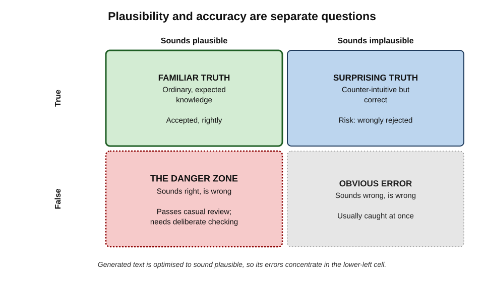
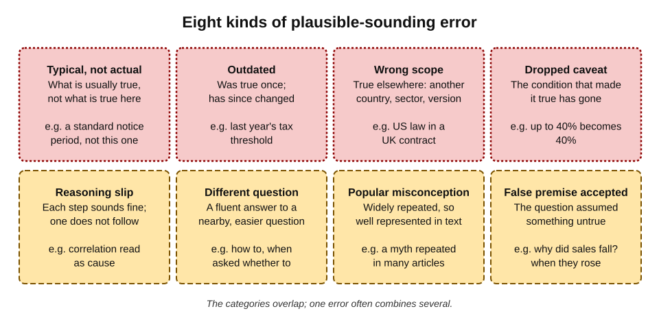
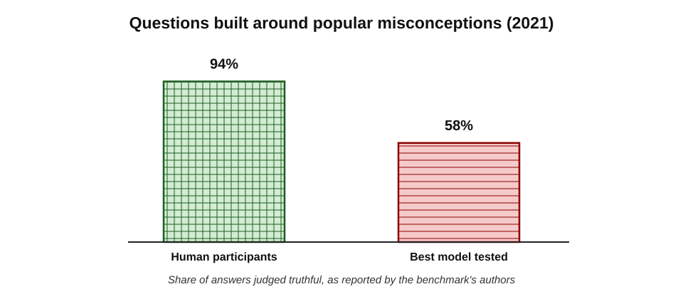
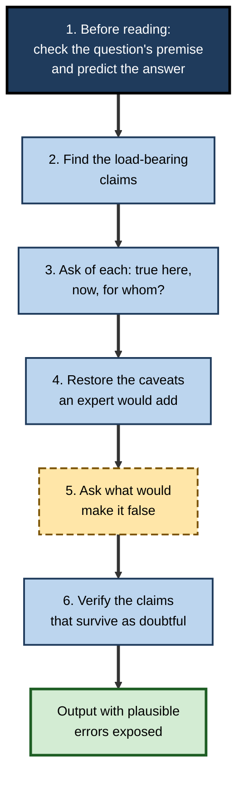
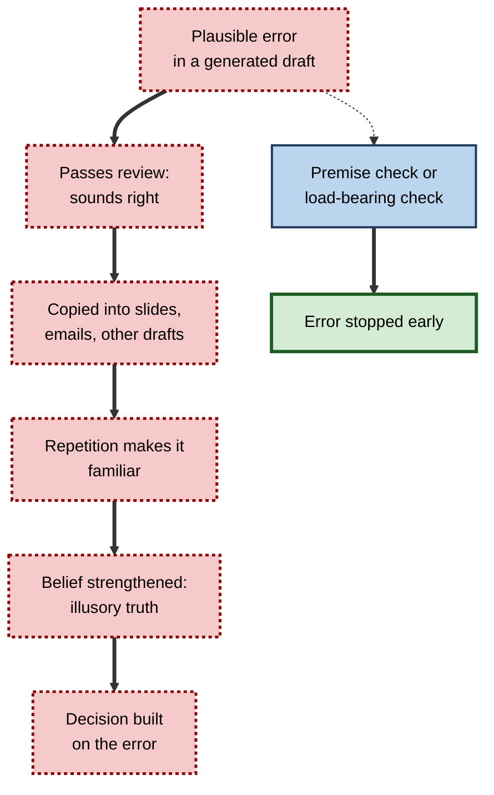

# K.5. Recognising plausible-sounding errors

An assistant explains that an employee's statutory notice period is "one month", which is true for many employees and wrong for this one. Another states, in a briefing on a new market, that a regulation "applies to all companies", when it applies only above a size threshold. A third answers "Why did our conversion rate fall in March?" with three sensible reasons — when the conversion rate rose. None of these is an invention. Each is an error that **sounds exactly like a correct answer**.

> **Definition — Plausible-sounding error:** a statement in generated output that is wrong but fits the reader's expectations so well — in content, tone and form — that it raises no suspicion on an ordinary reading.

**Why it matters**

- **Most AI errors are of this kind.** Outright inventions are memorable, but day-to-day errors are more often typical answers applied to the wrong case, outdated facts and dropped conditions.
- **They survive review.** Reviewers look for things that seem wrong; plausible errors, by definition, do not.
- **They are hardest for non-experts.** The less the reader knows, the more an answer that matches general expectations will be accepted.
- **They do the most cumulative damage.** Because they pass unnoticed, they enter decisions, documents and other people's understanding.

---

## Plausibility Is Not Accuracy

Plausibility is a judgement about whether something **fits what is expected**. Accuracy is whether it is **true**. The two are separate questions.

**Figure 1.** Plausibility and accuracy as independent properties of a statement.

- **Familiar truths** — plausible and true; most of what anyone reads.
- **Surprising truths** — implausible but true; at risk of being wrongly rejected.
- **Obvious errors** — implausible and false; usually caught at once.
- **The danger zone** — plausible and false; passes casual review.

> **Key point:** a language model generates text that is **likely** given its training and the prompt. Likely text is, almost by construction, plausible text. When such a model is wrong, it tends to be wrong **in the plausible direction**.

### Why generated errors cluster in the danger zone

- **Typicality** — the model reproduces what is usually said about a type of situation, which is what readers also expect.
- **Fluency** — grammatical, well-organised prose triggers the reader's sense that the content is sound.
- **Consistency of tone** — wrong statements are delivered with the same assurance as right ones, so tone gives no warning.
- **Coherence** — generated paragraphs hang together; one wrong premise is followed by reasoning that fits it perfectly.

> **Watch out:** the fact that an answer "makes sense" is evidence that it is **coherent**, not that it is correct. A coherent account built on one wrong assumption makes sense all the way through.

---

## Why People Miss Plausible Errors

The weakness lies as much in human reading as in the tool's writing. Several well-studied effects explain why plausible errors pass.

### The Moses illusion

**Study card — Erickson and Mattson (1981), the Moses illusion**

- **Design:** participants answered questions such as "How many animals of each kind did Moses take on the Ark?" They were told that some questions contained errors and that they should say so.
- **Results:**
  - most participants answered "two" — even though, when asked separately, they knew that the Ark story concerns **Noah**, not Moses;
  - the distortion was detected far less often when the substituted name was **semantically close** (another Old Testament figure) than when it was distant.
- **Conclusion:** people process meaning at a level that tolerates near-misses. When a detail fits the overall gist, it is accepted without being checked.
- **Lesson:** plausible errors in generated text are effectively **Moses-illusion errors** — close enough to the expected detail that the reader's comprehension glides over them.

> **Definition — Semantic illusion:** the failure to notice an incorrect detail in a sentence because it is closely related in meaning to the correct one.

### The illusory truth effect

**Study card — Hasher, Goldstein and Toppino (1977), repetition and belief**

- **Design:** participants rated the truth of plausible statements — some true, some false — on several occasions, a couple of weeks apart. Some statements were repeated across sessions.
- **Results:** repeated statements were rated as **more likely to be true** than new ones, whether they were actually true or false.
- **Later work:** studies by Lisa Fazio and colleagues (2015) found that repetition increased belief even in statements that contradicted participants' own knowledge.
- **Conclusion:** familiarity is mistaken for truth.
- **Lesson:** a wrong claim that a user has seen several times — in several generated drafts, or across several tools trained on similar text — becomes progressively easier to believe.

> **Definition — Illusory truth effect:** the tendency to judge a statement as more likely to be true after repeated exposure to it.

### Other effects that lower guard

- **Processing fluency** — information that is easy to read feels more true.
- **Confirmation bias** — errors that agree with what the reader already believes are less likely to be checked.
- **Expertise mismatch** — readers check carefully in their own field and accept more readily outside it.
- **Satisficing** — when an answer is good enough to proceed, people stop looking for problems with it.

> **Remember:** the reader's sense that "this is right" is produced by **familiarity, fluency and fit** — the very properties generated text has in abundance.

---

## Eight Kinds of Plausible Error

Plausible errors fall into recognisable kinds. Each has a characteristic signature and a matching check.

**Figure 2.** Eight kinds of plausible-sounding error.

### 1. Typical, not actual

- **What it is:** a statement that is true of the usual case but not of this one.
- *e.g.* a standard 30-day payment term when this client's contract says 45; a common job title for a role that this organisation names differently.
- **Check:** ask "is this what is generally true, or what is true **here**?" and look at the specific source.

### 2. Outdated

- **What it is:** a statement that was true when the model's training data was gathered, or when the source was written.
- *e.g.* last year's tax thresholds; a product feature since removed; an office holder who has moved on.
- **Check:** look for anything volatile — rates, rules, roles, prices, versions — and confirm it with a dated source.

### 3. Wrong scope

- **What it is:** a statement true for a different country, industry, organisation size, product edition or population.
- *e.g.* United States employment law presented in a United Kingdom context; consumer rules applied to business customers.
- **Check:** ask "true **where**, for **whom**, under **which version**?"

### 4. Dropped caveat

- **What it is:** a statement whose original qualification — "up to", "in some cases", "for companies with more than 250 employees", "subject to approval" — has disappeared.
- **Check:** for every strong, unconditional statement, ask what conditions an expert would attach to it.

> **Key point:** experts' statements are full of conditions. A generated paragraph with **no** "unless", "only if" or "except" on a subject that experts normally qualify is itself a warning sign.

### 5. Reasoning slip

- **What it is:** an argument in which each sentence sounds reasonable but one step does not follow.
- *e.g.* reading correlation as causation; generalising from one example; treating "not proven" as "disproven"; confusing a percentage of a subgroup with a percentage of the whole.
- **Check:** write the argument as a chain of steps and test each link.

### 6. Answer to a different question

- **What it is:** a fluent answer to a nearby, easier question than the one asked.
- *e.g.* asked **whether** to restructure a team, the tool explains **how** to restructure it; asked what the contract **requires**, it explains what such contracts **usually** require.
- **Check:** re-read the original question, then ask whether the answer actually addresses it.

### 7. Popular misconception

- **What it is:** a widely repeated false belief, reproduced because it appears often in the text the model learned from.
- **Check:** be especially wary of "everybody knows" facts, statistics that circulate without sources, and folk explanations.

### 8. False premise accepted

- **What it is:** the question contained an untrue assumption, and the tool answered as if it were true.
- *e.g.* "Why did customer complaints rise after the update?" — when they did not; "Which clause allows termination for convenience?" — when none does.
- **Check:** before reading the answer, confirm the **premise** of the question.

> **Definition — False premise:** an assumption built into a question that is not true, such that any direct answer accepts and reinforces it.

> **Mnemonic — "TOWD RDPF" ("The Old Wise Dog Rarely Digs Past Fences"):** Typical, Outdated, Wrong scope, Dropped caveat, Reasoning slip, Different question, Popular misconception, False premise.

**Signatures and checks for each kind of plausible error**

| Kind | Typical signature in the text | Question that exposes it |
|---|---|---|
| Typical, not actual | "Usually", "standard", generic values | Is this true of *this* case? |
| Outdated | "Current", "latest", undated figures | As of when? |
| Wrong scope | No country, sector or version named | True where, for whom? |
| Dropped caveat | Strong unconditional claims | What conditions would an expert add? |
| Reasoning slip | "Therefore", "this shows", "because" | Does each step follow? |
| Different question | Answer longer or easier than expected | Was this what was asked? |
| Popular misconception | Familiar "fact" with no source | Where does this actually come from? |
| False premise | Answer to a "why" or "which" question | Is the assumption true? |

---

## Evidence That Models Reproduce Plausible Falsehoods

**Study card — Lin, Hilton and Evans (2021), TruthfulQA**

- **Design:** researchers at the University of Oxford and OpenAI built a benchmark of 817 questions across 38 categories — health, law, finance, conspiracies, fiction and others — each designed so that a **common human misconception** offers a tempting false answer.
  - *e.g.* questions about what happens if one swallows chewing gum, or cracks one's knuckles.
- **Results:**
  - human participants answered truthfully on about **94%** of questions;
  - the best model tested answered truthfully on about **58%**;
  - in several model families, **larger** models were often **less** truthful — they had learned the popular misconceptions more thoroughly.
- **Conclusion:** models trained to imitate human text also imitate human errors — what the authors called **imitative falsehoods**.
- **Caveat:** later models, trained with additional methods, score much higher on this benchmark, and the benchmark itself has become widely known; the lasting point is the **mechanism**, not the specific rates.

**Figure 3.** Truthfulness on questions built around common misconceptions.

> **Definition — Imitative falsehood:** a false statement that a language model produces because it is common in the human-written text it learned from.

> **Watch out:** improvements on a known benchmark do not prove that a tool has stopped reproducing misconceptions in general. A misconception common in one professional field may never have been tested.

### Agreement with the user

- **Sycophancy** — the tendency of models to agree with the user's stated views or assumptions — makes false-premise errors more likely.
- A user who writes "As we know, the new rule applies to all contractors…" is more likely to receive an answer that builds on the claim than one that questions it.
- The effect is strongest where the user sounds confident or expert.

> **In practice:** phrase questions **neutrally** — "Does the new rule apply to contractors?" rather than "Explain how the new rule applies to contractors" — when the premise itself is uncertain.

---

## Reading for Plausible Errors

Plausible errors are not found by reading more carefully in the ordinary way. They are found by **changing the way of reading**.

**Figure 4.** A reading routine for exposing plausible errors.

### 1. Check the premise and predict the answer

- **Premise** — was the question itself correct? Did complaints actually rise; does the clause actually exist?
- **Prediction** — before reading, jot down what the answer is expected to say. Differences between prediction and output draw attention; agreement does not prove correctness but shows where the reader's own assumptions lie.

### 2. Find the load-bearing claims

- **Load-bearing claim** — a statement on which the conclusion or recommendation depends; if it is wrong, the conclusion falls.
- In most outputs only a few claims carry the weight. Identifying them focuses checking where it matters.

> **Definition — Load-bearing claim:** a statement in an argument or recommendation that, if false, would change the conclusion.

### 3. Ask: true here, now, for whom?

- **Here** — this organisation, this contract, this jurisdiction.
- **Now** — as of today, not as of the training data or source date.
- **For whom** — this customer segment, this employee type, this product edition.

### 4. Restore the missing caveats

- For each strong claim, ask what qualifications a careful expert would attach.
- If the claim is only true with a condition, and the condition does not hold, the claim is wrong for this case.

### 5. Ask what would make it false

- **Consider the opposite** — what evidence would show the claim is wrong? Is that evidence easy to find?
- This reverses the default mode of reading, which looks for confirmation.

> **Key point:** asking "what would make this false?" is one of the most reliable debiasing techniques known. Studies of judgement since the 1980s have found that prompting people to consider the opposite reduces overconfidence and anchoring more reliably than simply urging them to be careful.

### 6. Verify what remains doubtful

- Claims that fail any of the previous questions go to proper verification against a source.

> **Mnemonic — "PLACE-V":** **P**remise and prediction, **L**oad-bearing claims, **A**sk here–now–whom, **C**aveats restored, **E**vidence against, **V**erify.

---

## Worked Example (illustrative): Dissecting a Plausible Paragraph

A hospital operations manager asks: "Why have our outpatient no-show rates increased since we introduced text reminders?" The assistant replies:

> *"Text reminders can paradoxically increase no-shows when patients perceive them as impersonal. Research shows that reminders sent more than 72 hours in advance are often forgotten, and many patients now ignore automated messages. Studies indicate that switching to phone reminders typically reduces no-shows by around 30%. You should consider reverting to phone calls for high-risk patients."*

| Step | Finding |
|---|---|
| 1. Premise | The manager checks the data: no-show rates have **fallen** slightly since the reminders were introduced. One clinic's rate rose, which prompted the question. The premise was false for the hospital as a whole. |
| 2. Load-bearing claims | (a) reminders can increase no-shows; (b) phone reminders reduce no-shows by around 30%. |
| 3. Here, now, whom | Claim (a) is offered with no setting or population; claim (b) gives a precise figure with no source, setting or comparison. |
| 4. Caveats | Evidence on reminders generally finds that they **reduce** missed appointments; effects vary by method, timing and population. The paradox claim lacks the conditions it would need. |
| 5. What would make it false | The hospital's own data already contradicts the premise; for the one clinic, a change of location in the same month is a more likely cause. |
| 6. Verify | The 30% figure cannot be traced to a source and is removed. |

- **Outcome:** a fluent, coherent paragraph contained a **false premise accepted**, a **reasoning slip** (one clinic's rise generalised to the hospital), a **dropped caveat** and an **unsourced precise figure**.
- **Correct action:** investigate the one clinic; keep text reminders.

*Illustrative figures.*

> **Watch out:** the recommendation at the end — "consider reverting to phone calls for high-risk patients" — sounds prudent and modest, which made it the most likely sentence to be acted on. Modest-sounding recommendations built on false premises are particularly persuasive.

---

## Expertise and Plausible Errors

### What experts do differently

- **Richer expectations** — experts know the conditions, exceptions and recent changes, so wrong details violate their expectations.
- **Knowledge of where errors live** — experience of which questions are tricky, which rules recently changed, which figures are often misquoted.
- **Habitual qualification** — experts expect caveats and notice their absence.

### The novice's position

- A novice's expectations are closer to the **typical** answer, which is exactly what plausible errors supply.
- Novices are therefore at **greatest risk** when using AI tools outside their competence, and least able to notice that they are at risk.

> **Key point:** the more plausible an error, the more domain knowledge is needed to catch it. AI tools do not remove the need for expertise; they **raise the value of the expertise needed to check them**.

### Strategies when expertise is lacking

- **Borrow expertise** — ask a qualified colleague to review the load-bearing claims.
- **Use authoritative sources directly** — official guidance, the contract, the organisation's policy — rather than relying on the generated explanation.
- **Narrow the use** — use the tool for tasks within the user's competence, where errors can be recognised.
- **Ask the tool to argue the other side** — useful for surfacing caveats and alternatives, though not a substitute for verification.

**How readers at different levels of expertise fare with plausible errors**

| | Novice in the field | Competent practitioner | Expert |
|---|---|---|---|
| Expectations | Close to the typical answer | Knows main exceptions | Knows exceptions, history, recent changes |
| Likely to catch | Obvious errors only | Wrong scope, some outdated facts | Dropped caveats, subtle reasoning slips |
| Main risk | Accepting typical-not-actual answers | Missing recent changes | Overconfidence outside own speciality |
| Best defence | Check load-bearing claims with an authority or expert | Routine checks of volatile facts | Deliberate checks outside home territory |

---

## Case Study (illustrative): The Holiday Entitlement Guidance

- **Situation:** a small business owner used an assistant to draft a staff handbook section on annual leave for part-time and irregular-hours workers.
- **The output:** a clear, well-organised section explaining how to calculate holiday entitlement, with a worked example and a confident statement of the accrual method.
- **Problem:** the accrual method described was one that had been **changed** by updated government rules, with new rules for irregular-hours and part-year workers. The draft also applied a calculation method intended for full-time workers to part-timers without the pro-rata adjustment.
- **Why it was plausible:**
  - the method had been standard for years and was widely described online (**outdated** and **popular**);
  - the worked example was arithmetically correct, which made the method seem validated (**coherence**);
  - no caveat mentioned that the rules had changed (**dropped caveat**).
- **Discovery:** an employee who had read the official guidance queried her entitlement.
- **Actions:**
  1. the owner checked the official government guidance and found the change;
  2. the handbook section was rewritten from the official guidance, with the date of the rules stated;
  3. affected employees' entitlements were recalculated and underpayments corrected.
- **Lesson:** a correct worked example does not validate the method it applies. Rules that change — employment, tax, data protection — must be checked against **current official sources**, however plausible the generated version.

## Case Study (illustrative): The Churn Analysis

- **Situation:** a product analyst asked an assistant to interpret a dashboard showing that customers who used a new feature had **40% lower churn**.
- **The output:** a persuasive explanation of how the feature increased engagement and loyalty, and a recommendation to make it the default for all customers.
- **Problem:** the customers who used the feature were mostly long-standing, high-value accounts that already had very low churn. The feature had not been shown to **cause** lower churn; engaged customers were simply more likely to try it.
- **Why it was plausible:** the explanation matched the team's hopes for the feature and the familiar story that engagement drives retention (**confirmation bias**; **reasoning slip** — correlation read as causation).
- **Actions:** the analyst compared churn for similar customers with and without the feature, and recommended a controlled test before changing defaults.
- **Result:** the controlled test showed a small effect — real, but far smaller than the dashboard implied.
- **Lesson:** an explanation that **confirms what the team wants to believe** deserves more scrutiny, not less.

---

## Building Resistance in Teams

### Norms that help

- **Premise-checking as routine** — teams that ask "is that actually true?" about the question before discussing the answer.
- **Named devil's advocate** — someone asked to look for the condition under which a generated recommendation fails.
- **Celebrating catches** — recognising people who find plausible errors, so that challenging fluent output is socially rewarded.
- **Source expectations** — load-bearing claims in decision papers carry a source, whoever or whatever drafted them.

### Designs that help

- **Interfaces that surface uncertainty** — highlighting unsourced claims, showing confidence or showing alternative answers.
- **Prompt templates** that ask for scope, date and conditions to be stated explicitly.
- **Review templates** that include the premise and load-bearing-claim questions.

> **In practice:** asking the tool to "state the conditions under which each claim would not hold" often restores the caveats that a direct answer drops — and the restored caveats are themselves a list of things to check.

**Figure 5.** How a plausible error travels from a single draft into an organisation's decisions.

---

## Open Questions

- **Can tools reliably signal their own plausible errors?**
  - Confidence scores and uncertainty markers exist in some systems, but whether they are well calibrated for the kinds of error that matter in professional work is unclear.
- **Are plausible errors becoming rarer or subtler?**
  - As obvious errors decline, the remaining errors may be harder to detect; whether net risk falls is an open empirical question.
- **How should training for reviewers be designed?**
  - Debiasing techniques such as considering the opposite work in laboratory studies; evidence on lasting effects in workplace review is limited.
- **What is the effect of many tools agreeing?**
  - Tools trained on similar text may share misconceptions; agreement between them may create a false sense of confirmation.
- **How should organisations measure the plausible errors they miss?**
  - By definition, unnoticed errors are not counted; audits and seeded-error exercises are possible approaches, but practice is immature.

---

## Summary

- A **plausible-sounding error** is wrong but fits expectations so well that it raises no suspicion.
- **Plausibility and accuracy are independent**; generated text is optimised for plausibility, so its errors cluster in the **danger zone** — plausible and false.
- People miss such errors because of **semantic illusions** (Moses illusion), the **illusory truth effect**, fluency, confirmation bias and satisficing.
- Eight kinds: **typical not actual, outdated, wrong scope, dropped caveat, reasoning slip, different question, popular misconception, false premise accepted**.
- **TruthfulQA** showed that models imitate human misconceptions — **imitative falsehoods** — and that scale alone did not cure this.
- **Sycophancy** makes false-premise errors more likely; ask neutral questions when the premise is uncertain.
- A reading routine: **check the premise and predict; find load-bearing claims; ask here, now, for whom; restore caveats; ask what would make it false; verify**.
- Expertise is the main defence; AI tools **raise the value of the expertise needed to check them**. Novices should borrow expertise and go to authoritative sources.
- Teams build resistance through **premise-checking norms, devil's advocates, rewarded catches and sourced load-bearing claims**.

---

## Self-Check

1. Define a plausible-sounding error and explain why plausibility and accuracy are independent.
2. Why do errors in generated text tend to be plausible?
3. Describe the Moses illusion study and explain its relevance to reviewing AI output.
4. What is the illusory truth effect, and how might it operate when people use several AI tools?
5. Name the eight kinds of plausible error.
6. Give an example of "typical, not actual" and of "wrong scope" from your own field of work.
7. Why is a paragraph with no caveats on a normally qualified subject a warning sign?
8. What did TruthfulQA find, and what are imitative falsehoods?
9. How does sycophancy contribute to false-premise errors, and how can questions be phrased to reduce it?
10. Describe the six steps of the reading routine.
11. What is a load-bearing claim, and why identify it?
12. In the worked example, which kinds of plausible error appeared?
13. Why are novices at greatest risk from plausible errors, and what can they do?
14. A colleague shares a generated analysis concluding that remote workers are less productive "because studies show collaboration suffers", and asks you to endorse it for a leadership paper. How would you review it?

### Answer Key

1. A wrong statement that fits expectations so well it raises no suspicion. Plausibility is fit with expectations; accuracy is truth. Surprising truths and plausible falsehoods both exist.
2. Models generate likely text; likely text matches what is usually said and expected. When wrong, the output is wrong in the expected direction, with fluent, confident, coherent form.
3. People answered "two" to "How many animals of each kind did Moses take on the Ark?" despite knowing it was Noah; close substitutions were rarely noticed. Generated errors that are semantically close to the truth slip past comprehension in the same way.
4. Repeated statements are judged more likely true. Seeing the same wrong claim in several drafts or tools — trained on similar text — increases belief in it.
5. Typical not actual; outdated; wrong scope; dropped caveat; reasoning slip; answer to a different question; popular misconception; false premise accepted.
6. Answers vary; e.g. typical: a standard warranty period stated for a product with a longer one; wrong scope: another country's data-protection deadline.
7. Experts qualify such subjects with conditions and exceptions; unconditional statements suggest that conditions have been dropped and the claim may not apply to the case.
8. Humans were truthful on about 94% of misconception-based questions, the best model on about 58%, and larger models were often less truthful. Imitative falsehoods are false statements produced because they are common in human text.
9. Models tend to agree with users' stated assumptions, so a question that embeds a false premise gets an answer that builds on it. Ask neutral, open questions ("Does X apply?") rather than premise-laden ones ("Explain how X applies").
10. Check the premise and predict the answer; find load-bearing claims; ask whether each is true here, now and for whom; restore the caveats an expert would add; ask what would make it false; verify the doubtful claims.
11. A claim on which the conclusion depends. Identifying it focuses checking on the few statements that matter most.
12. False premise accepted; reasoning slip (one clinic generalised); dropped caveat (paradox claim without conditions); unsourced precise figure.
13. Their expectations match typical answers, so plausible errors fit perfectly, and they cannot tell they are at risk. They should borrow expertise, use authoritative sources, narrow use to areas of competence and ask for counter-arguments.
14. Check the premise (is productivity actually lower, measured how?); identify load-bearing claims ("studies show"); ask which studies, which roles, which countries, which period; restore caveats (evidence on remote work is mixed and depends on task, measure and arrangement); consider the opposite; trace the studies to sources; ask a subject expert. Endorse only a version whose claims are sourced and appropriately qualified.

---

## Glossary

| Term | Meaning |
|---|---|
| Confirmation bias | The tendency to accept information that agrees with existing beliefs. |
| Consider the opposite | A debiasing technique of asking what evidence would show a claim is wrong. |
| Dropped caveat | A statement whose qualifying condition has been lost. |
| False premise | An untrue assumption built into a question. |
| Illusory truth effect | Judging statements more likely true after repeated exposure. |
| Imitative falsehood | A falsehood a model produces because it is common in human text. |
| Load-bearing claim | A statement that, if false, would change the conclusion. |
| Moses illusion | Failure to notice a wrong detail that is semantically close to the right one. |
| Plausible-sounding error | A wrong statement that fits expectations so well it raises no suspicion. |
| Satisficing | Accepting the first option that seems good enough. |
| Semantic illusion | Missing an incorrect detail because it is closely related in meaning to the correct one. |
| Sycophancy | A model's tendency to agree with the user's stated views or assumptions. |
| TruthfulQA | A benchmark of questions designed around common misconceptions. |
