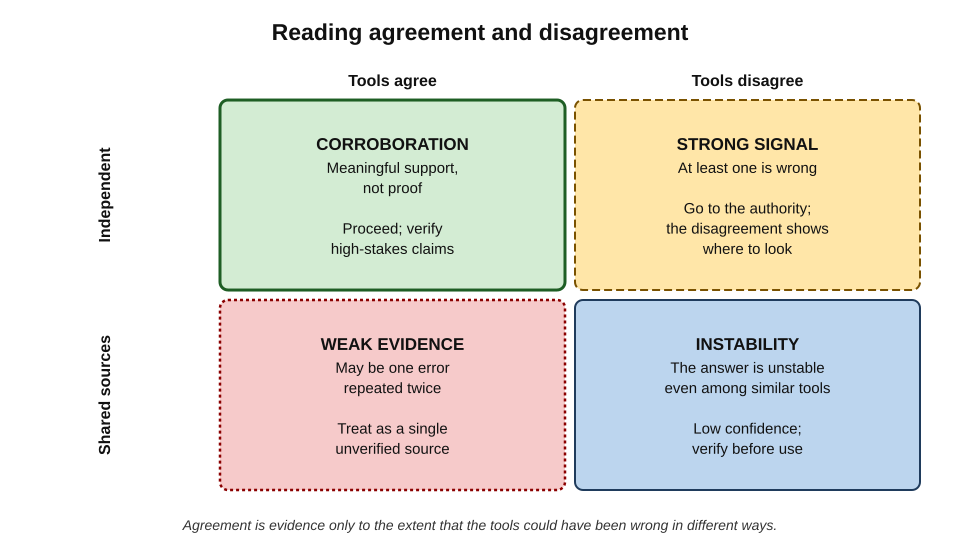
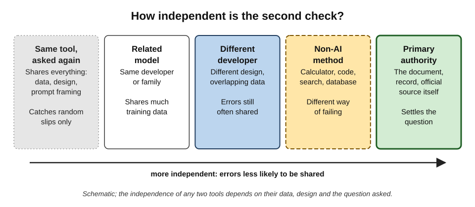
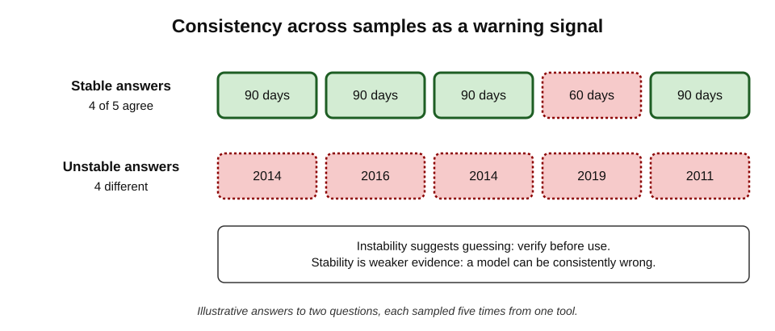
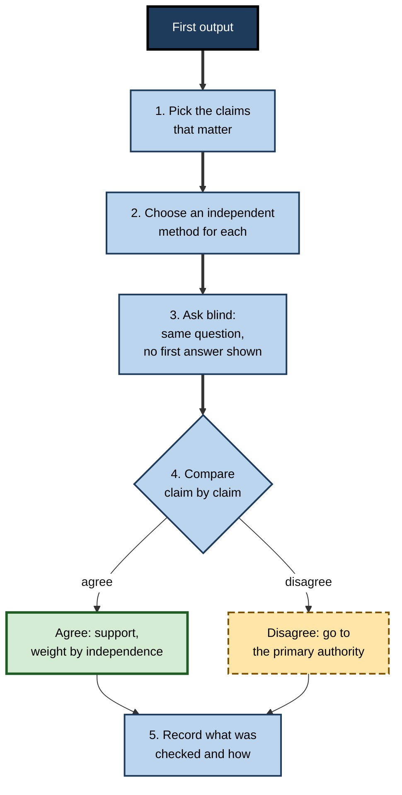
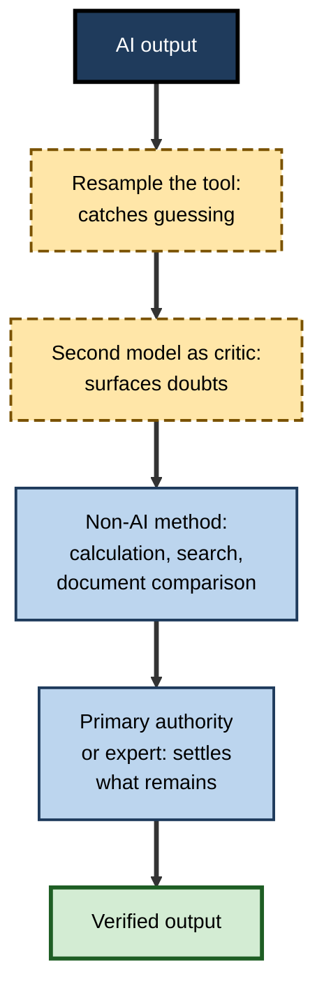

# K.6. Cross-checking across tools

A consultant asks two chatbots the same market question, gets the same figure from both and feels reassured; both took it from one outdated web page. A lawyer has two assistants summarise a contract; they disagree on the liability cap, and the disagreement leads her straight to a misread clause. Cross-checking can be efficient verification or a comforting ritual. The difference lies in **how independent the second check is** and **what is done with the result**.

> **Definition — Cross-checking across tools:** comparing an output, or the claims within it, with the result of a second tool or method applied to the same question, in order to detect errors through disagreement and to gain support through independent agreement.

**Why it matters**

- **It is fast.** A second tool can be consulted in seconds, often faster than locating a primary source.
- **Disagreement is informative.** When two methods disagree, at least one is wrong — and the point of disagreement shows where to look.
- **Agreement is easily over-read.** Tools that share training data, sources or design can share errors; their agreement may be one mistake repeated.
- **Choosing the right second tool is a skill.** A calculator checks arithmetic; a database checks a company's registration; a second chatbot checks neither reliably.

---

## The Logic of Cross-Checking

### Triangulation

- The idea comes from navigation and surveying: a position fixed from **two or more independent bearings** is more reliable than one.
- In research methods, **triangulation** means using different methods, data sources or investigators to study the same question.
- The principle: an error that would fool one method is unlikely to fool a **differently built** method in the same way.

> **Definition — Triangulation:** confirming a finding by approaching it through two or more independent methods or sources.

### What agreement and disagreement tell the reviewer

- **Disagreement** proves that at least one result is wrong (or that the question was read in two ways).
- **Agreement** is evidence of correctness **only to the extent that the two methods could have failed differently**.
- **Independence** is therefore the central property of any cross-check.

> **Key point:** the value of a cross-check is not the second answer itself but the **chance that the second method would have caught the first method's error**.

**Figure 1.** Reading agreement and disagreement between tools.

---

## Independence and Shared Errors

### Ways in which tools share errors

- **Shared training data** — large language models are trained on overlapping portions of the public web, books and code; a widespread misconception appears in all of them.
- **Shared retrieved sources** — two search-enabled assistants that consult the same top-ranked page inherit the same error.
- **Shared design** — models built with similar architectures and training methods tend to fail on similar questions.
- **Shared framing** — the same prompt, with the same embedded assumption, pushes two tools towards the same answer.
- **Shared input** — if the source document is wrong or garbled (a poor scan, a mis-transcribed recording), every tool working from it inherits the problem.

> **Watch out:** "I checked it in another AI" is often a check of **the same source twice**. Two chatbots agreeing on a statistic may both be quoting one unreliable article.

### Evidence that model errors are correlated

- **Studies comparing many models** on the same benchmark questions have found that when two different models are both wrong, they frequently give the **same** wrong answer — more often than chance would predict — and that correlation is higher between models from the same developer or of similar design.
- **Popular misconceptions** are reproduced across model families, because they are common in the text all models learn from.

> **Watch out:** the size of such correlations varies by task and model generation, and research on it is recent; the safe working assumption is that **two AI models are not independent witnesses**.

### A spectrum of independence

**Figure 2.** How independent different kinds of second check are.

- **Same tool, asked again** — shares everything; catches only random variation.
- **Related model** — same developer or family; shares much training data and design.
- **Different developer** — more independent, but training data still overlaps.
- **Non-AI method** — calculator, code execution, search of an official database, a spreadsheet; fails in quite different ways.
- **Primary authority** — the document, record or official source itself; settles the question rather than corroborating it.

> **Remember:** the most independent check of an AI claim is usually **not another AI** but a **different kind of method** — calculation, a database, the source document or a person who knows.

### The arithmetic of independence

A simple calculation shows why independence matters so much.

> **Formula — Chance that two checks both miss an error:** if two checks are fully independent, and each misses a given error with probability *p* and *q*, both miss it with probability *p* × *q*. Two independent checks that each miss 20% of errors together miss 0.2 × 0.2 = **4%**.

- **With dependence, the gain shrinks.** If the second check tends to fail on the same items as the first, the combined miss rate stays close to the first check's own rate.
  - In the extreme — a second tool that repeats the first tool's source — two checks that each miss 20% together still miss about **20%**.
- **The practical consequence:** adding a third or fourth similar tool adds little; adding one **differently built** check adds a great deal.

**How the combined miss rate depends on independence**

| Second check | First check misses | Second check misses | Combined miss rate (approx.) |
|---|---|---|---|
| Fully independent method | 20% | 20% | 4% |
| Partly dependent (overlapping sources) | 20% | 20% | Between 4% and 20% |
| Fully dependent (same source) | 20% | 20% | 20% |

*Illustrative figures, to show the principle; real miss rates are rarely known.*

> **Key point:** two weak but **independent** checks can be stronger than one careful check — and much stronger than two careful checks that share a blind spot.

### When cross-checking adds little

- **When the claim can be checked at the source just as fast.** If the original document is open, searching it beats asking a second tool.
- **When every available tool depends on the same source.** A niche figure that appears on one website will come back the same from every search-enabled assistant.
- **When the question is a matter of judgement.** Several tools agreeing on a recommendation shows that the recommendation is conventional, not that it is right for the case.
- **When the reviewer cannot act on disagreement.** A disagreement the reviewer cannot resolve creates doubt without resolution; then the right step is to involve someone who can.

---

## Choosing the Second Tool

The best cross-check depends on the kind of claim.

**Which second method suits which kind of claim**

| Kind of claim | Strong cross-check | Weak cross-check |
|---|---|---|
| Arithmetic or calculation | Calculator, spreadsheet, code execution | Another chatbot's arithmetic in prose |
| What a document says | The document itself, searched for key terms | A second summary of the same document |
| Company, legal or regulatory fact | Official register, legislation database, regulator's site | A second chatbot from memory |
| Current price, rate or status | Live official or market source with a date | Any model without live retrieval |
| Code behaviour | Running the code with test cases | Asking a second model whether the code is correct |
| Translation | Back-translation plus a fluent human reader for key passages | Two machine translations that agree |
| Interpretation or judgement | A qualified colleague; a second model as a source of counter-arguments | Majority vote of several chatbots |
| Spelling of a name | The person's own signature or official record | Another tool's spelling |

> **Key point:** a second AI model is most useful not as a **judge of truth** but as a **generator of doubts** — surfacing alternative readings, missing caveats and counter-arguments that the reviewer then checks properly.

### Second models as critics

- **Ask for problems, not verdicts.** "List the claims in this text that are most likely to be wrong, and why" is more useful than "Is this correct?"
- **Ask for the opposite case.** "Give the strongest argument that this recommendation is mistaken."
- **Ask for the conditions.** "Under what circumstances would each of these statements not hold?"
- **Then verify** whatever the critic raises — critics are wrong too.

> **Watch out:** AI models asked to judge other AI output show known biases: they tend to favour longer answers, answers in a particular position when comparing two, and in some studies answers similar to their own style. A model's approval is weak evidence of quality.

---

## Asking the Same Tool Several Times

Sampling one tool repeatedly is the least independent cross-check — but research shows it has a specific, useful role.

**Study card — Wang and colleagues (2022), self-consistency**

- **Setting:** researchers at Google studied language models solving arithmetic and commonsense reasoning problems.
- **Design:** instead of taking one answer, they sampled **many** reasoning paths for each problem and chose the answer that appeared **most often**.
- **Results:** this majority-vote approach — **self-consistency** — substantially improved accuracy over taking a single answer, across several models and benchmarks.
- **Conclusion:** when a model reaches the same answer by different reasoning paths, that answer is more likely to be right; scattered answers indicate uncertainty.
- **Limit:** a model that has learned a misconception will reach it consistently; consistency is not truth.

**Study card — Manakul, Liusie and Gales (2023), SelfCheckGPT**

- **Setting:** researchers at the University of Cambridge studied how to detect invented facts in generated biographies without access to an external database.
- **Design:** they sampled several responses to the same prompt and measured how consistent each sentence of the main response was with the samples.
- **Results:** sentences that the samples **contradicted or did not support** were much more likely to be inaccurate; facts the model reliably "knew" tended to recur across samples.
- **Conclusion:** **inconsistency across samples is a signal of invention**.
- **Limit:** consistency signals only what the model is confident about, which is not always what is true.

**Figure 3.** Consistency across repeated samples as a warning signal.

> **Definition — Self-consistency:** the degree to which a model gives the same answer when the same question is asked repeatedly or reasoned through in different ways.

> **In practice:** for a specific factual detail — a date, a figure, a name — **regenerating the answer two or three times** is a cheap first test. If the detail changes, the tool is guessing and the detail must be verified. If it stays the same, it still needs verification when it matters, but the risk is lower.

---

## Cross-Checking Well

**Figure 4.** A disciplined cross-check.

### 1. Pick the claims that matter

- Cross-check **claims**, not whole outputs. Two summaries will always differ in wording; what matters is whether they differ on facts, figures, obligations and conclusions.

### 2. Choose an independent method for each

- Match each claim to the strongest available method: calculation for arithmetic, the register for company facts, the document for what a document says.

### 3. Ask blind

- **Do not show the second tool the first answer.** Showing it invites anchoring and sycophantic agreement.
- **Ask the original question, neutrally phrased**, not a question that embeds the first answer ("Is the notice period 60 days?").

> **Definition — Blind cross-check:** a second check carried out without access to the first result, so that it cannot simply agree with it.

**Blind and anchored cross-checks compared**

| | Anchored check | Blind check |
|---|---|---|
| What the second tool sees | The first answer, often with "is this right?" | Only the original question and inputs |
| Typical response | Agreement, light edits, polite praise | An independent answer |
| Chance of catching the first tool's error | Low | Higher |
| Risk | False reassurance | Extra work comparing two answers |

### 4. Compare claim by claim

- Lay the two results side by side for each important claim.
- Classify each: **agree**, **disagree**, **one silent** (only one tool mentions it).
- Claims mentioned by only one tool deserve particular attention — they may be an omission by one or an invention by the other.

### 5. Resolve disagreements at the source

- **Never resolve a disagreement by majority vote among similar tools.** Three chatbots against one is not evidence if all three share a source.
- Go to the **primary authority** — the document, the record, the official source — or to a qualified person.

> **Mnemonic — "PICK BC":** **P**ick claims, **I**ndependent method, **C**ompare claim by claim, **K**eep blind — then **B**ack to the source for **C**onflicts.

---

## Worked Example (illustrative): Cross-Checking a Lease Summary

A property manager asks Assistant A to summarise a 40-page commercial lease. To check it, she asks Assistant B — from a different developer — for a summary of the same document, without showing it A's summary, and then searches the lease itself for disputed terms.

| Term | Assistant A | Assistant B | Lease (primary source) | Outcome |
|---|---|---|---|---|
| Term of lease | 10 years | 10 years | 10 years from 1 March 2024 | Agree, confirmed |
| Rent review | Every 5 years, upward-only | Every 5 years, upward-only | Clause 7: five-yearly, upward-only | Agree, confirmed |
| Break clause | Tenant may break at year 5 | Tenant may break at year 5 on 6 months' notice, **if no rent arrears** | Clause 12: break at year 5, 6 months' notice, conditional on no arrears and vacant possession | A **dropped conditions**; B partly right |
| Repair obligation | Tenant: internal repairs | Tenant: full repairing | Clause 9: full repairing, subject to a schedule of condition | **Disagree**; B right, both missed the schedule |
| Service charge cap | Capped at 5% annual increase | (not mentioned) | No cap in the lease | A **invented** a term |

*Illustrative figures.*

- **What cross-checking achieved:** the disagreement on repair obligations and the silence on the service charge pointed directly to the clauses to read.
- **What it did not achieve:** on the break clause, the two assistants partly agreed and both were incomplete; only the lease showed the vacant-possession condition.
- **Conclusion:** cross-checking was an efficient **map of where to look**; the primary source was the only **verdict**.

> **Watch out:** the term on which both assistants agreed most confidently — the break at year 5 — was the one where an unread condition mattered most. Agreement on the headline does not cover the conditions.

---

## Non-AI Tools as Cross-Checks

Many of the most effective cross-checks use ordinary digital tools.

- **Calculators and spreadsheets** — recompute any figure the AI calculated in prose.
- **Code execution** — run generated code against test inputs; ask an assistant with code execution to compute rather than estimate.
- **Search engines** — find the primary source behind a claim; search for exact phrases to find the origin of a quotation.
- **Official registers and databases** — company registers, legislation databases, standards bodies, professional registers.
- **Document search** — search the original document for key terms ("terminate", "cap", "liability") to find the passages a summary should reflect.
- **Version comparison** — compare a generated rewrite against the original with a document comparison feature, to see exactly what changed.
- **Spelling and grammar checkers** — a different kind of language tool, with different failure modes.
- **Calendars** — check that dates and days of the week agree.

### Cross-checking outputs that are not plain text

- **Meeting summaries** — compare decisions and actions against the recording at the timestamps where they were discussed, or against attendees' own notes; a second summary from another tool of the same faulty transcript adds little.
- **Charts and slides** — regenerate the chart from the underlying data in a spreadsheet and compare it with the generated one.
- **Images** — for factual images (a map, a diagram of equipment, a product photograph), compare with an authoritative reference image; generated images can contain plausible but wrong details such as extra components or misplaced labels.
- **Extracted data** — when a tool extracts figures from invoices or forms into a table, compare row counts and column totals with the originals, then spot-check individual rows.
- **Classifications** — when a tool sorts tickets, emails or documents into categories, have a person classify a random sample blind and compare the two sets of labels.

> **In practice:** **document comparison** is one of the most underused checks of AI rewriting. A side-by-side comparison of the original and the rewritten text shows every deleted qualifier, changed number and moved clause in seconds.

---

## People as Cross-Checks

The most independent "tool" is often a person with relevant knowledge.

- **Subject experts** — catch plausible errors no tool can detect.
- **The people concerned** — the client, the colleague named, the owner of the process.
- **A second reviewer** — someone who did not prompt the tool and so does not share the prompter's assumptions.

> **Key point:** a colleague who did not see the prompt is a **blind cross-check** in the fullest sense — they bring different knowledge and different assumptions.

### Practical limits

- **Confidentiality** — pasting confidential material into a second tool, especially a consumer tool, may breach policy or law; the second tool must be one approved for that material.
- **Time** — cross-checking every claim with several methods would remove the time saved; effort should follow consequence.
- **Expertise** — a second tool can raise a doubt that the user is not equipped to resolve; then a person is needed.

---

## Case Study (illustrative): Two Assistants, One Wrong Date

- **Situation:** a tax adviser's assistant prepared a client note on a change to a reporting deadline. To check it, she asked a second chatbot from a different developer.
- **Result of the cross-check:** both tools gave the **same** new deadline.
- **Problem:** both had drawn on the same widely shared news article, which had reported a **proposed** deadline from a consultation; the final rules, published later, set a different date.
- **Diagnosis:**
  1. the second tool was not independent — it relied on the same top-ranked article;
  2. the claim was volatile and recent, exactly where models and search results are least reliable;
  3. the authoritative source — the tax authority's published guidance — was not consulted.
- **Actions:** the error was caught by a partner who knew the consultation outcome; the note was corrected before it was sent; the practice now requires every **deadline in client advice** to be checked against the authority's own guidance, with the date of the guidance recorded.
- **Lesson:** two tools agreeing is **one source counted twice** if they share their origin. For volatile, consequential facts, the cross-check must be the authority itself.

## Case Study (illustrative): The Translation That Two Engines Agreed On

- **Situation:** a manufacturer translated a safety notice into Spanish with one machine-translation tool and checked it by translating it back into English with another.
- **Result:** the back-translation read correctly.
- **Problem:** a local distributor pointed out that a key term — the name of a protective component — had been translated into a word used for a different part in that market. Back-translation returned the original English word, so the error was invisible.
- **Diagnosis:** back-translation checks that meaning survives a round trip, not that the target text uses the **right term for the audience**.
- **Actions:** safety notices are now reviewed by a fluent reader in the target market, with a glossary of approved technical terms.
- **Lesson:** a cross-check can only catch errors of the kind it is designed to detect. Choose the check for the **risk**, not for convenience.

---

## Cross-Checking in Organisations

### Designing cross-checks into workflows

- **Defined second methods** for common claim types — "all figures recomputed in the spreadsheet; all legal citations checked in the legal database".
- **Approved second tools** — clear rules about which tools may be used with which data.
- **Blind review** — reviewers who see the source and the question before they see the AI output.
- **Recording** — notes of what was cross-checked and with what method, so that later readers know what the check did and did not cover.

**Figure 5.** Layering different kinds of cross-check so that each catches what others miss.

> **Key point:** layers of cross-checking work like layers of defence: each is imperfect, but errors that pass one are likely to be caught by a **differently built** layer — provided the layers are genuinely different.

### Avoiding the cross-checking ritual

- **Symptoms:** asking a second chatbot "is this right?", receiving "yes, this looks accurate", and recording the output as checked.
- **Why it persists:** it is fast, feels diligent and almost always produces reassurance.
- **Remedy:** count a cross-check only if it used a method that **could have caught** the error in question.

---

## Open Questions

- **How correlated are errors across current models?**
  - Early studies suggest substantial overlap, but correlation varies by task and changes with each generation of models; practitioners lack task-specific guidance.
- **Can AI critics be made reliably independent?**
  - Models trained differently, or instructed to search for flaws, may be more useful critics; whether such critics are good enough to reduce human checking is unclear.
- **Is self-consistency a dependable warning signal in professional tasks?**
  - It has been studied mostly on benchmarks; its value for workplace documents is less well established.
- **How should cross-checks be recorded?**
  - A note that a claim was "cross-checked" is ambiguous unless the method is stated; standards for recording verification are only beginning to emerge.
- **Will tools offer built-in cross-checking?**
  - Some products already compare answers or show sources; whether built-in checks share the primary tool's blind spots is an open design question.

---

## Summary

- **Cross-checking** compares output with a second tool or method; **disagreement** reveals errors and **independent agreement** gives support.
- Its value depends on **independence**: the chance that the second method could have failed differently.
- AI tools share errors through **training data, retrieved sources, design, framing and inputs**; two models are not independent witnesses.
- Independence rises from **same tool → related model → different developer → non-AI method → primary authority**.
- Choose the second method for the **kind of claim**: calculators for arithmetic, registers for company facts, the document for what a document says, people for judgement.
- Use second models as **critics that surface doubts**, not judges of truth.
- **Self-consistency** and **SelfCheckGPT** show that inconsistency across samples signals guessing; consistency is weaker evidence.
- Cross-check **claim by claim**, **blind**, and resolve disagreements **at the primary source**, never by majority vote.
- Non-AI tools — calculators, document comparison, registers, calendars — and **people** are often the strongest cross-checks.
- Count a cross-check only if it **could have caught** the error in question.

---

## Self-Check

1. Define cross-checking across tools and explain why independence is its central property.
2. List five ways in which AI tools can share errors.
3. Why is "I checked it in another chatbot" often weak evidence?
4. Order these by independence from a chatbot's answer: the source document; the same chatbot asked again; a calculator; a chatbot from a different developer.
5. For each claim, name a strong cross-check: a percentage change; a company's registered name; what a contract says about termination; whether code handles blank inputs.
6. What did Wang and colleagues (2022) show about self-consistency?
7. What does SelfCheckGPT use as a signal of invented facts, and what is its limit?
8. What is a blind cross-check, and why does it matter?
9. Why should disagreements not be resolved by majority vote among tools?
10. In the lease worked example, what did cross-checking achieve and what did it fail to achieve?
11. Why did back-translation fail to catch the error in the safety-notice case?
12. What are the practical limits on cross-checking with other tools?
13. What are the symptoms of a "cross-checking ritual", and how is it avoided?
14. Your manager proposes that every AI-drafted client report be checked by pasting it into a second AI tool with the prompt "Check this for accuracy." Evaluate the proposal and suggest a better design.

### Answer Key

1. Comparing output with a second tool or method on the same question, to detect errors through disagreement and gain support through independent agreement. Agreement is evidence only if the second method could have failed differently; dependent methods can share errors.
2. Shared training data; shared retrieved sources; shared design; shared prompt framing; shared (possibly faulty) input.
3. The second chatbot may share training data or the same retrieved source, so agreement may be one error counted twice; it may also simply agree with a premise in the prompt.
4. Same chatbot asked again (least); chatbot from a different developer; calculator; source document (most).
5. Recompute in a calculator or spreadsheet; check the official company register; search and read the contract's termination clauses; run the code with blank-input test cases.
6. Sampling many reasoning paths and taking the most frequent answer improved accuracy on reasoning tasks; agreement across paths indicates higher reliability, scattered answers indicate uncertainty.
7. Inconsistency between a response and other samples to the same prompt; unsupported sentences are more likely inaccurate. Limit: consistent answers can still be wrong when the model has learned an error.
8. A second check carried out without seeing the first result, with a neutral question. It prevents anchoring and sycophantic agreement, so the second check can genuinely catch errors.
9. Similar tools may share sources and errors; the majority may be one mistake repeated. Only the primary authority or a qualified person settles a disagreement.
10. It showed where to look — the disagreement on repairs and the silence on the service charge — and exposed an invented term. It failed where both tools agreed on an incomplete break clause; only the lease revealed all conditions.
11. Back-translation checks that meaning returns to the original; a wrong but semantically related term in the target language can back-translate to the correct English word. It cannot check whether the term is right for the audience.
12. Confidentiality rules on which tools may see which material; time; and the user's expertise to resolve raised doubts.
13. Asking a second chatbot "is this right?", receiving reassurance and recording the output as checked. Avoid it by counting only checks that could have caught the error — independent methods, blind questions, primary sources.
14. Weak: the second tool is not independent, sees the answer (anchoring), tends to approve, and cannot access the sources or records needed. Better: identify load-bearing claims; recompute figures in spreadsheets; check facts against the client's documents and official sources; use a second model only to list likely weak points, asked blind; have a human reviewer resolve disagreements; record the methods used.

---

## Glossary

| Term | Meaning |
|---|---|
| Anchored check | A second check in which the checker sees the first answer and tends to agree with it. |
| Back-translation | Translating a translated text back into the original language to compare meaning. |
| Blind cross-check | A second check carried out without access to the first result. |
| Correlated errors | Errors that two methods tend to make together, reducing the value of their agreement. |
| Cross-checking | Comparing output with the result of a second tool or method. |
| Document comparison | A feature showing every difference between two versions of a text. |
| Independence | The degree to which two methods could fail in different ways. |
| Primary authority | The original document, record or official source that settles a factual question. |
| Self-consistency | The degree to which a model gives the same answer across repeated samples. |
| SelfCheckGPT | A method that detects likely invented facts by comparing a response with other samples. |
| Triangulation | Confirming a finding through two or more independent methods or sources. |
