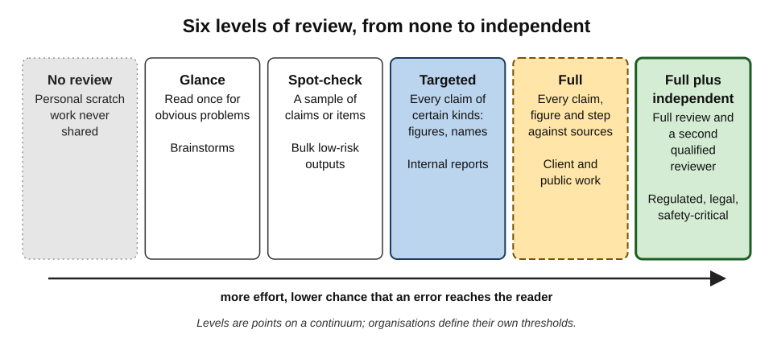
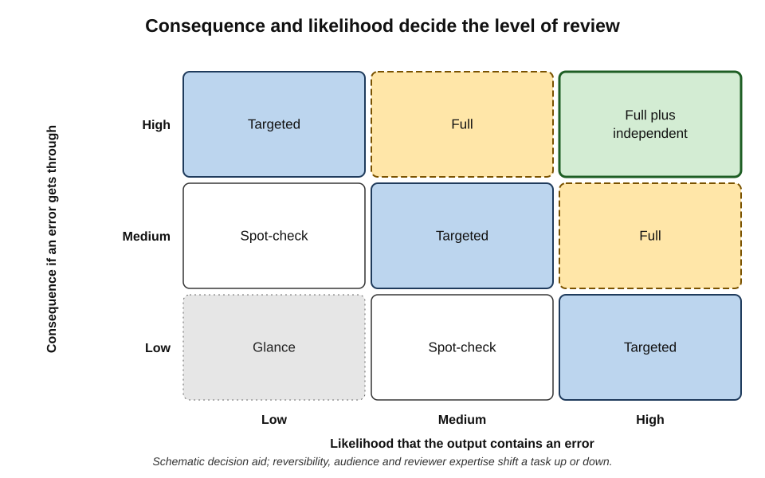
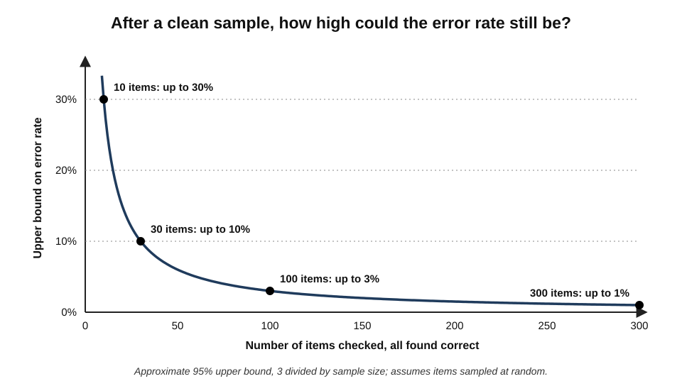
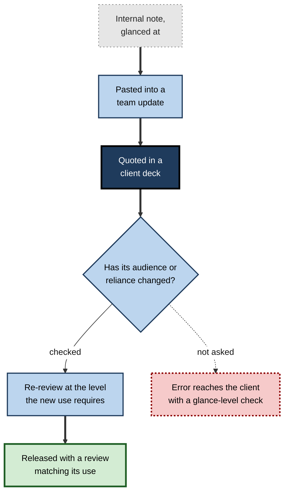
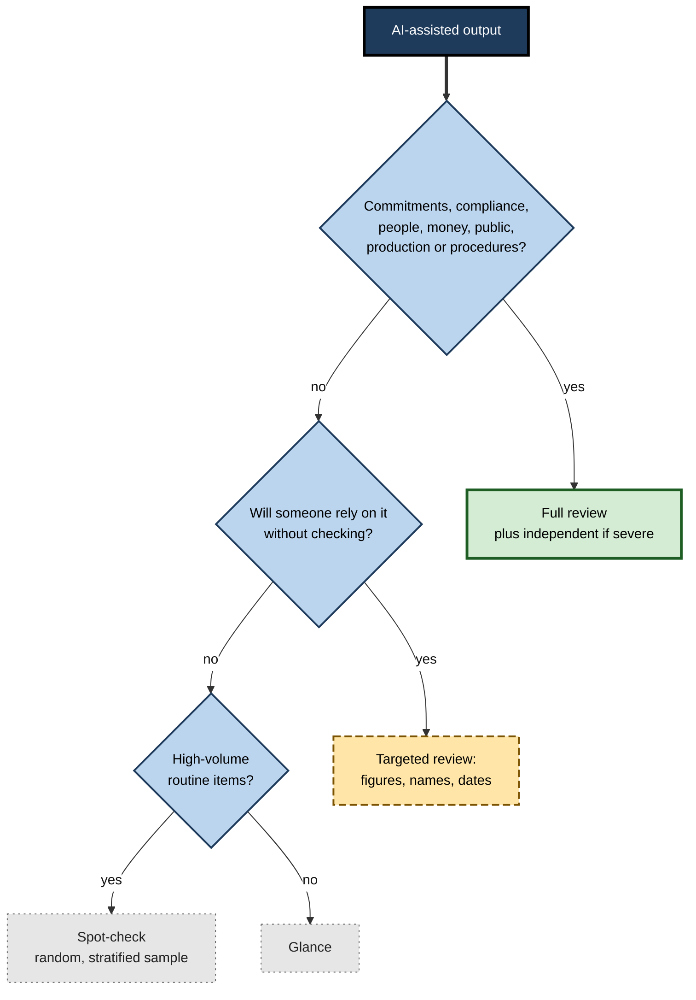

# K.7. Knowing which tasks need full review

A team lead uses an assistant fifty times a day: to tidy notes, suggest subject lines, summarise threads, draft a client proposal, and once a week to prepare figures for the board. Reviewing everything with equal care would consume the time the tool saves; reviewing nothing would eventually send a wrong figure to the board. The skill is **allocation**: deciding which outputs need a complete, line-by-line check and which need only a glance.

> **Definition — Full review:** a complete examination of an output — every claim, figure, name, instruction and conclusion — against appropriate sources, by a reviewer competent in the subject, before the output is used or released.

**Why it matters**

- **Review capacity is finite.** Attention spent on low-risk outputs is unavailable for high-risk ones.
- **Uniform review fails in both directions.** Reviewing everything lightly lets serious errors through; reviewing everything fully leads to fatigue and, in time, to nominal review.
- **Risk is uneven.** A wrong word in a brainstorm costs nothing; a wrong date in a regulatory filing can cost a great deal.
- **Accountability requires justification.** When something goes wrong, the question will be whether the level of review was reasonable for the task.

---

## Levels of Review

Review is not a yes-or-no matter. It is a scale, and each level has its uses.

**Figure 1.** Six levels of review, from none to independent.

- **No review** — personal scratch work that will never be shared or relied upon.
- **Glance** — one read for obvious problems: wrong topic, offensive content, nonsense.
- **Spot-check** — a sample of claims or items is checked against sources.
- **Targeted review** — every claim of certain high-risk kinds is checked: all figures, all names, all dates, all legal terms.
- **Full review** — every claim, figure, instruction and conclusion is checked, and the whole is judged for fitness.
- **Full review plus independent check** — full review by the author and a second qualified reviewer, ideally one who did not prompt the tool.

> **Definition — Spot-check:** verification of a sample of the claims or items in an output, used to estimate whether the whole is reliable.

> **Definition — Targeted review:** verification of every instance of particular high-risk elements — such as figures, names or legal terms — while the rest is read more lightly.

> **Key point:** the choice is not "review or not" but **which level**, and the level should be chosen **before** reading the output, not after a first impression of its quality.

---

## What Decides the Level

### The two main dimensions

- **Consequence** — how much harm an error would cause if it reached the reader or took effect.
- **Likelihood** — how probable it is that the output contains an error of that kind.

**Figure 2.** Consequence and likelihood of error decide the level of review.

### Factors that raise consequence

- **External audience** — clients, regulators, the public, the press.
- **Reliance** — the reader will act on the output without checking it themselves.
- **Irreversibility** — once sent, filed, published or executed, it cannot be recalled.
- **People affected** — decisions about individuals: hiring, performance, credit, care, discipline.
- **Legal and regulatory weight** — contracts, filings, disclosures, safety information, advice in regulated professions.
- **Money** — payments, prices, forecasts that drive spending.
- **Reputation** — anything carrying the organisation's name or a senior person's signature.

### Factors that raise likelihood of error

- **Task type** — tasks where the tool is known to be weak: precise figures, recent events, niche facts, legal and medical specifics, long documents, multi-step reasoning.
- **Input quality** — poor scans, noisy recordings, incomplete data, conflicting sources.
- **Novelty** — a type of task the user has not tried with this tool before.
- **Length and density** — more claims mean more chances of error.
- **Reliance on the tool's own knowledge** rather than on supplied, authoritative material.
- **Specificity** — names, numbers, dates, citations and quotations are more error-prone than general descriptions.

### Factors that lower the need for review

- **Errors will be caught downstream** — a draft that will go through a formal editorial process anyway.
- **The reviewer is the only reader** and knows the subject well.
- **The output is easily corrected** and will be used only briefly.
- **The tool's reliability on this exact task is established** — by the user's own record of checks, not by impressions.

> **Watch out:** "errors will be caught downstream" is only a valid reason if someone downstream **knows** they are expected to catch them. Two people who each assume the other is checking produce no check at all.

### Reviewer competence

- A full review requires a reviewer who **could recognise** the errors that matter.
- A non-specialist's "full review" of a medical or legal output is, in effect, a glance.

> **Key point:** the level of review is defined by **what is checked and by whom**, not by how long the reviewer spends reading.

---

## A Scoring Method: Risk Priority

For recurring tasks, a structured score helps make allocation consistent and defensible.

### Failure mode and effects analysis

- **Origin:** a procedure first set out by the United States military in 1949 and later adopted by the aerospace and automotive industries and by healthcare.
- **Idea:** for each way a process can fail, rate:
  - **Severity** — how bad the effect would be;
  - **Occurrence** — how likely the failure is;
  - **Detection** — how likely it is that the failure would **escape** detection before it caused harm.
- **Combined score:** the **risk priority number**.

> **Definition — Failure mode and effects analysis (FMEA):** a structured method of listing how a process can fail, rating each failure's severity, likelihood and detectability, and prioritising action accordingly.

> **Formula — Risk priority number (RPN):** RPN = Severity × Occurrence × Detection, each rated from 1 (best) to 10 (worst). Example: severity 9 × occurrence 4 × detection 7 = **252**.

### Worked example (illustrative): scoring four recurring AI-assisted tasks

| Task | Severity | Occurrence | Detection | RPN | Review level |
|---|---|---|---|---|---|
| Subject lines for internal emails | 1 | 4 | 2 | 8 | Glance |
| Summaries of internal meeting notes | 4 | 5 | 6 | 120 | Targeted (decisions, owners, dates) |
| Client proposal pricing section | 8 | 4 | 6 | 192 | Full |
| Figures in a board paper | 9 | 4 | 7 | 252 | Full plus independent |

*Illustrative figures.*

- **Reading the scores:** the meeting summaries score higher than intuition suggests because errors in owners and dates are **hard to detect** — no one rereads the summary until the deadline is missed.
- **Using the scores:** a team sets thresholds — for example, under 50 glance, 50–150 targeted, 150–200 full, over 200 full plus independent.

> **Watch out:** RPN multiplies ordinal ratings, which is mathematically crude; a high severity can be hidden by low ratings elsewhere. Many practitioners therefore add a rule that **any severity of 9 or 10 requires full review**, whatever the RPN.

---

## Evidence on How People Decide Whether to Check

People already weigh the cost of checking against its benefit — often without realising it.

**Study card — Vasconcelos and colleagues (2023), the cost and benefit of verifying AI**

- **Setting:** researchers at Stanford University ran a series of online experiments in which people solved tasks — such as mazes — with help from an AI whose answers were sometimes wrong, published in the *Proceedings of the ACM on Human–Computer Interaction*.
- **Manipulations:**
  - how **hard** the task was to check independently;
  - whether the AI's explanation made checking **easier**;
  - how much participants were **paid** for correct answers.
- **Results:**
  - people relied on the AI less — and caught more of its errors — when explanations made verification **cheaper** than solving the task themselves;
  - when explanations were as hard to check as the task, they did not reduce over-reliance;
  - higher rewards for accuracy reduced over-reliance.
- **Conclusion:** over-reliance is partly a **strategic choice**: people verify when the expected benefit outweighs the effort.
- **Lesson for allocation:**
  - make the stakes **visible** so that the benefit of checking is felt;
  - make checking **cheap** — sources linked, figures traceable — for the outputs that matter most.

> **Key point:** if full review is too costly, people will quietly skip it. Allocation works only when the reviews that are required are also **made practical**.

---

## Tasks That Usually Need Full Review

**Common categories and why they need full review**

| Category | Examples | Why full review |
|---|---|---|
| External commitments | Proposals, quotes, contracts, terms | Create obligations; hard to retract |
| Regulated communications | Financial promotions, health information, safety notices | Legal requirements on accuracy and content |
| Decisions about people | Hiring shortlists, performance assessments, disciplinary letters | Fairness, legal rights, serious personal impact |
| Financial figures for decision-makers | Board papers, forecasts, budgets | Decisions and spending rest on them |
| Public statements | Press releases, published reports, social media posts by the organisation | Wide reach, reputational exposure, persistence |
| Legal and compliance documents | Policies, filings, regulatory responses | Liability and enforcement |
| Code and configuration for live systems | Production code, security settings, data changes | Can break services or expose data |
| Instructions others will follow | Procedures, safety guidance, customer instructions | Errors become actions |

> **Remember:** **commitments, compliance, people, money, public, production, procedures** — outputs in these categories default to full review.

> **Mnemonic — "C2P4" ("Check Carefully: People, Public, Production, Procedures"):** Commitments and Compliance, plus People, Public, Production and Procedures — plus money, which touches them all.

### The regulatory picture

- **Decisions about individuals** attract the strongest legal attention. The European Union's AI Act classifies many uses in employment, education, credit and access to essential services as **high-risk**, requiring effective human oversight.
- **Data-protection law** in many jurisdictions gives people rights in relation to significant decisions made about them by automated means.
- **Professional regulators** in law, accountancy, medicine and financial services have issued guidance that practitioners remain responsible for AI-assisted work and must supervise it.

---

## Tasks Where Lighter Review Is Reasonable

- **Idea generation** — brainstorms, alternative headlines, lists of options; the human chooses and develops.
- **Reformatting** — restructuring content the user supplied, where a **comparison** with the original confirms nothing changed.
- **Personal notes and summaries for one's own use**, where the user knows the subject.
- **Drafts that will be fully rewritten** — the output serves only as a prompt for the author's own writing.
- **Low-stakes internal messages** — scheduling, acknowledgements, routine updates without figures or commitments.

> **Watch out:** reformatting is light-review work only if nothing **substantive** can change. Tools asked to "tidy up" often also shorten, rephrase and drop qualifiers — check with a document comparison.

---

## Who Should Review

The level of review says *what* is checked; it is equally important to decide *who* checks.

### The author as reviewer

- **Strengths:** knows the purpose, the audience and the background; can judge fitness quickly.
- **Weaknesses:**
  - shares the assumptions built into the prompt, so may not see a false premise;
  - reads what was intended rather than what is written — the familiar problem of proofreading one's own work;
  - has an interest in the draft being acceptable, especially under time pressure.

### A second reviewer

- **Strengths:** brings different knowledge and assumptions; sees the output as the reader will.
- **Best when** the second reviewer did not see the prompt and checks against the sources rather than against the author's explanation.
- **Weaknesses:** may defer to the author, or assume that the author has already checked the facts.

> **Watch out:** a second reviewer who is told "it's been checked, just give it a once-over" has been converted into a glance. State clearly what the second reviewer is expected to verify.

### Competence and independence together

**Choosing reviewers by competence and independence**

| Reviewer | Competence in the subject | Independence from the draft | Best use |
|---|---|---|---|
| Author, non-specialist | Low | Low | Glance, fitness for purpose |
| Author, specialist | High | Low | Targeted or full review of own work |
| Colleague, non-specialist | Low | High | Clarity, consistency, reader's view |
| Colleague, specialist | High | High | Independent full review of high-stakes outputs |
| Formal function (legal, compliance, finance) | High in its domain | High | Sign-off on regulated and contractual content |

> **Key point:** for the highest-stakes outputs, the reviewer must be **both** competent and independent. Either alone leaves a predictable gap.

### Review by the people affected

- **Clients, colleagues and speakers** named or quoted can confirm details about themselves.
- **Process owners** can confirm that a generated procedure matches the real process.
- **Users of instructions** can walk through them and report where they fail.

---

## Review Levels for Different Kinds of Output

The same task category can contain outputs of very different risk. The table gives typical starting points, to be adjusted for consequence and audience.

**Typical starting review levels by output type**

| Output | Typical starting level | Elements that push it higher |
|---|---|---|
| Brainstormed ideas, titles, options | Glance | Ideas that will be published unchanged |
| Reformatted or restructured own text | Glance plus document comparison | Any change of substance or figures |
| Summary for own reading | Glance or spot-check | Use in decisions or sharing with others |
| Internal email or message | Glance | Figures, commitments, people's names, sensitive topics |
| Meeting summary shared with attendees | Targeted: decisions, owners, dates | External attendees; contentious decisions |
| Internal report or analysis | Targeted: all figures and sources | Feeding a decision with budget or people impact |
| Client-facing document | Full | Contractual effect; regulated subject |
| Public content | Full | Claims about people, competitors, safety or health |
| Code for a personal script | Read and test | Shared use, access to real data |
| Code for live systems | Full, with tests and second review | Security, payments, personal data |

> **In practice:** the right column is often the most useful. A low-risk output becomes high-risk the moment it acquires a **figure, a commitment, a named person or a regulated topic** — and the review should rise with it.

---

## Sampling: Checking Part to Judge the Whole

For high-volume outputs — hundreds of summaries, tagged tickets, extracted records — full review of every item is impossible. **Sampling** estimates reliability.

### How much a clean sample proves

- Finding **no errors** in a sample does not mean the error rate is zero.
- A widely used approximation, the **rule of three**, gives a rough 95% upper bound on the true error rate after a clean sample.

> **Formula — Rule of three:** after checking *n* randomly chosen items and finding no errors, the true error rate is, with about 95% confidence, below **3 ÷ n**. Example: 30 clean items → error rate below 3 ÷ 30 = **10%**; 300 clean items → below **1%**.

**Figure 3.** What an error-free sample can rule out.

- **Implication:** a check of ten items, all correct, is compatible with an error rate as high as 30%. Small clean samples are weak reassurance.
- **For rare but serious errors**, sampling alone cannot give enough assurance; full review of the high-consequence items is needed.

### Sampling well

- **Random selection** — not the first items, not the items that look interesting.
- **Stratification** — sample across categories (each region, product, customer type), because errors are often concentrated in one.
- **Larger samples for higher stakes**, and for new tasks with no track record.
- **Escalation rule** — if the sample finds an error, widen the check or move to full review.

> **Definition — Stratified sample:** a sample drawn separately from each category of a population, so that every category is represented.

> **In practice:** teams processing large volumes of AI output often combine **full review of high-consequence items** (any item over a value threshold, any complaint, any vulnerable customer) with **random sampling of the rest**.

---

## Review Level Follows Final Use

The level of review must match where the output **ends up**, not where it started.

**Figure 4.** Re-assessing review when an output's use changes.

- **Promotion without re-review** — a quick internal summary is pasted into a status report, then into a client deck, never checked beyond the original glance.
- **Remedy:** whenever content moves to a **wider audience or a higher-stakes use**, it is re-reviewed at the new level.
- **Labels help** — marking content as "unverified" or "internal only" makes its review status travel with it.

> **Key point:** review status belongs to **content in a use**, not to content in itself.

---

## The Problem of Review Fatigue

### Why over-reviewing is not safe either

- **Vigilance decrement** — research on monitoring tasks since the Second World War has found that people's ability to detect rare signals declines over long periods of watching.
- **Approval drift** — reviewers who approve many correct items come to expect correctness and approve faster.
- **Crowding out** — time spent fully reviewing trivial outputs is taken from important ones.

> **Definition — Vigilance decrement:** the decline in detection of rare targets over time during sustained monitoring.

### Designing against fatigue

- **Tiering** — reserve full review for what needs it, so that it remains genuine.
- **Batching and breaks** — review high-stakes outputs in focused sessions, not interleaved with everything else.
- **Rotating reviewers** for repetitive high-volume checks.
- **Seeded errors** — some organisations insert known errors into review queues to measure whether reviewers are catching them.

---

## Case Study (illustrative): The Over-Reviewed Support Team

- **Situation:** a customer-support team adopted AI-drafted replies with a rule that **every** reply be fully reviewed before sending.
- **Problem:** after three months, average review time per reply had fallen from about two minutes to under twenty seconds. A quality audit found that reviewers were approving replies containing wrong refund amounts at about the same rate as before the rule.
- **Diagnosis:**
  - uniform "full review" of hundreds of routine replies had become a click;
  - routine replies (delivery updates, password resets) rarely contained errors, so reviewers learned to approve;
  - the rare replies with refunds, complaints or account closures received the same rushed treatment.
- **Actions:**
  1. routine replies moved to **spot-checking** of a random daily sample;
  2. replies involving money, complaints, vulnerable customers or account changes were flagged automatically for **full review**, with the relevant account details shown alongside;
  3. reviewers were given time targets for flagged replies that allowed genuine checking.
- **Result:** total review time fell; the error rate in flagged replies dropped substantially in the next audit.
- **Lesson:** applying the same review to everything **dilutes** review. Concentrating effort where consequence is high makes it real.

## Case Study (illustrative): The Summary That Became a Deliverable

- **Situation:** a junior analyst used an assistant to summarise twenty industry reports for her own background reading, glancing at the result.
- **Problem:** her manager, pressed for time, pasted three paragraphs of the summary into a client briefing. One paragraph attributed a market forecast to the wrong research firm and overstated it.
- **Diagnosis:** the content's **use changed** — from private notes to a client deliverable — without anyone re-assessing its review level; the manager assumed the analyst had checked it; the analyst never expected it to leave her notes.
- **Actions:** the firm introduced a simple rule — content generated with AI and not fully reviewed is labelled "UNVERIFIED — internal notes" in shared workspaces, and the label must be removed by the person who verifies it.
- **Lesson:** review level must follow **final use**; labels make review status visible as content travels.

---

## Allocation as a Professional Skill

### What skilled allocators do

- **Decide before reading** — set the review level from the task's consequence and likelihood, before the output's polish can influence judgement.
- **Know the tool's weak spots** — from their own record of corrections, not from marketing or impressions.
- **Escalate on surprise** — if a light check finds an error, they move to full review.
- **Document the choice** for high-stakes work — what was checked, by whom, and why that level was chosen.

> **In practice:** a short **review note** attached to high-stakes outputs — "Figures checked against the finance system; legal terms reviewed by the contracts team; narrative reviewed by author" — tells later readers what assurance they actually have.

### Allocation in teams

- **Shared definitions** of the review levels and what each requires.
- **Default levels** for common task types, documented so that new staff apply them consistently.
- **Clear ownership** — one named person responsible for confirming the review level of each external output.
- **Periodic recalibration** — as tools improve or deteriorate on particular tasks, the defaults are revisited using evidence from correction records.

**Figure 5.** Deciding the level of review for an AI-assisted output.

---

## Open Questions

- **How should review levels change as tools improve?**
  - Lower error rates may justify lighter review, but rare serious errors remain; there is little evidence on safe thresholds for reducing review.
- **Can tools tell users when an output needs closer review?**
  - Uncertainty signals and source-coverage indicators could guide allocation; their reliability for workplace tasks is not established.
- **How should responsibility be divided when review is sampled?**
  - When only a sample is checked, errors in unchecked items raise questions about accountability that professional rules have not fully addressed.
- **What sample sizes are appropriate for AI output?**
  - Audit sampling has mature methods; equivalent practice for generated content is still forming.
- **Does tiered review change behaviour?**
  - People may relax on items labelled low-risk; whether tiering improves overall accuracy in practice needs more evidence.

---

## Summary

- **Full review** checks every claim, figure, name, instruction and conclusion against sources, by a competent reviewer.
- Review is a **scale**: none, glance, spot-check, targeted, full, full plus independent.
- The level depends on **consequence** and **likelihood of error**, adjusted for reversibility, audience, reliance, people affected, regulation, money and reviewer competence.
- **Risk priority numbers** (severity × occurrence × detection) make allocation consistent; severe risks should trigger full review regardless of score.
- People verify when the **benefit outweighs the effort** (Vasconcelos and colleagues, 2023), so required reviews must be made practical and stakes visible.
- **Commitments, compliance, people, money, public statements, production systems and procedures** default to full review.
- **Sampling** suits high volumes; by the **rule of three**, a clean sample of *n* items bounds the error rate below about 3 ÷ n.
- Review level must follow **final use**; content promoted to wider audiences must be re-reviewed.
- Over-reviewing causes **fatigue and nominal approval**; tiering keeps full review genuine.

---

## Self-Check

1. Define full review and distinguish it from targeted review and spot-checking.
2. List the six levels of review and a typical use for each.
3. Name five factors that raise the consequence of an error and five that raise its likelihood.
4. Why is "errors will be caught downstream" a risky reason to review lightly?
5. Explain the risk priority number with a worked figure, and one weakness of the method.
6. In the worked example, why did meeting summaries score higher than intuition suggests?
7. Summarise the findings of Vasconcelos and colleagues (2023) and their lesson for organisations.
8. Which categories of output default to full review?
9. After checking 50 randomly selected AI-tagged tickets with no errors, what can be said about the error rate?
10. Why is a stratified sample often better than a simple random one for AI outputs?
11. What does "review level follows final use" mean? Give an example of failure.
12. Why can requiring full review of everything make outcomes worse?
13. What should a review note for a high-stakes output contain?
14. A legal team wants to use an assistant to draft first versions of 300 routine non-disclosure agreements a year from an approved template, and occasional bespoke agreements for major deals. Propose a review allocation and justify it.

### Answer Key

1. Full review checks every element against sources, by a competent reviewer. Targeted review checks every instance of particular high-risk elements (all figures, names). Spot-checking checks a sample to estimate reliability.
2. None (private scratch work); glance (brainstorms); spot-check (bulk low-risk outputs); targeted (internal reports — figures and names); full (client and public work); full plus independent (regulated, legal, safety-critical outputs).
3. Consequence: external audience, reliance, irreversibility, people affected, legal weight, money, reputation. Likelihood: weak task types, poor inputs, novelty, length and density, reliance on the tool's own knowledge, specificity.
4. Downstream reviewers may not know they are expected to catch errors; each party may assume the other is checking, so no check happens.
5. RPN = severity × occurrence × detection, each 1–10; e.g. 8 × 3 × 6 = 144. Weakness: multiplying ordinal ratings can hide a catastrophic severity behind low occurrence or detection scores.
6. Their errors (owners, dates) are hard to detect until a deadline is missed, giving a high detection rating.
7. People relied less on AI when explanations made checking cheaper than doing the task, and when accuracy was rewarded more; over-reliance is partly a cost–benefit choice. Organisations should make stakes visible and verification cheap for important outputs.
8. External commitments; regulated communications; decisions about people; financial figures for decision-makers; public statements; legal and compliance documents; live code and configuration; instructions others will follow.
9. By the rule of three, the true error rate is, with about 95% confidence, below 3 ÷ 50 = 6%. It is not shown to be zero.
10. Errors often concentrate in one category (a region, product or customer type); stratification ensures each category is checked.
11. The review must match where the content ends up. E.g. a glanced-at private summary pasted into a client briefing without re-review, carrying an error to the client.
12. Uniform full review of routine items leads to fatigue and approval drift, so reviews become nominal and high-risk items get the same rushed attention.
13. What was checked, against what sources, by whom, and why that level was chosen — so later readers know the assurance they have.
14. Routine NDAs from an approved template: targeted review of the variable fields (parties, legal entity names, dates, governing law, any deviations from the template, shown by document comparison), plus periodic stratified sampling of full documents; escalate to full review on any deviation. Bespoke major-deal agreements: full review by the responsible lawyer and an independent second review, since consequence is high and the tool's reliability on bespoke terms is unproven.

---

## Glossary

| Term | Meaning |
|---|---|
| Approval drift | The tendency of reviewers to approve faster as they come to expect correctness. |
| Consequence | The harm an error would cause if it reached the reader or took effect. |
| Detection (in FMEA) | A rating of how likely a failure is to escape detection before causing harm. |
| Failure mode and effects analysis (FMEA) | A method of listing failures and rating severity, occurrence and detection. |
| Full review | A complete check of every element of an output against sources by a competent reviewer. |
| Glance | A single read for obvious problems. |
| Review note | A record of what was checked in an output, how and by whom. |
| Risk priority number (RPN) | Severity × occurrence × detection. |
| Rule of three | After *n* clean random items, the error rate is below about 3 ÷ n with 95% confidence. |
| Spot-check | Verification of a sample to estimate reliability of the whole. |
| Stratified sample | A sample drawn from each category of a population. |
| Targeted review | Checking every instance of particular high-risk elements. |
| Vigilance decrement | Declining detection of rare targets during sustained monitoring. |
