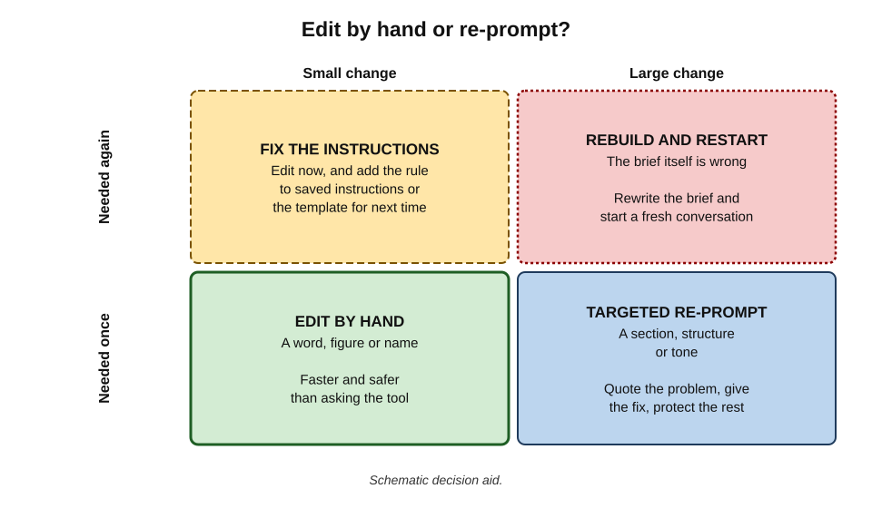
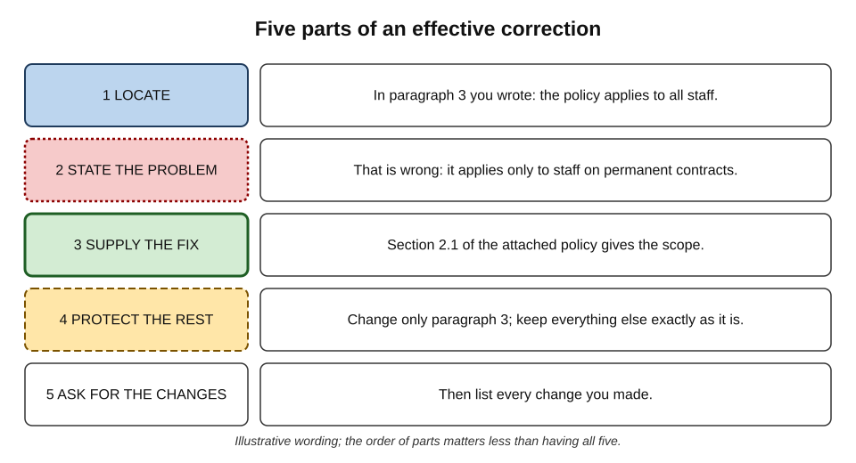
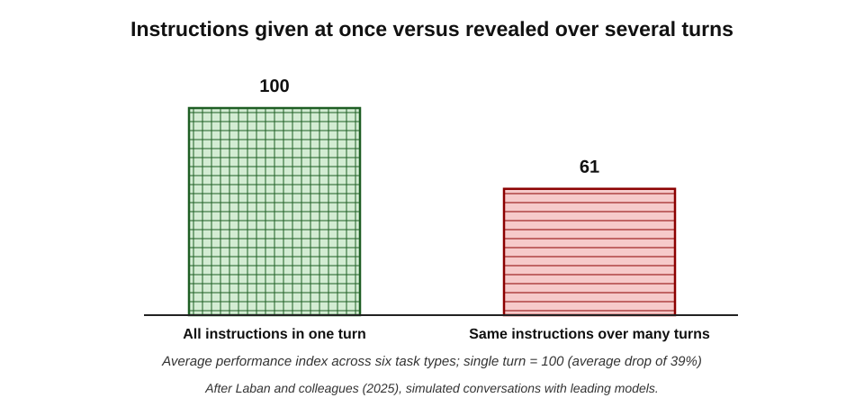
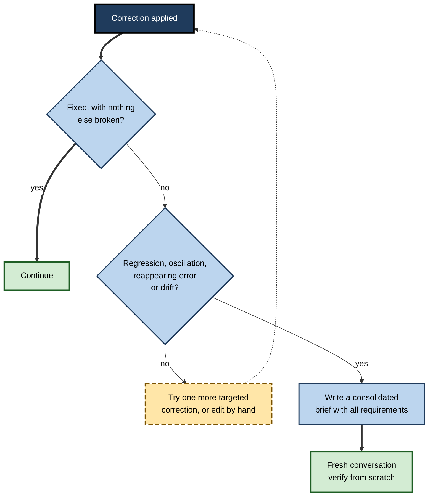
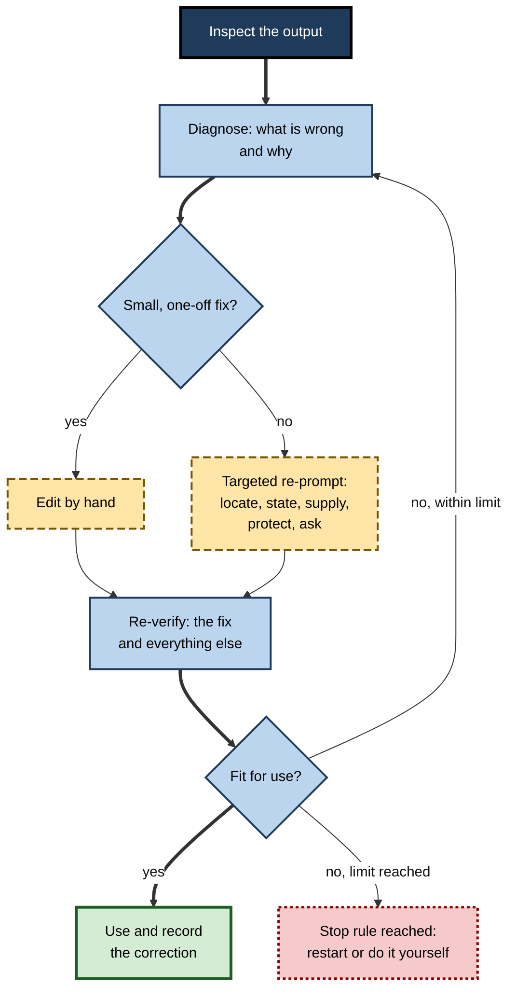

# K.8. Correcting and re-prompting

A manager finds that a generated policy summary misstates who the policy covers and types "That's wrong, fix it." The tool apologises, rewrites the whole summary, corrects the scope — and quietly drops the section on exceptions. A second request restores the exceptions but changes the effective date. After five rounds the summary is longer, vaguer and still not right. Finding an error is half the work; **correcting it without creating new ones** is the other half.

> **Definition — Correction loop:** the cycle of diagnosing what is wrong with an output, choosing how to fix it (by editing directly or by instructing the tool again), applying the fix, and re-verifying the result — repeated until the output is fit for use or abandoned.

**Why it matters**

- **Most outputs need some correction.** Skill in correcting determines how much of the tool's time saving survives.
- **Careless correction creates new errors.** Each regeneration is a new draft with its own chance of error, not a patched version of the old one.
- **Long correction conversations degrade.** Evidence shows that models perform worse when instructions arrive piecemeal over many turns.
- **The tool cannot reliably correct itself.** Without new information from outside, asking a model to "check its work" often fails or makes things worse.

---

## Two Routes to a Correction

Every correction can take one of two routes: **edit the output directly**, or **instruct the tool to change it**.

### Editing by hand

- **Best for** small, precise fixes: a figure, a name, a date, a word, a sentence.
- **Advantages:**
  - the change is exactly what the editor intended;
  - nothing else changes;
  - no new errors are introduced elsewhere.
- **Disadvantages:** slower for large structural or stylistic changes; does nothing to improve future outputs.

### Re-prompting

- **Best for** larger changes: restructuring, changing tone throughout, adding a missing section, adapting for a different audience.
- **Advantages:** fast for wide-ranging changes; can be reused if the same correction is often needed.
- **Disadvantages:**
  - the tool may change parts that were already correct;
  - it may introduce new errors;
  - each round costs another full read of the output.

> **Definition — Re-prompting:** giving a generative tool a further instruction to revise its previous output, rather than editing the output directly.

**Figure 1.** Choosing between editing by hand and re-prompting.

**Comparing the two routes**

| | Edit by hand | Re-prompt |
|---|---|---|
| Speed for a one-word fix | Fast | Slower (prompt, wait, re-read) |
| Speed for a structural change | Slow | Fast |
| Risk of collateral change | None | Moderate to high |
| Need to re-verify | Only the edited part | The whole output |
| Improves future outputs | No | Yes, if the instruction is saved |
| Control over exact wording | Complete | Partial |

> **Key point:** a re-prompt does not *repair* an output; it produces a **new draft**. Everything checked before must, in principle, be checked again.

> **Remember:** **small, precise, one-off fix → edit by hand. Large or repeated fix → re-prompt, then re-verify everything.**

---

## Diagnosing Before Correcting

A correction works only if it addresses the **cause** of the error. "That's wrong" gives the tool almost nothing to work with.

### What kind of error is it?

**Matching the correction to the type of error**

| Type of error | Example | Effective correction |
|---|---|---|
| Wrong fact or figure | Notice period stated as 60 days | Edit by hand, or supply the source passage and ask for that sentence only to be changed |
| Missing content | No section on exceptions | Specify exactly what to add and where |
| Unwanted content | An invented benchmark | Name it and instruct removal; tell the tool not to add facts not in the source |
| Wrong scope or audience | Written for experts, needed for new starters | Restate audience, purpose and reading level |
| Wrong tone | Too effusive for a formal complaint reply | Describe the tone, or give a short example of the desired register |
| Wrong structure | Narrative where a table was needed | Supply the template or outline |
| Reasoning error | Correlation read as causation | Point out the flawed step and supply the missing consideration |
| Task misunderstood | Explained *how* when asked *whether* | Restate the goal; often better to start afresh |

### Why did the tool get it wrong?

- **Missing information** — the tool was not given the source, the context or the constraint. *Remedy:* supply it.
- **Ambiguous instruction** — the request could reasonably be read another way. *Remedy:* clarify.
- **Conflicting instructions** — "be brief" and "cover every point". *Remedy:* set priorities.
- **Limits of the tool** — precise arithmetic, niche facts, very long documents. *Remedy:* use a different method or do that part by hand.
- **Default behaviour** — padding, generic warmth, unsolicited additions. *Remedy:* explicit constraints.

> **Watch out:** if the cause is a **limit of the tool**, no amount of re-prompting will fix it. Recognising this early saves many rounds.

---

## Writing an Effective Correction

**Figure 2.** The five parts of an effective correction.

### 1. Locate

- **Quote the error** or name its exact location: "In the second bullet under 'Eligibility'…"
- Vague references ("the bit about scope") lead to changes in the wrong place.

### 2. State the problem

- Say **what** is wrong and, where helpful, **why**: "This says all staff; the policy applies only to permanent employees."

### 3. Supply the fix

- **Give the correct information** or the source passage — "Section 2.1 of the attached policy defines scope."
- Without new information, the tool can only guess differently.

### 4. Protect the rest

- **State what must not change**: "Change only that bullet; keep all other text exactly as it is."
- For long outputs, ask for **only the revised part** to be returned, then paste it in by hand.

### 5. Ask for a record of changes

- "List every change you made." The list helps re-verification — though it must itself be checked, since tools do not always report all their changes.

> **Mnemonic — "LSSPA" ("Locate, State, Supply, Protect, Ask"):** "Little Ships Sail Past Anchors."

> **Example:** a weak correction — "This is wrong, the scope is different." A strong correction — "In paragraph 3 you wrote 'the policy applies to all staff'. That is wrong: section 2.1 of the attached policy says it applies only to staff on permanent contracts. Rewrite that sentence only, keeping all other text exactly as it is, and return just the revised paragraph."

### Corrections that tend to fail

- **"Be more accurate."** — the tool has no new information about what accuracy requires.
- **"Check your work."** — without external feedback, often ineffective, as research on self-correction shows.
- **"Don't make anything up."** — reduces but does not prevent invention.
- **Stacking many corrections in one message** — some are applied, others missed.
- **Correcting by emotion** — "No! That's completely wrong!" — prompts apologies and wholesale rewriting rather than targeted change.

---

## Why Self-Correction Without Feedback Fails

It is tempting to ask the tool to find and fix its own errors. Research shows the limits of this.

**Study card — Huang and colleagues (2024), self-correction of reasoning**

- **Setting:** researchers at Google DeepMind and the University of Illinois examined whether large language models can improve their own answers to reasoning problems by reviewing them, presented at the ICLR conference.
- **Distinction:** **intrinsic** self-correction — the model reviews its own answer with no outside information — versus correction guided by **external feedback** such as correct answers or test results.
- **Results:**
  - with intrinsic self-correction, models generally **did not** improve, and in most cases performance **fell** after self-correction — some correct answers were changed to incorrect ones;
  - improvements reported in earlier studies largely depended on information about which answers were wrong, which is not available in real use.
- **Conclusion:** models cannot yet reliably self-correct reasoning without external feedback.
- **Lesson for users:** a correction is effective when it brings **new information** — a source, a test result, a specific identified error. "Are you sure?" is not new information.

> **Watch out:** other research, such as work on iterative self-refinement published in 2023, reported gains when models critiqued and revised their own output on tasks such as improving the style or readability of text and code. The evidence is **mixed and task-dependent**: self-critique can improve qualities a model can judge (clarity, tone, format) far more readily than factual or logical correctness.

### The sycophancy trap in corrections

- **Capitulation** — when a user challenges a correct answer, models often apologise and change it, even when the user is wrong.
- **Implication 1:** a tool's agreement with a correction is **not** evidence that the correction is right.
- **Implication 2:** a user who mistakenly "corrects" a right answer may be confidently confirmed in the mistake.

> **Key point:** the human reviewer, not the tool, must be the **authority on what is correct**. Corrections should be grounded in sources the reviewer has checked.

---

## When Conversations Go Wrong

### The evidence on long, piecemeal conversations

**Study card — Laban and colleagues (2025), "LLMs Get Lost in Multi-Turn Conversation"**

- **Setting:** researchers at Microsoft Research and Salesforce Research ran more than 200,000 simulated conversations with leading open and closed models.
- **Design:** the same tasks — in six areas including coding, database queries and summarisation — were given either **all at once** in one fully specified instruction, or **revealed piece by piece** over several turns, as happens when users add requirements and corrections as they go.
- **Results:**
  - every model performed substantially worse in multi-turn conversations, with an **average drop of 39%**;
  - the main cause was a large rise in **unreliability** — variation between runs — rather than a loss of underlying ability;
  - models tended to make assumptions early, attempt a full solution prematurely, and then **rely on their own earlier answers** even when later turns changed the requirements; once they took a wrong turn, they rarely recovered.
- **Conclusion:** when a conversation goes off track, continuing to correct it is often less effective than starting again.
- **Lesson:** consolidate the requirements and corrections into **one complete instruction** and begin a fresh conversation.

**Figure 3.** Performance with instructions given at once and revealed over several turns.

### Signs that a conversation should be restarted

- **Regression** — fixing one thing breaks another that was right.
- **Oscillation** — the output flips between two versions with each correction.
- **Persistence of an error** — a removed claim reappears in later versions.
- **Drift** — the output wanders further from the original purpose.
- **Apology loops** — repeated apologies with little substantive change.

> **Definition — Regression (in correction):** the reappearance of an earlier error, or the introduction of a new one, as a side effect of fixing something else.

### Restarting well

1. **Collect** everything learned: the original goal, the audience, the constraints, the corrections already made and the errors to avoid.
2. **Write a consolidated brief** — one complete instruction, including the source material.
3. **Start a new conversation** so that earlier wrong answers no longer influence the output.
4. **Verify the new output from scratch.**

> **In practice:** many experienced users keep a running "brief" in a separate document while correcting. When the conversation falters, the brief — already containing every requirement discovered along the way — is pasted into a fresh session.

**Figure 4.** Continuing or restarting after a correction fails.

---

## The Correction Loop

Bringing the parts together.

**Figure 5.** The correction loop.

### Re-verify everything that could have changed

- **After a hand edit:** check the edited part and anything that refers to it (totals, cross-references, summaries).
- **After a re-prompt:** treat the output as new. At minimum, compare it with the previous version using a document comparison, and re-check every figure, name and claim in changed passages.

> **Watch out:** the most dangerous moment in a correction loop is **after** the visible error has been fixed. Relief at seeing the fix makes reviewers stop looking — exactly when a collateral change elsewhere is most likely to slip through.

### Set a stop rule

- Decide in advance how many rounds of correction are reasonable for the task — often two or three.
- When the limit is reached, restart with a consolidated brief, or finish the work by hand.

---

## Worked Example (illustrative): Correcting a Policy Summary

An HR adviser asks an assistant to summarise a new hybrid-working policy for line managers.

**Round 1 — inspection**

- **Errors found:**
  1. says the policy applies to "all employees" (it applies to permanent employees after probation);
  2. states "three office days a week" (the policy says "a minimum of two");
  3. omits the section on how to handle requests for exceptions.

**Round 2 — choose routes**

- Errors 1 and 2 are small, precise fixes → **edit by hand**.
- Error 3 needs new content → **targeted re-prompt**.

**Round 3 — the re-prompt**

- "Add a short section titled 'Requests for exceptions' after 'Office attendance', summarising section 5 of the attached policy in no more than 80 words. Do not change any other part of the summary. Return only the new section."

**Round 4 — re-verify**

| Check | Result |
|---|---|
| New section against policy section 5 | Accurate, but adds "requests must be decided within 5 days" — policy says "**10 working days**" |
| Document comparison of whole summary | No other changes (because only the new section was pasted in) |
| Scope and attendance edits | Correct |

**Round 5 — final fix**

- The "5 days" error is fixed **by hand** to "10 working days".

- **Total time:** about twelve minutes.
- **What made it work:** small fixes done by hand; the re-prompt constrained to one new section; only the new section accepted back into the document; every new sentence verified.

*Illustrative figures.*

> **Watch out:** even a tightly constrained re-prompt introduced a new error (5 days for 10 working days). Every sentence a tool writes, including in a correction, is a **new claim** to verify.

---

## Correction Patterns for Common Situations

Certain correction situations recur so often that well-tried patterns exist for them.

### Grounding a factual correction

- **Supply the source, not just the answer.** "The correct figure is 90 days" invites the tool to change one number; "Here is clause 14.2 of the contract; revise the notice-period sentence so that it matches this clause exactly" ties the correction to evidence.
- **Ask for quotation, then paraphrase.** For important terms, ask the tool first to quote the relevant passage, then to restate it — a two-step approach that makes mismatches easier to see.
- **Forbid additions.** "Use only information from the attached document; if something is not in it, say so rather than supplying it."

### Fixing length and padding

- **Set a hard limit** — "no more than 120 words", "five bullets" — rather than "shorter".
- **Name what to cut** — "remove the introductory paragraph and the closing offer of further help".
- **Watch what is cut.** Tools asked to shorten often drop qualifiers and exceptions first, because they are the least "central" words.

### Changing tone

- **Describe the relationship and situation** — "a reply to a long-standing client who is upset about a delayed delivery; apologetic but not grovelling; no marketing language".
- **Give a short example** of the desired register.
- **Name the unwanted features** — "no exclamation marks, no 'I hope this finds you well', no superlatives".

### Correcting structure

- **Supply the outline or template** and ask for the content to be fitted into it.
- **Keep content fixed while changing form**: "Reorganise this into a table with columns X, Y, Z; do not change any wording or figures."
- **Verify by comparison** that no content was lost in the restructuring.

### Removing an invented element

- **Name it precisely** — "remove the sentence beginning 'Industry benchmarks show…'".
- **State the rule behind the removal** — "do not include benchmarks, statistics or comparisons unless they appear in the attached material".
- **Check that it has not reappeared** elsewhere in reworded form.

> **In practice:** the pattern common to all of these is **specificity**. The more precisely a correction identifies the location, the problem and the boundary of the change, the fewer side effects it produces.

**Weak and strong corrections compared**

| Situation | Weak correction | Strong correction |
|---|---|---|
| Wrong figure | "The number is wrong." | "Paragraph 2 says £4.1m; the attached accounts, page 3, say £4.7m. Change that figure only." |
| Too long | "Make it shorter." | "Cut to 150 words; keep the three action points and the deadline; remove the introduction." |
| Wrong tone | "Be more professional." | "Formal, neutral tone for a regulator; no adjectives of praise; no contractions." |
| Invented claim | "Don't make things up." | "Delete the sentence on market share; include no statistics not found in the attached report." |
| Lost section | "You forgot something." | "Add the 'Exceptions' section from policy section 5, after 'Attendance', under 80 words." |

---

## Correcting in Different Kinds of Tool

### Document and email assistants

- **Select the passage** and ask for a revision of that passage only, rather than regenerating the whole document.
- **Use tracked changes** where available, so that every alteration is visible.

### Chat assistants

- **Quote the passage** being corrected.
- **Ask for only the revised part** to be returned.
- **Restart** when the conversation shows regression or drift.

### Code assistants

- **Give concrete feedback** — the failing test, the error message, the unexpected output — rather than "it doesn't work".
- **Run the tests again** after every change.
- **Review the change** (the "diff"), not just the final code.

> **Key point:** code is the setting in which correction works best, because tests provide exactly the **external feedback** that self-correction lacks.

### Spreadsheet and data assistants

- **Correct the instruction**, not the result: if a generated formula is wrong, fixing the formula and recalculating is better than overwriting numbers.
- **Recheck totals and dependent cells** after every change.

### Image and media tools

- **Change one thing at a time** — composition, colour, a detail — and compare versions.
- **Regeneration changes everything**; fix small details by editing, not by regenerating.

---

## Case Study (illustrative): The Claim That Kept Coming Back

- **Situation:** a marketing team used an assistant to write web copy for a financial product. Compliance had banned the phrase "guaranteed returns" and any comparison with named competitors.
- **Problem:** across six rounds of correction in one long conversation, the banned phrase and a competitor comparison were removed — and then reappeared in reworded form ("returns you can count on"; "unlike some well-known providers").
- **Diagnosis:**
  1. corrections were given one at a time, in reaction to each draft;
  2. the original prompt had asked for "persuasive, confident copy", which pulled the tool back towards strong claims;
  3. by round six, the conversation contained several conflicting instructions.
- **Actions:**
  - the team wrote a **consolidated brief**: product facts, audience, required tone ("clear and measured"), a list of prohibited claims and phrases, mandatory risk wording;
  - a fresh conversation produced copy that needed only two hand edits;
  - the brief was saved as a template for future copy on the product.
- **Result:** compliance approval at first review; the template cut later drafting time.
- **Lesson:** repeated reappearance of a corrected error is a sign that the **instructions themselves conflict**. Fix the brief, not the symptom.

## Case Study (illustrative): The Analyst Who Argued Back

- **Situation:** an analyst queried an assistant's statement that a dataset contained 4,212 rows, believing it was 4,312.
- **What happened:** the tool apologised, agreed it was 4,312, and recalculated the averages accordingly.
- **Problem:** the original figure had been correct; the analyst had misread a filter. The "corrected" averages were wrong.
- **Discovery:** a colleague recounted the rows in the spreadsheet.
- **Lesson:** a tool's agreement with a correction is not confirmation. Corrections must be grounded in a **source checked by the person** — here, a row count in the data itself.

---

## Making Corrections Last

### From correction to instruction

- **Patterns** — if the same correction is needed repeatedly (always too long, always American spelling, always adds a sales pitch), it belongs in the **standing instructions**, template or saved prompt.
- **House style** — supply a short style guide in the prompt or project settings.
- **Examples** — a short example of the desired output often corrects tone and format more effectively than descriptions.

### What corrections do not do

- **They do not retrain the model.** In most workplace tools, correcting a conversation does not improve the underlying model for future conversations.
- **Memory features are not fact stores.** Where tools remember preferences, they may also remember errors; check what is remembered.

> **In practice:** teams that use AI tools heavily keep a short list of **standing corrections** for each recurring task — the instructions that prevent the errors they have learned to expect.

---

## Open Questions

- **Will models become reliable self-correctors?**
  - Methods that train models to critique and revise their own work are developing quickly; whether they can reliably correct factual and logical errors without external feedback is unresolved.
- **How can tools avoid capitulating to wrong corrections?**
  - Reducing sycophancy without making tools stubborn when they are wrong is an active research problem.
- **Can conversations be made robust to piecemeal instructions?**
  - The multi-turn degradation found in 2025 may be reduced by better training or interface design, such as tools that ask clarifying questions before answering.
- **How should corrected outputs be marked?**
  - Readers often cannot tell which parts of a document were corrected or regenerated; norms for showing correction history are still emerging.
- **What is the right stopping point?**
  - Users lack evidence-based guidance on how many correction rounds are worthwhile for different tasks.

---

## Summary

- A **correction loop** diagnoses, fixes and re-verifies until the output is fit for use or abandoned.
- Two routes: **edit by hand** for small, precise, one-off fixes; **re-prompt** for large or repeated changes.
- A re-prompt produces a **new draft**, so everything that could have changed must be re-verified.
- **Diagnose** the type and cause of the error first; if the cause is a tool limit, re-prompting will not help.
- Effective corrections **locate, state, supply, protect and ask** — "Little Ships Sail Past Anchors".
- Without **external feedback**, self-correction often fails or makes answers worse (Huang and colleagues, 2024); code corrections work best because tests provide feedback.
- Tools often **capitulate** to wrong corrections; the human reviewer is the authority, grounded in checked sources.
- Models perform about **39% worse** when instructions arrive piecemeal (Laban and colleagues, 2025): when a conversation shows regression, oscillation, reappearing errors or drift, **consolidate the brief and restart**.
- Set a **stop rule**; turn repeated corrections into **standing instructions**.

---

## Self-Check

1. Define a correction loop.
2. When should an error be corrected by hand rather than by re-prompting?
3. Why must the whole output be re-verified after a re-prompt?
4. Match a correction strategy to each: an invented statistic; wrong tone; a missing section; a misunderstood task.
5. What are the five parts of an effective correction?
6. Why does "check your work" often fail? Summarise the Huang and colleagues (2024) finding.
7. In what kinds of task is self-critique more likely to help, and why?
8. What is capitulation, and what danger does it pose?
9. What did Laban and colleagues (2025) find, and what is the practical lesson?
10. Name four signs that a conversation should be restarted.
11. How should a restart be done?
12. In the policy-summary example, why was only the new section pasted back into the document?
13. Why does correction work especially well for code?
14. A colleague has spent 40 minutes in one conversation trying to get a tender response right; each version fixes one issue and introduces another. Advise them.

### Answer Key

1. The cycle of diagnosing what is wrong, choosing to edit or re-prompt, applying the fix and re-verifying, repeated until the output is fit for use or abandoned.
2. When the fix is small, precise and one-off — a figure, name, date or sentence — because a hand edit changes nothing else and introduces no new errors.
3. A re-prompt produces a new draft; the tool may change correct parts or add new errors anywhere.
4. Invented statistic: name it, instruct removal, and constrain the tool to the source (or delete by hand). Wrong tone: describe or exemplify the desired register. Missing section: specify what to add and where. Misunderstood task: restate the goal, often in a fresh conversation.
5. Locate the error; state the problem; supply the fix or source; protect what should not change; ask for a list of changes.
6. Without new information, the model has no basis to know what is wrong; intrinsic self-correction generally did not improve reasoning answers and often made them worse, changing some correct answers to incorrect ones.
7. Tasks where the model can judge the quality itself — clarity, style, tone, format — rather than factual or logical correctness.
8. A tool's tendency to agree with a user's challenge and change a correct answer. It can confirm users in their mistakes, so tool agreement is not evidence.
9. Performance dropped by an average of 39% when instructions arrived over several turns, mainly through unreliability; models anchored on early answers. Lesson: consolidate requirements and restart rather than correcting endlessly.
10. Regression, oscillation, reappearance of removed errors, drift from purpose, apology loops.
11. Collect the goal, audience, constraints, corrections and errors to avoid; write a consolidated brief with source material; start a new conversation; verify from scratch.
12. To prevent collateral changes to parts already verified; only the new text then needed verification.
13. Tests give concrete external feedback on what is wrong, and re-running them verifies each change.
14. Stop the current conversation; write a consolidated brief with every requirement and prohibited claim discovered; start fresh; fix small items by hand; verify the new draft fully with a document comparison; set a limit on rounds, and if it is reached, write the difficult sections personally.

---

## Glossary

| Term | Meaning |
|---|---|
| Capitulation | A tool changing a correct answer because a user challenged it. |
| Consolidated brief | A single complete instruction gathering all requirements and corrections discovered. |
| Correction loop | The cycle of diagnosing, fixing and re-verifying an output. |
| Drift | Progressive departure of an output from its original purpose during correction. |
| External feedback | Information from outside the model, such as a source or test result, used to guide correction. |
| Intrinsic self-correction | A model reviewing and revising its own answer with no outside information. |
| Oscillation | An output flipping between versions with successive corrections. |
| Re-prompting | Instructing a tool to revise its output rather than editing it directly. |
| Regression | An earlier error reappearing, or a new one appearing, as a side effect of a fix. |
| Standing instruction | A saved instruction that prevents a recurring error in future outputs. |
| Stop rule | A pre-set limit on correction rounds before restarting or finishing by hand. |
