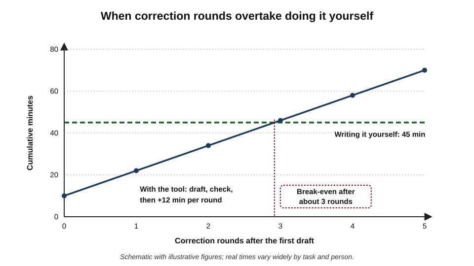
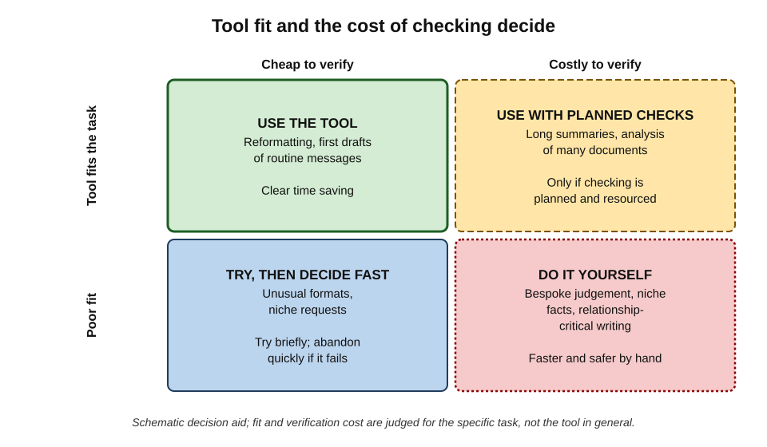
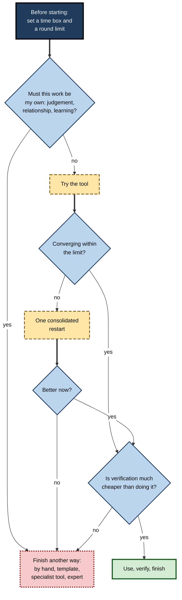
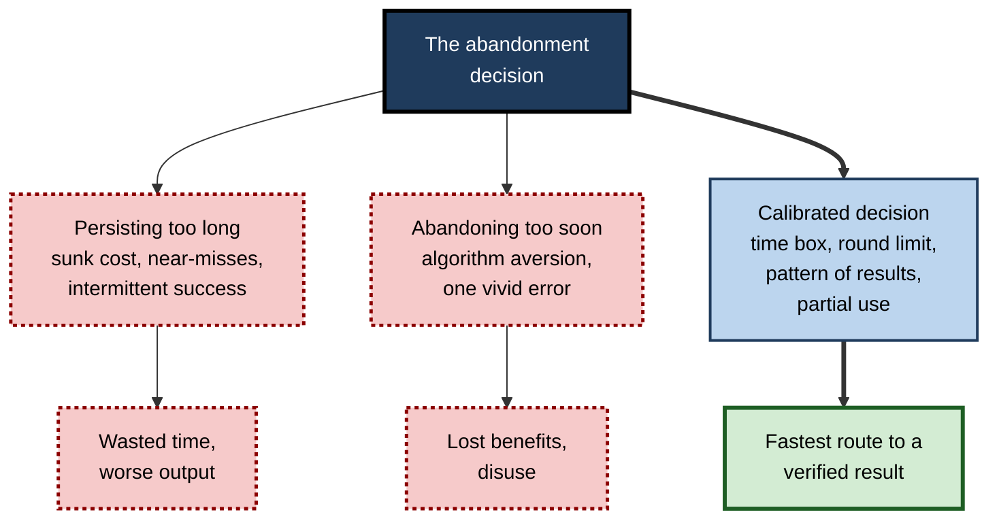
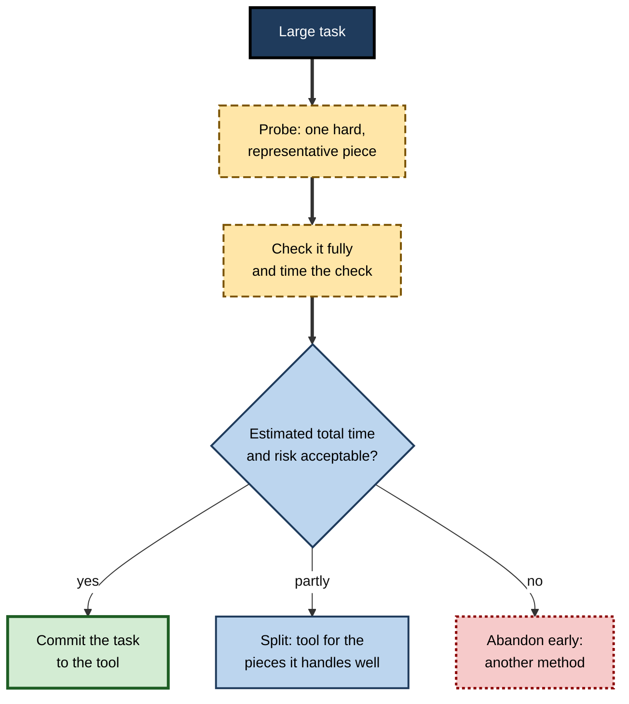

# K.9. When to abandon and do it yourself

A consultant spends ninety minutes coaxing an assistant into producing an organisation chart slide that she could have drawn in thirty. A solicitor asks for a bespoke indemnity clause, then realises that checking the draft means reading every authority she would have read to write it. A manager asks for help with a difficult message to a grieving colleague and finds every version subtly wrong. In each case the most skilled move is not a better prompt but a decision: **stop, and do it another way**.

> **Definition — Abandonment decision:** the deliberate choice to stop using an AI tool for a task, or for part of it, and to complete the work oneself or by another method, because continuing would cost more, risk more or achieve less than the alternative.

**Why it matters**

- **Time savings can turn negative.** Prompting, checking and correcting can take longer than doing the work directly.
- **Some work must be one's own.** Professional judgement, personal relationships and accountable decisions require the author's own thinking.
- **Persistence is psychologically sticky.** Once effort is invested, people continue past the point of sense.
- **Abandoning too early also costs.** Rejecting a useful tool after one bad result wastes real benefits; the skill is to abandon **for the right reasons**.

---

## The Economics of Persisting

### Counting the whole cost

The time a tool takes is not just the time to generate an answer. It is the sum of every activity around it.

> **Formula — Time with the tool:** total time = prompting + waiting + reading + verifying + (correcting × number of rounds). Example: 3 + 1 + 3 + 3 + (12 × 3) = **46 minutes**, against 45 minutes to write the piece by hand.

- **Prompting** — explaining the task, providing context and sources.
- **Reading** — every version must be read in full.
- **Verifying** — checking claims, figures and instructions.
- **Correcting** — diagnosing, re-prompting or editing, then re-verifying.

**Figure 1.** When correction rounds overtake doing it yourself.

> **Key point:** the first draft usually arrives quickly. The cost lies in the **rounds after it**, and each round costs roughly the same — so the break-even point can arrive sooner than intuition suggests.

### Verifying someone else's work is harder

- **Unknown reasoning** — when writing oneself, the author knows why each sentence is there. Checking generated text means reconstructing that reasoning.
- **Unknown sources** — the author of a generated text cannot say where each claim came from.
- **Asymmetry** — for some tasks, verifying an answer fully requires nearly all the work of producing it.
  - *e.g.* checking a summary of twenty research papers means reading the papers; checking a bespoke legal analysis means doing the legal research.

> **Definition — Verification asymmetry:** the difference between the effort needed to check an output and the effort needed to produce it. Tools save most where checking is much cheaper than producing.

> **Remember:** if checking the output properly would take **nearly as long as doing the work**, the tool offers little saving — and the temptation to skip the check grows.

### Perceptions of speed are unreliable

- Users' sense of how much time a tool saves is often inaccurate. A 2025 field experiment by the research organisation METR with experienced software developers found that they **believed** AI assistance had sped them up, while measured task times showed it had **slowed** them down on their own familiar projects.
- The lesson is not that tools never save time, but that the **feeling** of progress — fluent drafts arriving quickly — is a poor measure of the **total** time to a verified result.

> **In practice:** for a task done repeatedly, time it both ways once or twice. A rough measurement of total time to a finished, checked result is worth more than any impression.

---

## Signals That It Is Time to Stop

**Common signals that a task should be finished another way**

| Signal | What it looks like | Why it means stop |
|---|---|---|
| Correction loop not converging | Each fix breaks something else; errors reappear | Further rounds are unlikely to succeed |
| Verification costs as much as creation | Checking requires reading all the sources anyway | The tool saves little and adds risk |
| Missing knowledge only the author has | Context, history, relationships, unwritten rules | The tool cannot supply what it was never given |
| Repeated failure of the same kind | Always wrong on the figures; always the wrong tone | Indicates a limit of the tool for this task |
| The task is the learning | A junior learning to write analyses | Delegating it removes the practice that builds skill |
| Accountability for judgement | Advice, decisions about people, professional opinions | The reasoning must be the author's own |
| Relationship-critical writing | Condolences, apologies, difficult feedback | Recipients value the author's own words |
| Confidentiality | The material cannot be put into the available tool | No compliant way to use it |
| Faster by hand | A two-line reply; a small table edit | Prompting overhead exceeds the task |

### The correction loop that will not converge

- **Regression** — fixing one element breaks another.
- **Reappearing errors** — removed content returns in new words.
- **Oscillation** — the output alternates between two unsatisfactory versions.
- **Diminishing returns** — each round improves less than the last.

> **Key point:** two or three rounds without convergence is a strong signal. A consolidated restart is worth one attempt; after that, finishing by hand is usually faster.

### The limit of the tool

- **Precise arithmetic in prose**, **niche or very recent facts**, **very long documents**, **complex layouts** (detailed slides, diagrams), and **tasks needing information the tool cannot see** are common limits.
- No phrasing overcomes a genuine limit; recognising one early saves the most time.

> **Watch out:** a tool's confident attempt at a task beyond its limits looks much like a successful attempt at first glance. Limits are recognised from **patterns across attempts**, not from a single output.

---

## Work That Should Be One's Own

Some work should be done personally even when a tool could produce something acceptable.

### Judgement and accountability

- **Professional opinions** — an audit opinion, a medical assessment, legal advice — rest on the professional's own reasoning, which they must be able to explain and defend.
- **Decisions about people** — hiring, promotion, discipline, performance ratings — require the decision-maker's own consideration of the person and the evidence.
- **Recommendations to leaders** — the author must understand the reasoning well enough to answer challenges in the room.

> **Key point:** a person who cannot explain **why** a conclusion is right does not yet own it, whoever drafted it.

### Relationships and voice

- **Condolence, apology and gratitude** — recipients respond to evidence that the writer took the time to think about them.
- **Difficult feedback** — the words must fit the relationship and the person's situation, which only the writer knows.
- **Messages where authenticity matters** — references, personal introductions, leadership messages at moments of crisis.

> **Watch out:** discovery that a personal message was machine-written can damage a relationship more than a clumsy human message would have. Recipients often judge the **effort** shown as much as the words.

### Learning and capability

- **Skills still being learned** — writing, analysis, coding, modelling — are built by doing them.
- **Skills that must be available without tools** — in meetings, negotiations, emergencies and examinations.
- **Understanding needed to check** — a person who never does a task cannot judge AI output on it.

> **In practice:** many professionals deliberately do some tasks by hand on a regular schedule — writing a first draft before asking for critique, building one model a quarter without assistance — to keep the ability to judge generated work.

---

## Matching the Task to the Method

**Figure 2.** Tool fit and the cost of checking.

- **Good fit, cheap verification** — use the tool: reformatting, routine drafts, brainstorms.
- **Good fit, costly verification** — use the tool only if verification is planned and resourced: long syntheses, multi-document analysis.
- **Poor fit, cheap verification** — try briefly; abandon quickly if it fails.
- **Poor fit, costly verification** — do it yourself.

### "Do it yourself" does not always mean by hand

Abandoning a generative tool often means switching to a **better-suited method**, not to unaided effort.

- **Templates and standard documents** — approved contract clauses, letter templates, slide masters.
- **Specialist tools** — diagramming software for charts and organisation diagrams; spreadsheets for calculations; legal databases for research.
- **Search and primary sources** — reading the policy rather than asking for a summary of it.
- **Colleagues and experts** — a ten-minute conversation with the person who knows.

> **Remember:** the question is not "AI or no AI?" but "**which method gets to a verified result fastest and most safely?**"

---

## Partial Abandonment

Abandonment need not be all or nothing. Often the best result comes from **splitting the task**.

### Ways to split a task

- **Structure from the tool, substance from the author** — use a generated outline; write the analysis personally.
- **Author first, tool second** — write the draft personally; use the tool to critique, tighten or check consistency.
- **Tool for the routine parts** — boilerplate, formatting, standard sections; author for the parts requiring judgement.
- **Tool for options, author for the choice** — generate alternatives; choose and refine.

### The value of being able to modify

**Study card — Dietvorst, Simmons and Massey (2015 and 2018), algorithm aversion**

- **First studies (2015):** in a series of forecasting experiments at the University of Pennsylvania, participants chose whether to rely on a statistical model or on human judgement.
  - After **seeing the model make some errors**, participants became much less likely to use it — even when they had seen it **outperform** the human forecaster.
  - Seeing a human make similar errors reduced confidence in the human far less.
  - The authors called this **algorithm aversion**.
- **Follow-up studies (2018):** when participants were allowed to **modify** the model's forecasts — even only slightly — they became far more willing to use it, and their final forecasts were more accurate than if they had relied on their own judgement alone.
- **Conclusion:** people abandon imperfect automated help too readily after seeing errors, but stay with it — to good effect — when they keep some control.
- **Lesson for abandonment decisions:**
  - one visible error is **not** by itself a reason to abandon a tool that is generally good at a task;
  - **partial use with human modification** often beats both full reliance and full abandonment.

> **Definition — Algorithm aversion:** the tendency to lose confidence in an automated system after seeing it err, more than one would lose confidence in a human making the same error.

> **Key point:** the abandonment decision has two failure modes — **persisting too long** (sunk cost) and **abandoning too soon** (algorithm aversion). Good judgement avoids both.

---

## Why Stopping Is Hard

### Sunk cost and escalation

- **Sunk-cost effect** — continuing an endeavour because of what has already been invested, rather than because of what further investment will bring.
- **Escalation of commitment** — increasing investment in a failing course of action to justify earlier decisions.
- In prompting, the investment is time and effort in the conversation: "I've spent forty minutes on this; one more try will get it."

> **Definition — Sunk-cost effect:** the tendency to continue an endeavour once an investment of money, effort or time has been made, even when the future costs outweigh the future benefits.

### Intermittent success

- Occasional excellent outputs make each new attempt feel as though it **might** be the one that works.
- Rewards that arrive unpredictably are known, from decades of research on reinforcement, to sustain behaviour strongly — a pattern familiar from gambling.

### Near-misses

- Each version is **almost** right, so the remaining gap seems small. But the last 10% of quality — the precise fact, the exactly right tone — is often the part the tool cannot supply.

### Identity and expectations

- **Expectation of efficiency** — organisations that promote AI use may make people reluctant to admit that doing it themselves was faster.
- **Pride in prompting skill** — a person who sees themselves as good with AI tools may persist to prove the tool can do it.

> **Watch out:** "I'll just try one more prompt" is the sentence that most often precedes wasted time. Decide the stopping point **before** starting, when judgement is not yet coloured by investment.

---

## A Decision Procedure

**Figure 3.** Deciding whether to continue, restart or finish another way.

1. **Before starting, decide** whether the work must be one's own; if so, do not start with the tool.
2. **Set a time box** — the time it would take to do the task by hand is a natural upper limit.
3. **Set a round limit** — typically two or three correction rounds.
4. **At the limit, try one consolidated restart** with a complete brief.
5. **If that fails, finish another way** — by hand, by template, with a specialist tool or with an expert.
6. **Salvage what works** — keep a useful outline, phrase or structure; discard the rest.
7. **Record why** — a brief note of what the tool could not do helps next time.

> **Mnemonic — "TRIM":** **T**ime-box it, **R**ound-limit it, **I**ndependent restart once, then **M**ove to another method.

> **Formula — Time box:** stop when time spent ≥ estimated time to do the task by hand. Example: a 30-minute slide → stop prompting at 30 minutes and draw it.

---

## Worked Example (illustrative): The Organisation Chart Slide

A consultant needs a slide showing a client's new organisation structure: 14 roles, three reporting lines, two dotted-line relationships.

| Round | Activity | Minutes | Result |
|---|---|---|---|
| 0 | Describe the structure; generate slide | 8 | Layout cluttered; two roles in wrong reporting line |
| 1 | Correct reporting lines | 12 | Lines fixed; dotted lines now missing |
| 2 | Restore dotted lines | 12 | Dotted lines back; one role now duplicated |
| 3 | Remove duplicate, fix spacing | 14 | Spacing worse; labels truncated |
| — | Time box (30 minutes, the hand-drawing estimate) passed after round 2 | 46 total | — |
| Switch | Draw in the diagramming tool, using the generated version as a sketch | 25 | Correct, clean slide |

*Illustrative figures.*

- **Total time:** 71 minutes, against an estimated 30 by hand.
- **What should have happened:** stop after round 2 (time box reached), and draw the chart using the generated layout as a sketch.
- **Diagnosis:** precise diagram layout is a common **tool limit**; the near-misses made each round feel close to success.

> **In practice:** for structured visuals — organisation charts, process maps, detailed tables — generative tools are often best used for a **rough sketch or list of elements**, with the finished visual made in a dedicated tool.

---

## Case Study (illustrative): The Bespoke Indemnity Clause

- **Situation:** a solicitor at a mid-sized firm asked a legal research assistant to draft a bespoke indemnity clause for an unusual technology licensing deal, with an explanation of the relevant case law.
- **What happened:** the draft read well and cited several cases. To check it, she had to read each case, confirm it supported the point, check it had not been overturned and consider whether the clause addressed the deal's particular risks.
- **Diagnosis:**
  1. verification required **nearly all the research** she would have done to draft the clause herself;
  2. the draft reflected typical indemnity clauses, not the deal's particular allocation of risk, which only she knew from negotiations;
  3. the professional responsibility for the clause, and the advice to the client, was hers.
- **Action:** she abandoned the generated clause, drafted from the firm's precedent bank and her own research, and used the assistant only afterwards to check the clause for internal consistency and defined terms.
- **Result:** a clause she could fully explain to the client and defend in negotiation; a modest overall time saving from the consistency check.
- **Lesson:** when **verification asymmetry** is small and judgement is central, the tool is better used as a **checker of the author's work** than as its author.

## Case Study (illustrative): The Team That Gave Up Too Soon

- **Situation:** an accounts-payable team trialled an assistant to extract invoice details into a spreadsheet.
- **What happened:** in the first week, the tool misread three invoices with unusual layouts. The team manager stopped the trial.
- **Later review:** a colleague reviewed the trial data: across 400 invoices, the tool had extracted fields correctly on the large majority; errors were concentrated in one supplier's unusual format, and all three had been caught by the team's existing total-reconciliation check.
- **Diagnosis:** **algorithm aversion** — vivid errors outweighed the evidence of overall usefulness; the errors were also **detectable** by an existing control.
- **Action:** the trial was resumed with the unusual supplier excluded and processed by hand, and with reconciliation retained.
- **Result:** substantial time saved on routine invoices; no increase in payment errors.
- **Lesson:** abandon for **patterns and costs**, not for single vivid errors — and look for the partial-use option before abandoning entirely.

---

## Abandonment in Teams and Organisations

### Making stopping legitimate

- **Normalise "I did it myself"** — teams should treat a decision to stop using the tool as a professional judgement, not a failure of skill or of enthusiasm.
- **Share limits** — when someone finds a task the tool cannot do well, share it so that others do not repeat the attempt.
- **Avoid usage targets** that reward tool use for its own sake rather than outcomes.

### Learning from abandoned attempts

- **Record the task, the failure and the alternative used** — the record shows where tools are unsuitable and where better methods exist.
- **Revisit periodically** — tools change; a task abandoned last year may suit this year's tool, and vice versa.

> **In practice:** teams with mature AI practices often keep a short list of "**not with AI**" tasks — for example, condolence messages, final legal opinions, organisation charts — alongside their list of tasks the tools do well.

### Avoiding the opposite error

- **Do not ban a tool for a task after one bad experience.** Look at the pattern, the detectability of errors and the partial-use options.
- **Do not let a small number of enthusiasts define success.** Measure total time to verified result across the team.

**Figure 4.** The two failure modes of the abandonment decision.

---

## Probing Before Committing

Much wasted effort comes from committing a whole large task to a tool before knowing whether it can do that kind of work. A short **probe** reveals limits cheaply.

> **Definition — Probe:** a small, quick trial of a tool on a representative piece of a larger task, used to judge whether the tool is suited to the whole.

### How to probe

- **Choose a hard, representative piece** — not the easiest section. If the report's difficulty lies in the regulatory analysis, probe with that, not with the introduction.
- **Check the probe properly** — verify it as carefully as the final work would be verified, and time the check.
- **Estimate the whole** — multiply the time for the probe (including checking) by the number of similar pieces, and compare with doing the work another way.
- **Decide** — commit, split the task, or abandon before investing more.

**Figure 5.** Probing a tool on a small piece before committing a large task to it.

> **Example (illustrative):** before asking an assistant to draft 25 supplier risk profiles, a procurement analyst probes with the two most complex suppliers. Checking each profile takes 20 minutes, because every risk claim must be traced to the supplier's filings — about as long as writing one. She decides to use the tool only for the standard company-background section and to write the risk assessments herself.

> **Key point:** a probe converts the abandonment decision from a reaction to sunk costs into a **plan made before costs are sunk**.

---

## Abandoning for the Right Reasons: A Summary of Judgement

**Good and poor reasons to abandon a tool for a task**

| Good reasons | Poor reasons |
|---|---|
| Correction loop has not converged after a restart | A single error on a task the tool usually does well |
| Verification would cost as much as doing the task | The first draft needed some editing |
| The work requires knowledge or judgement only the author has | Discomfort with a new way of working |
| The task is a skill being learned or maintained | A colleague's bad experience on a different task |
| Confidentiality rules prevent compliant use | The output's style differs from one's own (when style does not matter) |
| A better-suited method exists | Impatience with prompting before trying a clear brief |

> **Key point:** abandoning is justified by **costs, risks and the nature of the task** — not by frustration, and not by a single memorable failure.

---

## Open Questions

- **How can users estimate the break-even point in advance?**
  - People are poor at predicting how long tasks take, with or without tools; better ways of judging when a tool will save time are needed.
- **Will tools tell users when a task is beyond them?**
  - Tools that recognise their own limits and suggest alternatives would make abandonment easier; current tools usually attempt every task.
- **What work should remain human by principle?**
  - Professional bodies and organisations are still debating which tasks should be done personally regardless of efficiency — for example, decisions about individuals or personal communications.
- **How does frequent abandonment affect adoption?**
  - Teams that stop using tools for some tasks may use them better for others, or may drift away entirely; evidence on these dynamics is limited.
- **How should time savings be measured?**
  - Self-reports overstate gains; measuring total time to a verified result is more accurate but rarely done.

---

## Summary

- The **abandonment decision** is the deliberate choice to stop using a tool for a task, or part of it, and finish another way.
- Count the **whole cost**: prompting, reading, verifying and correcting rounds; the first draft is fast, but rounds add up.
- **Verification asymmetry** — how much cheaper checking is than producing — determines whether a tool saves time; perceptions of speed are unreliable.
- **Signals to stop**: non-converging corrections, verification as costly as creation, missing knowledge only the author has, repeated failures of the same kind, learning goals, accountability for judgement, relationship-critical writing, confidentiality.
- Some work should be **one's own**: professional opinions, decisions about people, personal messages, skills being learned.
- "Do it yourself" may mean **templates, specialist tools, sources or experts**, not only unaided effort.
- **Partial use** often beats both extremes; people who can **modify** automated output use it more and better (Dietvorst and colleagues).
- Avoid both failure modes: **persisting too long** (sunk cost, near-misses, intermittent success) and **abandoning too soon** (algorithm aversion).
- Use **TRIM**: time-box, round-limit, one independent restart, then move to another method.

---

## Self-Check

1. Define the abandonment decision.
2. Write the formula for total time with a tool and explain why the first draft's speed misleads.
3. What is verification asymmetry? Give one task where it is large and one where it is small.
4. Why are users' perceptions of time saved unreliable?
5. List six signals that a task should be finished another way.
6. Why should some work be one's own even when a tool could produce something acceptable? Give three kinds.
7. Name three alternatives to unaided effort when abandoning a generative tool.
8. Describe two ways of partially abandoning a task.
9. Summarise the Dietvorst, Simmons and Massey findings and their lesson.
10. Explain the sunk-cost effect and intermittent success as reasons people persist too long.
11. What are the steps of the TRIM procedure?
12. In the organisation-chart example, when should the consultant have stopped, and why?
13. What went wrong in the invoice-extraction trial?
14. A graduate analyst spends most afternoons trying to get an assistant to produce complete financial models, which then need extensive correction. Her manager asks you for advice. What do you recommend?

### Answer Key

1. The deliberate choice to stop using an AI tool for a task or part of it and complete it another way, because continuing would cost more, risk more or achieve less.
2. Total time = prompting + waiting + reading + verifying + (correcting × rounds). The first draft arrives fast, but each correction round adds similar time, so totals can exceed doing it by hand.
3. The gap between the effort to check an output and to produce it. Large: reformatting a table (check by comparison, quick). Small: a bespoke legal analysis (checking requires the research itself).
4. Fluent drafts arriving quickly create a feeling of progress; total time including checking and correction is rarely measured; a 2025 study found developers believed they were faster while measured times were slower.
5. Any six of: non-converging corrections; verification as costly as creation; knowledge only the author has; repeated failure of the same kind; the task is the learning; accountability for judgement; relationship-critical writing; confidentiality; faster by hand.
6. Because judgement, relationships and learning depend on the author's own thinking. Kinds: professional opinions and decisions about people; personal and relationship-critical messages; skills still being learned or that must be available without tools.
7. Templates and standard documents; specialist tools (diagramming, spreadsheets, legal databases); primary sources; colleagues and experts.
8. Structure from the tool, substance from the author; author drafts and tool critiques; tool for routine sections and author for judgement; tool generates options and author chooses.
9. After seeing an algorithm err, people avoided it even when it outperformed humans; allowing them to modify its output, even slightly, increased use and improved accuracy. Single errors should not trigger abandonment; partial use with human control often works best.
10. Sunk cost: continuing because of effort already invested rather than future benefit. Intermittent success: occasional excellent outputs make every new attempt feel potentially successful, sustaining persistence.
11. Time-box the task; set a round limit; try one independent consolidated restart; then move to another method.
12. At the time box — 30 minutes, after round 2 — because precise diagram layout is a common tool limit and each round was producing near-misses; drawing it using the generated sketch would have been faster.
13. The manager abandoned the tool after a few vivid errors (algorithm aversion), although errors were concentrated in one format and caught by an existing reconciliation check; partial use was the better option.
14. Treat financial modelling as a skill she must build and a task with high verification cost. Recommend she builds models herself, using the tool for narrow parts (formula syntax, explaining functions, checking structure); time-box any tool use; measure total time to a checked model; review models with a senior colleague; revisit the approach once her own competence allows her to verify generated models efficiently.

---

## Glossary

| Term | Meaning |
|---|---|
| Abandonment decision | The choice to stop using a tool for a task and finish it another way. |
| Algorithm aversion | Losing confidence in an automated system after seeing it err, more than for a human. |
| Break-even point | The point at which time spent with a tool equals the time to do the task another way. |
| Escalation of commitment | Increasing investment in a failing course of action to justify earlier decisions. |
| Intermittent success | Unpredictable occasional good results that sustain persistence. |
| Partial abandonment | Using a tool for some parts of a task and another method for the rest. |
| Probe | A small trial of a tool on a representative piece of a larger task. |
| Round limit | A pre-set maximum number of correction rounds. |
| Sunk-cost effect | Continuing because of past investment rather than future benefit. |
| Time box | A pre-set maximum time for an attempt. |
| Verification asymmetry | The difference between the effort to check an output and to produce it. |
