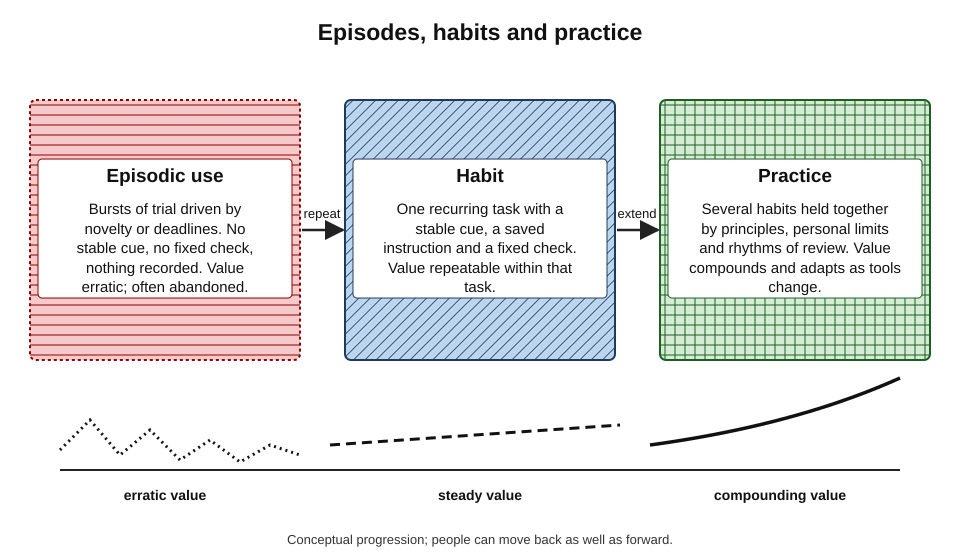
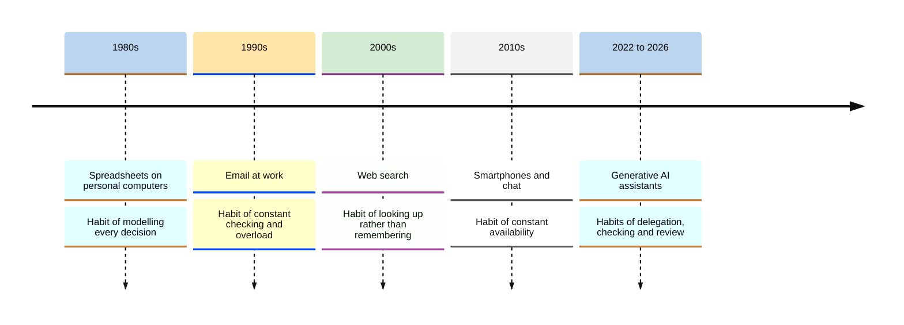
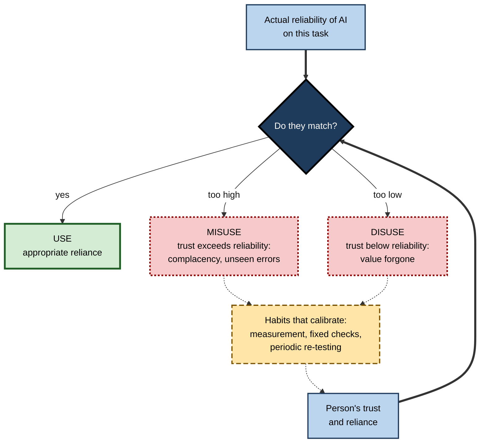
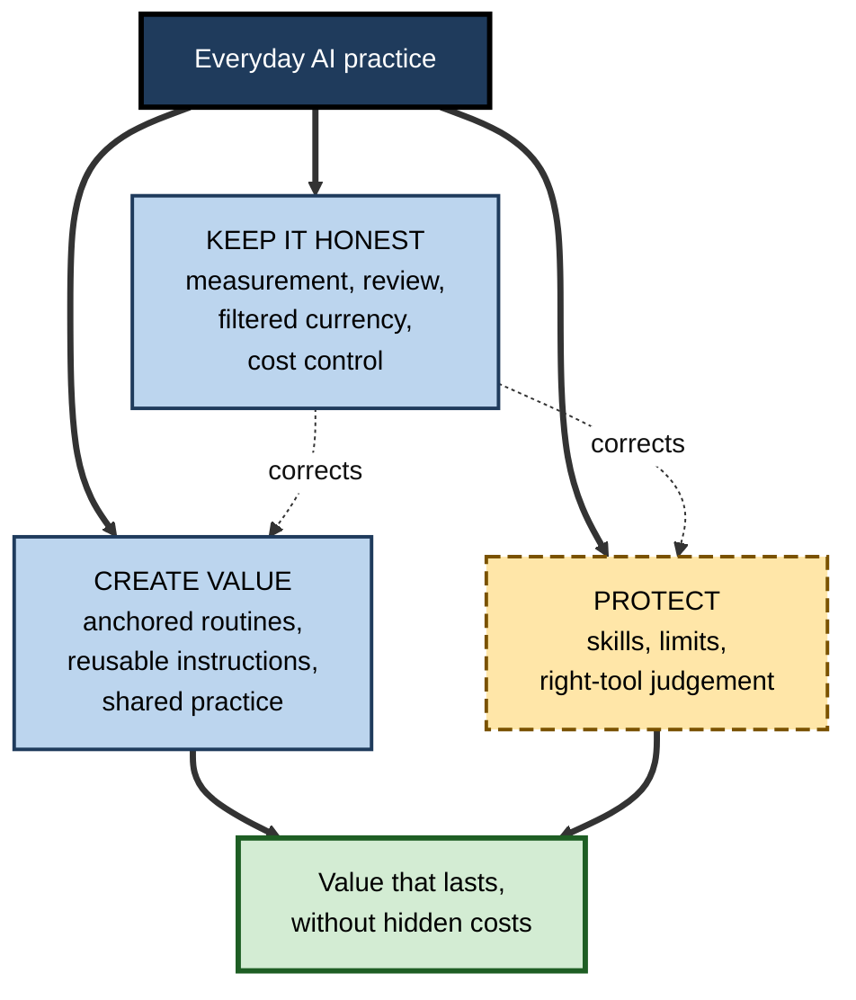
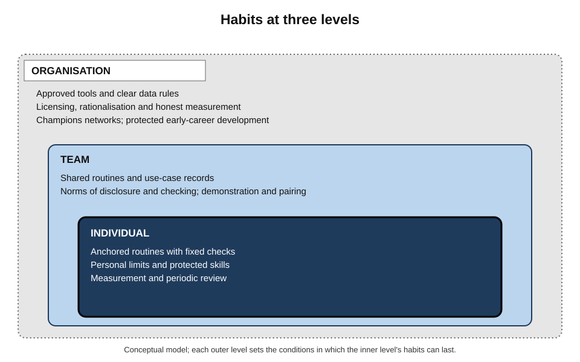

# L. Building Everyday AI Habits

By 2026 most knowledge workers had access to capable AI assistants, and many had tried them on almost everything. Yet the difference between those who gained lasting value and those who did not was rarely access, intelligence or even skill at writing prompts. It was **habit** — whether AI use had settled into stable, checked, periodically reviewed routines, or remained a sequence of enthusiastic experiments, disappointments and silent dependencies.

> **Definition — Everyday AI habit:** a stable, largely automatic pattern of using AI tools in recurring work, cued by the work itself, with built-in points of human judgement.

> **Definition — Everyday AI practice:** the whole set of a person's AI habits, together with the principles, limits and rhythms of review that keep them useful, safe and sustainable over time.

**Why the subject matters**

- **Value comes from repetition** — the benefits of AI accumulate only when use is sustained in the right tasks.
- **Harm also comes from repetition** — unchecked habits spread errors, erode skills and shift costs onto others.
- **Tools change faster than habits** — a person's practice must outlast many products and model generations.
- **Organisations depend on individual habits** — policies and licences achieve little unless everyday behaviour changes well.
- **Professional standing is at stake** — trust in a professional increasingly depends on how carefully they use AI, not on whether they use it.

---

## What Everyday AI Habits Are

### Habit, routine and practice

- **Habit** — a behaviour triggered automatically by a familiar context.
  - *e.g.* pasting the Friday call notes into a saved summary prompt as soon as the call ends.
- **Routine** — a deliberate sequence of steps for a recurring task, which may become habitual.
  - *e.g.* trigger, input, instruction, fixed check, human finish.
- **Practice** — the overall pattern: several routines plus the principles that decide what is and is not delegated, and the reviews that keep everything current.
- **Collective practice** — the shared routines, norms and standards of a team or profession.

> **Key point:** good AI use at work is less a skill exercised on demand than a **practice maintained over time**. Skill matters at the moment of use; habit decides whether skill is applied consistently.

### Why AI habits differ from earlier technology habits

- **Generality** — earlier tools did one kind of job; a general assistant attempts almost anything, so the question "should I use it here?" arises constantly.
- **Variable output** — the same request can produce different results; habits must include checking, not just operating.
- **Fluency** — wrong answers arrive as confidently as right ones; the cue to check must come from the habit, not from the output.
- **Pace of change** — models, features, prices and terms change within months; habits tied to particular products break.
- **Skill substitution** — AI performs parts of cognitive work itself, so habits affect the user's own capabilities.
- **Data exposure** — every use may send material outside the person's control.
- **Recurring cost structures** — subscriptions, tiers and metering make habits financial as well as behavioural.

| | Earlier workplace tools (email, spreadsheets, search) | Generative AI tools |
|---|---|---|
| Range of tasks | Narrow and defined | Almost any language or reasoning task |
| Output for the same input | Identical (deterministic) | Varies between runs |
| Error signals | Often visible (formula error, no results) | Errors look as fluent as correct output |
| Rate of change | Years between major changes | Months between significant changes |
| Effect on user's own skills | Mostly peripheral | Can substitute for core cognitive work |
| Main habit risk | Overload and distraction | Over-reliance, deskilling and unseen errors |

**Figure 1.** From episodic use to a sustained practice.

---

## How Workplace Technology Habits Formed Before

AI is not the first technology to reshape everyday work habits. Earlier waves show patterns that are repeating.

**Figure 2.** Waves of everyday workplace technology and the habits each produced.

### Lessons from earlier waves

- **Spreadsheets (1980s onward)** — enormously productive, yet research on spreadsheet errors has repeatedly found mistakes in a large share of real-world spreadsheets; habits of building outran habits of checking.
- **Email (1990s onward)** — Steve Whittaker and Candace Sidner (1996) described **email overload**: a tool designed for communication had become a place for task management and personal archiving, overwhelming users.
  - Lesson: a tool's everyday use drifts far beyond its intended purpose.
- **Web search (2000s onward)** — the habit of looking things up changed what people try to remember.
  - Claims that people remember less of what they expect to find online were influential, but some central findings did not replicate in a large 2018 project; the size of the effect is uncertain.
- **Smartphones (2010s onward)** — Melissa Mazmanian, Wanda Orlikowski and JoAnne Yates (2013), studying professionals with mobile email devices, described an **autonomy paradox**: each person chose to stay connected for flexibility, but collectively the habit created an expectation of constant availability that reduced everyone's autonomy.

> **Definition — Autonomy paradox:** the finding that individually chosen use of connective technology, intended to increase personal control, can collectively create norms that reduce it.

> **Key point:** three lessons recur — **use drifts beyond intention**, **checking habits lag behind production habits**, and **individually sensible habits can produce collectively costly norms**. Each applies to AI with greater force.

---

## The Science Beneath Everyday AI Habits

### Habit formation

- **Habits form through repetition in a stable context**; once formed, they run with little deliberation and are relatively insensitive to their outcomes.
- **Studies of new daily behaviours** have found habits typically take around two months to form, with very wide individual variation.
- **The practical consequence** — sustainable AI habits begin with a single repeated task rather than scattered experiments, because only repetition supplies the stable cue; and the check must be deliberately built into the routine, because automatic behaviour does not reconsider its own results.

### Accepting and continuing to use technology

- **Technology Acceptance Model (Fred Davis, 1989)** — intention to use depends mainly on **perceived usefulness** and **perceived ease of use**.
- **Unified Theory of Acceptance and Use of Technology (Viswanath Venkatesh and colleagues, 2003)** — adds **social influence** and **facilitating conditions** (support, infrastructure).
- **Expectation–confirmation model (Anol Bhattacherjee, 2001)** — continued use depends on whether early experience **confirms** expectations, which shapes satisfaction and perceived usefulness.
- **Implication for AI** — inflated early expectations, followed by disconfirmation on unsuitable tasks, explain much abandonment; honest early trials on suitable tasks give the best chance of lasting use.

### Adapting technology in practice

- **Adaptive structuration theory (Gerardine DeSanctis and Marshall Scott Poole, 1994)** — groups **appropriate** technologies, using them in ways that may be faithful or unfaithful to designers' intentions.
- **Technology-in-practice (Wanda Orlikowski, 2000)** — the "same" technology produces different structures of work in different settings, depending on how people enact it in daily practice.
- **Implication for AI** — the effects of an AI tool are not fixed by the tool; they emerge from the habits people and teams build around it.

> **Definition — Appropriation:** the way people adopt and adapt a technology in practice, which may differ from the uses its designers intended.

### Reliance on automation

- **Raja Parasuraman and Victor Riley (1997)** distinguished four relationships with automation:
  - **use** — appropriate reliance;
  - **misuse** — over-reliance, including complacency;
  - **disuse** — neglect or rejection, often after false alarms or errors;
  - **abuse** — automating functions without regard to the consequences for human operators.
- **John Lee and Katrina See (2004)** argued that **trust** should be **calibrated** — matched to the automation's actual capability — and that poorly calibrated trust leads to misuse or disuse.

> **Definition — Calibrated trust:** trust in an automated system that matches its actual reliability for the task at hand.

**Figure 3.** Calibration of reliance on AI tools.

> **Key point:** everyday AI habits are, at bottom, **calibration machinery**. Their job is to keep a person's reliance aligned with a tool's real reliability as both change.

---

## A Model of Everyday AI Practice

### Three functions

Every sustainable practice performs three functions. The habits within it matter less individually than the way they combine to perform these functions.

- **Creating value** — the reason for using AI at all.
  - Value arises where use is **concentrated and repeated**: routines anchored in frequent, bounded tasks, whose instructions and lessons are kept rather than reinvented, and which spread to colleagues once tested.
  - Without this function, AI use remains a series of impressive but isolated outputs.
- **Protecting the person and the work** — the reason the value lasts.
  - Protection comes from deciding in advance what is **not** delegated: the skills kept in use, the boundaries on tasks, depth and time, and the judgement that another tool or the person's own effort is sometimes better.
  - Without this function, value is bought with eroded skills, damaged relationships and errors that reach others.
- **Keeping the practice honest** — the reason it stays calibrated.
  - Honesty comes from **evidence and rhythm**: measuring net benefit rather than trusting impressions, resisting novelty that resets skill, reviewing tools, settings and costs on a schedule, and filtering the flood of releases down to the changes that matter.
  - Without this function, the other two drift — routines outlive their usefulness, limits erode and spending accumulates.

**Figure 4.** Three functions of an everyday AI practice.

> **Remember:** value without protection erodes the person; protection without value is pointless restraint; both without honest correction drift.

### The lifecycle of a habit

- **Start** — a single recurring task, chosen for frequency, low risk and ease of checking.
- **Stabilise** — a calibration period in which prompt, input and check settle.
- **Extend** — adjacent tasks added one at a time.
- **Review** — periodic checks of value, tools, settings and limits.
- **Retire** — habits that no longer help are deliberately ended, with clean exits from tools.

**Figure 5.** The lifecycle of an everyday AI habit.

```mermaid
%%{init: {'theme':'base','themeVariables':{'fontFamily':'Arial, Helvetica, sans-serif','fontSize':'15px','primaryColor':'#FFFFFF','primaryTextColor':'#111111','primaryBorderColor':'#222222','lineColor':'#333333','secondaryColor':'#F2F2F2','tertiaryColor':'#FFFFFF','clusterBkg':'#FAFAFA','clusterBorder':'#555555','edgeLabelBackground':'#FFFFFF','titleColor':'#111111'}}}%%
stateDiagram-v2
    direction LR
    Start: Start - one repeated task
    Stabilise: Stabilise - prompt and check settle
    Extend: Extend - adjacent tasks
    Review: Review - value, tools, limits
    Retire: Retire - ended cleanly
    Start --> Stabilise: weeks of repetition
    Stabilise --> Extend: routine is automatic
    Extend --> Review: scheduled or triggered
    Review --> Extend: still valuable
    Review --> Stabilise: needs recalibration
    Review --> Retire: no longer helps
```

---

## The State of Everyday AI Use, 2024–2026

### What the evidence shows

- **Adoption is widespread and largely bottom-up.**
  - A 2024 survey by Microsoft and LinkedIn of about 31,000 people in 31 countries reported that around three-quarters of knowledge workers used generative AI at work, most bringing their own tools.
- **Hidden use is common.**
  - Many users were reluctant to admit using AI for important tasks; a 2025 set of experiments published in the *Proceedings of the National Academy of Sciences* found that people who use AI are in fact judged as less competent and motivated by others — a real social penalty that discourages openness.
- **Gains are concentrated and smaller across whole jobs.**
  - Experiments on selected tasks show large gains; surveys across whole jobs have found modest time savings and, in a large Danish study linked to official records, no detectable effect on earnings or hours in the first two years.
- **Perception and measurement diverge.**
  - In a 2025 randomised trial, experienced developers believed AI had made them faster when, on those tasks at that time, it had made them slower.
- **Capability is jagged.**
  - A 2023 field experiment with consultants found large gains on tasks inside AI's capability and worse accuracy on a task just outside it.
- **Early signs of skill erosion.**
  - A 2025 observational study found that experienced endoscopists' unaided detection rate fell after routine AI assistance was introduced; a 2025 survey of knowledge workers linked greater trust in AI with less critical thinking.
- **Costs and products churn.**
  - Pricing settled into free, standard and premium tiers with growing metering; models were retired and replaced on providers' timetables.

| | Reasonably established | Still uncertain |
|---|---|---|
| Adoption | Widespread, much of it informal | How use will change as tools are bundled into suites |
| Productivity | Large on suitable tasks; modest across whole jobs | Long-run effects on jobs, pay and organisations |
| Perception | Self-reports overstate benefits | How quickly experience corrects the gap |
| Skills | Unaided capability can fall with heavy reliance | Which skills, how fast, and how reversible |
| Social norms | A social penalty for visible use exists | Whether it fades as use becomes ordinary |

> **Watch out:** most of this evidence is from 2023–2025, with early tools and early adopters. It is the best available guide, not a settled picture; several findings may not hold for later tools or more experienced users.

---

## Landmark Debates

### Augmentation or dependence?

- **The augmentation view** — AI habits free people from drudgery, raise the floor for less experienced workers and let experts focus on judgement.
- **The dependence view** — habitual reliance erodes the skills needed to supervise AI, homogenises work and transfers judgement to systems no one fully understands.
- **The emerging synthesis** — the same tool can do either; outcomes depend on habits such as thinking first, using AI as a reviewer for core skills and deliberately practising what matters.

### Whose responsibility?

- **The individualist position** — professionals are accountable for their work and must manage their own AI habits.
- **The organisational position** — organisations choose the tools, targets and culture; expecting individuals to resist poorly designed incentives is unrealistic.
- **The practical answer** — both: individuals own their practice; organisations shape the conditions in which good practice is possible.

### Standardise or experiment?

- **Standardisation** — shared routines, libraries and approved tools make work consistent, reviewable and safe.
- **Experimentation** — individual exploration discovers better methods and keeps pace with changing tools.
- **Resolution in practice** — a stable shared core with a bounded, visible route for experiments whose results feed back into the core.

### Who gains from time saved?

- **For the individual** — time for better work, learning or rest.
- **For the organisation** — capacity for more output or lower cost.
- **The tension** — when saved time is immediately absorbed by more work, people stop sharing methods and may stop measuring honestly. How gains are shared shapes whether good habits spread.

### Do habits undermine vigilance?

- **Habits are efficient because they are automatic** — but automatic behaviour does not reconsider its own results.
- **Automation research** shows complacency grows with reliability.
- **The design principle** — automate the routine, never the acceptance: the check must remain a deliberate act, and routines must be reviewed periodically because habits will not review themselves.

> **Key point:** each debate turns on the same insight — AI's effects are not properties of the tool but of the **habits** built around it, by individuals and by organisations.

---

## Everyday AI Habits in Organisations

### Three levels

- **Individual** — personal routines, limits, skills and reviews.
- **Team** — shared routines, use-case records, norms of disclosure and checking, demonstration and pairing.
- **Organisation** — approved tools, data rules, licensing, measurement, champions networks, protection of early-career development.

**Figure 6.** Everyday AI habits at three levels, and what each level contributes.

### What organisations that succeed tend to do

- **Lead with tasks** — introduce AI around named recurring tasks rather than general encouragement to "use AI".
- **Make the approved path easy** — capable approved tools reduce the pull of personal workarounds.
- **Clarify the rules** — which data may go where, what must be disclosed, who is accountable.
- **Measure honestly** — net effects on defined tasks, including quality and effects on others.
- **Credit careful use** — recognise checked, shared practice rather than raw volume.
- **Protect development** — preserve opportunities for juniors to build the skills that supervision of AI will require.
- **Rationalise** — review licences and tools periodically, retiring what is unused.

### Case study (illustrative): a year of habit-building in an advisory team

- **Situation:** a 25-person tax advisory team in a professional-services firm was given an approved AI assistant in January. Early use was enthusiastic but uneven; within two months, a draft letter with an outdated threshold had reached a client, and several staff were quietly using personal tools.
- **Diagnosis:**
  - use was scattered across tasks, many unsuitable (current thresholds, technical conclusions);
  - no shared instructions or checks;
  - no measurement; claims of large time savings were untested;
  - the social penalty discouraged people from admitting use.
- **Actions over the year:**
  1. **Quarter 1** — each adviser chose one recurring task (meeting summaries, first drafts of standard letters, research structuring); the partner demonstrated her own routine, including an error it made.
  2. **Quarter 2** — a team library of use-case cards was created with templates, checks, evidence and limits; a rule required current thresholds and rates to come from the official source, never from the assistant.
  3. **Quarter 2** — juniors were required to draft one technical memo a month without AI, reviewed for reasoning.
  4. **Quarter 3** — a light measurement exercise logged net time and rework on four routines; one routine was dropped as not worth it.
  5. **Quarter 4** — a licence and tool review removed unused seats and ended reimbursement of personal plans for work.
- **Result:** by year end, use of the approved assistant was broad and largely confined to tasks where it was measured to help; no further outdated figures reached clients during the year; personal-tool use reportedly fell; juniors' unaided memos were judged by partners to be at the expected standard.
- **Caveats:** results relied on team records and partner judgement; some advisers found the rules slowed them on simple tasks.
- **Lesson:** the team did not need a better tool. It needed **habits** — anchored routines, shared checks, protected skills, honest measurement and periodic review — built deliberately and supported by its leaders.

---

## What Distinguishes Expert Practitioners

### Patterns of mastery

- **They think in tasks, not tools** — asking first what the work requires.
- **They keep a small, deep core** — a few tools known thoroughly, with tested instructions.
- **They check by habit** — the check is part of the routine, not a mood.
- **They protect their craft** — doing the hardest and most identity-defining work themselves, using AI as critic.
- **They measure occasionally and honestly** — and drop routines that do not help.
- **They decide when not to use AI** — quickly and without regret.
- **They review on a rhythm** — tools, settings, costs, prompts and limits.
- **They share with evidence** — routines, checks, failures and limits.
- **They stay calm about releases** — filtering news and testing only what might matter.

| | Episodic user | Competent user | Expert practitioner |
|---|---|---|---|
| Starting point | Whatever seems impressive | A few useful tasks | Task analysis of recurring work |
| Checking | When something looks wrong | On important outputs | Built into every routine, matched to stakes |
| Tool changes | Frequent, on announcements | Occasional | After fair trials on own tasks |
| Own skills | Unexamined | Mostly maintained | Deliberately protected |
| Evidence of benefit | Impressions | Rough estimates | Occasional honest measurement |
| Relationship to colleagues | Private use | Informal tips | Shared routines with evidence and limits |

*A descriptive contrast of typical patterns, not formal levels.*

### Worked example (illustrative): one week of an expert's everyday practice

**Situation:** a senior data analyst's ordinary week, showing where each kind of habit operates.

| Day | Activity | Habit at work |
|---|---|---|
| Monday | Weekly stakeholder summary drafted from call notes with a saved template; every figure checked against the dashboard | Anchored routine with a fixed check |
| Monday | A colleague asks for the total of a large export; the analyst uses the database query, not the assistant | Right-tool judgement |
| Tuesday | Writes a complex query unaided, then asks AI to review it | Protected skill; AI as reviewer |
| Wednesday | A notice says the core assistant's model will change; runs five benchmark tasks; tightens one prompt | Staying current through testing |
| Wednesday | Declines to use AI for a message of thanks to a colleague | Personal limit on relational messages |
| Thursday | Ten-minute show-and-tell of a routine, including a failure it once made | Sharing with evidence and limits |
| Friday | Fifteen-minute scan of chosen sources; notes one capability for the monthly exploration slot | Filtered information diet; novelty discipline |
| Friday | Quick check of the month's charges; a trial renews next week; it is cancelled | Cost control |

*Illustrative example.*

1. **Most habits take minutes** — the practice runs inside ordinary work.
2. **Several habits are refusals** — not using AI is as much part of the practice as using it.
3. **Correction is continuous but light** — a benchmark run here, a prompt adjusted there.

- **Conclusion:** expert practice is not intense; it is **consistent**. Small, well-placed habits, repeated, produce reliable value and catch problems early.

> **Watch out:** the week looks effortless because the habits were built one at a time over many months. Attempting all of them at once usually leads to none of them lasting.

---

## Open Questions

- **How do AI habits form at work, specifically?**
  - Habit science rests mainly on health behaviours with simple cues; workplace AI routines are more complex and their tools change constantly.
- **Will agents change what a habit is?**
  - As agents perform multi-step work, everyday practice may shift from using tools to supervising them; the habits that supervision needs are still being discovered.
- **What is the long-run effect on skills?**
  - Early studies suggest erosion with heavy reliance; whether deliberate practice fully protects skills, and which skills matter, is unresolved.
- **How should the gains be shared?**
  - Whether time saved accrues to individuals, teams or organisations will shape incentives to build and share good habits.
- **Can tools support good habits?**
  - Designs that prompt thinking first, show uncertainty or encourage checking reduce over-reliance in experiments but are often disliked; whether products will adopt them is unclear.
- **Will social penalties for AI use fade?**
  - As use becomes normal the penalty may disappear — or shift to penalising careless rather than visible use.

---

## Summary

- An **everyday AI habit** is a stable, cued pattern of AI use in recurring work with built-in judgement; an **everyday AI practice** is the whole set of habits, principles, limits and review rhythms.
- AI habits differ from earlier technology habits through **generality, variable output, fluency, pace of change, skill substitution, data exposure** and **recurring costs**.
- Earlier waves — spreadsheets, email, search, smartphones — show that **use drifts beyond intention**, **checking lags production**, and **individual habits create collective norms** (the **autonomy paradox**).
- The science: **habit formation** through context-dependent repetition; **acceptance and continuance** (TAM, UTAUT, expectation–confirmation); **appropriation** and technology-in-practice; **use, misuse, disuse and abuse** of automation and **calibrated trust**.
- A practice serves three functions: **creating value**, **protecting the person and the work**, and **keeping it honest**; habits follow a lifecycle of **start, stabilise, extend, review, retire**.
- Evidence from 2023–2025: widespread, often hidden use; a real **social penalty**; large gains on suitable tasks but modest gains across jobs; **perception gaps**; a **jagged frontier**; early signs of **skill erosion**.
- Debates — augmentation or dependence, individual or organisational responsibility, standardise or experiment, who gains, habit and vigilance — all turn on **habits rather than tools**.
- Organisations succeed by **leading with tasks**, easing the approved path, clarifying rules, measuring honestly, crediting careful use, protecting development and rationalising tools.
- Expert practice is **consistent rather than intense**: small habits, including deliberate refusals, built one at a time.

---

## Self-Check

1. Define an everyday AI habit and an everyday AI practice, and explain how they differ.
2. Give five ways AI habits differ from habits formed around earlier workplace tools.
3. What three lessons do earlier technology waves offer for AI habits?
4. Explain the autonomy paradox and how it might apply to AI assistants.
5. Summarise the Technology Acceptance Model, UTAUT and the expectation–confirmation model, and what each implies for lasting AI use.
6. What is appropriation, and why does it mean an AI tool's effects are not fixed by the tool?
7. Distinguish use, misuse, disuse and abuse of automation, and define calibrated trust.
8. Describe the three functions of an everyday AI practice and give two habits for each.
9. Outline the lifecycle of an AI habit.
10. Summarise four findings about everyday AI use from 2023–2025 and one reason for caution.
11. Present both sides of the augmentation-or-dependence debate and the emerging synthesis.
12. Why does the question "who gains from time saved?" matter for habit formation in teams?
13. What do organisations that build good AI habits tend to do?
14. A director wants to "make everyone use AI more" by setting usage targets. Using the ideas above, evaluate this approach and propose an alternative.

### Answer Key

1. A habit is a stable, largely automatic pattern of AI use in recurring work with built-in judgement; a practice is the whole set of habits plus the principles, limits and review rhythms that keep them useful and sustainable.
2. Generality of tasks; variable output for the same input; fluent errors; rapid change; substitution for cognitive skills; data exposure; recurring cost structures.
3. Use drifts beyond intended purpose; checking habits lag behind production habits; individually sensible habits can create collectively costly norms.
4. Individuals choose connectivity for flexibility, but collectively create expectations of constant availability that reduce everyone's autonomy (Mazmanian, Orlikowski and Yates). With AI, individual speed-ups may create expectations of faster output and constant AI use for everyone.
5. TAM: perceived usefulness and ease of use drive intention. UTAUT adds social influence and facilitating conditions. Expectation–confirmation: continued use depends on early experience confirming expectations. Implication: honest early trials on suitable tasks, social support and good infrastructure sustain use.
6. The way people adopt and adapt a technology in practice, possibly differently from its designers' intentions. Because effects emerge from use, the same AI tool can produce different outcomes depending on the habits built around it.
7. Use: appropriate reliance; misuse: over-reliance; disuse: under-use or rejection; abuse: automating without regard for human operators. Calibrated trust: trust matched to actual reliability.
8. Create value: anchored routines; a tested prompt library; sharing. Protect: unaided practice of key skills; personal limits; right-tool judgement. Keep it honest: measurement; periodic review; filtered currency; cost control.
9. Start with one repeated task; stabilise through calibration; extend to adjacent tasks; review periodically; retire habits that no longer help, with clean exits.
10. Widespread and often hidden use; a real social penalty for visible use; large gains on suitable tasks but modest across whole jobs; felt and measured effects diverge; jagged capability; early signs of skill erosion. Caution: early tools and adopters; findings may not hold later.
11. Augmentation: frees time, raises the floor, lets experts focus. Dependence: erodes supervisory skills, homogenises work, transfers judgement. Synthesis: outcomes depend on habits — think first, AI as reviewer for core skills, deliberate practice.
12. If saved time is absorbed by more work or cuts, people stop sharing methods and may stop measuring honestly; fair sharing of gains encourages open, evidence-based practice.
13. Lead with named tasks; make approved tools easy; clarify data and disclosure rules; measure net effects; credit careful, shared use; protect juniors' development; rationalise tools periodically.
14. Usage targets reward volume, not value; they encourage use on unsuitable tasks, discourage honest measurement, risk deskilling and errors (Goodhart's law). Alternative: identify recurring tasks where AI helps; support anchored routines with shared checks; measure net benefit on those tasks; credit careful, shared practice; protect skills; review periodically.

---

## Glossary

| Term | Meaning |
|---|---|
| Appropriation | The way people adopt and adapt a technology in practice. |
| Autonomy paradox | Individually chosen connectivity creating norms that reduce everyone's autonomy. |
| Calibrated trust | Trust matched to a system's actual reliability for the task. |
| Collective practice | Shared routines, norms and standards of a team or profession. |
| Disuse | Under-use or rejection of automation that would help. |
| Email overload | The overwhelming of email users as the tool absorbs task management and archiving. |
| Episodic use | Bursts of AI use triggered by novelty or deadlines, without lasting structure. |
| Everyday AI habit | A stable, cued pattern of AI use in recurring work with built-in judgement. |
| Everyday AI practice | The whole set of AI habits with their principles, limits and review rhythms. |
| Expectation–confirmation model | Theory that continued use depends on early experience confirming expectations. |
| Habit lifecycle | The sequence start, stabilise, extend, review, retire. |
| Misuse | Over-reliance on automation, including complacency. |
| Routine | A deliberate sequence of steps for a recurring task. |
| Technology Acceptance Model | Model in which perceived usefulness and ease of use drive intention to use. |
| Technology-in-practice | The structures of work produced by how people enact a technology in daily use. |
| UTAUT | Unified Theory of Acceptance and Use of Technology, adding social influence and facilitating conditions. |
