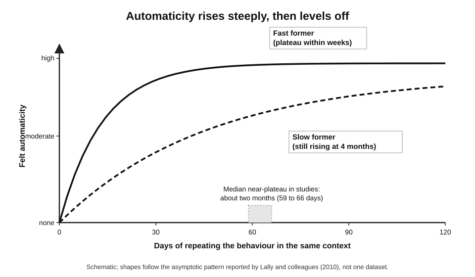
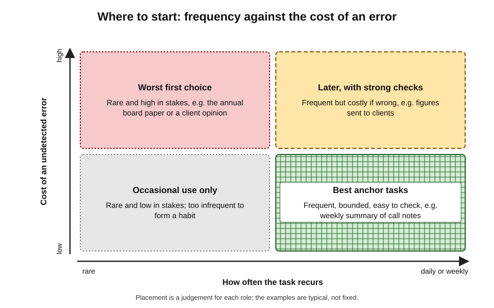
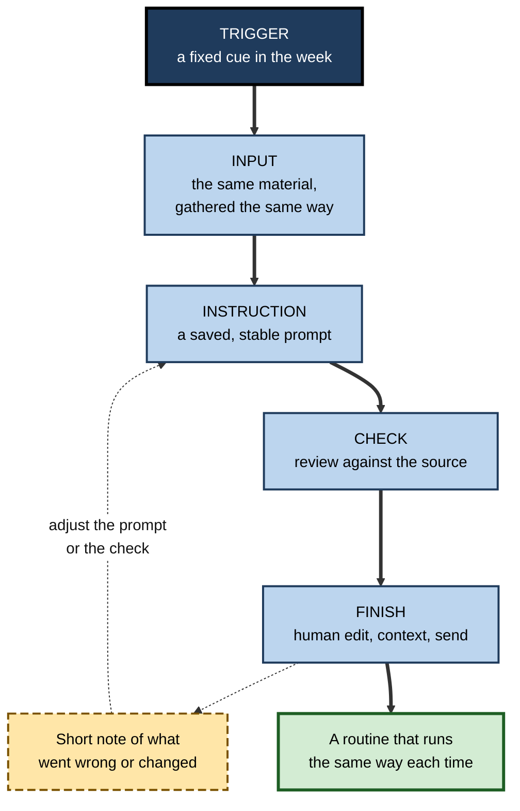
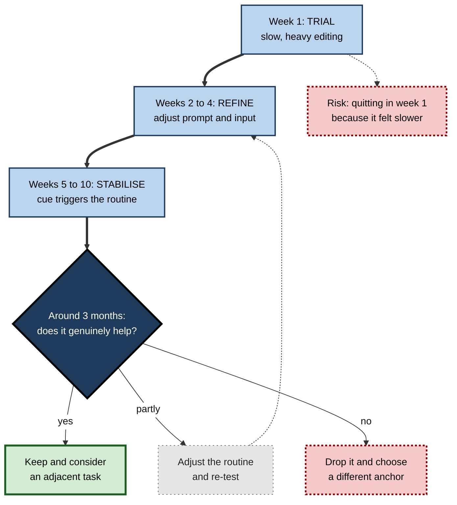

# L.1. Starting with one repeated task

Two analysts receive the same AI assistant on the same Monday. The first tries it on everything that week — a strategy paper, a spreadsheet, a difficult email, a slide deck — is impressed twice, disappointed five times, and by the end of the month has stopped opening it.

The second uses it for one thing only: turning the raw notes of the Friday client call into the weekly status summary. Six months later the second analyst still uses it every week, knows exactly where it fails, and has quietly added two more tasks. The difference is not enthusiasm or skill. It is **where they started**.

> **Definition — Anchor task:** a single, frequently repeated piece of work chosen deliberately as the first place to use an AI tool, so that a stable routine can form around it before use spreads to anything else.

**Why the starting point matters**

- **Habits form through repetition in a stable context** — a task that recurs every day or week supplies that repetition; a scattering of one-off experiments does not.
- **Judgement about a tool is built from comparison** — repeating the same task shows how the tool behaves across many similar inputs, which is the only way to learn its strengths and failure modes.
- **Gains compound only when use persists** — a modest saving on a weekly task, repeated for a year, outweighs a dramatic saving on a task done once.
- **Most abandoned AI tools were never given a fair trial** — they were tried on hard, varied or unsuitable work and judged on first impressions.

---

## Why Most First Attempts Fail

Early use of a general AI assistant tends to follow a recognisable arc: curiosity, a few striking successes, a run of disappointments, and then quiet abandonment.

### The scatter pattern

- **Trying the hardest task first.**
  - Newcomers often test a tool on the work they find most difficult — a novel analysis, a sensitive negotiation email — because that is where help seems most valuable.
  - These are usually the tasks where AI output is least reliable and hardest to check.
- **Trying a different task every time.**
  - Each attempt starts from zero: a new prompt, new context, no memory of what went wrong last time.
  - No routine forms, because nothing is repeated.
- **Judging on a single output.**
  - One weak answer is taken as proof the tool "does not work"; one brilliant answer is taken as proof it works for everything.
  - Both conclusions are drawn from a sample of one.
- **Spending more time prompting than working.**
  - Without a stable task, every use involves inventing a request, explaining the context and repairing the result.
  - The overhead swamps the benefit, and the user concludes AI is slower.

> **Key point:** scattered experimentation feels like exploration but produces neither a habit nor reliable knowledge of the tool. One repeated task produces both.

### The jagged frontier, briefly

- AI capability is **uneven**: a tool can be excellent at one task and poor at a neighbouring one that looks equally hard to a human.
- Researchers studying consultants at Boston Consulting Group in 2023 called this the **jagged technological frontier** — some tasks fall inside the boundary of what AI does well, others just outside it, and the boundary is not obvious in advance.
- A repeated task is the cheapest way to discover where one small part of that frontier lies for the work a particular person actually does.

> **Watch out:** a tool's performance on a demonstration or a colleague's showcase says little about its performance on one's own recurring work. The frontier is discovered task by task, not inferred from impressive examples.

---

## The Science of Habit

A habit is not simply something done often. It is a behaviour that has become **automatic in response to a context**, so that it happens with little deliberate thought.

> **Definition — Habit:** a process by which a stimulus generates an impulse to act as a result of a learned stimulus–response association (Benjamin Gardner, 2015); in everyday terms, a behaviour triggered automatically by a familiar situation.

> **Definition — Automaticity:** the degree to which a behaviour runs with little awareness, effort, intention or control.

### How habits form

- **Context-dependent repetition** — the core mechanism.
  - A behaviour is repeated in the same situation (time, place, preceding event, task).
  - Each repetition strengthens the mental link between the situation and the behaviour.
- **Reduced deliberation** — over time, the situation itself prompts the behaviour; the person no longer decides each time.
- **Wendy Wood and David Neal (2007)** argued that habits are cued by context rather than by goals: once formed, a habit runs even when the original goal is not in mind.
- **Consequences matter early, less later** — rewards help a behaviour get repeated at first; once automatic, the behaviour persists even if the reward weakens.

> **Key point:** for AI use to become a habit, the **same situation** must reliably meet the **same behaviour**. That is exactly what a single repeated task supplies — and what scattered use cannot.

### How long it takes

**Study card — Lally, van Jaarsveld, Potts and Wardle (2010)**

- **Design:** 96 volunteers each chose one new daily behaviour (eating, drinking or exercise) tied to a daily cue, such as "after breakfast, drink a glass of water".
  - Each day for 12 weeks, they rated how automatic the behaviour felt.
- **Results:**
  - automaticity rose steeply at first, then levelled off — an **asymptotic curve**;
  - the median time to reach 95% of each person's plateau was about **66 days**;
  - individual times ranged from **18 to 254 days**;
  - **missing a single occasion did not materially harm** habit formation.
- **Conclusion:** habits take weeks to months, not days, and vary greatly between people and behaviours.

**Study card — Singh and colleagues (2024), systematic review and meta-analysis**

- **Scope:** 20 studies, about 2,600 participants, mostly health behaviours (physical activity, diet, flossing, drinking water).
- **Results:**
  - median times to habit formation in the studies that reported them ranged from about **59 to 66 days**;
  - means were longer, about **106 to 154 days**, because some people took much longer;
  - individual variation ran from **4 to 335 days**;
  - frequency of repetition, timing (e.g. morning behaviours) and personal choice of the behaviour were linked to stronger habits.
- **Conclusion:** the popular "21 days to form a habit" claim is not supported.

> **Watch out:** the "21-day habit" figure is a myth traced to self-help writing in the 1960s, not to habit research. Planning on two to three weeks leads people to give up just before a routine stabilises.

**Figure 1.** How automaticity grows with repetition.

### Cues, plans and small starts

- **Implementation intentions** — plans of the form "**when** situation X arises, **I will** do Y" (Peter Gollwitzer, 1999).
  - A meta-analysis of 94 studies by Gollwitzer and Paschal Sheeran (2006) found a medium-to-large effect on goal attainment.
  - They work by handing control of the behaviour to a specified cue.
- **Habit stacking** — attaching a new behaviour to an existing routine ("after I close the client call, I will paste the notes into the summary prompt").
  - A popular application of the same cue principle.
- **Starting small** — B. J. Fogg's "tiny habits" approach (2019) recommends a version of the behaviour so small it needs little motivation.
  - Widely used in practice; the approach draws on established principles, but direct controlled evidence for the specific method is limited.

> **Definition — Implementation intention:** a plan that links a specific future situation to a specific response, in the form "when X, I will Y".

> **Remember:** habits need a **stable cue**, **frequent repetition**, a behaviour **small enough to start**, and **weeks to months** of persistence.

---

## Why One Task, and Why a Repeated One

### Five reasons to start narrow

- **Repetition** — only frequent tasks generate enough occurrences for automaticity to build within a few months.
- **Comparison** — doing the same task many times with and without the tool shows the real effect; varied tasks make every comparison unique.
- **Learning curve** — skill in instructing and checking a tool is itself learned; concentrating practice on one task climbs the steep early part of that curve quickly.
- **Containment of risk** — mistakes in one well-understood task are easy to spot and cheap to fix.
- **Low cognitive load** — a single new routine is easier to sustain than a dozen half-formed ones.

### What innovation research adds

- **Everett Rogers's diffusion of innovations (first published 1962)** identified attributes that speed adoption of any new practice.
  - **Trialability** — it can be tried on a limited basis.
  - **Observability** — its results are visible.
  - **Low complexity** — it is easy to understand and use.
  - **Compatibility** — it fits existing values, needs and routines.
  - **Relative advantage** — it is better than what it replaces.
- A single repeated task maximises all five: the trial is limited, results are visible each time, the routine is simple, it fits an existing workflow, and its advantage can be judged directly.

> **Key point:** narrowing the first use to one recurring task converts AI from a vague capability into a concrete, testable change in one routine.

### Breadth comes later

- Starting narrow does not mean staying narrow.
- Once the first routine is automatic, a second task can be added — ideally one **adjacent** to the first (similar inputs, similar outputs, similar checks).
- The knowledge gained — how to supply context, how to phrase constraints, what errors to expect — transfers most readily to similar tasks.

| | Scattered start | Anchor-task start |
|---|---|---|
| What is repeated | Nothing; each use is new | The same task, cue and routine |
| What is learned about the tool | Impressions from isolated outputs | Its behaviour across many similar inputs |
| Overhead per use | High — new prompt, context and repair each time | Falls quickly as the routine stabilises |
| Can the benefit be judged? | Rarely — no like-for-like comparison | Yes — the same task, before and after |
| Typical outcome after three months | Abandonment or sporadic use | A stable routine and a base for expansion |

---

## Choosing the Task

The choice of anchor task decides whether the routine survives. A good one is frequent, bounded, low in stakes, easy to check and already partly standardised.

### Seven properties of a good anchor task

- **Frequent** — occurs at least weekly, ideally daily.
  - *e.g.* the weekly status update; daily triage of incoming requests.
- **Time-consuming enough to matter** — saving seconds is not worth a new routine.
  - *e.g.* a 40-minute summary, not a 2-minute reply.
- **Bounded** — clear inputs and a clear finished output.
  - *e.g.* "meeting notes in, summary of decisions and actions out".
- **Tolerant of error** — a mistake would be caught before it caused harm.
  - *e.g.* an internal draft read by the author before sending, not a regulatory filing.
- **Easy to verify** — the person can check the result quickly against the source.
  - *e.g.* a summary of notes the person attended; a reformatted table with the original beside it.
- **Within the tool's strengths** — language transformation, summarising, restructuring, drafting from supplied material.
  - *e.g.* rewriting dense technical notes for a non-technical reader.
- **Permitted** — the data involved may be used in the tool under the organisation's policy.
  - Whether particular material may be entered into a particular tool is a separate question of privacy and confidentiality; an anchor task should be one where the answer is plainly yes.

> **Mnemonic — "Frequent Tasks Bring Easy, Visible, Safe Progress":** Frequent, Time-consuming, Bounded, Error-tolerant, Verifiable, Strength-matched, Permitted.

### Tasks that make good first routines

- **Summarising from material the person already knows** — meeting notes, call transcripts, long email threads.
- **Restructuring** — turning bullet notes into a formatted report section; converting a list into a table.
- **First drafts of routine communications** — acknowledgement emails, meeting requests, standard updates — always edited before sending.
- **Rewriting for audience** — simplifying, shortening, changing tone, translating internal jargon.
- **Generating variants** — alternative subject lines, headings or explanations to choose from.
- **Extracting structure** — pulling action items, dates or named entities from text into a list.

### Tasks that make poor first routines

- **High-stakes, irreversible output** — advice to clients, legal or medical judgements, financial figures sent externally.
- **Tasks needing facts the tool cannot see** — current prices, internal decisions not supplied in the prompt.
- **Rare tasks** — the annual budget narrative; too infrequent to form a habit or learn from.
- **Exact calculation over large data** — better done with spreadsheets or code.
- **Work whose difficulty is the point** — a task the person is still learning to do unaided.
- **Highly sensitive material** — personnel issues, confidential deals, health data.

> **Watch out:** the most tempting first task is often the most impressive one to show colleagues. Impressive tasks are usually varied, high in stakes and hard to check — the opposite of a good anchor.

**Figure 2.** Placing candidate tasks by how often they recur and what an error would cost.

### Worked example (illustrative): scoring candidate tasks

**Situation:** a project coordinator lists five recurring tasks and estimates, for each, its frequency, time taken and how well-suited it seems to AI help. Suitability is a rough judgement from 0 (unsuitable) to 1 (very suitable), reduced where errors would be costly or hard to catch.

| Task | Occurrences per month | Minutes each | Suitability (0–1) | Potential minutes per month |
|---|---|---|---|---|
| Weekly status summary from call notes | 4 | 45 | 0.7 | 4 × 45 × 0.7 = **126** |
| Daily triage of shared inbox | 20 | 15 | 0.4 | 20 × 15 × 0.4 = **120** |
| Monthly risk register update | 1 | 90 | 0.5 | 1 × 90 × 0.5 = **45** |
| Supplier contract queries | 6 | 30 | 0.2 | 6 × 30 × 0.2 = **36** |
| Quarterly board paper | 0.33 | 300 | 0.3 | 0.33 × 300 × 0.3 = **30** |

*Illustrative figures.*

> **Formula — Potential monthly value:** occurrences per month × minutes per occurrence × suitability. For the status summary: 4 × 45 × 0.7 = 126 minutes of work that AI might reshape each month — an upper bound, not a saving.

1. **Rank by potential** — the status summary and inbox triage lead.
2. **Apply the tie-breakers** — the status summary has a clear input and output and is checked by its author; inbox triage involves many sender types, some confidential.
3. **Check risk** — an error in the summary is caught at review; a mis-triaged complaint might go unanswered.
4. **Choose** — the weekly status summary becomes the anchor task; inbox triage is noted as a possible second task.

- **Conclusion:** the highest-potential task with the cleanest boundary and lowest error cost wins — not the most impressive task.

> **Watch out:** "potential minutes" is not "minutes saved". Prompting, waiting, checking and correcting all consume time; the real net effect is known only after the routine has run for several weeks and has been measured.

---

## Designing the Routine

A routine is more than "use AI for the summary". It specifies the **trigger**, the **input**, the **instruction**, the **check** and the **finish**, so that each occurrence runs the same way.

### The five parts of a task routine

1. **Trigger** — the cue that starts it.
   - *e.g.* "When I close the Friday client call…"
2. **Input** — what material is gathered, in what form.
   - *e.g.* "…I paste my call notes and the previous week's summary…"
3. **Instruction** — a stable prompt, saved and reused.
   - *e.g.* "…with my saved summary prompt, which specifies the headings, length and audience…"
4. **Check** — a fixed review against the source.
   - *e.g.* "…I check every decision and date against my notes and delete anything not in them…"
5. **Finish** — the human completion step.
   - *e.g.* "…then I edit the tone, add context only I know, and send it."

> **Mnemonic — "TIICF" ("The Idea Is Comfortably Fixed"):** Trigger, Input, Instruction, Check, Finish.

**Figure 3.** The anatomy of a repeated AI-assisted task.

### Making the routine stable

- **Save the instruction** — a prompt rewritten from memory each week drifts and produces inconsistent output.
- **Standardise the input** — the same template for notes makes the output more predictable.
- **Fix the check** — decide in advance what is always verified (names, numbers, dates, commitments).
- **Keep a short log** — one line per occurrence: what was changed and why.
  - After four to six weeks, the log reveals the tool's recurring errors.
- **Change one thing at a time** — altering the prompt, the tool and the input together makes it impossible to tell what helped.

> **In practice:** experienced users treat the first month of an anchor task as a **calibration period**. They expect to adjust the prompt several times, and they record each adjustment so that the routine converges rather than wanders.

### Where the human stays in the loop

- **Before** — choosing what material to supply and what to leave out.
- **During** — reading the output critically rather than skimming it.
- **After** — owning the final version, including anything the tool got wrong.
- Methods for checking AI output in depth form a separate discipline; here the point is only that the check is a **fixed step in the routine**, not an optional extra.

> **Key point:** the routine is designed so that the person's judgement is applied at the same points every time. That is what makes the routine safe enough to become automatic.

---

## The First Weeks

### A realistic arc

- **Week 1 — trial.** The routine is new and slow; output needs heavy editing. Time may rise rather than fall.
- **Weeks 2–4 — refinement.** The prompt is adjusted; the input template settles; recurring errors become familiar.
- **Weeks 5–10 — stabilisation.** The routine runs with little thought; editing becomes lighter; the cue reliably triggers the behaviour.
- **Around three months — decision.** Enough occurrences exist to judge whether the routine genuinely helps, and whether to keep, adjust or drop it.

**Figure 4.** A realistic arc for the first three months of an anchor task.

> **Watch out:** the first week is usually the **least** representative. Judging the tool then — as many people do — compares an unpractised new routine with a long-practised old one.

### Why a slower start is normal

- **Two learning curves at once** — the person is learning both the tool and a new way of doing a familiar task.
- **The old routine is highly practised** — years of automaticity give it an unfair advantage early on.
- **Checking is heavier at first** — trust in the output must be earned, so early checks are more thorough.
- **The pattern resembles the "J-curve"** observed when organisations adopt new technology: performance often dips before it rises, because complementary changes in skills and processes take time.

> **Key point:** a temporary dip is expected. The question is not "was week one faster?" but "is week ten faster, and is the work at least as good?"

### Missed occasions and setbacks

- **A missed week is not a failure** — the Lally study found that missing one occasion did not materially harm habit formation.
- **A run of misses is a signal** — the cue may be unreliable, or the routine too heavy.
- **A bad output is information** — it shows where the frontier lies for this task; the response is to adjust the input, the instruction or the check, not to abandon the routine on the spot.

---

## From One Routine to a Practice

### Signs the anchor is established

- The cue prompts the routine without a reminder.
- The prompt has stopped changing every week.
- The person can predict the tool's typical errors before reading the output.
- The total time, including checking, is reliably lower — or the quality reliably higher — than before.
- Colleagues receiving the output notice no drop in quality.

### Choosing the second task

- **Adjacency** — choose a task that shares inputs, outputs or checks with the first.
  - *e.g.* from weekly status summaries to monthly steering-committee summaries.
- **Transfer of the prompt structure** — reuse the headings, constraints and audience description.
- **Same rules of selection** — frequent, bounded, error-tolerant, verifiable, permitted.
- **One at a time** — the second task should stabilise before a third is added.

**Figure 5.** How a single routine grows into a broader practice.

```mermaid
%%{init: {'theme':'base','themeVariables':{'fontFamily':'Arial, Helvetica, sans-serif','fontSize':'15px','primaryColor':'#FFFFFF','primaryTextColor':'#111111','primaryBorderColor':'#222222','lineColor':'#333333','secondaryColor':'#F2F2F2','tertiaryColor':'#FFFFFF','clusterBkg':'#FAFAFA','clusterBorder':'#555555','edgeLabelBackground':'#FFFFFF','titleColor':'#111111'}}}%%
stateDiagram-v2
    direction LR
    Exploring: Exploring - ad hoc trials
    Anchored: Anchored - one stable routine
    Extending: Extending - adjacent tasks added
    Practised: Practised - several routines, reviewed
    Exploring --> Anchored: choose one repeated task
    Anchored --> Extending: routine automatic
    Extending --> Practised: each new task stabilised
    Extending --> Anchored: a new task fails, return to base
    Practised --> Extending: periodic review adds or drops tasks
```

### What transfers and what does not

| | Transfers readily to new tasks | Must be relearned for each task |
|---|---|---|
| Skill | How to supply context, state constraints and specify format | What counts as a good output for this task |
| Knowledge of the tool | General tendencies, such as inventing detail when context is thin | Where the frontier lies for this kind of input |
| Routine elements | The habit of a fixed check and a log | The specific cue, input template and check items |
| Judgement | Scepticism calibrated by experience | Error costs and who will rely on the output |

> **In practice:** practitioners who use AI tools heavily rarely describe a single moment of adoption. They describe a sequence of small routines, each added after the previous one proved itself — a portfolio built one task at a time.

---

## Professional and Organisational Practice

### How organisations apply the same idea

- **Use-case-led adoption** — many organisations introduce AI tools around a short list of named, repeated tasks rather than general encouragement to "use AI".
  - *e.g.* drafting first responses in customer service; summarising case files in claims handling.
- **Champions and pilots** — small groups establish routines on specific tasks, then share them.
- **Measurement around tasks** — benefits are easier to show for a defined task than for a general licence.
- **The pattern from large rollouts** — evaluations of organisation-wide AI assistants have often found that use concentrates in a handful of recurring tasks such as summarising and drafting, while broad, unstructured access leads to uneven and fading use.

> **Key point:** the individual principle and the organisational principle are the same — adoption anchored in concrete, repeated work outlasts adoption driven by general enthusiasm.

### Differences between roles

- **Analysts and consultants** — reports, summaries, data commentary; anchor tasks often involve restructuring notes.
- **Software developers** — boilerplate code, test scaffolding, commit messages, documentation; frequent, bounded and checked by tests.
- **Sales and account managers** — call summaries, follow-up emails, account briefs.
- **Managers** — meeting agendas, action lists, first drafts of routine communications; never performance judgements.
- **Healthcare and legal professionals** — administrative summarisation and correspondence under strict data rules; clinical and legal judgement stays human.

### Case study (illustrative): one summary, then a practice

- **Situation:** a procurement analyst in a manufacturing firm received access to an approved AI assistant. Early trials on contract clauses and spend analysis produced confident but unreliable answers, and use lapsed within three weeks.
- **Problem:** the analyst wanted to save time but had no stable place to use the tool and no way to judge it.
- **Actions:**
  1. Listed recurring tasks and chose the **weekly supplier-performance summary**, assembled every Monday from a delivery report and buyer comments — about 50 minutes each week.
  2. Wrote one saved prompt specifying headings, length, audience (category managers) and the rule "use only the material supplied".
  3. Standardised the input: the same two pasted sections every week.
  4. Fixed the check: every supplier name, percentage and late delivery was compared with the report.
  5. Kept a one-line log for each Monday.
- **During the first month:** the first two summaries took longer than doing them by hand; the tool twice described a late delivery as "resolved" when the comments said otherwise. The prompt was changed to require quoting the buyer's comment for any open issue.
- **Result (after three months):** the routine ran in about 25 minutes including the check, with fewer editing changes each week; category managers reported no loss of quality. The analyst then added the monthly supplier-review pack, which used the same inputs and checks.
- **Caveats:** the time figures were the analyst's own estimates from the log, and the gain was confined to a narrow task; contract analysis remained manual.
- **Lesson:** the same tool that failed on scattered hard tasks succeeded on one bounded, repeated task — because repetition revealed its errors and allowed the routine to be corrected.

---

## The Deeper Picture

### Habit, intention and the limits of willpower

- **Intentions predict new behaviour only modestly** — people often intend to use new tools and do not.
  - The gap between intention and action is one of the most consistent findings in behaviour-change research.
- **Habits bypass the gap** — once behaviour is cued by context, it does not depend on remembering or deciding.
- **Motivation fades; cues persist** — enthusiasm for a new tool is highest in the first days, exactly when the routine is least practised.

> **Key point:** relying on enthusiasm to sustain AI use is relying on the weakest part of the system. Designing a cue-based routine relies on the strongest.

### Habit as double-edged

- **Automatic use is efficient** — it frees attention for the parts of the task that need judgement.
- **Automatic use can become unthinking** — a habit can persist after the tool has changed, the task has changed, or the routine has stopped helping.
  - Habits are, by definition, insensitive to their outcomes once established.
- **The safeguard** — keep the check step deliberate even when the rest is automatic, and review routines periodically.

> **Watch out:** the aim is a habit of **using a tool on a suitable task with a fixed check**, not a habit of trusting whatever the tool produces. Automaticity should apply to the routine, never to acceptance of the output.

### Technology adoption models

- **The Technology Acceptance Model (Fred Davis, 1989)** — intention to use a technology depends mainly on its **perceived usefulness** and **perceived ease of use**.
- **The Unified Theory of Acceptance and Use of Technology (Venkatesh and colleagues, 2003)** — adds social influence and facilitating conditions.
- **Continuance research** — whether people keep using a technology depends heavily on whether early use **confirms** their expectations.
- **Implication:** an anchor task gives early use the best chance of confirming expectations honestly — and, if the tool does not help, of disconfirming them clearly.

> **Definition — Perceived usefulness:** the degree to which a person believes a technology would improve their performance at work (Davis, 1989).

---

## Open Questions

- **How long does an AI-use habit take to form at work?**
  - The habit-formation studies concern health behaviours with simple cues; workplace AI routines involve more complex behaviour and changing tools, and have not been studied directly in the same way.
- **Does starting narrow slow down discovery of the most valuable uses?**
  - A single anchor builds a stable habit but may delay finding high-value uses elsewhere; the right balance between focus and exploration is unclear.
- **How should anchor routines adapt when the tool itself changes?**
  - Model updates can change output behaviour; how much a routine must be re-calibrated after each change is not well understood.
- **Is the best first task the same for novices and experts?**
  - Novices may gain most from tasks where AI supplies know-how; experts from tasks where it removes drudgery. Evidence on matching first tasks to experience is sparse.
- **When should a routine become automation?**
  - A routine performed by a person each week may later be automated end to end; where human checking must remain is an open design question.

---

## Summary

- An **anchor task** is one frequent, bounded task chosen as the first place to use an AI tool so that a stable routine can form.
- **Scattered first attempts** — hardest task first, a different task each time, judging on one output — produce neither a habit nor reliable knowledge of the tool.
- **Habits** form through **context-dependent repetition**; automaticity rises along an asymptotic curve. Lally and colleagues (2010) found a median of about **66 days** (range 18–254); a 2024 review found medians of **59–66 days** with wide variation. The **21-day** figure is a myth.
- **Implementation intentions** ("when X, I will Y"), **habit stacking** and **small starts** help a new routine attach to a stable cue.
- A good anchor task is **Frequent, Time-consuming, Bounded, Error-tolerant, Verifiable, Strength-matched and Permitted**.
- Score candidates by **occurrences × minutes × suitability**, then break ties on boundary clarity and error cost — never on how impressive the task looks.
- Design the routine as **Trigger → Input → Instruction → Check → Finish**, with a saved prompt, standard input, fixed check and short log.
- Expect a **slower first week** and judge only after enough occurrences — around three months for a weekly task.
- Expand to **adjacent tasks** one at a time; prompt craft and scepticism transfer, but each task's frontier must be learned afresh.
- Keep the **check deliberate** even when the routine is automatic: the habit is to use the tool well, not to trust it.

---

## Self-Check

1. Define an anchor task and explain why it should be repeated rather than one-off.
2. Describe three features of the "scatter pattern" of early AI use and why each undermines learning about the tool.
3. What is the jagged technological frontier, and why does a repeated task help to locate it?
4. Summarise the design and main findings of Lally and colleagues (2010).
5. Why is the "21 days to form a habit" claim misleading, and what is its practical danger?
6. What is an implementation intention? Write one for an AI-assisted task in a role of your choice.
7. List the seven properties of a good anchor task.
8. A colleague proposes using AI for the quarterly board paper as a first routine. Give three reasons this is a poor choice and suggest a better one.
9. Using the formula occurrences × minutes × suitability, compare a daily 10-minute task (suitability 0.6) with a weekly 60-minute task (suitability 0.5). Which has more potential, and what else should decide the choice?
10. Name the five parts of a task routine and explain why the check must be fixed in advance.
11. Why is the first week of an AI routine often slower than the old method, and why does that not justify abandoning it?
12. How should a second task be chosen, and what transfers from the first?
13. Explain why habits are "double-edged" for AI use and what safeguard is needed.
14. A team leader asks every member to "use AI wherever possible" and finds usage has collapsed after two months. Diagnose the problem and redesign the approach.

### Answer Key

1. A single, frequently repeated task chosen as the first place to use an AI tool. Repetition supplies the stable context that habits need and the many like-for-like occurrences that reveal how the tool behaves; one-off uses supply neither.
2. Trying the hardest task first — where AI is least reliable and hardest to check; a different task each time — no routine forms and no lesson carries over; judging on one output — a sample of one supports no conclusion. Prompting overhead without a stable task can also swamp the benefit.
3. The uneven boundary between tasks AI does well and tasks it does poorly, which is not obvious in advance. Repeating one task across many inputs shows where that boundary lies for that kind of work.
4. 96 volunteers adopted one daily behaviour tied to a cue and rated automaticity daily for 12 weeks. Automaticity rose along an asymptotic curve; median time to near-plateau was about 66 days, ranging from 18 to 254; missing one occasion did not materially harm formation.
5. Research shows medians of around two months with wide variation; the 21-day figure comes from self-help writing, not habit studies. Expecting a habit in three weeks leads people to quit just before the routine stabilises.
6. A plan linking a specific situation to a specific response: "when X, I will Y". *e.g.* "When I finish the daily stand-up, I will paste my notes into the saved action-list prompt and check every owner and date before posting."
7. Frequent; time-consuming enough to matter; bounded; tolerant of error; easy to verify; within the tool's strengths; permitted under data policy.
8. It is rare (no habit can form), high in stakes (errors reach the board), varied and hard to verify. Better: a weekly or daily task with clear inputs and an internal audience, such as summarising team updates.
9. Daily: about 20 × 10 × 0.6 = 120 minutes a month. Weekly: 4 × 60 × 0.5 = 120 minutes. Equal potential; choose on boundary clarity, error cost, ease of checking and data permissions. The daily task also offers more repetitions for habit formation.
10. Trigger, Input, Instruction, Check, Finish. A pre-defined check ensures judgement is applied consistently, especially as the rest of the routine becomes automatic and attention drifts.
11. The person is learning the tool and a new routine at once, competing with a long-practised old method, and checks more heavily while trust is earned. Like organisational J-curves, performance often dips before it rises; the fair comparison is after several weeks.
12. Choose an adjacent task with similar inputs, outputs or checks, meeting the same selection criteria, and add it only after the first is stable. Prompt structure, context-giving skill and calibrated scepticism transfer; each task's quality standard and frontier must be learned anew.
13. Automatic use frees attention but becomes insensitive to outcomes — it can persist after tools or tasks change, or slide into unthinking acceptance. The safeguard is a deliberate check step and periodic review of the routine.
14. General encouragement produced scattered use: no cues, no repeated tasks, no comparisons, early disappointment. Redesign: each member picks one frequent, bounded, low-risk task; designs a routine with a saved prompt and fixed check; keeps a short log; reviews after about three months; then shares successful routines and adds adjacent tasks.

---

## Glossary

| Term | Meaning |
|---|---|
| Adjacent task | A task sharing inputs, outputs or checks with an established routine, suitable as the next to add. |
| Anchor task | A single repeated task chosen as the first place to use an AI tool. |
| Asymptotic curve | A curve that rises steeply at first and then levels off towards a plateau. |
| Automaticity | The degree to which a behaviour runs with little awareness, effort or deliberate control. |
| Calibration period | The first weeks of a routine, during which prompt, input and check are adjusted. |
| Context-dependent repetition | Repeating a behaviour in the same situation, the core mechanism of habit formation. |
| Diffusion of innovations | Everett Rogers's theory of how new practices spread, emphasising attributes such as trialability. |
| Habit | A behaviour triggered automatically by a learned association with a context. |
| Habit stacking | Attaching a new behaviour to an existing routine that serves as its cue. |
| Implementation intention | A plan of the form "when situation X arises, I will do Y". |
| J-curve | A pattern in which performance dips after a new technology is adopted before rising above its earlier level. |
| Jagged technological frontier | The uneven, non-obvious boundary between tasks AI does well and tasks it does poorly. |
| Perceived usefulness | Belief that a technology would improve one's job performance. |
| Scatter pattern | Early AI use spread across many varied, one-off tasks, typically ending in abandonment. |
| Task routine | A fixed sequence of trigger, input, instruction, check and finish for a repeated task. |
| Technology Acceptance Model | Fred Davis's model in which perceived usefulness and ease of use drive intention to use a technology. |
| Trialability | The degree to which a new practice can be tried on a limited basis. |
