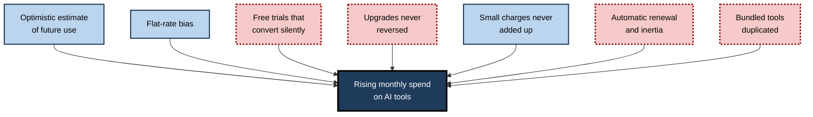
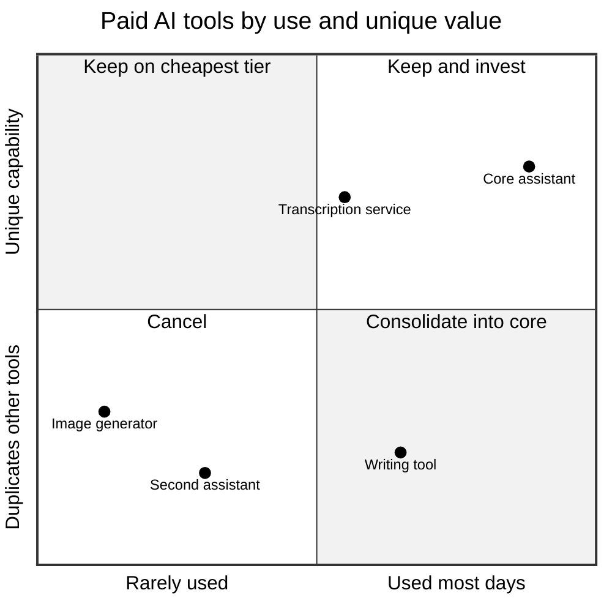
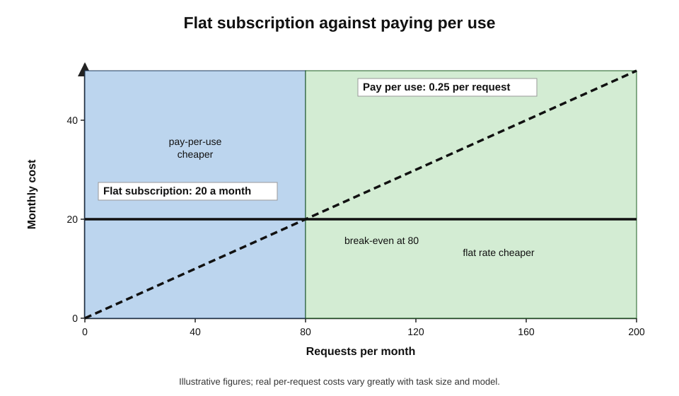
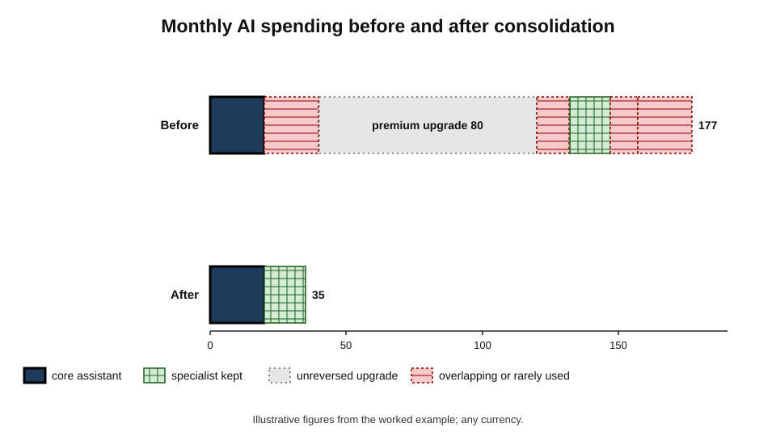
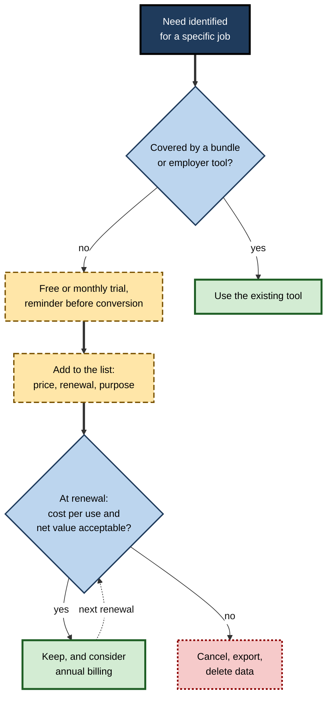

# L.10. Managing subscription costs

An independent consultant adds up a year of card statements and finds she has paid for two general AI assistants, a writing tool, a transcription service, an image generator, a research tool and a premium tier she upgraded to for one urgent project and never downgraded. Each charge was modest. Together they came to more than a week of her fees. Half the tools did overlapping jobs; one she had not used since spring.

> **Definition — Subscription cost management:** the deliberate choosing, monitoring and adjusting of recurring payments for AI tools so that what is spent matches the value actually received.

**Why it matters**

- **Small recurring charges add up** — several plans at ordinary prices quickly reach a significant annual sum.
- **Recurring costs are easy to forget** — automatic renewal makes spending continue without a decision.
- **Pricing is complex and changing** — tiers, usage caps, credits, metering and bundles make comparisons hard.
- **Who pays matters** — personal payment for work tools raises questions of reimbursement, data and policy, not just money.
- **Value is uneven** — a few tools usually deliver most of the benefit; the rest are paid for out of habit.

---

## How AI Tools Are Priced

### Common pricing models

- **Free tier** — limited usage, older or smaller models, fewer features; sometimes supported by advertising or by using conversations to improve the service.
- **Flat monthly subscription** — a fixed price for a usage allowance; the commonest individual model.
- **Premium tiers** — several times the standard price for higher limits, the most capable models and early features.
- **Annual billing** — a discount, typically around 15–20%, in exchange for paying a year in advance.
- **Per-seat business plans** — priced per user, often with administrative controls and stronger data terms.
- **Bundled AI** — AI features included in an office suite, design package or other software subscription.
- **Usage-based (metered) pricing** — paying per unit of use, such as per request, per minute of transcription, or per million **tokens** (pieces of text) processed through a programming interface.
- **Credits** — prepaid units spent on resource-heavy tasks such as image generation, video, deep research or agent runs.

> **Definition — Token:** a unit of text — roughly a word or part of a word — in which language models process input and output; metered AI pricing is often expressed per million tokens.

> **Definition — Freemium:** a pricing strategy in which a basic version is free and more capable versions are paid.

### The market as of autumn 2026

- **Standard individual plans** for the leading general assistants clustered around **US$20 a month** (for example, ChatGPT Plus, Claude Pro and Google AI Pro).
- **Lower-priced tiers** had appeared below that, at a few dollars to under US$10 a month (for example, ChatGPT Go and Google AI Plus), with tighter limits.
- **Premium individual tiers** ranged from about **US$100 to US$200 or more** a month (for example, ChatGPT Pro, Claude Max and Google AI Ultra), sold on higher usage and the most capable models.
- **Office suites** increasingly included AI features in standard plans, sometimes with price rises for the whole plan, while dedicated organisational assistants were often separate paid add-ons.
- **Metering and credits** were spreading, especially for agents and resource-heavy tasks.
- **Local prices** in many countries differed from US dollar prices, sometimes substantially.

> **Watch out:** every price above will change. The durable features are the **structure** — a free tier, a standard tier near one price point, premium tiers several times higher, bundling into suites, and growing metering — not the numbers.

| | Free tier | Standard subscription | Premium tier | Metered or credit-based |
|---|---|---|---|---|
| Cost predictability | Certain (zero) | High | High | Low — varies with use |
| Usage limits | Tight | Moderate | High | Pay for what is used |
| Model capability | Often reduced | Strong | Strongest | Depends on model chosen |
| Typical data terms | Often least protective | Varies; check settings | Varies; check settings | Often stronger for business accounts |
| Best for | Occasional, non-sensitive use | Regular daily use | Very heavy, demanding use | Light or highly variable use; technical users |

---

## Why People Overspend

### Behavioural economics of subscriptions

**Study card — Stefano DellaVigna and Ulrike Malmendier (2006), "Paying not to go to the gym"**

- **Design:** analysis of several thousand gym members' contracts and attendance at US health clubs.
- **Results:**
  - members on flat monthly contracts attended so rarely that they paid **more per visit** than if they had bought individual visit passes;
  - members were slow to cancel — many kept paying for months after attendance stopped.
- **Conclusion:** people **overestimate their future use** when choosing subscriptions and then fail to cancel, consistent with over-optimism about self-control.

**Study card — Anja Lambrecht and Bernd Skiera (2006), flat-rate bias**

- **Design:** study of customers choosing between flat-rate and pay-per-use tariffs for internet access.
- **Results:** many customers chose flat rates even when pay-per-use would have been cheaper for their actual use.
- **Explanations identified:**
  - an **insurance effect** — wanting protection against unexpectedly high bills;
  - a **taxi-meter effect** — disliking the feeling of a meter running;
  - **convenience**;
  - **overestimation** of future use.
- **Conclusion:** a **flat-rate bias** leads people to pay for allowances they do not use.

> **Definition — Flat-rate bias:** a preference for flat-rate pricing even when pay-per-use would cost less for one's actual usage.

### Other mechanisms

- **Inertia and automatic renewal** — the default is to keep paying; cancelling requires noticing, deciding and acting.
- **Mental accounting** — Richard Thaler described how people treat money in separate mental "accounts"; small monthly charges are rarely added up, so their total is underestimated.
- **The upgrade ratchet** — people upgrade for a busy period and forget to downgrade.
- **Free-trial conversion** — trials that turn into paid plans unless cancelled.
- **Duplicate coverage** — paying for a standalone assistant when a bundled one already covers the need.
- **Sunk cost** — "I have paid for it, so I should keep it" — even when keeping it means paying more.

**Figure 1.** Why subscription spending drifts upwards.

> **Key point:** overspending on subscriptions is rarely a single bad decision. It is the accumulation of small, reasonable-seeming choices that are never revisited.

---

## Judging Value for Money

### Costs beyond the sticker price

- **Usage caps** — standard plans often limit the number of requests to the most capable models, or the volume of long tasks, within a period; hitting caps can push users into upgrades.
- **Expiring credits** — prepaid credits may lapse at the end of a billing period, so unused value is lost.
- **Taxes and currency** — prices shown in US dollars may attract sales taxes, goods and services taxes and card currency-conversion charges.
- **Renewal price rises** — introductory prices and annual plans may renew at higher rates.
- **Lock-in costs** — prompts, files, projects and history held in one tool make leaving costly; poor export options raise the eventual exit cost.
- **Management time** — every subscription costs a little attention to track, renew and review.
- **Hidden duplication** — paying for a standalone assistant and for an office-suite plan whose price rose to include AI features.

> **Remember:** the real monthly cost of a tool is its price **plus** the upgrades it pushes, the credits it wastes, the taxes it attracts and the exit it will one day require.

### Cost per use and value per month

> **Formula — Cost per use:** monthly price ÷ number of genuinely useful uses per month. Example: a 20-a-month tool used usefully 40 times costs 0.50 per use; the same tool used 4 times costs 5 per use.

> **Formula — Monthly net value:** (net hours saved per month × value of an hour) − monthly price. Example: 3 net hours × 30 per hour − 20 = **70 per month**; 0.5 hours × 30 − 20 = **−5 per month** (illustrative figures, any currency).

- **Net hours** must be net — after prompting, checking and correction.
- **Value of an hour** — for an employee, a rough proxy is what the employer pays; for a freelancer, the billable rate **only if** saved time is actually billed or used productively.
- **Quality** and **unique capability** count too — a tool that makes possible something otherwise unaffordable has value beyond hours saved.

- **Frequency and uniqueness together** — a tool used daily that does nothing the core cannot do is a candidate for consolidation; a tool used rarely that does something unique may be worth keeping on its cheapest tier.

**Figure 2.** Placing each paid tool by how often it is used and how much unique value it adds.

### Flat rate or pay per use?

- **Light users** may pay less through free tiers or usage-based interfaces.
- **Heavy, regular users** usually gain from a flat subscription.
- **Highly variable users** — very heavy some months, idle others — may gain from upgrading only for busy months, if they remember to downgrade.

**Figure 3.** Where a flat subscription becomes cheaper than paying per use.

> **Formula — Break-even usage:** flat monthly price ÷ cost per use under pay-per-use. Example: a 20-a-month plan versus 0.25 per equivalent request → 20 ÷ 0.25 = **80 requests a month**. Below 80, pay-per-use is cheaper; above it, the flat rate is.

> **Watch out:** usage-based pricing is hard to predict for long or complex tasks. A single agent run, deep-research request or long document can consume far more than an ordinary request; set spending caps where the provider allows.

### Setting a personal AI budget

- **Decide a total in advance** — a monthly or annual figure for all AI tools combined, rather than judging each sign-up in isolation.
- **Allocate it** — most to the core tool, a share to specialists, a small amount for trials.
- **Treat trials as part of the budget** — a new trial must fit within it, or something else must be cancelled.
- **Review the budget annually** — against changes in work, income and the value received.
- **For freelancers** — compare the budget with billable rates: a tool that saves an hour a month at a rate well above its price pays for itself, if the hour is genuinely used.

> **In practice:** setting a single AI budget converts many small, unexamined decisions into one examined decision — the opposite of mental accounting's blind spot.

### Discounts and alternatives

- **Annual billing** — once value is proved.
- **Education, non-profit and public-sector pricing** — offered by several providers to eligible users.
- **Team and family plans** — sometimes cheaper per person than individual plans.
- **Regional pricing** — some providers price lower in certain countries; terms and features may differ.
- **Employer programmes** — many organisations now license tools centrally; asking may remove the need for a personal plan entirely.
- **Open-weight models run locally** — for technical users, models that run on one's own computer can handle some tasks with no subscription, at the cost of set-up time, hardware demands and usually lower capability.

### When paying more is the right decision

- **The premium capability is used and valued** — the most capable model genuinely improves high-value work.
- **Limits are binding** — caps regularly interrupt important work, costing more in lost time than the upgrade.
- **Business terms are needed** — a paid business plan provides data protections that a free or consumer plan does not.
- **Reliability matters** — paid tiers may offer better availability at busy times.

> **Watch out:** "I might need the premium features" is not a reason to pay for them. The decision should rest on **recent, actual use**, not on anticipated use — which, as the gym study showed, people tend to overestimate.

### Worked example (illustrative): consolidating a personal stack

**Situation:** the consultant from the opening lists her monthly AI costs and her measured or estimated use.

| Tool | Monthly cost | Useful uses per month | Cost per use | Overlaps with | Decision |
|---|---|---|---|---|---|
| General assistant A (standard) | 20 | 60 | 0.33 | B | **Keep** — core |
| General assistant B (standard) | 20 | 8 | 2.50 | A | **Cancel** — A does the same jobs |
| Premium tier upgrade on A | 80 extra | Used heavily for one month in the year | — | — | **Downgrade** — upgrade again only for peak months |
| Writing tool | 12 | 3 | 4.00 | A, suite | **Cancel** |
| Transcription service | 15 | 10 | 1.50 | None | **Keep** — specialist for client interviews |
| Image generator | 10 | 2 | 5.00 | Suite | **Cancel** — suite tool adequate |
| Research tool | 20 | 5 | 4.00 | A's research mode | **Cancel** after a one-month test without it |
| **Total** | **177** | | | | **35 after changes** |

*Illustrative figures.*

1. **Identify the core** — assistant A carries most value.
2. **Remove overlaps** — B, the writing tool and the image generator duplicate A or the office suite.
3. **Reverse the ratchet** — the premium upgrade outlived the project it was bought for.
4. **Test before cancelling** where unsure — the research tool is paused for a month to see whether it is missed.
5. **Result** — monthly spending falls from 177 to 35, an annual saving of about **1,700**, with little loss of capability.

- **Conclusion:** most spending served overlapping or rarely used tools; the value was concentrated in two.

**Figure 4.** Monthly spending before and after consolidation.

---

## Practical Methods

### Keeping track

- **One list** — every AI subscription with price, billing cycle, renewal date, who pays and what it is for.
- **One payment route** — a single card or account for subscriptions makes them easy to find; some people use virtual cards with spending limits for trials.
- **Renewal reminders** — a calendar note a few days before each renewal, especially annual ones.
- **Trial discipline** — on starting a free trial, set a reminder before it converts, or cancel immediately and keep the trial until it ends where the provider allows.
- **Monthly glance** — five minutes reviewing the statement for AI charges.

### Choosing plans

- **Start free or monthly** — commit to annual billing only once a tool has proved its value over months.
- **Use the bundle first** — check what is already included in suites and employer-provided tools before paying separately.
- **Match tier to use** — upgrade for a busy period with a reminder to downgrade.
- **Prefer one strong general assistant** to several overlapping ones.
- **Consider usage-based access** for light or technical use, with caps.

### The cancellation test

- **Pause or cancel for a month** where a tool's value is uncertain.
- **Note whether it is missed** — and for which tasks.
- **Resubscribe only if** the missed value clearly exceeds the cost.

**Figure 5.** Managing a subscription from sign-up to renewal.

---

## Who Pays, and Why It Matters

### Employer-provided, reimbursed or personal

- **Employer-provided tools** — usually the right choice for work: approved, with business data terms and administrative controls.
- **Reimbursed personal subscriptions** — some organisations reimburse individual plans; these may still fall outside approved-tool policies and data protections.
- **Personal payment for work use** — common, but problematic:
  - work data may enter tools without business-grade terms;
  - the organisation cannot see or govern the use;
  - the person subsidises the employer.

> **Key point:** the cheapest-looking option — a personal plan used for work — can carry the highest hidden cost if it puts confidential material outside approved protections. Whether particular data may be used in particular tools is a matter of privacy and confidentiality rules; the cost decision must not override them.

### Freelancers and small businesses

- **Business expense** — AI subscriptions used for work are generally treated as business expenses, subject to local tax rules.
- **Passing costs to clients** — some practitioners itemise tool costs; others treat them as overheads within rates.
- **Client requirements** — some clients require specific tools or prohibit others, which can force additional subscriptions for particular engagements.

### Managers and teams

- **Licence utilisation** — paid seats that are rarely used are common; reallocating them saves money without reducing capability.
- **Tiered allocation** — premium seats for heavy users; standard or bundled access for others.
- **Visibility** — knowing what the team spends on personal and reimbursed AI tools.

| | Employer-provided | Reimbursed personal plan | Unreimbursed personal plan |
|---|---|---|---|
| Who pays | Organisation | Organisation, after the fact | Individual |
| Data terms for work | Usually business-grade | Often consumer-grade | Consumer-grade |
| Organisational oversight | Yes | Partial | None |
| Suitable for confidential work | Where approved | Only if specifically approved | Generally no |
| Main risk | Under-used licences | Policy gaps | Data exposure; personal cost |

---

## Consumer Protection and Cancellation Rules

Rules on subscriptions are changing in several jurisdictions, generally in the direction of easier cancellation and clearer renewal information.

- **United States** — the Federal Trade Commission finalised a "click-to-cancel" rule in October 2024 requiring cancellation to be as easy as sign-up; a federal appeals court **vacated** the rule in July 2025 before it took effect, on procedural grounds. Some states have their own automatic-renewal laws.
- **United Kingdom** — the Digital Markets, Competition and Consumers Act 2024 contains a new subscription-contracts regime requiring clear pre-contract information, renewal reminders and easy exit; its commencement has been postponed more than once and, as of autumn 2026, was scheduled for 2027.
- **Germany** — since 2022, online contracts must offer a clearly labelled cancellation button.
- **India** — Reserve Bank of India rules for recurring card and digital payments require registration of a mandate with additional authentication, advance notification before each debit, and further authentication for payments above a set threshold, giving users a chance to stop unwanted charges.

> **Watch out:** these rules differ by country, change often and do not remove the need for personal tracking. A cancellation that is easy in law is still a cancellation that must be remembered.

---

## Case Study (illustrative): A Team's Licence Review

- **Situation:** a marketing department of 40 had 40 seats of a premium AI assistant, plus a mixture of personal plans reimbursed through expenses.
- **Problem:**
  - the finance team questioned the rising cost;
  - nobody knew how many seats were used;
  - reimbursed personal plans were outside the approved-tool list.
- **Actions:**
  1. Obtained usage reports for the licensed seats: about a third were used daily, a third occasionally, a third rarely or never.
  2. Surveyed staff on reimbursed personal plans and the tasks they served.
  3. Moved occasional users to the AI features bundled in the existing office suite.
  4. Reallocated premium seats to daily users and to two staff using reimbursed personal plans for heavy work.
  5. Ended reimbursement of personal AI plans for work, with a short request route for genuinely needed specialist tools.
  6. Set a six-monthly utilisation review.
- **Result:** total AI spending fell substantially while every heavy user kept premium access; reimbursed personal plans — and the data exposure they carried — were removed.
- **Caveats:** some occasional users found the bundled features less capable; two requested premium seats back after a quarter and received them.
- **Lesson:** matching **tiers to actual use** and closing **personal-plan gaps** cut cost and risk together.

---

## Open Questions

- **Will prices fall or rise?**
  - Competition and efficiency gains push some prices down; premium tiers, metering for agents and bundling into higher-priced suites push others up.
- **Will metering replace flat rates?**
  - Resource-heavy uses such as agents favour usage-based pricing, which is harder for individuals to predict and budget.
- **How should value be measured for budgeting?**
  - Hours saved are hard to measure honestly; individuals and organisations often pay for perceived rather than measured value.
- **Will consumer protection keep pace?**
  - Cancellation rules are uneven and contested; AI products with credits, caps and bundles raise new transparency questions.
- **Who should pay for AI used at work?**
  - Norms on employer provision, reimbursement and personal payment are still forming, with implications for fairness and data protection.

---

## Summary

- **Subscription cost management** means choosing, monitoring and adjusting AI payments so spending matches value received.
- Pricing models: **free tier, flat subscription, premium tier, annual billing, per-seat plans, bundles, metered use per token or request, credits**. As of autumn 2026, standard plans clustered around **US$20 a month**, with cheaper tiers below and premium tiers of **US$100–200 or more** — numbers that will change.
- People overspend through **over-optimistic use estimates** (DellaVigna and Malmendier, 2006), **flat-rate bias** (Lambrecht and Skiera, 2006), inertia, **mental accounting**, the upgrade ratchet, trial conversion, duplication and sunk cost.
- Judge value with **cost per use**, **monthly net value** and **break-even usage**; count net hours and unique capability.
- Practical methods: **one list**, **one payment route**, **renewal reminders**, **trial discipline**, **monthly glance**, **bundle first**, **tier matched to use**, the **cancellation test**.
- **Who pays** matters: employer-provided tools usually carry better data terms; personal plans for work can carry hidden risk.
- Consumer-protection rules on cancellation are changing (US, UK, Germany, India) but do not replace personal tracking.

---

## Self-Check

1. Define subscription cost management and give three reasons it matters.
2. Describe five AI pricing models and who each suits.
3. What did DellaVigna and Malmendier find about gym contracts, and how does it apply to AI tools?
4. Explain flat-rate bias and its four explanations.
5. List four other mechanisms that cause subscription spending to drift upwards.
6. Calculate cost per use for a 25-a-month tool used usefully 10 times, and for 50 times.
7. A freelancer saves a net 2 hours a month with a 20-a-month tool and values an hour at 40. Calculate monthly net value. What if the saved time is not used productively?
8. Calculate break-even usage for a 20-a-month plan against 0.40 per request.
9. Why should annual billing usually wait until a tool has proved itself?
10. In the worked example, which three patterns accounted for most of the excess spending?
11. Compare employer-provided, reimbursed and unreimbursed personal plans on data terms and oversight.
12. Summarise the state of cancellation rules in two jurisdictions as of autumn 2026.
13. Describe the cancellation test.
14. A manager is asked to cut the team's AI budget by a third without reducing capability. Propose a plan.

### Answer Key

1. Choosing, monitoring and adjusting recurring AI payments so spending matches value. Reasons: small charges add up; renewal makes spending automatic; pricing is complex; personal payment for work raises data and policy issues; value is concentrated in a few tools.
2. Free tier — occasional, non-sensitive use; standard subscription — regular daily use; premium tier — very heavy users; metered — light or variable, often technical users; bundled — those already paying for a suite; per-seat business plans — organisations.
3. Monthly members attended so rarely that they paid more per visit than pay-per-visit, and were slow to cancel. People similarly overestimate future AI use and keep paying for unused plans.
4. Preferring flat rates even when pay-per-use is cheaper; explained by the insurance effect, the taxi-meter effect, convenience and overestimation of use.
5. Inertia and automatic renewal; mental accounting; the upgrade ratchet; free-trial conversion; duplicate coverage with bundles; sunk cost.
6. 25 ÷ 10 = **2.50** per use; 25 ÷ 50 = **0.50** per use.
7. 2 × 40 − 20 = **60 per month**. If saved time is not used productively, the monetary value is lower — possibly negative — though other benefits may remain.
8. 20 ÷ 0.40 = **50 requests** a month.
9. Discounts lock in a year of payment; people overestimate future use; tools and prices change quickly. Months of proven use reduce the risk.
10. Overlapping tools duplicating the core assistant or suite; an upgrade never reversed; rarely used specialist tools.
11. Employer-provided: business-grade terms, full oversight. Reimbursed: often consumer terms, partial oversight. Unreimbursed: consumer terms, no oversight, personal cost.
12. *e.g.* US: the FTC's 2024 click-to-cancel rule was vacated by an appeals court in July 2025. UK: the DMCC Act 2024 subscription regime, postponed more than once, was scheduled for 2027.
13. Pause or cancel a tool of uncertain value for a month, note whether and where it is missed, and resubscribe only if the missed value clearly exceeds the cost.
14. Obtain usage data per seat; reallocate premium seats to daily users; move occasional users to bundled features; remove overlapping tools; end reimbursement of duplicate personal plans with a request route for specialist needs; use monthly billing until value is proved; review utilisation every six months.

---

## Glossary

| Term | Meaning |
|---|---|
| Annual billing | Paying a year in advance, usually at a discount. |
| Break-even usage | The level of use at which a flat plan costs the same as pay-per-use. |
| Bundled AI | AI features included in another software subscription. |
| Cancellation test | Pausing a tool for a period to see whether it is missed. |
| Cost per use | Monthly price divided by genuinely useful uses. |
| Credits | Prepaid units spent on resource-heavy AI tasks. |
| Flat-rate bias | Preferring flat-rate pricing even when pay-per-use is cheaper. |
| Freemium | A free basic version with paid upgrades. |
| Mental accounting | Treating money in separate mental categories, so small charges go unsummed. |
| Metered pricing | Charging by units of use, such as requests or tokens. |
| Per-seat plan | Business pricing per user. |
| Premium tier | A higher-priced plan with greater limits and capability. |
| Token | A unit of text in which language models process input and output. |
| Upgrade ratchet | Upgrading for a busy period and failing to downgrade afterwards. |
| Utilisation | The share of paid licences actually used. |
