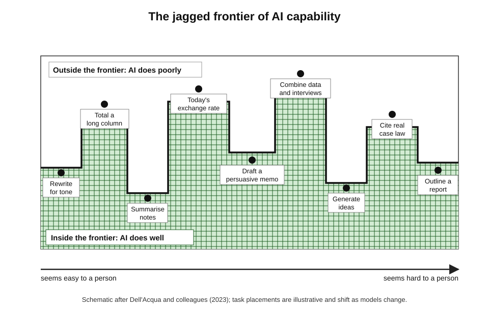
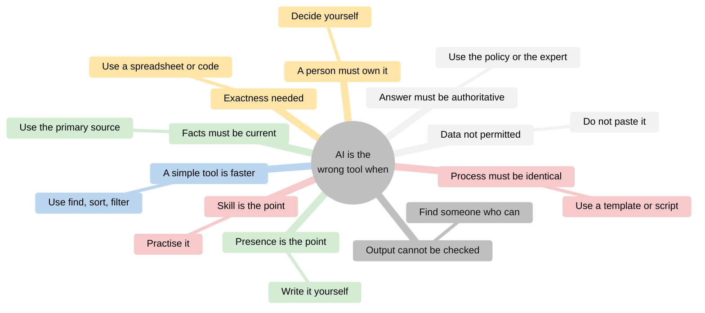
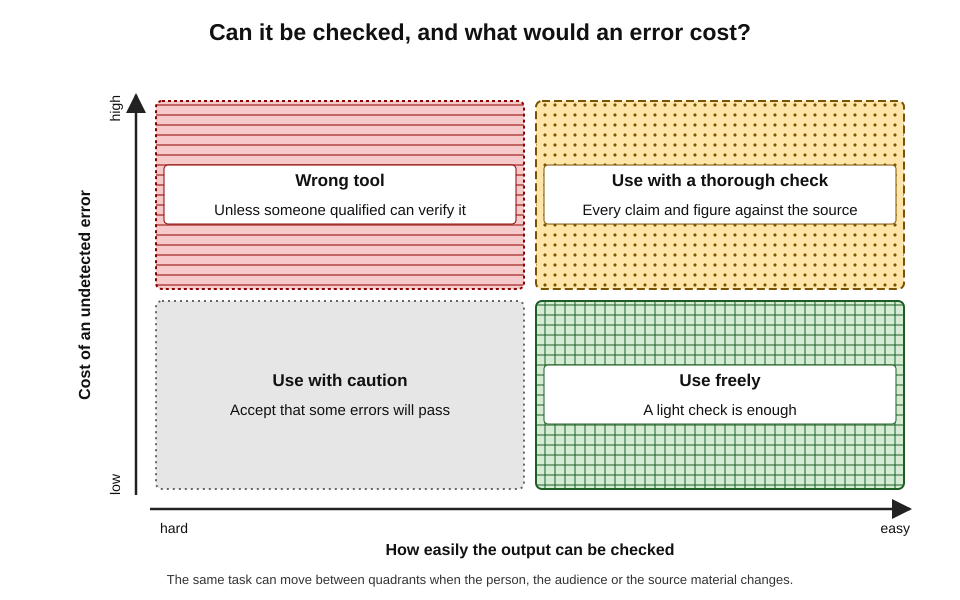
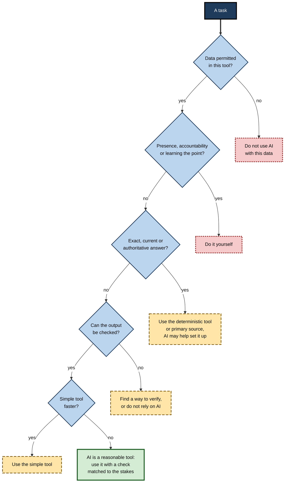
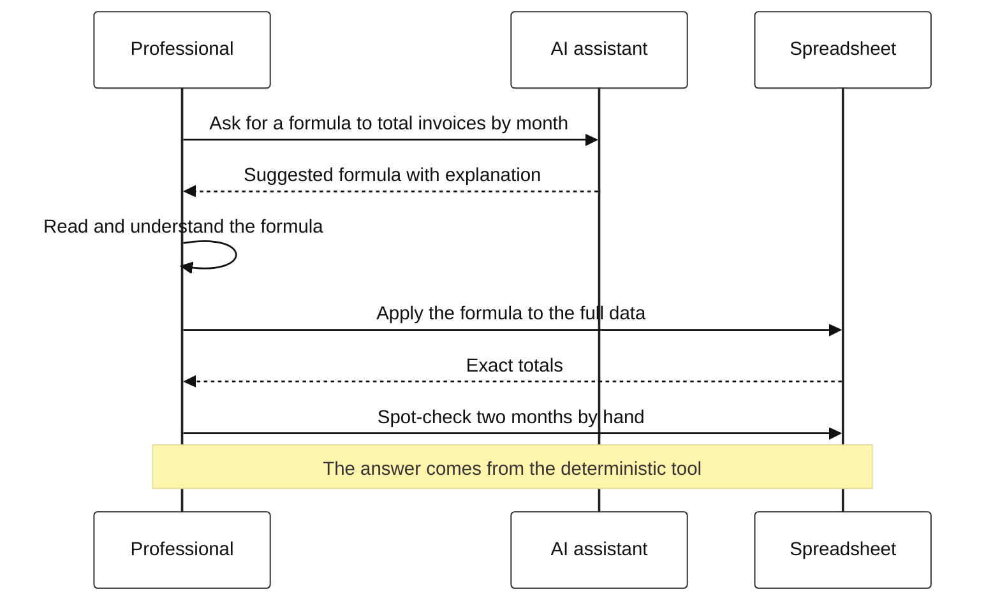

# L.11. Recognising when AI is the wrong tool

An operations analyst asks a chatbot to total a column of 2,000 invoice amounts pasted from a spreadsheet. It returns a confident figure, wrong by several thousand. The spreadsheet's own sum function would have given the exact answer in a second. The same week, a colleague asks a chatbot for the current exchange rate, receives a figure months out of date, and uses it in a quote. Neither tool was broken. Each was simply the wrong tool for the job.

> **Definition — Wrong-tool use (AI):** applying a generative AI tool to a task that another tool, method or person would do more accurately, quickly, cheaply, safely or appropriately — or that should not be delegated at all.

**Why recognising it matters**

- **AI is general, not universal** — a tool that can attempt anything will attempt things it does badly.
- **Fluent output hides unsuitability** — wrong answers arrive in the same confident form as right ones.
- **Better tools often exist** — calculators, spreadsheets, databases, official sources, templates, scripts and people.
- **Some tasks lose their value when delegated** — relationships, accountable judgements and learning.
- **Expert users are distinguished as much by when they do not use AI** as by how well they use it.

---

## The Law of the Instrument

### When the tool shapes the task

- **Abraham Maslow (1966):** "I suppose it is tempting, if the only tool you have is a hammer, to treat everything as if it were a nail."
- **Abraham Kaplan (1964)** had earlier described the same tendency as the "law of the instrument": a child given a hammer finds that everything needs pounding.
- **With AI**, the hammer is unusually versatile — it can produce something for almost any request — which makes the temptation stronger and the misfit harder to see.

> **Definition — Law of the instrument:** the tendency to over-use a familiar or available tool, applying it to problems it does not suit.

### Task–technology fit

- **Dale Goodhue and Ronald Thompson (1995)** proposed that technology improves performance only when its capabilities **fit** the requirements of the task.
  - Use alone does not raise performance; fit does.
- **For AI**, fit depends on the task's demands for exactness, currency, accountability, verifiability and human presence — not on whether the AI can produce *something*.

> **Definition — Task–technology fit:** the degree to which a technology's capabilities match the requirements of a task, which determines whether its use improves performance.

---

## The Jagged Frontier

### Uneven capability

**Study card — Fabrizio Dell'Acqua and colleagues (2023), Harvard Business School with Boston Consulting Group**

- **Design:** 758 BCG consultants were randomly assigned to work with or without GPT-4 on realistic consulting tasks.
  - Some tasks were designed to be **inside** the AI's capability frontier (creative product ideas, analysis, persuasive writing).
  - One task was designed to be just **outside** it — requiring careful combination of interview notes and spreadsheet data, where the AI's plausible answer was wrong.
- **Results:**
  - **inside the frontier:** consultants with AI completed about 12% more tasks, about 25% faster, with quality rated about 40% higher;
  - **outside the frontier:** consultants with AI were **19 percentage points less likely** to reach the correct answer than those without.
- **Conclusion:** AI capability is **jagged** — superb on some tasks and misleading on others of apparently similar difficulty; using it outside the frontier made skilled professionals worse.

> **Definition — Jagged technological frontier:** the irregular boundary between tasks AI performs well and tasks it performs poorly, which does not follow human intuitions about difficulty.

**Figure 1.** The jagged frontier: tasks of similar apparent difficulty can fall on either side.

> **Watch out:** the frontier moves as models improve, and differs between tools. A task outside it last year may be inside it now — and vice versa after a model change. Recognising the wrong tool is a judgement to be renewed, not a list to be memorised.

---

## Where AI Is Usually the Wrong Tool

### Exactness: calculation and counting

- **Language models predict text**; they do not inherently calculate. Many tools now call calculators or code internally, but not always, and not always visibly.
- **Better tools:** spreadsheet functions, calculators, database queries, scripts.
- **AI's proper role:** helping write the formula or query, which is then run by the deterministic tool — and checked.
- *e.g.* totalling invoices; counting records; computing interest; reconciling accounts.

### Currency: facts that change

- **Models have a training cut-off** and may not know recent facts unless connected to search or supplied sources.
- **Better tools:** the official, primary source — regulator's website, exchange-rate feed, company register, product catalogue, internal system of record.
- *e.g.* today's prices, rates, laws in force, opening hours, a client's current contract terms.

### Authority: answers that must be right and attributable

- **Some answers must come from an authoritative source** that bears responsibility for them.
- **Better tools:** the policy document itself; the responsible team; the regulator's guidance; a qualified professional.
- *e.g.* an organisation's refund policy; a legal deadline; a drug dosage; a tax rule.

### Determinism: processes that must run the same way every time

- **Generative output varies between runs**; a process requiring identical, auditable behaviour suits rules, templates, scripts or automation.
- **Better tools:** mail-merge templates, form logic, workflow automation, validated scripts.
- *e.g.* standard contract clauses; compliance notices; data transformations in a pipeline.

### Simplicity: tasks a simple tool does faster

- **Using AI has overhead** — writing the request, waiting, checking.
- **Better tools:** find-and-replace, sorting, filters, keyboard shortcuts, the calendar, a quick search.
- *e.g.* renaming a term throughout a document; sorting a list; finding a file.

### Accountability: judgements a person must own

- **Decisions about people, money, health, safety and law** carry personal and professional accountability.
- **AI may inform** — gathering material, testing reasoning — but the judgement must be the person's own.
- *e.g.* hiring decisions, performance ratings, clinical decisions, credit decisions, legal advice, audit opinions.

### Relationship: when human presence is the point

- **Some communication is valuable because a person did it** — the effort and attention are the message.
- *e.g.* condolences, apologies, personal thanks, difficult feedback, reconciliation after conflict.

### Permission: tasks the data does not allow

- **If the material may not be entered into the available tool**, the tool is wrong regardless of capability. The detailed rules belong to privacy and confidentiality practice.

### Learning: when doing it is the point

- **When the purpose of a task is to build or keep a skill**, delegating it defeats the purpose.

### Verifiability: when output cannot be checked

- **If neither the person nor anyone available can check the output**, and errors would matter, AI is the wrong tool — however capable it seems.
- *e.g.* a translation into a language no one involved reads, for a public notice; technical advice in a field the person does not know.

> **Mnemonic — "Every Clever Assistant Doesn't Suit All Real Problems, Lacking Verification":** Exactness, Currency, Authority, Determinism, Simplicity, Accountability, Relationship, Permission, Learning, Verifiability.

**Figure 2.** Ten signals that AI is the wrong tool for a task.

| | AI usually fits | AI usually does not fit |
|---|---|---|
| Nature of output | Language, structure, variants, first drafts | Exact numbers, current facts, binding answers |
| Tolerance for variation | Variation acceptable or useful | Identical output required |
| Verification | Easy to check against source or by judgement | Hard or impossible for those involved |
| Accountability | Person reviews and owns result | Decision that must be personally reasoned and signed |
| Value of human effort | Effort incidental | Effort is the message or the learning |

---

## Errors in Both Directions

### Algorithm aversion and algorithm appreciation

- **Berkeley Dietvorst, Joseph Simmons and Cade Massey (2015)** found **algorithm aversion**: people who saw an algorithm make a mistake became less willing to use it than an equally or more error-prone human, even when the algorithm was more accurate overall.
- **Jennifer Logg, Julia Minson and Don Moore (2019)** found **algorithm appreciation**: in several tasks, lay people gave more weight to advice labelled as coming from an algorithm than from a person — though experts were less inclined to.
- **Together** these show that people misjudge algorithms in both directions, depending on circumstances and experience.

> **Definition — Algorithm aversion:** reluctance to rely on an algorithm after seeing it err, even when it outperforms human alternatives.

> **Definition — Algorithm appreciation:** a tendency to give more weight to algorithmic than to human advice.

### The two errors of tool choice

- **Over-use** — applying AI where it is the wrong tool; the subject of most of these notes.
- **Under-use** — refusing AI where it is the right tool, often after one bad experience; time and quality are lost.
- **The skill is discrimination** — recognising, task by task, which side of the frontier a task falls on.

**Figure 3.** Choosing by how easily the output can be checked and what an undetected error would cost.

> **Key point:** the question is never "is AI good?" but "is AI the right tool for **this** task, **here**, given **what an error would cost** and **whether I can check**?"

---

## A Decision Procedure

### Six questions before reaching for AI

1. **Is there a tool built for exactly this?** — spreadsheet, calculator, database, search of an authoritative source, template, script.
2. **Does the answer need to be current or authoritative?** — if so, go to the source.
3. **Could I check the output?** — with my own knowledge, the source material or a colleague.
4. **What would an undetected error cost?** — and who would bear it?
5. **Is human presence, accountability or learning the point?**
6. **Is the data permitted in this tool?**

**Figure 4.** Deciding whether AI is the right tool.

### AI as helper to the right tool

- **Often the best answer is a combination**: AI helps use the right tool rather than replacing it.
  - *e.g.* AI writes a spreadsheet formula; the spreadsheet computes.
  - *e.g.* AI suggests search terms; the official database is searched.
  - *e.g.* AI drafts a template; the template system produces the identical notices.
  - *e.g.* AI explains a regulation's structure; the regulation itself is read for the binding text.
- **Tool-using assistants** increasingly do this internally — running code, calling search, querying connected systems. It helps, but the person must know whether a deterministic step actually happened.

**Figure 5.** AI producing the method while a deterministic tool produces the answer.

> **In practice:** experienced users ask AI to **produce the method** (formula, query, script, search strategy) more often than to **produce the answer** for exact or current questions — because a method can be inspected and re-run, while an answer can only be trusted or checked.

### Worked example (illustrative): sorting eight tasks

**Situation:** a small-business accountant reviews eight tasks she has been tempted to give to a chatbot.

| Task | Main signal | Right tool | Role for AI |
|---|---|---|---|
| Total quarterly expenses from a ledger export | Exactness | Spreadsheet sum and pivot table | Write or explain the formula |
| Find this year's VAT registration threshold | Currency and authority | Tax authority's official guidance | Suggest where to look; summarise after reading |
| Draft a friendly reminder about an overdue invoice | Language, low stakes | AI with a quick check | Draft; she edits and sends |
| Write a condolence note to a client whose partner died | Relationship | Herself | None |
| Decide whether a client's expense is allowable | Accountability | Her own judgement, with the rules | Gather relevant rules; she decides |
| Rename a supplier throughout a 40-page report | Simplicity | Find-and-replace | None |
| Summarise a long HMRC guidance note for a client | Language, verifiable | AI, checked against the note | Draft summary; she verifies every claim |
| Translate a notice into Polish for a client's staff | Verifiability | Professional translator | None unless a Polish-speaking reviewer is available |

*Illustrative example.*

1. **Three tasks** suit AI directly (with checks).
2. **Three tasks** need a different tool, with AI at most helping set it up.
3. **Two tasks** should not involve AI at all.

- **Conclusion:** sorting by signal took minutes and avoided two likely errors (a wrong total and an outdated threshold) and one likely relational misstep.

> **Watch out:** "summarise the guidance" is suitable only because she can check the summary against the guidance itself. The same request about guidance she had not read and could not check would move to the "cannot verify" category.

---

## Real Cases of the Wrong Tool

### Case study: Mata v. Avianca (2023)

- **Situation:** in a personal-injury case against the airline Avianca in a US federal court in New York, lawyers for the plaintiff filed a brief citing several earlier court decisions.
- **Problem:** the decisions did not exist. One lawyer had used ChatGPT for research and had asked it to confirm the cases were real; it said they were.
- **Result:** in June 2023 the judge sanctioned the lawyers and their firm, imposing a fine of US$5,000 and requiring them to notify the judges falsely named as authors of the invented opinions.
- **Signals missed:** **authority** (case law must come from authoritative legal databases), **verifiability** (the cases could have been checked in minutes in a legal database) and **accountability** (the filing was the lawyers' responsibility).
- **Lesson:** a chatbot was the wrong tool for finding and confirming legal authority; it was not even the right tool for checking its own answer.

### Case study: Moffatt v. Air Canada (2024)

- **Situation:** a customer asked Air Canada's website chatbot about bereavement fares after a relative's death. The chatbot said he could apply for a bereavement discount retroactively after travel.
- **Problem:** the airline's actual policy, on another page of its website, did not allow retroactive applications; his claim was refused.
- **Result:** in February 2024 the British Columbia Civil Resolution Tribunal held the airline responsible for the chatbot's misinformation, rejecting the argument that the chatbot was a separate entity responsible for its own statements, and ordered compensation.
- **Signals missed:** **authority** — policy answers must come from, or be tied to, the authoritative policy; and **accountability** — the organisation remains responsible for what its tools say.
- **Lesson:** an unconstrained generative answer is the wrong tool for stating binding policy; organisations cannot delegate responsibility to the tool.

### Case study: an AI-assisted government report in Australia (2025)

- **Situation:** a report prepared by Deloitte for an Australian government department in 2025 was found by an academic reader to contain references to non-existent sources and a misattributed court quotation.
- **Result:** the firm acknowledged that a generative AI tool had been used in preparing parts of the report, issued a corrected version and agreed to refund part of its fee; the department said the report's substantive findings were unchanged.
- **Signals missed:** **verifiability** and **authority** — citations must be checked against the actual sources.
- **Lesson:** even in large professional firms, generating references with AI and not verifying them is a wrong-tool error with reputational and financial cost.

> **Key point:** none of these cases involved a malfunction. In each, a generative tool did what it does — produce plausible text — in a task that required authority, exactness or verified sources.

---

## The Costs of Choosing Wrongly

### Direct costs

- **Errors that reach others** — wrong figures, invented sources, outdated facts and misstated policies.
- **Time lost** — prompting, waiting and checking for a task a simple tool would have finished at once.
- **Rework** — discovering the error later and redoing the work, often under pressure.
- **Liability** — sanctions, compensation, refunds and contractual penalties, as the real cases show.

### Indirect costs

- **Trust** — clients, managers and colleagues who find one AI-generated error begin to doubt all of a person's work.
- **Relationships** — a templated condolence or apology can damage a relationship more than a late or plain one.
- **Skill** — repeatedly delegating tasks that should build capability.
- **False lessons** — a person who uses AI for the wrong tasks and gets poor results may abandon it for the right tasks too.

> **Key point:** wrong-tool errors are expensive out of proportion to their frequency, because they often reach outsiders and damage trust. Avoiding a few of them is worth more than speeding up many routine tasks.

### Habits that keep tool choice sharp

- **Pause on the signals** — before sending a request, glance for exactness, currency, authority, accountability, relationship and verifiability.
- **Name the right tool aloud** — "this is a spreadsheet job"; "this needs the policy page"; "this one I write myself".
- **Ask for the method** when the answer must be exact.
- **Open the source** for anything current or binding, even when AI has summarised it.
- **Keep a short list of personal "never" tasks** — those that should not involve AI in one's role.
- **Record surprises** — tasks where AI did unexpectedly well or badly; they mark where the frontier lies for one's own work.
- **Re-test after model changes** — a task long kept away from AI may now be suitable, and one that worked may now fail.

| | Using the wrong tool | Using the right tool, with AI as helper |
|---|---|---|
| Total of 2,000 invoices | Chatbot generates a plausible total | Spreadsheet sums; AI explains a pivot table |
| Current exchange rate | Chatbot recalls an old rate | Bank or central bank rate; AI drafts the quote around it |
| Refund policy question | Chatbot improvises an answer | Policy page cited; AI summarises with the link to the clause |
| Legal citation | Chatbot invents a case | Legal database search; AI suggests search terms |
| Condolence message | AI drafts warm-sounding text | Person writes; no AI |

---

## Professional Mastery

### What experts do differently

- **They classify tasks quickly** — recognising exactness, currency, authority and accountability signals almost automatically.
- **They prefer methods to answers** for exact work — formulas, queries and scripts that can be inspected.
- **They go to the source** for anything current or binding.
- **They keep relational and accountable work personal** without agonising.
- **They notice when they cannot check** — and treat that as a stop signal, not a reason for more trust.
- **They update their sense of the frontier** after model changes and after surprises.

### Organisational safeguards

- **Grounding** — connecting assistants to authoritative sources and restricting them to those sources for policy and factual answers.
- **Tool routing** — systems that send calculations to code and lookups to databases rather than generating answers.
- **Use-case classification** — listing tasks where AI is permitted, restricted or prohibited.
- **Clear accountability** — stating that the person or organisation remains responsible for AI-assisted output.

| | Novice pattern | Expert pattern |
|---|---|---|
| First question | "Can AI do this?" | "What does this task require?" |
| Exact or current tasks | Asks for the answer | Asks for the method, or goes to the source |
| Unverifiable output | Trusts fluent answers | Treats inability to check as a stop signal |
| Relational tasks | Delegates for speed | Keeps personal |
| After a model change | Assumes nothing changed | Re-tests where the frontier might have moved |

---

## Open Questions

- **Where will the frontier move next?**
  - Tool-using models increasingly calculate, search and query correctly; which wrong-tool categories will shrink, and how fast, is uncertain.
- **Can tools signal their own unsuitability?**
  - Systems that decline or redirect tasks they handle poorly would help, but calibrated self-assessment by models is still unreliable.
- **How should responsibility be shared?**
  - Courts and tribunals have held users and organisations responsible; how liability will be divided between providers, deployers and users is still developing.
- **Does wrong-tool use decline with experience?**
  - Experience may calibrate judgement, or may breed complacency; evidence on how tool-choice skill develops is limited.
- **Will deterministic and generative tools merge?**
  - As assistants route tasks internally, users may lose sight of which step was calculated and which generated — a new transparency problem.

---

## Summary

- **Wrong-tool use** applies AI where another tool, method or person would do better — or where delegation is inappropriate.
- The **law of the instrument** (Kaplan; Maslow) is stronger with versatile AI; **task–technology fit** (Goodhue and Thompson, 1995) decides whether use helps.
- The **jagged frontier** (Dell'Acqua and colleagues, 2023): inside it, consultants were faster and better; outside it, they were **19 percentage points less likely** to be correct.
- Ten signals: **Exactness, Currency, Authority, Determinism, Simplicity, Accountability, Relationship, Permission, Learning, Verifiability**.
- People err both ways: **algorithm aversion** after errors, **algorithm appreciation** in other settings; the skill is **discrimination**.
- Six questions before use: built-for-purpose tool? current or authoritative? checkable? cost of error? presence, accountability or learning the point? data permitted?
- Often the best answer is **AI helping the right tool** — producing the method, not the answer.
- Real cases — **Mata v. Avianca (2023)**, **Moffatt v. Air Canada (2024)**, an **Australian government report (2025)** — show wrong-tool errors without any malfunction.
- Experts ask "what does this task require?", go to the source, and treat **inability to check as a stop signal**.

---

## Self-Check

1. Define wrong-tool use and give two everyday examples.
2. Explain the law of the instrument and why it applies strongly to generative AI.
3. What is task–technology fit, and what does it imply for AI use?
4. Summarise the design and results of the 2023 jagged-frontier study.
5. List the ten signals that AI is the wrong tool.
6. Why is AI often the wrong tool for exact calculation, and how can it still help?
7. Distinguish algorithm aversion from algorithm appreciation and explain why both matter.
8. State the six questions to ask before using AI.
9. Classify these tasks and name the right tool: (a) checking today's interest rate; (b) writing an apology to a customer for a serious error; (c) drafting five subject-line options for a newsletter.
10. Why do experts prefer methods to answers for exact work?
11. What went wrong in Mata v. Avianca, and which signals were missed?
12. What did the tribunal decide in Moffatt v. Air Canada, and what is the lesson for organisations?
13. How can organisations reduce wrong-tool use?
14. A colleague uses a chatbot to produce the figures in a monthly financial report "because it is faster". Explain the risks and propose a better workflow that still uses AI.

### Answer Key

1. Applying AI where another tool, method or person would do better, or where delegation is inappropriate. *e.g.* totalling invoices in a chatbot; using a chatbot for a current exchange rate.
2. The tendency to over-use an available tool (Kaplan, Maslow). Generative AI can produce something for any request, so the misfit is less visible and the temptation stronger.
3. Technology improves performance only when its capabilities match task requirements (Goodhue and Thompson). AI helps only where the task's needs — exactness, currency, accountability, verifiability — fit what AI does well.
4. 758 BCG consultants were randomised to work with or without GPT-4. Inside the frontier: about 12% more tasks, 25% faster, 40% higher quality. On a task just outside: 19 percentage points less likely to be correct with AI.
5. Exactness, currency, authority, determinism, simplicity, accountability, relationship, permission, learning, verifiability.
6. Language models predict text rather than calculate and may produce plausible wrong figures. AI can write or explain the formula or script, which a deterministic tool then runs.
7. Aversion: avoiding algorithms after seeing them err, even when more accurate. Appreciation: over-weighting algorithmic advice. Both cause poor tool choice — under-use and over-use.
8. Is there a tool built for this? Must the answer be current or authoritative? Can I check it? What would an undetected error cost? Is presence, accountability or learning the point? Is the data permitted?
9. (a) Currency and authority — the bank's or central bank's official source. (b) Relationship and accountability — write it oneself. (c) Language, low stakes — AI is suitable with a quick check.
10. A method can be inspected, tested and re-run; an answer can only be trusted or checked separately. Methods also keep the computation deterministic.
11. Lawyers cited non-existent cases generated by ChatGPT, which also falsely confirmed them; they were sanctioned. Missed: authority, verifiability, accountability.
12. The airline was held responsible for its chatbot's wrong statement about bereavement fares and ordered to compensate. Organisations remain accountable for what their tools say; binding policy answers must be grounded in the authoritative policy.
13. Grounding assistants in authoritative sources; routing calculations and lookups to deterministic tools; classifying use cases as permitted, restricted or prohibited; stating clear accountability.
14. Risks: wrong figures from generation rather than calculation; no audit trail; errors reaching decision-makers; personal accountability for the report. Better: compute figures in the spreadsheet or finance system; use AI to help write formulas or queries, to draft the commentary from verified figures, and to check wording; verify every number against the system of record.

---

## Glossary

| Term | Meaning |
|---|---|
| Algorithm appreciation | A tendency to give more weight to algorithmic than to human advice. |
| Algorithm aversion | Reluctance to rely on an algorithm after seeing it err. |
| Deterministic tool | A tool that produces the same output for the same input every time. |
| Grounding | Restricting an AI system's answers to specified authoritative sources. |
| Jagged technological frontier | The irregular boundary between tasks AI does well and poorly. |
| Law of the instrument | The tendency to over-use a familiar or available tool. |
| Primary source | The original, authoritative origin of a fact or rule. |
| Task–technology fit | The match between a technology's capabilities and a task's requirements. |
| Tool routing | Sending parts of a request to specialised tools such as code or databases. |
| Training cut-off | The date after which a model has no training data. |
| Verifiability | Whether the people involved can check an output's correctness. |
| Wrong-tool use | Applying AI where another tool, method or person would do better, or where delegation is inappropriate. |
