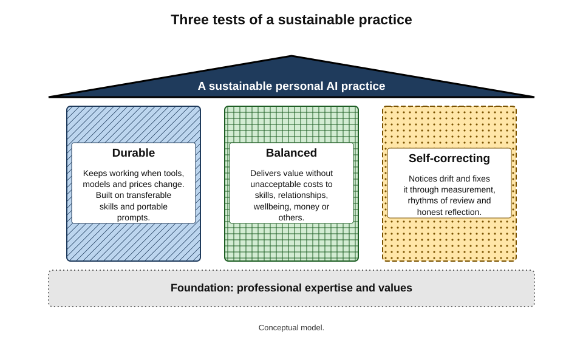
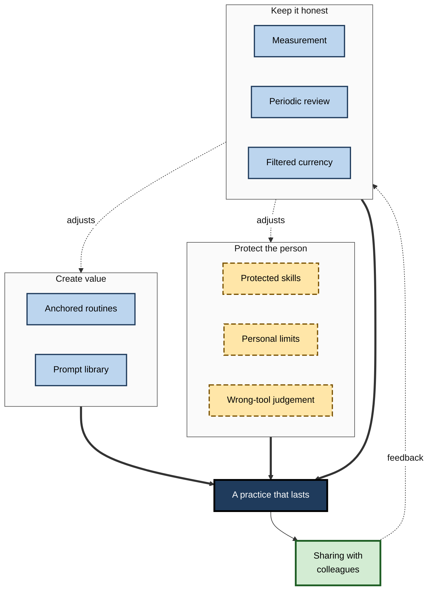
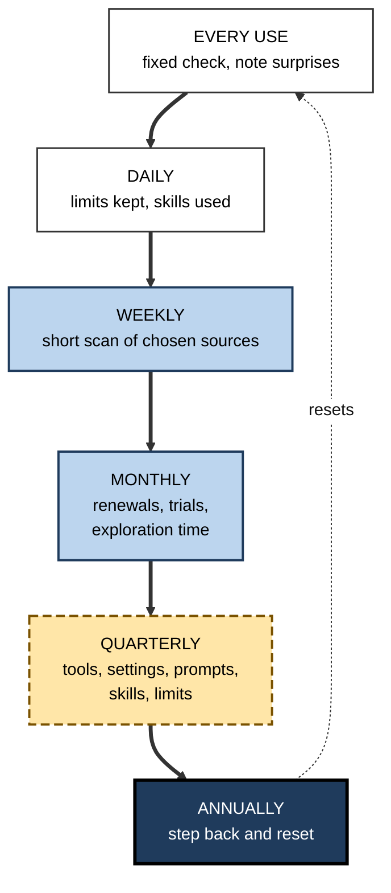
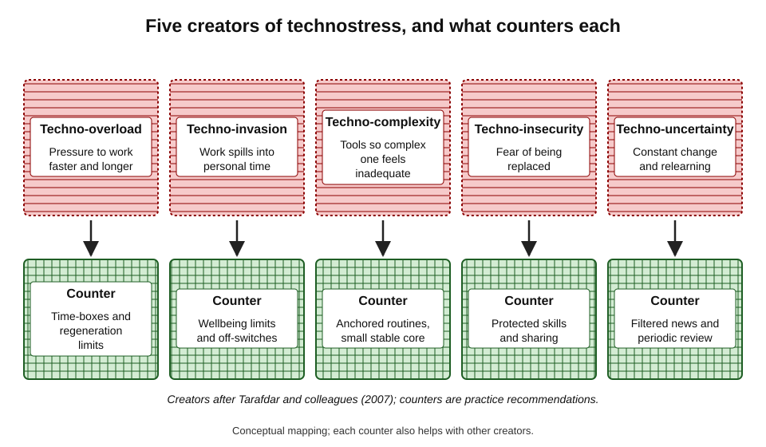
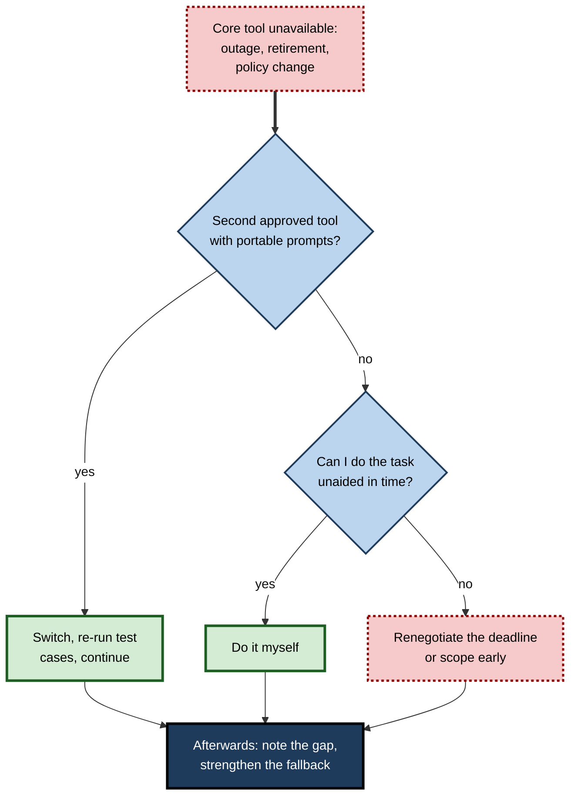

# L.12. A sustainable personal practice

Two engineers started using AI assistants in the same month of 2023. Three years later, the first has been through five tools, three bursts of enthusiasm and two periods of giving up; she feels permanently behind and slightly anxious. The second uses AI daily in a handful of well-tested routines, changed her main tool once after a fair comparison, still writes the hardest code herself, and spends a few minutes a week keeping up. Neither is more talented. One has a **practice**; the other has a series of episodes.

> **Definition — Sustainable personal AI practice:** a stable, self-maintaining way of using AI tools at work that continues to deliver value over years — adapting as tools and roles change — without eroding the person's judgement, skills, relationships, wellbeing or values.

**Why sustainability matters**

- **The field will keep changing** — a practice built around particular products will break; one built around principles will adapt.
- **Benefits compound only with persistence** — skill, prompts, judgement and measured routines accumulate over years.
- **Unsustainable use has hidden costs** — burnout from constant change, eroded skills, damaged trust, wasted money.
- **A career outlasts every tool** — what lasts is the professional, not the software.

---

## What Makes a Practice Sustainable

### Three tests of sustainability

- **Durable** — it keeps working when tools, models and prices change.
  - Built on transferable skills and portable assets (prompts, test cases, notes).
- **Balanced** — it delivers value without unacceptable costs.
  - To skills, relationships, wellbeing, finances, colleagues and the wider world.
- **Self-correcting** — it notices when something is going wrong and adjusts.
  - Through measurement, review and honest reflection.

> **Key point:** a practice is sustainable not because it is perfect at any moment, but because it **keeps correcting itself** at a cost the person can bear indefinitely.

**Figure 1.** Three tests of a sustainable personal AI practice.

### From episodes to practice

- **An episode** — a burst of activity triggered by a new tool, a deadline or enthusiasm, ending when the trigger fades.
- **A practice** — a set of habits, principles and rhythms that persists regardless of triggers.
- **What turns episodes into practice:**
  - **routines** anchored to recurring tasks rather than to novelty;
  - **principles** that guide new situations without new decisions each time;
  - **rhythms** of review that keep the routines honest;
  - **identity** — seeing oneself as a professional who uses tools well, rather than as a user of a particular tool.

| | Episodic use | Sustainable practice |
|---|---|---|
| Trigger | New tool, deadline, excitement | Recurring tasks and scheduled rhythms |
| Tool changes | Frequent, impulsive | Occasional, after fair trials |
| Knowledge retained | Little; starts again each time | Accumulates in prompts, notes, judgement |
| Skills | Drift unnoticed | Deliberately protected |
| Feeling | Alternating excitement and anxiety | Calm, routine competence |
| Value over years | Uneven, often lost | Compounding |

---

## The Elements of a Practice

Each element of a sustainable practice is a habit that can be built separately; together they support each other.

- **Anchored routines** — AI used in a few recurring tasks, each with a fixed check, started one at a time.
- **A maintained prompt library** — tested, portable instructions with notes on limits and test dates.
- **Honest measurement** — occasional net-time and quality checks rather than impressions.
- **Discipline about novelty** — a bounded exploration budget and a gate before adopting.
- **Protected skills** — deliberate unaided practice of what matters.
- **Personal limits** — written boundaries on tasks, depth, sequence, time and wellbeing.
- **Periodic review** — of tools, settings, costs, data and habits.
- **Sharing** — tested routines passed to colleagues with evidence and limits.
- **Filtered currency** — a small, primary information diet and a personal benchmark.
- **Cost control** — a budget, one list and renewal discipline.
- **Tool discrimination** — recognising when AI is the wrong tool.

> **Remember:** no single element makes a practice sustainable. **Routines** create value, **limits** and **skills** protect the person, **reviews** keep everything honest, and **sharing** extends the benefit beyond oneself.

**Figure 2.** How the elements of a practice support one another.

---

## Rhythms

A practice is sustained by **rhythms** — recurring moments when attention is given to it — rather than by constant vigilance.

### A practice calendar

- **Every use** — apply the fixed check; note surprises in a line.
- **Daily** — work within personal limits; keep protected skills in use where scheduled.
- **Weekly (15–30 minutes)** — scan chosen sources; note anything affecting own tools.
- **Monthly (about 15 minutes)** — glance at renewals and charges; review the short list of possible trials; spend the exploration budget.
- **Quarterly (about an hour)** — review the toolset, settings and data; re-test core prompts if models changed; check protected skills; review limits.
- **Annually (half a day)** — step back: what has changed in the work, the tools and the person; reset the practice.

**Figure 3.** The rhythms that sustain a personal practice.

> **In practice:** the total time is modest — perhaps an hour or two a month spread across these rhythms. Most of the practice runs inside ordinary work; the rhythms simply make sure it is examined.

### Why rhythms beat vigilance

- **Vigilance fades** — constant monitoring is tiring and is quickly abandoned.
- **Rhythms are habits** — attached to calendar cues, they persist without effort.
- **Batching reduces switching** — dealing with tool questions at set times keeps them out of focused work.
- **Rhythms make drift visible** — comparing one quarter with the last reveals slow changes that day-to-day attention misses.

---

## The Human Side

### Motivation that lasts

- **Self-determination theory** (Edward Deci and Richard Ryan) holds that sustained, high-quality motivation depends on three psychological needs:
  - **autonomy** — feeling that one's actions are self-chosen;
  - **competence** — feeling effective;
  - **relatedness** — feeling connected to others.
- **Applied to AI practice:**
  - **autonomy** — choosing how and when to use AI, rather than feeling driven by tools, hype or pressure;
  - **competence** — growing skill, both in using AI and in the underlying work;
  - **relatedness** — sharing practice with colleagues and keeping human relationships at the centre of work.
- **When these needs are thwarted** — tools imposed without choice, skills fading, work becoming isolated — motivation becomes brittle and practice collapses.

> **Definition — Self-determination theory:** a theory of motivation holding that autonomy, competence and relatedness are basic psychological needs whose satisfaction supports lasting, self-driven motivation.

### Technostress

- **Monideepa Tarafdar and colleagues (2007)** identified five **creators of technostress** — stress caused by information and communication technologies:
  - **techno-overload** — technology forcing people to work faster and longer;
  - **techno-invasion** — technology extending work into personal time;
  - **techno-complexity** — technology so complex that people feel inadequate;
  - **techno-insecurity** — fear of being replaced by technology or by people who use it better;
  - **techno-uncertainty** — constant change requiring continual relearning.
- **Their research and follow-up studies linked technostress** to greater role stress, lower productivity and lower job satisfaction.
- **AI intensifies all five** — faster expected output, always-available assistants, complex and changing tools, fears of replacement, and relentless releases.

> **Definition — Technostress:** stress experienced by people as a result of their use of, or dependence on, information and communication technologies.

**Figure 4.** The five creators of technostress and the practice that counters each.

> **Key point:** each element of a sustainable practice counters one or more creators of technostress — limits counter **overload** and **invasion**; anchored routines and filtered currency counter **complexity** and **uncertainty**; protected skills and sharing counter **insecurity**.

### Identity

- **Identity-based habits** — habits last longer when they express who a person takes themselves to be, rather than goals they are chasing.
- **A durable identity** — "a professional who uses tools well and owns the result", not "a user of tool X" or "an AI person".
- **Why it matters** — identities tied to a product break when the product changes; identities tied to professional standards survive.

> **Watch out:** "identity-based habits" is a popular framing rather than a single well-tested theory, but it draws on solid research linking behaviour to self-concept. Its useful core is that a practice should express **professional values**, not loyalty to a tool.

---

## Resilience

### When tools fail or disappear

- **Outages** — major assistants have suffered outages lasting hours; work that depends entirely on them stops.
- **Retirements and repricing** — models are withdrawn, plans change, products close.
- **Policy changes** — an employer withdraws approval for a tool; a client prohibits its use.
- **Errors at scale** — a model update introduces a new failure across all routines.

### Building resilience

- **A fallback for every core routine** — the person can still do the task unaided, or with a second approved tool, if needed.
- **Portable assets** — prompts, test cases and reference files kept outside any one product.
- **No single point of failure** — critical deadlines are not planned on the assumption that a tool will be available and working.
- **Protected skills** — the ultimate fallback is the person's own capability.

**Figure 5.** A fallback path when a core AI tool is unavailable.

---

## Warning Signs and Transitions

### Signs a practice is becoming unsustainable

- **Effort signs**
  - more time spent managing tools than using them;
  - frequent regeneration and long sessions to get acceptable output;
  - reviews skipped for several cycles.
- **Quality signs**
  - errors reaching colleagues or clients that a fixed check would have caught;
  - work described by others as generic or templated;
  - prompts that have not been tested since the last model change.
- **Capability signs**
  - discomfort doing core tasks unaided;
  - inability to explain why an AI output is right.
- **Wellbeing signs**
  - anxiety at each new release;
  - AI use stretching into evenings and rest;
  - a sense of being driven by tools rather than directing them.
- **Financial and risk signs**
  - subscriptions no one can account for;
  - work data found in personal tools.

> **Key point:** a single sign is a prompt to adjust one element; several signs together suggest the practice has reverted to **episodic** use and needs a deliberate reset.

### Carrying a practice through change

- **A new role** — routines tied to old tasks lapse; the anchor-task approach applies again, starting with one recurring task in the new role.
- **A new employer** — approved tools, data rules and norms differ; portable prompts and habits transfer, but tool-specific settings and personal accounts must not carry work data across.
- **A new core tool** — re-run test cases, re-calibrate checks, expect a short dip in speed.
- **A period of heavy pressure** — limits and reviews are most likely to slip when most needed; agreeing exceptions in advance ("during the year-end close, reviews pause for a month") keeps the practice intact.
- **A long absence** — on return, re-check tools, terms and models before resuming routines; much may have changed.

| | Practice that breaks on change | Practice that carries through |
|---|---|---|
| Where knowledge lives | In one tool's history and settings | In portable prompts, test cases and notes |
| Dependence | One tool, one account | Principles and a fallback |
| After a role change | Starts from nothing | Re-anchors on a new recurring task |
| After a model change | Unnoticed drift | Test cases re-run within days |
| Under pressure | Limits abandoned permanently | Exceptions agreed in advance, then restored |

### Conditions that help — and hinder

- **Organisations help when they:**
  - provide approved, capable tools so personal workarounds are unnecessary;
  - state clearly what data may be used where;
  - value checked, honest work over raw speed;
  - give time for learning, sharing and review;
  - protect junior staff's opportunities to build skills.
- **Organisations hinder when they:**
  - set targets that reward output volume alone;
  - leave policy vague, encouraging hidden use;
  - roll out new tools faster than people can learn them;
  - treat time saved only as capacity to be absorbed by more work.

> **In practice:** individuals can sustain a good practice in a poor environment for a while, but not indefinitely. Professionals with influence — managers, senior practitioners, champions — sustain their own practice best by improving the conditions for everyone else's.

---

## Values and the Wider World

### Professional values

- **Accountability** — the person owns AI-assisted work as fully as unassisted work.
- **Honesty** — no misrepresentation of how work was produced where it matters to the recipient.
- **Care for others' time** — not sending colleagues polished but empty output that they must fix.
- **Fairness** — awareness that AI output can carry biases, especially in decisions about people.
- **Confidentiality** — respecting what may and may not be shared with tools, a discipline in its own right.

### Environmental footprint

**Study card — Google (August 2025), measuring the environmental impact of AI inference**

- **Scope:** Google's estimate of the energy, emissions and water associated with serving its Gemini assistant, including data-centre overheads.
- **Results:**
  - the **median text prompt** to the Gemini apps used about **0.24 watt-hours** of energy, emitted about **0.03 grams** of carbon-dioxide equivalent and consumed about **0.26 millilitres** of water;
  - Google reported that the energy per median prompt had fallen roughly **33-fold** over the previous year through efficiency improvements.
- **Limits:**
  - a provider's own estimate, using its own methods;
  - a **median text prompt** — long reasoning, image, video and agent tasks use much more;
  - excludes training of models and much of the hardware's embodied impact;
  - critics questioned some methodological choices, such as the treatment of indirect water use and market-based emissions accounting.
- **Conclusion:** an individual's ordinary text requests have a small footprint each, but the aggregate of rapidly growing global use — and heavier task types — is significant.

> **Watch out:** environmental figures for AI vary widely between providers and methods, and independent verification is limited. They support **proportion** — avoiding wasteful habits such as endless regeneration or heavy models for trivial tasks — rather than precise personal accounting.

### Colleagues and the profession

- **A sustainable practice is social** — it supports colleagues' learning, keeps juniors' development in mind, and contributes to shared standards.
- **The profession's reputation** — each practitioner's careful use builds trust in the profession's use of AI; each careless error erodes it.

---

## Career and Long-Term Development

### AI fluency as a durable capability

- **What lasts across tools:**
  - decomposing work into parts AI can and cannot do;
  - giving context and constraints clearly;
  - verifying efficiently;
  - measuring benefit honestly;
  - judging when not to use AI.
- **What gives these their value:** deep expertise in one's own field — the knowledge that makes judgement of AI output possible.

### Development over a career

- **Early career** — build foundational skills with deliberate unaided practice; use AI as a coach and reviewer more than as an author.
- **Mid-career** — integrate AI into routines that free time for higher-value work; protect the skills that make one's judgement valuable.
- **Senior career** — model good practice; design team routines; protect juniors' development; decide where AI should and should not be used in the organisation's work.

### Stages of personal practice

- **Curious** — trying tools, mostly episodic.
- **Anchored** — one or two stable routines with checks.
- **Deliberate** — several routines, a library, limits and measurement.
- **Self-correcting** — regular reviews; practice adapts to change.
- **Generative** — practice shared, improving others' work and shaping team standards.

**Figure 6.** Stages in the development of a personal AI practice.

```mermaid
%%{init: {'theme':'base','themeVariables':{'fontFamily':'Arial, Helvetica, sans-serif','fontSize':'15px','primaryColor':'#FFFFFF','primaryTextColor':'#111111','primaryBorderColor':'#222222','lineColor':'#333333','secondaryColor':'#F2F2F2','tertiaryColor':'#FFFFFF','clusterBkg':'#FAFAFA','clusterBorder':'#555555','edgeLabelBackground':'#FFFFFF','titleColor':'#111111'}}}%%
stateDiagram-v2
    direction LR
    Curious: Curious - episodic trials
    Anchored: Anchored - stable routines
    Deliberate: Deliberate - library, limits, measures
    SelfCorrecting: Self-correcting - regular reviews
    Generative: Generative - shared with others
    Curious --> Anchored: one repeated task
    Anchored --> Deliberate: several routines checked
    Deliberate --> SelfCorrecting: reviews scheduled
    SelfCorrecting --> Generative: practice shared
    SelfCorrecting --> Deliberate: a review finds drift
```

> **Watch out:** these stages are a descriptive convenience, not a validated model. People move back as well as forward — a new role or a major tool change can return an experienced practitioner to an earlier stage for a while.

---

## Worked Example (illustrative): An Annual Practice Review

**Situation:** a public-sector policy officer spends half a day each December reviewing her AI practice.

| Area | Question | Finding this year | Change for next year |
|---|---|---|---|
| Routines | Which routines delivered measured value? | Consultation summaries and briefing outlines: large net savings; meeting notes: small | Keep both; drop meeting-note routine in favour of the approved note-taker |
| Library | Are core prompts tested on current models? | Two prompts untested since a model change | Re-test in January; add test cases |
| Skills | Which protected skills feel weaker? | Drafting ministerial submissions from scratch felt slower | One unaided submission draft a month |
| Limits | Which limits were broken, and why? | Late-evening use during a crisis period | Keep the limit; agree crisis exceptions in advance |
| Tools and costs | What is spent, and on what? | One personal plan unused since spring | Cancel; rely on approved tools |
| Currency | How much time went on AI news? | About two hours a month | Keep the current diet |
| Sharing | What did I share, and what came back? | Two routines shared; one improved by a colleague | Present one routine at a team meeting each quarter |
| Wellbeing | How does the practice feel? | Mostly calm; anxiety during new-tool launches | Use the announcement triage; no trials during busy periods |

*Illustrative example.*

1. **Collect evidence** — logs, the library's test dates, statements, notes of limits broken.
2. **Answer each question** briefly and honestly.
3. **Choose a few changes** — no more than five, each specific.
4. **Schedule them** — add the actions to the calendar.
5. **Write one sentence** on what the practice is for next year.

- **Conclusion:** a half-day review produced five small, specific changes — the practice corrected itself without upheaval.

> **Watch out:** the most common failure of annual reviews is ambition. Ten resolutions are abandoned by February; three that fit inside existing rhythms usually last.

---

## Case Study (illustrative): Two Engineers, Three Years

- **Situation:** the two engineers from the opening, in the same company, with access to the same approved tools.
- **Engineer A — episodic use:**
  - adopted each new assistant on release, often outside approved tools;
  - used AI for almost all code, including security-sensitive components;
  - kept no prompts or notes; never measured;
  - after a production incident traced to unreviewed generated code, stopped using AI for two months, then resumed with a new tool;
  - by year three reported feeling behind, anxious and less confident writing complex code unaided.
- **Engineer B — sustainable practice:**
  - started with one task (test scaffolding) and added routines one at a time;
  - kept a small prompt library with test cases;
  - wrote security-critical and architecture-defining code herself, using AI as a reviewer;
  - measured two routines in the first year, dropped one that did not help;
  - reviewed tools quarterly; changed her main assistant once after a fair comparison;
  - shared three routines with the team, one adopted as a team standard;
  - by year three reported steady productivity gains, unchanged unaided skill and little anxiety; she was asked to lead the team's AI guidelines.
- **Caveats:** a composite contrast; real careers are messier, and luck and context matter.
- **Lesson:** the difference was not access or intelligence but **structure** — routines, limits, protected skills, reviews and sharing turned tool use into a practice that compounded.

---

## Open Questions

- **What does a sustainable practice look like in five years?**
  - If agents take over whole workflows, the individual's practice may shift from using tools to supervising them; the habits that will matter most are uncertain.
- **Can individuals sustain good practice against organisational pressure?**
  - Targets that reward speed alone may push people towards unsustainable use; how individual practice and organisational incentives interact is little studied.
- **How should the environmental cost be weighed?**
  - Per-request footprints are small but aggregate use is growing quickly; independent, comparable data are scarce.
- **Will technostress from AI decline as it becomes ordinary?**
  - Earlier technologies became less stressful as they matured; whether AI's pace of change allows the same is unknown.
- **How should professions define good AI practice?**
  - Professional bodies are beginning to issue guidance; whether consistent standards of personal practice will emerge is open.

---

## Summary

- A **sustainable personal AI practice** delivers value over years, adapts to change and protects judgement, skills, relationships, wellbeing and values.
- Three tests: **durable**, **balanced**, **self-correcting**.
- **Practice, not episodes**: routines, principles, rhythms and identity turn bursts of use into lasting habit.
- Elements: anchored routines, prompt library, measurement, novelty discipline, protected skills, personal limits, periodic review, sharing, filtered currency, cost control, tool discrimination — **creating value, protecting the person and keeping it honest**.
- **Rhythms** — every use, daily, weekly, monthly, quarterly, annually — sustain the practice at modest cost.
- **Self-determination theory**: autonomy, competence and relatedness sustain motivation; **technostress** (Tarafdar and colleagues, 2007) — overload, invasion, complexity, insecurity, uncertainty — is countered by the practice's elements.
- **Resilience**: fallbacks, portable assets and protected skills guard against outages, retirements and policy change.
- **Values**: accountability, honesty, care for others' time, fairness, confidentiality and **proportion** about environmental footprint (Google's 2025 estimate: about 0.24 Wh per median text prompt, with important limits).
- Over a career, **AI fluency** plus **domain expertise** is the durable capability; practice develops from curious to generative and can move back as well as forward.

---

## Self-Check

1. Define a sustainable personal AI practice and state its three tests.
2. Distinguish episodic use from a practice, and name four things that turn episodes into practice.
3. Group the elements of a practice into those that create value, protect the person and keep it honest.
4. Describe the rhythms of a practice and the approximate time each takes.
5. Why do rhythms sustain a practice better than constant vigilance?
6. Explain self-determination theory and apply each of its three needs to AI practice.
7. Name the five creators of technostress and the element of practice that counters each.
8. Why should a professional's identity be tied to standards rather than to a tool?
9. Describe a fallback path for when a core tool becomes unavailable.
10. Summarise Google's 2025 environmental estimate and three of its limits.
11. What capability lasts across tools, and what gives it value?
12. Describe the five stages of personal practice and why movement can be backwards.
13. Outline an annual practice review and the most common reason such reviews fail.
14. A colleague says: "I don't need a practice; I just use whatever AI tool is best this month." Evaluate this view with reference to costs, risks and evidence.

### Answer Key

1. A stable, self-maintaining way of using AI that delivers value over years, adapts to change and does not erode judgement, skills, relationships, wellbeing or values. Tests: durable, balanced, self-correcting.
2. Episodes are bursts triggered by novelty or deadlines; a practice persists regardless of triggers. Routines anchored to tasks, guiding principles, review rhythms and a professional identity turn episodes into practice.
3. Create value: anchored routines, prompt library, sharing. Protect the person: protected skills, personal limits, wrong-tool judgement, cost control. Keep it honest: measurement, periodic review, filtered currency, novelty discipline.
4. Every use (fixed check); daily (limits, skills); weekly 15–30 minutes (scan); monthly about 15 minutes (renewals, trials); quarterly about an hour (tools, settings, prompts, skills, limits); annually half a day (step back and reset).
5. Vigilance tires and fades; rhythms are habits tied to calendar cues; batching reduces switching; periodic comparison reveals slow drift.
6. Lasting motivation needs autonomy, competence and relatedness (Deci and Ryan). Autonomy: choosing one's own use rather than being driven by hype. Competence: growing skill in AI use and in the work. Relatedness: sharing practice and keeping human relationships central.
7. Overload — limits on time and regeneration; invasion — wellbeing limits; complexity — anchored routines and a stable core; insecurity — protected skills and sharing; uncertainty — filtered currency and periodic review.
8. Tools change and disappear; an identity tied to a product breaks with it, while one tied to professional standards survives every change.
9. If the core tool is unavailable, switch to a second approved tool with portable prompts and re-run test cases; if none, do the task unaided if time allows; otherwise renegotiate deadline or scope early; afterwards strengthen the fallback.
10. Median Gemini text prompt: about 0.24 Wh, 0.03 g CO₂e, 0.26 mL water; energy per median prompt down about 33-fold in a year. Limits: provider's own estimate; median text only, heavier tasks use more; excludes training and much embodied impact; methodological criticisms.
11. AI fluency — decomposition, context-giving, verification, measurement, judging when not to use AI — given its value by deep expertise in one's own field.
12. Curious, anchored, deliberate, self-correcting, generative. New roles or major tool changes can return people to earlier stages temporarily.
13. Collect evidence; answer questions on routines, library, skills, limits, tools and costs, currency, sharing and wellbeing; choose a few specific changes; schedule them; write a one-sentence purpose. Most common failure: too many ambitious resolutions.
14. Monthly switching resets learning curves, prevents accumulated prompts and judgement, invites novelty effects and unapproved tools, raises costs and sprawl, and increases technostress. Evidence on skill decay, novelty effects and perception gaps suggests the "best tool" is often not best on one's own tasks after switching costs. A practice with a stable core, fair trials and reviews captures genuine improvements without these costs.

---

## Glossary

| Term | Meaning |
|---|---|
| Anchored routine | A recurring task in which AI is used in a fixed way with a fixed check. |
| Episodic use | Bursts of AI use triggered by novelty or deadlines, without lasting structure. |
| Fallback | An alternative way to complete a task when a core tool is unavailable. |
| Identity-based habit | A habit sustained because it expresses who a person takes themselves to be. |
| Portable asset | A prompt, test case or reference file kept independent of any one tool. |
| Practice calendar | The set of recurring moments for checking and adjusting a practice. |
| Relatedness | In self-determination theory, the need to feel connected to others. |
| Resilience | The ability of a practice to continue when tools fail, change or disappear. |
| Self-correcting practice | A practice that detects and adjusts for problems through measurement and review. |
| Self-determination theory | A theory that autonomy, competence and relatedness sustain motivation. |
| Sustainable personal AI practice | A lasting, adaptive way of using AI that protects the person and their work. |
| Techno-insecurity | Fear of being replaced by technology or by those who use it better. |
| Techno-invasion | Technology extending work into personal time. |
| Techno-overload | Technology pushing people to work faster and longer. |
| Techno-uncertainty | Constant technological change requiring continual relearning. |
| Technostress | Stress caused by the use of, or dependence on, information technologies. |
