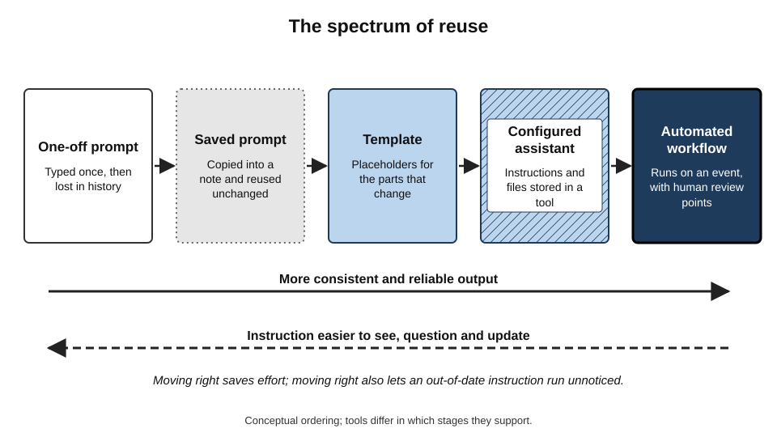
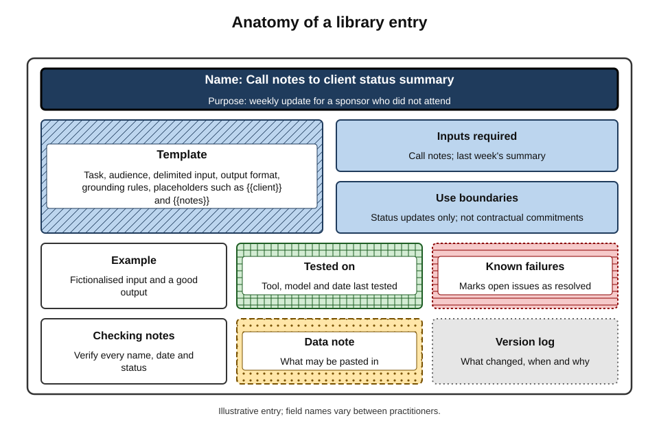
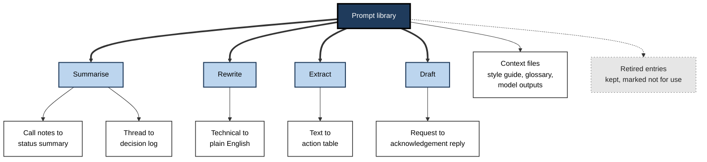
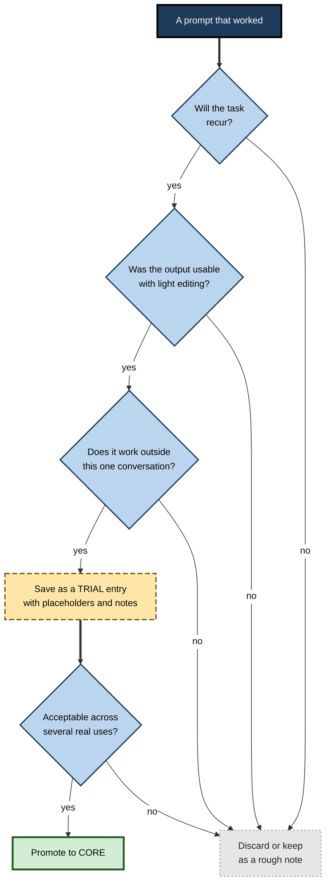
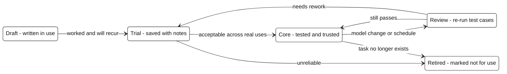

# L.2. Keeping a prompt library

A consultant writes an excellent instruction for turning interview notes into a structured findings table. It takes forty minutes and five attempts to get right. Three weeks later, needing it again, she cannot find it in her chat history and rebuilds it from memory — worse. A colleague who keeps every working instruction in a small, named collection simply opens the entry, fills in two blanks and has a reliable result in a minute.

> **Definition — Prompt library:** a personal or shared collection of tested, reusable instructions for AI tools, each stored with enough context — purpose, inputs, known limits, date last tested — to be found, trusted and reused.

**Why it matters**

- **Effort is not repeated** — a good instruction is often the product of several rounds of refinement; storing it preserves that investment.
- **Quality becomes consistent** — the same task is asked for the same way, so output varies less from week to week.
- **Lessons are captured** — the constraints that fixed past failures stay in the instruction instead of being forgotten.
- **Knowledge becomes shareable** — a written, tested instruction can be handed to a colleague; a habit in someone's head cannot.

---

## From One-Off Prompts to Reusable Instructions

### What a prompt is

> **Definition — Prompt:** the input given to a generative AI tool to direct its output — the instruction, together with any context, examples and material supplied with it.

- **The instruction** — what to do.
  - *e.g.* "Summarise these notes as a list of decisions and actions."
- **The context** — who the output is for and why.
  - *e.g.* "The reader is a client sponsor who did not attend."
- **The material** — the input to work on.
  - *e.g.* the pasted call notes.
- **The constraints** — length, format, tone, what to avoid.
  - *e.g.* "No more than 200 words; do not add information not in the notes."
- **Examples** — samples of the desired output, where helpful.

### Why prompts are worth keeping

- **Language models are sensitive to wording.**
  - Small changes in phrasing, ordering or format can change the output substantially.
  - Research in 2023 by Melanie Sclar and colleagues showed that purely cosmetic changes to prompt formatting — separators, spacing, capitalisation — could shift the accuracy of some models on the same tasks by large margins.
- **Good prompts encode tacit lessons.**
  - "Quote the source for any open issue" or "flag uncertain figures rather than guessing" are rules usually learned from a failure.
- **Memory is unreliable.**
  - Rebuilt prompts tend to lose the precise constraints that made the original work.

> **Key point:** a tested prompt is a small piece of working knowledge. Without a library it is lost after use; with one it accumulates.

### The spectrum of reuse

- **One-off prompt** — typed for a single use and discarded.
- **Saved prompt** — copied into a note for future use, unchanged.
- **Template** — a saved prompt with **placeholders** for the parts that change.
- **Configured assistant** — a template built into a tool's custom instructions, project or reusable assistant feature, often with reference files attached.
- **Automated workflow** — the instruction runs automatically when an event occurs, with human review at defined points.

> **Definition — Prompt template:** a reusable prompt with marked placeholders, such as `{{audience}}` or `{{notes}}`, that are filled in for each use.

**Figure 1.** From a single prompt to an automated workflow: the spectrum of reuse.

> **Watch out:** moving along the spectrum adds reliability but also **hides** the instruction. A configured assistant or automation can keep running an out-of-date prompt long after the task or the underlying model has changed.

---

## Anatomy of a Library Entry

A bare prompt is hard to reuse. An entry that records **what it is for, how to use it and how far to trust it** can be picked up months later — or by someone else.

### The fields of a good entry

- **Name** — short and task-based.
  - *e.g.* "Call notes → client status summary".
- **Purpose** — one line on the job it does.
- **When to use / when not to use** — boundaries.
  - *e.g.* "Internal and client status updates; not for contractual commitments."
- **The template** — the full instruction with placeholders.
- **Inputs required** — what must be supplied and in what form.
- **Example** — a short sample input and a good output (with sensitive detail removed).
- **Tool and model tested on** — the product and, where visible, the model or version.
- **Date last tested** — when it last produced acceptable output.
- **Known failure modes** — what to watch for.
  - *e.g.* "Sometimes marks open issues as resolved; check every status line."
- **Checking notes** — the fixed review steps that go with it.
- **Data note** — what categories of material may be pasted in.
- **Version and change log** — what changed and why.
- **Owner** — in shared libraries, who maintains the entry.

> **Mnemonic — "PUT-TIME-CK":** Purpose, Use-boundaries, Template, Tested-on, Inputs, Model-and-date, Example, Checks, Known failures — the core of an entry.

**Figure 2.** The parts of a well-formed prompt-library entry.

### Designing the template itself

- **Lead with the task** — a clear verb and object.
  - *e.g.* "Rewrite the following technical update for a non-technical reader."
- **State the audience and purpose** — models adjust tone and level to the reader they are told about.
- **Delimit the input** — mark where supplied material begins and ends.
  - *e.g.* "The notes are between the lines marked NOTES START and NOTES END."
  - Delimiting reduces confusion between instructions and material, and makes it harder for text inside the material to be treated as instructions.
- **Specify the output format** — headings, bullet structure, table columns, length.
- **Add grounding rules** — "use only the material supplied"; "say 'not stated' if information is missing".
- **Add the lessons** — the specific constraints that fixed past failures.
- **Keep placeholders obvious** — a consistent marker such as `{{double braces}}` that cannot be mistaken for content.
- **Prefer clarity to cleverness** — plain, explicit instructions age better across model updates than elaborate tricks.

### Worked example (illustrative): turning a one-off prompt into a template

**Situation:** a recruitment consultant has typed many versions of a request to turn interview notes into a candidate summary for hiring managers.

1. **Original one-off prompt:** "Summarise these notes about Priya for the hiring manager."
2. **Identify what varies:** candidate name, role, hiring manager's priorities, the notes.
3. **Identify what should never vary:** structure, length, the rule against invented detail, the rule against comments on protected characteristics.
4. **Add the lessons from past failures:**
   - the tool once inferred a notice period not mentioned in the notes → add "state 'not discussed' for anything absent";
   - it once used flattering adjectives not supported by evidence → add "support every strength with an example from the notes".
5. **Write the template:**
   - "Write a candidate summary for `{{hiring_manager}}`, who is recruiting a `{{role}}` and cares most about `{{priorities}}`. Use only the interview notes between NOTES START and NOTES END. Structure: Overview (two sentences); Strengths (three bullets, each with an example from the notes); Concerns (up to three bullets); Practical details (notice period, salary expectations, location — write 'not discussed' if absent). Under 250 words. Do not comment on age, family, health or any other personal characteristic."
6. **Record the entry fields:** purpose, when not to use (no use for rejection feedback), tested on the firm's approved assistant on a given date, failure mode (may still over-praise; check adjectives), data note (anonymise before pasting where policy requires).

- **Conclusion:** the template now carries the structure and the lessons; each use needs only four placeholders filled in.

> **Watch out:** a template that has been edited many times can accumulate contradictory constraints. Re-read the whole instruction occasionally as a stranger would, and remove rules that no longer serve a purpose.

---

## Patterns Worth Knowing

### Prompt patterns

- **Researchers at Vanderbilt University (Jules White and colleagues, 2023)** catalogued recurring **prompt patterns** — reusable solutions to common problems in instructing language models, by analogy with software design patterns.
- **Patterns often useful in everyday work:**
  - **Persona or audience** — specify a role for the tool or, more usefully, a reader for the output.
  - **Template** — supply the exact output structure to fill.
  - **Flipped interaction** — ask the tool to ask clarifying questions before answering.
  - **Question refinement** — ask the tool to suggest a better version of the request first.
  - **Cognitive verifier** — ask it to break a question into sub-questions and combine the answers.
  - **Reflection** — ask it to explain the reasoning or assumptions behind an answer, as an aid to checking (not as proof of correctness).

> **Definition — Prompt pattern:** a named, reusable way of structuring an instruction to solve a recurring problem in working with a language model.

### Context matters more than tricks

- **Early prompting folklore** — "magic phrases", elaborate role-play, offers of tips — produced inconsistent effects and many did not survive model updates.
- **Durable elements** — clear task, audience, supplied material, explicit format, examples and grounding rules.
- **The shift towards context** — as tools gained the ability to hold project files, style guides and reference documents, much of what a library stores has moved from **instructions** to **context**: the standard glossary, the house style, the approved structure of a report.

> **Key point:** a mature library stores not only prompts but the **reference material** that makes them work — style guides, examples of excellent output, glossaries and checklists of facts that must be correct.

| | Fragile prompt content | Durable prompt content |
|---|---|---|
| Typical form | Tricks, stock phrases, elaborate role-play | Task, audience, format, grounding rules, examples |
| Behaviour across model updates | Effects often vanish or reverse | Usually continues to work, sometimes better |
| Explains its own purpose? | Rarely | Yes — each part has a reason |
| Easy for a colleague to adapt? | No | Yes |

---

## Organising the Library

### Where to keep it

- **A notes application or document** — simple, searchable, portable between tools.
- **A text-expansion utility** — short codes expand into full templates; fast for very frequent prompts.
- **The tool's own saving features** — saved prompts, custom instructions, projects and reusable assistants offered by major AI products.
  - Convenient, but tied to one product and sometimes lost when plans or tools change.
- **A shared team space** — a wiki page, shared document or organisation-provided prompt gallery.
- **Version-controlled files** — for technical teams, prompts stored alongside code with history and review.

> **In practice:** many practitioners keep the **master copy** in a portable, tool-independent place (a notes file or document) and copy templates into tools' saved-prompt features for convenience. When a tool is dropped, nothing is lost.

### How to structure it

- **By task, not by tool** — "summarise", "rewrite for audience", "extract actions", "draft reply" — because tasks outlast tools.
- **Consistent naming** — input → output form, e.g. "Transcript → decision log".
- **Tags** — audience, sensitivity, tool tested on, status.
- **Status tiers:**
  - **Core** — tested, used regularly, trusted within known limits;
  - **Trial** — promising but not yet tested across enough cases;
  - **Retired** — kept for reference, clearly marked not for use.
- **Small** — a library of a few dozen entries that are actually used is worth more than hundreds that are not.

**Figure 3.** A task-based structure for a personal prompt library.

### Deciding what to save

- **Save** when an instruction:
  - took several rounds to get right;
  - will be needed again;
  - produced output good enough to use with light editing;
  - encodes a lesson from a failure.
- **Do not save** when it:
  - was a one-time question;
  - depends entirely on a particular conversation's context;
  - produced output that needed heavy rewriting anyway.

**Figure 4.** Deciding whether a prompt belongs in the library.

---

## Keeping the Library Alive

A library decays. Tools change, models are updated, tasks evolve and organisational rules shift. Maintenance is what separates a useful library from an archive of stale text.

### Why prompts stop working

- **Model updates** — providers change the models behind their products, sometimes without notice.
  - **Study card — Lingjiao Chen, Matei Zaharia and James Zou (2023)**
    - **Design:** compared the behaviour of the March 2023 and June 2023 versions of GPT-3.5 and GPT-4 on the same tasks — mathematical questions, code generation, sensitive questions and others.
    - **Results:** performance and behaviour changed substantially between versions on several tasks, in some cases getting markedly worse; formatting of generated code changed in ways that broke direct use.
    - **Conclusion:** the "same" named model can behave differently over time; prompts and workflows built on it need re-testing.
- **Model retirement** — older models are withdrawn on providers' timetables; prompts tuned to them may behave differently on successors.
- **Tool changes** — a product's default settings, system instructions or attached features change.
- **Task changes** — the report format, audience or policy the prompt served has moved on.
- **Accumulated patches** — repeated fixes make the instruction long and self-contradictory.

> **Definition — Model drift:** change in the behaviour of an AI system over time, whether because the provider has updated the model or because the inputs it receives have changed.

### Test cases

- **Keep one or two representative inputs** for each core entry, with a note of what good output looks like.
  - Sensitive details removed or replaced with realistic fictional ones.
- **Re-run them** when a tool announces a model change, when output seems to have shifted, or at a regular review.
- **Compare** against the stored good output and the checking notes.
- This is a personal version of what software teams call **regression testing** — checking that something that used to work still does.

> **Definition — Regression test:** a check, run after a change, that previously working behaviour has not been broken.

**Figure 5.** The life of a library entry.

### A maintenance rhythm

- **At each use** — note any new failure or editing need in the entry's log.
- **When a tool changes its model** — re-run the test cases for core entries used with that tool.
- **Quarterly** — scan the library; retire entries not used in months; merge duplicates; re-read long templates for contradictions.
- **When a task changes** — update or retire the entry the same day.

> **Remember:** an entry is only as trustworthy as its **date last tested**. An untested entry is a draft, however polished it looks.

### How experienced users work with a library

- **They keep it small and current.**
  - A working library for one person rarely needs more than twenty to forty core entries; anything unused for two review cycles is retired.
- **They separate the stable from the variable.**
  - The fixed part — structure, rules, lessons — lives in the template; the variable part — audience, material, deadline — lives in the placeholders. When they find themselves editing the fixed part at every use, they treat it as a sign the entry needs splitting into two.
- **They store examples of excellent output.**
  - A model output that was judged excellent, with the input that produced it, is often a more powerful instruction than further rules; many tools follow a good example more faithfully than an abstract description.
- **They write failure notes immediately.**
  - The moment an entry produces a bad result, a one-line note goes into its log; recalled later, the detail is lost.
- **They record why each rule exists.**
  - A short comment such as "added after invented deadline, March" stops a later editor — often themselves — from deleting a rule that looks redundant.
- **They keep the library tool-independent.**
  - Placeholders and instructions are written in plain language rather than in one product's special syntax, so the entry can move to another tool with little rework.

| | Template in a notes file | Configured assistant in a tool |
|---|---|---|
| Setup effort | Low — copy, fill, paste | Moderate — instructions and files configured once |
| Speed at each use | Slower — placeholders filled by hand | Faster — only the new material is supplied |
| Visibility of the instruction | High — read at every use | Low — hidden once set up |
| Portability between tools | High | Low — tied to one product and plan |
| Typical fit | Varied tasks, occasional use | One high-frequency task with stable reference files |

---

## Risks and Responsibilities

### What must not go into a library

- **Confidential material in examples** — real client names, personal data, figures from live deals.
  - Replace with realistic fictional examples.
- **Credentials and access details** — never in a prompt, never in a library.
- **Instructions that bypass rules** — prompts designed to evade tool safeguards or organisational policy.
- Detailed rules on which data may be used in which tools belong to the separate discipline of privacy and confidentiality; the library should simply record the data note for each entry.

### Copying prompts from elsewhere

- **Untested provenance** — prompts copied from public collections are usually untested on the person's tasks.
- **Hidden instructions** — text copied from web pages or documents can contain instructions the user did not notice, intended to manipulate the tool's behaviour (**prompt injection**).
- **Mismatch** — a prompt tuned for one model or tool may behave differently on another.
- **Response:** read every line before use; adopt copied prompts only as trial entries; test on one's own cases.

> **Definition — Prompt injection:** text, placed in material an AI tool processes, that is crafted to make the tool follow instructions its user did not intend.

### Over-reliance on the library

- **False confidence** — a well-documented entry can encourage skimming of the output.
- **Rigidity** — a template can be applied to inputs it was not designed for.
- **Stagnation** — a library can preserve old ways of working after better ones become possible.

> **Watch out:** a template guarantees a consistent **request**, not a correct **answer**. The checking notes stored with an entry must be applied every time.

---

## Libraries Beyond the Individual

### Team libraries

- **Value** — new joiners inherit tested instructions; good practice spreads; output becomes consistent across the team.
- **Requirements:**
  - **ownership** — each entry has a maintainer;
  - **review** — entries are checked before being marked core;
  - **standard fields** — every entry records purpose, limits, tests and data notes;
  - **feedback** — users can report failures.
- **Common failure** — a large shared page of untested, unowned prompts that nobody trusts and nobody prunes.

### Organisational prompt galleries

- Many large organisations and software vendors now provide **prompt galleries** — curated collections attached to approved tools.
- **Advantages** — vetted for policy, aligned with approved tools, discoverable.
- **Limits** — often generic; rarely tuned to a specific team's tasks and standards.

| | Personal library | Team library | Organisational gallery |
|---|---|---|---|
| Fit to specific tasks | Highest | High | Low to moderate |
| Testing | By one person, on own work | By owners, on team work | By central function, on generic cases |
| Maintenance burden | Light | Moderate — needs owners | Heavy — needs governance |
| Main risk | Loss when the person leaves | Unowned, untested sprawl | Generic entries few people use |
| Best use | Daily personal routines | Shared recurring outputs | Starting points and policy-safe patterns |

### Knowledge-management lineage

- **Checklists and standard work** — professions from aviation to surgery codify reliable procedures in written form; prompt libraries are a recent instance of the same idea.
- **Codified versus personalised knowledge** — Morten Hansen, Nitin Nohria and Thomas Tierney (1999) distinguished knowledge strategies that codify knowledge into reusable documents from those that connect people who hold it.
  - Prompt libraries are a codification strategy; they work best for well-defined, repeated tasks.
  - Novel, judgement-heavy work still depends on people.

> **Key point:** a prompt library codifies the repeatable part of working with AI. It does not replace the judgement that decides when an entry applies and whether its output is right.

---

## Case Study (illustrative): A Library That Saved a Rollout

- **Situation:** a regional legal-operations team of eight adopted an approved AI assistant for administrative tasks — summarising correspondence, drafting standard letters, extracting dates from documents.
- **Problem:** after two months, results varied widely between team members; one standard letter went out with an invented deadline; the team lead considered withdrawing the tool.
- **Diagnosis:**
  - each person wrote their own prompts from scratch;
  - nobody recorded which instructions worked;
  - the invented deadline came from a prompt that never said "use only dates stated in the document".
- **Actions:**
  1. Collected the prompts each member actually used and kept the best version of each task's instruction.
  2. Rewrote them as templates with delimiters, grounding rules and placeholders.
  3. Added the standard fields — purpose, limits, checking notes, data notes, test date.
  4. Created two test inputs per entry from fictionalised past matters.
  5. Assigned an owner to each entry and a quarterly review.
  6. Marked six entries core and four trial.
- **Result (over the following quarter):** output became noticeably more consistent across the team; no further invented dates reached letters; new joiners used the library from their first week. When the provider changed the underlying model, the owner re-ran the test inputs, found one entry now produced longer letters, and tightened its length constraint the same day.
- **Caveats:** consistency was judged by the team lead's review of samples, not a formal study; the library worked for administrative tasks, not legal analysis.
- **Lesson:** the tool was not the main problem; the absence of shared, tested instructions was.

---

## Open Questions

- **Will prompt libraries matter less as models improve?**
  - Better models need less elaborate instruction, but tasks still need audience, format, grounding and context; the library may shift from prompts to context documents rather than disappear.
- **How portable are prompts between tools and models?**
  - Evidence on how well instructions transfer across providers and model generations is limited and changes quickly.
- **What is the right amount of testing for a personal library?**
  - Systematic evaluation is standard for software teams; how much testing is worth an individual's time is unsettled.
- **Who owns a prompt?**
  - Prompts written at work may be organisational property; whether well-crafted prompts are protectable intellectual property is legally unclear in many jurisdictions.
- **Do shared libraries reduce diversity of thinking?**
  - Standard prompts produce consistent output, which may also narrow the range of approaches a team considers.

---

## Summary

- A **prompt library** is a collection of tested, reusable instructions stored with purpose, limits, test date and checking notes.
- Prompts are worth keeping because models are **sensitive to wording** and good prompts **encode lessons** from failures that memory loses.
- Reuse runs along a spectrum: **one-off → saved → template → configured assistant → automated workflow**; each step adds reliability and hides the instruction further.
- A good entry records **purpose, use boundaries, template, inputs, example, tool and date tested, known failures, checks, data note, version and owner**.
- Good templates lead with the task, state audience and purpose, **delimit input**, specify format, add **grounding rules** and record lessons.
- **Prompt patterns** (template, flipped interaction, question refinement, cognitive verifier) are reusable solutions; durable content beats tricks; mature libraries also store **context**.
- Organise **by task, not by tool**; keep the master copy portable; use **core, trial and retired** tiers.
- Libraries decay through **model drift**, retirement, tool and task change; keep **test cases** and re-run them — personal **regression testing**.
- Keep confidential data and credentials out; treat copied prompts as untested and watch for **prompt injection**.
- A template guarantees a consistent request, **not a correct answer**.

---

## Self-Check

1. Define a prompt library and name four reasons for keeping one.
2. What are the five components of a prompt? Give an example of each for a meeting summary.
3. Describe the spectrum of reuse and the hidden risk that grows along it.
4. List at least eight fields of a well-formed library entry and explain why "date last tested" matters.
5. Why should input material be delimited inside a template?
6. Convert "Write an email to the client about the delay" into a template with placeholders and grounding rules.
7. Name four prompt patterns and give a work use for each.
8. Why is "durable" prompt content more valuable than tricks?
9. Why should a library be organised by task rather than by tool?
10. Summarise the 2023 study by Chen, Zaharia and Zou and its implication for a prompt library.
11. What is a regression test in the context of a personal library, and when should it be run?
12. A colleague shares a long prompt found online. What should be done before adding it to the library?
13. Compare personal, team and organisational libraries on fit, maintenance and main risk.
14. A team's shared prompt page has 300 entries and nobody uses it. Diagnose and propose a redesign.

### Answer Key

1. A collection of tested, reusable instructions stored with context for reuse. Reasons: avoids repeating effort; makes quality consistent; captures lessons from failures; makes working knowledge shareable.
2. Instruction ("summarise as decisions and actions"); context ("for a sponsor who did not attend"); material (the notes); constraints ("under 200 words, nothing not in the notes"); examples (a past summary in the desired style).
3. One-off → saved → template → configured assistant → automated workflow. Reliability rises, but the instruction becomes less visible, so an out-of-date prompt may keep running unnoticed after tasks or models change.
4. Name, purpose, use boundaries, template, inputs, example, tool and model tested on, date last tested, known failures, checking notes, data note, version log, owner. The test date shows whether the entry has been checked since the last model or tool change; an untested entry is effectively a draft.
5. It separates instructions from material, reducing confusion and making it harder for text within the material to be treated as an instruction.
6. *e.g.* "Write an email to `{{client_contact}}` explaining that `{{deliverable}}` will be delayed from `{{old_date}}` to `{{new_date}}` because `{{reason}}`. Use only these facts; do not promise anything not stated. Tone: direct and courteous. Include the next step: `{{next_step}}`. Under 150 words."
7. Template — supply the report structure to fill; flipped interaction — have the tool ask questions before drafting a project brief; question refinement — improve a vague research question; cognitive verifier — break a complex policy question into sub-questions.
8. Task, audience, format, grounding rules and examples have clear purposes and keep working across model updates; tricks have inconsistent, often temporary effects and are hard for others to understand or adapt.
9. Tasks outlast tools; a task-based structure survives a change of product, and makes entries easy to find by the job to be done.
10. They found that GPT-3.5 and GPT-4 behaved substantially differently between March and June 2023 on the same tasks, sometimes worse. Named models drift, so library entries need re-testing after model changes.
11. Re-running stored representative inputs and comparing outputs with known-good results to check nothing has broken. Run it when a tool changes its model, when output seems to shift, and at periodic reviews.
12. Read every line for hidden or unwanted instructions; remove anything that conflicts with policy; adapt it to the task; test it on one's own cases; add it as a trial entry only.
13. Personal: best fit, light maintenance, lost when the person leaves. Team: high fit, needs owners, risks unowned sprawl. Organisational: generic, heavy governance, risks low use.
14. Untested, unowned, unpruned sprawl with no standard fields, so nobody trusts it. Redesign: cut to the entries actually used; rewrite as templates with standard fields; add test cases; assign owners; mark core, trial and retired; review quarterly; collect feedback on failures.

---

## Glossary

| Term | Meaning |
|---|---|
| Configured assistant | A tool feature that stores instructions and reference files for repeated use. |
| Context | Information about audience, purpose and background supplied with a prompt. |
| Core entry | A library entry tested and trusted within known limits. |
| Delimiter | A marker separating supplied material from instructions in a prompt. |
| Grounding rule | An instruction restricting the tool to supplied material, e.g. "use only the notes". |
| Model drift | Change in an AI system's behaviour over time. |
| Placeholder | A marked slot in a template, filled in for each use. |
| Prompt | The input that directs a generative AI tool: instruction, context, material, constraints and examples. |
| Prompt gallery | A curated collection of prompts provided with an organisation's approved tools. |
| Prompt injection | Text crafted to make an AI tool follow instructions its user did not intend. |
| Prompt library | A collection of tested, reusable instructions stored with context for reuse. |
| Prompt pattern | A named, reusable structure for solving a recurring prompting problem. |
| Prompt template | A reusable prompt with placeholders. |
| Regression test | A check that previously working behaviour still works after a change. |
| Retired entry | A library entry kept for reference but marked not for use. |
| Test case | A stored representative input with a note of what good output looks like. |
| Trial entry | A saved prompt not yet tested across enough real uses. |
