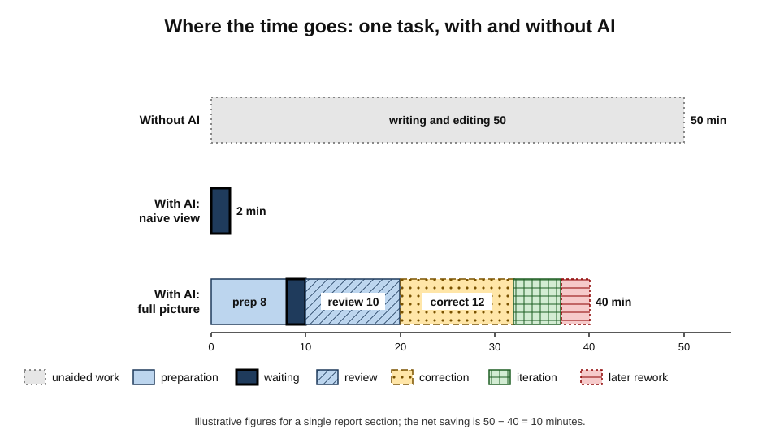
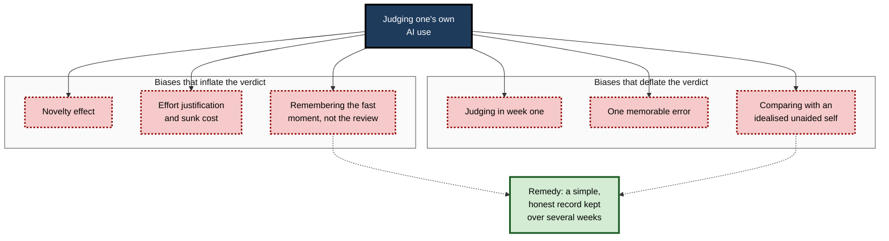
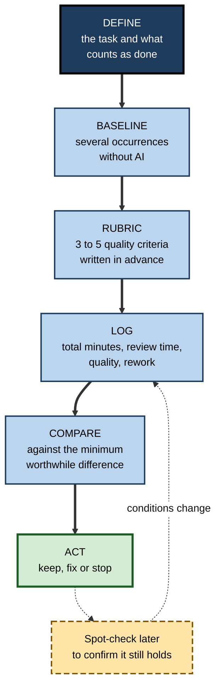
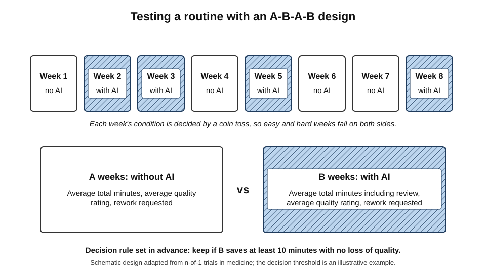

# L.3. Measuring whether it actually helps

An account manager is certain that AI saves her an hour a day. When she logs one week of tasks honestly — the time spent writing requests, waiting, reading, correcting and redoing — the figure is closer to twenty minutes, concentrated in two kinds of task, with one task actually taking longer. She does not stop using the tool. She stops using it for the task that was costing her time, and her real saving rises.

> **Definition — Net benefit of AI use (personal):** the difference AI makes to a person's work once **all** the time it consumes and **all** its effects on quality, effort and other people are counted — compared with doing the same work without it.

**Why measurement matters**

- **Feelings mislead** — people routinely misjudge how much time a tool saves; in one widely reported 2025 trial, experienced software developers believed AI had made them faster when it had in fact made them slower.
- **The fast part hides the slow parts** — generation takes seconds; preparing, checking and fixing take minutes.
- **Benefits are uneven** — a tool may help greatly on one task and harm another; an average conceals both.
- **Decisions depend on it** — which tasks to keep using AI for, whether to pay for a tool, and what to tell colleagues all rest on knowing what actually helps.

---

## What "Helps" Means

### Five dimensions of benefit

- **Time** — the total minutes a task takes from start to finished, acceptable output.
- **Quality** — how good the result is: accuracy, completeness, clarity, fitness for its reader.
- **Effort** — how mentally demanding the task feels; a task can take the same time but be less draining, or more.
- **Capability** — whether the person's own skill is growing, holding or fading.
- **Effects on others** — whether recipients receive better work, or receive work that costs them time to fix.

> **Key point:** "it helps" is a claim about all five. A tool that saves time but lowers quality, or saves effort but erodes a skill the person needs, may not help at all.

### Gross and net time

> **Definition — Gross time saving:** the difference between the time a task took without AI and the time the AI took to produce its output.

> **Definition — Net time saving:** the difference between the time without AI and the **total** time with AI, including preparing the request, waiting, reviewing, correcting and any rework later.

- Gross saving is what people notice; net saving is what they actually gain.
- The gap between them is the **overhead** of using the tool.

**The components of total time with AI**

- **Preparation** — gathering material, writing or adapting the request.
- **Waiting** — generation time, especially for long or multi-step tasks.
- **Review** — reading the output critically.
- **Correction** — fixing errors, filling gaps, adjusting tone.
- **Iteration** — asking again, regenerating, re-prompting.
- **Downstream rework** — fixing problems found later by the person or by others.

**Figure 1.** The same task with and without AI: where the time goes.

> **Formula — Net time saving per occurrence:** time without AI − (preparation + waiting + review + correction + iteration + later rework). Example: a report section takes 50 minutes by hand; with AI, preparation 8, waiting 2, review 10, correction 12, iteration 5, later rework 3 = 40 minutes. Net saving = 50 − 40 = **10 minutes**, not the 48 minutes suggested by "the AI wrote it in two minutes".

---

## Why Self-Assessment Fails

The most common way of judging an AI tool — "it feels faster" — is also the least reliable.

### The perception gap

- **The 2025 trial by the research organisation METR** randomly allowed or disallowed AI tools on real tasks for experienced open-source developers.
  - Tasks took longer with AI, yet developers afterwards believed they had been faster.
  - A follow-up in 2026 with newer tools gave estimates too uncertain to show a speed-up or a slowdown — but the gap between **felt** and **measured** effect remained the most durable lesson.
- **Why the gap arises:**
  - AI-assisted work **feels** less effortful — less typing, less blank-page struggle — and lower effort is mistaken for less time;
  - waiting time is **experienced** differently from working time, and is under-remembered;
  - the striking moment of fast generation is memorable; the slow review that followed is not.

> **Key point:** without a record, people judge AI by the moment it produced text, not by the whole task. Only measurement closes the gap.

### Biases that inflate the verdict

- **Novelty effect** — new tools are used with extra enthusiasm and attention; early results flatter.
- **Effort justification** — having invested time learning a tool, people value its output more.
  - Related: the **IKEA effect** — Michael Norton, Daniel Mochon and Dan Ariely (2012) found people value things more when they have partly made them, which may extend to outputs they have prompted and shaped.
- **Confirmation bias** — successes are noticed and remembered; failures explained away.
- **Selective memory** — the one brilliant output is recalled; the ten mediocre ones are not.
- **Sunk cost** — having paid for a tool, people want it to have been worth it.

### Biases that deflate the verdict

- **Early clumsiness** — judging in the first week, before the routine and prompts have settled.
- **Single bad experience** — one embarrassing error colours the whole judgement.
- **Comparison with an idealised self** — the AI-assisted version is compared with how fast the person *thinks* they work unaided, not how fast they actually do.

**Figure 2.** Common biases in judging one's own AI use.

> **Watch out:** "the Hawthorne effect" — the idea that being observed itself improves performance — is often cited when people measure their own work. The original 1920s–30s factory studies are now widely regarded as weaker evidence than their fame suggests, but the general point holds: measuring a task can change how carefully it is done.

---

## Methods for Personal Measurement

Personal measurement need not be elaborate. It must be **honest**, **comparable** and **sustained** long enough to outlast first impressions.

### Establishing a baseline

> **Definition — Baseline:** a measurement of how a task is done before a change, used as the point of comparison.

- **Time several occurrences without AI** — not one; tasks vary.
- **Record what was produced and how good it was** — a quick quality rating, errors found, revisions requested.
- **Use the same definition of "done"** — the task ends when the output is acceptable to its recipient, not when the first draft exists.
- **If no baseline was taken** — alternate occurrences with and without AI from now on.

### A simple time log

- **Fields per occurrence:**
  - date and task type;
  - with or without AI;
  - start and finish time (or minutes);
  - minutes spent on review and correction;
  - a quality rating (e.g. 1–5 against a fixed description);
  - any rework requested later;
  - one line of notes.
- **Duration** — at least four to six weeks for a weekly task; two to three weeks for a daily one.
- **Effort** — about a minute per occurrence; heavier logging is rarely sustained.

> **In practice:** many practitioners log only a **sample** — every third or fifth occurrence — which keeps the burden low while still revealing the pattern.

**Figure 3.** A cycle of personal measurement for one AI routine.

### Alternating designs: the personal experiment

- **Medicine's n-of-1 trial** — Gordon Guyatt and colleagues (1986) described randomised trials in **individual patients**, alternating treatment and comparison periods to find what works for that one person.
- **The same logic works for work tasks:**
  - alternate occurrences or weeks with and without AI (an **A–B–A–B** design);
  - ideally decide which occurrence gets AI by a coin toss, so that easy tasks do not all fall on the AI side;
  - compare totals and quality across the periods.
- **Why alternation helps** — it separates the effect of AI from improvement over time, workload changes and seasonal variation in the tasks.

> **Definition — N-of-1 trial:** a structured comparison within a single person, alternating between conditions over time, to determine which works better for that individual.

**Figure 4.** An alternating design for testing AI on one recurring task.

### Measuring quality without fooling oneself

- **Write a short rubric first** — three to five criteria with clear descriptions.
  - *e.g.* for a client summary: accuracy of facts; completeness of decisions; clarity for a non-attendee; appropriate length; correct tone.
- **Blind comparison** — ask a colleague to rate samples without knowing which used AI.
  - Even a small number of blind ratings is more informative than the author's own impression.
- **Count objective signals:**
  - errors found by reviewers or recipients;
  - revision requests;
  - questions recipients had to ask;
  - corrections after sending.
- **Note quality shifts, not just averages** — AI may raise the floor (fewer weak outputs) while lowering the ceiling (fewer excellent ones).

| | Self-impression | Simple log | Alternating trial | Blind quality review |
|---|---|---|---|---|
| Effort | None | About a minute per task | Planning plus logging | A colleague's time |
| Measures time? | Unreliably | Yes | Yes, with fairer comparison | No |
| Measures quality? | Unreliably | Roughly | Roughly | Yes |
| Guards against bias? | No | Partly | Well | Well, for quality |
| Typical use | Never sufficient alone | Default for any routine | Before a significant decision | Where quality is critical |

### Measuring effort and capability

- **Effort** — a one-question rating after each task: "how mentally demanding was this?" (1–5).
  - A task that takes the same time but is far less draining may still be worth doing with AI.
- **Capability** — occasionally do the task **unaided** and compare with earlier unaided performance.
  - A falling unaided standard is a signal to rebalance; how to preserve important skills is a subject in its own right.

### What to measure for different kinds of task

The right measure depends on what the task is for. A drafting task, a checking task and a thinking task each "help" in different ways.

- **Transformation tasks** — summarising, reformatting, rewriting supplied material.
  - **Main measure:** net time, with an accuracy check against the source.
  - *e.g.* minutes per summary; number of facts misstated per summary.
- **Drafting tasks** — first versions of emails, reports, proposals.
  - **Main measures:** net time to an *acceptable* final version, and the amount of editing needed.
  - *e.g.* proportion of the draft surviving into the sent version; revision requests from the reader.
- **Search and synthesis tasks** — gathering and combining information.
  - **Main measures:** time **including verification**, and errors or unsupported claims found.
  - *e.g.* number of claims that could not be traced to a source.
- **Ideation tasks** — options, angles, headlines, names.
  - **Main measures:** usefulness of the options, not their number; time to a decision.
  - *e.g.* how many of the generated options were seriously considered.
- **Coding and technical tasks** — scripts, formulas, queries.
  - **Main measures:** time to working, tested output; defects found later.
  - *e.g.* tests passed first time; bugs traced to generated code.
- **Thinking tasks** — analysis, judgement, decisions.
  - **Main measures:** quality of the reasoning and outcome, assessed by a knowledgeable reviewer; time is secondary.
  - *e.g.* whether a reviewer found the analysis sounder, not whether it was faster.

> **Key point:** time is the right headline measure only for tasks whose quality is easy to check. The harder the quality is to see, the more the measurement must focus on quality rather than speed.

### Keeping measurement sustainable

- **Measure intensively once, then lightly** — a few weeks of careful logging when a routine is new; occasional spot checks thereafter.
- **Re-measure when something changes** — a new tool, a new model, a new kind of input, or a feeling that results have shifted.
- **Keep the record where the work is** — a line in the same notes file as the prompt, not a separate system that will be forgotten.
- **Stop measuring what is settled** — a routine that has passed several checks needs only an annual look.
- **Share the method, not just the result** — a colleague can repeat a simple log; a bare claim of "it saves me an hour" cannot be repeated or checked.

> **In practice:** practitioners who measure well rarely keep elaborate spreadsheets. They keep **one honest line per sampled task** for a few weeks, decide, and move on — returning to measurement only when conditions change.

---

## Interpreting the Results

### When is a difference real?

- **Variation is normal** — the same task can take 30 minutes one week and 50 the next.
- **Look for consistent differences** across most occurrences, not one dramatic case.
- **Set a minimum worthwhile difference in advance** — e.g. "at least 10 minutes saved per occurrence with no loss of quality" — and judge against it.
- **Beware regression to the mean** — if measurement started because a task felt unusually slow, it is likely to be faster next time regardless of AI.

> **Definition — Regression to the mean:** the tendency of an unusually extreme measurement to be followed by one closer to the average, simply by chance.

### Worked example (illustrative): six weeks of a weekly report

**Situation:** a financial analyst alternates weeks with and without AI for two tasks: the commentary section of a weekly performance report, and a summary of market news for the team.

| Week | Task | AI? | Total minutes | Review and correction (min) | Quality (1–5) | Later rework |
|---|---|---|---|---|---|---|
| 1 | Commentary | No | 55 | — | 4 | None |
| 1 | News summary | No | 40 | — | 3 | None |
| 2 | Commentary | Yes | 60 | 25 | 3 | One figure corrected by manager |
| 2 | News summary | Yes | 18 | 8 | 4 | None |
| 3 | Commentary | No | 50 | — | 4 | None |
| 3 | News summary | No | 42 | — | 3 | None |
| 4 | Commentary | Yes | 52 | 22 | 4 | None |
| 4 | News summary | Yes | 20 | 9 | 4 | None |

*Illustrative figures.*

1. **Average commentary time** — without AI (55 + 50) ÷ 2 = 52.5 minutes; with AI (60 + 52) ÷ 2 = 56 minutes. **No saving**, plus one error that reached the manager.
2. **Average news-summary time** — without AI (40 + 42) ÷ 2 = 41 minutes; with AI (18 + 20) ÷ 2 = 19 minutes. **About 22 minutes saved**, with slightly better quality ratings.
3. **Explanation** — the commentary requires interpreting figures and context the tool does not have; the news summary is a transformation of supplied text.
4. **Decision** — keep AI for the news summary; stop using it for the commentary (or try a narrower use, such as checking phrasing after the analyst writes it).

- **Conclusion:** an average across both tasks would have shown a modest saving and hidden both the real gain and the real loss.

> **Watch out:** four weeks is a small sample. The direction of the result is useful; the precise number of minutes is not. Continue logging occasionally to confirm the pattern holds.

### Four outcomes and what to do

- **Faster and at least as good** — keep; consider extending to similar tasks.
- **Faster but worse** — keep only if the quality loss can be fixed by a better check or prompt; otherwise stop.
- **Slower but better** — keep where quality matters more than time; be explicit that this is the trade.
- **Slower and no better** — stop; the routine is costing time.

**Figure 5.** Deciding what to do with a measured result.

```mermaid
%%{init: {'theme':'base','themeVariables':{'fontFamily':'Arial, Helvetica, sans-serif','fontSize':'15px','primaryColor':'#FFFFFF','primaryTextColor':'#111111','primaryBorderColor':'#222222','lineColor':'#333333','secondaryColor':'#F2F2F2','tertiaryColor':'#FFFFFF','clusterBkg':'#FAFAFA','clusterBorder':'#555555','edgeLabelBackground':'#FFFFFF','titleColor':'#111111'}}}%%
flowchart TD
    classDef core    fill:#1F3B5C,stroke:#000000,stroke-width:3px,color:#FFFFFF
    classDef key     fill:#BCD5EE,stroke:#1F3B5C,stroke-width:2px,color:#000000
    classDef good    fill:#D3ECD3,stroke:#1E5E24,stroke-width:3px,color:#000000
    classDef accent  fill:#FFE6A8,stroke:#7A5200,stroke-width:2px,stroke-dasharray:8 4,color:#000000
    classDef caution fill:#F6CACA,stroke:#8B0000,stroke-width:2.5px,stroke-dasharray:3 3,color:#000000

    M["Several weeks of<br/>honest measurement"]
    Q1{"Net time lower?"}
    Q2{"Quality at least<br/>as good?"}
    Q3{"Quality clearly<br/>better?"}
    K["KEEP<br/>consider adjacent tasks"]
    F["FIX the check or prompt,<br/>then re-measure"]
    T["KEEP where quality<br/>matters more than time"]
    S["STOP using AI<br/>for this task"]

    M ==> Q1
    Q1 -- "yes" --> Q2
    Q1 -- "no" --> Q3
    Q2 -- "yes" --> K
    Q2 -- "no" --> F
    Q3 -- "yes" --> T
    Q3 -- "no" --> S

    class M core
    class Q1,Q2,Q3 key
    class K,T good
    class F accent
    class S caution
```

---

## Costs That Are Easy to Miss

### Hidden costs to the person

- **Fragmented attention** — switching between writing a prompt, waiting and reviewing breaks concentration; research on task switching shows each switch carries a cost in time and errors.
- **Review fatigue** — reading many plausible outputs critically is tiring; attention degrades and errors slip through late in the day.
- **Skill erosion** — less practice of the underlying task over months.
- **Cost of subscriptions** — money as well as time; worthwhile only if the net benefit exceeds it.

### Hidden costs to others

- **Shifted effort** — output that looks finished but needs work by its recipient moves the cost rather than removing it.
- **Volume inflation** — faster drafting can mean longer documents and more messages, adding to the time everyone spends reading.
- **Trust costs** — an error that reaches a client or manager costs more than the minutes saved.

> **Key point:** a personal measure that counts only one's own minutes can show a gain while the team as a whole loses. At minimum, track **rework requested by recipients** and **errors found after sending**.

### A value calculation

> **Formula — Monthly net value of an AI routine:** (net minutes saved per occurrence × occurrences per month ÷ 60 × value of an hour) − monthly cost of the tool share used for it. Example: 20 minutes × 8 occurrences ÷ 60 = 2.7 hours; at a notional value of 40 per hour, about 107 per month, against a tool share of 10 → net value about **97 per month** (illustrative figures, any currency).

- **The formula is a guide, not a verdict** — it leaves out quality, effort and learning, which must be judged alongside it.
- **Value of an hour** — for an employee, a rough proxy is cost to the employer; for a freelancer, the billable rate if the time saved would actually be billed.

---

## Measurement at Scale, Briefly

- **Organisations face the same problems on a larger scale** — self-reported savings, counting only the fast part, ignoring quality and others' time.
- **Population studies show smaller effects than individual experiments** — surveys of whole jobs across many workers have tended to find modest time savings, much smaller than laboratory studies of selected tasks.
- **The personal lesson** — a person's own net benefit is likely to be concentrated in a few tasks; the job-wide average is diluted by the many tasks where AI makes little difference.

> **In practice:** when asked by a manager "how much time does AI save you?", the most credible answer names **specific tasks**, gives **net** figures from a log, and mentions **where it does not help**.

---

## Case Study (illustrative): The Consultant Who Measured

- **Situation:** a management consultant used a general AI assistant for most writing tasks and estimated it saved "at least a day a week".
- **Trigger:** her firm asked staff to justify renewal of a premium AI licence with evidence.
- **Actions:**
  1. Listed six recurring tasks: interview summaries, slide headlines, proposal boilerplate, research briefs, email drafts and workshop agendas.
  2. For three weeks, logged every occurrence: total minutes, review and correction minutes, a rubric score and any rework.
  3. For one week, did each task without AI to provide a comparison.
  4. Asked a colleague to rate six anonymised outputs without knowing which used AI.
- **Findings:**
  - **interview summaries** and **workshop agendas** — large net savings, quality equal or better;
  - **proposal boilerplate** — moderate saving;
  - **slide headlines** — no net saving; much regeneration in search of a perfect phrase;
  - **research briefs** — slower: every claim had to be checked, and two invented sources had to be removed;
  - **email drafts** — small saving, but the colleague rated AI-drafted emails as less direct.
  - Total net saving: about **three hours a week**, not a day.
- **Actions taken:** kept AI for summaries, agendas and boilerplate; set a limit of one regeneration for headlines; stopped using it to draft research briefs, using it instead only to restructure briefs she had written; wrote emails herself and used AI only for tone checks.
- **Result (next quarter, spot checks):** net saving rose to about four hours a week, because time-wasting uses had stopped; the licence was renewed with a task-specific justification.
- **Lesson:** the real benefit was smaller than felt, unevenly distributed, and **increased** once measurement identified the tasks where AI was costing time.

---

## Open Questions

- **How should quality be measured for knowledge work?**
  - Time is easy to count; the quality of a judgement, an argument or a client relationship is not, and simple rubrics capture only part of it.
- **How long-lasting are personal gains?**
  - Gains may grow as skill improves or shrink as novelty fades and tasks change; few studies follow individuals over years.
- **How should effects on others be counted?**
  - Downstream costs fall on recipients who may never know AI was involved; practical personal methods for capturing them are underdeveloped.
- **Does measuring change the behaviour measured?**
  - Logging makes people more deliberate, which may itself improve results; the measured routine may differ from the unmeasured one.
- **What happens to skill over the long term?**
  - Net time saved today may be offset by lost capability later; how to weigh present savings against future skill is unresolved.

---

## Summary

- **Net benefit** counts all time, quality, effort, capability and effects on others — not just the speed of generation.
- **Gross saving** is what people notice; **net saving** subtracts preparation, waiting, review, correction, iteration and later rework.
- **Self-assessment fails**: people feel faster when AI reduces effort; novelty, effort justification, the IKEA effect, confirmation bias and sunk cost inflate verdicts; early clumsiness and single errors deflate them.
- Measure with a **baseline**, a **simple log** (about a minute per occurrence, or a sample), and for important decisions an **alternating A–B–A–B** design borrowed from medicine's **n-of-1 trials**.
- Measure **quality** with a rubric written in advance, **blind** ratings by a colleague and objective signals — errors, revisions, rework.
- Judge against a **minimum worthwhile difference**; beware variation and **regression to the mean**.
- Results fall into four outcomes — keep, fix, keep for quality, stop — and are usually **task-specific**.
- Hidden costs include **fragmented attention**, **review fatigue**, skill erosion, subscription costs and **effort shifted to others**.
- The most credible statement of benefit names **specific tasks**, gives **net** figures and admits **where AI does not help**.

---

## Self-Check

1. Define net benefit of AI use and name its five dimensions.
2. Distinguish gross from net time saving and list the components of total time with AI.
3. A task takes 40 minutes by hand. With AI: preparation 5, waiting 1, review 8, correction 10, iteration 4, later rework 2. What is the net saving?
4. Why do people tend to feel faster with AI even when they are not?
5. Name three biases that inflate and two that deflate a person's judgement of an AI tool.
6. What is a baseline and how should it be taken?
7. Describe an n-of-1 or A–B–A–B design for a weekly task, including how to decide which weeks use AI.
8. How can quality be measured without relying on the author's impression?
9. Why should a minimum worthwhile difference be set in advance?
10. Explain regression to the mean with an example from AI measurement.
11. In the worked example, why would averaging both tasks have been misleading?
12. List three hidden costs to the person and two to others.
13. Using the value formula, calculate monthly net value for 15 minutes saved, 12 occurrences, a notional 30 per hour and a tool share of 15.
14. A colleague claims AI saves them "two hours a day" and wants the team to adopt their methods. What questions would test the claim, and how should the evidence be gathered?

### Answer Key

1. The difference AI makes once all time and all effects are counted, compared with doing the work without it. Dimensions: time, quality, effort, capability, effects on others.
2. Gross: time without AI minus the tool's generation time. Net: time without AI minus total time with AI. Components: preparation, waiting, review, correction, iteration, downstream rework.
3. Total with AI = 5 + 1 + 8 + 10 + 4 + 2 = 30 minutes. Net saving = 40 − 30 = **10 minutes**.
4. AI reduces felt effort (less typing, no blank page), which is mistaken for less time; waiting is under-remembered; the fast generation moment is memorable while slow review is not.
5. Inflate: novelty effect, effort justification or IKEA effect, confirmation bias, selective memory, sunk cost. Deflate: judging in week one, one memorable error, comparing with an idealised unaided self.
6. A measurement of the task before the change. Time several occurrences without AI, record quality and rework, and use the same definition of "done" as will be used later.
7. Alternate weeks with and without AI over at least four weeks, deciding each week's condition by coin toss so easy weeks are not concentrated on one side; log total time, review time, quality and rework; compare the conditions.
8. A rubric written in advance; blind ratings by a colleague; objective signals such as errors found, revision requests, recipients' questions and post-sending corrections.
9. So that natural variation and wishful thinking do not turn small or random differences into a conclusion; it fixes the standard before the data are seen.
10. Extreme measurements tend to be followed by more typical ones. If measurement began after an unusually slow week, the next week is likely faster with or without AI, falsely suggesting AI helped.
11. The commentary showed no saving and an error; the news summary showed a large saving. An average would have shown a modest gain, hiding both the real benefit and the real cost.
12. Person: fragmented attention, review fatigue, skill erosion, subscription cost. Others: shifted effort to recipients, volume inflation, trust costs from errors.
13. 15 × 12 ÷ 60 = 3 hours; 3 × 30 = 90; 90 − 15 = **75 per month** (illustrative).
14. Questions: which tasks; net or gross; measured or estimated; over how long; with what quality checks; any rework by others; compared with what baseline. Evidence: a few weeks' task-level log with total times, a short alternating comparison, blind quality ratings of samples and a count of rework or errors reported by recipients — before the team adopts anything.

---

## Glossary

| Term | Meaning |
|---|---|
| A–B–A–B design | Alternating periods with and without a change to compare their effects. |
| Baseline | A measurement before a change, used for comparison. |
| Blind comparison | Rating outputs without knowing which were produced with AI. |
| Confirmation bias | Noticing and remembering evidence that supports an existing belief. |
| Downstream rework | Effort spent later, by the author or others, to fix problems in delivered work. |
| Effort justification | Valuing an outcome more because effort was invested in it. |
| Gross time saving | Time without AI minus the tool's generation time. |
| IKEA effect | Valuing things more when one has partly made them. |
| Minimum worthwhile difference | The smallest improvement, set in advance, that would justify keeping a change. |
| N-of-1 trial | A structured comparison of conditions within a single individual over time. |
| Net benefit | The effect of AI once all time, quality, effort, capability and effects on others are counted. |
| Net time saving | Time without AI minus total time with AI, including all overheads. |
| Novelty effect | Temporary improvement or enthusiasm caused by something being new. |
| Overhead | Time spent preparing, waiting, reviewing and correcting when using a tool. |
| Perception gap | The difference between felt and measured effect of a tool. |
| Regression to the mean | The tendency of extreme measurements to be followed by more average ones. |
| Rubric | A short set of quality criteria with descriptions, written before rating. |
| Sunk cost | A past investment that cannot be recovered but still influences decisions. |
