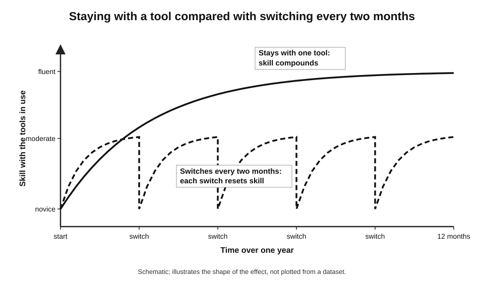
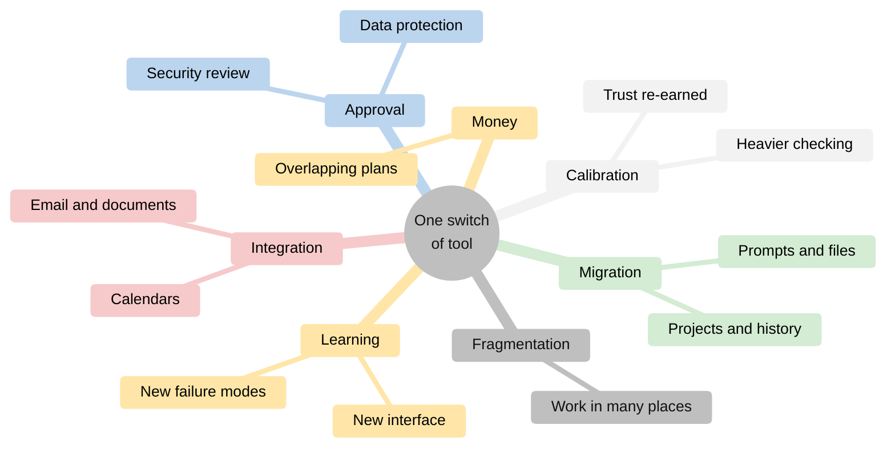
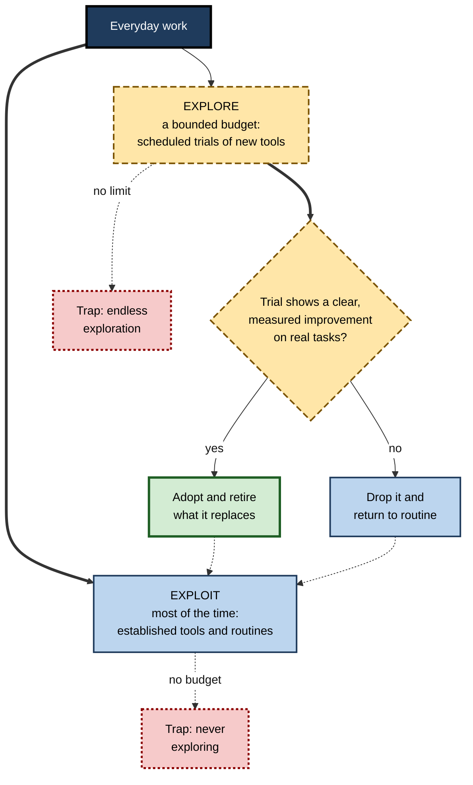
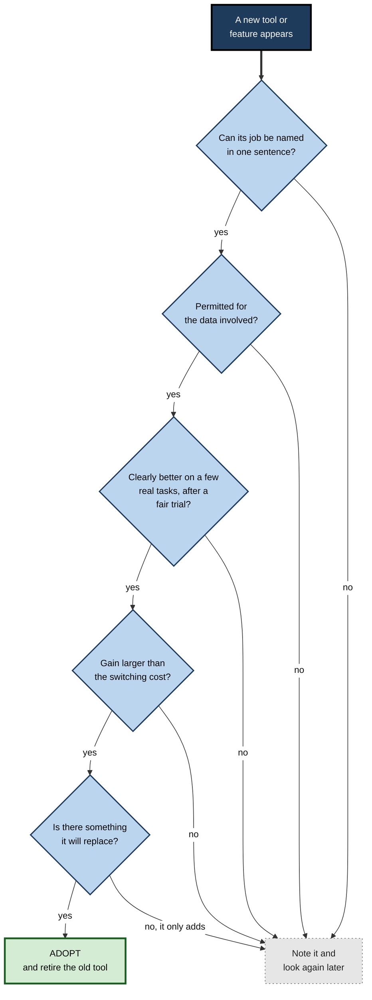
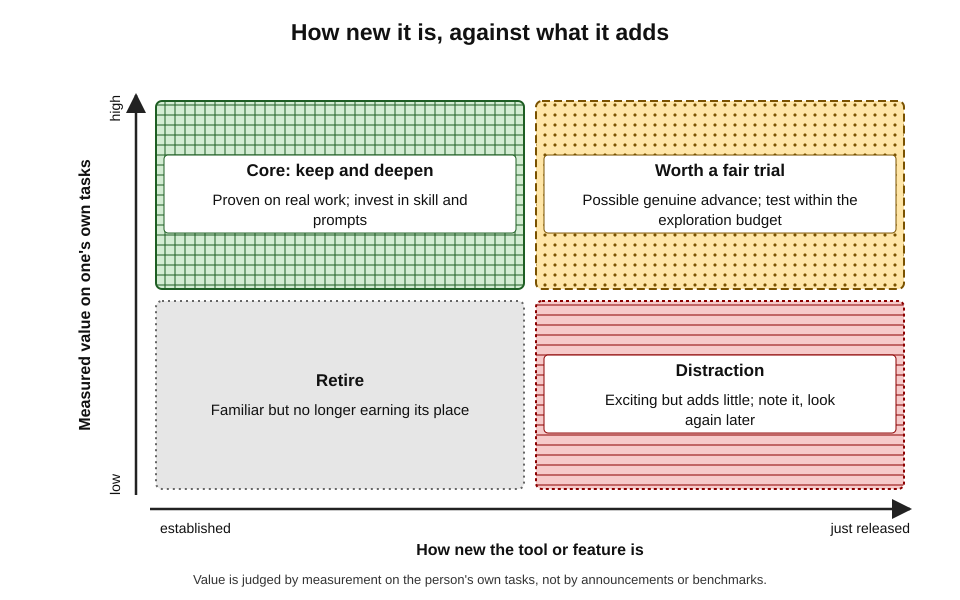

# L.4. Avoiding novelty for its own sake

A marketing coordinator signs up for a new AI tool almost every week: a writing assistant, a slide generator, a meeting recorder, a research agent, a different chatbot "everyone is switching to". Each is exciting for a few days. After a year she has eleven accounts, no stable routine and a nagging sense of falling behind. Her colleague uses two tools she knows deeply — and produces more, faster and with fewer errors.

> **Definition — Novelty for its own sake:** adopting or switching to a new tool, feature or model mainly because it is new, rather than because it does a specific job measurably better than the current way of working.

**Why it matters**

- **Every switch resets the learning curve** — skill with a tool, its prompts and its failure modes accumulates only with sustained use.
- **Attention is finite** — time spent trialling, comparing and configuring tools is time not spent on the work itself.
- **Novelty feels like progress** — the excitement of a new tool is easily mistaken for improvement in results.
- **Sprawl creates risk and cost** — scattered accounts multiply subscriptions, data exposure and confusion about where work lives.

---

## The Pull of the New

### Why novelty attracts

- **The brain rewards novelty.**
  - Neuroscience research has linked novel stimuli to activity in the brain's dopamine-related reward systems; novelty appears to motivate exploration in its own right.
  - *Novelty* and *reward* are partly processed by overlapping systems, which helps explain why new things feel worthwhile before any benefit is shown.
- **Information-seeking** — people value information about possible improvements, even when they are unlikely to act on it.
- **Fear of missing out (FOMO)** — Andrew Przybylski and colleagues (2013) defined it as a pervasive apprehension that others might be having rewarding experiences from which one is absent.
  - Constant announcements of new AI tools feed exactly this apprehension in professional form: "everyone else is using something better".
- **Social signalling** — early adoption can signal competence and modernity to colleagues and clients.
- **Marketing** — the AI industry releases and promotes new products at an extraordinary pace; launch messages emphasise transformation, not trade-offs.

> **Definition — Fear of missing out (FOMO):** a pervasive apprehension that others might be having rewarding experiences from which one is absent, accompanied by a desire to stay continually connected with what they are doing.

### Shiny object syndrome

- **The informal name** for repeatedly chasing new tools, ideas or opportunities before finishing or mastering current ones.
- **Typical signs:**
  - more tools signed up for than used weekly;
  - switching tools mid-task;
  - spending more time reading about tools than using them;
  - abandoning a routine as soon as a new option appears;
  - difficulty saying what a new tool does better, in specific terms.

> **Watch out:** "shiny object syndrome" is a popular label, not a clinical or research construct. It names a recognisable pattern, but the evidence lies in the underlying mechanisms — novelty reward, FOMO, switching costs — rather than in the label itself.

### The pro-innovation bias

- **Everett Rogers** observed that diffusion research itself long carried a **pro-innovation bias** — the assumption that an innovation should be adopted by everyone, quickly, and that rejection is a failure.
- **In everyday AI use** the same bias appears as the belief that the newest tool or model is necessarily better and that not switching is falling behind.
- **The corrective:** an innovation's value depends on fit to a particular person's tasks; for some, the right decision is not to adopt.

---

## What Novelty Costs

### The learning-curve reset

- **Skill with a tool is learned** — how to instruct it, how it fails, what to check.
- **Gains are steepest early, then continue more slowly** — the familiar shape of practice curves.
- **Switching** moves the person back to the start of a new curve.
- **Repeated switching** keeps the person permanently on the steep, clumsy early part of every curve — never reaching the fluency where most of the value lies.

**Figure 1.** Repeated switching keeps a user on the early part of every learning curve.

> **Key point:** the cost of a switch is not the hour spent signing up. It is the weeks of accumulated skill, prompts and calibrated judgement left behind.

### Switching costs, item by item

- **Learning** — new interface, new behaviours, new failure modes.
- **Migration** — prompts, custom instructions, reference files, projects and history to move or rebuild.
- **Calibration** — trust must be re-earned through checking; early output is checked more heavily.
- **Integration** — connections to email, documents and calendars to set up again.
- **Approval** — at work, a new tool may need security, legal or data-protection review; using it before approval creates risk.
- **Money** — overlapping subscriptions during trials, and often after.
- **Fragmentation** — work and history scattered across accounts; "which tool did I do that in?"

> **Definition — Switching cost:** the total cost, in time, money, effort and risk, of moving from one tool or way of working to another.

**Figure 2.** The hidden costs carried by a single switch of tool.

### Task switching and attention

- **Laboratory research on task switching** — for example by Joshua Rubinstein, David Meyer and Jeffrey Evans (2001) — found that switching between tasks carries measurable time costs, which grow with task complexity.
- **Trying tools mid-task** adds such switches: leaving the work to try a new assistant, configuring it, comparing outputs, returning.
- **Research on workplace attention** has repeatedly found that office workers switch screens and activities very frequently, and that resuming interrupted work takes time.

> **Remember:** switching tools is also switching tasks. Every comparison made in the middle of real work is paid for in attention.

### The novelty effect in evaluation

> **Definition — Novelty effect:** a temporary improvement in engagement or performance that occurs because something is new, and fades as it becomes familiar.

- **Educational technology research** has long documented novelty effects: new media raise engagement and short-term results that fade over weeks or months.
- **Richard Clark (1983)** argued that many apparent learning gains from new media were explained by novelty and by differences in teaching method, not by the medium itself — a claim that sparked a long debate, but whose caution about novelty is widely accepted.
- **For AI tools:** the first days with a new tool feel more productive partly because attention is heightened and the easiest tasks are tried first.

> **Watch out:** a new tool that "seems much better" after two days has been compared under unfair conditions — fresh enthusiasm and easy tasks against a familiar tool used on everything.

| | Genuine improvement | Novelty effect |
|---|---|---|
| When it appears | Persists after weeks of normal use | Strongest in the first days |
| What it rests on | A specific capability the old tool lacked | Fresh attention, easy first tasks, excitement |
| Can it be named precisely? | Yes — "it handles 80-page documents; the old one could not" | Rarely — "it just feels better" |
| Survives measurement? | Yes, on the same tasks | Usually shrinks or vanishes |

---

## Exploration Without Chasing

Avoiding novelty for its own sake does not mean refusing anything new. Tools do improve, sometimes dramatically. The aim is to **explore deliberately** rather than **switch impulsively**.

### Exploration and exploitation

- **James March (1991)** described a fundamental tension in organisational learning:
  - **exploitation** — refining and using what is already known to work;
  - **exploration** — searching for new possibilities that might work better.
- **Too much exploitation** — the person or organisation becomes trapped in outdated methods.
- **Too much exploration** — costs of experimentation without gaining the benefits of any one approach; March called this a failure trap of endless search.
- **The balance** — mostly exploit, explore deliberately in bounded amounts.

> **Definition — Exploration–exploitation trade-off:** the tension between using known options that work (exploitation) and trying new options that might work better (exploration).

- **In decision science** the same trade-off appears as the **multi-armed bandit problem**: a gambler choosing between slot machines with unknown payouts must balance playing the best-known machine against testing others.
  - Optimal strategies explore more at the start and less as knowledge accumulates — a useful analogy for a professional's toolset.

**Figure 3.** Balancing exploration and exploitation in a personal toolset.

### An exploration budget

- **Ring-fence a small, regular amount of time** for trying new tools — for example an hour every fortnight, or one afternoon a month.
- **Keep exploration out of live work** — test on copies of real tasks, not on a deadline.
- **Explore with a question** — "is there a better way to do X?" — rather than "what is new?".
- **Batch announcements** — collect interesting releases in a list and look at them during the budgeted time, not as they arrive.

> **In practice:** many experienced practitioners treat new tools the way investors treat speculative positions — a small, deliberate allocation, held to account for results, never allowed to displace the core.

---

## A Gate Before Adopting

Before a new tool enters regular use, it should pass a short, explicit test. The test protects against both impulsive switching and blind loyalty.

### Seven questions

1. **What job, exactly?** — the specific task the tool would do, in one sentence.
2. **What is the current way?** — the tool or method used for that job now.
3. **How much better, on my tasks?** — measured on a few real, representative cases, not on the vendor's demonstration.
4. **What will switching cost?** — learning, migration, calibration, integration, approval, money.
5. **Is it permitted?** — approved for the data involved and the organisation's policy.
6. **How durable is it?** — the provider's stability, the product's likely lifespan, the ability to export work.
7. **What will it replace?** — the tool or routine that will be retired if it is adopted.

> **Mnemonic — "Just Compare How Switching Pays, Durably, Replacing":** Job, Current way, How much better, Switching cost, Permitted, Durable, Replaces.

**Figure 4.** A gate for deciding whether a new tool enters regular use.

### Running a fair trial

- **Same tasks, both tools** — run the new tool and the current one on the same few real cases.
- **Several cases, not one** — at least three to five, including a difficult one.
- **Judge after the novelty fades** — use the new tool for a week or two before deciding.
- **Use a fixed rubric** — accuracy, completeness, editing needed, total time.
- **Write the verdict down** — one paragraph: what it does better, what worse, what it costs, decision.

> **Remember:** a trial is fair only if both tools face the **same tasks**, under the **same conditions**, judged by the **same standard**, after the **novelty has faded**.

### Worked example (illustrative): is the switch worth it?

**Situation:** a business analyst uses an established general assistant for drafting and summarising. A new assistant claims better summaries of long documents. The analyst summarises about ten long documents a month.

| Item | Estimate |
|---|---|
| Time saved per summary with the new tool, after a fair trial | 6 minutes |
| Monthly saving | 10 × 6 = 60 minutes |
| One-off switching cost: learning, rebuilding prompts, re-calibrating checks | about 8 hours |
| Approval: tool not yet approved; review expected to take several weeks | delay, plus colleagues' time |
| Extra subscription if both tools are kept | 20 per month |

*Illustrative figures.*

1. **Payback period on time alone** — 8 hours ÷ 1 hour per month = **8 months**.
2. **Money** — keeping both tools adds a recurring cost; the switch makes sense only if the old tool can be dropped or downgraded.
3. **Risk** — unapproved use is not an option; the gain must wait for approval.
4. **Alternative** — test whether a better prompt in the current tool closes most of the gap: a revised summary template saves 4 of the 6 minutes.
5. **Decision** — improve the current prompt now; revisit the new tool at the next periodic review if it is approved and the gap persists.

> **Formula — Payback period of a switch:** one-off switching cost ÷ net gain per period. Example: 8 hours ÷ 1 hour per month = 8 months before the switch begins to pay.

> **Watch out:** payback periods for AI tools must be compared with the tool's likely **lifespan**. If products change or disappear every year or two, a switch with an eight-month payback leaves little margin.

### Personal rules that curb impulsive switching

- **One in, one out** — no new tool enters regular use unless an existing one leaves; the toolset stays the same size or shrinks.
- **The cooling-off rule** — an announcement that excites is written on a list and revisited after a few days, or at the next exploration session; much of the urge fades.
- **The job statement** — before signing up, write one sentence: "This would replace X for task Y because Z." If the sentence cannot be written, the tool is not needed yet.
- **No switching mid-project** — tools are changed between pieces of work, not during them; a half-finished report should not be split across two assistants.
- **Copies, not live work** — trials use copies of past tasks or fictionalised material, never the live deadline or unapproved data.
- **Written verdicts** — every trial ends with a few lines recording what was tried, on what, with what result; the record prevents re-trying the same tool every few months on enthusiasm alone.

> **Key point:** these rules do not forbid novelty. They move the decision from the **moment of excitement** to a **moment of evidence**.

> **Example (illustrative):** a solicitor's paralegal sees a new contract-review assistant announced. Instead of signing up, she adds it to her list. At her fortnightly exploration hour she checks that it is not approved by the firm, notes "revisit if approved", and returns to work. Three months later the firm approves a different tool with similar features — and her note saves her from having learned the wrong one.

---

## Telling Real Advances from Noise

### When newness genuinely matters

- **A new capability category** — something previously impossible becomes possible.
  - *e.g.* reliable handling of very long documents; working directly with spreadsheets; acting across several applications.
- **A large, measured improvement on core tasks** — not a few points on a public benchmark, but a clear difference on one's own work.
- **A change that removes a known failure** — the tool that kept misreading tables now reads them correctly.
- **A change forced from outside** — the current tool is withdrawn, repriced or no longer approved.

### Signals of noise

- **Superlatives without specifics** — "revolutionary", "game-changing", "the end of X".
- **Benchmarks unrelated to one's tasks** — leaderboard positions measure performance on test sets that may be far from everyday work.
- **Demonstrations on cherry-picked examples** — the vendor's best case, not the typical case.
- **Social momentum** — "everyone is switching" usually means a vocal minority is.
- **Feature lists** — many features rarely matter; one well-done feature used weekly matters more.

**Figure 5.** Sorting new tools by how new they are and how much value they add.

### The case for patience

- **Early versions are often rough** — later updates fix early failures; late adopters receive a more stable product.
- **Waiting reveals durability** — many new AI products of 2023–2025 were absorbed into larger platforms, repriced or closed.
- **Heuristics such as the "Lindy effect"** — the idea, popularised by Nassim Nicholas Taleb, that the longer a non-perishable thing has survived, the longer it is likely to survive — suggest established tools are safer bets.
  - This is a rule of thumb, not a law; in a fast-moving field it can be wrong.
- **The cost of being slightly late is usually small** — for most everyday tasks, adopting an improvement a few months after release loses little.

> **Key point:** for the individual professional, being a **fast follower** — adopting genuine improvements once they are proven — usually beats being a **first mover** on every release.

| | First mover on every release | Fast follower | Laggard |
|---|---|---|---|
| Exposure to genuine advances | Earliest | A few months later | Very late or never |
| Learning-curve resets | Constant | Occasional, deliberate | Rare |
| Exposure to immature or short-lived tools | High | Low | Very low |
| Risk of unapproved data use | High | Low | Low |
| Typical net result | Busy, but shallow skill | Most of the benefit at modest cost | Falls behind as practice changes |

### The opposite error: loyalty past its time

- **Avoiding novelty is not the same as avoiding change.** A tool that was the right choice two years ago may now be outclassed, repriced or unsupported.
- **Status quo bias** — the tendency to prefer the current state simply because it is current — can keep a person on a tool long after a fair trial would favour another.
- **Sunk investment in skill** — the effort put into mastering one tool makes leaving it feel wasteful, even when the skill would largely transfer.
- **Signs that loyalty has become the problem:**
  - colleagues routinely do in minutes what still takes an hour;
  - workarounds have accumulated for things the tool cannot do;
  - the tool is no longer approved, updated or supported.
- **The remedy is the same gate** — the same fair trial, applied in both directions: the new tool must prove itself, but so must the old one.

> **Remember:** the question is never "new or old?" but "which does **this job** better, on **my tasks**, once **all costs** are counted?"

---

## Novelty in Teams and Organisations

### How novelty spreads in teams

- **Enthusiasts** introduce new tools informally; colleagues follow, and a team ends up with several overlapping tools.
- **Fragmentation** — documents, prompts and meeting records scattered across products; colleagues cannot find or reuse each other's work.
- **Shadow use** — tools used without approval, creating data and security exposure.
- **Change fatigue** — repeated new tools exhaust colleagues who must learn each one.

### What organisations do

- **Approved tool lists** with a clear route for requesting additions.
- **Sandboxes** — safe environments for trying new tools with non-sensitive data.
- **Evaluation criteria** — the same questions as the personal gate, applied formally.
- **Rationalisation** — periodic consolidation of overlapping licences.

> **In practice:** the most effective teams pair a **stable core** of shared tools with a **named route for experiments** — so curiosity is channelled into trials that can benefit everyone, rather than private switching.

---

## Case Study (illustrative): From Eleven Tools to Three

- **Situation:** the marketing coordinator from the opening had accumulated eleven AI tools in a year — three general assistants, two writing tools, two image generators, a slide generator, a meeting recorder, a research agent and a transcription service.
- **Problem:**
  - she could not remember which tool held which project's history;
  - prompts existed in different forms in different tools;
  - subscriptions totalled more than her manager realised;
  - two tools had never been approved by IT;
  - she felt constantly behind.
- **Diagnosis:** most adoptions had been triggered by announcements or colleagues' enthusiasm; none had been compared fairly with the existing tool; nothing had ever been retired.
- **Actions:**
  1. Listed every tool with its job, frequency of use and cost.
  2. Found that one approved general assistant, the organisation's document suite assistant and one approved image tool covered almost all real use.
  3. Ran short fair trials where two tools overlapped, on the same five real tasks.
  4. Moved prompts and reference files into one tool-independent library.
  5. Cancelled eight tools, exporting anything worth keeping and deleting stored data.
  6. Set an exploration budget: one hour every second Friday, with a written note for any tool tried.
- **Result (six months later):** she reported spending noticeably less time on tool management, finding work more easily and producing campaigns faster; two tools tried during exploration time were rejected after fair trials; one feature was adopted because it replaced a manual step.
- **Caveats:** results were self-reported; some value was lost when a niche tool she occasionally liked was cancelled.
- **Lesson:** depth with a few tools outperformed breadth across many; exploration became productive once it was bounded and honest.

---

## Open Questions

- **How fast should individuals update in a fast-moving field?**
  - When capabilities genuinely improve every few months, the optimal rate of switching is unclear; "fast follower" is a heuristic, not a proven rule.
- **Are tool-specific skills durable?**
  - If skill transfers easily between similar tools, switching costs are lower than they appear; evidence on transfer between AI products is limited.
- **Do benchmarks predict everyday benefit?**
  - The relationship between public benchmark scores and gains on ordinary professional tasks is weakly understood.
- **Is novelty-seeking a stable trait?**
  - Personality research links sensation- and novelty-seeking to individual differences; how these interact with workplace tool adoption is little studied.
- **Will consolidation reduce the problem?**
  - If general assistants absorb specialised tools, the menu of choices may shrink; if not, sprawl may grow.

---

## Summary

- **Novelty for its own sake** means adopting tools because they are new, not because they do a named job measurably better.
- Novelty attracts through **reward systems**, **information-seeking**, **FOMO**, **social signalling**, marketing and a **pro-innovation bias**.
- Its main cost is the **learning-curve reset**: repeated switching keeps a person on the clumsy early part of every curve. **Switching costs** include learning, migration, calibration, integration, approval, money and fragmentation.
- Switching tools mid-task is also **task switching**, with measurable attention costs.
- The **novelty effect** makes new tools look better in the first days; fair comparison requires the same tasks, conditions and standard, after novelty fades.
- Use March's **exploration–exploitation** balance: mostly exploit; explore within a bounded **exploration budget**, outside live work, with a question.
- Pass every candidate through a **gate**: Job, Current way, How much better, Switching cost, Permitted, Durable, Replaces.
- Calculate a **payback period** and compare it with the tool's likely lifespan.
- Genuine advances bring **new capability**, **large measured gains**, **removed failures** or are **forced** by change; noise brings superlatives, irrelevant benchmarks and social momentum.
- For most professionals, being a **fast follower** captures most benefit at modest cost.

---

## Self-Check

1. Define novelty for its own sake and give two everyday signs of it.
2. Explain three psychological reasons why new tools attract attention.
3. What is the pro-innovation bias, and how does it appear in everyday AI use?
4. Describe the learning-curve reset and why it is the main cost of frequent switching.
5. List the seven components of switching cost.
6. What is the novelty effect, and why does it make a two-day comparison unfair?
7. Explain March's exploration–exploitation trade-off and the two traps at its extremes.
8. Design an exploration budget for a busy professional.
9. State the seven gate questions before adopting a new tool.
10. A new tool saves 5 minutes on a task done 12 times a month; switching costs 6 hours. Calculate the payback period and comment.
11. Name three signals that a new release represents a genuine advance and three that suggest noise.
12. Compare a first mover, a fast follower and a laggard on exposure to advances and learning-curve resets.
13. How does novelty-seeking create problems in teams, and how can organisations channel it?
14. A colleague wants to switch the whole team to a new assistant after a two-day trial because it "feels much smarter". How should the decision be made?

### Answer Key

1. Adopting or switching mainly because something is new rather than measurably better. Signs: more accounts than weekly-used tools; switching mid-task; more time reading about tools than using them; inability to state specifically what the new tool does better.
2. Novelty engages reward systems linked to exploration; people value information about possible improvements; FOMO creates anxiety that others have something better; early adoption signals modernity.
3. The assumption that innovations should be adopted widely and quickly and that non-adoption is failure. In AI use: believing the newest tool or model is necessarily better and that not switching means falling behind.
4. Skill with a tool accumulates with use along a curve that is steep early. Each switch returns the user to the start; frequent switching keeps them on the clumsy early part, never reaching fluency.
5. Learning, migration, calibration, integration, approval, money, fragmentation.
6. A temporary boost in engagement or performance due to newness. In two days the new tool benefits from fresh attention and easy first tasks, while the old tool is judged on everything.
7. Exploitation uses and refines what works; exploration searches for better options. Too little exploration traps one in outdated methods; too much incurs endless experimentation costs without mastering anything.
8. *e.g.* one hour every second Friday; uses copies of real tasks, not live deadlines; starts from a question about a specific task; draws on a list of announcements collected since the last session; ends with a written note and a decision.
9. What job exactly? What is the current way? How much better on my tasks? What will switching cost? Is it permitted? How durable is it? What will it replace?
10. Monthly gain = 12 × 5 = 60 minutes = 1 hour; payback = 6 ÷ 1 = **6 months**. Worth it only if the tool is likely to last well beyond six months, is approved, and replaces rather than adds to existing tools.
11. Genuine: new capability category; large measured gain on own tasks; removal of a known failure; forced change. Noise: superlatives without specifics; irrelevant benchmarks; cherry-picked demonstrations; social momentum; long feature lists.
12. First mover: earliest exposure, constant resets. Fast follower: exposure a few months later, occasional deliberate resets. Laggard: very late exposure, rare resets but risks falling behind.
13. Enthusiasts introduce overlapping tools, fragmenting work, creating shadow use and change fatigue. Organisations channel it through approved lists with request routes, sandboxes, shared evaluation criteria and periodic rationalisation.
14. Two days is dominated by novelty. Define the jobs the assistant would do; check approval; run both tools on the same five or more real tasks for at least a week or two using a rubric; estimate switching costs for the whole team; decide what would be retired; then decide — and record why.

---

## Glossary

| Term | Meaning |
|---|---|
| Exploration budget | A bounded, regular allocation of time for trying new tools. |
| Exploration–exploitation trade-off | The tension between using what works and trying what might work better. |
| Fair trial | A comparison of tools on the same tasks, conditions and standard, after novelty fades. |
| Fast follower | Someone who adopts genuine improvements once proven, rather than at release. |
| Fear of missing out (FOMO) | Apprehension that others are having rewarding experiences from which one is absent. |
| Learning-curve reset | The return to early, clumsy performance after switching to a new tool. |
| Lindy effect | A heuristic that the longer something has survived, the longer it is likely to survive. |
| Multi-armed bandit problem | A decision problem of choosing between options with unknown payoffs, balancing testing and using. |
| Novelty effect | Temporary improvement caused by something being new. |
| Novelty for its own sake | Adopting tools because they are new rather than measurably better. |
| Payback period | The time before a switch's gains repay its one-off costs. |
| Pro-innovation bias | The assumption that innovations should be adopted widely and quickly. |
| Sandbox | A safe environment for trying tools with non-sensitive data. |
| Shiny object syndrome | An informal name for repeatedly chasing new tools before mastering current ones. |
| Switching cost | The total cost of moving from one tool or method to another. |
| Tool sprawl | An accumulation of overlapping tools and accounts. |
