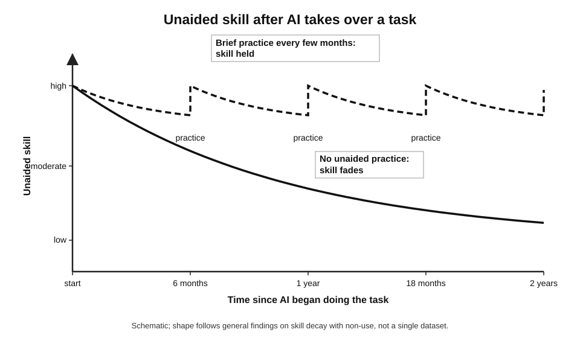
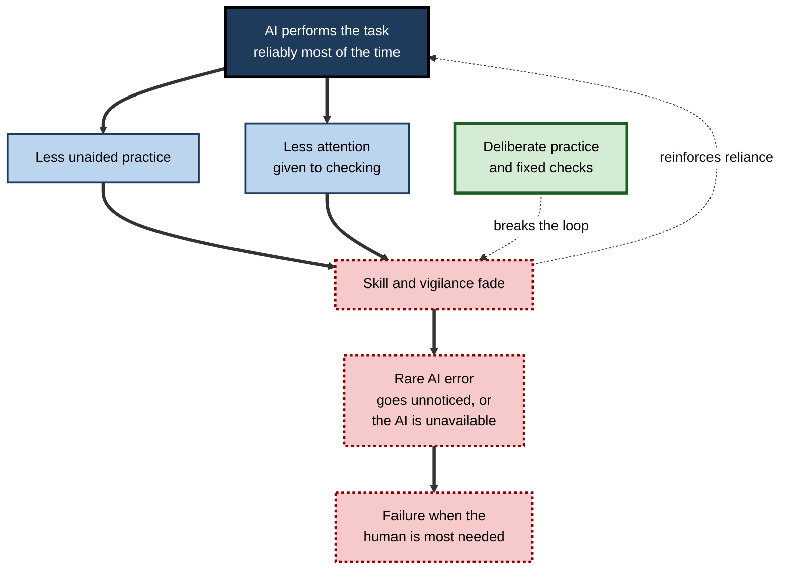
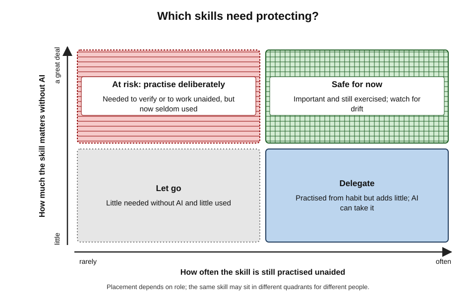
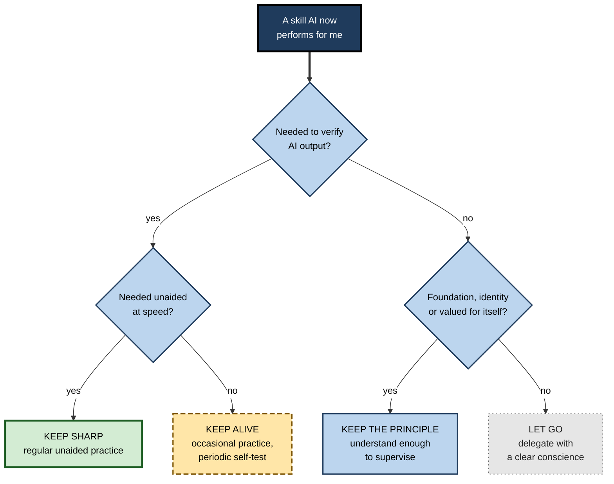
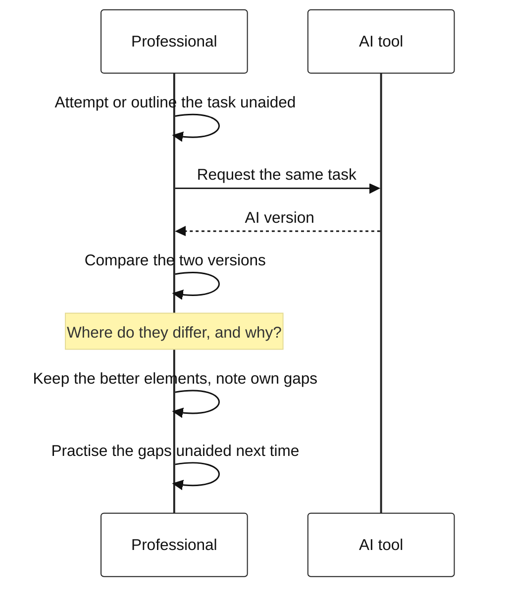

# L.5. Protecting skills you want to keep

In 2021 four endoscopy centres in Poland began using AI that highlights possible precancerous growths during colonoscopy. Some months later, researchers looked at the colonoscopies these experienced doctors performed **without** the AI. Their detection rate had fallen noticeably compared with the period before the AI arrived. The tool helped when it was on; the doctors' own skill seemed to weaken when it was off.

> **Definition — Deskilling:** the loss, or failure to develop, of a person's own capability at a task because a tool or system regularly performs that task, or part of it, for them.

**Why it matters**

- **Tools are not always available** — outages, unapproved settings, client sites, exams, live conversations and emergencies all demand unaided skill.
- **Checking requires knowing** — a person who can no longer do a task well cannot reliably judge whether an AI has done it well.
- **Skills are the basis for further learning** — what a person can do determines what they can learn next.
- **Some skills are part of professional identity** — and of what employers, clients and regulators pay for.
- **The loss is gradual and silent** — skill fades without a moment of failure that would draw attention to it.

---

## How Skills Fade

### Skill decay

> **Definition — Skill decay:** the loss of trained or acquired skills, or knowledge, after a period of non-use.

**Study card — Arthur, Bennett, Stanush and McNelly (1998), meta-analysis of skill decay**

- **Scope:** pooled studies of skill retention after training, across many kinds of task and intervals of non-use.
- **Results:**
  - skill decayed substantially with non-use, and decay grew as the interval lengthened — markedly so beyond a year;
  - **cognitive** tasks and tasks without natural step-by-step structure tended to decay more than physical tasks and well-sequenced procedures;
  - how well a skill was learned originally strongly affected how much was retained.
- **Conclusion:** skills that are not practised fade, and the fade is predictable enough to plan against.

- **Practical implications:**
  - **frequency of practice matters more than intensity** — occasional use keeps a skill alive;
  - **complex judgement skills are fragile** — the kind of skills AI most often assists are among those that decay fastest;
  - **over-learning protects** — skills practised well beyond first mastery last longer.

**Figure 1.** How an unpractised skill fades, and how occasional practice holds it.

### Three routes to lost capability

- **Decay** — a skill once held fades through non-use.
  - *e.g.* an experienced writer who has drafted nothing unaided for two years finds structuring an argument from scratch slow and uncomfortable.
- **Never-skilling** — a skill is never developed because the tool did it from the start.
  - *e.g.* a junior analyst who has always had AI write formulas cannot build one when the tool is wrong.
  - The term has been used in medical education debates since 2025 for trainees who may never acquire skills their seniors learned by doing.
- **Mis-skilling** — a person learns a distorted version of a skill from imitating tool output.
  - *e.g.* absorbing a generic, over-hedged writing style; learning a coding pattern the tool favours but that is unsafe.

> **Definition — Never-skilling:** failure to acquire a skill in the first place because a tool performs the task from the outset of training.

### Automation complacency and bias

- **Automation complacency** — reduced vigilance in monitoring an automated system that usually works.
- **Automation bias** — the tendency to follow automated advice even when it is wrong, or to fail to notice problems the automation does not flag.
- **Raja Parasuraman and Dietrich Manzey (2010)** reviewed these phenomena across aviation, medicine and process control:
  - both occur in experts as well as novices;
  - both are hard to remove by instruction alone;
  - both are linked to attention: when automation is reliable, people allocate less attention to checking it.

> **Definition — Automation bias:** over-reliance on automated aids, leading people to act on incorrect advice (errors of commission) or to miss problems the aid did not flag (errors of omission).

**Figure 2.** How reliable automation can erode the skill needed to supervise it.

### The ironies of automation

- **Lisanne Bainbridge (1983)** set out the "ironies of automation" in industrial process control:
  - automation removes the routine work through which operators keep their skills;
  - yet operators are kept to handle the rare, difficult situations the automation cannot;
  - so the more reliable the automation, the less prepared the human is for the moment they are needed.
- **The irony applies directly to AI at work** — when AI drafts, summarises and analyses routinely, the human's role shrinks to checking and handling exceptions, which are the hardest tasks, done with the least practice.

> **Key point:** delegating routine work to AI does not remove the need for skill. It concentrates the need into fewer, harder moments — exactly when an unpractised skill is most likely to fail.

---

## The Evidence

### Medicine: the colonoscopy study

**Study card — Budzyń and colleagues (2025), *The Lancet Gastroenterology & Hepatology***

- **Setting:** four endoscopy centres in Poland that introduced AI-assisted polyp detection at the end of 2021.
- **Design:** observational comparison of about 1,440 colonoscopies **without** AI — roughly 800 before the AI was introduced and 650 after — performed by 19 experienced endoscopists, each with more than 2,000 previous procedures.
- **Results:**
  - the adenoma detection rate in non-AI colonoscopies fell from about **28%** before to about **22%** after AI exposure — a relative fall of around 20%;
  - in AI-assisted colonoscopies over the same period, the rate was about **25%**.
- **Interpretation:** the authors suggested that routine reliance on AI may have reduced the doctors' own vigilance or attention when the AI was not present.
- **Limits:** observational; other changes over time could contribute; one country and one procedure.

> **Watch out:** this single observational study is suggestive, not conclusive. It is the first clinical evidence of its kind, and it has been debated; but its pattern matches decades of research on automation in aviation and process control.

### Knowledge work: critical thinking

**Study card — Hao-Ping (Hank) Lee and colleagues, Microsoft Research and Carnegie Mellon University (2025)**

- **Design:** survey of 319 knowledge workers who described 936 real examples of using generative AI at work, and rated the critical thinking and effort involved.
- **Results:**
  - **higher confidence in the AI** was associated with **less** critical thinking;
  - **higher self-confidence** in one's own ability was associated with **more** critical thinking;
  - critical thinking shifted from producing work towards **verifying, integrating and stewarding** AI output.
- **Conclusion:** the effort of critical thinking does not disappear with AI, but it can be skipped — especially by people who trust the tool more than themselves.
- **Limits:** self-reported; associations, not causes.

### Learning settings

- **A 2025 field experiment in Turkish high-school mathematics** found that unrestricted access to a chatbot raised practice scores but **lowered** later unaided exam performance, while a version designed to give hints rather than answers largely avoided the harm.
- **Brain-activity studies of essay writing with chatbots**, such as a widely publicised 2025 study from the MIT Media Lab, reported lower engagement measures and weaker recall of one's own essays among chatbot users.
  - That study was small, initially released as a preprint and heavily debated; its findings should be treated as preliminary.

### Earlier tools

- **Satellite navigation** — research by Louisa Dahmani and Véronique Bohbot (2020) found that greater lifetime GPS use was associated with poorer spatial memory when people navigated without it, and in a follow-up subgroup, with steeper decline over three years.
  - Correlational, but consistent with the idea that the skill not exercised weakens.
- **Spelling and arithmetic** — long-standing debates about spellcheckers and calculators; the general consensus is that tools are valuable once foundational skills are secure, and harmful when they replace their formation.

> **Key point:** across very different settings — colonoscopy, mathematics, navigation, office work — the pattern is the same: **assisted performance can rise while unaided capability falls**. Whether it does depends on how the tool is used.

| | Evidence of erosion | Strength of evidence | Main caveat |
|---|---|---|---|
| Colonoscopy (2025) | Lower detection without AI after AI exposure | Moderate: one observational multi-centre study | Other changes over time possible |
| Knowledge workers (2025) | Less critical thinking with high trust in AI | Moderate: large survey | Self-reported, correlational |
| Mathematics students (2025) | Lower unaided exam scores after unrestricted AI | Strong: large field experiment | Students, not professionals |
| Satellite navigation (2020) | Poorer unaided spatial memory with more GPS use | Moderate: correlational with follow-up | Direction of cause not proven |
| Aviation (decades) | Manual flying skills weaken with heavy automation | Strong: incident analyses and simulator studies | Different domain from office work |

---

## Deciding Which Skills to Keep

Not every skill must be protected. People have let go of many skills — long division, map-reading, shorthand — without loss. The question is **which** skills matter enough to keep, and at **what level**.

### Five reasons to keep a skill

- **Verification** — the skill is needed to check AI output.
  - *e.g.* a financial analyst must be able to build the model logic to spot an AI's error in it.
- **Availability** — the skill is needed when AI is absent, slow or not permitted.
  - *e.g.* speaking in a negotiation; answering a client in a meeting; working on a secure system.
- **Foundation** — the skill underpins learning of more advanced skills.
  - *e.g.* writing clear paragraphs before structuring complex reports.
- **Identity and value** — the skill is part of what the person is employed, trusted or paid for.
  - *e.g.* a designer's eye; a lawyer's drafting judgement; a clinician's examination.
- **Meaning** — the person values the skill for its own sake.
  - *e.g.* writing well; reasoning through a hard problem.

> **Mnemonic — "VAFIM" ("Very Able Folk Insist on Mastery"):** Verification, Availability, Foundation, Identity, Meaning.

### A triage of skills

- **Keep sharp** — high importance, needed unaided at speed: practise regularly without AI.
- **Keep alive** — important but not needed at speed: practise occasionally; check standard periodically.
- **Keep the principle** — enough understanding to supervise and verify, without full fluency.
- **Let go** — low importance, reliably available tools, no verification role.

**Figure 3.** Sorting skills by how much they matter without AI and how often they are now practised.

**Figure 4.** Deciding what to do with a skill that AI now performs.

### Worked example (illustrative): a skill audit for a communications manager

**Situation:** a communications manager uses AI daily for press-release drafts, social posts, speech outlines, media-monitoring summaries and translation of short messages. She audits which skills to protect.

| Skill | Verification role? | Needed unaided at speed? | Foundation, identity or meaning? | Triage | Practice plan |
|---|---|---|---|---|---|
| Writing a press release | Yes — must spot weak or wrong claims | Sometimes — crisis statements within minutes | Identity: core of the role | **Keep sharp** | Draft one release a fortnight unaided; AI only reviews |
| Briefing a spokesperson verbally | No AI in the room | Yes — live, under pressure | Identity | **Keep sharp** | Unaided rehearsal before every major briefing |
| Summarising media coverage | Yes — must catch misread tone | No | Foundation for judgement of coverage | **Keep alive** | Summarise one day unaided each month and compare |
| Writing social-media variants | Light | No | Low | **Keep the principle** | Review AI variants against brand guide |
| Translating short messages | Cannot verify most languages | No | Low | **Let go** to approved translation services | Use professional translation for anything public |

*Illustrative example.*

1. **Identify the skills** AI now touches in the role.
2. **Ask the three triage questions** for each: verification, unaided speed, foundation or identity.
3. **Assign a category** and a concrete, small practice plan.
4. **Diary the practice** — a fortnightly and a monthly slot.
5. **Re-audit** in six months or when the role changes.

- **Conclusion:** two skills need regular unaided practice, one needs occasional checking, and two can be safely delegated — a manageable load of about an hour a fortnight.

> **Watch out:** the audit exposed a hidden risk — she could not verify translations into most languages at all, so "let go" had to mean **handing the task to a qualified service**, not trusting an AI translation she could not check.

> **Watch out:** "I can always look it up or ask the AI" assumes the person can **recognise** a good answer. For verification skills, that assumption fails precisely when the skill has faded.

---

## Methods for Keeping Skills

### Practise without the tool

- **Unaided sessions** — schedule regular work done entirely without AI.
  - *e.g.* one report section a week drafted from scratch; one analysis a fortnight built by hand.
- **Rotation** — alternate tasks between AI-assisted and unaided.
- **Keep a few tasks permanently manual** — the ones most central to the person's craft.
- **Practise under realistic conditions** — at speed, with time pressure, without notes, where the real situation demands it.

### Think first, then use the tool

- **Generate-then-compare** — attempt the task (or its outline) unaided, then ask AI, then compare.
  - Keeps the person's own thinking primary and turns AI into a source of feedback.
- **Predict before reading** — before reading an AI answer, state what one expects it to say.
  - Exposes gaps in one's own understanding and makes errors in the output easier to spot.
- **Outline before drafting** — decide the structure and key points oneself; use AI only for prose.

**Figure 5.** Generate-then-compare: keeping one's own thinking first.

### Use AI as a coach, not only as a doer

- **Ask for hints, not answers** — the hint-giving tutor in the mathematics study largely avoided harm.
- **Ask for critique of one's own work** rather than a replacement for it.
- **Ask for explanation** — why a formula works, why a paragraph is unclear — and then redo the task oneself.
- **Set the tool's role in the prompt** — "do not rewrite; point out the three weakest sentences and say why".

> **In practice:** many experienced writers and engineers use AI chiefly as a **reviewer** of their own drafts and code, rather than as the author — keeping the core skill in use while gaining a second pair of eyes.

### Check the skill itself

- **Periodic self-tests** — do a representative task unaided and compare with an earlier unaided sample.
- **Timed tasks** — note how long the unaided version takes; rising time is an early signal of decay.
- **Feedback from others** — a colleague's review of unaided work.
- **Signs of decay:**
  - discomfort or anxiety at doing the task without the tool;
  - inability to explain why the AI's answer is right;
  - accepting outputs that later prove wrong;
  - noticeably slower unaided work.

| | Doing it oneself | AI as reviewer | AI as doer with careful check | AI as doer with light check |
|---|---|---|---|---|
| Skill exercised | Fully | Mostly | Partly — verification only | Little |
| Speed | Slowest | Moderate | Fast | Fastest |
| Risk of unnoticed error | Own errors only | Lower | Moderate | Highest |
| Effect on skill over time | Maintains or grows | Maintains | Verification skill held; production skill fades | Fades |
| Suitable for | Core craft skills | Skills to keep sharp | Skills to keep the principle of | Skills safely let go |

---

## Professional and Organisational Practice

### What high-reliability professions do

- **Aviation**
  - After incidents linked to automation dependence, the US Federal Aviation Administration in 2013 issued a safety alert encouraging operators to give pilots opportunities to fly manually, to maintain hand-flying skills.
  - Recurrent simulator training includes manual handling and automation-failure scenarios.
- **Medicine**
  - Simulation training, skills logbooks and revalidation keep rarely used skills current.
  - Discussion of AI in clinical training increasingly addresses never-skilling of trainees.
- **Engineering and operations**
  - "Game days" and failure drills rehearse what happens when automated systems fail.

### Case study: Air France Flight 447 (2009)

- **Situation:** an Airbus A330 flying from Rio de Janeiro to Paris at night over the Atlantic, in cruise on autopilot.
- **Event:** ice crystals temporarily blocked the airspeed sensors; the autopilot disconnected and the aircraft's flight-control system moved to a mode with fewer protections.
- **What happened next:** the crew, faced with unreliable indications and manual control at high altitude, made inputs that led to an aerodynamic stall, which was not recognised and recovered from. All 228 people on board died.
- **Findings:** the French investigation authority (BEA), reporting in 2012, identified among the contributing factors the crew's difficulty in handling the aircraft manually at high altitude and in recognising the stall — skills rarely practised because the automation normally handled cruise flight.
- **Industry response:** renewed emphasis on manual-flying practice, high-altitude upset training and recognising automation failures.
- **Lesson:** reliable automation can leave highly qualified people unprepared for the rare moment when it stops — the ironies of automation in their starkest form.

### Organisations and the apprenticeship problem

- **Junior work is often the training ground** — first drafts, basic analyses, routine research.
- **When AI does junior work,** juniors may lose the repetitions through which seniors learned their judgement.
- **Responses being explored:**
  - assigning some tasks to juniors **without** AI as deliberate training;
  - requiring juniors to explain and defend AI-assisted work;
  - senior review that focuses on reasoning, not just output;
  - rotating trainees through tasks that build foundations.

> **Key point:** for organisations, protecting skills is a **pipeline** question — today's juniors are tomorrow's experts who will supervise the AI.

### Case study (illustrative): an analyst who noticed in time

- **Situation:** a data analyst in an insurance firm had used AI to write almost all spreadsheet formulas and database queries for eighteen months.
- **Trigger:** during a client workshop with no laptop access to AI, she was asked to sketch the logic for a simple cohort calculation and found she could not do it confidently.
- **Diagnosis:**
  - query writing was a **keep-sharp** skill: needed to verify AI queries and to work live with clients;
  - she had let it slide into "let go" without deciding to.
- **Actions:**
  1. Wrote one query a day unaided before asking AI, then compared.
  2. Changed her prompts to ask the AI for **review** of her queries rather than for queries.
  3. Kept a short log of mistakes she made unaided, and practised those patterns.
  4. Did a monthly timed self-test on a past problem.
- **Result (after three months):** she reported writing standard queries unaided at close to her previous speed, and catching two errors in AI-generated queries that she would previously have accepted.
- **Caveats:** self-assessed; her total speed on routine work dipped for the first few weeks.
- **Lesson:** skill erosion was invisible until a situation demanded unaided performance; a small, regular practice restored it.

---

## The Wider Debate

### Is deskilling inevitable?

- **The pessimistic view** — heavy reliance on AI will hollow out expertise across professions, leaving people unable to judge the tools they depend on.
- **The optimistic view** — people will **reskill** towards higher-level work (framing problems, judging outputs, integrating results), just as calculators shifted mathematics towards reasoning.
- **The evidence-based middle** — outcomes depend on **how** tools are used: the same AI can erode or build skill depending on whether it replaces thinking or supports it.

> **Definition — Reskilling:** developing new capabilities to replace those made less valuable by technological change.

### Cognitive offloading reconsidered

- **Cognitive offloading** — using external tools to reduce mental demand — is ancient and often beneficial: writing, calendars and calculators are all forms of it.
- **The cost arises** when the offloaded process was the one that built or maintained a valuable skill.
- **The professional question** is therefore not "offload or not?" but "**which** processes can be offloaded without losing capabilities that matter?"

### Equity and career stage

- **Novices** risk never-skilling; **mid-career professionals** risk decay; **experts** risk complacency.
- **Workers whose roles are reshaped by AI** may find the skills they built devalued while new ones are not yet developed.
- **The burden of practice falls unevenly** — those with less time or support may find it hardest to protect skills.

---

## Open Questions

- **Which skills truly need protecting?**
  - Evidence about which capabilities each profession must keep "in the head" is thin; most guidance is reasoned from analogy.
- **How much practice is enough?**
  - Skill-decay research gives general patterns, but not the minimum practice needed to maintain specific AI-assisted skills.
- **Can tool design prevent deskilling?**
  - Hint-giving tutors suggest yes in learning; whether everyday work tools can be designed to keep users engaged without slowing them is open.
- **How should never-skilling be addressed in training?**
  - Professions are only beginning to redesign apprenticeship and early-career work around AI.
- **Is the colonoscopy finding general?**
  - Replication in other procedures and professions is needed before strong conclusions are drawn.

---

## Summary

- **Deskilling** is the loss, or failure to develop, of one's own capability because a tool does the task.
- **Skill decay** grows with non-use; complex cognitive skills are fragile; frequent practice and over-learning protect (Arthur and colleagues, 1998).
- Capability is lost by **decay**, **never-skilling** and **mis-skilling**; **automation complacency** and **automation bias** reduce vigilance.
- Bainbridge's **ironies of automation**: automation removes the practice that maintains skills, yet leaves humans to handle the hardest exceptions.
- Evidence: the **2025 colonoscopy study** (detection without AI fell after AI exposure); the **2025 knowledge-worker survey** (trust in AI linked to less critical thinking); the **2025 mathematics experiment**; **GPS** and spatial memory; aviation, including **Air France 447**.
- Keep skills needed for **Verification, Availability, Foundation, Identity, Meaning**; triage into **keep sharp, keep alive, keep the principle, let go**.
- Methods: **unaided practice**, **rotation**, **generate-then-compare**, **predict before reading**, **AI as coach or reviewer**, **periodic self-tests**.
- Organisations must protect the **pipeline**: juniors need repetitions that build judgement.
- Outcomes depend on **how** AI is used: it can erode or build skill.

---

## Self-Check

1. Define deskilling and explain why the loss is often silent.
2. Summarise the main findings of the 1998 meta-analysis of skill decay and two practical implications.
3. Distinguish decay, never-skilling and mis-skilling with a workplace example of each.
4. What are automation complacency and automation bias? Name the two kinds of error automation bias produces.
5. Explain Bainbridge's ironies of automation and how they apply to AI at work.
6. Describe the 2025 colonoscopy study, its main result and its limits.
7. What did the 2025 survey of 319 knowledge workers find about confidence and critical thinking?
8. List the five reasons to keep a skill and give an example of each for a role of your choice.
9. Describe the four-way triage of skills and how each category should be practised.
10. Explain generate-then-compare and why it protects skill.
11. How can AI be used as a coach rather than a doer? Give two example instructions.
12. What happened on Air France Flight 447, and what lesson does it hold for AI users?
13. Why is protecting skills a pipeline question for organisations? Suggest two responses.
14. A manager wants all junior staff to use AI for every first draft to maximise output. Assess the risks and propose a policy that balances productivity and skill.

### Answer Key

1. Loss, or failure to develop, of one's own capability because a tool does the task. Silent because skill fades gradually and the tool masks the loss until a situation demands unaided performance.
2. Skill decays substantially with non-use, more as intervals lengthen; cognitive and loosely structured tasks decay more; original learning strength affects retention. Implications: regular practice keeps skills alive; complex judgement skills need particular attention; over-learning protects.
3. Decay: a writer who has not drafted unaided for years struggles to structure an argument. Never-skilling: a junior who always used AI for formulas cannot build one. Mis-skilling: adopting an AI's over-hedged style or an unsafe coding pattern.
4. Complacency: reduced vigilance monitoring a usually reliable system. Bias: over-reliance on automated advice. Errors of commission (acting on wrong advice) and omission (missing problems not flagged).
5. Automation removes the routine practice that maintains skill but leaves humans to handle rare, hard exceptions — so the more reliable it is, the less prepared they are. With AI, humans shift to checking and exceptions, the hardest work with the least practice.
6. In four Polish centres, the adenoma detection rate of experienced endoscopists in non-AI colonoscopies fell from about 28% to about 22% after AI was introduced. Limits: observational, possible other changes over time, one country and procedure.
7. Higher confidence in AI was associated with less critical thinking; higher self-confidence with more. Critical thinking shifted towards verification and integration of AI output.
8. *e.g.* for a solicitor — Verification: spotting a wrong clause in an AI draft; Availability: advising live in a meeting; Foundation: drafting simple clauses before complex agreements; Identity: drafting judgement clients pay for; Meaning: pride in precise drafting.
9. Keep sharp: regular unaided practice at speed. Keep alive: occasional practice and periodic self-tests. Keep the principle: understand enough to supervise and verify. Let go: delegate freely.
10. Attempt or outline the task unaided, then ask AI, then compare. One's own thinking is exercised first, AI becomes feedback, and the comparison reveals gaps to practise.
11. Ask for hints, critique or explanation rather than finished work. *e.g.* "Do not rewrite; identify the three weakest arguments and explain why." "Give me a hint for the next step, not the solution."
12. Airspeed sensors iced; the autopilot disconnected; the crew, rarely practised in manual high-altitude flight, stalled the aircraft without recognising it; 228 died. Lesson: reliable automation can leave capable people unprepared for its rare failures.
13. Juniors learn judgement through routine work that AI now does; without it, there will be fewer capable future supervisors. Responses: some tasks done unaided as training; juniors explain and defend AI-assisted work; review of reasoning, not only output.
14. Risks: never-skilling, inability to verify AI drafts, weaker future seniors, automation bias. Policy: AI allowed for drafts, but a set proportion of key drafts written unaided; juniors outline before using AI; juniors explain their choices in review; periodic unaided assessments; AI used as reviewer for core craft tasks.

---

## Glossary

| Term | Meaning |
|---|---|
| Automation bias | Over-reliance on automated aids, causing errors of commission or omission. |
| Automation complacency | Reduced vigilance in monitoring a usually reliable automated system. |
| Cognitive offloading | Using external tools or actions to reduce mental demand. |
| Deskilling | Loss, or failure to develop, of capability because a tool does the task. |
| Generate-then-compare | Attempting a task unaided before asking AI, then comparing the versions. |
| Ironies of automation | Bainbridge's observation that automation erodes the skills needed for its rare failures. |
| Keep the principle | Retaining enough understanding to supervise a task without full fluency. |
| Mis-skilling | Learning a distorted version of a skill by imitating tool output. |
| Never-skilling | Failure to acquire a skill because a tool performed it from the start. |
| Over-learning | Practice beyond first mastery, which improves retention. |
| Reskilling | Developing new capabilities to replace those devalued by change. |
| Skill decay | Loss of skill or knowledge after a period of non-use. |
| Skill triage | Sorting skills into keep sharp, keep alive, keep the principle and let go. |
| Unaided practice | Deliberate performance of a task without AI to maintain skill. |
