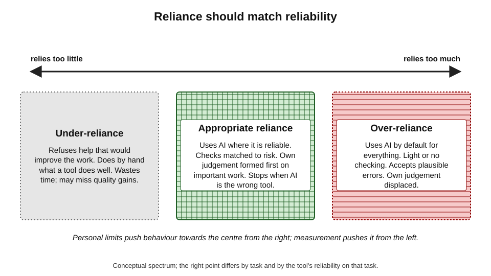
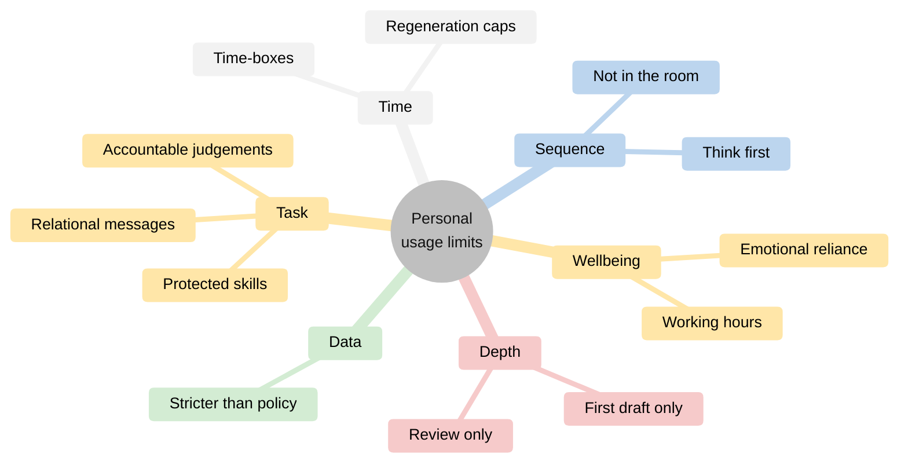
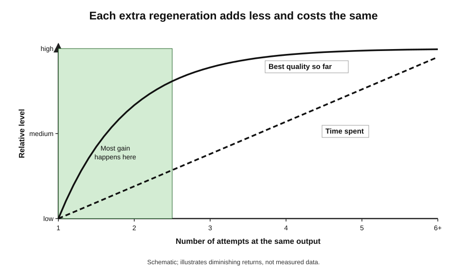
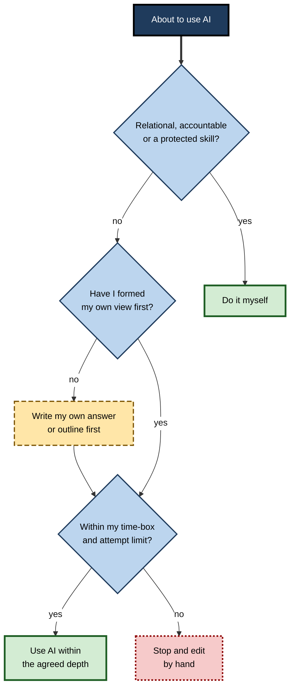

# L.6. Setting personal usage limits

A project manager notices that she now opens an AI assistant before she has thought about anything: before replying to a two-line message, before deciding what a meeting is for, before writing a note of thanks to a colleague who stayed late. One evening she spends forty minutes regenerating a single paragraph in search of a perfect version. None of this is forbidden by any policy. But she senses that the tool has quietly moved from **helping** her work to **shaping** it.

> **Definition — Personal usage limit:** a boundary a person sets for themselves on when, for what, how much or how deeply they use AI tools, beyond whatever their organisation requires.

**Why limits matter**

- **Policies set the floor, not the standard** — organisational rules address data, security and legal risk; they rarely address over-reliance, wasted time or the erosion of one's own voice.
- **Ease invites overuse** — a tool that is always one keystroke away gets used for things it does not improve.
- **Some work should remain personal** — certain messages, judgements and decisions lose value when delegated.
- **Without limits, habits drift** — usage expands by default; limits are how a person keeps deliberate control.

---

## Why Usage Expands by Default

### The pull of the easy option

- **Effort minimisation** — people tend to choose the path that requires least immediate effort; an AI request is often easier than starting from a blank page.
- **Intermittent reward** — AI output is sometimes excellent, sometimes poor; unpredictable rewards are known to sustain repeated behaviour strongly.
- **Availability** — assistants embedded in email, documents, chat and browsers are present at every moment of work.
- **Social norms** — when colleagues use AI for everything, not using it can feel like inefficiency.

> **Key point:** without a deliberate boundary, AI use tends to grow into every task it can touch — not because each use helps, but because each use is easy.

### Over-reliance and appropriate reliance

> **Definition — Appropriate reliance:** relying on an AI tool when it is likely to be right and not relying on it when it is likely to be wrong — trust matched to actual reliability.

> **Definition — Over-reliance:** accepting or depending on AI output more than its reliability warrants, including using it where one's own judgement would be better.

- **Under-reliance** — refusing help that would improve the work; wasted time and missed quality.
- **Appropriate reliance** — use where it helps, with checks matched to risk.
- **Over-reliance** — use by default, light checking, acceptance of plausible errors, loss of one's own judgement.

**Figure 1.** The spectrum of reliance on AI tools.

**Study card — Zana Buçinca, Maja Barbara Malaya and Krzysztof Gajos (2021), "To trust or to think"**

- **Design:** online experiments in which participants made decisions with AI recommendations, some of which were deliberately wrong.
  - Some conditions used **cognitive forcing functions** — designs that made people think before seeing the AI's answer, such as having to decide first, or waiting before the recommendation appeared.
- **Results:**
  - cognitive forcing **reduced over-reliance** on wrong AI recommendations compared with simple explanations;
  - but participants **liked** those designs less and found them more effortful;
  - people with higher "need for cognition" (enjoyment of effortful thinking) benefited more.
- **Conclusion:** making people think first reduces over-reliance, but the most effective safeguards are the least popular — so they rarely survive unless chosen deliberately.

> **Definition — Cognitive forcing function:** a design or rule that requires a person to engage their own reasoning before receiving an automated suggestion.

> **In practice:** a personal "think first" rule is a self-imposed cognitive forcing function. Its value comes precisely from being slightly inconvenient.

---

## Kinds of Limits

Limits can be drawn on several dimensions. A good personal set uses a few of them, each with a clear reason.

### Task limits — what AI is not used for

- **Relational messages** — condolences, apologies, personal thanks, difficult feedback, messages whose value lies in the sender's own effort.
- **Core judgements** — decisions the person is accountable for: hiring choices, performance ratings, clinical or legal conclusions, investment recommendations.
- **Skills being protected** — tasks kept manual to preserve capability.
- **Creative work where voice matters** — speeches, personal essays, signature pieces.

> **Watch out:** recipients increasingly suspect AI involvement in personal messages. Research on AI-mediated communication has found that people who believe a message was AI-written tend to judge its sender as less sincere or warm — whether or not AI was actually used. A personal note that reads as generated can do more harm than a plainer one written by hand.

### Data limits — what is never pasted in

- Rules about which information may enter which tools belong to privacy and confidentiality practice; a personal limit can simply be **stricter** than the policy.
  - *e.g.* "no client names in any tool, even approved ones, unless the task needs them".

### Time limits — how long is spent

- **Time-boxing** — a fixed time allowed for an AI-assisted step before moving on or doing it oneself.
- **Regeneration limits** — a maximum number of attempts at the same output.
- **Session limits** — breaks from long, absorbing back-and-forth sessions.

### Depth limits — how far AI goes

- **First draft only** — AI may draft, but the person rewrites substantially.
- **Structure from me, prose from the tool** — or the reverse.
- **Review only** — AI critiques; the person writes.
- **No final say** — AI never produces the version that is sent without human editing.

### Sequence limits — when AI comes in

- **Think first** — form one's own view, outline or answer before asking.
- **After the first hour** — on major pieces, do the initial thinking unaided.
- **Not in the room** — no AI during conversations where full attention is owed to people present, beyond agreed note-taking.

### Wellbeing limits — protecting the person

- **Working hours** — AI makes it easier to keep working anywhere; limits protect evenings and rest.
- **Companionship and emotional use** — chatbots used for reassurance or emotional support during work stress can be helpful in moments but are not a substitute for people; heavy reliance is a signal worth noticing.
- **Constant availability** — a habit of "just asking quickly" can fragment attention throughout the day.

**Figure 2.** Six dimensions on which personal limits can be drawn.

> **Mnemonic — "To Do The Daily Stuff Well":** Task, Data, Time, Depth, Sequence, Wellbeing.

---

## The Regeneration Trap

### Why perfect output is a mirage

- **Generative tools produce a different output each time** — there is always another version to try.
- **Each new version is a lottery ticket** — sometimes better, often similar, occasionally worse.
- **Diminishing returns** — after the first few attempts, the expected improvement from another regeneration falls sharply, while the time cost stays constant.
- **The prompt spiral** — repeated rewording and regenerating in search of a slightly better result, often ending with a version little better than the second attempt.

**Figure 3.** Diminishing returns from regenerating the same output.

### Satisficing

- **Herbert Simon (1956)** introduced **satisficing** — choosing the first option that meets an acceptable threshold, rather than searching for the best.
  - Simon argued that with limited time and information, satisficing is often the rational strategy.
- **Barry Schwartz and colleagues (2002)** distinguished **maximisers** (who seek the best) from **satisficers** (who seek good enough):
  - maximisers reported **lower satisfaction**, more regret and less happiness;
  - a later study of graduating students (Sheena Iyengar, Rachael Wells and Schwartz, 2006) found that maximisers obtained jobs with higher starting salaries but felt worse about their choices.
- **For AI use:** set the "good enough" standard before generating; stop at the first output that meets it, then improve it by hand.

> **Definition — Satisficing:** choosing the first option that meets a predefined standard of acceptability, rather than searching for the optimum.

> **Remember:** decide what "good enough" looks like **before** the first generation. A standard set afterwards keeps moving.

### A simple regeneration rule

1. **Define the standard** — e.g. "correct facts, right length, plain tone".
2. **Generate once**; if it meets the standard, stop.
3. **If not, change the instruction**, not just the dice — add the missing constraint.
4. **Allow one more attempt** — two at most.
5. **Then edit by hand** — the remaining gap is usually faster to close oneself.

> **Formula — Cost of the prompt spiral:** extra attempts × minutes per attempt. Example: 8 extra regenerations × 3 minutes = 24 minutes to improve a paragraph that would have taken 5 minutes to fix by hand — a loss of **19 minutes**.

---

## Designing Personal Limits

### What makes a limit work

- **Specific** — "no AI for condolence messages", not "use AI thoughtfully".
- **Reasoned** — each limit has a stated purpose (protect a skill, protect a relationship, save time).
- **Few** — five to eight limits that are kept beat twenty that are not.
- **Written down** — memory bends rules in the moment; writing fixes them.
- **Phrased as if-then rules** — "if I am writing to someone about a loss, then I write it myself".
- **Reviewed** — revisited every few months as tools, tasks and roles change.

### Bright lines and personal rules

- **George Ainslie**, studying self-control, argued that people protect long-term goals by adopting **personal rules** that treat each choice as a precedent for future choices.
  - Clear rules — **bright lines** — are easier to keep than vague ones, because there is no room to argue with oneself in the moment.
- **Bright lines suit high-stakes limits** — data, relational messages, accountable judgements.
- **Flexible standards suit low-stakes limits** — time-boxes and depth limits, where judgement is needed.

> **Definition — Bright-line rule:** a clear, unambiguous rule that admits no case-by-case exceptions, used where consistency matters more than flexibility.

| | Bright-line rule | Flexible standard |
|---|---|---|
| Example | "Never paste client personal data into any AI tool" | "Keep AI use proportionate to the task" |
| Ease of keeping | High — no argument in the moment | Low — invites rationalisation |
| Handles unusual cases | Poorly | Well |
| Best for | High-stakes, irreversible risks | Low-stakes efficiency choices |
| Failure mode | Rigidity in rare cases | Gradual erosion |

### Precommitment

- **Precommitment** — binding one's future self to a choice made in advance.
  - The classic image is Ulysses having himself tied to the mast to hear the Sirens without steering towards them.
- **Dan Ariely and Klaus Wertenbroch (2002)** found that students allowed to set their own deadlines often chose to impose them — showing people recognise their own self-control problems — although self-set deadlines worked less well than evenly spaced external ones.
- **Precommitment tools for AI use:**
  - removing AI shortcuts from the places where limits apply;
  - turning off automatic suggestions in documents where the person wants to write unaided;
  - setting assistants' custom instructions to give critique rather than rewrites;
  - scheduling unaided work blocks in the calendar.

> **Definition — Precommitment:** a choice made in advance that restricts or raises the cost of later options, to protect long-term goals from short-term temptation.

### Implementation as if-then rules

- **"If–then" plans** connect a situation to a response and are more effective than general intentions.
- *e.g.* "If I am about to ask AI for a decision I am accountable for, then I first write my own answer in one sentence."
- *e.g.* "If I have regenerated twice, then I edit by hand."
- *e.g.* "If it is after 7 p.m., then I do not open work AI tools."

**Figure 4.** Applying personal limits at the moment of use.

---

## Worked Example (illustrative): A Personal Usage Charter

**Situation:** a senior consultant writes a one-page charter of personal limits after noticing over-reliance in her own work.

1. **Task limits**
   - If a message is about a loss, an apology, praise for an individual or difficult feedback, I write it myself.
   - I do not ask AI for my recommendation to a client; I may ask it to challenge my recommendation after I have written it.
2. **Data limit** (stricter than policy)
   - No client names or financial figures in any AI tool unless the task cannot be done without them and the tool is approved for them.
3. **Sequence limits**
   - For any document longer than two pages, I write the outline and key messages before using AI.
   - In client meetings, no AI beyond the approved note-taker, and only with participants' agreement.
4. **Time and depth limits**
   - Two generations, then edit by hand.
   - AI drafts internal emails; I rewrite anything going to clients.
5. **Wellbeing limit**
   - No work AI tools after 8 p.m. or at weekends, except for genuine emergencies.
6. **Review**
   - First working day of each quarter: reread the charter; note where it was broken and why; adjust.

- **Conclusion:** six short rule groups, each with a reason, written as if-then statements, with a scheduled review.

> **Watch out:** a charter that lists everything ends up observing nothing. If more than a page is needed, the limits are probably too many or too vague.

---

## Limits Across Roles and Situations

The right limits depend on what a role is accountable for, which skills it rests on and whom it serves. The same tool can need very different boundaries in different hands.

### Typical limits by role

- **Managers**
  - Write performance reviews, feedback, recognition and difficult conversations themselves; AI may help structure evidence beforehand.
  - Do not let AI summaries of team members' work replace direct conversation.
  - Form their own view of a decision before asking AI to challenge it.
- **Software developers**
  - Write security-critical, novel or architecture-defining code themselves, or review generated code line by line.
  - Cap the time spent coaxing a tool to fix a bug it has failed on twice; debug directly instead.
  - Keep some routine coding manual to retain fluency.
- **Writers, editors and communications staff**
  - Keep signature pieces, speeches and personal columns in their own voice.
  - Use AI for review, research support and variants, with a rule against publishing generated prose unedited.
- **Analysts and consultants**
  - Form hypotheses and recommendations before asking AI; use it to test them.
  - Never let AI choose which data to exclude or which result to report.
- **Clinicians, lawyers and other regulated professionals**
  - Keep diagnosis, advice and signed judgements human, within professional rules.
  - Apply stricter personal data limits than general office staff.
- **Teachers and trainers**
  - Keep assessment judgements and personal feedback to learners their own.

### When to tighten and when to relax

- **Tighten limits when:**
  - errors that would have been caught are slipping through;
  - unaided work feels harder or slower than it used to;
  - colleagues or clients comment that work sounds generic;
  - AI use is spilling into evenings and rest;
  - the work moves into higher-stakes territory — a new client, a regulated matter, a public statement.
- **Relax limits when:**
  - measurement shows a task is reliably done well with AI and the skill is not one to protect;
  - a tool's reliability on a task has clearly improved and been tested;
  - the limit has become a ritual with no remaining purpose.

| | Signs a limit is too loose | Signs a limit is too tight |
|---|---|---|
| Quality | Errors accepted; generic output; complaints | No change — the limit is not the issue |
| Time | Long regeneration sessions; late evenings | Hours spent on work AI does reliably and well |
| Skills | Unaided work slower or uncomfortable | Skills maintained, but at high time cost for little benefit |
| Relationships | Messages read as templated | None |
| Typical response | Add a specific bright line or time-box | Convert a bright line into a flexible standard, or drop it |

**Figure 5.** The life of a personal limit.

```mermaid
%%{init: {'theme':'base','themeVariables':{'fontFamily':'Arial, Helvetica, sans-serif','fontSize':'15px','primaryColor':'#FFFFFF','primaryTextColor':'#111111','primaryBorderColor':'#222222','lineColor':'#333333','secondaryColor':'#F2F2F2','tertiaryColor':'#FFFFFF','clusterBkg':'#FAFAFA','clusterBorder':'#555555','edgeLabelBackground':'#FFFFFF','titleColor':'#111111'}}}%%
stateDiagram-v2
    direction LR
    Proposed: Proposed - a problem noticed
    Written: Written - specific if-then rule
    Kept: Kept - applied in daily work
    Reviewed: Reviewed - purpose still valid?
    Retired: Retired - purpose gone
    Proposed --> Written: reason stated
    Written --> Kept: precommitment in place
    Kept --> Reviewed: quarterly or after a breach
    Reviewed --> Kept: still serves its purpose
    Reviewed --> Written: tighten or loosen
    Reviewed --> Retired: no longer needed
```

> **Remember:** a limit earns its place by its **purpose**. When the purpose no longer applies, the limit should change — deliberately, at a review, not in the middle of a tempting moment.

---

## Limits in Context

### Organisational policy and personal limits

| | Organisational AI policy | Personal usage limits |
|---|---|---|
| Purpose | Manage legal, security, data and reputational risk | Protect judgement, skills, relationships, time and wellbeing |
| Set by | The organisation | The individual |
| Typical content | Approved tools, data classes, disclosure rules | Tasks kept personal, think-first rules, time-boxes |
| Enforcement | Monitoring, sanctions | Self-commitment and review |
| Relationship | Minimum standard | May be stricter; never looser |

> **Key point:** personal limits never override organisational rules in the permissive direction. They add standards the policy does not cover.

### Disclosure and honesty

- **Disclosure norms vary** — by profession, organisation and audience; some require disclosure of AI assistance, others do not.
- **A personal limit may go further** — "if a reader would feel misled to learn that AI wrote this, I either disclose or write it myself."
- **The underlying test** — would the recipient's trust or judgement change if they knew how the work was produced?

### Environmental considerations

- **Each AI request uses energy and water** in data centres; per-request figures published by providers in 2025 were small (for one provider's median text request, a fraction of a watt-hour), but larger models, long reasoning, image and video generation, and agents use considerably more.
- **Aggregate use is growing fast**, and estimates vary widely between providers and methods.
- **A proportionate personal response** — avoid wasteful habits such as needless regeneration and very large requests for trivial tasks — rather than treating each small request as a significant harm.

> **Watch out:** published per-request environmental figures come largely from providers themselves, use differing methods and cover only some kinds of use. They are useful for scale, not for precise personal accounting.

### Wellbeing and the always-available assistant

- **Boundary blurring** — research on mobile technology and work has long documented how constant connectivity erodes the boundary between work and rest.
- **AI extends this** — work can now be advanced from anywhere, with little effort, at any hour.
- **Signals worth noticing:**
  - reaching for AI out of habit rather than need;
  - discomfort at working without it;
  - using it to avoid starting difficult work;
  - late-night sessions that extend the working day;
  - turning to a chatbot for reassurance more than to colleagues.

> **In practice:** practitioners who sustain heavy AI use without strain usually have **clear off-switches** — times, places and tasks where the tool is not used — in the same way that careful email users set times when they do not check messages.

---

## Case Study (illustrative): The Consultant in the Prompt Spiral

- **Situation:** a strategy consultant used an AI assistant for almost all writing and much of her thinking: framing problems, choosing recommendations, drafting every email.
- **Problem:**
  - she spent long evenings refining outputs, often regenerating ten or more times;
  - a partner commented that her recommendations had become "generic";
  - a client remarked that a thank-you note "sounded like a template".
- **Diagnosis:**
  - no sequence limit: AI framed problems before she had thought;
  - no time or attempt limit: the prompt spiral consumed hours;
  - no task limit: relational messages were delegated;
  - her own judgement had been displaced by the tool's average view.
- **Actions:**
  1. Wrote a one-page charter of six limits, including think-first for recommendations and personal writing of relational messages.
  2. Set a two-attempt rule and a 20-minute time-box for AI-assisted drafting.
  3. Changed her assistant's custom instructions to "challenge and critique; do not rewrite unless asked".
  4. Blocked a daily 45-minute unaided thinking slot.
  5. Reviewed the charter at the end of each month for a quarter.
- **Result (after a quarter):** she reported fewer late evenings and less time per document; the partner noted sharper, more distinctive recommendations; she still used AI daily, but mainly to test and polish her own thinking.
- **Caveats:** self-reported time; one partner's judgement of quality.
- **Lesson:** the problem was not the tool but the absence of boundaries; a few written, specific limits restored her judgement without giving up the benefit.

---

## Open Questions

- **What level of AI reliance is healthy?**
  - There is no agreed measure of appropriate reliance in everyday knowledge work, and it differs by task and person.
- **Do self-imposed limits last?**
  - Research on personal rules suggests they help but erode; how well AI usage limits survive changing tools and pressures is unstudied.
- **Should tools build in limits?**
  - Cognitive forcing designs reduce over-reliance but are unpopular; whether vendors will offer them, and whether users will choose them, is unclear.
- **How should disclosure norms settle?**
  - Professions, publishers and organisations are still converging on when AI assistance should be disclosed.
- **What is the real environmental cost of everyday use?**
  - Estimates depend on provider methods and the mix of model sizes and tasks; independent, comparable measurement is limited.

---

## Summary

- A **personal usage limit** is a self-set boundary on when, for what, how much or how deeply AI is used — beyond organisational policy.
- Usage **expands by default** through effort minimisation, intermittent reward, constant availability and social norms.
- The aim is **appropriate reliance** — trust matched to reliability — avoiding both under- and **over-reliance**.
- Buçinca and colleagues (2021): **cognitive forcing functions** reduce over-reliance but are disliked; a **think-first** rule is a personal version.
- Limits can be drawn on six dimensions: **Task, Data, Time, Depth, Sequence, Wellbeing**.
- The **regeneration trap**: returns diminish after a few attempts; use **satisficing** (Simon), set "good enough" in advance, and cap attempts.
- Good limits are **specific, reasoned, few, written, if-then, reviewed**; use **bright lines** for high stakes and flexible standards for low stakes.
- **Precommitment** — removing shortcuts, changing default instructions, scheduling unaided work — protects limits from in-the-moment temptation.
- Personal limits may be **stricter, never looser**, than policy; they also address disclosure, environmental proportion and **wellbeing**.

---

## Self-Check

1. Define a personal usage limit and explain why organisational policy is not enough.
2. Give three reasons AI usage expands by default.
3. Distinguish under-reliance, appropriate reliance and over-reliance.
4. Summarise the 2021 "To trust or to think" study and its practical lesson.
5. List the six dimensions of personal limits with one example each.
6. Why do people suspect and penalise AI involvement in personal messages, and what limit follows?
7. Explain the regeneration trap and the concept of satisficing.
8. Calculate the cost of a prompt spiral of six extra attempts at 4 minutes each, compared with 6 minutes of hand-editing.
9. What makes a personal limit effective? Name five properties.
10. Distinguish a bright-line rule from a flexible standard and say when each is appropriate.
11. What is precommitment? Give three precommitment tools for AI use.
12. Write three if-then rules for a role of your choice.
13. How should personal limits relate to organisational policy?
14. A colleague says limits are pointless because "AI is always faster". Construct a reasoned reply using evidence and examples.

### Answer Key

1. A self-set boundary on when, for what, how much or how deeply one uses AI. Policies address data, legal and security risk; they rarely address over-reliance, skill erosion, relational damage, wasted time or wellbeing.
2. Effort minimisation; intermittent reward from unpredictable output quality; constant availability inside work tools; social norms of heavy use.
3. Under-reliance: refusing help that would improve work. Appropriate: using AI where it is reliable, with checks matched to risk. Over-reliance: depending on AI beyond its reliability, accepting plausible errors and displacing one's own judgement.
4. Participants made decisions with sometimes-wrong AI advice; designs forcing them to think first reduced over-reliance more than explanations did, but were less liked. Lesson: the most effective safeguards are inconvenient, so they must be chosen deliberately.
5. Task — no AI for condolences. Data — no client names even in approved tools. Time — 20-minute time-box. Depth — AI drafts only internal emails. Sequence — think first on recommendations. Wellbeing — no work AI after 8 p.m.
6. Recipients who believe a message is AI-written tend to see the sender as less sincere or warm. Limit: write relational messages oneself.
7. Each regeneration is a new draw; improvements diminish after a few attempts while time costs stay constant. Satisficing means choosing the first option that meets a predefined standard, which avoids the spiral.
8. 6 × 4 = 24 minutes versus 6 minutes of editing: a loss of **18 minutes**.
9. Specific, reasoned, few, written down, phrased as if-then rules, reviewed periodically.
10. Bright line: clear, no exceptions (e.g. never paste personal data); suits high-stakes, irreversible risks. Flexible standard: judgement-based (e.g. proportionate use); suits low-stakes efficiency choices.
11. Binding one's future self in advance. Tools: removing AI shortcuts where limits apply; turning off automatic suggestions; setting custom instructions to critique rather than rewrite; calendar blocks for unaided work.
12. *e.g.* for a manager: "If I am writing a performance review, then I draft it myself." "If I have regenerated twice, then I edit by hand." "If I am in a one-to-one meeting, then no AI tools are open."
13. Policy is the minimum; personal limits add standards on judgement, skills, relationships, time and wellbeing. They may be stricter but never more permissive.
14. Measured studies show perceived and real speed can diverge, and regeneration spirals cost time; some tasks lose value when delegated (relational messages); over-reliance leads to accepted errors (as in decision experiments); skills used to verify output fade without practice. Limits are not anti-AI — they direct use to where it genuinely helps.

---

## Glossary

| Term | Meaning |
|---|---|
| Appropriate reliance | Trust in AI matched to its actual reliability on the task. |
| Bright-line rule | A clear rule admitting no case-by-case exceptions. |
| Cognitive forcing function | A design or rule requiring one's own reasoning before an automated suggestion. |
| Intermittent reward | Rewards that arrive unpredictably, which strongly sustain repeated behaviour. |
| Maximiser | A person who seeks the best possible option. |
| Over-reliance | Depending on AI more than its reliability warrants. |
| Personal rule | A self-imposed rule treating each choice as a precedent, protecting long-term goals. |
| Personal usage limit | A self-set boundary on when, for what, how much or how deeply AI is used. |
| Precommitment | An advance choice that restricts later options to protect long-term goals. |
| Prompt spiral | Repeated rewording and regenerating in pursuit of marginally better output. |
| Satisficing | Choosing the first option that meets a predefined acceptable standard. |
| Time-box | A fixed amount of time allowed for a step before moving on. |
| Under-reliance | Refusing AI help that would genuinely improve the work. |
| Usage charter | A short written set of personal AI usage limits with reasons and a review date. |
