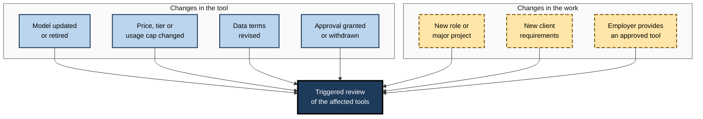
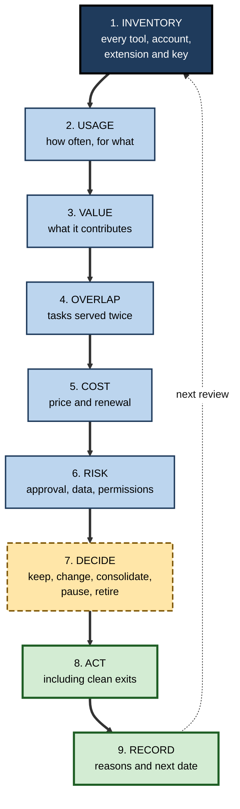
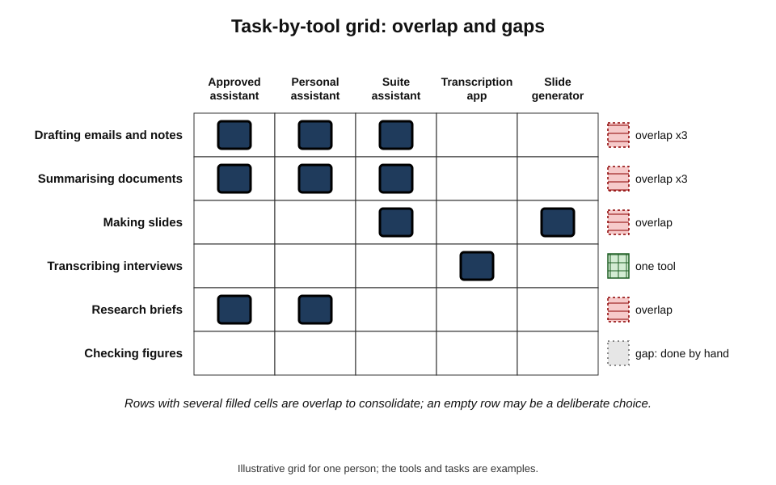
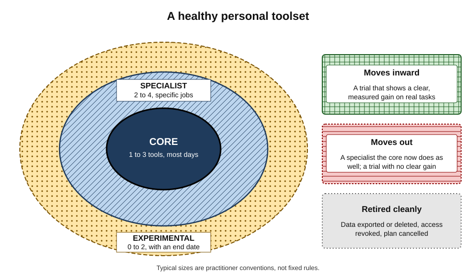
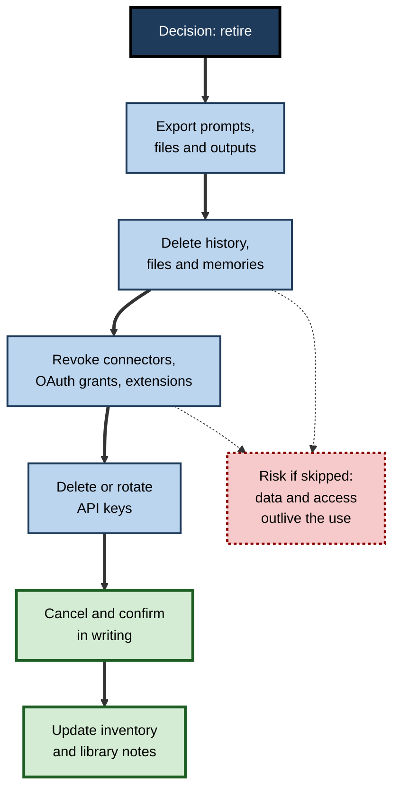

# L.7. Reviewing your toolset periodically

A freelance designer sits down one January afternoon to list every AI tool she pays for or has an account with. The list runs to fourteen. Three do essentially the same thing. One she has not opened since the spring, yet it renews every month. Another still holds a year of client briefs in its history. A browser extension she installed for a single project still has permission to read every page she visits. None of this was a decision. It simply accumulated.

> **Definition — Toolset review:** a periodic, structured look at all the AI tools a person uses — what each is for, how much it is used, what it costs, what data it holds and what risks it carries — leading to explicit decisions to keep, change or retire each one.

**Why reviews matter**

- **Tools accumulate silently** — sign-ups are easy; cancellations require effort and memory.
- **Tools change under the user** — features, models, prices, data terms and approval status shift without the user's choosing.
- **Needs change** — a new role, client, project or policy alters which tools fit.
- **Habits fossilise** — once established, routines continue even after they stop helping.
- **Exposure grows** — every account, connector and extension holds data or permissions that outlast their use.

---

## Why Toolsets Drift

### Status quo bias and inertia

- **William Samuelson and Richard Zeckhauser (1988)** demonstrated **status quo bias**: in decision experiments and real choices such as health plans and retirement allocations, people disproportionately stuck with whatever option was already in place.
- **Inertia in subscriptions** — the default is renewal; leaving requires action.
- **Endowment effect** — people value things more once they own them, including tools they have configured and learned.
- **Sunk cost** — time spent learning a tool makes abandoning it feel wasteful, even when it is no longer the best option.

> **Definition — Status quo bias:** a preference for the current state of affairs, so that departures from it are perceived as losses and avoided more than their merits justify.

> **Key point:** without a scheduled review, the toolset reflects **past** decisions and **accidents**, not **current** needs.

### What changes in the tools themselves

- **Models** — providers update and retire the models behind their products; behaviour can change noticeably.
- **Features** — capabilities are added, removed or moved to higher-priced tiers.
- **Prices and plans** — increases, new tiers, usage caps and metering.
- **Terms** — data use, retention and training policies are revised; consumer and business terms can diverge.
- **Approval** — an organisation may approve, restrict or withdraw a tool.
- **Ownership** — products are acquired, merged or closed.

### What changes in the person's work

- **Role** — a promotion, transfer or new specialism changes the tasks to be done.
- **Clients and sectors** — some clients prohibit certain tools or require specific safeguards.
- **Employer tools** — the organisation introduces an approved assistant that covers what personal tools did.
- **Skills** — a person's growing competence may make some assistance unnecessary, or make more advanced tools useful.

**Figure 1.** Events that should trigger a review between scheduled ones.

---

## The Review Cycle

### Cadence

- **Light monthly check** — five minutes: any renewal coming, any tool unused this month, any change notices received.
- **Full review every three to six months** — an hour: the complete procedure below.
- **Triggered reviews** — whenever one of the events above occurs, review the tools affected.
- **Annual reset** — once a year, ask the fundamental question: if starting from nothing today, which tools would be chosen?

> **Remember:** **monthly** glance, **quarterly or half-yearly** review, **triggered** checks, **annual** reset.

### The full review, step by step

1. **Inventory** — list every AI tool, account, plan, extension, plug-in, connector and API key.
2. **Usage** — note how often each was actually used and for which tasks.
3. **Value** — judge what each contributes, using measurement where available.
4. **Overlap** — identify tasks served by more than one tool.
5. **Cost** — record the price, billing cycle, renewal date and who pays.
6. **Risk** — check approval status, data held, permissions granted, terms changes.
7. **Decide** — for each tool: keep, change plan, consolidate, pause or retire.
8. **Act** — carry out the decisions, including clean exits.
9. **Record** — write a short note of decisions and reasons, and set the next review date.

> **Mnemonic — "I Use Very Old Cards, Rarely Do Any Reviews":** Inventory, Usage, Value, Overlap, Cost, Risk, Decide, Act, Record.

**Figure 2.** The periodic toolset review.

### The inventory

- **Where tools hide:**
  - subscriptions on personal and work cards, app stores and expense claims;
  - free accounts created with work or personal email;
  - browser extensions and add-ins in office applications;
  - connectors granting AI tools access to email, calendars, cloud storage or code repositories;
  - API keys created for experiments;
  - AI features switched on inside other products (note-takers, design tools, CRM systems).
- **What to record for each:**
  - name, account type (personal, work, free, paid);
  - main tasks;
  - frequency of use in the last period;
  - cost and renewal date;
  - data it holds (history, files, memories, projects);
  - permissions it has (read email, access drive, act on calendar);
  - approval status at work;
  - date of last terms change noticed.

> **Watch out:** the riskiest items are often the forgotten ones — an old extension with broad browser permissions, a connector to a work drive set up for a trial, an API key in a notes file. They are invisible precisely because they are no longer used.

### Judging value

- **Use evidence where it exists** — time logs, measured comparisons, error counts.
- **Otherwise ask three questions:**
  - Which specific tasks did this tool do in the last period?
  - What would happen if it disappeared tomorrow?
  - Is there another tool already in the set that could do the same tasks as well?
- **The "cancel test"** — imagine the tool has been cancelled; would one sign up again today, at today's price? If not, it is a candidate for retirement.

### Analysing overlap

- **Map tasks against tools** — a simple grid with tasks as rows and tools as columns.
- **Overlap is not always bad** — a backup for critical tasks, or a specialist tool clearly better at one job, can justify duplication.
- **Overlap without reason** — two general assistants used interchangeably, both paid for, is the commonest waste.

**Figure 3.** Mapping tasks against tools reveals overlap and gaps.

### Looking inside each tool

A review asks not only *which* tools are held but *how each is set up*. Settings drift as much as subscriptions.

- **Default model and mode** — many assistants let users choose among models or modes (fast, reasoning, research). Defaults set months ago may no longer suit the tasks, or may have been changed by the provider.
- **Custom instructions and profiles** — standing instructions written for an old role or project keep shaping every answer until they are revised.
- **Memory features** — some assistants remember facts about the user across conversations. Reviewing what has been remembered, and deleting what is outdated or should not be held, keeps output relevant and exposure low.
- **Projects and workspaces** — collections of files and instructions for past clients or projects that have ended.
- **History and retention settings** — whether conversations are kept, for how long, and whether they may be used to improve the provider's models; the right choices depend on privacy and confidentiality rules, but the review is the moment to check that the settings still reflect them.
- **Integrations** — which of the tool's connectors are switched on, and whether each is still needed.
- **Sharing** — links to conversations or projects shared with others, which may still be accessible.

> **Watch out:** a provider's change of default — a new model, a memory feature switched on, a revised data-use setting — can alter a tool's behaviour or exposure without any action by the user. Settings should be re-read after any notice of changed terms.

### Questions for the annual reset

Once a year the review steps back from individual tools and asks what the whole toolset is for.

- **If starting from nothing today**, with today's tasks and today's market, which two or three tools would be chosen?
- **What has changed in the work** over the year — and which tools no longer fit it?
- **Which routines produced the most value**, and which tools did they depend on?
- **Where did AI cause problems** — errors, wasted time, awkward moments with clients — and which tools were involved?
- **What would happen if the core tool disappeared** next month? Is there a fallback, and are prompts portable?
- **What is being spent in total**, including employer-paid tools, and is it proportionate?

> **Key point:** the annual reset counters status quo bias directly. It replaces the question "should I drop this?" — which favours keeping — with "would I choose this?", which treats every tool equally.

---

## Decisions and Their Consequences

### Five possible decisions

- **Keep** — the tool earns its place; no change.
- **Change plan** — upgrade for a needed capability, or downgrade where a cheaper tier suffices.
- **Consolidate** — move its tasks to another tool and retire it.
- **Pause** — suspend a subscription for a period of low use, if the provider allows it.
- **Retire** — stop using it, exit cleanly and delete held data.

### Portfolio thinking: core, specialist, experimental

- **Core** — one to three tools used most days for the main recurring tasks; deep skill, saved prompts, established checks.
- **Specialist** — a few tools clearly better at a particular job used regularly (transcription, image work, code).
- **Experimental** — tools under trial, time-limited, with a decision date.

**Figure 4.** A healthy personal AI toolset as a small core, a few specialists and a time-limited experimental fringe.

> **Key point:** a review should leave the core **stable**, the specialists **justified** and the experiments **decided** — no tool should remain "on trial" indefinitely.

| | Core tools | Specialist tools | Experimental tools |
|---|---|---|---|
| Typical number | 1–3 | 2–4 | 0–2 at a time |
| Frequency of use | Daily or most days | Weekly or for specific jobs | During trial only |
| Investment in skill and prompts | Deep | Moderate | Minimal |
| Review question | Still the best fit for the main tasks? | Still clearly better than the core at its job? | Has the trial shown a clear gain? |
| Default if in doubt | Keep | Consolidate into the core | Retire |

### Worked example (illustrative): a half-year review

**Situation:** a product manager lists her AI tools and scores each from 1 (low) to 5 (high) on value and on risk, using her logs and a quick check of terms and approvals.

| Tool | Main use | Uses in last 3 months | Monthly cost | Value (1–5) | Risk (1–5) | Decision |
|---|---|---|---|---|---|---|
| Employer's approved assistant | Drafting, summaries, research | About 300 | 0 (employer) | 5 | 1 | **Keep** — core |
| Personal general assistant (paid) | Same as above, plus side projects | About 40 | 20 | 2 | 3 | **Change plan** — downgrade to free for side projects; no work data |
| Meeting transcription app | Customer interviews | About 25 | 15 | 4 | 3 | **Keep** — specialist; check consent wording |
| Slide generator | Two decks | 2 | 12 | 1 | 2 | **Retire** — suite assistant covers this |
| Browser research extension | Trial last year | 0 | 0 | 0 | 4 | **Retire** — broad permissions, unused |
| Code assistant (trial) | Prototype scripts | About 15 | 10 | 3 | 2 | **Decide by next review**; trial ends then |

*Illustrative figures.*

1. **Core confirmed** — the employer's assistant handles almost all work use.
2. **Overlap removed** — the paid personal assistant duplicated the core; downgraded.
3. **Waste removed** — the slide generator cost about 72 over six months for two decks.
4. **Risk removed** — the unused extension with broad permissions was the highest-risk item.
5. **Trial bounded** — the code assistant has a decision date.

- **Conclusion:** monthly spending falls by 32 (20 + 12), two risk items disappear, and the toolset becomes one core, one specialist and one bounded trial.

> **Watch out:** a scoring table is an aid to judgement, not a formula. A low-use tool may be essential if it does a rare but critical job; a high-use tool may be risky if it is not approved for the data it handles.

### Why reviews fail

- **Never scheduled** — the review happens "when there is time", which is never.
- **Too ambitious** — a plan to evaluate every tool rigorously is abandoned halfway; a one-hour, good-enough review completed is worth more.
- **Inventory only** — the list is made but no decisions follow.
- **Decisions without action** — tools marked "retire" are still running at the next review.
- **Cancelling without exiting** — subscriptions stopped, data and access left behind.
- **No record** — the same debates recur at every review because previous reasons were not written down.
- **Reviewing tools but not habits** — the toolset is tidied while ineffective routines continue.

> **In practice:** the reviews that last are short, calendared, and finish with a written list of actions completed **during** the review itself — cancellations confirmed, permissions revoked, notes updated — rather than a to-do list for later.

### Reviews in different situations

- **Employees using only employer tools** — the review is mostly about habits, settings, prompts and whether any personal tools have crept into work use.
- **Employees with personal tools as well** — the boundary question dominates: keeping work data out of personal tools and personal accounts out of work.
- **Freelancers and small-business owners** — cost, client requirements and data held for each client become central; contracts may impose specific obligations.
- **Managers** — beyond their own tools, they review which tools the team relies on, whether these are approved, and whether licences are being used.
- **Technical professionals** — API keys, local models, scripts, automations and agents add items that must be inventoried and retired as carefully as subscriptions.

---

## Clean Exits

Retiring a tool is not just cancelling a payment. Data, permissions and dependencies must be dealt with, or the risk outlives the use.

### Steps in a clean exit

1. **Export what is worth keeping** — prompts, custom instructions, reference files, project outputs.
2. **Move prompts to the master library** — so nothing depends on the retired tool.
3. **Delete stored data** — conversation history, uploaded files, saved memories, projects — using the provider's deletion options.
4. **Revoke permissions** — disconnect connectors to email, calendars and drives; remove OAuth access from account security settings.
5. **Remove extensions and add-ins** from browsers and applications.
6. **Delete or rotate API keys** created for the tool.
7. **Cancel the subscription** and confirm cancellation in writing; note the end date.
8. **Close the account** if no longer needed.
9. **Update records** — the inventory, the prompt library's "tested on" notes, any team documentation.

> **Definition — OAuth access:** a standard method by which one service grants another limited access to an account (for example, reading email) without sharing a password; such grants persist until revoked.

**Figure 5.** The steps of a clean exit from an AI tool.

> **In practice:** many careful professionals review the "connected apps" or "third-party access" page of their main email and cloud accounts at every toolset review. It is often the quickest way to find forgotten AI tools that still hold access.

---

## Reviewing Habits, Not Just Tools

A toolset review is also the natural moment to review **how** tools are used.

### Questions about routines

- **Which routines still save time** — and has that been checked recently?
- **Which routines have become automatic without being useful** — habits that persist after their benefit has gone?
- **Which prompts need retesting** — after model changes noted in the period?
- **Which limits were broken** — and does that mean the limit or the behaviour should change?
- **Which skills feel weaker** — and does a task need to move back to unaided practice?

### Retrospective formats

- **Keep, stop, start** — what to keep doing, stop doing, start doing.
- **Keep, kill, combine** — for tools specifically: keep it, kill it, or combine it with another.
- **Four questions** adapted from team retrospectives — what went well, what did not, what was learned, what will change.

> **Example (illustrative):** at her quarterly review, an HR adviser notes under "stop" that she has been using AI to draft every reply to employee queries, and that two employees asked follow-up questions suggesting the replies had missed the point. Under "start" she writes: read each query twice and draft the first sentence myself before using the assistant.

---

## Organisational Parallels

### Software-asset management

- **Organisations** run licence reviews and **software-asset management** to control spending, security and compliance across hundreds of applications.
- **Surveys of large organisations** have repeatedly found substantial spending on software licences that are under-used or unused, and many applications acquired outside central IT.
- **AI has intensified the problem** — many tools, rapid change, bundled AI features, and staff using personal accounts for work.

### What organisations increasingly do

- **Approved tool registers** — a single list of sanctioned AI tools and the data classes each may handle.
- **Licence rationalisation** — consolidating overlapping assistants; reallocating unused seats.
- **Access reviews** — periodic checks of which applications hold access to corporate data.
- **Retirement procedures** — formal offboarding of tools, including data deletion and contract exit.

> **Key point:** the personal review is the individual-scale version of practices organisations adopted because unmanaged software accumulates cost and risk. The same logic applies at any scale.

### Personal and work toolsets

| | Work toolset | Personal toolset |
|---|---|---|
| Who decides | Largely the employer | The individual |
| Main review questions | Am I using approved tools well? Am I using anything unapproved? | Value, overlap, cost, data, permissions |
| Who pays | Employer | Individual |
| Key risk | Work data in unapproved tools | Accumulated subscriptions and stored personal data |
| Rule at the boundary | Work data stays in work tools | Personal tools never become a back door for work data |

---

## Case Study (illustrative): A Freelancer's Half-Year Review

- **Situation:** the freelance designer from the opening, working for several agencies and direct clients, held fourteen AI tool accounts.
- **Problem:**
  - monthly spending on AI tools had crept above what she charged for a day's work;
  - three image tools overlapped;
  - one client's contract prohibited uploading its materials to unapproved AI services — and one of her tools still held that client's briefs;
  - an unused browser extension retained broad permissions.
- **Actions:**
  1. Built an inventory from card statements, app stores, email sign-up confirmations and her accounts' third-party access pages.
  2. Mapped tasks against tools; found three tools covered everything she did weekly.
  3. Ran short fair comparisons where tools overlapped, on four real past jobs.
  4. Retired nine tools with clean exits — export, deletion, revocation, cancellation confirmed.
  5. Deleted the prohibited client material and recorded the deletion in case the client asked.
  6. Set a quarterly review in her calendar and a monthly five-minute renewal check.
- **Result:** monthly AI spending fell by more than half; she reported finding work faster with fewer places to search; the client matter was closed before it became a breach of contract.
- **Caveats:** some convenience was lost; one retired tool was later re-subscribed for a single project, then cancelled again.
- **Lesson:** the review's largest benefit was not the money saved but the **risks removed** — data and access she had forgotten she had granted.

---

## Open Questions

- **How often should a personal toolset be reviewed?**
  - Quarterly and half-yearly cadences are practitioner conventions; the right frequency depends on how fast tools and work change, and has not been studied.
- **Can tools make exit easier?**
  - Data portability and deletion options vary widely between providers; regulation in some jurisdictions is pushing towards easier export and cancellation.
- **Will bundling reduce the need for review?**
  - If office suites and platforms absorb most AI functions, personal toolsets may shrink; if specialised tools keep multiplying, sprawl may grow.
- **How should agents be reviewed?**
  - AI agents acting on a person's behalf across systems create permissions and activity histories that are harder to inventory than simple subscriptions.
- **How can a person know what a provider still holds?**
  - Deletion is often hard to verify from outside; how much assurance individuals can obtain is limited.

---

## Summary

- A **toolset review** is a periodic look at every AI tool — purpose, use, value, cost, data, permissions, risk — ending in explicit decisions.
- Toolsets drift through **status quo bias** (Samuelson and Zeckhauser, 1988), inertia, the endowment effect and sunk costs, while tools and work change underneath.
- Cadence: **monthly** glance, **quarterly or half-yearly** full review, **triggered** reviews after changes, **annual** reset.
- The full review: **Inventory, Usage, Value, Overlap, Cost, Risk, Decide, Act, Record**.
- Inventories must include **extensions, connectors, OAuth grants and API keys** — the forgotten items are the riskiest.
- Judge value by evidence and the **cancel test**; map tasks against tools to find **overlap**.
- Decisions: **keep, change plan, consolidate, pause, retire**; aim for a **core, specialist and experimental** portfolio with no indefinite trials.
- **Clean exits** export, delete, revoke, remove, rotate, cancel and record.
- Review **habits** as well as tools: routines, prompts, limits and skills.
- The personal review mirrors organisational **software-asset management** and access reviews.

---

## Self-Check

1. Define a toolset review and give four reasons it is needed.
2. Explain status quo bias and two related effects that keep unused tools in place.
3. List four changes in tools and three changes in work that should trigger a review.
4. Describe the recommended cadence of reviews.
5. Name the nine steps of a full review.
6. Where do AI tools "hide" in a typical person's accounts?
7. What is the cancel test?
8. When is overlap between tools justified, and when is it waste?
9. Describe the core, specialist and experimental tiers and the default decision for each when in doubt.
10. Using the worked example, explain why the unused browser extension was the highest-priority retirement.
11. List the steps of a clean exit and explain why cancelling the subscription alone is insufficient.
12. Give two questions about habits that belong in a toolset review.
13. How does a personal review relate to organisational software-asset management?
14. A colleague says reviews are a waste of time because "I only use a few tools". Give a reasoned response, including what a review often finds.

### Answer Key

1. A periodic, structured examination of all AI tools leading to explicit keep, change or retire decisions. Needed because tools accumulate silently; tools change under the user; needs change; habits fossilise; data and permissions outlast use.
2. A preference for the current state, treating change as loss (Samuelson and Zeckhauser). Related: the endowment effect (valuing what one has configured) and sunk cost (reluctance to abandon invested learning); also subscription inertia.
3. Tools: model update or retirement; price or tier change; data terms revised; approval granted or withdrawn. Work: new role or project; new client requirements; employer provides an approved tool.
4. A five-minute monthly check; a full review every three to six months; triggered reviews after significant changes; an annual "start from nothing" reset.
5. Inventory, usage, value, overlap, cost, risk, decide, act, record.
6. Subscriptions on cards, app stores and expenses; free accounts; browser extensions and office add-ins; connectors and OAuth grants; API keys; AI features inside other products.
7. Imagining the tool has been cancelled and asking whether one would sign up again today at today's price; if not, it is a candidate for retirement.
8. Justified as a backup for critical tasks or where a specialist is clearly better at a specific job. Waste when two general tools are used interchangeably and both paid for.
9. Core: 1–3 daily tools, deep skill — keep. Specialist: clearly better at specific jobs — consolidate into core if doubtful. Experimental: time-limited trials — retire if no clear gain.
10. It was unused (no value) yet held broad permissions (high risk), so retiring it removed risk at no cost.
11. Export what is worth keeping; move prompts to the library; delete history, files and memories; revoke connectors and OAuth grants; remove extensions; delete or rotate API keys; cancel and confirm; close the account; update records. Cancelling alone leaves stored data and access in place.
12. *e.g.* Which routines have become automatic without still saving time? Which prompts need retesting after model changes? Which limits were broken, and why? Which skills feel weaker?
13. It is the individual-scale version of organisational licence reviews, access reviews and tool retirement, addressing the same accumulation of cost and risk.
14. Reviews are quick for small toolsets, and typically still find forgotten free accounts, connectors with access to email or drives, old extensions, renewals for unused plans, stored client data and prompts tied to one tool. The main benefit is often removing risk rather than saving money.

---

## Glossary

| Term | Meaning |
|---|---|
| Access review | A periodic check of which applications hold access to an account or data. |
| Cancel test | Asking whether one would sign up for a tool again today at today's price. |
| Clean exit | Retiring a tool with export, deletion, revocation, cancellation and record-keeping. |
| Connector | A link giving an AI tool access to another service, such as email or cloud storage. |
| Core tool | One of a small number of tools used most days for main recurring tasks. |
| Endowment effect | Valuing something more because one already has it. |
| Experimental tool | A tool under time-limited trial with a decision date. |
| Inventory | A complete list of tools, accounts, extensions, connectors and keys. |
| OAuth access | A delegated permission letting one service access an account without a password, persisting until revoked. |
| Overlap | Two or more tools serving the same task. |
| Software-asset management | Organisational practice of tracking and controlling software licences and use. |
| Specialist tool | A tool clearly better than the core at a specific, regular job. |
| Status quo bias | A preference for the current state, treating change as loss. |
| Toolset review | A periodic, structured examination of all AI tools in use, ending in decisions. |
| Triggered review | A review prompted by a change in a tool or in the work. |
