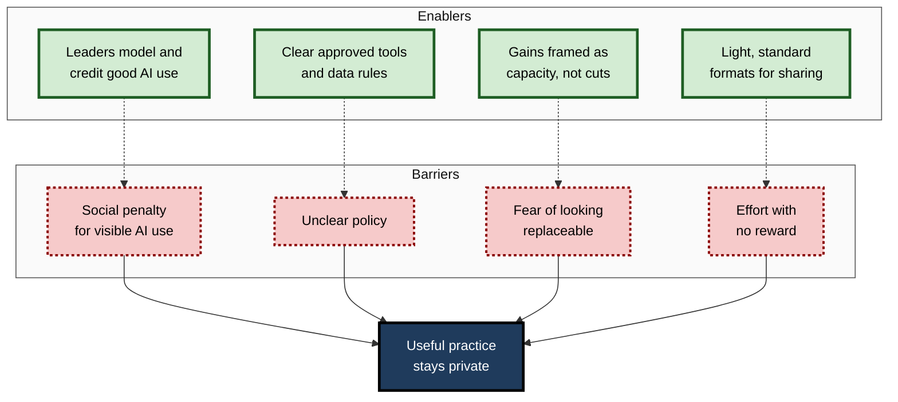
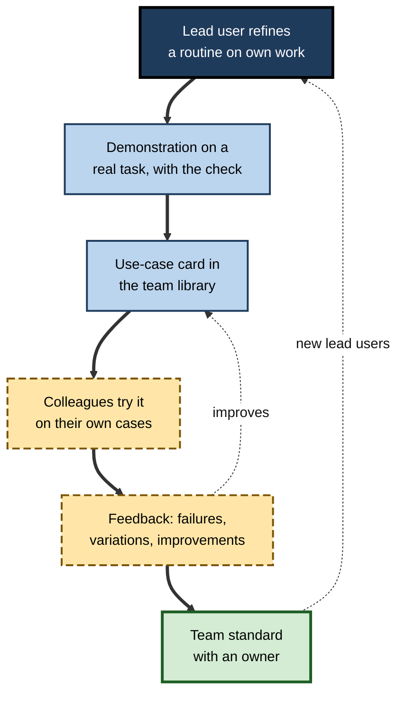
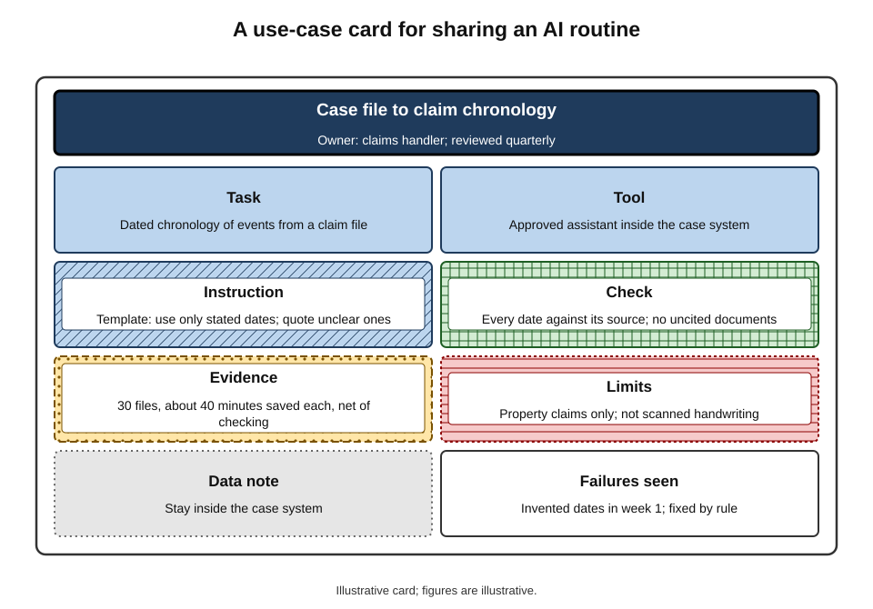
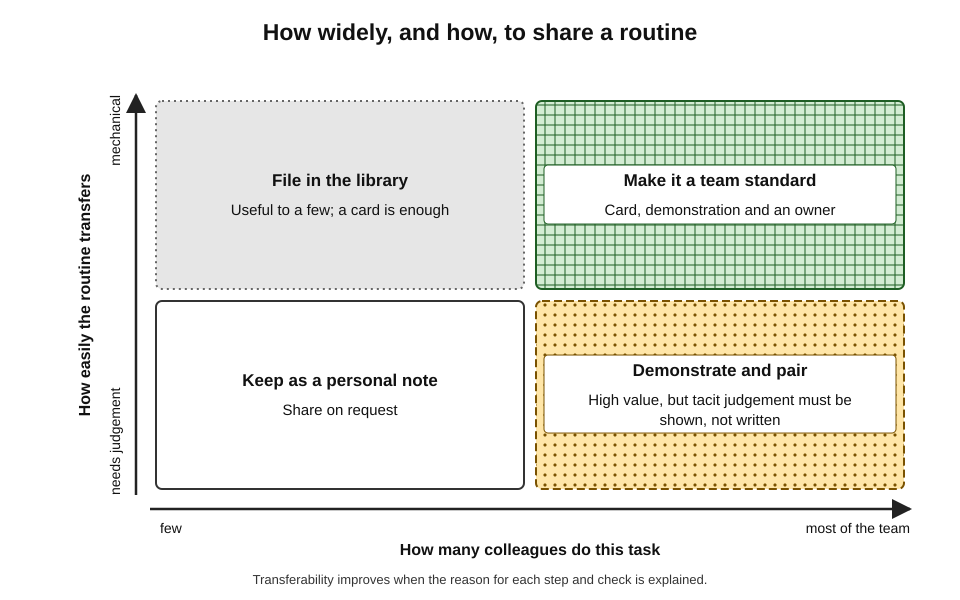
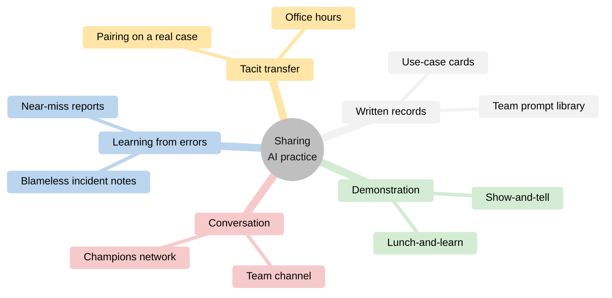

# L.8. Sharing what works with colleagues

In a claims department of twenty people, one handler has quietly worked out how to use the approved AI assistant to turn a messy case file into a clean chronology in ten minutes, with a fixed check that catches its usual mistakes. She has told no one. Two desks away, a colleague spends an hour on the same task every day; another has tried the assistant, received a chronology with an invented date, and concluded that AI "cannot be trusted".

The knowledge that would help both exists in the room. It simply has not moved.

> **Definition — Practice sharing (AI):** the deliberate passing on of tested ways of using AI tools — the task, the instruction, the check, the evidence of benefit and the known limits — so that colleagues can adopt, adapt or avoid them.

**Why sharing matters**

- **Individual discoveries are cheap to spread** — a routine that took one person weeks to refine can be learned by a colleague in minutes.
- **Hidden use creates hidden risk** — when people use AI privately, errors, unapproved tools and poor practices go unseen.
- **Shared practice is better practice** — when routines are visible, others improve them, find their flaws and agree standards.
- **Teams benefit more than individuals** — consistent methods make work easier to review, hand over and combine.

---

## Why Useful Practice Stays Hidden

### Secret use

- **Ethan Mollick (2023)** coined the phrase **"secret cyborgs"** for employees who use AI extensively at work without telling their managers or colleagues.
- **A 2024 survey by Microsoft and LinkedIn** of about 31,000 people in 31 countries reported that:
  - about three-quarters of knowledge workers used generative AI at work;
  - most AI users were **bringing their own** tools rather than waiting for employer-provided ones;
  - around half of users were **reluctant to admit** using AI for their most important tasks;
  - around half worried that using AI made them look **replaceable**.

> **Definition — Shadow AI:** the use of AI tools at work without the knowledge or approval of the organisation, typically through personal accounts.

### The social penalty

**Study card — Jessica Reif, Richard Larrick and Jack Soll (2025), *Proceedings of the National Academy of Sciences***

- **Design:** four experiments with more than 4,400 participants, examining how people expect to be judged, and how they actually judge others, for using AI tools at work.
- **Results:**
  - people **expected** to be seen as lazier, less competent and more replaceable if they used AI;
  - these expectations were **justified** — evaluators did rate AI users as less competent and less motivated than people who received other kinds of help;
  - the penalty was reduced when AI was clearly useful for the specific task, and varied with the evaluator's own AI use.
- **Conclusion:** a real social cost of visible AI use exists, which discourages people from admitting, and therefore sharing, what they do.
- **Limits:** experimental scenarios; workplace norms are changing quickly.

> **Key point:** people hide AI use partly for a rational reason — they may be judged for it. Sharing grows only where the culture makes useful AI practice something to be **credited**, not suspected.

### Other barriers

- **Policy uncertainty** — people unsure whether their use is permitted keep quiet rather than ask.
- **Competitive incentives** — where people are compared individually, a personal productivity edge is worth keeping.
- **Fear of replacement** — showing that a task can be done faster may invite questions about headcount.
- **Effort** — writing up a method takes time, with no obvious reward.
- **Uncertainty about value** — people doubt their own tricks are worth sharing, or fear being wrong.
- **Tacitness** — some of what makes a routine work is hard to put into words.

**Figure 1.** Barriers that keep useful AI practice hidden, and what lowers them.

---

## How Knowledge Moves Between People

### Tacit and explicit knowledge

- **Michael Polanyi (1966):** "we can know more than we can tell" — much skilled knowledge is **tacit**, held in practice rather than in words.
- **Ikujiro Nonaka and Hirotaka Takeuchi (1995)** described how organisations create knowledge by converting between tacit and explicit forms:
  - **socialisation** — tacit to tacit, through shared experience (watching a colleague work);
  - **externalisation** — tacit to explicit, by articulating it (writing up a routine);
  - **combination** — explicit to explicit, by assembling documents (a team prompt library);
  - **internalisation** — explicit to tacit, by practising until it becomes skill.
- **For AI practice:** a prompt is the explicit part; the judgement about when to use it, what to check and how to recognise a bad output is largely tacit.

> **Definition — Tacit knowledge:** knowledge held in skilled practice and judgement that is difficult to express fully in words.

> **Key point:** sharing a prompt alone transfers the explicit part. Sharing **how it is used, checked and judged** — by demonstration and discussion — transfers the tacit part that makes it work.

### Communities of practice

- **Jean Lave and Etienne Wenger (1991)** and **Wenger (1998)** described **communities of practice** — groups of people who share a concern or craft and learn how to do it better through regular interaction.
- **Three elements:**
  - a **domain** — a shared area of interest (using AI in claims handling);
  - a **community** — relationships that allow people to learn together;
  - a **practice** — a shared repertoire of methods, stories and tools.
- **AI communities of practice** have emerged in many organisations — informal channels, regular show-and-tell sessions, networks of "champions".

> **Definition — Community of practice:** a group of people who share a concern or craft and improve it through regular interaction.

### Why practices do not simply copy across

**Study card — Gabriel Szulanski (1996), "Exploring internal stickiness"**

- **Design:** study of 122 transfers of best practices between units in eight large firms.
- **Results:** the strongest barriers to transfer were not lack of motivation but:
  - the recipient's lack of **absorptive capacity** — the prior knowledge needed to understand and use the practice;
  - **causal ambiguity** — uncertainty about why the practice works;
  - an **arduous relationship** between source and recipient.
- **Conclusion:** good practices are "sticky"; transfer depends on understanding and relationships as much as on documentation.

- **Implications for AI practice:**
  - explain **why** a routine works, not only what it is;
  - share with people who have the background to use it, or provide that background;
  - share in relationships of trust — colleagues learn more readily from peers they respect.

> **Definition — Absorptive capacity:** the ability to recognise the value of new knowledge, assimilate it and apply it, which depends heavily on prior related knowledge (Wesley Cohen and Daniel Levinthal, 1990).

### Diffusion through a team

- **Everett Rogers's** diffusion research found that new practices spread faster when they are **observable** and **trialable**, and when **opinion leaders** — respected peers — adopt them.
- **Peers persuade more than mandates** — seeing a respected colleague use a routine successfully is more convincing than a policy or a vendor demonstration.
- **Lead users** — Eric von Hippel (1986) described users who face needs ahead of the market and often invent solutions; in AI adoption, early expert users within teams play this role.

**Figure 2.** How a tested routine spreads through a team.

---

## What to Share

### The content of a useful share

- **The task** — exactly what job the routine does, with its inputs and outputs.
- **The tool** — which approved tool, plan and (where visible) model.
- **The instruction** — the template, with placeholders.
- **The check** — what is always verified and how.
- **The evidence** — what was measured: time, quality, errors, over how many uses.
- **The limits** — where it fails, what it should not be used for.
- **The data note** — what may and may not be pasted in.
- **The owner** — who to ask, who maintains it.

> **Remember:** a share without **evidence** is a rumour; a share without **limits** is a hazard.

**Figure 3.** The anatomy of a use-case card for sharing an AI routine.

### Sharing failures

- **Failures are as useful as successes** — a colleague who knows the assistant invents dates in chronologies is protected from the same error.
- **Near misses** — errors caught by a check — show why the check matters.
- **"Not worth it" findings** — a task where AI looked promising but cost time — save others from repeating the experiment.
- **The bias towards success stories** — what gets shared is usually what worked; the result is an over-optimistic picture, a form of **survivorship bias**.

> **Definition — Survivorship bias:** drawing conclusions from the cases that are visible because they succeeded, while overlooking the failures that are not seen.

### What not to share

- **Confidential material in examples** — real client names, personal data, live figures.
- **Unapproved tools presented as recommendations** — sharing can spread shadow use; route promising tools through the organisation's approval process instead.
- **Unverified claims** — "it saves hours" without measurement.
- **Workarounds of controls** — methods for bypassing data rules or safeguards.

### Evangelism and honesty

- **Enthusiasts can over-sell** — a routine that suits one person's work may not suit another's.
- **Honest sharing states conditions** — "works well for property claims under a certain value; not tested on injury claims".
- **Invite challenge** — ask colleagues to try it and report where it fails.

| | Evangelism | Evidence-based sharing |
|---|---|---|
| Typical claim | "This changes everything" | "On 30 chronologies it saved about 40 minutes each, net of checking" |
| Limits stated? | Rarely | Always |
| Failures shared? | No | Yes, with the check that catches them |
| Effect on sceptics | Resistance | Willingness to try |
| Effect on risk | Spreads errors with enthusiasm | Spreads safeguards with the method |

### Which practices to share widely

- **Not every routine deserves a team-wide launch.** Two questions decide how widely to share:
  - **How many colleagues do this task?** A routine for a task the whole team performs weekly is worth far more effort than one for a task only its inventor does.
  - **How well does it transfer?** A routine that depends on a clear template and a mechanical check transfers easily; one that depends on the inventor's judgement needs pairing and demonstration.

**Figure 4.** Deciding how widely, and how, to share a routine.

---

## How to Share

### Formats

- **Show-and-tell sessions** — short, regular slots (fifteen minutes in a team meeting) where one person demonstrates a routine on a real, anonymised task.
- **Pairing** — sitting with a colleague while they try the routine on their own case; the most effective way to transfer tacit judgement.
- **Use-case cards** — short, standard written records in a shared library.
- **Team channels** — a dedicated space for questions, tips and warnings.
- **Office hours** — a regular time when an experienced user is available to help.
- **Champions networks** — named people in each team who collect and spread good practice and feed problems back to the organisation.
- **Lunch-and-learn sessions** — informal, wider-audience demonstrations.
- **Post-incident notes** — when an AI error causes a problem, a short blameless write-up of what happened and what check would prevent it.

**Figure 5.** Formats for sharing AI practice, from the most tacit to the most explicit.

### Running a good show-and-tell

1. **Pick one routine** — one task, not a tour of features.
2. **Use a real (anonymised) case** — not a vendor demonstration.
3. **Show the whole routine** — input, instruction, output, **check**, final edit.
4. **Show a failure** — an output that needed correcting, and how the check caught it.
5. **Give the evidence** — what was measured, over how many uses.
6. **State the limits** — where it should not be used.
7. **Point to the card** — where the template and notes are kept.
8. **Invite trials** — ask two colleagues to try it and report back.

> **In practice:** the most useful demonstrations are often the least polished — a real task, a real mistake, a real fix. Polished demonstrations look like marketing and invite scepticism.

### Psychological safety

- **Amy Edmondson (1999)** found that teams with high **psychological safety** — a shared belief that it is safe to take interpersonal risks — engaged more in learning behaviours such as asking questions, seeking feedback and discussing errors.
- **For AI practice**, psychological safety determines whether people admit using AI, admit its failures, and ask for help.
- **Signals that build it:**
  - leaders talk openly about their own AI use, including mistakes;
  - questions about whether something is permitted are welcomed, not punished;
  - errors caught by checks are celebrated as the system working.

> **Definition — Psychological safety:** a shared belief within a team that it is safe to take interpersonal risks, such as asking questions or admitting mistakes.

---

## The Role of Managers and Organisations

### What managers can do

- **Model use** — demonstrate their own routines, including what they do not use AI for.
- **Legitimise** — state clearly which tools are approved and that using them well is valued.
- **Credit sharing** — recognise people who share tested practice in reviews and meetings.
- **Frame gains as capacity** — present time saved as time for better work, not as a reason for cuts, where that is genuinely the intention.
- **Protect time** — allow a few minutes in team meetings for practice sharing.
- **Ask for evidence** — encourage measured claims rather than enthusiasm.

> **Watch out:** a manager who responds to a shared time saving by immediately adding workload or cutting roles teaches the whole team to stop sharing. Whatever the organisation's choices, the response to sharing shapes whether it continues.

### What organisations do

- **Approved tools and clear rules** — remove the policy uncertainty that keeps people quiet.
- **Shared libraries** — curated, owned, tested collections of routines.
- **Champions programmes** — networks of trained users in each function.
- **Use-case registers** — records of where AI is used, with risk classification.
- **Feedback loops** — routes for reporting problems and successful practices to those who govern tools.

### Sharing in hybrid and remote teams

- **Fewer chance encounters** — much tacit practice spreads by overhearing and glancing at a colleague's screen; distributed teams lose this channel.
- **Compensating practices:**
  - **screen-shared demonstrations** recorded briefly for those absent, with sensitive content removed;
  - **"working out loud"** — posting a short note in the team channel when a routine works or fails;
  - **virtual pairing** — a colleague watches while another applies a routine to a real case;
  - **asynchronous cards** — written records matter more when demonstrations cannot be attended.
- **Time zones** — a shared library and channel allow practice to move across locations without meetings.

### Knowing whether sharing is working

- **Signals that sharing is healthy:**
  - more people using approved tools for the tasks where routines exist;
  - fewer repeated errors of the same kind;
  - new cards added by people other than the original enthusiasts;
  - cards recording failures and retired routines, not only successes;
  - new joiners using the library within their first weeks.
- **Signals that it is not:**
  - the same two people present every session;
  - a library growing but rarely opened;
  - private use continuing alongside public enthusiasm;
  - errors discovered by customers that a shared check would have caught.

> **In practice:** teams that sustain sharing usually keep it **small and regular** — fifteen minutes a fortnight, one routine at a time — rather than launching large training events that generate enthusiasm and then fade.

### Disclosure norms within teams

- **Transparency about AI use within a team** — who used what, for which parts of a deliverable — helps reviewers know what to check.
- **Attribution** — credit for a shared routine belongs to its originator; this encourages further sharing.
- **Norms differ** — some teams note AI use on every deliverable; others only where it materially shaped content. Agreeing a norm prevents both secrecy and pointless labelling.

| | Hidden individual use | Shared team practice |
|---|---|---|
| Errors | Repeated privately by many | Found once, check shared |
| Quality across the team | Uneven | More consistent |
| Risk visibility | Low — shadow tools, unknown data flows | High — tools and data known |
| Learning speed | Each person starts from zero | New joiners inherit tested routines |
| Credit | None, or suspicion | Recognised contribution |

---

## Worked Example (illustrative): Writing a Use-Case Card

**Situation:** the claims handler from the opening decides to share her chronology routine.

1. **Title:** "Case file → claim chronology".
2. **Task:** produce a dated chronology of events from a claim file (notes, emails, reports) for the handler's own use and for the supervisor's review.
3. **Tool:** the department's approved assistant, inside the case-management system.
4. **Instruction (template):** "From the documents below, list every event with a date, in date order, as: date — event — source document. Use only dates stated in the documents. If a date is unclear, write 'date unclear' and quote the text. Do not infer events."
5. **Check:** compare every date against its source; scan the file for documents not cited; confirm that the first and last events match the file's opening and closing records.
6. **Evidence:** used on 30 files over six weeks; average time fell from about 55 to about 15 minutes, including the check; two invented dates were caught by the check in the first week, none since the "use only stated dates" rule was added.
7. **Limits:** tested on property claims only; not tested on injury claims with medical records; not for files with handwritten scans.
8. **Data note:** use only inside the case-management system; do not copy file contents into any other tool.
9. **Owner:** the handler; review quarterly or after a system update.

*Illustrative figures.*

- **Conclusion:** the card carries the task, instruction, check, evidence, limits and ownership — enough for a colleague to try it safely and to know when not to.

> **Watch out:** the card's evidence came from one person's files. A colleague with different claim types should treat it as a promising trial, not a proven method, until it has been tested on their own cases.

---

## Case Study (illustrative): From Secret Use to Shared Standard

- **Situation:** the claims department of twenty from the opening, with an approved AI assistant available for six months.
- **Problem:**
  - usage was uneven: a few heavy users, many non-users, several people quietly using personal tools;
  - two errors from AI-generated letters had reached customers;
  - the department head did not know which practices existed.
- **Actions:**
  1. The head stated publicly which tools were approved and that good, checked use would be credited.
  2. A fortnightly fifteen-minute show-and-tell was added to the team meeting, starting with the head's own routine and a mistake it had made.
  3. A standard use-case card was introduced; the chronology routine was the first.
  4. Two champions were named and given an hour a week for office hours.
  5. A blameless note was written about each of the two customer errors, identifying the missing check.
  6. Personal-tool use was addressed by making the approved tool easier to access, not by punishment alone.
- **Result (after two quarters):** use of the approved assistant broadened across the team; personal-tool use reportedly fell; the team library held twelve cards, three of them recording tasks where AI was **not** worth using; no further AI-related errors reached customers in that period.
- **Caveats:** measures were simple counts and supervisor reports; the improvement coincided with a new case-management release.
- **Lesson:** the routines already existed; what changed was the **culture** that allowed them to be seen, tested and improved.

---

## Open Questions

- **Will the social penalty for AI use fade?**
  - As AI use becomes normal, evaluations may change; how fast and in which professions is uncertain.
- **How much of AI practice is transferable?**
  - Routines depend on task details and individual judgement; how well they transfer between people and teams has not been measured systematically.
- **Who owns a shared routine?**
  - Credit, intellectual property and responsibility for errors in shared routines are unsettled questions in many organisations.
- **Does standardisation reduce innovation?**
  - Shared standards spread good practice but may discourage individual experimentation that finds better methods.
- **How should gains be shared?**
  - Whether time saved goes to the individual, the team or the organisation strongly affects willingness to share, and practice varies widely.

---

## Summary

- **Practice sharing** passes on tested AI routines — task, instruction, check, evidence, limits — so colleagues can adopt, adapt or avoid them.
- Useful practice stays hidden through **secret use** and **shadow AI**, a real **social evaluation penalty** (Reif, Larrick and Soll, 2025), policy uncertainty, competition, fear of replacement, effort and tacitness.
- Knowledge moves by converting **tacit** and **explicit** forms (Polanyi; Nonaka and Takeuchi); a prompt is explicit, the judgement around it tacit.
- **Communities of practice** (Lave and Wenger) sustain shared learning; practices are **sticky** (Szulanski, 1996) because of **absorptive capacity**, **causal ambiguity** and relationships.
- Diffusion is faster when practices are **observable**, **trialable** and adopted by respected peers.
- A useful share contains **task, tool, instruction, check, evidence, limits, data note, owner**; share **failures** too, to counter **survivorship bias**.
- Formats range from **pairing** (most tacit) through **show-and-tell** to **use-case cards** and libraries; demonstrations should show the check and a failure.
- **Psychological safety** (Edmondson, 1999) and managers who **model, legitimise and credit** use make sharing normal.
- Prefer **evidence-based sharing** over evangelism.

---

## Self-Check

1. Define practice sharing and give three reasons it matters for a team.
2. What are "secret cyborgs" and shadow AI? Why are they risky?
3. Summarise the 2025 PNAS study on the social evaluation penalty and its implication for sharing.
4. List four barriers to sharing other than the social penalty.
5. Explain the four conversions in Nonaka and Takeuchi's model with an AI example of each.
6. What three barriers did Szulanski find most important in transferring best practices, and how should AI sharing respond to each?
7. Why do peers persuade more effectively than mandates?
8. List the eight elements of a useful share.
9. Why should failures be shared, and what bias does this counter?
10. Describe the steps of a good show-and-tell.
11. What is psychological safety, and how does it affect AI practice in a team?
12. What can a manager do to encourage sharing, and what response discourages it?
13. Write a short use-case card for an AI routine in a role of your choice.
14. A team leader finds that half the team use personal AI tools secretly. Design a response that brings practice into the open without simply punishing people.

### Answer Key

1. Deliberately passing on tested AI routines with their checks, evidence and limits. Reasons: individual discoveries spread cheaply; hidden use creates hidden risks; shared practice improves through others' scrutiny; consistency helps review and hand-over.
2. People using AI extensively without telling managers or colleagues (Mollick's term); shadow AI is use of unapproved tools, usually personal accounts. Risks: unknown data flows, unchecked errors, uneven quality, no shared learning.
3. Across four experiments with over 4,400 people, AI users expected and actually received lower ratings of competence and motivation than people receiving other help. Sharing grows only where culture credits good AI use.
4. Policy uncertainty; competitive incentives; fear of looking replaceable; effort with no reward; doubt about value; tacitness.
5. Socialisation: watching a colleague check an AI chronology. Externalisation: writing up the routine. Combination: adding it to a team library with others. Internalisation: practising it until the check is second nature.
6. Lack of absorptive capacity — provide background or share with those equipped to use it; causal ambiguity — explain why it works; arduous relationships — share through trusted peers and pairing.
7. Seeing a respected colleague succeed makes the practice observable and credible, and lowers perceived risk; mandates compel compliance but not understanding.
8. Task, tool, instruction, check, evidence, limits, data note, owner.
9. Failures and near misses protect colleagues from the same errors and show why checks matter. They counter survivorship bias — a picture drawn only from successes.
10. Pick one routine; use a real anonymised case; show input, instruction, output, check and edit; show a failure; give evidence; state limits; point to the card; invite trials.
11. A shared belief that interpersonal risk-taking is safe (Edmondson). It determines whether people admit AI use, report its failures and ask for help.
12. Model own use; legitimise approved tools; credit sharing; frame gains as capacity; protect meeting time; ask for evidence. Discouraging: immediately loading extra work or cutting roles in response to shared savings.
13. *e.g.* "Meeting transcript → action list. Tool: approved assistant. Template: list actions with owner and date, only those stated, 'owner unclear' if not stated. Check: compare every owner and date with the transcript. Evidence: 20 meetings, about 15 minutes saved each. Limits: not for board meetings. Data note: approved tool only. Owner: me, quarterly review."
14. Clarify approved tools and data rules; make the approved tool easy to access; invite people to show their routines in a safe, non-punitive session; convert useful practices into use-case cards in the approved tool; address data already in personal tools calmly through proper channels; name champions; credit sharing; review periodically.

---

## Glossary

| Term | Meaning |
|---|---|
| Absorptive capacity | Ability to recognise, assimilate and apply new knowledge, dependent on prior knowledge. |
| Causal ambiguity | Uncertainty about why a practice works, which hinders its transfer. |
| Champions network | Named users in each team who spread good practice and report problems. |
| Community of practice | A group sharing a craft and improving it through regular interaction. |
| Lead user | A user who faces needs early and often invents solutions others later adopt. |
| Practice sharing | Passing on tested AI routines with their checks, evidence and limits. |
| Psychological safety | A shared belief that it is safe to take interpersonal risks in a team. |
| SECI model | Nonaka and Takeuchi's cycle of socialisation, externalisation, combination and internalisation. |
| Secret cyborg | Mollick's term for someone using AI extensively at work without disclosure. |
| Shadow AI | Use of AI tools at work without organisational knowledge or approval. |
| Show-and-tell | A short demonstration of a routine on a real task, including its check. |
| Social evaluation penalty | Lower judgements of competence and motivation received for visible AI use. |
| Stickiness | Difficulty of transferring a practice from one unit or person to another. |
| Survivorship bias | Drawing conclusions only from visible successes. |
| Tacit knowledge | Knowledge held in practice and judgement, hard to express in words. |
| Use-case card | A short, standard record of an AI routine for sharing. |
