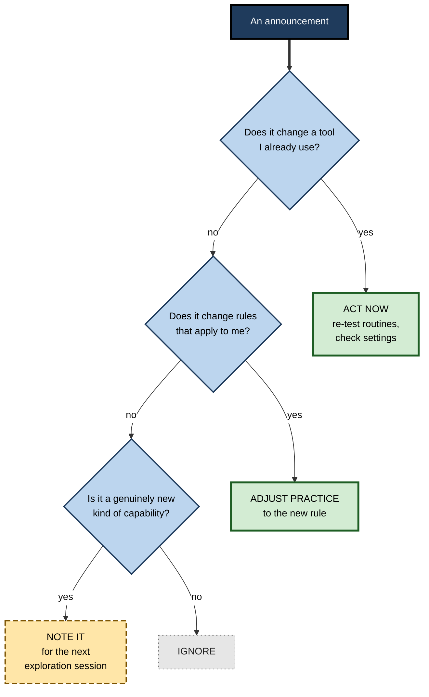
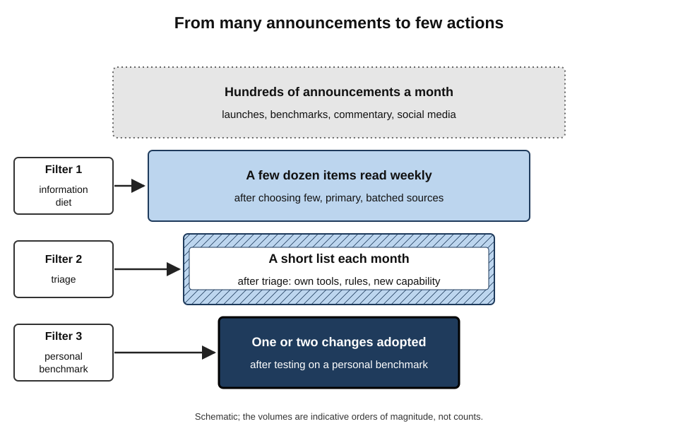
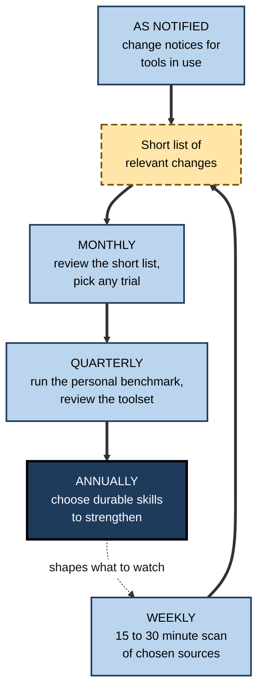
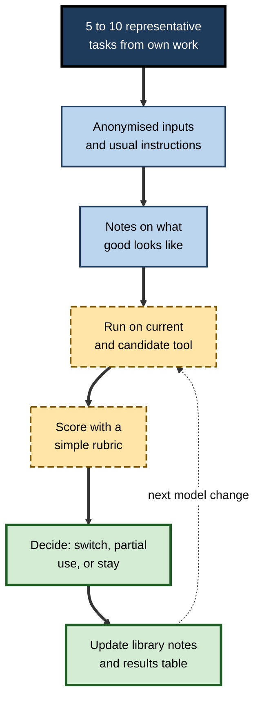
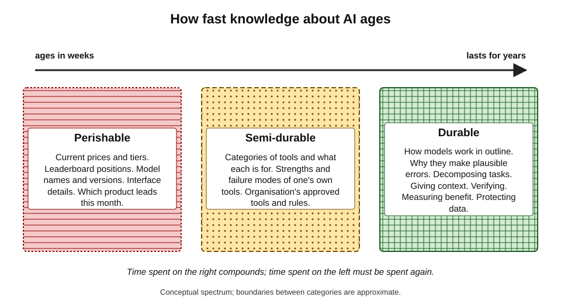

# L.9. Staying current without chasing every release

Within a few weeks in mid-2025, the major AI providers between them announced several new models, new reasoning modes, agents that could operate a browser, price changes, new usage caps and the retirement of older models — each accompanied by claims that it changed everything. A professional who tried to follow it all would have done little else. One who ignored it all might have missed the one change that mattered to their work: the retirement of the model their main routine depended on.

> **Definition — Staying current (AI tools):** keeping one's knowledge of AI tools accurate enough to use them well, notice changes that affect one's own work, and recognise genuinely useful advances — at a sustainable cost in time and attention.

**Why it matters**

- **The field changes fast** — capabilities, prices, terms and products shift within months.
- **Some changes matter directly** — a model retirement, a data-terms revision or a new approved tool can alter what a person should do.
- **Most changes do not** — the majority of announcements have no effect on a given person's work.
- **Attention is the scarce resource** — time spent following releases is taken from work, learning and rest.

---

## The Problem of Abundance

### Information overload

- **Herbert Simon (1971)** observed that "a wealth of information creates a poverty of attention" — the more information is available, the scarcer attention becomes.
- **Martin Eppler and Jeanne Mengis (2004)** reviewed research on **information overload** across organisational and management studies:
  - beyond a point, more information **worsens** decisions, rather than improving them;
  - overload is associated with stress, poorer prioritisation and reduced satisfaction;
  - it arises from the quantity, frequency and ambiguity of information, and from poor filtering.
- **AI news displays every cause** — a high volume of announcements, a daily rhythm, ambiguous claims and many sources repeating each other.

> **Definition — Information overload:** a state in which the volume or rate of information exceeds a person's capacity to process it, degrading decisions and wellbeing.

### Why AI announcements are hard to judge

- **Benchmarks are distant from work** — model announcements report scores on standard tests that may bear little relation to everyday tasks.
  - Test sets can leak into training data (**contamination**), and leaderboards based on crowd preferences have been criticised for being gamed or unrepresentative.
- **Demonstrations are selected** — launch examples show the best cases.
- **Capabilities arrive unevenly** — a model better at mathematics may be no better, or worse, at summarising contracts.
- **Names change faster than substance** — products are renamed, merged and re-tiered; the same capability can appear under several names.
- **Secondary sources amplify** — commentary, newsletters and social media repeat and exaggerate, often without testing.

> **Watch out:** a model's leap on a public leaderboard is evidence about that leaderboard. It is weak evidence about whether the model will summarise one's own meeting notes better.

### How providers release and retire

Understanding how change usually arrives makes it easier to notice the changes that matter.

- **Staged roll-outs** — new models and features often reach some users, regions or plans before others; a colleague may see a change weeks earlier.
- **Silent updates** — the model behind a product name can be updated without a new name; behaviour shifts without an announcement the user notices.
- **Pinned and floating versions** — some technical interfaces let users fix ("pin") a specific model version, while consumer products usually "float" to the latest; routines built on floating versions need more frequent checking.
- **Deprecation windows** — providers typically announce the retirement of older models some time in advance, then withdraw them; routines tuned to a retiring model need re-testing before the date.
- **Tier movement** — features launched in premium plans often move to cheaper plans later; waiting can mean getting the same capability for less.
- **Enterprise lag** — organisational versions of tools often receive new models later than consumer versions, after security and contractual review.

> **Definition — Deprecation:** a provider's announcement that a model, feature or interface will be withdrawn, usually followed by a period during which it still works before retirement.

### Signals in daily work that something has changed

Not every relevant change is announced in a way a user sees. Routines themselves give early warning.

- **Output shape shifts** — answers become longer, shorter, more formatted or more hedged than usual.
- **Familiar errors disappear or new ones appear** — a check that used to catch a recurring mistake now finds a different one.
- **Prompts need more editing** — a template that produced usable output now needs repair.
- **Speed changes** — responses become noticeably slower or faster, often a sign of a different model or mode.
- **New buttons and settings** — interface changes often accompany model or policy changes.

> **In practice:** practitioners who keep a short log for their core routines notice these shifts within days, and treat them as a prompt to check release notes and re-run their benchmark.

### The cost of chasing

- **Time** — reading, watching and trying absorb hours each week.
- **Attention fragmentation** — frequent checking of news breaks concentration on work.
- **Anxiety** — the constant sense of falling behind; a professional form of fear of missing out.
- **Shallow knowledge** — broad awareness of many tools, deep skill in none.
- **Wrong priorities** — following the frontier of capability while neglecting the durable skills that make any tool useful.

---

## What Actually Needs Tracking

### Four kinds of change

- **Changes to tools already in use** — the most important category.
  - *e.g.* the model behind the core assistant is updated or retired; a feature used daily moves to a higher tier; data terms change.
- **Changes in the rules** — organisational policy, approved tool lists, professional guidance, regulation.
  - *e.g.* the employer approves a new assistant; a professional body issues guidance on disclosure.
- **New capability categories** — genuinely new kinds of thing tools can do.
  - *e.g.* reliable work with very long documents; tools that act across applications; real-time voice translation.
- **Everything else** — incremental model updates, new products in categories already served, benchmark news, funding and corporate news.

> **Key point:** most professionals need to track the first two categories **closely**, the third **periodically**, and the fourth **barely at all**.

| | Changes to tools in use | Changes in the rules | New capability categories | Everything else |
|---|---|---|---|---|
| Example | Core model retired | New approved tool list | Agents that operate software | A new chatbot in an existing category |
| Effect on daily work | Direct and often immediate | Direct | Possible, after testing | Usually none |
| How to track | Provider notices, release notes of own tools | Employer and professional channels | Periodic scan, colleagues | Ignore unless it reaches the other columns |
| How often | As notified; monthly check | As issued | Monthly or quarterly | Rarely |
| Typical action | Re-test routines | Adjust practice | Note; trial in exploration time | None |

**Figure 1.** Triage of an AI announcement.

---

## Designing an Information Diet

An **information diet** is a deliberate choice of what to read, how often and from whom — the opposite of being fed by whatever arrives.

> **Definition — Information diet:** a deliberately chosen set of information sources and a rhythm for consulting them, designed to keep a person informed at a sustainable cost.

### Principles

- **Few sources, chosen for reliability** — two or three trusted sources outperform twenty that repeat each other.
- **Primary over secondary** — the release notes and change notices of tools actually used are more reliable than commentary about them.
- **Batch, do not stream** — read news at a fixed time each week, not as it arrives.
- **People as filters** — a knowledgeable colleague, team channel or community of practice can surface what matters for a particular field.
- **Unsubscribe freely** — sources that generate anxiety without action can be dropped.
- **Separate awareness from action** — knowing about a release is not a reason to try it.

> **Mnemonic — "Fewer, Primary, Batched, Filtered, Pruned":** the five habits of a healthy information diet.

### Which sources to trust for everyday decisions

- **Most useful:**
  - change notices and release notes from providers of tools in use;
  - the employer's approved-tool updates and policy notices;
  - guidance from one's professional body or regulator;
  - colleagues' measured experience on similar tasks.
- **Useful with care:**
  - established technology journalism that tests products;
  - independent evaluations and research summaries.
- **Least useful for decisions:**
  - launch-day social media;
  - promotional newsletters and influencer content;
  - leaderboard movements without task-specific testing.

### Questions to ask of any capability claim

- **Better at what, exactly?** — which tasks, measured how?
- **Compared with what?** — the previous version, a competitor, or nothing?
- **On whose examples?** — the provider's selected cases, or independent tests?
- **At what cost?** — price, speed, usage limits, data terms.
- **Available to whom?** — which plans, regions and organisational versions?
- **Tested by whom?** — has anyone with similar work reported measured results?

> **Remember:** a claim that cannot answer "better at what, compared with what, on whose examples?" is marketing until shown otherwise.

### Staying current in regulated and high-stakes fields

- **Professional guidance changes too** — bodies for law, medicine, accounting, engineering and education have been issuing and revising guidance on AI use, disclosure and supervision.
- **Regulatory timelines** — rules on AI, data protection and consumer protection come into force in stages; dates are often revised.
- **Client and contract terms** — clients may add AI clauses to contracts, requiring notification or prohibiting certain tools.
- **For these fields, the "rules" column of the triage is as important as the "tools" column** — and an unnoticed rule change can matter more than any new model.

**Figure 2.** From many sources to few actions: filtering the flow of AI news.

### A rhythm for staying current

- **As notified** — read change notices for tools in use; act if they affect routines.
- **Weekly (15–30 minutes)** — scan the chosen sources; add anything genuinely relevant to a short list.
- **Monthly** — review the list; decide whether anything warrants a trial.
- **Quarterly** — run a personal benchmark on any candidate; combine with the toolset review.
- **Annually** — step back: which durable skills should be strengthened this year?

**Figure 3.** A sustainable rhythm for staying current.

> **In practice:** many experienced practitioners deliberately **lag** behind releases by weeks or months for anything not affecting their tools. Early problems are found and fixed by others; the useful improvements are still there when they look.

---

## The Personal Benchmark

Public benchmarks measure what model builders care about. A **personal benchmark** measures what the individual cares about.

> **Definition — Personal benchmark:** a small, fixed set of representative tasks from a person's own work, with notes on what a good result looks like, used to compare tools or model versions.

### Building one

1. **Choose five to ten tasks** that represent the person's real AI use — summaries, drafts, extractions, analyses, code.
2. **Prepare inputs** — fictionalised or anonymised versions of real material, so they can be used in any tool.
3. **Write the instruction** for each, as it would normally be given.
4. **Record what good looks like** — key facts that must appear, errors to watch for, length and tone.
5. **Include one hard case** — a task where tools have previously failed.
6. **Keep a results table** — tool, version, date, score on each task, notes.

### Running it

- **When a candidate tool or model appears** that has passed the announcement triage.
- **When a core tool's model changes** — to see whether routines still work.
- **Periodically** — to notice gradual drift.
- **Score with a simple rubric** — for example 0 (unusable), 1 (needs heavy editing), 2 (needs light editing), 3 (usable as is), plus notes on errors.

### Worked example (illustrative): testing a new model on six tasks

**Situation:** a policy adviser's core assistant offers a new model. She runs her personal benchmark on the current and new versions.

| Task | Current model | New model | Notes |
|---|---|---|---|
| Summarise a 30-page consultation response | 2 | 3 | New model kept minority views |
| Draft a ministerial briefing from notes | 2 | 2 | No clear difference |
| Extract dates and obligations from a regulation | 1 | 2 | New model missed one obligation, current missed three |
| Rewrite technical text for the public | 3 | 3 | Both good |
| Compare two policy options in a table | 2 | 1 | New model invented a cost figure |
| Hard case: summarise a document with contradictory sections | 1 | 2 | New model flagged the contradiction |
| **Total (max 18)** | **11** | **13** | |

*Illustrative figures.*

1. **Overall** — the new model is modestly better on her tasks.
2. **Mixed results** — better at extraction and long summaries, worse on one comparison task with an invented figure.
3. **Decision** — switch to the new model for summaries and extraction; keep a stricter grounding rule and check for figures in comparisons.
4. **Record** — note the date and results; update the prompt library's "tested on" fields.

- **Conclusion:** half an hour of testing on her own tasks gave a clearer answer than any announcement or leaderboard could.

> **Watch out:** six tasks run once is a small sample; outputs vary between runs. A personal benchmark shows **direction** and **specific failures**, not precise differences. For important decisions, run the key tasks more than once.

**Figure 4.** Building and using a personal benchmark.

---

## Durable and Perishable Knowledge

### What ages fast and what lasts

- **Perishable knowledge** — which product leads, current prices, feature lists, interface details, model names.
  - Useful for weeks or months.
- **Durable knowledge** — how generative models work in outline; why they produce plausible errors; how to decompose a task; how to give context; how to verify; how to measure benefit; how to protect data.
  - Useful for years, across tools.
- **Samuel Arbesman (2012)** popularised the idea of the **half-life of facts** — that knowledge in many fields becomes outdated at measurable rates, so that a share of what is "known" today will be revised.

> **Definition — Half-life of knowledge:** the time it takes for half of the knowledge in a field to become outdated or superseded — a metaphor for how quickly different kinds of knowledge age.

**Figure 5.** Knowledge about AI tools, from perishable to durable.

> **Key point:** time spent on durable knowledge compounds; time spent on perishable knowledge must be spent again next quarter. Staying current means **just enough** perishable knowledge and a **steadily growing** stock of durable knowledge.

### Just in time, not just in case

- **Just-in-case learning** — studying every new tool in case it becomes useful; expensive and mostly wasted.
- **Just-in-time learning** — learning a tool's details when a real task needs it; cheaper and better retained, because it is applied immediately.
- **A balanced approach** — a little just-in-case awareness of capability categories, and just-in-time depth for tools actually adopted.

### Durable skills worth the investment

- **Understanding models in outline** — how they generate text from patterns in training data, why they can be fluent and wrong, what context windows and retrieval do.
- **Task decomposition** — breaking work into parts and judging which parts suit AI.
- **Context-giving** — supplying audience, purpose, material and constraints clearly, whatever the tool.
- **Verification** — checking claims, figures and sources efficiently against originals.
- **Measurement** — judging net benefit honestly on one's own tasks.
- **Data judgement** — knowing what may be shared with which tool, and why.
- **Domain expertise** — the deep knowledge of one's own field that makes it possible to judge any tool's output.

> **Key point:** the last item is the most durable of all. A professional's own expertise is what turns any AI tool, old or new, into reliable work — and it is the one form of currency that no release makes obsolete.

| | Chasing every release | Ignoring everything | Deliberate currency |
|---|---|---|---|
| Time per week | Hours | None | 15–30 minutes plus periodic tests |
| Knowledge of own tools' changes | Buried in noise | Missing | Complete |
| Awareness of new capability | High but undiscriminating | Low | Moderate, filtered |
| Durable skill | Neglected | Static | Growing |
| Anxiety | High | Low until a surprise | Low |
| Typical outcome | Busy, shallow, tired | Caught out by retirements and rule changes | Informed, focused, adaptable |

---

## Staying Current Together

### Teams as filters

- **Shared scanning** — one person per quarter takes responsibility for summarising relevant changes for the team.
- **A team channel** — colleagues post only changes that affect shared tools or tasks, with a line on what to do.
- **Team benchmarks** — a shared set of representative tasks lets new tools be judged once, for everyone.
- **Champions and communities of practice** — act as the organisation's early filter, reducing the burden on everyone else.

> **In practice:** in teams that do this well, most people spend only minutes a week on AI news, because a rota or a champion filters it for them and every post comes with a "so what".

### Organisations

- **Central evaluation** — larger organisations test new models and tools before approval, sparing individuals the effort.
- **Change communication** — notifying users when an approved tool's model or terms change, with any actions required.
- **Learning programmes** — focused on durable skills rather than product features.

---

## Case Study (illustrative): The Product Manager Who Stopped Reading Everything

- **Situation:** a product manager at a software company followed dozens of AI newsletters, social accounts and video channels, spending what she estimated at five or more hours a week.
- **Problem:**
  - she felt permanently behind;
  - she trialled tools constantly, rarely kept any;
  - she missed an internal notice that the company's approved assistant was moving to a new model, and a routine she depended on began producing longer, less structured outputs without her noticing for two weeks.
- **Actions:**
  1. Cut her sources to three: the release notes of her two core tools, the company's AI updates channel and one testing-focused technology publication.
  2. Read them in a single 20-minute slot on Friday mornings.
  3. Built a seven-task personal benchmark from anonymised past work.
  4. Agreed with two colleagues to share the job of scanning wider news, each taking a month.
  5. Used freed time for a quarter-long effort on a durable skill: writing evaluation criteria for AI-assisted features in her product.
- **Result (over six months):** time on AI news fell to well under an hour a week; she caught the next model change on the day it was announced and re-tested her routines within an hour; she adopted one new capability after it passed her benchmark.
- **Caveats:** time estimates were her own; she accepted missing some interesting but irrelevant developments.
- **Lesson:** the problem was not too little information but too little **filtering**; a small, primary, batched diet and a personal benchmark made her both better informed and less anxious.

---

## Open Questions

- **How should individuals judge capability claims?**
  - Independent, task-relevant evaluation of AI tools for ordinary professional work remains scarce; personal benchmarks fill a gap they cannot fully close.
- **Will the pace of change slow?**
  - If capability gains plateau, staying current becomes easier; if they continue or accelerate, filtering becomes more important.
- **How durable is "durable" knowledge?**
  - Principles such as prompting techniques have already changed as models improved; which skills will last a decade is uncertain.
- **Who should bear the cost of staying current?**
  - Employers, professional bodies and individuals share it unevenly; expectations of continuous self-education may burden some groups more than others.
- **Can tools explain their own changes?**
  - Clearer change notes, version labels and behaviour summaries from providers would reduce the need for personal testing; practice varies widely.

---

## Summary

- **Staying current** means knowing enough to use tools well, notice changes that affect one's work and recognise genuine advances — at sustainable cost.
- **Information overload** (Simon; Eppler and Mengis) worsens decisions; AI news shows all its causes.
- Announcements are hard to judge: **benchmarks** are distant from work, **contamination** and gamed **leaderboards** mislead, demonstrations are selected.
- Track **changes to tools in use** and **changes in rules** closely, **new capability categories** periodically, and **everything else** barely at all.
- Build an **information diet**: few, primary, batched, filtered, pruned; use **people as filters**.
- Keep a **rhythm**: as notified, weekly, monthly, quarterly, annually.
- Use a **personal benchmark** — five to ten representative tasks with notes on good results — to test candidates and model changes.
- Invest in **durable knowledge** over **perishable knowledge**; prefer **just-in-time** to **just-in-case** learning.
- Teams and organisations can **share the filtering** through rotas, channels, champions and central evaluation.

---

## Self-Check

1. Define staying current and explain why it must be sustainable.
2. What did Herbert Simon mean by "a poverty of attention", and what did Eppler and Mengis find about overload?
3. Give four reasons why AI announcements are hard to judge.
4. Name the four kinds of change and how closely each should be tracked.
5. Apply the announcement triage to: (a) the retirement of a model used by one's core tool; (b) a new chatbot in a crowded category; (c) a new professional-body guidance note.
6. List the five habits of a healthy information diet.
7. Rank three types of source by usefulness for everyday decisions.
8. Describe a sustainable rhythm for staying current.
9. How is a personal benchmark built and when should it be run?
10. In the worked example, why did the adviser not simply switch to the new model for everything?
11. Distinguish durable from perishable knowledge with three examples of each.
12. Compare just-in-time and just-in-case learning.
13. How can a team share the burden of staying current?
14. A colleague spends an hour a day on AI news and feels constantly behind. Diagnose the problem and design a better approach.

### Answer Key

1. Keeping knowledge of AI tools accurate enough to use them well, notice relevant changes and recognise genuine advances. It must be sustainable because attention is limited and time spent following news is taken from work and rest.
2. Abundant information consumes attention, making attention scarce. Eppler and Mengis found that beyond a point more information worsens decisions and is linked to stress, poorer prioritisation and lower satisfaction.
3. Benchmarks are distant from everyday work; contamination and gamed leaderboards; selected demonstrations; uneven capability gains; frequent renaming; amplifying secondary sources.
4. Changes to tools in use — closely; changes in rules — closely; new capability categories — periodically; everything else — barely.
5. (a) Act now: re-test routines and settings. (b) Ignore. (c) Adjust practice to the guidance.
6. Fewer sources; primary over secondary; batched reading; people as filters; prune freely.
7. Most useful: provider change notices for tools in use, employer updates, professional guidance, colleagues' measured experience. Useful with care: testing-based journalism, independent evaluations. Least useful: launch-day social media, promotional content, leaderboards.
8. Change notices as they arrive; a 15–30 minute weekly scan; a monthly review of the short list; quarterly benchmark runs and toolset review; an annual choice of durable skills.
9. Choose 5–10 representative tasks; prepare anonymised inputs and usual instructions; record what good looks like; include a hard case; score with a rubric. Run it for candidates, after core model changes and periodically.
10. Results were mixed: better on summaries and extraction, worse on one comparison task where it invented a figure. She switched for the tasks where it was better and added safeguards where it was worse.
11. Durable: how models work in outline, why they produce plausible errors, verification methods. Perishable: which product leads, current prices, interface details.
12. Just-in-case: learning tools in advance in case they are needed — costly, often wasted. Just-in-time: learning details when a real task requires them — cheaper, better retained.
13. Rotate the job of scanning; keep a channel for relevant changes with a "so what"; maintain a shared benchmark; rely on champions and central evaluation.
14. Overload from too many secondary sources, streamed rather than batched, with no filtering by relevance. Approach: cut to a few primary sources; read weekly in one slot; use the triage; build a personal benchmark; share scanning with colleagues; redirect saved time to durable skills.

---

## Glossary

| Term | Meaning |
|---|---|
| Benchmark | A standard test used to compare AI models. |
| Contamination | Leakage of benchmark test material into a model's training data. |
| Durable knowledge | Knowledge about AI that remains valid across tools and years. |
| Half-life of knowledge | A metaphor for how quickly half of a field's knowledge becomes outdated. |
| Information diet | A deliberate choice of sources and rhythm for consulting them. |
| Information overload | A state in which incoming information exceeds processing capacity. |
| Just-in-case learning | Learning in advance in case knowledge is needed. |
| Just-in-time learning | Learning details when a real task requires them. |
| Leaderboard | A public ranking of models by benchmark or user-preference scores. |
| Perishable knowledge | Knowledge about AI that becomes outdated within weeks or months. |
| Personal benchmark | A small fixed set of one's own representative tasks for comparing tools. |
| Release notes | A provider's description of changes in a new version of a tool. |
| Staying current | Keeping knowledge of AI tools accurate enough for good use at sustainable cost. |
| Triage | Sorting incoming items by urgency and relevance to decide what to act on. |
