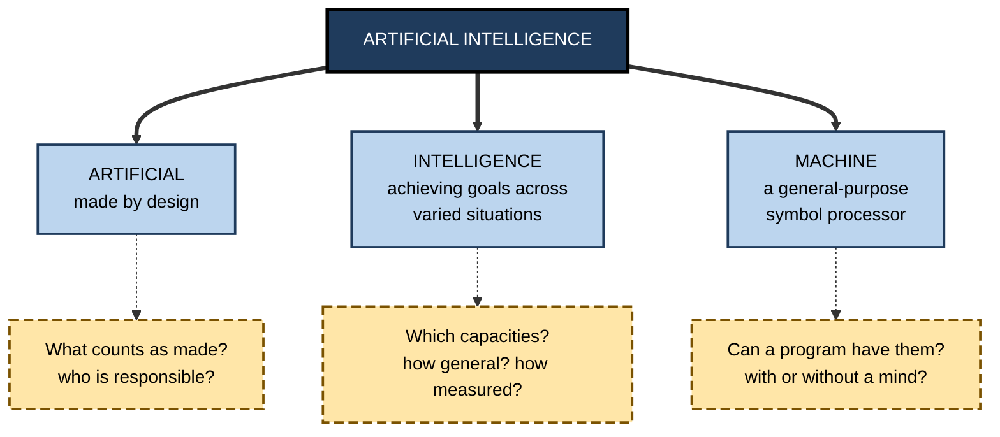
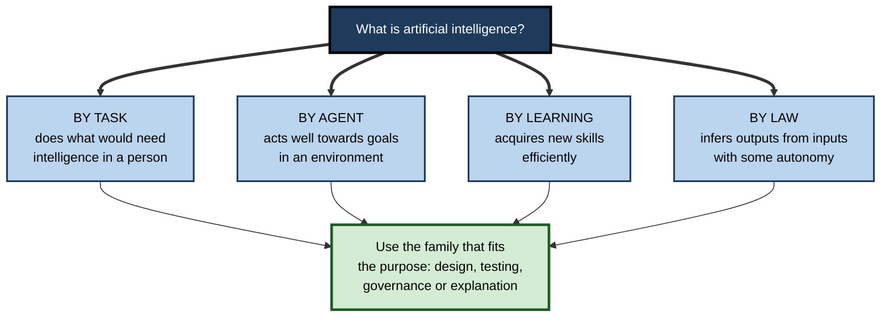
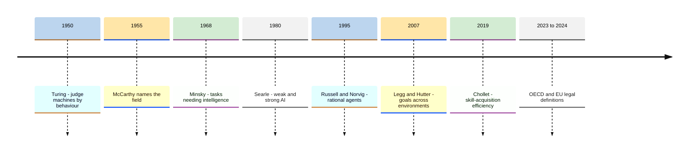
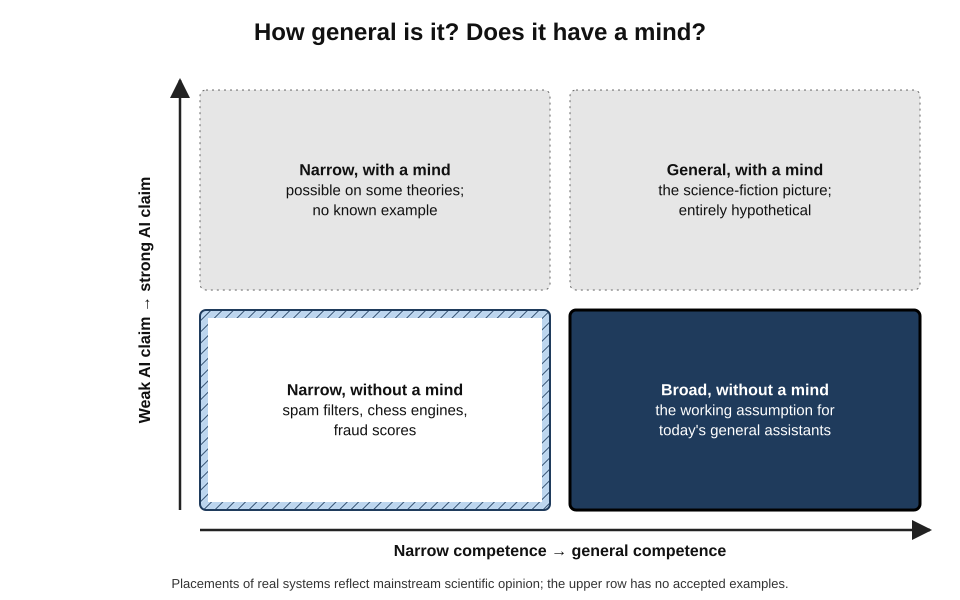
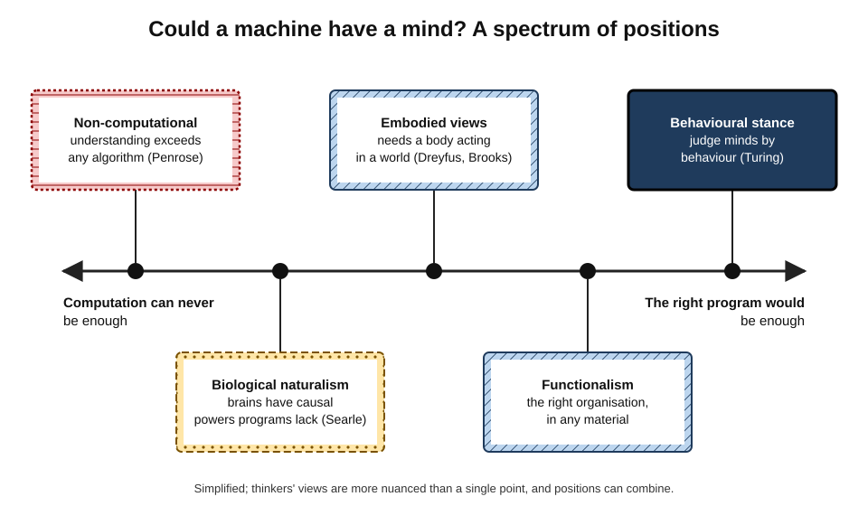
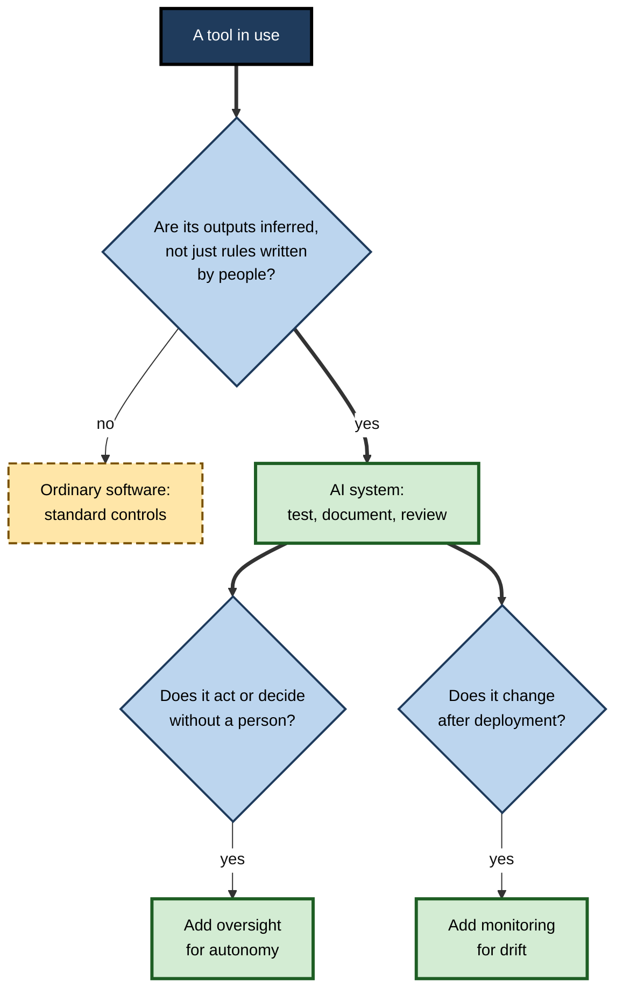

# A. Defining Intelligence and Machines

"Artificial intelligence" is one of the most used phrases of the age and one of the least defined. It is attached to spam filters and to systems that write legal briefs, to thermostats and to robotaxis, to products that learn and to products that merely follow rules.

Behind the label stand three old and difficult questions: **what intelligence is**, **what a machine is**, and **whether — and in what sense — the second can have the first**. How a professional answers them determines what they expect of AI, how far they trust it, and who they hold responsible when it fails.

> **Definition — Artificial intelligence (the field):** the science and engineering of making machines — chiefly computer programs — that perform tasks which, when people perform them, are regarded as requiring intelligence: perceiving, reasoning, learning, using language, planning and acting to achieve goals.

> **Definition — AI system (in law and policy):** a machine-based system that, for explicit or implicit objectives, infers from the input it receives how to generate outputs — such as predictions, content, recommendations or decisions — that can influence physical or virtual environments, with varying levels of autonomy and adaptiveness.

**Why the subject matters**

- **Every judgement about AI rests on a definition.** Whether a product "is AI", whether a regulation applies and whether a claim is honest all depend on where the line is drawn.
- **Words shape trust.** Calling a system "intelligent", "thinking" or "understanding" raises expectations that its behaviour may not meet.
- **Responsibility depends on the picture.** If AI is a tool, its makers and users answer for it; if it is imagined as an agent with a mind, responsibility blurs.
- **The questions are genuinely open.** Philosophers, psychologists and computer scientists still disagree about the nature of intelligence, understanding and consciousness — and those disagreements bear directly on how AI is built and governed.

---

## Three Words, Three Problems

### "Intelligence"

- **No single agreed definition exists**, but definitions from psychology, everyday speech and AI research converge on a core: the capacity to **achieve goals across a wide range of situations — especially new ones — by learning, reasoning and adapting**.
- **The everyday concept is a bundle** — quickness, knowledge, judgement, social understanding and practical know-how — and ordinary people already distinguish its strands.
- **Psychology measures it** through tests that reveal a general factor alongside broad abilities such as fluid reasoning and accumulated knowledge.
- **The influential synthesis of Shane Legg and Marcus Hutter (2007):** "intelligence measures an agent's ability to achieve goals in a wide range of environments" — a definition that does not care whether the agent is a person, an animal or a program.

> **Key point:** the more **varied and unfamiliar** the situations in which a system succeeds, the more intelligent it is. Brilliance in one fixed setting is **competence**, not necessarily intelligence.

### "Machine"

- **The everyday sense** — a mechanism that transforms energy or materials by fixed operation: a loom, a pump, a clock.
- **The sense that matters for AI** — the **general-purpose computer**: a machine that follows stored programs, chooses its next step from intermediate results and can process any kind of symbol, not only numbers.
  - The path from counting aids and mechanical calculators to stored-program computers is what made it possible to ask whether some program might think.
- **Alan Turing's 1936 insight** — a single "universal" machine can imitate any other computing machine, given its description — means that the question "can a machine think?" becomes "**can some program** think?".

> **Definition — Universal machine:** a computing machine that, given a description of any other computing machine and enough time and memory, can carry out the same computation.

### "Artificial"

- **Made by people, by design** — as opposed to evolved or grown.
- **Not the same as "fake"** — artificial light is real light; whether artificial intelligence is *real* intelligence is exactly the question in dispute.
- **The word was chosen deliberately.** John McCarthy coined "artificial intelligence" for the 1955 proposal of a summer research project at Dartmouth College, partly to distinguish the new field from cybernetics and automata theory.

**Figure 1.** The three questions packed into the phrase "artificial intelligence".

---

## Defining Artificial Intelligence

### Definitions by task

- **Marvin Minsky (1968):** "the science of making machines do things that would require intelligence if done by men."
- **Strength:** intuitive and practical — AI is judged by what it does.
- **Weakness:** a pocket calculator does something that requires intelligence in a person (long division) without being intelligent; and once a task is mastered, it tends to be reclassified as "mere computation" — the **AI effect**.

### Definitions by agent and environment

- **Stuart Russell and Peter Norvig (1995):** crossed two choices — thinking or acting; human or ideal standard — to give four approaches; they argued for **acting rationally**: building agents that do the best thing given their goals and what they perceive.
- **Nils Nilsson (2010):** "artificial intelligence is that activity devoted to making machines intelligent, and intelligence is that quality that enables an entity to function appropriately and with foresight in its environment."
- **Strength:** measurable; does not require resemblance to people.
- **Weakness:** relocates the hard question to the choice of goals and performance measures.

### Definitions by learning and generality

- **François Chollet (2019):** skill is not intelligence; intelligence is the **efficiency with which a system acquires new skills**, relative to its prior knowledge and experience, across tasks it has not seen.
- **Strength:** separates genuine adaptability from skill bought with huge data or hand-built knowledge.
- **Weakness:** hard to measure; leaves out much of what people value in intelligent behaviour, such as judgement about ends.

### Definitions in law and policy

- **The OECD (2019, revised 2023)** and **the European Union's AI Act (2024)** define an AI system by the fact that it **infers** how to produce outputs from inputs, with varying **autonomy** and **adaptiveness**.
- **Strength:** neutral about technique; usable by regulators and organisations.
- **Weakness:** deliberately broad; says nothing about *how intelligent* a system is, and leaves borderline cases — complex rule systems, simple statistical models — to interpretation.

| | Task definitions | Agent definitions | Learning definitions | Legal definitions |
|---|---|---|---|---|
| Core idea | Doing what would need intelligence in a person | Acting well towards goals in an environment | Acquiring new skills efficiently | Inferring outputs from inputs with some autonomy |
| Typical source | Early AI pioneers | Modern textbooks | Recent research on measurement | OECD, EU AI Act |
| Counts a pocket calculator? | Arguably yes | Barely — a trivial agent | No | No |
| Main use | Describing the field's ambitions | Designing and evaluating systems | Testing for general ability | Deciding which rules apply |
| Main weakness | Moving target; too inclusive | Hides choice of goals | Hard to measure | Broad; silent on degree |

**Figure 2.** Four families of definitions of artificial intelligence.

> **In practice:** use the definition that fits the purpose. A regulator needs a **legal** definition to decide scope; an engineer needs an **agent** definition to design and test; anyone judging claims of "real intelligence" needs a **learning and generality** standard.

**Figure 3.** How the definition of artificial intelligence has developed.

---

## Kinds of Claim About Machine Intelligence

### Weak and strong AI

- **John Searle (1980)** distinguished two claims:
  - **weak AI** — computers are powerful tools for studying and simulating minds, and can perform useful intelligent tasks;
  - **strong AI** — an appropriately programmed computer **literally has** a mind, with understanding and other mental states.
- **Most practical AI work assumes only weak AI.** Debates about whether chatbots "really understand" are debates about strong AI.

### Narrow and general

- **Narrow AI** handles a particular task or domain; **general AI** would match or exceed human versatility across most cognitive tasks. Where today's systems sit between these poles is itself disputed.

| | Weak AI claim | Strong AI claim |
|---|---|---|
| What is asserted | Machines can perform intelligent tasks and model minds | Suitably programmed machines have minds |
| Test of truth | Performance | Understanding or experience — no agreed test |
| Status | Uncontroversially true for many tasks | Deeply disputed |
| Practical consequence | Evaluate by results; govern as a tool | Would raise questions of moral status |

**Figure 4.** Two independent questions: how broad a system's competence is, and whether it has a mind.

> **Watch out:** progress towards **generality** does not by itself settle the **strong AI** question. A system could become far more versatile without that showing it understands or experiences anything — and a narrow system could, on some theories, have experiences. The two dimensions are logically separate.

---

## Two Traditions of Building Intelligence

### Writing intelligence down

- **The symbolic tradition** treats thinking as the manipulation of symbols by rules — an idea traced from Hobbes's "reasoning is reckoning" through Boole's algebra of logic to Allen Newell and Herbert Simon's **physical symbol system hypothesis** (1976).
- **Its achievements** include programs that proved theorems, played games and, in narrow domains, matched specialists — but **hand-written rule systems proved brittle** outside the situations their authors foresaw, costly to maintain and short of the common sense people take for granted.

### Letting intelligence be learned

- **The learning tradition** treats intelligence as something a system can **acquire** from examples and feedback, much as Turing proposed in 1950 when he suggested educating a "child machine".
- **Its achievements** include systems for perception, translation, game play and fluent language that no one could have written as explicit rules — at the cost of **transparency**, a hunger for data and failures that are hard to predict.

> **Key point:** the two traditions embody two answers to one question — **can intelligence be fully described in advance, or must it be acquired?** Modern systems typically combine them: learned components for perception and judgement, explicit rules for constraints and guarantees.

| | Symbolic tradition | Learning tradition |
|---|---|---|
| Picture of thinking | Rule-governed symbol manipulation | Pattern acquisition from experience |
| Source of competence | Knowledge written by people | Data, examples and feedback |
| Strength | Transparent, auditable, needs little data | Handles variety, perception and tacit skill |
| Characteristic failure | Brittle at the edge of its rules | Opaque; right for the wrong reasons |
| Philosophical ally | Computational theory of mind | Associationism, connectionism |

---

## The Central Debates

### Can machines think?

- **Turing's reframing (1950):** replace the vague question with a behavioural test — can a machine converse so that an interrogator cannot reliably tell it from a person? He predicted success by about 2000 and answered nine objections, chiefly by asking whether each applied equally to people.
- **The behavioural test has now been passed in a standard form:** in a 2025 study at the University of California, San Diego, a language model prompted to adopt a humanlike persona was judged to be the human in five-minute three-party conversations more often than the real humans were.
- **Most researchers draw a modest conclusion:** convincing **imitation** has been achieved; whether imitation amounts to **thinking** is precisely what the test was designed to sidestep.

### Do current systems understand?

**Study card — Bender and Koller's "octopus" (2020)**

- **Thought experiment:** two people stranded on separate islands communicate by an undersea cable. A hyper-intelligent octopus taps the cable and learns, from the statistical patterns of their messages alone, to impersonate one of them convincingly.
- **The test:** one islander is attacked by a bear and asks how to build a weapon from sticks; the octopus, having never perceived bears, sticks or the world, cannot give a genuinely useful answer except by luck.
- **Claim:** a system trained only on the **form** of language cannot learn its **meaning**, because meaning involves the relation between language and the world.
- **Responses:** critics argue that patterns in vast text encode a great deal about the world, and point to evidence that language models build internal representations of concepts and situations; the authors' defenders reply that such representations remain parasitic on human understanding.

- **A 2023 review by Melanie Mitchell and David Krakauer** described the research community as **sharply divided** on whether large language models understand, and suggested that they may possess a form of understanding quite unlike human understanding.

> **Watch out:** "it merely predicts the next word" and "it truly understands" are both stronger than the evidence. A safe working position: these systems show **competence that often looks like understanding and sometimes fails in ways no understanding person would**.

### Must intelligence be embodied?

**Study card — Rodney Brooks, "Elephants Don't Play Chess" (1990)**

- **Argument:** AI had wrongly focused on abstract tasks like chess; real intelligence evolved for **perceiving and acting in the physical world**, and should be built from the bottom up in robots that interact with their surroundings.
- **Demonstrations:** insect-like robots at MIT that walked and navigated cluttered spaces with no central symbolic model.
- **Legacy:** an influential strand of robotics and of **embodied cognition**, which holds that thinking depends on having a body in an environment.

- **Hubert Dreyfus** had argued from philosophy from 1972 onwards that human expertise is embodied, situated and intuitive — and so cannot be captured in rules.
- **The question today** is whether systems trained largely on text and images, without bodies, can acquire robust common sense — or whether that requires interaction with the world.

### Is mind computational at all?

- **Functionalism** — mental states are defined by what they do — their causal roles — so any system with the right organisation, in any material, would have them.
- **Biological naturalism (Searle)** — minds are produced by specific causal powers of brains; running a program is not enough.
- **Non-computational views (Roger Penrose, 1989 onwards)** — human understanding of mathematical truth exceeds what any algorithm could achieve; most logicians and computer scientists reject the argument.
- **Consciousness science** — an indicator-based assessment in 2023 found no current AI system to be a strong candidate for consciousness, while seeing no obvious technical barrier to future systems meeting more of the indicators.

**Figure 5.** Positions on whether a machine could have a mind.

---

## Telling Intelligence From Its Imitations

### What intelligence is not

- **Not automation** — a dishwasher is fully automated and not intelligent; automation concerns **who acts**, intelligence **how well behaviour copes with novelty**.
- **Not magic** — every output comes from data, methods, infrastructure and often hidden human labour; a Mechanical Turk question — "who is inside the cabinet?" — remains worth asking.
- **Not sentience** — capability and the capacity to feel are separate; AI systems are tools whose personas are designed and whose makers and deployers remain responsible.
- **Not human problem solving in disguise** — machines often reach the same answers by different routes, such as vast search or statistical pattern-matching, and fail in correspondingly different, often alien, ways.

> **Mnemonic — "AMSH, not intelligence by default":** **A**utomated, **M**agical-looking, **S**entient-seeming or **H**uman-like behaviour is not, on its own, evidence of intelligence.

### Measuring machine intelligence

- **By imitation** — Turing-style tests of human-likeness in conversation.
- **By benchmark** — standard task sets; prone to saturation and to test questions leaking into training data.
- **By generalisation** — tasks deliberately unlike training data, such as the Abstraction and Reasoning Corpus.
- **By profile** — rating perception, learning, generality, autonomy and adaptation separately, since systems are uneven.
- **By real work** — controlled trials on genuine tasks, which often give more modest — and occasionally negative — results than demonstrations suggest.

| | Imitation tests | Benchmarks | Generalisation tests | Real-work trials |
|---|---|---|---|---|
| Measures | Human-likeness | Skill on fixed tasks | Adaptation to the new | Net value in context |
| Strength | Open-ended | Comparable, repeatable | Targets general ability | Ecologically valid |
| Weakness | Rewards deception | Saturates; contamination | Narrow puzzle formats | Costly; context-specific |

---

## Defining AI in Professional Practice

### Why organisations need a working definition

- **Scope of policy** — which tools fall under an AI-use policy, procurement review or risk assessment.
- **Inventories** — regulators increasingly expect organisations to know which AI systems they use.
- **Honest communication** — avoiding **AI washing** (labelling ordinary automation as AI) and its opposite, unacknowledged AI inside familiar products.
- **Matching oversight to properties** — autonomy, adaptiveness and stakes matter more than the label.

### Worked example (illustrative): building an AI inventory

A mid-sized insurer applies an inference-based definition — *does the system infer its outputs from inputs, rather than only following rules people wrote?* — to six tools.

| Tool | Infers outputs? | AI system under the working definition? | Oversight implied |
|---|---|---|---|
| Premium calculator using fixed rating tables | No — rules written by actuaries | No | Standard software controls |
| Fraud-scoring model trained on past claims | Yes — learned from data | Yes | Bias testing, monitoring, human review of declines |
| Chat assistant for staff drafting letters | Yes | Yes | Usage policy, output review |
| Spreadsheet macro for monthly reporting | No | No | Standard controls |
| Document reader extracting fields from claim forms | Yes | Yes | Accuracy sampling, exception handling |
| Workflow that routes claims by value thresholds | No — explicit thresholds | No, though it uses AI outputs as inputs | Check how AI scores feed thresholds |

*Illustrative example.*

1. **Three of six tools are AI systems** under the working definition; the label on the vendor's brochure was irrelevant.
2. **The borderline case** — the routing workflow — is not AI itself but **depends on** AI outputs, so its thresholds need review whenever the fraud model changes.
3. **Oversight follows properties** — learning, autonomy, stakes — not the word "AI".

> **Watch out:** a definition that is too narrow lets learned systems escape review; one that is too broad buries teams in paperwork for spreadsheets. Test the definition on real borderline cases before adopting it.

### Case study: defining AI in European law

- **Situation:** when the European Commission proposed its AI Act in April 2021, it defined AI systems partly by listing **techniques** in an annex — machine learning, logic- and knowledge-based approaches, and statistical approaches.
- **Problem:** critics argued the list was both **too broad** — sweeping in ordinary statistics and conventional software — and **brittle**, since new techniques would require amendments.
- **Negotiation:** during 2022–2023 the Council and Parliament moved towards a **technology-neutral** definition aligned with the OECD's, which itself was revised in November 2023 to reflect generative systems.
- **Result:** the Act adopted in 2024 defines an AI system by **inference**, **autonomy** and **adaptiveness** rather than by technique; in February 2025 the Commission published guidelines explaining how to apply the definition and which simpler systems — such as those that only follow rules defined by people — fall outside it.
- **Lesson:** defining AI is not an academic exercise. Where the line is drawn determines **who must comply, what must be documented and which risks are governed** — and good definitions rest on **what systems do**, not on fashionable techniques.

**Figure 6.** Deciding whether a tool should be treated as an AI system.

### Setting realistic expectations

- **Capability is not reliability** — a system that can do something sometimes may not do it consistently; small per-step error rates compound over long tasks.
- **Demonstrations mislead in both directions** — polished demos inflate expectations; single failures deflate them.
- **The professional standard** is to state, for each use, the measured benefit as a range, the known failure modes, the controls and the date for re-testing.

---

## What Distinguishes Expert Understanding

- **Definitional fluency** — uses task, agent, learning and legal definitions appropriately, and knows the weakness of each.
- **Separates the questions** — capability, generality, autonomy, understanding and sentience are kept apart rather than run together.
- **Calibrated language** — describes what systems *do* ("the model produced", "we decided using the score") rather than attributing minds.
- **Knows the debates** — can state the strongest case on each side of the understanding, embodiment and consciousness questions.
- **Demands evidence on real tasks** — distrusts both hype and dismissal; asks for error rates, generalisation tests and controlled comparisons.
- **Keeps responsibility human** — treats every AI system as a tool for whose use people are accountable.

### Case study (illustrative): a board asks "are we using AI?"

- **Situation:** a retailer's board asks its technology director a single question after a news story about AI risks: "Are we using AI, and is it safe?"
- **First answer:** "Only in our new chatbot pilot." The answer reflects the vendor labels on the tools the director knows about.
- **Investigation:** applying an inference-based definition across departments reveals:
  - a demand-forecasting model in the supply chain, running for five years;
  - a fraud-screening service embedded in the payments provider's platform;
  - a CV-screening feature switched on by default in the recruitment software;
  - staff using public chat assistants for marketing copy without guidance.
- **Actions:**
  1. adopted a written working definition and maintained an inventory;
  2. rated each system on autonomy, adaptiveness and stakes;
  3. paused the CV-screening feature pending a bias review;
  4. issued an AI-use policy with approved tools;
  5. reported to the board in plain terms — what each system does, how it fails and who owns it.
- **Result:** the board received an accurate picture; the riskiest system turned out to be one no one had called "AI".
- **Lesson:** **definitions are operational**. An organisation that cannot say what counts as AI cannot know what it is using, and cannot govern it.

---

## Open Questions

- **Is there one intelligence, in people and machines alike?**
  - Goal-and-environment definitions are neutral about the agent; critics argue they leave out understanding, values and consciousness.
- **Do language-trained systems understand?**
  - The research community remains divided; new evidence about internal representations is accumulating on both sides.
- **Is a body necessary for robust common sense?**
  - Text-and-image systems have acquired surprising world knowledge; whether it is robust without interaction is unresolved.
- **How should machine intelligence be measured once human-imitation tests are passed?**
  - Candidates include generalisation tests, long-horizon reliability and real-work trials; none is agreed.
- **Could a machine be conscious, and how would anyone know?**
  - Theories disagree about what consciousness is, and therefore about what would count as evidence.
- **Where should legal definitions draw the line?**
  - Technology-neutral definitions are durable but broad; their application to borderline systems is still being worked out.

---

## Summary

- **Artificial intelligence** is the science and engineering of making machines perform tasks regarded as needing intelligence; in law, an **AI system** is one that **infers** outputs from inputs with varying **autonomy** and **adaptiveness**.
- The phrase packs three problems: **intelligence** (achieving goals across varied, especially new, situations), **machine** (the general-purpose, universal computer) and **artificial** (made by design, not necessarily fake).
- Definitions come in four families — **task, agent, learning, legal** — each suited to different purposes and each with characteristic weaknesses.
- **Weak AI** (useful intelligent behaviour) is uncontroversial; **strong AI** (machines literally having minds) is disputed; **generality** and **mind** are separate questions.
- Two traditions — **writing intelligence down** (symbolic, transparent, brittle) and **letting it be learned** (flexible, opaque) — are now usually combined.
- Central debates concern whether machines can **think** (Turing's behavioural test, now passed in a standard form), whether current systems **understand** (the octopus argument and its critics), whether intelligence must be **embodied** (Brooks, Dreyfus) and whether mind is **computational** at all.
- Intelligence is distinct from **automation, magic, sentience and human-style problem solving**; it is measured by imitation, benchmarks, generalisation, profiles and real-work trials.
- In practice, a **working definition** drives inventories, policy and oversight; the EU's move to a **technology-neutral** definition shows that definitions decide who must comply.
- Expert understanding keeps the questions separate, uses calibrated language, demands evidence and keeps **responsibility with people**.

---

## Self-Check

1. Define artificial intelligence as a field and an AI system in the legal sense.
2. What three problems are packed into the phrase "artificial intelligence"?
3. Why does Turing's universal machine turn "can a machine think?" into "can a program think?"
4. Compare task, agent, learning and legal definitions of AI, giving one weakness of each.
5. Why might a pocket calculator count as AI under Minsky's definition but not under Chollet's?
6. Distinguish weak from strong AI and explain why progress towards generality does not settle the strong AI question.
7. Contrast the symbolic and learning traditions and explain why modern systems combine them.
8. What does the 2025 three-party Turing Test result show, and what does it not show?
9. Summarise the octopus thought experiment and one objection to it.
10. What did Rodney Brooks argue in "Elephants Don't Play Chess"?
11. Distinguish functionalism, biological naturalism and Penrose's view.
12. Why are automation, magic and sentience not evidence of intelligence? Give one example of each.
13. In the AI-inventory example, why does the routing workflow need review even though it is not an AI system?
14. What lesson does the evolution of the EU AI Act's definition teach?
15. A colleague says, "Our new tool is AI, so it must be intelligent and will improve on its own." Correct each part of the statement.

### Answer Key

1. The field: the science and engineering of making machines perform tasks regarded as requiring intelligence. Legal AI system: a machine-based system that, for explicit or implicit objectives, infers from its input how to generate outputs that can influence environments, with varying autonomy and adaptiveness.
2. What intelligence is; what a machine is; whether something made by design can have intelligence — and in what sense.
3. A universal machine can imitate any computing machine given its description, so all computers are equivalent in principle; whether a machine can think depends only on whether some program could.
4. Task: doing what would need intelligence in people — moving target, too inclusive. Agent: acting well towards goals — hides the choice of goals. Learning: efficient skill acquisition — hard to measure. Legal: inferring outputs with autonomy — broad and silent on degree.
5. Long division needs intelligence in a person, so it fits Minsky's task definition; but a calculator acquires no new skills and generalises to nothing, so it has no intelligence on Chollet's definition.
6. Weak AI: machines perform intelligent tasks and model minds. Strong AI: suitably programmed machines literally have minds. Generality concerns breadth of competence; having a mind concerns understanding or experience — a system could grow more general without that showing it has a mind.
7. Symbolic: rules written by people — transparent but brittle. Learning: competence acquired from data — flexible but opaque. Combining gives learned perception and judgement inside rule-based constraints and guarantees.
8. That a language model with a humanlike persona can be mistaken for a human in five-minute conversations more often than real humans — convincing imitation. Not that it thinks, understands or has experiences.
9. An octopus learns to imitate islanders' messages from statistical patterns alone but cannot help with a novel real-world problem, because form without connection to the world does not yield meaning. Objection: vast text encodes much about the world, and models appear to build internal representations of concepts.
10. That real intelligence evolved for perceiving and acting in the physical world and should be built bottom-up in embodied robots, not through abstract tasks like chess.
11. Functionalism: mental states are causal roles, so any suitably organised system has them. Biological naturalism: minds need the specific causal powers of brains; programs are not enough. Penrose: human understanding exceeds any algorithm.
12. Automation: a dishwasher acts alone without intelligence. Magic: a Mechanical Turk-style system may depend on hidden people. Sentience-like behaviour: a chatbot saying it feels sad reflects training, not feeling — and none of these shows adaptive, general capability.
13. Its thresholds use the fraud model's scores as inputs, so changes in the model change the workflow's decisions; oversight must cover the dependency.
14. Defining AI by a list of techniques proved too broad and brittle; a technology-neutral definition based on what systems do (inference, autonomy, adaptiveness) is more durable — and the definition decides who must comply and which risks are governed.
15. "It is AI" — check under a working definition whether it infers outputs or just follows rules. "So it must be intelligent" — AI systems vary greatly; test how it copes with new and varied cases. "Will improve on its own" — most deployed systems are fixed between versions; any adaptiveness needs monitoring, and improvement depends on people updating it.

---

## Glossary

| Term | Meaning |
|---|---|
| AI effect | The tendency to stop calling a capability "AI" once machines achieve it. |
| AI system (legal) | A machine-based system that infers from inputs how to generate outputs, with varying autonomy and adaptiveness. |
| AI washing | Labelling ordinary automation or software as AI. |
| Artificial intelligence | The science and engineering of making machines perform tasks regarded as requiring intelligence. |
| Biological naturalism | Searle's view that minds arise from specific causal powers of brains, not from running programs. |
| Embodied cognition | The view that thinking depends on having a body acting in an environment. |
| Functionalism | The view that mental states are defined by their causal roles, whatever the material. |
| General AI | AI that would match or exceed human versatility across most cognitive tasks. |
| Intelligence | The capacity to achieve goals across a wide range of situations by learning, reasoning and adapting. |
| Learning tradition | The approach that builds intelligence by acquiring it from data and feedback. |
| Narrow AI | AI that handles a particular task or domain. |
| Physical symbol system hypothesis | The claim that symbol manipulation is necessary and sufficient for general intelligent action. |
| Strong AI | The claim that a suitably programmed computer literally has a mind. |
| Symbolic tradition | The approach that builds intelligence by writing knowledge and rules explicitly. |
| Universal machine | A computing machine that can imitate any other, given its description. |
| Weak AI | The claim that computers can perform intelligent tasks and model minds, without having minds. |
