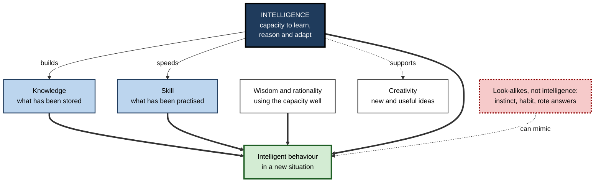
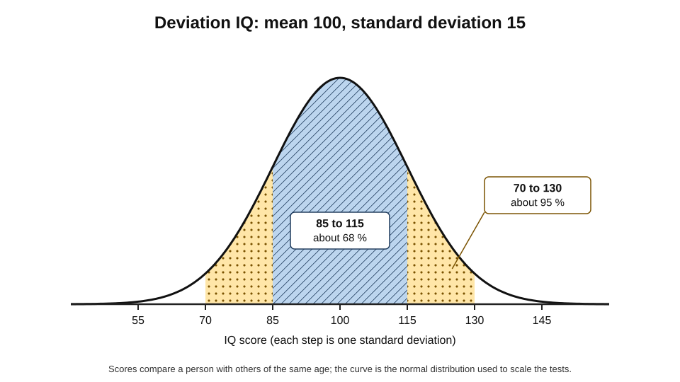
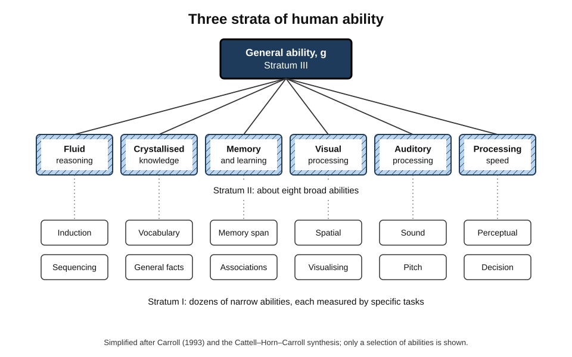
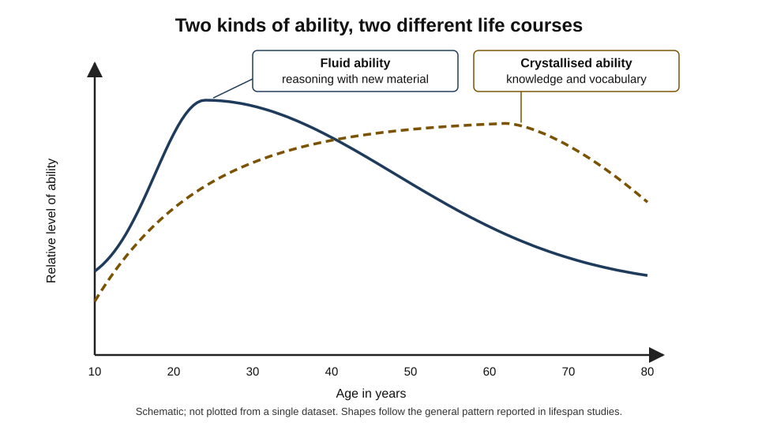
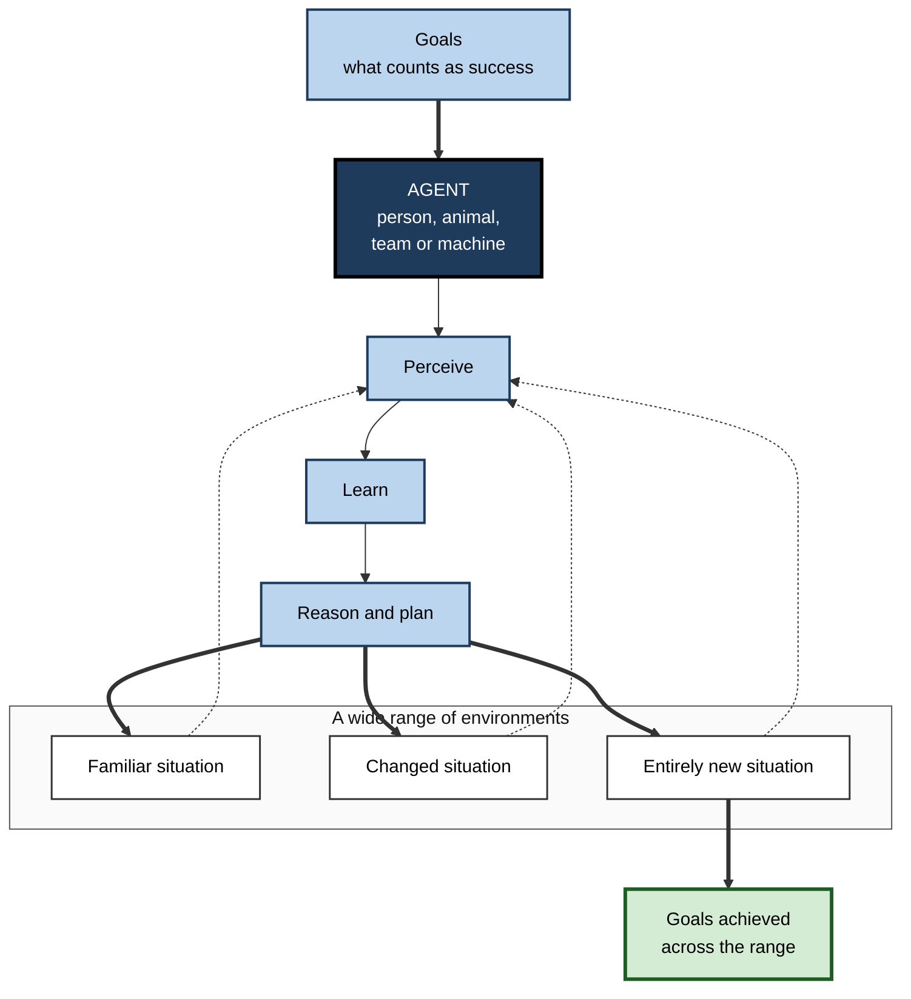
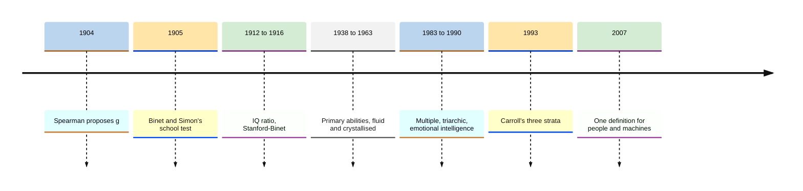

# A.1. What does intelligence mean in everyday life?

A mechanic listens to an engine for ten seconds and names the faulty part. A new graduate masters an unfamiliar database in a week. A nurse notices that a patient who says "I'm fine" is not fine. A crow bends a piece of wire into a hook to lift food out of a tube.

People call all of these **intelligent** — yet they involve hearing, learning, reading people and inventing tools, and they happen in a garage, an office, a ward and a laboratory. The everyday word covers a great deal, and knowing exactly what it covers is the first step towards judging any claim that a machine has it.

> **Definition — Intelligence (working definition):** the general capacity to achieve goals across a wide range of situations — especially new ones — by perceiving what matters, learning from experience, reasoning, and adapting behaviour accordingly.

> **Definition — Intelligence (the mainstream psychological statement, 1994):** "a very general mental capability that, among other things, involves the ability to reason, plan, solve problems, think abstractly, comprehend complex ideas, learn quickly and learn from experience" — a statement drafted by Linda Gottfredson and signed by 52 researchers.

**Why the everyday meaning matters**

- **It is the yardstick for machines.** Every claim that software is "intelligent" borrows the human word; the claim can only be judged if the word is understood.
- **It shapes hiring and promotion.** Organisations constantly judge who is "bright", "sharp" or "a quick study" — often on thin and biased evidence.
- **It shapes self-belief.** Whether people think intelligence is fixed or can grow affects how they respond to difficulty.
- **It has a dark history.** Narrow and careless ideas of intelligence have been used to exclude, rank and harm people; a careful understanding guards against repeating that.

---

## The Word and Its Senses

### Where the word comes from

- **Latin *intellegere*** — "to understand", built from *inter* (between) and *legere* (to choose, to read).
  - The root image is **choosing between**: telling what matters from what does not.
- **Through French into English** by the fourteenth century, meaning understanding or the faculty of understanding.

### Three everyday senses

- **A capacity of a mind** — "she is very intelligent".
  - The sense used in psychology and in artificial intelligence.
- **Information gathered about others** — "military intelligence", "business intelligence", "market intelligence".
  - A body of knowledge, not a capacity; a spreadsheet of competitor prices is *intelligence* in this sense but is not *intelligent*.
- **Designed responsiveness in products** — "intelligent lighting", "smart thermostat".
  - Often a marketing word for something that merely reacts to a sensor or a schedule.

> **Watch out:** the three senses are routinely blurred. A "business intelligence platform" is a reporting tool; a "smart" kettle may simply switch off when it boils. Neither label says anything about learning, reasoning or adapting.

### Words people use instead

- **Clever, bright, sharp** — quickness in reasoning and learning.
- **Wise, sensible, shrewd** — sound judgement about what to do, especially about people and consequences.
- **Street-smart, savvy** — practical know-how in a specific social world.
- **Gifted, talented** — unusual ability, often in one domain such as music or mathematics.
- **Knowledgeable, well-read** — possessing a large store of information.
- **Creative, inventive** — producing ideas or solutions that are both new and useful.

> **Key point:** everyday speech already separates *quickness*, *judgement*, *practical know-how*, *knowledge* and *creativity*. A careful account of intelligence keeps those distinctions instead of collapsing them into one word.

---

## What People Think Intelligence Is

### Implicit theories

> **Definition — Implicit theory of intelligence:** the informal, often unspoken beliefs that ordinary people hold about what intelligence is and how it shows itself.

**Study card — Sternberg, Conway, Ketron and Bernstein (1981)**

- **Design:** people in a train station, a supermarket and a university library, together with intelligence researchers, listed behaviours typical of an intelligent person; other participants then rated how characteristic each behaviour was.
- **Results:** lay ratings clustered into three broad factors:
  - **practical problem-solving ability** — "reasons logically", "sees all sides of a problem", "makes good decisions";
  - **verbal ability** — "speaks clearly", "reads widely", "converses well";
  - **social competence** — "admits mistakes", "accepts others for what they are", "shows interest in the world".
- **Conclusion:** ordinary people hold a coherent, rich conception — and it gives more weight to **social competence** than most tests do.

### Intelligence across cultures

- **Social responsibility as intelligence.**
  - Research in several rural African communities — for example Robert Serpell's work in Zambia in the 1970s — found that local words translated as "intelligent" included **reliability, cooperativeness and responsibility towards others**, not only quickness.
- **Knowing when to show it.**
  - Studies of Taiwanese Chinese conceptions in the 1990s found that people valued **interpersonal and intrapersonal understanding** and a sense of when to display or withhold one's ability.
- **Speed is not universal.**
  - Many Western conceptions prize *fast* thinking; in other traditions careful, deliberate thought is the mark of an able mind.

> **Watch out:** a test or a hiring rubric built on one culture's conception can mistake *unfamiliarity* for *lack of ability*. A candidate who answers slowly and carefully may be judged less "sharp" by a panel that equates speed with intelligence.

### Fixed or growable?

- **Entity belief** — intelligence is a fixed quantity a person either has or lacks.
- **Incremental belief** — intelligence can be developed through effort and good strategies.
- **Carol Dweck's research programme (from the 1980s)** linked incremental beliefs ("growth mindset") to persistence after failure.
  - **Contested scale:** large studies and meta-analyses since about 2018 find the effects of mindset interventions on achievement to be **small on average**, larger for some struggling students and near zero for many others.

> **Watch out:** "growth mindset" is often oversold as a cure-all. The defensible claim is modest: believing ability can grow helps some people persist; it does not by itself raise ability.

---

## Telling Intelligence Apart From Its Neighbours

Intelligence is often confused with the things it helps produce. Separating them makes clear what an intelligent system — human or machine — must actually have.

| | Intelligence | Knowledge | Skill | Wisdom |
|---|---|---|---|---|
| What it is | A general capacity to learn, reason and adapt | Stored information and understanding | Fluent, practised performance in a domain | Sound judgement about how to live and act |
| How it is gained | Partly innate, shaped by environment and schooling | Study, experience, instruction | Repeated practice with feedback | Long experience, reflection, values |
| Tested by | Novel problems | Questions about content | Timed performance on real tasks | Advice on hard, value-laden dilemmas |
| Can exist without the others? | Yes — a bright novice | Yes — a well-read but impractical person | Yes — an expert typist | Rarely without some knowledge |

### Intelligence is not the same as…

- **Knowledge** — a quiz champion may know thousands of facts yet struggle with a new kind of problem.
  - *e.g.* a lawyer who has memorised case law still needs reasoning to apply it to a novel dispute.
- **Skill** — an experienced typist types fast; that is practice, not intelligence.
- **Education** — schooling raises measured intelligence somewhat, but qualifications are proxies, not measures.
- **Rationality** — Keith Stanovich has shown that people of high measured intelligence still fall for many reasoning biases; he calls the gap **dysrationalia**.
- **Wisdom** — knowing what is worth doing, for whom, and at what cost.
- **Creativity** — related to intelligence up to a point, then increasingly separate.
- **Consciousness** — being aware and having experiences; a separate question entirely.

> **Remember:** intelligence is a **capacity**; knowledge and skill are **products** of using it; wisdom and rationality are about **using it well**.

### Clever-looking behaviour that is not intelligence

- **Instinct** — complex, fixed behaviour triggered by a stimulus.
  - The digger wasp *Sphex* drags a paralysed cricket to its burrow, leaves it at the entrance, and inspects the burrow first. In classic accounts, if an observer moves the cricket a few centimetres, the wasp drags it back and inspects the burrow **again** — dozens of times.
  - The behaviour looks purposeful but does not adapt to the change.
- **Habit** — a learned routine that runs without thought.
- **Rote response** — a memorised answer reproduced without understanding.

> **Watch out:** later field studies found that *Sphex* wasps do eventually abandon the loop in many cases, so the textbook story is exaggerated. The general point survives: behaviour that **looks** intelligent may be rigid underneath. The word "sphexish" is now used for exactly this — a quality worth looking for in machines.

**Figure 1.** Intelligence and the capacities most often confused with it.

---

## How Science Has Described Intelligence

### The testing tradition

- **Alfred Binet and Théodore Simon (1905)** — built the first practical test to identify Paris schoolchildren who needed extra help.
  - Binet insisted the score was a practical tool, not a measure of a fixed inborn quantity.
- **William Stern (1912)** — proposed the **intelligence quotient**: mental age divided by chronological age, times 100.
- **Lewis Terman (1916)** — adapted Binet's test as the Stanford–Binet and promoted mass testing in the United States.
- **David Wechsler (from 1939)** — built the most widely used adult and child scales and defined intelligence as "the aggregate or global capacity of the individual to act purposefully, to think rationally, and to deal effectively with his environment".
- **Modern IQ scores** are no longer ratios; they compare a person with others of the same age.

> **Formula — Deviation IQ:** IQ = 100 + 15 × z, where z is how many standard deviations a person's score lies above or below the mean for their age group. Example: a score 1.2 standard deviations above the mean → 100 + 15 × 1.2 = **118**.

**Figure 2.** How modern IQ scores are spread across a population.

### One ability or many?

- **Charles Spearman (1904)** — noticed that children who did well on one kind of school test tended to do well on others.
  - He proposed a **general factor, *g***, shared by all mental tasks, plus specific factors for each task.
- **Louis Thurstone (1938)** — argued for about seven **primary mental abilities** (verbal comprehension, word fluency, number, space, memory, perceptual speed, reasoning).
  - Later analyses showed that his primary abilities were themselves correlated — so *g* reappeared one level up.
- **Raymond Cattell and John Horn (1940s–1960s)** — split general ability into:
  - **fluid intelligence (Gf)** — reasoning with new material, independent of what one has learned;
  - **crystallised intelligence (Gc)** — knowledge and skills accumulated through experience and culture.
- **John Carroll (1993)** — re-analysed more than 460 datasets from most of the century and proposed **three strata**: *g* at the top, about eight broad abilities in the middle, many narrow abilities at the bottom.
- **The CHC model** (Cattell–Horn–Carroll) — the synthesis used by most modern test designers.

> **Definition — General intelligence (g):** the statistical factor that captures why performance on very different mental tasks is positively correlated.

> **Definition — Fluid intelligence:** the ability to reason and solve new problems without relying on previously learned knowledge.

> **Definition — Crystallised intelligence:** the knowledge, vocabulary and skills acquired through experience and education.

**Figure 3.** The three-stratum picture of human intelligence.

### Fluid and crystallised abilities over a lifetime

- **Fluid abilities** — rise through childhood, peak in the late teens or twenties, then decline slowly.
- **Crystallised abilities** — keep rising well into middle age and decline only late in life.
- **Practical consequence:** a fifty-year-old manager may be slower than a graduate on a novel puzzle yet far better at a problem that draws on accumulated knowledge of people, markets and precedents.

**Figure 4.** Fluid and crystallised abilities across the adult lifespan.

### Broader theories

- **Howard Gardner — multiple intelligences (1983)**
  - Proposed separate intelligences: linguistic, logical-mathematical, spatial, musical, bodily-kinaesthetic, interpersonal, intrapersonal — and later naturalistic (1999).
  - Hugely popular in education.
- **Robert Sternberg — triarchic and "successful" intelligence (1985 onwards)**
  - **Analytical** — evaluating and comparing; what tests mostly measure.
  - **Creative** — coping with novelty.
  - **Practical** — adapting to, shaping and selecting real-world environments; includes **tacit knowledge** about how things really work in a job.
- **Peter Salovey and John Mayer — emotional intelligence (1990)**
  - The ability to perceive, understand, use and manage emotions.
  - Popularised by Daniel Goleman's 1995 book.

> **Watch out:** Gardner's "intelligences" have weak empirical support as separate abilities — measures of most of them correlate with *g*, and teaching to supposed "learning styles" built on them does not improve learning. Popular claims that emotional intelligence "matters more than IQ" for success are **not supported**; ability-based measures of emotional intelligence add modest, real prediction in some roles. These theories are valuable mainly for reminding people that tests capture only part of what matters.

| | General-ability view (*g*, CHC) | Multiple intelligences (Gardner) | Successful intelligence (Sternberg) |
|---|---|---|---|
| Core claim | One general factor plus broad and narrow abilities | Several independent intelligences | Analytical, creative and practical abilities used to achieve one's goals |
| Evidence base | Very strong statistical support across a century | Weak support for independence | Mixed; practical intelligence measures debated |
| Strength | Predicts school and job outcomes well | Widens what counts as talent | Takes real-world adaptation seriously |
| Weakness | Says little about creativity, values or social skill | Hard to measure; overlaps with *g* | Hard to measure separately from *g* |

### Experts disagree on wording, not on the core

**Study card — two symposia, 1921 and 1986**

- **1921:** the *Journal of Educational Psychology* asked leading psychologists to define intelligence; answers ranged from "the ability to carry on abstract thinking" to "the capacity to learn".
- **1986:** Robert Sternberg and Douglas Detterman put the same question to two dozen experts of their day.
- **Results:** wording varied widely, but most answers shared three elements:
  - **higher-level thinking** — abstract reasoning, problem-solving;
  - **learning** — acquiring new knowledge and skill;
  - **adaptation** — meeting the demands of the environment.
- **Conclusion:** the core of the concept is stable even when its boundaries are argued over.

### Distilling the definitions

**Study card — Shane Legg and Marcus Hutter (2007)**

- **Method:** collected about seventy definitions of intelligence from psychologists, dictionaries and artificial-intelligence researchers.
- **Common features:** intelligence is a property of an **agent** interacting with an **environment**; it concerns the ability to **succeed with respect to goals**; and it depends on how well the agent **adapts** to different goals and environments.
- **Their synthesis:** "Intelligence measures an agent's ability to achieve goals in a wide range of environments."
- **Why it matters:** the definition is neutral about *what* the agent is — a person, an animal, a team or a machine.

**Figure 5.** The common core of definitions of intelligence: an agent pursuing goals across many environments.

> **Key point:** the more *varied and unfamiliar* the situations in which an agent succeeds, the more intelligent it is. Succeeding brilliantly in one narrow, familiar setting is **competence**, not necessarily intelligence.

---

## Measuring Intelligence and Its Limits

### What tests do well

- **Reliability** — well-constructed IQ tests give similar scores on retesting.
- **Prediction** — scores predict school results, job training success and some health and life outcomes better than most other single measures.
- **Breadth** — modern batteries sample reasoning, vocabulary, memory, processing speed and spatial ability.

**Study card — general mental ability and job performance**

- **Frank Schmidt and John Hunter (1998):** a meta-analysis of decades of personnel research concluded that **general mental ability** was the single best predictor of job performance, especially in complex jobs.
- **Paul Sackett and colleagues (2022):** re-examined the statistical corrections behind those estimates and concluded they had been **overstated**; in their revised ranking, structured interviews and job-knowledge tests predicted at least as well, and ability remained a useful but **moderate** predictor.
- **Status:** the size of the relationship is **contested**; that measured ability predicts performance to some degree is not.

> **Watch out:** a moderate correlation leaves a great deal unexplained. Many people with average scores outperform many with high scores, because experience, conscientiousness, motivation, health and opportunity also matter.

### What scores move with

- **The Flynn effect** — James Flynn documented in the 1980s that average raw scores on IQ tests rose substantially across the twentieth century in many countries — roughly three points per decade — far too fast for genetic change.
  - Likely causes: more and longer schooling, better nutrition and health, smaller families, and more abstract everyday environments.
  - **Reversal:** since the 1990s, scores have stalled or fallen in some countries, including Norway, Denmark and Finland; a 2018 Norwegian study of brothers found the decline **within families**, pointing to environmental causes.
- **Schooling** — each additional year of education raises measured intelligence by a few points, according to a 2018 meta-analysis of natural experiments.
- **Genes and environment** — both contribute; heritability estimates rise with age, but heritability describes variation **in a population**, not how fixed any individual's ability is.

> **Remember:** a measured score is a **snapshot** of performance on particular tasks, under particular conditions, compared with a particular group.

### What tests miss

- **Practical and tacit knowledge** — knowing how things really get done in a particular workplace.
- **Social and emotional judgement** — reading situations and people.
- **Creativity and originality** — tests have right answers; real problems often do not.
- **Character** — persistence, honesty, care.
- **Wisdom** — what is worth doing.

### A dark history

- **Eugenics** — in the early twentieth century, test scores were used to argue for sterilisation laws in the United States and elsewhere and to justify the 1924 US immigration restrictions.
- **Army Alpha and Beta tests (1917–18)** — given to about 1.75 million US recruits; results heavily influenced by schooling and familiarity with American culture were read as innate differences between groups.
- **Lesson:** a measure of something real can still be misread, misused and turned against people.

> **Watch out:** differences in **average** scores between groups say nothing about any individual and are strongly shaped by schooling, language, wealth and test familiarity. Using intelligence scores to rank groups of people is both scientifically unsound and ethically indefensible.

**Figure 6.** Milestones in the scientific idea of intelligence.

---

## Intelligence Beyond the Individual Human

### Animal minds

- **New Caledonian crows** — in a 2002 Oxford study, a crow named Betty bent a straight wire into a hook to lift a basket of food from a tube, a solution she had not been shown.
- **Chimpanzees** — Jane Goodall observed in 1960 that chimpanzees strip twigs to fish termites from mounds, overturning the belief that only humans made tools.
- **Octopuses** — solve puzzles, open jars and learn by watching, with a nervous system organised very differently from a vertebrate's.
- **Honeybees** — communicate the direction and distance of food through the waggle dance, decoded by Karl von Frisch.

> **Key point:** intelligence has evolved many times in very different bodies and brains. There is no single blueprint for it — a lesson that matters when people ask whether something as unlike a brain as a computer could have it.

### Groups and organisations

- **Collective intelligence** — a group solving problems better than its members could alone.
  - *e.g.* open-source software communities; the pooled judgement of a well-run forecasting team.
- **Study — Anita Woolley and colleagues (2010):** reported a general "collective intelligence" factor for small groups, linked less to members' average intelligence than to social sensitivity and equal turn-taking.
  - **Status:** later re-analyses and replications produced **mixed** results; the existence and strength of a single group factor is debated.
- **Organisational intelligence** — the capacity of an organisation to sense change, learn and adapt its routines.

### Distributed and extended intelligence

- **People think with tools** — notebooks, calculators, maps and software extend what an individual can do.
- **Expert performance** often depends on the environment: checklists, colleagues and instruments carry part of the intelligence.
  - *e.g.* a ship's navigation team works as a combined system of people and instruments, as the cognitive scientist Edwin Hutchins showed in his study of navy navigation in the 1990s.

---

## Intelligence at Work

### How intelligence shows in daily professional life

- **Learning quickly** — getting up to speed on a new client, product or regulation.
- **Handling novelty** — coping when the usual procedure does not fit.
  - *e.g.* an IT engineer diagnosing an outage with symptoms never seen before.
- **Seeing the real problem** — asking the question behind the question.
  - *e.g.* a consultant realising that a "pricing problem" is really a sales-incentive problem.
- **Judging people and situations** — knowing when to push and when to wait.
- **Transferring ideas** — applying a solution from one field to another.
  - *e.g.* hospital teams borrowing checklists and briefings from aviation.
- **Knowing the limits of one's knowledge** — recognising when to check or ask.

> **In practice:** the most useful everyday signs of intelligence at work are **speed of learning**, **quality of questions** and **performance on unfamiliar problems** — not fluency in jargon, confidence or speed of speech.

### Intelligence is not the same as success

- **Lewis Terman's longitudinal study (from 1921)** followed about 1,500 California children with very high scores.
  - Many did well, but outcomes varied widely and depended on family, education, personality and the era's opportunities.
  - Two boys tested and **not** selected — William Shockley and Luis Alvarez — later won Nobel prizes in physics; no member of the selected group did.
- **Expertise requires years of practice** in a domain; intelligence speeds learning but does not replace it.

### Worked example (illustrative): which behaviour shows intelligence?

A team lead must decide which of three new analysts shows the strongest *general* ability, using a week of observations.

| | Analyst 1 | Analyst 2 | Analyst 3 |
|---|---|---|---|
| Routine weekly report | Fastest and flawless — has built similar reports for years | Average speed, minor errors | Slow, several errors |
| Unfamiliar data-quality problem | Repeats the usual cleaning steps; problem persists | Notices the problem lies in an upstream system; proposes a fix | Asks good questions but does not resolve it |
| New tool introduced on Wednesday | Uses it as shown | Uses it, then finds a faster method | Still learning it on Friday |

*Illustrative figures and observations.*

1. **Separate skill from capacity.** Analyst 1's speed on the routine report reflects **practice and knowledge** — valuable, but not evidence of general ability.
2. **Look at novelty.** Only Analyst 2 succeeded on the unfamiliar problem.
3. **Look at learning rate.** Analyst 2 also learned the new tool fastest and improved on it.
4. **Conclusion:** Analyst 2 shows the strongest evidence of **intelligence** in the general sense; Analyst 1 shows the strongest **current competence** in the routine task.

> **Watch out:** one week is a small sample, and anxiety, unfamiliarity with the domain or a poor first impression can depress anyone's performance. The method — weighting performance on *new* problems and *speed of learning* — is sound; the verdict should stay provisional.

### Case study: the cult of brilliance at Enron

- **Situation:** in the 1990s the US energy firm Enron recruited aggressively from elite universities and prized raw intellectual brilliance above almost everything else.
- **Practice:**
  - a forced-ranking performance system graded employees against one another and removed those at the bottom;
  - star performers were moved rapidly into new roles and given wide latitude;
  - executives described the firm, approvingly, as full of the smartest people in the industry.
- **What went wrong:**
  - judgement, integrity and experience counted for less than visible cleverness;
  - complex financial structures, understood by few, concealed losses and debt;
  - challenge from inside was discouraged by a culture that equated doubt with lack of intelligence.
- **Result:** Enron filed for bankruptcy in December 2001, then the largest corporate bankruptcy in US history; several senior executives were later convicted of crimes.
- **Commentary:** the writer Malcolm Gladwell argued in 2002 that Enron illustrated the danger of believing that an organisation's success comes from the intelligence of its stars rather than from its systems.
- **Lesson:** an organisation that defines intelligence as **cleverness alone** — without judgement, honesty and learning from error — can be both very bright and very foolish.

---

## From Everyday Intelligence to Machine Intelligence

- **The everyday concept already contains the test.** Learning, reasoning and above all **adapting to the new** are what people mean when they call each other intelligent.
- **The same tests apply to machines.** A system that excels at one fixed task but fails when the situation shifts shows competence, not general intelligence.
- **Human intelligence is a bundle.** Machines may match people on some strands — calculation, memory, pattern recognition in images — while lacking others entirely, such as common sense about the physical world or social judgement.

> **Key point:** asking "is it intelligent?" about any system is really several questions — **can it learn, can it reason, can it cope with the unfamiliar, and across how wide a range?**

---

## Open Questions

- **Is there one intelligence or many?**
  - The statistical case for *g* is strong, but whether *g* reflects one underlying brain property or the overlap of many separate processes is unresolved.
- **Why did the Flynn effect reverse?**
  - Environmental causes are implicated, but which ones — schooling, reading habits, media, test motivation — is debated.
- **How should practical and social intelligence be measured?**
  - They matter at work, yet reliable measures independent of *g* remain elusive.
- **Is collective intelligence a real general factor?**
  - Early findings have not replicated consistently.
- **Can a single definition fit humans, animals and machines?**
  - Goal-and-environment definitions are neutral about the agent, but they leave out consciousness, values and understanding — which many people regard as part of what the word means.

---

## Summary

- **Intelligence** is the general capacity to achieve goals across a wide range of situations — especially new ones — by learning, reasoning and adapting.
- The word has three everyday senses: a **capacity of mind**, **information gathered**, and **designed responsiveness** in products; only the first is the psychological sense.
- Ordinary people's **implicit theories** emphasise problem-solving, verbal ability and **social competence**; cultures differ, some stressing responsibility and deliberation over speed.
- Intelligence is distinct from **knowledge, skill, education, rationality, wisdom, creativity** and **consciousness**; rigid instinct, habit and rote response can mimic it.
- Science describes a **general factor (g)** above broad abilities such as **fluid** and **crystallised** intelligence (the CHC model); Gardner's and Sternberg's broader theories widen the view but have weaker evidence.
- Tests are reliable and predictive, but the **strength of prediction at work is contested**, scores move with environment (the **Flynn effect**), and testing has a history of misuse.
- Intelligence appears in **animals, groups and human–tool systems**, in many different forms.
- At work, the best signs are **speed of learning, quality of questions and success with the unfamiliar**; cleverness without judgement and integrity can be disastrous.
- The everyday concept supplies the test for machines: **learning, reasoning and adapting across a wide range of situations**.

---

## Self-Check

1. Give the working definition of intelligence and explain why "especially new ones" matters.
2. Name the three everyday senses of the word "intelligence" and give an example of each.
3. What did Sternberg and colleagues (1981) find about lay conceptions of intelligence?
4. How do some non-Western conceptions of intelligence differ from a speed-focused Western one?
5. Distinguish intelligence from knowledge, skill and wisdom with a workplace example of each.
6. What does the digger-wasp story illustrate, and why should it be told with caution?
7. Explain Spearman's *g* and the difference between fluid and crystallised intelligence.
8. A score lies 0.8 standard deviations below the mean for the age group. What is the deviation IQ?
9. Why does the debate between Schmidt and Hunter (1998) and Sackett and colleagues (2022) matter for hiring?
10. What is the Flynn effect, and what does its reversal in some countries suggest?
11. Summarise Legg and Hutter's synthesis and explain why it suits both people and machines.
12. Why is Gardner's theory of multiple intelligences treated with caution by researchers?
13. A manager says, "Priya is our most intelligent analyst — she produces the monthly report fastest." Critique the reasoning.
14. What lesson about defining intelligence does the Enron case teach an organisation designing a talent programme?

### Answer Key

1. Intelligence is the general capacity to achieve goals across a wide range of situations by perceiving, learning, reasoning and adapting. "Especially new ones" matters because success in familiar settings can come from practice or memorised routines; coping with novelty is the clearest sign of general capacity.
2. A capacity of mind ("a highly intelligent engineer"); information gathered ("market intelligence on competitors' prices"); designed responsiveness in products ("intelligent lighting" that responds to a sensor).
3. Ordinary people held coherent conceptions clustering into practical problem-solving, verbal ability and social competence — giving social competence more weight than tests do.
4. Some, such as conceptions documented in rural Zambia, include responsibility, cooperativeness and reliability; others value deliberation and knowing when to show ability, rather than speed alone.
5. Intelligence: a new hire quickly working out an unfamiliar process. Knowledge: a colleague who knows every clause of a contract. Skill: a typist's practised speed. Wisdom: a manager judging that a technically correct decision would damage trust and choosing a better course.
6. Behaviour that looks purposeful can be rigid underneath — the wasp repeated its routine when the situation changed. Later field work found many wasps eventually break the loop, so the classic story is exaggerated, though the general point stands.
7. *g* is the statistical factor reflecting the positive correlation of performance across different mental tasks. Fluid intelligence is reasoning with new material; crystallised intelligence is accumulated knowledge and skill. Fluid peaks early; crystallised keeps rising into middle age.
8. 100 + 15 × (−0.8) = 100 − 12 = 88.
9. Hiring practices relied on ability tests as the best predictor; the 2022 re-analysis suggests their advantage was overstated and that structured interviews and job-knowledge tests do at least as well — so ability tests are useful but should not dominate selection.
10. The large rise in average raw IQ scores across the twentieth century. Its reversal, found within families in Norway, suggests that environmental factors drive scores and that measured intelligence is not fixed across generations.
11. "Intelligence measures an agent's ability to achieve goals in a wide range of environments." It refers only to an agent, goals and environments, so it applies equally to a person, an animal, a team or a machine.
12. Measures of most of the proposed intelligences correlate with *g*, their independence is not well supported, and educational practices built on them (such as matching teaching to "learning styles") do not improve learning.
13. Speed on a routine report reflects practice and familiarity, not general ability. Better evidence would be how Priya handles unfamiliar problems, how fast she learns new tools and the quality of her questions — observed over time.
14. Defining talent as cleverness alone is dangerous; a programme should value judgement, integrity, learning from error and willingness to challenge, and should build systems that do not depend on a few "stars".

---

## Glossary

| Term | Meaning |
|---|---|
| CHC model | The Cattell–Horn–Carroll synthesis: *g* above broad abilities above narrow abilities. |
| Collective intelligence | A group's capacity to solve problems better than its members alone. |
| Crystallised intelligence | Knowledge and skills accumulated through experience and education. |
| Deviation IQ | A score expressing how far a person lies from the mean of their age group (mean 100, standard deviation 15). |
| Dysrationalia | Keith Stanovich's term for poor reasoning despite high measured intelligence. |
| Emotional intelligence | The ability to perceive, understand, use and manage emotions. |
| Flynn effect | The large twentieth-century rise in average raw IQ test scores. |
| Fluid intelligence | The ability to reason and solve new problems without relying on learned knowledge. |
| General intelligence (g) | The common factor underlying performance across different mental tasks. |
| Implicit theory | Informal, unspoken beliefs about what a concept such as intelligence means. |
| Instinct | Complex, fixed behaviour triggered by a stimulus and not dependent on learning. |
| Intelligence | The general capacity to achieve goals across a wide range of situations by learning, reasoning and adapting. |
| Intelligence quotient (IQ) | A standardised score of performance on intelligence tests. |
| Multiple intelligences | Howard Gardner's theory of several independent intelligences. |
| Practical intelligence | Ability to adapt to, shape and select real-world environments. |
| Sphexish | Describing behaviour that looks purposeful but is rigid and fails to adapt. |
| Successful intelligence | Sternberg's theory combining analytical, creative and practical abilities. |
| Tacit knowledge | Practical know-how that is rarely stated but guides effective action. |
| Wisdom | Sound judgement about what is worth doing and how, especially in human affairs. |
